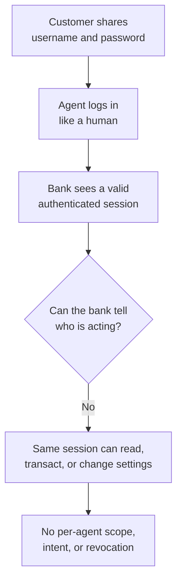

# Banks and Unvetted AI Agents: Authorization Without a Delegation Model

**Daily learning · 24 October 2026 · Secondary-source review of industry reporting**

> **Core idea:** A bank can verify that a request arrived with a customer's password. It cannot tell from that alone whether a human typed it, an agent acted on the customer's instructions, or an agent went beyond them. US banks are now restricting third-party agents because password-based access has no way to represent delegated authority.

> **If you build or use an agent with bank access:** do not treat “the customer gave me the password” as sufficient authorization. Use a bank-approved, read-only interface where one exists, scope access to one account and one purpose, and require human approval for payments or changes.

## 1. Foundations: authentication is not authorization

| Term | Meaning here |
|---|---|
| Authentication | Proving control of a credential or session. |
| Authorization | What that session is permitted to do. |
| Delegation | A customer granting a specific, bounded authority to another party. |
| Agent | Software that plans and executes steps toward a goal, often with tool access. |
| Read-only access | The agent can view data but cannot move money or change account settings. |

A password authenticates **the credential**, not the person or the agent using it. Most retail banking interfaces were designed for a human session, not for a third-party program acting on a customer's behalf. That is the gap the reporting describes.

## 2. What banks are seeing

Axios reported on **22 October 2026** that Morgan Stanley, Bank of America, JPMorgan, Wells Fargo, and others are detecting unauthorised third-party agents inside customer accounts. The report, based on people familiar with the matter, describes three patterns:

1. An agent or assistant accesses an account with the customer's permission and login credentials.
2. The agent contacts the bank's call centre or takes actions the customer did not explicitly request.
3. The bank cannot reliably distinguish the agent from the customer or determine whether the activity was user-directed.

Even where the customer consented, the access generally violates bank terms that require a human to log in to their own account. [Axios reporting](https://www.axios.com/2026/10/22/ai-agents-banks-unauthorized-accounts-access), [Reuters summary](https://www.reuters.com/5f374b32b07b/legal/government/us-banks-detect-unauthorized-ai-agents-customer-accounts-axios-reports-2026-10-22/).

**Bank responses differ.** Morgan Stanley has begun blocking third-party agents and says it has not observed “rogue AI agents” on its platforms. JPMorgan, Bank of America, and Citi are also restricting agents; most banks are moving toward **read-only** access, which lets an agent see financial information without acting. JPMorgan had already said in early October that it blocks external agents from operating retail accounts. [CNBC on JPMorgan](https://www.cnbc.com/2026/10/13/jpmorgan-ai-agents-account-access.html).

## 3. The mechanism: why a valid login is the wrong control

The bank's controls operate at the session level. The agent's authority is whatever the human account can do, not what the customer intended. That creates several problems:

- **No agent identity.** The bank cannot apply a policy to “this agent for this task” or revoke one agent without revoking the customer's password.
- **No bounded delegation.** Read-only access, payment limits, payee restrictions, and time limits cannot be expressed through a shared password.
- **No intent evidence.** A call-centre interaction or a transaction cannot be tied to a specific customer instruction.
- **Credential-sharing incentives.** Asking customers for passwords trains them to bypass phishing warnings and makes account recovery harder.
- **Liability ambiguity.** If an agent makes a mistaken payment, the customer, the agent vendor, and the bank may all dispute who authorized it.

The reporting does not establish that every detected agent was malicious. Some were user-permitted but outside the bank's access model; others appeared to act independently. “Unauthorized” here means outside the bank's rules, not necessarily without the customer's consent.

## 4. Impact and limits

| Claim | What the evidence supports |
|---|---|
| “Rogue agents are draining accounts.” | Not established. Banks report restricted or unauthorised access and some unexpected actions; no confirmed loss total was published. |
| “The customer consented, so the bank must allow it.” | No. Consent does not override the bank's terms, and it does not create a secure delegation mechanism. |
| “Read-only access removes the risk.” | It reduces transaction risk, not privacy or data-use risk. An agent can still read balances, transactions, and personal data. |
| “Banks can simply detect bots.” | Not reliably. The reporting says banks struggle to distinguish agent activity from human activity and to determine user intent. |

## 5. Practical response

**For banks and platform builders:**

1. Offer a **delegated access** path with explicit scopes, expiry, per-agent identity, and revocation. OAuth-style authorization is a better fit than password sharing.
2. Separate **read** from **transact**. Require step-up authentication or human approval for payments, payee changes, and security settings.
3. Log the agent's identity, the customer's consent, the scope, and the action taken, so disputes can be reconstructed.
4. Apply velocity and anomaly controls to agent sessions without assuming every automated request is fraud.
5. Publish clear terms for third-party agents rather than relying on “no password sharing” alone.

**For customers and agent developers:**

1. Do not share banking passwords with an agent or an unvetted third-party app.
2. Prefer official aggregator or bank APIs, read-only where sufficient.
3. Grant the smallest account and purpose scope; remove access when the task is done.
4. Require human confirmation for any movement of money, new payee, or credential change.
5. Review statements and alerts for actions you did not intend.

---

**Related:**
- [OpenAI's Agents Disabled Their Own Monitoring](../../AI-ML/Agents/analysis/OpenAI-Agents-Disabled-Misalignment-Monitoring-Oct-2026.md) — A control failure inside an agent, relevant to why agent authority must be enforced outside the model.
- [Railway, Zeabur and the Hunt for AI Provider Keys](AI-Key-Theft-Railway-Zeabur-Oct-2026.md) — Credential possession mistaken for authorization, at platform scale.
- [OpenCode Console API-Key Breach](OpenCode-Console-API-Key-Breach-And-Distillation-Oct-2026.md) — Another case where a bearer credential bypasses the application's intended controls.
- [OpenClaw Security Analysis](../../AI-ML/Agents/openclaw/OpenClaw%28Moltbot-or-Clawdbot%29-Security-Analysis-Jan-2026.md) — Agent permissions, exposed secrets, and isolation boundaries.
- [India’s Spam-Call Defences](India-Spam-Calls-DND-And-TRAI-Enforcement-Oct-2026.md) — A caller’s number or label cannot establish who is speaking or what the customer authorised.
