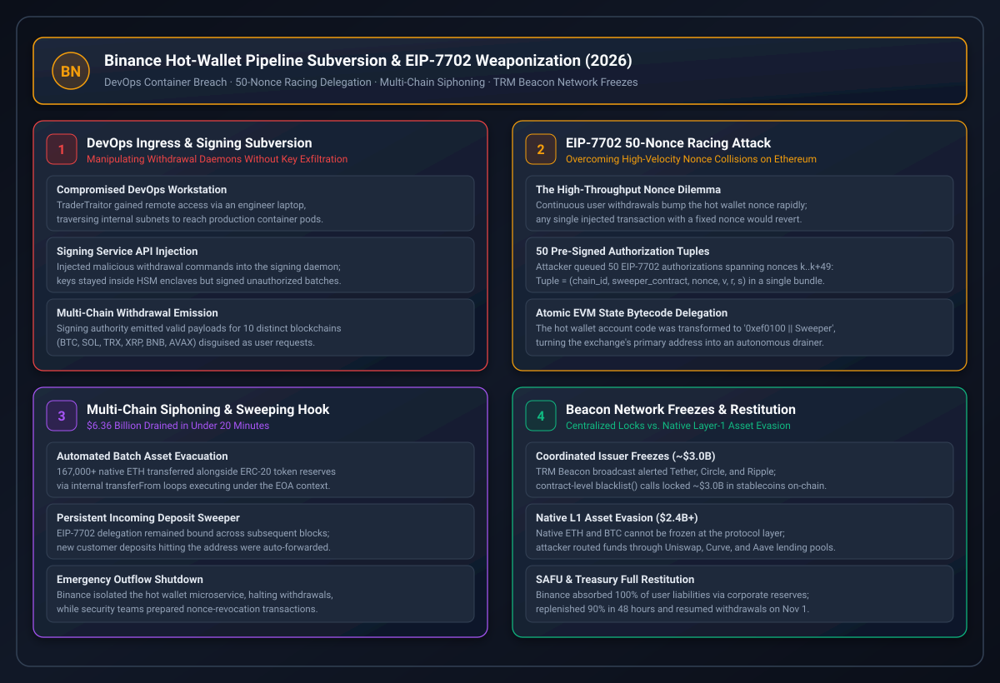
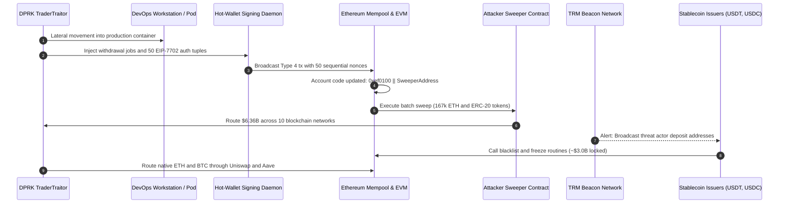

# Binance: $6.36 Billion Hot-Wallet Theft, EIP-7702 Exploitation, and the TRM Labs Investigation

**Daily learning · 1 November 2026 · Primary-source review · Phased recovery ongoing**  
*By Srinivasan Ragothaman ([@rsrini7](https://github.com/rsrini7))*

> **Core idea:** On 29 October 2026, North Korea-linked cybercrime unit TraderTraitor siphoned approximately $6.36 billion across ten blockchains from Binance hot wallets in under 20 minutes by compromising internal signing infrastructure via a DevOps container rather than extracting private keys. On Ethereum, the attacker used 50 pre-signed EIP-7702 authorizations to convert the hot wallet into an automated sweeper contract; emergency issuer freezes secured roughly $3 billion, while Binance replenished 90% of assets from corporate reserves and began phased withdrawal resumption on 1 November. [TRM Labs Binance Heist Analysis](https://www.trmlabs.com/resources/blog/binance-heist-investigation), [Binance Incident Recovery Update #3](https://www.binance.com/en/support/announcement/incident-recovery-update-3).

---

## 1. Foundations: why hot wallets and signing pipelines matter

Centralized cryptocurrency exchanges operate dual accounting systems: an off-chain ledger that records customer balances and order-book matches in high-performance transactional databases, and on-chain addresses that interface directly with public blockchains for customer deposits and withdrawals.

### Hot Wallets vs. Cold Storage
* **Cold Storage Vaults:** Highly protected, air-gapped cryptographic vaults (frequently utilizing multi-signature schemes or Multi-Party Computation with strict manual threshold approvals). These custody 90% to 95% of customer deposits entirely offline.
* **Hot Wallets:** Online, internet-connected operational wallets that maintain working liquidity to settle automated user withdrawal requests continuously without manual human intervention for each individual transaction.

### Automated Transaction-Signing Pipelines
To process customer withdrawals at scale, exchanges run automated microservice pipelines:
1. Web and API gateways validate user balances and anti-fraud velocity limits.
2. Approved withdrawal jobs are queued and formatted into raw blockchain transactions.
3. A backend **signing microservice** interacts with a Hardware Security Module (HSM) or secure enclave to affix the exchange's cryptographic signature.
4. The signed transaction is broadcast to the peer-to-peer mempool of the target network.

In this incident, the threat actor did not breach cold vaults or compromise master private keys. Instead, they compromised a DevOps staging environment, accessed internal service pods, and instructed the hot-wallet signing daemon to sign malicious batches directly.

| Party | Role and effect in this incident |
|---|---|
| **Binance** | World's largest cryptocurrency exchange; experienced an unauthorized drain of ~$6.36B across 10 blockchains from hot wallets; suspended withdrawals, covered 100% of user liabilities via corporate treasury and SAFU reserves, replenished 90% within 48 hours, and began phased withdrawal resumption on 1 November. |
| **TRM Labs** | Blockchain intelligence and financial crime investigation firm; attributed the heist to TraderTraitor with high confidence; broadcast real-time threat telemetry via the Beacon Network to coordinate stablecoin issuer blacklisting. |
| **TraderTraitor (DPRK)** | State-sponsored cybercrime unit (linked to North Korea's Reconnaissance General Bureau / Lazarus ecosystem); breached a DevOps development container, subverted Binance's hot-wallet signing daemon, weaponized EIP-7702 sweeper logic, and routed funds across DEX protocols. |
| **Centralized Asset Issuers (Tether, Circle, Ripple)** | Responded to Beacon Network alerts by triggering `blacklist()` and `freeze()` functions in USDT, USDC, and RLUSD smart contracts, successfully freezing roughly $2.7B to $3.0B on-chain. |
| **Exchange Customers** | Faced temporary withdrawal freezes while deposits remained open; shielded from financial haircuts by Binance corporate treasury and SAFU insurance reserves. |

| Term | Meaning in this incident |
|---|---|
| **Hot Wallet** | An online blockchain wallet used by an exchange to process outgoing customer withdrawals automatically. |
| **Signing Pipeline** | The off-chain microservice architecture that validates withdrawal requests and triggers cryptographic signing. |
| **EIP-7702** | An Ethereum standard enabling standard Externally Owned Accounts (EOAs) to temporarily execute smart contract bytecode via signed authorization tuples. |
| **Sweeper Contract** | A smart contract program deployed on-chain designed to transfer all current and subsequent token balances to an attacker address. |
| **Nonce Racing** | The technique of pre-signing multiple sequential transaction counters (nonces) to guarantee inclusion against a high-frequency wallet. |
| **Beacon Network** | TRM Labs' institutional communication network enabling real-time alerting and cross-organization freezing between exchanges and asset issuers. |
| **Proof of Reserves (PoR)** | A cryptographic audit snapshot allowing external verification that an exchange's on-chain holdings fully back customer liabilities. |
| **SAFU Fund** | Binance's Secure Asset Fund for Users, an emergency insurance reserve established in 2018. |

---

## 2. Deep Technical Mechanism: DevOps Breach & EIP-7702 Weaponization

The Binance intrusion did not rely on cryptographic vulnerabilities in elliptic curve mathematics or leaked master private keys. Instead, it was an **off-chain authorization and signing pipeline failure** paired with sophisticated exploitation of Ethereum's account abstraction primitives.

### Step 1: Initial Ingress via Compromised DevOps Environment
Preliminary postmortem telemetry revealed that the threat actor established initial access via a developer/DevOps engineer's workstation. By moving laterally across internal VPN networks, the attacker reached production container pods (Kubernetes worker nodes) managing the exchange's automated withdrawal orchestration daemon.

### Step 2: Subverting the Signing Microservice Without Key Theft
Binance's signing daemons receive formatted withdrawal payloads over internal gRPC/REST APIs. Because the attacker gained access inside the trusted container boundary:
* The signing authority received commands from what appeared to be an authenticated internal service.
* Across nine blockchains (including Bitcoin, Solana, Tron, XRP Ledger, BNB Chain, and Avalanche), the service emitted standard valid transaction signatures that transferred funds to attacker-controlled staging addresses.
* The HSMs and secure enclaves performed their mathematical signing correctly; the defect was the absence of transactional policy validation (e.g. rate limits, destination whitelisting, and transaction type constraints).

### Step 3: Ethereum Nonce Collision & EIP-7702 50-Nonce Racing
On Ethereum, high-frequency hot wallets continuously issue customer withdrawals. Each outgoing transaction increments the account's sequence counter (**nonce**):

$$n_{t+1} = n_t + 1$$

If an attacker injects a single static transaction with nonce $k$, legitimate withdrawal traffic will rapidly consume nonce $k$, causing the attacker's transaction to revert due to nonce collision.

To overcome this, TraderTraitor leveraged **EIP-7702** (introduced in Ethereum's Pectra upgrade). EIP-7702 defines a new transaction type (`0x04`) that allows an EOA to temporarily delegate its code execution to an implementation smart contract by providing an authorization list:

$$\text{Authorization} = ( \text{chain}_{\text{id}}, \text{address}, \text{nonce}, v, r, s )$$

The attacker instructed the compromised signing daemon to pre-sign **50 consecutive EIP-7702 authorization tuples**, covering sequential nonces $k$ through $k + 49$:
1. **Nonce Monopolization:** The attacker bundled these authorizations into rapid-fire Type 4 transactions. Regardless of which nonce the hot wallet currently occupied in the Ethereum transaction pool, at least one authorization matched the exact current state.
2. **Bytecode Delegation:** The authorization designated an **attacker-deployed sweeper contract** as the code implementation for Binance's primary Ethereum hot wallet (`0x28C6c06298d514Db089934071355E5743bf21d60`).
3. **EVM Account Mutation:** The Ethereum Virtual Machine updated the account state, setting the account code to a 23-byte delegation pointer:

$$\text{Bytecode} = \mathtt{0xef0100} \,\|\, \text{TargetContractAddress}_{20}$$

```
+--------------------------------------------------------------------------+
| EIP-7702 Delegation Mechanism                                            |
|                                                                          |
| 1. Binance EOA Hot Wallet                                                |
|    Address: 0x28C6c06298d514Db089934071355E5743bf21d60                  |
|    Signed: [ Auth(nonce=k), Auth(nonce=k+1), ... Auth(nonce=k+49) ]      |
|                                                                          |
| 2. EVM State Transition                                                  |
|    Code for 0x28C6... set to: [0xef0100 || 0xAttackerContractAddress]   |
|                                                                          |
| 3. Execution Phase                                                       |
|    0x28C6... now executes attacker sweeper logic:                        |
|    - Batch transfer of 167,000+ native ETH                               |
|    - Iterative ERC-20 transferFrom for all held token contracts          |
|    - Automated hook: any incoming deposit immediately forwarded          |
+--------------------------------------------------------------------------+
```

### Step 4: Persistent Sweeping of Incoming Deposits
Once an EOA delegates its execution logic under EIP-7702, that contract delegation remains active until overridden by a new authorization signed with a subsequent nonce.

Because the delegation persisted for several hours before Binance engineers isolated the hot-wallet infrastructure and broadcast a revoking authorization, **new incoming customer deposits hitting the hot wallet were automatically swept into the attacker's staging addresses** immediately upon block inclusion.

### Step 5: The Freezing Race: Centralized Tokens vs. Native Layer-1 Assets
Once funds were evacuated from Binance wallets, the incident became a real-time race between asset issuers and the attacker:
* **Centralized Stablecoin Freezes:** Centralized tokens (USDT, USDC, RLUSD) include administrative freeze functions in their smart contracts (e.g. Tether's `AddedBlackList`, Circle's `Blacklisted`). TRM Labs broadcast malicious addresses over the Beacon Network, enabling issuers to freeze ~$3.0B within hours.
* **Native Layer-1 Evasion:** Native tokens (ETH, BTC, SOL) cannot be frozen at the protocol level. TraderTraitor immediately routed hundreds of millions in native tokens and non-frozen stablecoins through decentralized exchange (DEX) liquidity pools (Uniswap, Curve) and deposited assets into Aave to borrow unfreezeable wrapped tokens.

---

## 3. Architectural Visuals (SVGs & Mermaid)

The following architectural diagram illustrates the end-to-end incident lifecycle: the DevOps ingress, the 50-nonce EIP-7702 delegation, the multi-chain drain, and the real-time freeze race.



*Figure 1: High-level architectural breakdown of the Binance hot-wallet signing subversion, EIP-7702 50-nonce racing delegation on Ethereum, multi-chain asset siphoning, and TRM Beacon Network stablecoin freeze coordination.*

### End-to-End Attack Sequence



---

## 4. Production Implementations & Code Recipes

The following production-ready scripts demonstrate how security teams and on-chain auditors detect EIP-7702 delegations, trace multi-hop fund flows, and enforce signing policy gates.

### Recipe 1: Inspecting and Decoding EIP-7702 Delegations (Python & Web3.py)

This Python script queries an Ethereum JSON-RPC endpoint to determine if an account has been delegated under EIP-7702 (checking for the `0xef0100` prefix) and decodes Type 4 transactions.

```python
#!/usr/bin/env python3
"""
eip7702_auditor.py - Detects active EIP-7702 account code delegations
and parses Type 4 authorization payloads.
"""

import sys
from web3 import Web3

EIP7702_MAGIC_PREFIX = bytes.fromhex("ef0100")

def inspect_account_delegation(rpc_url: str, address: str) -> dict:
    """
    Queries account bytecode to check for active EIP-7702 delegation.
    Returns delegation details if active.
    """
    w3 = Web3(Web3.HTTPProvider(rpc_url))
    if not w3.is_connected():
        raise ConnectionError(f"Failed to connect to RPC: {rpc_url}")

    checksum_address = Web3.to_checksum_address(address)
    code = w3.eth.get_code(checksum_address)

    # Standard EOA has empty code (b'')
    if len(code) == 0:
        return {
            "address": checksum_address,
            "is_delegated": False,
            "account_type": "Standard EOA",
            "implementation": None
        }

    # EIP-7702 delegation bytecode is exactly 23 bytes: 0xef0100 + 20-byte address
    if len(code) == 23 and code.startswith(EIP7702_MAGIC_PREFIX):
        impl_address = Web3.to_checksum_address(code[3:])
        return {
            "address": checksum_address,
            "is_delegated": True,
            "account_type": "EIP-7702 Delegated EOA",
            "implementation": impl_address,
            "magic_bytes": code[:3].hex()
        }

    return {
        "address": checksum_address,
        "is_delegated": False,
        "account_type": "Smart Contract (Standard)",
        "bytecode_size": len(code)
    }

if __name__ == "__main__":
    if len(sys.argv) < 3:
        print("Usage: python3 eip7702_auditor.py <RPC_URL> <TARGET_ADDRESS>")
        sys.exit(1)

    result = inspect_account_delegation(sys.argv[1], sys.argv[2])
    print(f"Audit Target : {result['address']}")
    print(f"Account Type : {result['account_type']}")
    print(f"Is Delegated : {result['is_delegated']}")
    if result["is_delegated"]:
        print(f"Sweeper Impl : {result['implementation']}")
```

### Recipe 2: Hot-Wallet Outflow Velocity Policy Gate (Python)

This snippet demonstrates a zero-trust policy engine middleware deployed in front of the HSM signing daemon to enforce velocity caps and block unauthorized transaction types.

```python
#!/usr/bin/env python3
"""
signing_policy_gate.py - Pre-sign enforcement layer rejecting Type 4 (EIP-7702)
and rate-limiting outgoing withdrawals from hot wallets.
"""

import time
from typing import Dict, Any

class SigningPolicyViolation(Exception):
    """Raised when an outgoing transaction violates HSM security policies."""
    pass

class HotWalletPolicyGate:
    def __init__(self, max_hourly_volume_usd: float, max_tx_value_usd: float):
        self.max_hourly_volume_usd = max_hourly_volume_usd
        self.max_tx_value_usd = max_tx_value_usd
        self.sliding_window = []  # List of (timestamp, value_usd)

    def validate_transaction(self, tx_payload: Dict[str, Any], estimated_usd_val: float):
        now = time.time()
        
        # Rule 1: Strictly reject EIP-7702 Type 4 transactions on hot wallets
        tx_type = tx_payload.get("type", 0)
        if tx_type in (4, "0x4", "0x04") or "authorizationList" in tx_payload:
            raise SigningPolicyViolation(
                "CRITICAL: EIP-7702 Type 4 transaction rejected! "
                "Hot wallets cannot delegate code execution."
            )

        # Rule 2: Single-transaction upper bound check
        if estimated_usd_val > self.max_tx_value_usd:
            raise SigningPolicyViolation(
                f"Value ${estimated_usd_val:,.2f} exceeds single tx cap of ${self.max_tx_value_usd:,.2f}"
            )

        # Rule 3: Sliding window hourly velocity calculation
        one_hour_ago = now - 3600
        self.sliding_window = [item for item in self.sliding_window if item[0] > one_hour_ago]
        current_hourly_sum = sum(val for _, val in self.sliding_window)

        if (current_hourly_sum + estimated_usd_val) > self.max_hourly_volume_usd:
            raise SigningPolicyViolation(
                f"Hourly rate limit exceeded: current ${current_hourly_sum:,.2f} + "
                f"tx ${estimated_usd_val:,.2f} > limit ${self.max_hourly_volume_usd:,.2f}"
            )

        # Register transaction in sliding window
        self.sliding_window.append((now, estimated_usd_val))
        return True
```

---

## 5. Impact, Real-World Edge Cases & Gotchas

The scale of this intrusion—$6.36 billion—makes it roughly four times larger than the February 2025 Bybit theft ($1.5 billion) and the largest cryptocurrency theft recorded.

### Common Claims vs. Technical Realities

| Claim or misconception | Technical reality established as of 1 November 2026 |
|---|---|
| **"EIP-7702 contains a cryptographic vulnerability."** | **False.** EIP-7702 functioned exactly as designed. The protocol delegates code execution when presented with a valid cryptographic signature. The failure occurred in Binance's off-chain signing infrastructure, which signed the delegation payload. The other 9 blockchains were drained using ordinary native signatures with no EIP-7702 involved. [EIP-7702 Specification](https://eips.ethereum.org/EIPS/eip-7702). |
| **"Binance's private keys were stolen."** | **Refuted by investigation.** Binance's internal postmortem and TRM Labs' analysis confirmed that the transaction-signing pipeline itself was commanded to sign transactions. Private keys remained enclosed within their protected HSM environments. [Binance Incident Update #1](https://www.binance.com/en/support/announcement/incident-update-1). |
| **"All $6.36 billion was laundered or lost."** | **False.** Approximately **$2.7B to $3.0B** in centralized stablecoins (USDT, USDC, RLUSD) was frozen on-chain within hours due to rapid collaboration between TRM Labs, Binance, Tether, Circle, and Ripple. |
| **"The attacker cannot move the remaining funds."** | **Partial.** The threat actor successfully retained control of over **$2.4 billion**, primarily in native layer-1 assets (ETH and BTC). Native network tokens cannot be frozen or blacklisted at the protocol level without hard-forking the blockchain. [TRM Labs Forensics Summary](https://www.trmlabs.com/resources/blog/binance-heist-investigation). |
| **"Binance users will take a financial haircut."** | **Refuted by exchange actions.** Binance absorbed 100% of user liabilities from corporate treasury, SAFU reserves, and Futures insurance funds. By 31 October, 90% of stolen asset quantities were replenished, with top liquid assets reaching 100% backing. [Binance Incident Recovery Update #3](https://www.binance.com/en/support/announcement/incident-recovery-update-3). |

### Real-World Architectural Gotchas
1. **Delegation Persistence Across Nonces:** Unlike ephemeral session keys, an EIP-7702 delegation persists in the account state until explicitly overridden. To revoke the sweeper contract, the account holder must sign and broadcast a new authorization pointing to `address(0)` with a strictly higher nonce.
2. **Mempool Nonce Racing:** High-throughput exchange accounts experience high mempool contention. Pre-signing 50 nonces guaranteed that regardless of standard withdrawal transaction ordering, the attacker's authorization was accepted.
3. **Smart Contract Blacklist Asymmetry:** Centralized stablecoins can be frozen instantly via smart contract admin functions, but native assets (ETH, BTC) have no protocol-level freeze capability. Attackers immediately swap stablecoins for native gas tokens via decentralized automated market makers (AMMs) to bypass issuer blacklists.

---

## 6. Practical Adoption Blueprint & Verification Checklist

To secure institutional hot-wallet infrastructure against pipeline subversion and unauthorized delegation, custody operations must implement the following safeguards:

### Institutional Custody Security Checklist
- [ ] **HSM Transaction Type Restrictions:** Configure HSM firmware and MPC signing nodes to reject Type 4 (EIP-7702) transaction signing requests for exchange operational wallets.
- [ ] **Zero-Trust Network Microsegmentation:** Completely isolate withdrawal-signing daemons into an isolated VPC with mutual TLS (mTLS) authentication; no DevOps workstations or developer bastion hosts should have direct network ingress to signing clusters.
- [ ] **Hardware Rate Limiting:** Enforce hard outflow velocity caps (per block, per minute, and per hour) directly within the signing enclave, independent of application-layer logic.
- [ ] **Address Splitting Architecture:** Partition hot-wallet liquidity across dozens of ephemeral operational addresses rather than routing billions through a single high-profile EOA.
- [ ] **On-Chain Code Monitoring:** Deploy real-time node listeners that alert immediately if `eth_getCode` for any exchange address transitions from `0x` to `0xef0100...`.
- [ ] **Emergency Circuit Breakers:** Establish automated RPC front-runners capable of bumping pending nonces with zero-value self-transactions if anomalous withdrawal patterns appear in the mempool.

### Exact Diagnostic Commands

Security teams can audit addresses for EIP-7702 delegation using Foundry's `cast` or standard `curl`:

```bash
# 1. Query the bytecode of an address using cast to verify delegation status
cast code 0x28C6c06298d514Db089934071355E5743bf21d60 --rpc-url https://eth-mainnet.public.blastapi.io

# Standard EOA output:
# 0x

# EIP-7702 delegated output (23 bytes starting with 0xef0100):
# 0xef0100[20-byte implementation contract address]

# 2. Search block transactions for Type 4 (0x04) EIP-7702 transactions
cast block latest --full --json | jq '.transactions[] | select(.type == "0x4" or .type == 4)'

# 3. Check current account nonce via JSON-RPC
curl -s -X POST https://eth-mainnet.public.blastapi.io \
  -H "Content-Type: application/json" \
  -d '{"jsonrpc":"2.0","method":"eth_getTransactionCount","params":["0x28C6c06298d514Db089934071355E5743bf21d60","latest"],"id":1}' | jq .
```

---

## 7. Timeline and Current State

All recorded timestamps are in **UTC**.

| Date & Time (UTC) | Event and technical evidence |
|---|---|
| **29 Oct, ~20:05** | Unauthorized withdrawal transactions begin emitting from Binance hot wallets across ten blockchains. |
| **29 Oct, 20:08** | Ethereum hot wallet executes a Type 4 transaction containing 50 EIP-7702 authorizations, binding the account to the attacker's sweeper contract. |
| **29 Oct, 20:10–20:25** | The bulk of the $6.36 billion drain completes in a 20-minute window; 167,000+ ETH and billions in stablecoins leave exchange wallets. |
| **29 Oct, 20:30** | TRM Labs detects massive anomalous flows and broadcasts threat indicators across the Beacon Network. |
| **29 Oct, 20:45–21:30** | Tether, Circle, Ripple, and Arbitrum Security Council execute emergency blacklist actions, successfully freezing roughly $2.7B to $3.0B in stablecoin tokens. |
| **29 Oct, 21:00** | Binance halts all customer withdrawals across all chains while maintaining deposit functionality; engineers isolate hot-wallet signing clusters. |
| **30 Oct, 04:00** | Binance publishes Incident Update #1, confirming hot-wallet pipeline compromise, verifying zero private key exfiltration, and pledging complete user restitution via SAFU. |
| **30 Oct, 14:00** | TRM Labs, Chainalysis, and US intelligence agencies publish preliminary attribution reports tying on-chain signatures and staging patterns to North Korea's TraderTraitor. |
| **31 Oct, 18:00** | Binance releases Incident Recovery Update #3: confirms 90% of total stolen asset volume replenished, 100% full backing restored for top 10 liquid assets, and launches fresh Proof of Reserves (PoR) audit snapshot. |
| **1 Nov, 06:00** | Binance begins phased reopening of customer withdrawals, starting with high-liquidity networks (BTC, ETH, BSC, TRX, SOL, XRP, AVAX, Arbitrum, Base, Optimism, SUI). |

---

## 8. Primary Sources & References

1. [TRM Labs: Binance Heist Investigation & Beacon Network Telemetry](https://www.trmlabs.com/resources/blog/binance-heist-investigation) — Primary forensic analysis attributing the attack to DPRK's TraderTraitor and documenting real-time issuer freezes.
2. [Binance Support Announcement: Incident Recovery Update #3](https://www.binance.com/en/support/announcement/incident-recovery-update-3) — Official exchange announcement confirming 90% asset replenishment and phased withdrawal reopening.
3. [Binance Support Announcement: Incident Update #1](https://www.binance.com/en/support/announcement/incident-update-1) — Initial postmortem disclosing the hot-wallet signing pipeline compromise and confirming key isolation.
4. [Ethereum Improvement Proposal: EIP-7702 (Set EOA Account Code)](https://eips.ethereum.org/EIPS/eip-7702) — Official protocol specification defining Type 4 transactions and authorization list delegation mechanics.
5. [CISA & FBI: TraderTraitor Cybercrime Group Advisory (AA22-108A)](https://www.cisa.gov/news-events/cybersecurity-advisories/aa22-108a) — Joint US government cybersecurity advisory analyzing DPRK state-sponsored tactics against cryptocurrency infrastructure.
6. [Chainalysis Incident Analysis: Multi-Chain Exchange Theft](https://www.chainalysis.com/blog/binance-october-2026-incident/) — Blockchain intelligence report detailing cross-chain fund tracing, DEX swapping, and lending pool deposits.

---

**Related:**
- [Polymarket: Compromised Monitoring Script](Polymarket-DebugBear-Supply-Chain-Attack-Oct-2026.md) — Another major web3 platform incident where authenticated authority was reused to siphon user assets.
- [OpenCode Console API-Key Breach and Distillation](OpenCode-Console-API-Key-Breach-And-Distillation-Oct-2026.md) — Compare how internal developer credential and environment exposures lead to service-level compromise.
- [LiteLLM 1.107.0 Supply-Chain Compromise](LiteLLM-1.107.0-Supply-Chain-Compromise-Oct-2026.md) — Software dependency and development pipeline tampering targeting sensitive operational environments.
- [PHP2Shell: "Steal My Bitcoin" Challenge](PHP2Shell-Steal-My-Bitcoin-Challenge-Oct-2026.md) — Cryptographic key handling and proof-of-concept exploitation against digital asset security boundaries.
- [Stablecoins Mechanics and Market Structure](../../Blockchain/crypto/StableCoins-Jan-2026.md) — Detailed analysis of centralized stablecoin issuer capabilities, including on-chain blacklists and token freeze controls.
