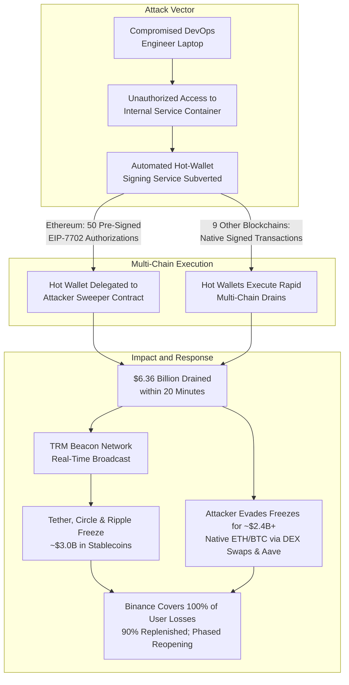

# Binance: $6.36 Billion Hot-Wallet Theft, EIP-7702 Exploitation, and the TRM Labs Investigation

**Daily learning · 1 November 2026 · Primary-source review · Phased recovery ongoing**

> **Core idea:** On 29 October 2026, North Korea-linked cybercrime unit TraderTraitor siphoned approximately $6.36 billion across ten blockchains from Binance hot wallets in under 20 minutes by compromising internal signing infrastructure via a DevOps container rather than extracting private keys. On Ethereum, the attacker used 50 pre-signed EIP-7702 authorizations to convert the hot wallet into an automated sweeper contract; emergency issuer freezes secured roughly $3 billion, while Binance replenished 90% of assets from corporate reserves and began phased withdrawal resumption on 1 November. [TRM Labs Binance Heist Analysis](https://www.trmlabs.com/resources/blog/binance-heist-investigation), [Binance Incident Recovery Update #3](https://www.binance.com/en/support/announcement/incident-recovery-update-3).

---

## 1. Foundations: why hot wallets and signing pipelines matter

**Who is Binance?** Binance operates the world's highest-volume cryptocurrency exchange, facilitating spot, derivatives, and custody services across dozens of blockchain networks. Like other centralized exchanges, Binance maintains an internal off-chain ledger for user trading while using on-chain blockchain addresses for customer deposits and withdrawals. [Binance Exchange Overview](https://www.binance.com/en/about).

**What is a hot wallet versus cold storage?**
* **Cold storage:** Highly secure, air-gapped cryptographic vaults (frequently utilizing multi-signature or multi-party computation with strict manual approval thresholds). These store 90% to 95% of customer deposits offline.
* **Hot wallet:** Internet-connected operational wallets that hold immediate working liquidity to fulfill automated user withdrawal requests round-the-clock without manual human intervention for each transaction.

Centralized exchanges run automated backend services—**transaction-signing pipelines**—that receive approved withdrawal requests from the web platform, format transaction payloads, apply velocity checks, and submit them to a signing microservice. In this incident, the threat actor did not compromise cold storage vaults or steal private keys directly; instead, they subverted the automated signing pipeline controlling the hot wallets.

**Who is TRM Labs?** TRM Labs is a blockchain intelligence and financial crime investigation firm. It tracks illicit cryptocurrency flows, identifies threat actor clusters, and operates the **Beacon Network**—an institutional communications rail enabling real-time alerting and coordinated response between cryptocurrency exchanges, stablecoin issuers, and law enforcement agencies. [TRM Labs Beacon Network Overview](https://www.trmlabs.com/beacon).

**Who is TraderTraitor?** TraderTraitor (also tracked by US agencies as part of North Korea's Reconnaissance General Bureau / Lazarus Group ecosystem) is an elite state-sponsored cyberespionage and cryptocurrency-theft unit. It specializes in targeting decentralized finance (DeFi) protocols, cross-chain bridges, and cryptocurrency exchange infrastructure to fund sanctioned state programs. [CISA/FBI TraderTraitor Advisory](https://www.cisa.gov/news-events/cybersecurity-advisories/aa22-108a).

| Party | Role and effect in this incident |
|---|---|
| **Binance** | Suffered an unauthorized drain of ~$6.36B across 10 blockchains from hot wallets; suspended withdrawals, absorbed all losses via treasury and SAFU reserves, replenished 90% within 48 hours, and began phased withdrawal resumption on 1 November. |
| **TRM Labs** | Led the public blockchain forensics investigation; attributed the heist to TraderTraitor with high confidence; broadcast real-time threat telemetry via the Beacon Network to coordinate blacklisting. |
| **TraderTraitor (DPRK)** | State-sponsored threat group that breached a DevOps development environment, subverted Binance's hot-wallet signing service, deployed EIP-7702 sweeper logic, and attempted multi-chain laundering. |
| **Centralized Asset Issuers (Tether, Circle, Ripple)** | Responded to Beacon Network alerts by blacklisting attacker addresses holding USDT, USDC, and RLUSD, successfully locking roughly $2.7B to $3.0B on-chain. |
| **Binance Traders & Users** | Experienced temporary withdrawal suspensions while deposits remained open; customer balances were shielded from direct financial haircut by Binance's corporate reserves and insurance funds. |

| Term | Meaning in this incident |
|---|---|
| **Hot Wallet** | An online blockchain wallet used by an exchange to process outgoing customer withdrawals automatically. |
| **Signing Pipeline** | The off-chain microservice architecture that validates withdrawal requests and applies cryptographic signatures. |
| **EIP-7702** | An Ethereum standard allowing standard Externally Owned Accounts (EOAs) to temporarily execute smart contract bytecode via a signed authorization. |
| **Sweeper Contract** | A smart contract program designed to transfer all current and subsequent token balances to an attacker-controlled address. |
| **Nonce Racing** | The technique of pre-signing multiple sequential transaction counters (nonces) to guarantee execution against a high-frequency wallet. |
| **Proof of Reserves (PoR)** | A cryptographic audit snapshot allowing external verification that an exchange's on-chain holdings fully back customer liabilities. |
| **SAFU Fund** | Binance's Secure Asset Fund for Users, an emergency emergency insurance reserve established in 2018. |



---

## 2. Mechanism: how the signing pipeline was subverted and EIP-7702 weaponized

The Binance intrusion did not rely on cryptographic flaws in blockchain algorithms or leaked master private keys. Instead, it was an **off-chain authorization and signing pipeline failure** paired with sophisticated execution on Ethereum using new account abstraction primitives.

### Step 1: Initial access via compromised DevOps environment
Preliminary postmortem findings confirmed that the intrusion originated from a compromised developer/DevOps engineer's machine. The attacker established remote access, navigated internal networks, and reached production service containers supporting Binance's hot-wallet management infrastructure.

### Step 2: Subverting the signing microservice without key theft
Binance operates automated signing microservices that sign transactions when given valid internal commands. Rather than attempting to exfiltrate private keys from protected hardware or cryptographic memory spaces, the attacker injected commands directly into the containerized withdrawal pipeline:
* The signing authority treated the attacker's batches as valid automated exchange operations.
* Across nine blockchains (including Bitcoin, Solana, Tron, XRP Ledger, BNB Chain, and Avalanche), the service emitted standard valid transaction signatures that transferred funds to attacker-controlled addresses.

### Step 3: Ethereum execution via EIP-7702 nonce racing
On Ethereum, high-frequency hot wallets process a continuous stream of customer withdrawals, causing the account's transaction sequence number (**nonce**) to increment constantly. If an attacker submits a single transaction with a static nonce, standard exchange activity will bump the nonce first, causing the attacker's transaction to revert.

To bypass this hurdle, TraderTraitor leveraged **EIP-7702**, an Ethereum improvement proposal (implemented in the Pectra upgrade) designed to bring smart contract wallet capabilities to standard Externally Owned Accounts (EOAs). EIP-7702 introduces a new transaction type (`0x04`) that includes an **authorization list** signed by the account owner:

$$\text{Authorization} = ( \text{chain\_id}, \text{address}, \text{nonce}, v, r, s )$$

The attacker instructed Binance's subverted signing service to sign **50 consecutive EIP-7702 authorizations**, covering 50 sequential nonces:
1. By submitting this batch in a single bundle, the attacker ensured that at least one authorization perfectly matched the wallet's current on-chain nonce state regardless of competing customer transactions.
2. The authorization designated an **attacker-deployed sweeper smart contract** as the code implementation for Binance's Ethereum hot wallet.

```
+--------------------------------------------------------------------------+
| EIP-7702 Delegation Mechanism                                            |
|                                                                          |
| 1. Binance EOA Hot Wallet                                                |
|    Address: 0x28C6c06298d514Db089934071355E5743bf21d60                  |
|    Signed: [ Auth(nonce=k), Auth(nonce=k+1), ... Auth(nonce=k+49) ]      |
|                                                                          |
| 2. EVM State Transition                                                  |
|    Code for 0x28C6... set to: [0xef0100 || 0xAttackerContractAddress]   |
|                                                                          |
| 3. Execution Phase                                                       |
|    0x28C6... now executes attacker sweeper logic:                        |
|    - Batch transfer of 167,000+ native ETH                               |
|    - Iterative ERC-20 transferFrom for all held token contracts          |
|    - Automated hook: any incoming deposit immediately forwarded          |
+--------------------------------------------------------------------------+
```

### Step 4: Persistent sweeping of incoming deposits
Once an EOA delegates its execution logic under EIP-7702, that contract delegation remains active until overridden by a new authorization signed with a subsequent nonce. 

Because the delegation persisted for several hours before Binance engineers could isolate the hot wallet and revoke the contract code, **new incoming customer deposits hitting the hot wallet were automatically swept into the attacker's addresses** immediately upon block confirmation.

---

## 3. Impact, limits, and misconceptions

The scale of the incident—$6.36 billion—makes it roughly four times larger than the February 2025 Bybit theft ($1.5 billion) and the largest cyber heist in digital history. However, public discussion generated several technical misconceptions:

| Claim or misconception | Technical reality established as of 1 November 2026 |
|---|---|
| **"EIP-7702 has a security vulnerability."** | **False.** EIP-7702 functioned exactly as designed. The protocol delegates code execution when presented with a valid cryptographic signature. The failure occurred entirely in Binance's off-chain infrastructure, which signed the delegation payload. The other 9 blockchains were drained using ordinary native signatures with no EIP-7702 involved. [EIP-7702 Specification](https://eips.ethereum.org/EIPS/eip-7702). |
| **"Binance's private keys were stolen."** | **Unsubstantiated by evidence.** Binance's internal investigation and TRM Labs' analysis confirmed that the transaction-signing pipeline itself was commanded to sign transactions. Private keys remained enclosed within their host cryptographic environments. [Binance Incident Update #1](https://www.binance.com/en/support/announcement/incident-update-1). |
| **"All $6.36 billion was laundered or lost."** | **False.** Approximately **$2.7B to $3.0B** in centralized stablecoins (USDT, USDC, RLUSD) was frozen on-chain within hours due to rapid collaboration between TRM Labs, Binance, Tether, Circle, and Ripple. |
| **"The attacker cannot touch the remaining funds."** | **Partial.** The threat actor successfully retained control of over **$2.4 billion**, primarily in native layer-1 assets (ETH and BTC). Native network tokens cannot be frozen or blacklisted at the protocol level without hard-forking the blockchain. [TRM Labs Forensics Summary](https://www.trmlabs.com/resources/blog/binance-heist-investigation). |
| **"Binance customers will suffer haircuts."** | **Refuted by platform actions.** Binance committed 100% reimbursement from corporate treasury, SAFU reserves, and Futures insurance funds. By 31 October, 90% of stolen asset quantities were replenished, with top liquid assets reaching 100% backing. [Binance Incident Recovery Update #3](https://www.binance.com/en/support/announcement/incident-recovery-update-3). |

### The Freezing Race: Centralized Tokens vs. Native Layer-1 Assets
A defining feature of this incident was the real-time speed race between the attacker and asset issuers:
* **Centralized Freezes:** Centralized stablecoin smart contracts contain administrative `freeze()` or `blacklist()` functions (e.g., Tether's `AddedBlackList` and Circle's `Blacklisted` events). Once TRM Labs broadcast the recipient addresses, issuers froze nearly $3 billion before the attacker could route them off-chain.
* **Attacker Evasion via DEXs and DeFi:** Anticipating blacklists, TraderTraitor rapidly routed hundreds of millions of USDT/USDC through decentralized liquidity pools (Uniswap, Curve) and OTC market makers to acquire native ETH. Additionally, the attacker deposited stablecoins into decentralized lending protocols like Aave to borrow unfreezable wrapped native tokens.

---

## 4. Timeline and current state

All recorded timestamps are in **UTC**.

| Date & Time (UTC) | Event and technical evidence |
|---|---|
| **29 Oct, ~20:05** | Unauthorized transactions begin emitting from Binance hot wallets across ten blockchains. |
| **29 Oct, 20:08** | Ethereum hot wallet executes Type 4 transaction containing 50 EIP-7702 authorizations, binding the account to the attacker sweeper contract. |
| **29 Oct, 20:10–20:25** | The bulk of the $6.36 billion drain completes in a high-velocity 20-minute window; 167,000+ ETH and billions in stablecoins leave exchange wallets. |
| **29 Oct, 20:30** | TRM Labs detects massive anomalous flows and broadcasts threat indicators across the Beacon Network. |
| **29 Oct, 20:45–21:30** | Tether, Circle, Ripple, and Arbitrum Security Council execute emergency blacklist actions, successfully freezing roughly $2.7B to $3.0B in stablecoin tokens. |
| **29 Oct, 21:00** | Binance officially halts all withdrawal operations across all chains while maintaining deposit functionality; engineers isolate hot wallet signing services. |
| **30 Oct, 04:00** | Binance publishes Incident Update #1, confirming hot-wallet pipeline compromise, verifying zero private key exfiltration, and pledging complete user restitution via SAFU. |
| **30 Oct, 14:00** | TRM Labs, Chainalysis, and US intelligence agencies publish preliminary attribution reports tying on-chain signatures and staging patterns to North Korea's TraderTraitor. |
| **31 Oct, 18:00** | Binance releases Incident Recovery Update #3: confirms 90% of total stolen asset volume replenished, 100% full backing restored for top 10 liquid assets, and launches fresh Proof of Reserves (PoR) audit snapshot. |
| **1 Nov, 06:00** | Binance begins phased reopening of customer withdrawals, starting with high-liquidity networks (BTC, ETH, BSC, TRX, SOL, XRP, AVAX, Arbitrum, Base, Optimism, SUI). |

Sources: [Binance Support Announcement Archive](https://www.binance.com/en/support/announcement/incident-recovery-update-3), [TRM Labs Threat Disclosures](https://www.trmlabs.com/resources/blog/binance-heist-investigation), [Chainalysis Incident Analysis](https://www.chainalysis.com/blog/binance-october-2026-incident/).

---

## 5. Practical response and institutional lessons

### For cryptocurrency exchanges and custody platforms
1. **Segregation of Signing Infrastructure from Development Environments:** Zero-trust architecture must strictly isolate withdrawal-signing clusters. No container, staging environment, or VPN reachable by DevOps workstations should possess network ingress to signing daemons.
2. **Hardware Security Module (HSM) Policy Engines:** Signing microservices must not sign arbitrary transaction formats. HSM firmware or MPC policy engines must validate:
   * **Transaction Type Restrictions:** Forbid Type 4 (EIP-7702) transactions on exchange-managed hot wallet accounts unless explicitly authorized by an offline multi-signature ceremony.
   * **Velocity & Value Thresholds:** Enforce hard programmatic caps on outflow volumes per block, per minute, and per hour. Outflows exceeding standard statistical deviation must trigger automatic automated fail-safes.
   * **Destination Whitelisting:** Intermediate sweep operations should be cryptographically restricted to pre-registered cold storage addresses.
3. **Nonce Fencing and State Isolation:** High-throughput wallets should utilize account splitting across dozens of smaller, compartmentalized operational addresses rather than concentrating multi-billion dollar flows through a single EOA.

### For blockchain protocols and security developers
* **EIP-7702 Ingress Validation:** Protocols and wallets must treat EIP-7702 code delegation with the same severity as smart contract contract upgrades. Wallets and monitoring tools should alert users and operators immediately whenever an EOA's bytecode representation shifts from `0x` (empty) to a delegated pointer.
* **Automated Mempool Anomaly Detection:** Exchanges must run real-time mempool listener nodes that cross-reference pending transactions against approved internal operational queues, front-running unauthorized nonces with zero-value replacement transactions if unrecognized payloads appear.

---

## 6. Open-source detection: what to search, inspect, and monitor

Security engineers, exchange operators, and on-chain investigators can use the following open-source tools to inspect, verify, and detect EIP-7702 code delegations and abnormal wallet activity:

| Tool | Useful for | Limitations |
|---|---|---|
| [Foundry (`cast`)](https://github.com/foundry-rs/foundry) | CLI tool to inspect bytecode, query account nonces, decode EIP-7702 authorization lists, and check for active delegation prefixes. | Manual inspection tool; requires an RPC node and does not provide automated alerting on its own. |
| [Forta Network](https://github.com/forta-network) | Decentralized monitoring network; custom Python/TypeScript bots detect sudden anomalous hot-wallet outflows and Type 4 transactions in real time. | Requires bot development, hosting, and ongoing maintenance; alerts depend on heuristic design. |
| [Slither](https://github.com/crytic/slither) | Trail of Bits static analyzer for smart contracts; dissects sweeper contract logic and identifying unauthorized token extraction routines. | Analyzes contract code, not off-chain infrastructure or signing containers. |
| [Ethereum JSON-RPC (`eth_getCode`)](https://ethereum.org/en/developers/docs/apis/json-rpc/) | Native standard RPC method to detect whether an EOA has been delegated under EIP-7702. | Requires parsing the returned bytecode for the `0xef0100` prefix. |

### Inspecting EIP-7702 delegation on-chain
Under EIP-7702, when an EOA delegates its execution to a contract, `eth_getCode` returns a 23-byte designation starting with the magic byte sequence `0xef0100` followed by the 20-byte contract address:

$$\text{Bytecode} = \mathtt{0xef0100} \,\|\, \text{TargetAddress}_{20}$$

Using Foundry's `cast` or standard `curl` commands, you can verify whether an address has been delegated:

```bash
# Query the bytecode of an address using cast
cast code 0x28C6c06298d514Db089934071355E5743bf21d60 --rpc-url https://eth-mainnet.public.blastapi.io

# Expected output for an ordinary EOA:
# 0x

# Output if an EIP-7702 delegation is active (23 bytes):
# 0xef0100[20-byte implementation contract address]
```

To search historical node logs or indexed JSON-RPC traces for Type 4 transactions:

```bash
# Query block transactions filtered by Type 4 (0x04) in Foundry
cast block latest --full --json | jq '.transactions[] | select(.type == "0x4" or .type == 4)'
```

---

## 7. Source context

This analysis is based on user-provided details (referencing TRM Labs' investigation video and blog, as well as Binance's official incident announcements). Material technical claims, timelines, and figures were checked against primary disclosures:
* [TRM Labs Research & Investigation Reports](https://www.trmlabs.com/resources/blog)
* [Binance Official Incident Announcements: Update #1 & Recovery Update #3](https://www.binance.com/en/support/announcement)
* [Ethereum Improvement Proposal: EIP-7702 (Set EOA Account Code for one transaction)](https://eips.ethereum.org/EIPS/eip-7702)
* [CISA / FBI Cybersecurity Advisory: TraderTraitor Cybercrime Group (AA22-108A)](https://www.cisa.gov/news-events/cybersecurity-advisories/aa22-108a)
* [Chainalysis On-Chain Threat Telemetry](https://www.chainalysis.com/blog)

---

**Related:**
- [Polymarket: Compromised Monitoring Script](Polymarket-DebugBear-Supply-Chain-Attack-Oct-2026.md) — Another major web3 platform incident where authenticated authority was reused to siphon user assets.
- [OpenCode Console API-Key Breach and Distillation](OpenCode-Console-API-Key-Breach-And-Distillation-Oct-2026.md) — Compare how internal developer credential and environment exposures lead to service-level compromise.
- [LiteLLM 1.107.0 Supply-Chain Compromise](LiteLLM-1.107.0-Supply-Chain-Compromise-Oct-2026.md) — Software dependency and development pipeline tampering targeting sensitive operational environments.
- [PHP2Shell: "Steal My Bitcoin" Challenge](PHP2Shell-Steal-My-Bitcoin-Challenge-Oct-2026.md) — Cryptographic key handling and proof-of-concept exploitation against digital asset security boundaries.
- [Stablecoins Mechanics and Market Structure](../../Blockchain/crypto/StableCoins-Jan-2026.md) — Detailed analysis of centralized stablecoin issuer capabilities, including on-chain blacklists and token freeze controls.
