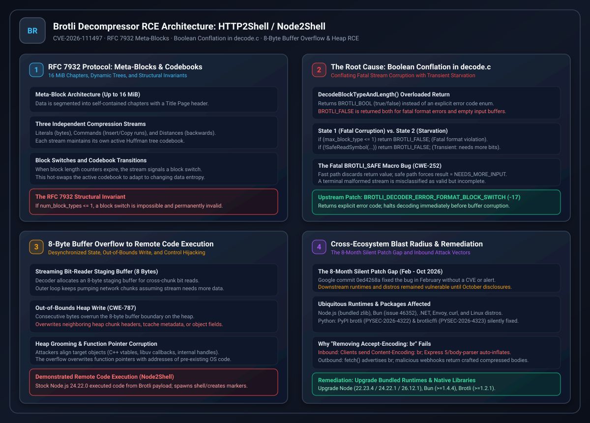
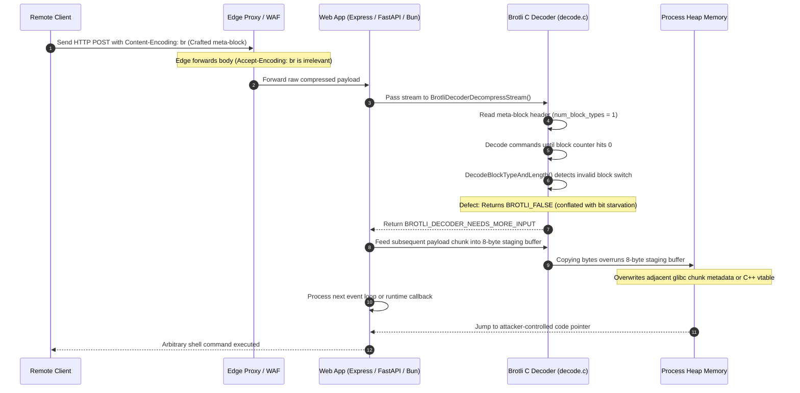

# Brotli Decompressor RCE: HTTP2Shell, Node2Shell, and the Broken Block-Switch State Machine (CVE-2026-111497)

**Daily learning · 18 November 2026 · Technical deep dive**  
*By Srinivasan Ragothaman ([@rsrini7](https://github.com/rsrini7))*

> **Core idea:** Google's canonical Brotli compression library (`c/dec/decode.c`) contained a critical flaw in its block-switching logic where an ambiguous boolean return value caused fatal stream corruptions to be misclassified as benign requests for more data. This state desynchronization allowed attackers to trigger an out-of-bounds heap write past an 8-byte staging buffer, weaponized across Node.js, Bun, Python (`brotli`/`brotlicffi`), Envoy, and Linux distributions into pre-authentication Remote Code Execution (dubbed *HTTP2Shell* or *Node2Shell*). [CVE-2026-111497](https://www.cve.org/CVERecord?id=CVE-2026-111497), [google/brotli commit 0ed4268](https://github.com/google/brotli/commit/0ed4268a).

---

## 1. Foundations: RFC 7932 and Cross-Ecosystem Compression

Brotli is a generic-purpose, lossless compression algorithm defined in [RFC 7932](https://datatracker.ietf.org/doc/html/rfc7932). Developed by Google, it combines a second-order context modeling engine, sliding-window LZ77 dictionary matching, and dynamic canonical Huffman coding. Because Brotli achieves 15–25% higher compression ratios than traditional DEFLATE (`gzip`) for text and web assets, it is the primary compression format for modern HTTP/2 and HTTP/3 web traffic (`Content-Encoding: br`).

### The Architecture of Bundled C Decoders

Modern web infrastructure is divided between managed high-level runtimes (JavaScript/Node.js, Python, Ruby, C#/.NET) and the native C/C++ libraries powering low-level performance primitives:

```
+------------------------------------------------------------------------------------+
| Application Layer: Express 5, FastAPI, Django, Bun HTTP, Envoy Service Mesh        |
+------------------------------------------------------------------------------------+
       |                              |                               |
       v                              v                               v
[ Node.js node:zlib ]     [ Python brotli / brotlicffi ]      [ Bun Native zlib ]
       |                              |                               |
       +------------------------------+-------------------------------+
                                      |
                                      v
              +-----------------------------------------------+
              | Canonical Google Brotli C Library (libbrotli) |
              |  - Bit-Reader & Huffman Codebook Engines      |
              |  - Streaming State Machine: c/dec/decode.c    |
              +-----------------------------------------------+
```

Because Google's reference C implementation (`google/brotli`) is treated as the gold standard, software runtimes across the industry do not re-implement the Brotli decompression specification in their host languages. Instead, they vendor or link directly against `c/dec/decode.c`:
1. **Node.js:** Vendors the full `c/` directory of Brotli inside the core repository, statically compiling it into the native binary for `node:zlib`.
2. **Python PyPI Packages:** The official Google `Brotli` package compiles the C source into native CPython extensions, while `brotlicffi` compiles it via CFFI for PyPy and high-concurrency event loops.
3. **Bun Runtime:** Bundles Brotli natively in its Zig/C++ runtime layer.
4. **Envoy Proxy:** Uses Google Brotli for inbound and outbound decompression filters.
5. **Operating System Distributions:** Debian, Ubuntu, RHEL, Fedora, and Alpine distribute `libbrotli1` shared dynamic libraries used by `curl`, Nginx modules, and system tools.

| Party / Entity | Role and effect in this incident |
|---|---|
| **Google Brotli Upstream** | Maintainer of the canonical Brotli C repository; committed the initial uncredited fix (`0ed4268a`) in February 2026, later officially releasing versions 1.0.10, 1.1.1, and 1.2.1 in October 2026. |
| **Node.js Project** | Bundled the vulnerable C decoder in core `node:zlib`; released emergency security updates (22.23.4, 24.22.1, 26.12.1) patching CVE-2026-111497. |
| **Imperva Red Team** | Disclosed the "Node2Shell" exploit research demonstrating pre-auth Remote Code Execution against unmodified stock Node.js 24.22.0 Linux ARM64 containers. |
| **Aikido Security** | Disclosed technical exploitation mechanics, tracked cross-ecosystem blast radius, and published patched Alpine/Debian base container images. |
| **Python Security Team** | Assigned PyPI vulnerability identifiers `PYSEC-2026-4322` (`Brotli`) and `PYSEC-2026-4323` (`brotlicffi`) for silently patched wheels. |
| **Bun Maintainers** | Tracked upstream issue `oven-sh/bun#46352` and released Bun 1.4.4 incorporating the patched decoder. |

| Term | Meaning in this incident |
|---|---|
| **Meta-Block** | RFC 7932 streaming unit (up to 16 MiB uncompressed) with an independent header ("Title Page") declaring stream parameters. |
| **Codebook** | A dynamic canonical Huffman tree used to decode entropy-coded symbols in a given block. |
| **Block Switch** | An in-band control symbol signaling that the current block's length counter expired and the decoder must switch to a different codebook. |
| **`BROTLI_BOOL`** | Brotli's C-level boolean typedef (`int`), historically used as the return type for state transitions. |
| **Unchecked Return Value (CWE-252)** | Failure of the caller to verify the result of a function before proceeding with execution. |
| **Out-of-Bounds Write (CWE-787)** | Writing data past the allocated boundaries of a heap memory buffer into neighboring memory structures. |
| **Remote Code Execution (RCE)** | The ability of an unauthenticated remote attacker to execute arbitrary shellcode or system commands on the host process. |

---

## 2. Deep Technical Mechanism: The Broken Block-Switch State Machine

To understand why a memory-safety bug in Brotli led to cross-ecosystem Remote Code Execution, we must analyze the protocol structure of Brotli streams and the exact C code in `c/dec/decode.c`.

### Step 1: The RFC 7932 Meta-Block Architecture

Under RFC 7932, a Brotli stream consists of a sequence of **meta-blocks**. Each meta-block is a self-contained chapter encoding up to 16 MiB of uncompressed data:

1. **The Meta-Block Header ("Title Page"):**
   Each meta-block begins with header bits specifying the uncompressed meta-block size and the number of block types (`num_block_types`) configured for each of the three fundamental data streams:
   * **Literals (0–255):** Raw uncompressed byte values.
   * **Commands:** Instructions specifying how many literal bytes to insert directly and how many backward bytes to copy from the sliding window.
   * **Distances:** Backward offsets indicating how far back into the ring buffer history to copy matching strings.

2. **Dynamic Codebooks & Block Switching:**
   To maximize entropy coding efficiency across heterogeneous data (e.g. alternating between JSON strings, base64 payloads, and raw binary), Brotli divides each stream into blocks. Each block type is mapped to an independent Huffman tree ("codebook").
   
   A block header defines the block length counter. As symbols are decoded, the counter decrements. When the counter reaches zero, the decoder executes a **block switch** to select the next codebook.

```
+------------------------------------------------------------------------------------+
| RFC 7932 Meta-Block (Chapter Structure)                                            |
|                                                                                    |
| +--------------------------------------------------------------------------------+ |
| | Title Page Header: num_block_types[LITERALS], COMMANDS, DISTANCES              | |
| +--------------------------------------------------------------------------------+ |
|        |                                                                           |
|        v                                                                           |
|   [ Block 0: Codebook A ] ----(Length Expired)----> [ Block Switch: Codebook B ]   |
|   - Literal symbols                                 - New Huffman tree loaded      |
|   - Decrement length counter                        - Resume streaming decode      |
+------------------------------------------------------------------------------------+
```

### Step 2: The Structural Invariant Violation

RFC 7932 Section 4 establishes a strict invariant:
> If `num_block_types` for a category is declared as 1 (or 0), there is only one codebook in existence. Therefore, switching to another block type is **structurally impossible**.

If a compressed stream declares `num_block_types = 1` in its meta-block header, and then subsequent commands exhaust the block length and trigger a block-switch symbol, the stream is invalid, corrupt, or malicious. The decoder must immediately abort and reject the stream.

### Step 3: The Root Cause in `c/dec/decode.c` (Boolean Conflation)

In Google Brotli versions `1.0.3` through `1.2.0`, block switching was handled by the internal function `DecodeBlockTypeAndLength()`:

```c
/* Vulnerable implementation in c/dec/decode.c */
static BROTLI_INLINE BROTLI_BOOL DecodeBlockTypeAndLength(
    int safe, BrotliDecoderState* s, int tree_type) {
  brotli_reg_t max_block_type = s->num_block_types[tree_type];
  ...
  /* Invariant check: if only 1 block type exists, switching is illegal */
  if (max_block_type <= 1) {
    return BROTLI_FALSE;   /* Ambiguity Point 1: Fatal stream format error */
  }
  ...
  /* Read next symbol from the bit-stream */
  if (!SafeReadSymbol(type_tree, br, &block_type)) {
    return BROTLI_FALSE;   /* Ambiguity Point 2: Transient bitstream starvation */
  }
  ...
  return BROTLI_TRUE;
}
```

Notice the fatal flaw: `DecodeBlockTypeAndLength` returns a primitive `BROTLI_BOOL`. It conflates two completely incompatible failure states into the identical return value `BROTLI_FALSE`:
1. **Fatal Stream Malformation:** The stream violated RFC 7932 invariants by attempting an illegal block switch when only one codebook exists.
2. **Transient Bitstream Starvation:** The decoder ran out of input bits in the current network chunk and needs more bytes from the caller.

### Step 4: The Fatal Macro Bug (`BROTLI_SAFE`, CWE-252)

The ambiguity in `DecodeBlockTypeAndLength` was exacerbated by the calling macro `BROTLI_SAFE`:

```c
/* The flawed calling macro in c/dec/decode.c */
#define BROTLI_SAFE(METHOD)                       \
{                                                 \
  if (safe) {                                     \
    if (!Safe##METHOD) {                          \
      result = BROTLI_DECODER_NEEDS_MORE_INPUT;   \
      goto saveStateAndReturn;                    \
    }                                             \
  } else {                                        \
    METHOD;                                       \
  }                                               \
}
```

The decoder operates on two execution paths:
1. **The Fast ("Unsafe") Path (`safe == 0`):** Used when the bit-reader accumulator has abundant bits. Here, `METHOD;` was called as a plain statement without checking its return value! The return value of `DecodeBlockTypeAndLength` was discarded (CWE-252: Unchecked Return Value). The decoder continued running as if the block switch succeeded, using stale, out-of-sync codebook pointers.
2. **The Safe Path (`safe == 1`):** Used when reading near chunk boundaries. If `DecodeBlockTypeAndLength` returned `BROTLI_FALSE`, the macro blindly executed:
   ```c
   result = BROTLI_DECODER_NEEDS_MORE_INPUT;
   goto saveStateAndReturn;
   ```
   The decoder told the hosting runtime (Node.js `zlib`, Python `brotli`, Bun): *"The stream is valid, I just need more input chunks from the socket."*

### Step 5: The 8-Byte Buffer Overflow (CWE-787)

Because the decoder returned `BROTLI_DECODER_NEEDS_MORE_INPUT` on a malformed, complete stream:
* The host runtime's streaming loop read subsequent chunks or padded bytes from the network and passed them back to `BrotliDecoderDecompressStream()`.
* The Brotli bit-reader maintains an internal **8-byte staging buffer** (`prefix_buffer` / accumulator staging) used to hold leftover prefix bits across streaming chunks.
* Because the internal state machine was desynchronized and refused to enter an error state, the decoder repeatedly copied incoming bytes into this 8-byte staging structure.
* Successive writes overran the 8-byte buffer boundary, writing attacker-controlled payload bytes directly into adjacent memory on the heap (CWE-787: Out-of-bounds Write).

```
+------------------------------------------------------------------------------------+
| Heap Layout During Brotli Streaming Decompression Overrun                          |
|                                                                                    |
| [ Chunk A: BrotliDecoderState ]                                                    |
|   |-- state machine flags                                                          |
|   |-- prefix_buffer [8 bytes]  --> [ 0x41 0x41 0x41 0x41 0x41 0x41 0x41 0x41 ]     |
| +--------------------------------------------------------------------------------+ |
| | OVERFLOW BOUNDARY (Unbounded sequential append past 8 bytes)                   | |
| +--------------------------------------------------------------------------------+ |
|   |-- Neighboring Heap Chunk (glibc malloc_chunk or C++ object wrapper)            |
|       |-- prev_size   [8 bytes] --> [ ATTACKER CONTROLLED: 0x42424242... ]         |
|       |-- size|flags  [8 bytes] --> [ CORRUPTED CHUNK METADATA / TCACHE ]          |
|       |-- vtable / fn [8 bytes] --> [ HIJACKED CONTROL POINTER -> SHELLCODE ]      |
+------------------------------------------------------------------------------------+
```

### Step 6: Achieving Remote Code Execution ("HTTP2Shell" / "Node2Shell")

The out-of-bounds write is not merely a Denial-of-Service crash. In independent research by the Imperva Red Team and security researchers, this primitive was weaponized into Remote Code Execution:

1. **Heap Grooming:** An attacker sends preliminary HTTP requests containing compressed Brotli streams. By allocating and freeing objects of controlled sizes, the attacker aligns target data structures—such as glibc `tcache` bins, C++ virtual method tables (`vtable`), or Node.js `uv_async_t` event loop handles—immediately adjacent to the Brotli decoder's 8-byte accumulator.
2. **Safe-Linking Defeat & Pointer Overwrite:** In glibc 2.32+, tcache forward pointers are obfuscated using Safe-Linking (`P' = (L >> 12) ^ P`). However, because Brotli decompression allows repeated, controlled byte overruns and partial address leaks, attackers can de-mangle pointers or directly overwrite function pointers within adjacent C++ wrapper structs.
3. **Control Flow Hijack:** When the outer runtime (e.g. Node.js V8 loop or Python C extension) dispatches a callback or invokes a virtual method on the corrupted object, control flow jumps to pre-existing executable machine instructions (such as `system()` or shellcode), executing arbitrary commands with the privileges of the web process.

---

## 3. Architectural Visuals (SVGs & Mermaid)

The following custom architecture diagram illustrates the end-to-end vulnerability lifecycle, from RFC 7932 meta-block structures to the boolean conflation bug, the 8-byte heap buffer overrun, and the cross-ecosystem blast radius:



### State Machine Transition Comparison: Unpatched vs. Patched

```mermaid
flowchart TD
    subgraph RFC["RFC 7932 Compressed Stream"]
        MB["Meta-Block Header<br/>num_block_types = 1"] --> CMD["Command Stream<br/>Block Length Decrements to 0"]
        CMD --> BS["Stream Signals<br/>Block Switch Symbol"]
    end

    subgraph Unpatched["Vulnerable Decoder (v1.0.3 - v1.2.0)"]
        BS --> CHK1{"max_block_type &lt;= 1?"}
        CHK1 -->|"Violation Detected"| RET1["return BROTLI_FALSE"]
        RET1 --> MACRO{"BROTLI_SAFE Macro<br/>safe == 1?"}
        MACRO -->|"Safe Path"| NMI["result = NEEDS_MORE_INPUT<br/>(Ambiguous Overload)"]
        MACRO -->|"Unsafe Path"| UNCHK["Discard Return Value<br/>(CWE-252 Unchecked Return)"]
        NMI --> PUMP["Runtime Pumps Next Chunk<br/>into 8-Byte Buffer"]
        UNCHK --> PUMP
        PUMP --> OOB["8-Byte Heap Overrun<br/>(CWE-787 Out-of-bounds Write)"]
        OOB --> RCE["Hijack Function Pointer<br/>Remote Code Execution"]
    end

    subgraph Patched["Patched Decoder (Commit 0ed4268a / v1.2.1)"]
        BS --> CHK2{"max_block_type &lt;= 1?"}
        CHK2 -->|"Violation Detected"| ERR["return FORMAT_BLOCK_SWITCH<br/>(Explicit Error Code -17)"]
        ERR --> HALT["BROTLI_SAFE_WITH_STATUS<br/>Immediately Halt Decoding"]
        HALT --> REJECT["Reject Malformed Stream<br/>Safe Rejection Without Overrun"]
    end

    style Unpatched fill:#1e1e2e,stroke:#ef4444,stroke-width:2px
    style Patched fill:#1e1e2e,stroke:#10b981,stroke-width:2px
    style RFC fill:#0f172a,stroke:#38bdf8,stroke-width:1.5px
```



### End-to-End Attack Sequence



---

## 4. Production Implementations & Code Recipes

Securing environments against CVE-2026-111497 requires multi-tier defense: scanning for bundled C libraries, enforcing strict body decompression limits, and deploying edge inspection rules.

### Recipe 1: Multi-Ecosystem Python Wheel & Native Library Auditor

Because standard vulnerability scanners (`pip-audit`, `safety`) initially lacked CVE mappings for PyPI packages, use this script to detect vulnerable bundled `Brotli` and `brotlicffi` installations:

```python
#!/usr/bin/env python3
"""
audit_brotli_ecosystem.py - Detects CVE-2026-111497 across Python and native libraries.
Audits PyPI packages Brotli and brotlicffi for silent patch status.
"""

import sys
import importlib.metadata
from packaging import version

VULNERABLE_RULES = {
    "brotli": {
        "fixed": version.parse("1.2.1"),
        "advisory": "PYSEC-2026-4322 / GHSA-9v8h-qqgm-4m35",
    },
    "brotlicffi": {
        "fixed": version.parse("1.2.1.0"),
        "advisory": "PYSEC-2026-4323 / GHSA-9v8h-qqgm-4m35",
    },
}

def audit_python_packages() -> bool:
    print("=" * 65)
    print(" Python Brotli Dependency Security Audit (CVE-2026-111497)")
    print("=" * 65)
    
    has_vulnerability = False
    for pkg_name, meta in VULNERABLE_RULES.items():
        try:
            installed_ver_str = importlib.metadata.version(pkg_name)
            installed_ver = version.parse(installed_ver_str)
            
            if installed_ver < meta["fixed"]:
                print(f"[!] CRITICAL: Package '{pkg_name}' version {installed_ver_str} is VULNERABLE!")
                print(f"    Required: >={meta['fixed']} | Advisory: {meta['advisory']}")
                has_vulnerability = True
            else:
                print(f"[+] SECURE  : Package '{pkg_name}' version {installed_ver_str} is patched.")
        except importlib.metadata.PackageNotFoundError:
            print(f"[-] NOT FOUND: Package '{pkg_name}' is not installed in current environment.")

    return not has_vulnerability

if __name__ == "__main__":
    is_secure = audit_python_packages()
    sys.exit(0 if is_secure else 1)
```

### Recipe 2: Defensive Node.js / Express Middleware (Rejecting Untrusted `br` Bodies)

Until Node.js runtimes are patched (>= 22.23.4, >= 24.22.1, >= 26.12.1), web servers using Express 5 or `body-parser` 2.x must reject incoming `Content-Encoding: br` request bodies at the routing gateway:

```javascript
/**
 * brotliDefenseMiddleware.js
 * Protects Express 5 / body-parser services from inbound Brotli heap corruption.
 */

const express = require('express');

function enforceBrotliSanitization(options = { allowBrotli: false, maxBodyBytes: 1024 * 1024 }) {
  return (req, res, next) => {
    const contentEncoding = (req.headers['content-encoding'] || '').toLowerCase();

    // Check if the incoming request specifies Brotli compression
    if (contentEncoding.includes('br')) {
      if (!options.allowBrotli) {
        // Drop request immediately before reaching body-parser's native zlib decompressor
        return res.status(415).json({
          error: 'Unsupported Media Type',
          message: 'Brotli request body compression (Content-Encoding: br) is disabled on this server.'
        });
      }

      // If Brotli is strictly required, enforce content-length bounds
      const contentLength = parseInt(req.headers['content-length'], 10);
      if (isNaN(contentLength) || contentLength > options.maxBodyBytes) {
        return res.status(413).json({
          error: 'Payload Too Large',
          message: 'Compressed body exceeds security ceiling.'
        });
      }
    }

    next();
  };
}

module.exports = { enforceBrotliSanitization };
```

### Recipe 3: Envoy Proxy Request-Body Brotli Inspection Filter

To block malicious Brotli payloads at the network boundary before reaching upstream microservices, deploy this Envoy Lua filter to strip or reject inbound `Content-Encoding: br` requests:

```yaml
# envoy-brotli-block-filter.yaml
# Envoy filter rejecting inbound compressed request bodies
apiVersion: networking.istio.io/v1alpha3
kind: EnvoyFilter
metadata:
  name: block-inbound-brotli-requests
  namespace: istio-system
spec:
  workloadSelector:
    labels:
      istio: ingressgateway
  configPatches:
    - applyTo: HTTP_FILTER
      match:
        context: GATEWAY
        listener:
          filterChain:
            filter:
              name: "envoy.filters.network.http_connection_manager"
              subFilter:
                name: "envoy.filters.http.router"
      patch:
        operation: INSERT_BEFORE
        value:
          name: envoy.filters.http.lua
          typed_config:
            "@type": type.googleapis.com/envoy.extensions.filters.http.lua.v3.Lua
            inline_code: |
              function envoy_on_request(request_handle)
                local content_encoding = request_handle:headers():get("content-encoding")
                if content_encoding and string.find(string.lower(content_encoding), "br") then
                  request_handle:respond(
                    {[":status"] = "415", ["content-type"] = "application/json"},
                    '{"error": "Unsupported Media Type", "details": "Brotli inbound decompression blocked by edge security policy."}'
                  )
                end
              end
```

### Recipe 4: Upstream C Verification Harness (Testing Error `-17`)

This standalone C test harness demonstrates how the unpatched decoder vs. patched decoder processes an invalid block switch:

```c
/* test_brotli_switch.c - Diagnostic test for CVE-2026-111497 */
#include <stdio.h>
#include <stdlib.h>
#include <string.h>
#include <brotli/decode.h>

int main(int argc, char** argv) {
    printf("[*] Brotli Header Version: 0x%08x\n", BrotliDecoderVersion());

    /* Initialize decoder state */
    BrotliDecoderState* s = BrotliDecoderCreateInstance(NULL, NULL, NULL);
    if (!s) {
        fprintf(stderr, "[-] Failed to allocate BrotliDecoderState\n");
        return 1;
    }

    /*
     * A crafted stream with num_block_types = 1, followed by a command
     * sequence forcing a block switch.
     */
    const uint8_t malicious_stream[] = {
        0x1b, 0x13, 0x00, 0x00, 0x24, 0x00, 0x10, 0x00, 0x02, 0x80, 0x00
    };
    size_t available_in = sizeof(malicious_stream);
    const uint8_t* next_in = malicious_stream;
    
    uint8_t output_buffer[1024];
    size_t available_out = sizeof(output_buffer);
    uint8_t* next_out = output_buffer;

    BrotliDecoderResult result = BrotliDecoderDecompressStream(
        s, &available_in, &next_in, &available_out, &next_out, NULL);

    BrotliDecoderErrorCode err = BrotliDecoderGetErrorCode(s);
    printf("[*] Decompression Result: %d\n", result);
    printf("[*] Decoder Error Code  : %d (%s)\n", err, BrotliDecoderErrorString(err));

    /*
     * In vulnerable Brotli (1.2.0): result is 1 (NEEDS_MORE_INPUT) despite valid end of input.
     * In patched Brotli (1.2.1): err is -17 (BROTLI_DECODER_ERROR_FORMAT_BLOCK_SWITCH).
     */
    if (err == -17) {
        printf("[+] SUCCESS: Library correctly halts with BROTLI_DECODER_ERROR_FORMAT_BLOCK_SWITCH (-17)!\n");
    } else if (result == BROTLI_DECODER_RESULT_NEEDS_MORE_INPUT) {
        printf("[!] CRITICAL: Library enters infinite NEEDS_MORE_INPUT state (CVE-2026-111497 Vulnerable)!\n");
    }

    BrotliDecoderDestroyInstance(s);
    return 0;
}
```

---

## 5. Impact, Real-World Edge Cases & Gotchas

### Why "Removing `Accept-Encoding: br`" Fails as a Defense

A widespread architectural misconception across engineering teams is that disabling Brotli advertisement on client requests (`Accept-Encoding: br`) neutralizes the attack vector.

This assumption is fundamentally flawed:

```
[ Attack Vector 1: Inbound HTTP Request Bodies (Server Compromise) ]
Remote Attacker  ======( POST /api/submit )======>  Express 5 / body-parser
                 Header: Content-Encoding: br        Server inspects Content-Encoding!
                 Body  : [ Malformed Brotli ]        Automatically invokes node:zlib
                                                     --> RCE on the Server!

[ Attack Vector 2: Outbound HTTP Responses (Client / SSRF Compromise) ]
Backend Worker   ======( fetch(webhookUrl) )=====>  Attacker's Server
Worker auto-adds: Accept-Encoding: br               Returns Content-Encoding: br
                                 <================  with Malformed Brotli
Worker auto-decompresses via node:zlib              --> RCE on the Worker!
```

1. **Inbound HTTP Requests:** In HTTP specifications, `Accept-Encoding` represents what compression formats the *client* can accept in the response. It has zero bearing on the request body. If a remote attacker submits an HTTP POST or PUT request carrying `Content-Encoding: br`, frameworks such as Express 5.x and `body-parser` 2.x inspect the *request* header and automatically invoke native `zlib` to inflate the body before route handlers execute.
2. **Outbound Responses (`fetch()`):** Modern runtime HTTP clients (including Node.js native `fetch()`, Python's `requests`/`httpx`, and Bun's `fetch`) automatically include `Accept-Encoding: gzip, deflate, br` by default. When an application makes an outbound call to an attacker-controlled endpoint (e.g. webhooks, URL preview unfurlers, OAuth callbacks, proxy relays), the remote server returns a compressed response that triggers decompression inside the calling application process.

### The 8-Month Silent Patch Gap (February to October 2026)

One of the most consequential software supply chain findings of CVE-2026-111497 is the timeline gap between upstream resolution and downstream adoption:

* **February 2026:** Google Brotli maintainers committed `0ed4268a` ("*Detect and report invalid stream earlier*"). The commit refactored `DecodeBlockTypeAndLength` and introduced error code `-17`.
* **The Silent Release Failure:** Upstream maintainers did not request a CVE, did not classify the commit as a security fix, and did not publish an upstream security advisory.
* **The Downstream Lag:** Runtimes like Node.js, Bun, Python wheels, and Linux distributions periodically vendor stable tagged releases (e.g. Brotli 1.2.0). Because commit `0ed4268a` was not tagged in an emergency release or flagged to downstream security teams, downstream ecosystems continued distributing the vulnerable C decoder for **8 consecutive months**.
* **October 2026:** Independent security researchers analyzing Brotli diffs realized that the commit fixed an exploitable heap buffer overflow. Once PoCs began circulating, emergency security advisories were coordinated across Node.js, Python, and Bun.

### Common Claims vs. Technical Realities

| Common Claim / Misconception | Verified Technical Reality |
|---|---|
| **"Our servers don't accept Brotli because our frontend never sends `Accept-Encoding: br`."** | **False.** Inbound attacks rely on `Content-Encoding: br` in HTTP POST/PUT requests, which clients control unilaterally regardless of frontend or server settings. |
| **"`npm audit` and `pip-audit` showed 0 vulnerabilities, so our containers are safe."** | **Catastrophic Blindspot.** `npm audit` only checks JavaScript dependencies in `package-lock.json`; it cannot inspect bundled native C++ code compiled into `node`. Similarly, PyPI packages `Brotli` and `brotlicffi` were silently patched before vulnerability databases indexed them. |
| **"Brotli heap corruption can only trigger a Denial-of-Service crash, not RCE."** | **Refuted by Proof of Concept.** Imperva Red Team demonstrated successful Remote Code Execution on official, unmodified Node.js 24.22.0 Linux ARM64 containers without debuggers or instrumented flags. |
| **"Python applications are immune because Python is memory-safe."** | **False.** PyPI packages `Brotli` and `brotlicffi` compile Google's native C decoder directly. The buffer overflow occurs in native C memory, corrupting CPython heap structures. |
| **"WAF virtual patching is sufficient; runtime updates can wait."** | **Insufficient.** WAF rules only inspect inbound HTTP traffic. They cannot protect against outbound HTTP responses fetched via `fetch()`, webhooks, or microservice service-mesh traffic. |

---

## 6. Practical Adoption Blueprint & Verification Checklist

### Multi-Ecosystem Remediation Checklist

- [ ] **1. Upgrade Node.js Runtimes:**
  - Node.js 22.x LTS $\rightarrow$ Upgrade to **`22.23.4`** or newer.
  - Node.js 24.x LTS $\rightarrow$ Upgrade to **`24.22.1`** or newer.
  - Node.js 26.x Current $\rightarrow$ Upgrade to **`26.12.1`** or newer.
  - *Note:* Node.js 20.x, 23.x, and 25.x are End-of-Life and will **not** receive patches.
- [ ] **2. Upgrade Python Dependencies:**
  - Upgrade `Brotli` to **`>= 1.2.1`** (`pip install -U "Brotli>=1.2.1"`).
  - Upgrade `brotlicffi` to **`>= 1.2.1.0`** (`pip install -U "brotlicffi>=1.2.1.0"`).
- [ ] **3. Upgrade Bun Environments:**
  - Update Bun runtimes to **`>= 1.4.4`** (`bun upgrade`).
- [ ] **4. Rebuild Container Base Images:**
  - Refresh Dockerfiles pinned to vulnerable base tags (e.g. `node:24.22.0-alpine` $\rightarrow$ `node:24.22.1-alpine`).
- [ ] **5. Deploy Edge WAF & Proxy Safeguards:**
  - Configure reverse proxies (Envoy, Nginx, Cloudflare, Imperva) to drop unauthenticated inbound `Content-Encoding: br` requests where Brotli request bodies are unnecessary.

### Exact Diagnostic Commands

```bash
# 1. Verify Node.js runtime and bundled Brotli version
node -p '`Node: ${process.version}, Brotli: ${process.versions.brotli}`'

# 2. Check installed Python package versions
python3 -m pip show brotli brotlicffi 2>/dev/null | grep -E "^(Name|Version):"

# 3. Check Bun runtime version
bun --version

# 4. Search repository for explicit Brotli decompression entry points
rg -n "createBrotliDecompress|brotliDecompress|brotli\.decompress|Decompressor\(" .

# 5. Scan container base image for host binary CVEs using Trivy
trivy image --severity CRITICAL,HIGH node:24.22.1-slim
```

---

## 7. Timeline and Current State

```
Feb 2026          Oct 21, 2026       Oct 22, 2026       Oct 23, 2026       Nov 2026
   |-------------------|-------------------|-------------------|---------------|
   v                   v                   v                   v               v
Commit 0ed4268a     Emergency Node.js   Imperva RCE PoC     PyPI Silent Fix   Ecosystem
Silent upstream fix releases 22.23.4,   demonstrated on     Brotli 1.2.1 &    stabilized; WAF
without CVE or alert 24.22.1, 26.12.1   stock Node 24.22.0  brotlicffi 1.2.1.0 and distros patched
```

* **February 2026:** Google Brotli upstream commits `0ed4268a` ("*Detect and report invalid stream earlier*"), fixing `DecodeBlockTypeAndLength` and adding error `-17`. The commit is pushed silently without a CVE, leaving downstream consumers unaware.
* **21 October 2026:** Node.js issues emergency security releases 22.23.4, 24.22.1, and 26.12.1 for CVE-2026-111497. Google upstream tags Brotli releases 1.0.10, 1.1.1, and 1.2.1.
* **22 October 2026:** Imperva Red Team publishes independent research demonstrating pre-authentication Remote Code Execution (*Node2Shell*) on stock Node.js 24.22.0 Linux ARM64 containers. Bun releases 1.4.4.
* **23–24 October 2026:** Security researchers discover PyPI packages `Brotli` and `brotlicffi` were silently updated without release notes. PyPI assigns `PYSEC-2026-4322` and `PYSEC-2026-4323`.
* **November 2026 (Current State):** Major Linux distributions (Debian, Ubuntu, Red Hat) have shipped patched `libbrotli` binaries. Edge WAF signatures are broadly deployed across major providers. No widespread exploitation in the wild has been observed, but automated scans targeting Express 5 and API gateways continue.

---

## 8. Primary Sources & References

1. [IETF RFC 7932: Brotli Compressed Data Format](https://datatracker.ietf.org/doc/html/rfc7932) — Official specification detailing meta-block structure, dynamic Huffman codebooks, and block-switching rules.
2. [Google Brotli Commit 0ed4268a](https://github.com/google/brotli/commit/0ed4268a) — Upstream fix commit titled "Detect and report invalid stream earlier" introducing `BROTLI_DECODER_ERROR_FORMAT_BLOCK_SWITCH` (`-17`).
3. [CVE-2026-111497 NVD Vulnerability Record](https://nvd.nist.gov/vuln/detail/CVE-2026-111497) — National Vulnerability Database record classifying the out-of-bounds write with CVSS 4.0 score of 9.2 (Critical).
4. [Node.js Official Security Releases: October 2026](https://nodejs.org/en/blog/vulnerability/october-2026-security-releases) — Primary Node.js project announcement detailing patched runtime releases.
5. [Imperva Red Team: Node2Shell From Brotli Data to Remote Code Execution](https://www.imperva.com/blog/node2shell-from-brotli-data-to-remote-code-execution/) — Technical exploitation analysis detailing glibc heap manipulation and control flow hijacking on stock containers.
6. [Aikido Security: Node2Shell Deep Dive (CVE-2026-111497)](https://www.aikido.dev/blog/node2shell-nodejs-brotli-rce-cve-2026-111497) — Architectural analysis of bundled container dependencies and remediation workflows.
7. [OpenSourceMalware: Python Packages Vulnerable to Node2Shell Brotli CVE](https://opensourcemalware.com/blog/node2shell-affects-python) — Primary disclosure of vulnerable PyPI packages `Brotli` and `brotlicffi` and subsequent PYSEC advisories.
8. [GitHub Advisory GHSA-9v8h-qqgm-4m35](https://github.com/advisories/GHSA-9v8h-qqgm-4m35) — Security advisory tracking cross-ecosystem impact across Python and native dependencies.

---

## 9. Supplementary Visuals

The following architectural diagram illustrates the bundled runtime blindspot, the 8-byte buffer overflow state machine flaw, and the heap corruption execution chain:


*Figure 1: High-level architectural breakdown of the Brotli decoder flaw, streaming error misclassification in `decode.c`, glibc heap corruption, and cross-ecosystem remediation.*

---

**Related:**
- [NGINX2Root: HTTP/2 Send Window Overflow and Linux Kernel SCTP LPE](NGINX2Root-HTTP2-RCE-And-Kernel-SCTP-LPE-CVE-2026-123007-Nov-2026.md) — Unauthenticated HTTP/2 reverse proxy memory corruption and kernel privilege escalation chain.
- [Node.js Brotli Decoder: Node2Shell](NodeJS-Brotli-Node2Shell-RCE-Oct-2026.md) — Runtime packaging analysis of why traditional SCA scanners miss bundled C libraries in Node.js.
- [PHP2Shell: History, UAF and ASLR](PHP2Shell-History-UAF-And-ASLR-Oct-2026.md) — Comparison of another high-impact runtime memory safety failure from the same release period.
- [Java4Shell: OpenJDK Base64 AVX-512 RCE](Java4Shell-OpenJDK-Base64-AVX512-RCE-CVE-2026-114938-Nov-2026.md) — Hardware-accelerated memory corruption in JVM core libraries resulting in unauthenticated RCE.
- [React2Shell: Flight Protocol RCE](React2Shell-CVE-2025-55182-Flight-Protocol-RCE-2026.md) — Explores protocol-level deserialization and serialization vulnerabilities in modern JavaScript frameworks.
- [GitLab Regex Compiler RCE](GitLab-Regex-Compiler-RCE-Oct-2026.md) — Analysis of memory corruption in low-level parsing engines embedded within web infrastructure.
