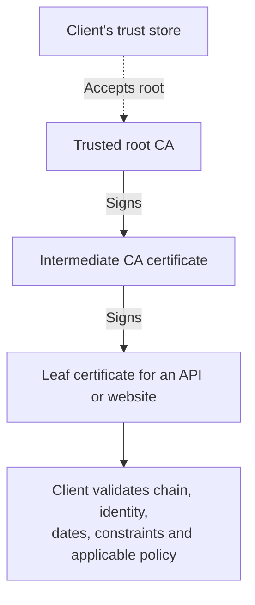
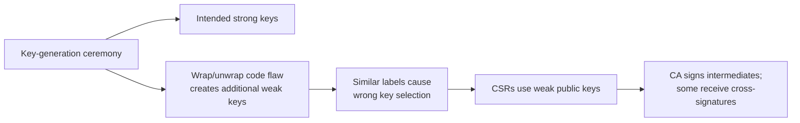
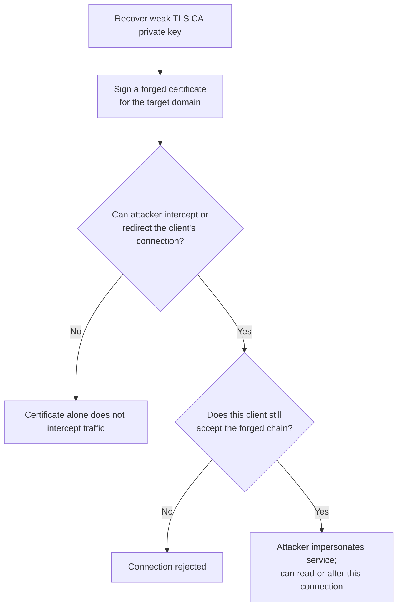

# eMudhra: Eight Weak CA Keys and the PKI Trust Gap

**Daily learning · 22 October 2026 · Primary-source review · Investigation ongoing**

> **Core idea:** Eight certificate-issuing keys were small enough to guess almost instantly. An attacker could use them to impersonate services to clients that still trusted the affected chains. Browsers received emergency blocks; other software needs its own trust updates.

## 1. First understand the chain: who trusts whom?

| Term | Simple meaning |
|---|---|
| Certificate | A signed statement linking an identity, such as a domain, to a public key. It is public. |
| Private key | The secret used to create signatures. A certificate does **not** contain it. |
| Root CA | A trust anchor accepted by a browser, operating system or application. |
| Intermediate CA | A delegated issuer that signs other certificates. |
| Leaf certificate | The end certificate used by a website, API or software publisher. |
| Trust store | The client's collection of accepted trust anchors. |

The root's self-signature does not create trust: **the client chooses to trust it**. An intermediate can issue only within the constraints the verifier enforces. The arrows show certificate issuance, not network traffic. [X.509 validation: RFC 5280, §6](https://www.rfc-editor.org/rfc/rfc5280.html#section-6).

Architecture reference supplied with this review: [The SSL Store's three-tier PKI diagram](https://www.thesslstore.com/blog/wp-content/uploads/2021/12/3-tier-ca-pki-architecture-diagram-843x1024.png). The simplified diagram above focuses on the trust path relevant to this incident.

## 2. What actually broke? A large key format hid a tiny secret

The affected keys used **P-384**, but their private values were:

**`4 · 56 · 66 · 115 · 155 · 156 · 230 · 237`**

Scott Helme independently recovered all eight from public certificates on his laptop in under a second. This was a weak-key-generation failure: stealing secrets from eMudhra's servers was unnecessary. [Helme's recovery and demonstration](https://scotthelme.co.uk/eight-bits-of-trust-emudhras-ca-keys-cracked-in-milliseconds/).

The underlying relationship is:

**Public key `Q = d × G`**, where `d` is the private integer and `G` is a known curve point.

Normally, recovering a properly generated `d` from `Q` is infeasible. If `d` is one of **1–255**, a researcher can calculate each candidate's public key and compare it with the certificate. Zero is not a valid private scalar. This explanation follows [SEC 1: Elliptic Curve Cryptography, §3.2.1](https://www.secg.org/sec1-v2.pdf).

| Misleading intuition | Correct interpretation |
|---|---|
| “P-384 was broken.” | The implementation selected tiny secrets; the curve was not cryptanalytically broken. |
| “A 48-byte key must be strong.” | These integers fit in one byte; a 48-byte scalar encoding merely adds 47 leading zero bytes. |
| “384-bit key means 384-bit security.” | Key size, entropy and attack cost are different quantities. |

Padding changes representation, not unpredictability. The byte explanation follows [EC private-key encoding: RFC 5915, §3](https://www.rfc-editor.org/rfc/rfc5915.html#section-3).

### Reported cause: the wrong keys survived the ceremony

This is **eMudhra's preliminary account**, not a completed forensic finding. A CSR is a certificate signing request; wrapping packages key material for transfer. eMudhra reported that similar labels led operators to use the unintended weak keys for CSRs, which its root signed and which were also sent to Sectigo. [CA responses in Mozilla's incident record](https://bugzilla.mozilla.org/show_bug.cgi?id=2083449).

The company dates the ceremony to **30 April 2025**, using FIPS 140-2 Level 3 HSMs, and says the detailed root cause remains under investigation. Hardware certification did not establish that the entire workflow selected secure keys. [eMudhra's 21 October statement](https://emudhra.com/investor-assets/investors/esg-profile/fy2027/statement-on-distrust-of-global-tls-intermediate-and-root-ca.pdf).

**A missed warning:** eMudhra also reported that earlier revocation lists were signed with the intended strong keys and failed verification against the published intermediates. Operators re-signed them using the weak keys. The mismatch should have triggered investigation of which keys had actually been certified. [Incident record, comment 11](https://bugzilla.mozilla.org/show_bug.cgi?id=2083449#c11).

## 3. What could an attacker do—and what else was required?

The eight keys covered **six TLS intermediates and two code-signing intermediates**. Chrome's verifier excludes the code-signing-only chains from TLS use. [Chrome Root Program's technical response](https://groups.google.com/a/mozilla.org/g/dev-security-policy/c/0R3XLJL6FuE/m/ra8uYR6tAgAJ).

This is a conceptual attack path. Mozilla confirms the need to intercept a connection and the potential for reading or changing its traffic. [Mozilla's security notice](https://blog.mozilla.org/security/2026/10/20/protecting-firefox-users-following-the-compromise-of-emudhra-intermediate-certificates/).

| Question | Precise answer |
|---|---|
| Only eMudhra customers at risk? | No. A client trusting the affected TLS chain could accept a forged certificate for an unrelated domain. |
| Did Helme compromise Stripe? | No. He demonstrated a locally forged certificate for its API hostname being accepted by tested clients. |
| Does a code signature make malware safe? | No. A forged signing chain can undermine publisher authentication where accepted; execution controls remain separate. |
| Can these keys decrypt every old HTTPS recording? | No. A CA signing key is not a session key. Properly established forward-secret TLS sessions are not retroactively decrypted by this compromise alone. |

Sources: [Helme's local proof](https://scotthelme.co.uk/eight-bits-of-trust-emudhras-ca-keys-cracked-in-milliseconds/), [CERT-In's impact advisory](https://www.cert-in.org.in/s2cMainServlet?CACODE=CICA-2026-3649&pageid=PUBADV01), [TLS 1.3 forward secrecy](https://www.rfc-editor.org/rfc/rfc8446.html#appendix-E.1).

**Signing is one layer:** Windows SmartScreen also checks downloaded-app reputation. macOS Gatekeeper uses Apple's Developer ID and notarization requirements; an eMudhra-issued signing chain does not substitute for them. These controls are not a blanket guarantee against malicious software. [Microsoft's reputation checks](https://learn.microsoft.com/windows/apps/package-and-deploy/smartscreen-reputation), [Apple's Developer ID requirements](https://developer.apple.com/developer-id/).

## 4. Timeline: emergency block first, broader distrust later

Times are **UTC**; October dates are **2026**.

| When | Event |
|---|---|
| 30 Apr 2025 | Affected key-generation ceremony: roughly 17½ months before discovery. |
| Oct 17, 18:05 | Chrome receives the researcher's report. |
| Oct 17, 19:45 | Chrome lands a CRLSet block for the six TLS keys, including cross-certificates sharing those keys. |
| Oct 17, 20:06 → 22:59 | Mozilla receives the report → completes Firefox OneCRL distribution. |
| Oct 18–20 | CA revocations and additional platform protections follow. |
| Oct 19, ~22:00 | Android receives equivalent blocks through **Google Play Services**, without requiring a full OS firmware update. |
| Oct 20 | Mozilla announces Firefox fixes and an NSS root-store update. |
| **Oct 27, morning PDT—scheduled** | Chrome expects broad rollout of removal of **emSign ECC Root CA – G3**. Earlier on prerelease channels. |

Sources: [Google's response and rollout schedule](https://blog.google/security/protecting-chrome-and-android-users-from-compromised-emudhra-intermediate-ca-certificates/), [Mozilla's notice](https://blog.mozilla.org/security/2026/10/20/protecting-firefox-users-following-the-compromise-of-emudhra-intermediate-certificates/), [incident record](https://bugzilla.mozilla.org/show_bug.cgi?id=2083449).

**Blocking a key and removing a root are different actions.** Key blocking can reject every certificate using that key, including alternate cross-signed paths. Root removal affects other legitimate chains too; it does not establish that the root's private key was recovered. Google warns operators under this root to migrate certificates before rollout. [Google's migration warning](https://blog.google/security/protecting-chrome-and-android-users-from-compromised-emudhra-intermediate-ca-certificates/).

**22 October update:** eMudhra's board approved a voluntary exit from the global SSL/TLS certificate business. The company said no end-entity certificates were issued under the affected CAs, that it will provide replacement certificates through partners, and that its Indian DSC/eSign services remain separate. This is a business decision following the incident, not evidence that the weak keys were exploited. [eMudhra press release](https://emudhra.com/en/press-release/emudhra-to-exit-global-ssl-tls-certificate-business).

## 5. The gap: your browser's protection does not update your application

| Layer | What must reach the running client? |
|---|---|
| Chrome / Firefox | Vendor emergency blocks; custom settings or stale clients can affect delivery. |
| OS-based applications | Updated platform trust decisions, actually used by the application. |
| Bundled runtimes and libraries | Their own trust-bundle or verification updates. |
| Containers / embedded devices | Updated image or firmware, followed by deployment and any necessary restart. |

Many non-browser clients do not consume revocation information or enforce Certificate Transparency (CT). A valid signature and an unexpired certificate can therefore remain acceptable after a CA publishes a revocation. Behavior depends on the client, TLS backend and configuration. [Incident checker and downstream guidance](https://emudhra.we-have-a-problem.com/).

**Cross-signing matters:** the same intermediate public key can have certificates from different parents. Removing only the eMudhra root may leave a Sectigo-backed path accepted. Merely deleting a cached intermediate is insufficient if a peer can supply it again. The remediation must reject the affected keys or eliminate **every accepted path**. This is an engineering inference from [Google's SPKI block](https://groups.google.com/a/mozilla.org/g/dev-security-policy/c/0R3XLJL6FuE/m/ra8uYR6tAgAJ) and [X.509 path validation](https://www.rfc-editor.org/rfc/rfc5280.html#section-6).

### Was it exploited?

Google found no TLS certificates under the six intermediates in CT before its block: default CT-enforcing Chrome clients could not have accepted such forged certificates. Cloudflare reported no identified active exploitation **on its services**. Neither observation proves that all non-CT clients were safe. [Google's CT assessment](https://blog.google/security/protecting-chrome-and-android-users-from-compromised-emudhra-intermediate-ca-certificates/), [Cloudflare's assessment](https://blog.cloudflare.com/emudhra-certificate-compromise/).

## 6. Practical response: update, activate, verify

1. **Inventory actual verifiers.** Include outbound API clients, CI runners, proxies, runtimes and container images—not just public web servers.
2. **Apply vendor distrust fixes.** Update OS stores and separately bundled trust data, such as Python `certifi` or Rust `webpki-roots`, where used. Installing an update helps only if it contains the relevant fix.
3. **Activate the updates.** Rebuild and redeploy images; reload or restart processes that retain trust data. Check custom stores separately.
4. **Migrate affected server chains.** Replace legitimate certificates dependent on the removed root with an unaffected trusted hierarchy.
5. **Verify with the deployed client.** Use the [incident checker](https://emudhra.we-have-a-problem.com/), including both direct and cross-signed chains. Successful HTTPS to a compromised-chain test endpoint indicates residual trust; a certificate rejection is expected. A timeout or DNS failure is inconclusive, and one rejected chain does not establish full coverage.
6. **Keep verification enabled.** Resolve certificate failures; do not bypass them with `--insecure`, `-k` or disabled certificate validation.

For Cloudflare users: update One/WARP clients to the fixed versions in its advisory, and `cloudflared` to **2026.10.2 or later**. Review custom origin and mTLS trust configurations. Cloudflare documents separate updates for shared stores, bundled stores, base images and running services. [Cloudflare's remediation instructions](https://blog.cloudflare.com/emudhra-certificate-compromise/).

The deployment checklist above synthesizes that guidance with the [downstream remediation tracker](https://emudhra.we-have-a-problem.com/). mTLS exposure depends on which CAs the service accepts; a private-only client trust store does not automatically trust public WebPKI issuers.

## 7. What this incident teaches

**Engineering conclusions:** validate the key-generation workflow as a whole; use unambiguous key identities and independently check the public key selected for each CSR. Reject known weak-key patterns, while recognizing that a small-number scan cannot prove good randomness. Design trust updates to reach running applications, and test alternate chains.

eMudhra says its infrastructure and data were not breached, Indian DSC/eSign services run separately, and global TLS represents around 1% of revenue. These are company statements; they do not reduce the authentication risk for clients trusting the weak keys. [Company filing](https://emudhra.com/investor-assets/investors/esg-profile/fy2027/statement-on-distrust-of-global-tls-intermediate-and-root-ca.pdf). [CERT-In](https://www.cert-in.org.in/s2cMainServlet?CACODE=CICA-2026-3649&pageid=PUBADV01) also distinguishes the unaffected domestic services.

---

**Related:**
- [PHP2Shell: History, UAF and ASLR](PHP2Shell-History-UAF-And-ASLR-Oct-2026.md) — Compare a serious primitive with the additional conditions needed for exploitation.
- [LiteLLM 1.107.0 Supply-Chain Compromise](LiteLLM-1.107.0-Supply-Chain-Compromise-Oct-2026.md) — LiteLLM delayed a release while removing this CA from its trust store, showing the downstream operational impact.
- [Notepad++ Targeted Attack](Notepad++-Targetted-Attach.md) — Compare software-update authenticity and failures in trusted delivery paths.
- [Wireless Devices and Apps](Security-Vulnerabilities-in-Wireless-Devices-and-Apps.md) — Compare certificate validation and implementation failures across client devices.
