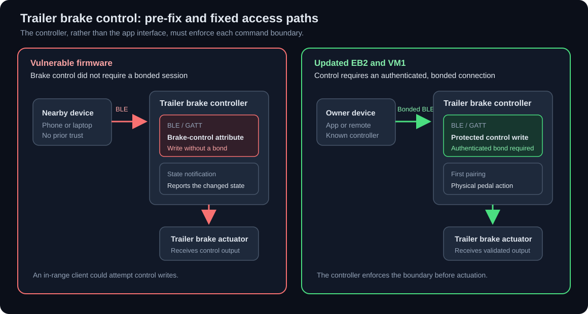
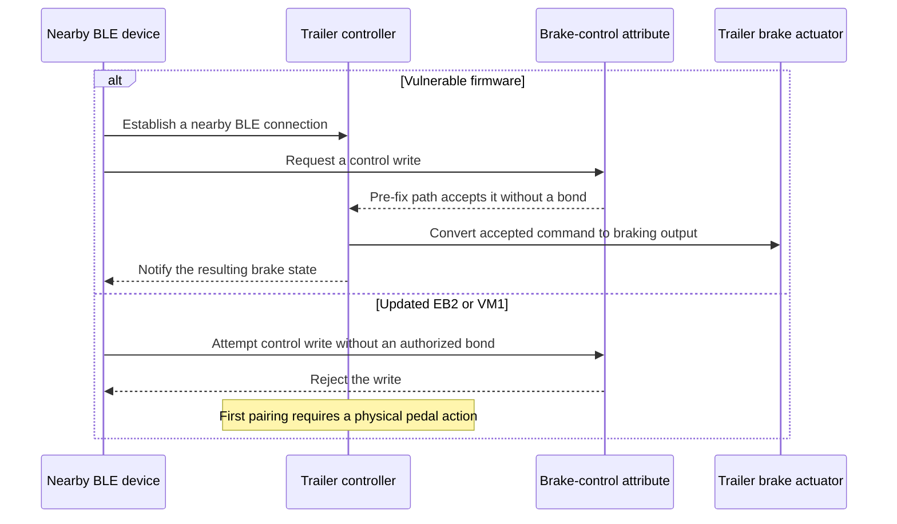

# Elecbrakes Trailer Brake Controllers: Bluetooth Access and Firmware Risks

Daily learning · November 26, 2026  
*By Srinivasan Ragothaman ([@rsrini7](https://github.com/rsrini7))*

> **Core idea:** An unauthenticated Bluetooth Low Energy (BLE) write could control the brakes on affected Elecbrakes trailer controllers. The EB2 and VM1 have manual firmware fixes; the older ELBC 2000 remained without a fix in CISA's November advisory.



---

## 1. System and affected users

An electric trailer brake controller turns the tow vehicle's braking input into controlled braking force at the trailer. Elecbrakes places this controller on the trailer and provides Bluetooth connections to a phone app or in-car remote for operation and adjustment. The controller therefore sits on a safety-critical path: unexpected braking can affect the trailer, tow vehicle, driver, passengers, and nearby road users. [Element Digital's technical disclosure](https://elementdigital.com.au/blog/brake-check-trailer-brakes-over-bluetooth/).

| Term | Meaning here |
|---|---|
| BLE | Bluetooth Low Energy, the short-range radio connection used by the app, remote, and controller. |
| GATT | BLE's attribute model for exposing services and readable, writable, or notifying characteristics. |
| Characteristic | A named value or command within a GATT service. Its device-side permissions determine who can read or write it. |
| Bond | Stored Bluetooth pairing keys that can be reused on later connections. A bond is not automatically protected against an active man-in-the-middle attack. |
| OTA update | Firmware delivered to the device over a wireless connection. |

The affected products are Elecbrakes EB2, VM1, and ELBC 2000 controllers. CISA lists the following product ranges as affected. [CISA advisory data](https://raw.githubusercontent.com/cisagov/CSAF/develop/csaf_files/OT/white/2026/icsa-26-323-02.json).

| Model | Affected firmware | Fix listed by CISA and Elecbrakes |
|---|---|---|
| EB2 | Version 3.0.4.2.0 and earlier | 3.0.4.4.3 or later |
| VM1 | Earlier than 1.3.4.2.1 | 1.3.4.2.1 or later |
| ELBC 2000 | All versions | No firmware fix listed as of November 26, 2026 |

The EB2 and VM1 updates are not automatic. Their owners need to use the Elecbrakes app to install the update and verify the resulting firmware version. [Elecbrakes customer advisory, November 23](https://www.elecbrakes.com/news-and-articles/security-update-for-elecbrakes-brake-controllers).

## 2. What the disclosures establish

CISA's advisory, ICSA-26-323-02, groups three vulnerabilities affecting all three controller models. Its CVSS v3.1 scores distinguish the missing control authentication and replay protection from the firmware update issue. [CISA's machine-readable advisory](https://raw.githubusercontent.com/cisagov/CSAF/develop/csaf_files/OT/white/2026/icsa-26-323-02.json).

| CVE | CISA classification | Score | Practical effect |
|---|---|---:|---|
| [CVE-2026-96805](https://www.cve.org/CVERecord?id=CVE-2026-96805) | CWE-306, missing authentication for a critical function | 9.6 Critical | A nearby BLE device could reach the brake control interface without pairing or authentication. |
| [CVE-2026-125273](https://www.cve.org/CVERecord?id=CVE-2026-125273) | CWE-294, capture-replay | 9.6 Critical | Commands lacked freshness checks such as nonces or sequence numbers, allowing replay. |
| [CVE-2026-124281](https://www.cve.org/CVERecord?id=CVE-2026-124281) | CWE-749, exposed dangerous method or function | 6.1 Medium | The firmware update channel had weaknesses that could permit unauthorized firmware modification. |

The researchers report that the controller exposed 47 GATT characteristics across four services. Some functions required pairing, while the brake-control characteristic did not. A separate state-notification characteristic reported brake-state changes, giving immediate feedback that a control action had taken effect. Hiding characteristics from the official app did not protect them from other BLE clients. [Element Digital's disclosure](https://elementdigital.com.au/blog/brake-check-trailer-brakes-over-bluetooth/).

The research team says it tested its own hardware on private property or a closed setup. It did not test another person's vehicle. The published proof therefore demonstrates a device flaw in controlled testing; it is not evidence that an attacker used it on a road. [Research scope and test account](https://elementdigital.com.au/blog/brake-check-trailer-brakes-over-bluetooth/).

## 3. The control path under the hood

BLE does not make every device operation private or authenticated by default. GATT defines a structured set of services and characteristics; the product's firmware must protect each sensitive characteristic with appropriate link-security and application checks. Here, a write to the brake-control characteristic could reach the controller without the pairing gate used elsewhere.



This is an access-control failure in the product's GATT implementation, not a break in Bluetooth encryption. The vulnerability was that a safety-critical characteristic accepted a command without requiring the intended access state. The fix moves control behind an authenticated, bonded connection; the research disclosure says first-time pairing is gated by a physical brake-pedal sequence. [Element Digital's patch analysis](https://elementdigital.com.au/blog/brake-check-trailer-brakes-over-bluetooth/).

### Pairing mode matters

Bluetooth's Security Manager defines several association methods. The Core Specification classifies Just Works as unauthenticated; Numeric Comparison and Passkey Entry can provide man-in-the-middle protection when the device input/output capabilities support them. Just Works can establish encrypted future links, but it does not authenticate the peer during pairing. The strongest practical design depends on what the device can display or accept, and may require an out-of-band or physical-presence step. [Bluetooth Core Specification 6.1, Security Manager](https://www.bluetooth.com/wp-content/uploads/Files/Specification/HTML/Core-61/out/en/host/security-manager-specification.html).

For this incident, the more basic issue came first: the brake-control operation did not require pairing at all. Protecting the OTA service or hiding a characteristic in the app could not compensate for that missing gate.

### Firmware update integrity is a separate boundary

The researchers also analyzed the firmware update mechanism. They report that its package integrity checks used CRC32 and that firmware images lacked a cryptographic signature. A CRC detects accidental data corruption; an attacker who can alter the data can recompute a CRC. Encryption also does not prove who created a firmware image. [Element Digital's analysis](https://elementdigital.com.au/blog/brake-check-trailer-brakes-over-bluetooth/).

The researchers did **not** flash modified firmware onto a live brake controller. Their claim about unauthorized firmware modification is based on inspection of the update path, not a demonstrated persistent compromise. CISA lists the issue as CVE-2026-124281, and the EB2 and VM1 firmware update fixes require an authenticated bonded connection before entering update mode. [CISA advisory data](https://raw.githubusercontent.com/cisagov/CSAF/develop/csaf_files/OT/white/2026/icsa-26-323-02.json), [researchers' patch review](https://elementdigital.com.au/blog/brake-check-trailer-brakes-over-bluetooth/).

## 4. Common claims vs. technical realities

| Claim | Technical reality |
|---|---|
| “Bluetooth range means remote access from anywhere.” | The reported brake-control issue requires radio proximity to a powered controller. It is not an internet-facing remote exploit. The effective range depends on radios and surroundings. |
| “The phone controls all braking during normal towing.” | The phone or remote provides a control and adjustment path. The trailer controller remains connected to the towing system and applies braking in response to its inputs. This is not a claim that the whole vehicle was remotely controlled. |
| “If one service requires pairing, the whole device is protected.” | Access rules apply per operation. A paired OTA path does not protect a separate brake-control characteristic that allows unauthenticated writes. |
| “The app hides that control, so attackers cannot find it.” | An app allow-list is a user-interface choice. The controller must enforce authorization at the characteristic and command handler. |
| “CRC32 or encryption proves firmware is authentic.” | CRC32 checks for accidental corruption. Encryption protects confidentiality under its key assumptions. A signed image verified by a protected bootloader is needed to establish firmware authenticity. |
| “No known exploitation means no risk.” | CISA reported no known public exploitation as of its November 19 advisory. Researchers separately demonstrated the behavior on their own equipment. Those facts can both be true. |
| “CVSS 9.6 means an attacker can reach it over the internet.” | The published v3.1 vector uses adjacent attack (`AV:A`), consistent with nearby BLE access. CVSS describes a vulnerability's severity, not internet reachability or the probability of an attack. |

## 5. Safe adoption and verification

### For EB2 and VM1 owners

1. Before the next trip, update the Elecbrakes app and power the controller as described by the manufacturer.
2. Initiate the firmware update from the app. It does not install itself.
3. Confirm the controller reports EB2 **3.0.4.4.3 or later** or VM1 **1.3.4.2.1 or later**.
4. If using a V2 remote, read the vendor's replacement instructions before updating. The patched controller firmware is not compatible with that remote; Elecbrakes offers a V3 replacement process.

These steps follow Elecbrakes' customer advisory. A displayed update prompt is not the same as a completed update; verify the reported firmware version after installation. [Elecbrakes update instructions](https://www.elecbrakes.com/news-and-articles/security-update-for-elecbrakes-brake-controllers).

### For ELBC 2000 owners and fleet operators

The latest CISA advisory lists no firmware fix for the ELBC 2000. Elecbrakes advises owners to keep the controller actively connected to a smartphone or remote while in use and to check for future update information. Treat that as vendor guidance, not as proof that the underlying issue is fixed or that the workaround has been independently validated. Contact Elecbrakes for current model-specific direction before relying on the unit in safety-critical use. [CISA advisory data](https://raw.githubusercontent.com/cisagov/CSAF/develop/csaf_files/OT/white/2026/icsa-26-323-02.json), [Elecbrakes advisory](https://www.elecbrakes.com/news-and-articles/security-update-for-elecbrakes-brake-controllers).

### For product teams building BLE actuators

Use a device-side policy for every safety-critical characteristic. A defensive authorization gate should validate peer identity, link security, command authenticity, freshness, device binding, and current operating state before an actuator command reaches hardware.

```cpp
#include <cstdint>

struct BleSession {
    bool encrypted;
    bool bonded;
    bool mitm_authenticated;
};

struct BrakeRequest {
    std::uint32_t controller_id;
    std::uint64_t sequence;
    std::uint8_t force;
    bool mac_verified;  // Set only by the device-side cryptographic verifier.
};

bool authorize_brake_write(const BleSession& session,
                           const BrakeRequest& request,
                           std::uint32_t expected_controller_id,
                           std::uint64_t last_committed_sequence,
                           std::uint8_t maximum_force,
                           bool operating_state_allows_braking) {
    if (!session.encrypted || !session.bonded || !session.mitm_authenticated) {
        return false;
    }
    if (!request.mac_verified || request.controller_id != expected_controller_id) {
        return false;
    }
    if (request.sequence <= last_committed_sequence || request.force > maximum_force) {
        return false;
    }
    return operating_state_allows_braking;
}
```

This is a portable policy sketch, not Elecbrakes firmware or a Bluetooth-stack integration. `mac_verified` must be the result of checking a cryptographic MAC over the controller identity, operation, force, session nonce, and sequence number; it must never be copied from an untrusted packet field. Commit the accepted sequence atomically and durably before actuation so concurrent writes or a reboot cannot reopen the replay window. A production design also needs an explicit safety analysis for link loss, emergency braking, and recovery behavior.

| Verification area | Acceptance criterion |
|---|---|
| GATT authorization | Unbonded or unauthenticated writes to every safety-critical characteristic are rejected by the controller. |
| Session identity | Reconnection from an unrecognized central cannot inherit the owner's permissions. |
| Replay handling | Duplicate, stale, cross-device, and out-of-order commands are rejected across reconnects and power cycles. |
| Update authenticity | The bootloader verifies a vendor signature and enforces a defined rollback policy before installing firmware. |
| Safety behavior | Link loss and invalid commands produce a bounded, hazard-reviewed state under towing, parked, and service conditions. |
| Field verification | The exact model and firmware version are recorded after update; the approved app/remote pair is confirmed while stationary. |

Do not probe another person's trailer or test command behavior on a public road. The original researchers say they used their own equipment and a closed setup; repeat validation should follow the same ownership and safety boundary.

## 6. Timeline and current state

| Date | Event |
|---|---|
| Date not stated | Research began after an Elecbrakes remote connected to an unrelated trailer without a pairing prompt. |
| May 18, 2026 | Element Digital reported the findings to Elecbrakes under coordinated disclosure. |
| July 6, 2026 | Elecbrakes released EB2 3.0.4.4.3 and VM1 1.3.4.2.1 firmware updates. |
| October 2026 | Elecbrakes confirmed the older ELBC 2000 was affected; no fix was available in the November advisory. |
| November 19, 2026 | CISA published ICSA-26-323-02 and the researchers published their technical report. |
| November 23, 2026 | Elecbrakes published a customer advisory with update and ELBC guidance. |
| November 26, 2026 | Current status for this note: EB2 and VM1 fixes are available and require manual installation; the ELBC 2000 has no fix listed by CISA. |

## 7. Source context and evidence limits

| Evidence | What it supports | Limit |
|---|---|---|
| CISA advisory ICSA-26-323-02 | CVE descriptions, CVSS v3.1 scores, affected versions, fixes, and CISA's exploitation-status note. | CISA's HTML page returned HTTP 403 in this research session; its CISA-maintained CSAF JSON was accessible and used directly. |
| Element Digital disclosure | GATT behavior, test observations, AI-assisted reverse engineering, patch analysis, and disclosure timeline. | This is the researchers' account. They state that tests used their own hardware in a private or closed setup. |
| Elecbrakes customer advisory | Supported update versions, manual installation steps, V2 remote compatibility, and guidance for ELBC owners. | Vendor guidance and vendor incident knowledge; it does not independently validate the ELBC interim measure. |
| [SavvyNik video supplied with the request](https://www.youtube.com/watch?v=k2bXb7K_-mU&t=270s) | A pointer to the news-roundup topic. | The original link included a 270-second offset, but direct playback and captions were unavailable, so the exact segment boundary could not be confirmed. No technical claim above depends on the video. |

CISA stated that it had received no reports of known public exploitation when its advisory was published. Elecbrakes separately said it was unaware of exploitation, property damage, or injuries. These are time-bounded reports, not proof that abuse never occurred. [CISA advisory data](https://raw.githubusercontent.com/cisagov/CSAF/develop/csaf_files/OT/white/2026/icsa-26-323-02.json), [vendor advisory](https://www.elecbrakes.com/news-and-articles/security-update-for-elecbrakes-brake-controllers).

## 8. Primary Sources & References

1. [CISA: ICSA-26-323-02, Elecbrakes EB2, VM1, ELBC2000](https://www.cisa.gov/news-events/ics-advisories/icsa-26-323-02) — Public advisory describing the affected products and mitigations.
2. [CISA: Machine-readable CSAF advisory](https://raw.githubusercontent.com/cisagov/CSAF/develop/csaf_files/OT/white/2026/icsa-26-323-02.json) — CISA's structured CVE, affected-version, severity, and remediation data.
3. [Patrick Forck and Jeremy McCarthy, Element Digital: Brake Check](https://elementdigital.com.au/blog/brake-check-trailer-brakes-over-bluetooth/) — Primary research disclosure with the GATT analysis, controlled test scope, AI-assisted workflow, and patch review.
4. [Elecbrakes: Security Update for Brake Controllers](https://www.elecbrakes.com/news-and-articles/security-update-for-elecbrakes-brake-controllers) — Manufacturer's current update versions, installation steps, and older-model guidance.
5. [Bluetooth SIG: Core Specification 6.1, Security Manager](https://www.bluetooth.com/wp-content/uploads/Files/Specification/HTML/Core-61/out/en/host/security-manager-specification.html) — Normative pairing and authentication behavior for Bluetooth LE.
6. [CVE.org: CVE-2026-96805](https://www.cve.org/CVERecord?id=CVE-2026-96805), [CVE-2026-125273](https://www.cve.org/CVERecord?id=CVE-2026-125273), and [CVE-2026-124281](https://www.cve.org/CVERecord?id=CVE-2026-124281) — Individual vulnerability records associated with the advisory.

---

**Related:**
- [Wireless Device Security: WhisperPair & Implementation Traps](Wireless-Device-Security-WhisperPair-CVE-2025-36911-2026.md) — Another BLE security case where correct pairing and device-side state checks matter.
- [Notepad++ Targeted Attack](Notepad++-Targeted-Attack-Nov-2026.md) — Compare firmware authenticity and update trust with a compromised desktop software update path.
- [OpenAI Found 948 Ways to Hack Linux](OpenAI-948-Linux-Kernel-LPEs-Autonomous-Exploits-Nov-2026.md) — Contrast AI-assisted device reverse engineering and human-validated testing with large-scale automated vulnerability research.
