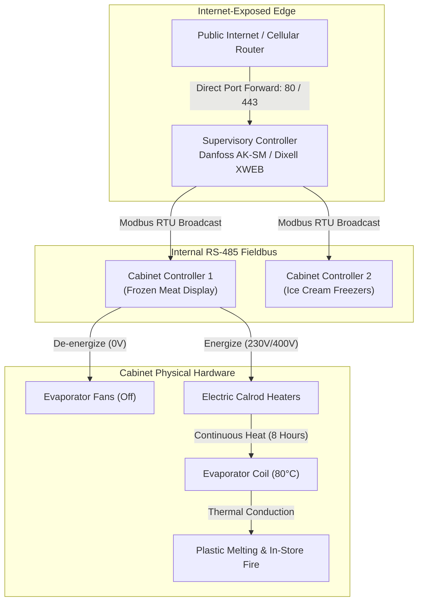
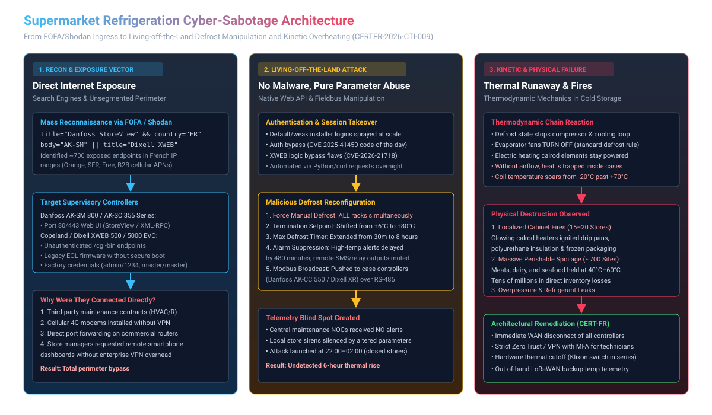
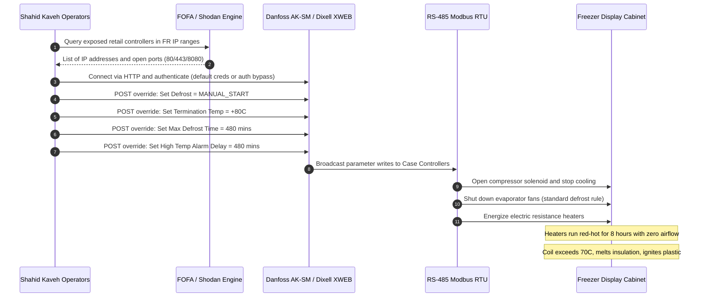

# French Supermarket Refrigeration Cyber-Sabotage: Architecture, Living-off-the-Land OT Abuse, and Physical Consequences

**Daily learning · 12 November 2026 · Primary-source review · Joint French C4 attribution**

> **Core idea:** Overnight on 11–12 October 2026, state-sponsored cyber operators breached internet-exposed industrial refrigeration controllers across roughly 700 retail sites in France. By abusing native supervisory interfaces without deploying malware, the attackers forced continuous electric defrost heating and suppressed alerts, driving case temperatures up to 80°C, spoiling tens of millions of euros of food, and triggering at least 15 physical in-store fires. [CERTFR-2026-ALE-012](https://www.cert.cyber.gouv.fr), [CERTFR-2026-CTI-009](https://www.cert.cyber.gouv.fr/uploads/CERTFR-2026-CTI-009.pdf).

---

## 1. Foundations: Supermarket Refrigeration Topology and the Exposed Edge

Commercial supermarkets rely on centralized direct-expansion (DX) or transcritical $\text{CO}_2$ (R744) refrigeration systems. These systems maintain two critical thermal regimes across dozens of display aisles and cold-storage rooms: **Medium Temperature (MT)** (+1°C to +4°C for dairy, produce, and fresh meat) and **Low Temperature (LT)** (-18°C to -25°C for frozen foods and ice cream).

To manage this complex thermodynamic loop efficiently, supermarkets deploy a hierarchical Operational Technology (OT) architecture:

```
[ Central Cloud / Maintenance NOC (Carrier, Equans, Engie) ]
                       ▲
                       │ (Insecure WAN / Direct Port Forward)
                       ▼
       [ Supervisory Controller / System Manager ]
       (Danfoss AK-SM 800 / AK-SC 355 | Copeland / Dixell XWEB)
                       │
       [ RS-485 Modbus RTU / LonWorks Serial Fieldbus ]
         ├── Case Controller 1 (Danfoss AK-CC 55 / Dixell XR)
         ├── Case Controller 2 (Evaporator Fans + Calrod Heaters)
         └── Compressor Rack Pack Controller
```

1. **Supervisory Controllers (System Managers):** Industrial gateway devices—predominantly the **Danfoss AK-SM 800 series / AK-SC 355** and **Copeland / Dixell XWEB series**—aggregate temperature sensor data, coordinate compressor rack sequencing, log temperature curves for regulatory compliance, and broadcast global commands (such as synchronized defrost scheduling).
2. **Case Controllers:** Small microcontroller units (such as the Danfoss AK-CC series or Dixell XR/XM) located directly beneath or behind each individual refrigerated display cabinet. They read thermistor probes (cabinet air temperature $S4$, evaporator coil temperature $S5$), modulate electronic expansion valves (EEVs), and actuate physical electromechanical relays for compressor solenoids, evaporator fans, and electric defrost heaters.
3. **The Defrost Cycle:** During normal cooling, moisture from ambient store air condenses on the cold evaporator coils and forms frost. If left unchecked, frost insulates the coil and chokes airflow, collapsing cooling efficiency. To melt this ice, controllers run automated defrost cycles 2 to 4 times a day. In low-temperature freezers, this is executed using high-wattage **electric resistance heating elements (calrods)** woven directly into the aluminum fins of the evaporator coil.





### Parties and Roles in the Incident

| Party | Architectural Role | Operational Effect in Incident |
|---|---|---|
| **Affected Supermarket Chains** | Operators of retail stores (Carrefour, E.Leclerc, Intermarché, Casino, Système U, Metro). | Suffered simultaneous cold-chain failure across ~700 stores; inventory condemned; in-store fire responses. |
| **Danfoss &amp; Copeland / Dixell** | Manufacturers of industrial refrigeration controllers and supervisors. | Hardware management interfaces were directly targeted; issued security hardening bulletins and firmware patches. |
| **HVAC/R Maintenance Contractors** | Facilities engineering firms (e.g. Equans, Carrier Commercial, Dalkia). | Managed remote store maintenance; frequently configured direct WAN port forwards or 4G routers to avoid on-site visits. |
| **Shahid Kaveh (IRGC-CEC)** | Cyber warfare unit under Iran's Islamic Revolutionary Guard Corps. | Executed automated reconnaissance and Living-off-the-Land parameter sabotage across French commercial infrastructure. |
| **French Crisis Center (C4) &amp; ANSSI** | Joint cybersecurity and intelligence agency (ANSSI, COMCYBER, DGSE, DGSI, DGA). | Investigated root causes, published alert `CERTFR-2026-ALE-012`, and formally attributed the attack via `CERTFR-2026-CTI-009`. |

### Key Technical Terminology

| Term | Operational Meaning in Refrigeration Systems |
|---|---|
| **Calrod Electric Heater** | High-wattage (1.5 kW to 5 kW per display case) resistive metal heating rods clamped against evaporator fins to melt frost. |
| **Defrost Termination Probe ($S5$)** | A temperature sensor attached to the evaporator coil that signals the controller to kill power to heaters once the coil reaches ~+6°C. |
| **Fail-Safe Defrost Timeout** | A countdown timer (typically 30–45 minutes) designed to cut heater power if the termination temperature sensor fails open or falls off. |
| **Klixon Thermal Cutoff** | A non-programmable, bimetallic mechanical safety thermostat mounted directly on the heating element to cut power if temperature exceeds 65°C–80°C. |
| **Living-off-the-Land (LotL) OT** | Sabotaging physical processes by issuing valid commands to native control software, requiring no custom malware or binary payloads. |
| **Safety-Instrumented System (SIS)** | An engineered safety layer that operates independently of the process control system to bring equipment to a safe state during failure. |

---

## 2. Mechanism: Living-off-the-Land Attack Chain and Thermodynamic Failure

Mainstream news coverage characterized the event as a generic "ransomware" or "hacking" attack. In reality, the operation was a classic **Living-off-the-Land Operational Technology (LotL-OT)** sabotage campaign. The threat actors deployed **no malware, dropped no ransomware binaries, and executed no kernel-level exploits on store servers**. Instead, they manipulated native controller setpoints through publicly exposed web interfaces and supervisory APIs.



### Stage 1: Internet Reconnaissance via Targeted Search Engines

Rather than compromising corporate Active Directory environments or headquarters networks, the threat actors identified retail endpoints using public cyberspace mapping engines such as **FOFA** and **Shodan**. 

Supermarket refrigeration supervisory controllers typically expose lightweight HTTP/HTTPS web servers:
- **Danfoss AK-SM 800 / AK-SC 355:** Run an embedded web server hosting the **Danfoss StoreView** interface, presenting distinct HTTP title banners and URI paths (e.g. `title="Danfoss StoreView"` or `/storeview/`).
- **Copeland / Dixell XWEB:** Expose administrative portals under `/cgi-bin/` or HTTP page titles containing `XWEB500`, `XWEB5000 EVO`, or `Dixell S.r.l.`.

The operators filtered for these banners across French autonomous system numbers (ASNs) owned by major telecommunication providers (Orange AS3215, SFR AS15557, Free AS12322) and commercial cellular 4G/LTE APNs used by refrigeration maintenance providers. This quickly yielded an actionable inventory of roughly 700 exposed controllers.

### Stage 2: Authentication Compromise and Logic Bypasses

Access was achieved through a combination of configuration hygiene failures and specific logic vulnerabilities:

1. **Factory and Installer Default Credentials:** A significant portion of the exposed controllers retained default factory administrative credentials (e.g., `admin` / `1234`, `supervisor` / `3456` on Danfoss units; `master` / `master`, `admin` / `admin`, `dixell` / `dixell` on Dixell XWEB devices). In other instances, third-party maintenance contractors configured predictable passwords across hundreds of client stores (such as store numbers or contractor brand names).
2. **Authentication Logic Flaws (CVE-2025-41450 &amp; CVE-2026-21718):** On updated devices where default passwords had been changed, attackers leveraged architectural authentication flaws. On the Danfoss AK-SM 800A series, Claroty Team82 discovered **CVE-2025-41450** (CVSS 8.2), which exploited an undocumented "code-of-the-day" diagnostic routine to bypass standard web session validation and export system settings. On Copeland/Dixell XWEB Pro devices, logic flaws in return-code handling (**CVE-2026-21718**) allowed unauthenticated users to invoke administrative configuration functions.

### Stage 3: Operational Parameter Sabotage

Once logged into the supervisory interface, the attackers did not brick the controllers. Bricking the device would immediately fail-safe the system (de-energizing all relays and sounding local hardware alarms). Instead, they issued valid configuration modifications:

1. **Initiate Forced Manual Defrost:** The supervisor was commanded to initiate an immediate, global manual defrost cycle across all connected low-temperature and medium-temperature circuits simultaneously.
2. **Elevate Termination Temperature Threshold ($S5$):** Normally, the defrost cycle terminates automatically when the coil temperature probe reaches **+5°C to +8°C**, confirming that all ice has transitioned to water. The attackers overwrote this parameter, setting the defrost termination limit to **+80°C** (the maximum allowable numerical setpoint in the firmware).
3. **Override the Maximum Defrost Timer:** The fail-safe duration timer—normally restricted to 30 to 45 minutes—was reprogrammed to **480 minutes (8 hours)** or continuous operation.
4. **Mute High-Temperature Alarms and Notifications:** In standard operation, if a cabinet exceeds its target threshold (e.g., -15°C for freezers), the controller waits for an alarm delay timer (typically 60 minutes during defrost) before sounding an in-store buzzer, dialing a digital relay, or transmitting an automated alert via email/SMS to the maintenance provider's central network operations center (NOC). The attackers extended the alarm delay to 480 minutes and suppressed external notification dispatches, effectively blinding both on-duty store managers and remote monitoring contractors throughout the night.

The supervisory controller serialized these parameters and pushed them across internal **RS-485 serial fieldbus networks using Modbus RTU** to every individual cabinet controller throughout the store.

### Stage 4: The Physical and Thermodynamic Failure Cascade

The interaction between the modified software parameters and the physical mechanical design of commercial display cases led directly to physical destruction:

1. **The Evaporator Fan Interlock:** In all commercial refrigeration systems, evaporator fans are **automatically de-energized during defrost**. This is a deliberate design rule: if fans were to run while the defrost heaters were active, warm air would be blown directly into the retail shopping aisle, wasting energy and melting open food items.
2. **Heat Trapping in Insulated Enclosures:** With the fans turned off, the refrigeration display case becomes a sealed, highly insulated box with zero forced air circulation. 
3. **Continuous High-Wattage Electrical Dissipation:** Commercial supermarket freezers utilize electric calrod resistance elements operating at 230V or 400V, drawing between 1.5 kW and 5 kW per display case. Across a large hypermarket with 40 to 60 freezer cases, the total heating capacity exceeds **100 kW to 250 kW**.
4. **Thermal Runaway and Breakdown of Mechanical Fail-Safes:**
   - As the heating elements remained continuously powered for hours, coil temperatures soared past +50°C and approached +80°C.
   - Most modern display cases feature a local bimetallic safety switch (a **Klixon switch**) designed to mechanically open the heater circuit if temperatures exceed 65°C–70°C. However, in retail environments with older cabinets, these mechanical thermostats often suffer from contact welding (contacts pitting and fusing closed under high inductive load over years of use), calibration drift, or intentional bypass by technicians troubleshooting nuisance trips.
5. **Combustion and Flashovers (15–20 In-Store Fires):** With calrod heating rods glowing cherry-red internally without airflow, intense radiant heat transferred into surrounding components:
   - Polyurethane and expanded polystyrene (EPS) thermal insulation inside the cabinet walls decomposed into combustible hydrocarbons.
   - Plastic condensate drain pans, ABS fan cowlings, and PVC wiring conduits melted and dripped directly onto the red-hot heating elements.
   - Cardboard packaging and plastic film wrapping of frozen food caught fire, triggering open localized cabinet fires in at least 15 to 20 retail locations across France.

---

## 3. Impact, Limits, and Attribution

The consequences of the attack extended beyond digital disruption into tangible physical damage and food security concerns.

### Demonstrated Real-World Consequences

- **Physical Fires:** Between 15 and 20 documented store fires required emergency responses from local French fire brigades (*sapeurs-pompiers*) overnight.
- **Inventory Destruction:** Tens of thousands of tons of frozen and chilled inventory (fresh poultry, beef, dairy, frozen goods, and seafood) maintained at temperatures between +40°C and +70°C for hours entered dangerous bacterial proliferation phases. All affected inventory was legally condemned and destroyed, totaling tens of millions of euros in direct write-downs.
- **Equipment Degradation &amp; Refrigerant Leaks:** Prolonged extreme temperatures expanded refrigerant trapped inside evaporator circuits, spiking internal pressure and causing thermal warping of seals, ruptured solder joints, and localized refrigerant discharges.
- **Secondary Targets:** Concomitant scanning and intrusion attempts targeted Schneider Electric programmable logic controllers (PLCs) at several small French hydroelectric facilities, though these resulted in negligible operational disruption compared to the retail sector.

### Common Misconceptions vs. Verified Facts

| Common Misconception | Verified Reality |
|---|---|
| **"Supermarkets were hit by a new ransomware encrypting servers."** | No ransomware or data encryption was deployed. The attack was pure operational sabotage using native controller parameters (Living-off-the-Land). |
| **"The corporate IT networks of Carrefour and Leclerc were penetrated."** | Store corporate headquarters and IT backbones were uncompromised. Attackers connected directly from the public internet into standalone refrigeration controllers via exposed WAN IPs. |
| **"A zero-day exploit gave root code execution on all controllers."** | While specific CVEs were used against patched models, the overwhelming majority of breaches relied on default factory credentials, obsolete EOL units, and exposed HTTP/CGI endpoints. |
| **"Refrigeration systems simply turned off."** | If refrigerators had simply lost power, insulated cabinets would have maintained safe temperatures for several hours. The disruption was catastrophic because the units were actively commanded to **heat** continuously. |

### Attribution to Shahid Kaveh (IRGC)

On 9 November 2026, the French Cyber Crisis Coordination Centre (**C4**)—a joint operational body uniting **ANSSI**, the French Military Cyber Command (**COMCYBER**), the General Directorate for External Security (**DGSE**), the General Directorate for Internal Security (**DGSI**), and the Directorate General of Armaments (**DGA**)—published threat intelligence report **CERTFR-2026-CTI-009**.

The investigation formally attributed the campaign to **Shahid Kaveh** (alongside sister unit *Shahid Shoostari*), an offensive cyber warfare unit embedded within the Electronic and Cyber Center of the Islamic Revolutionary Guard Corps (**IRGC-CEC**):

1. **Infrastructure Fingerprints:** Scanning patterns, proxy servers, and command-and-control infrastructure overlapped directly with infrastructure previously tracked during the 2023 cyberattacks against *Charlie Hebdo* and the disruption of video display signage during the Paris 2024 Olympic and Paralympic Games.
2. **Linguistic Artifacts:** Persian (Farsi) language strings, variable naming conventions, and comments were recovered from automation scripts used to query FOFA and transmit configuration commands.
3. **Known Front Personas:** Threat intelligence confirmed links between Shahid Kaveh and hacktivist personas historically used to claim IRGC operations, including *CyberAveng3rs*, *Soldiers of Solomon*, and *Cyber Isnaad Front*.
4. **Judicial and Diplomatic Measures:** The Paris Public Prosecutor’s Office issued international arrest warrants for three senior Shahid Kaveh operational leaders: **Hamid Reza Lashgarian, Mahdi Lashgarian, and Reza Salarvand**. The French Ministry for Europe and Foreign Affairs summoned the Iranian ambassador and pushed for European Union-wide sanctions against IRGC cyber leadership.

---

## 4. Timeline and Incident Progression

All recorded events reflect coordinated operational milestones during autumn 2026:

| Date &amp; Time (UTC) | Milestone | Operational Details |
|---|---|---|
| **September – Early Oct 2026** | Target Reconnaissance | Iranian operators execute automated FOFA queries targeting French ASNs for Danfoss StoreView and Dixell XWEB devices. |
| **11 Oct 2026, 21:00** | Initial Wave Execution | Automated scripts begin authenticating against exposed controllers across France as retail stores close for the night. |
| **11–12 Oct 2026 (Overnight)** | Defrost Sabotage &amp; Fires | Defrost parameters overwritten to continuous heating (+80°C, 480 mins); 15–20 in-store fires break out; ~700 stores impacted. |
| **12 Oct 2026, 06:00** | Discovery &amp; Containment | Morning store personnel arrive to find melted inventory, smoke, and blazing display cases. Emergency disconnects begin. |
| **12 Oct 2026** | Official Alert Issued | CERT-FR publishes urgent security advisory **CERTFR-2026-ALE-012**, instructing all operators to disconnect controllers from WAN. |
| **16 Oct 2026** | Advisory Revision 2 | CERT-FR updates CERTFR-2026-ALE-012 with specific firmware hardening and Modbus isolation guidance. |
| **2 Nov 2026** | European Expansion Wave | Similar defrost override attacks strike retail and cold-chain targets across 9 European nations (including Belgium, Germany, Italy, Netherlands). |
| **9 Nov 2026** | Formal Attribution Report | ANSSI and C4 release **CERTFR-2026-CTI-009**, formally attributing the attacks to IRGC unit Shahid Kaveh. |
| **10 Nov 2026** | Diplomatic &amp; Legal Action | Paris prosecutor issues international arrest warrants; French Foreign Ministry summons the Iranian ambassador. |

---

## 5. Practical Engineering Response and Defensive Hardening

The French supermarket sabotage exposed a widespread operational misconception: treating Building Management Systems (BMS) and refrigeration controllers as low-risk facilities IoT rather than critical Operational Technology.

### 1. Perimeter Isolation and Zero Trust Network Architecture

Refrigeration controllers should **never** have public IPv4 addresses or direct port-forwarding rules on edge routers:

- **Complete Ingress Elimination:** Block all inbound WAN traffic on ports 80, 443, 8080, 10443, and 502 (Modbus TCP).
- **Mandatory VPN / ZTNA for Maintenance:** Remote access by third-party facilities engineers (Carrier, Equans, Engie) must be routed strictly through an encrypted Virtual Private Network (IPsec / WireGuard) or Zero Trust Network Access (ZTNA) gateway enforcing Multi-Factor Authentication (MFA).
- **Cellular Gateway Hardening:** Dedicated 4G/5G cellular modems deployed by refrigeration vendors must use **Private APNs** (Access Point Names) with private, non-routable IP space rather than public static IP addresses.

### 2. The Critical Missing Link: Hardwired Physical Interlocks (Safety-Instrumented Systems)

The incident proves that software-based safety checks are fundamentally insufficient when an adversary possesses administrative credentials:

$$\text{Safety Barrier} \neq \text{Software Parameter in Supervisory Firmware}$$

In high-consequence industrial engineering (chemical processing, power generation), physical safety is governed by **Safety-Instrumented Systems (SIS)** that cannot be altered via software:

- **Series-Wired Bimetallic Thermal Cutoffs:** Every electric defrost heating circuit must feature an independent, non-resettable bimetallic thermal fuse or Klixon switch **wired physically in series with the power contactor coil** (not just reporting to a digital input on the microcontroller). If the temperature inside the coil block reaches +40°C, the bimetal strip physically breaks the circuit, cutting 230V/400V power to the heating elements regardless of what software state the controller commands.
- **Hardware Max-Run Timers:** Dedicated electromechanical delay-off relays wired in the power circuit can physically prevent heaters from remaining energized for more than 45 continuous minutes.

### 3. Out-of-Band Telemetry &amp; Independent Monitoring

Because the attackers disabled software alarms inside the supervisory controller, remote monitoring centers received no alerts:

- **Independent IoT Sensors:** Supermarkets must deploy battery-powered, wireless temperature loggers (e.g. **LoRaWAN** or standalone cellular sensors) inside freezers and cold rooms.
- **Decoupled Alerting Pipeline:** These sensors communicate directly to an independent cloud monitoring system that has no network connection to the Danfoss or Dixell BMS. If a freezer crosses -10°C, automated SMS and phone call alerts dispatch immediately, bypassing compromised local controllers.

---

## 6. Open-Source Detection and Threat Hunting

Security teams and facilities managers can hunt for exposed refrigeration infrastructure and detect anomalous parameter manipulation using the following tools and signatures.

### Reconnaissance &amp; Exposure Audit Queries

Asset owners can check if their public IP blocks or domain names are exposed using these search engine queries:

```bash
# FOFA Query: Discover exposed Danfoss StoreView interfaces
app="Danfoss-StoreView" || body="Danfoss AK-SM" || title="StoreView Web"

# FOFA Query: Discover exposed Dixell / Copeland XWEB supervisors
title="XWEB500" || title="XWEB5000" || body="Dixell S.r.l."

# Shodan Query: Search for exposed Danfoss controllers
"Server: Danfoss" "StoreView" port:80,443,8080

# Shodan Query: Search for exposed Dixell XWEB controllers
"XWEB" "Dixell" http.title:"XWEB"
```

### Suricata / Snort Detection Rule: Anomalous Defrost Parameter Write

Network IDS sensors monitoring perimeter traffic or maintenance VPN tunnels can detect unauthorized HTTP POST requests targeting Danfoss AK-SM / StoreView parameter endpoints:

```suricata
# Detect unauthorized manual defrost overrides sent to Danfoss StoreView controllers
alert http any any -> $REFRIGERATION_CONTROLLERS [80,443,8080] (
    msg:"ET EXPLOIT Possible Malicious Refrigeration Defrost Override (CERTFR-2026-ALE-012)";
    flow:established,to_server;
    http.method; content:"POST";
    http.uri; content:"/storeview/setpoint" nocase;
    http.request_body; content:"defrost_manual_start=1" nocase;
    http.request_body; content:"def_term_temp=" nocase;
    classtype:attempted-admin;
    sid:202610111;
    rev:1;
    reference:url,www.cert.cyber.gouv.fr;
)
```

### Forensic Incident Response Checklist

When responding to an impacted site, follow this triage procedure:

1. **Immediate Physical Disconnect:** Physically unplug the Ethernet cable and power down cellular modems attached to the Danfoss AK-SM or Dixell XWEB unit.
2. **Inspect Physical Contactor Cabinets:** Verify whether defrost heating contactors are stuck or welded in the closed position.
3. **Capture Volatile Memory &amp; Audit Logs:** Before rebooting, download the local event and alarm log file (`/log/event.log` or StoreView system log) to capture originating remote IP addresses, session timestamps, and altered parameters.
4. **Restore Configuration from Known-Good Baseline:** Re-flash controller configuration from an offline, verified backup; explicitly verify that maximum defrost durations are set to $\le 35\text{ minutes}$ and termination temperatures are restored to $+6\text{°C}$.

---

## 7. Source Context and Verification

This technical review synthesizes official government advisories, threat intelligence publications, and industrial control systems research:

- **CERT-FR Security Alert CERTFR-2026-ALE-012:** *Incident de sécurité ciblant les contrôleurs à distance des installations de réfrigération* (Initial alert published 12 October 2026, revised 16 October 2026).
- **CERT-FR CTI Report CERTFR-2026-CTI-009:** *Activités cyber offensives ciblant la France menées par des acteurs iraniens liés au CGRI* (Threat intelligence attribution published 9 November 2026 by C4: ANSSI, COMCYBER, DGSE, DGSI, DGA).
- **Claroty Team82 Vulnerability Disclosures:** Analysis of Danfoss AK-SM 800A controllers (CVE-2025-41450, CVE-2025-41451, CVE-2025-41452) and Copeland / Dixell XWEB supervisors (CVE-2026-21718, CVE-2026-25085, CVE-2026-25109).
- **CISA ICS Advisories:** Guidance on securing Building Management Systems and commercial HVAC/R industrial controllers from public internet exposure.

---

**Related:**
- [Polymarket-DebugBear-Supply-Chain-Attack-Oct-2026.md](Polymarket-DebugBear-Supply-Chain-Attack-Oct-2026.md) — Analyzes Living-off-the-Land session authority reuse versus operational parameter manipulation.
- [Grok-Build-Passive-DNS-Data-Exposure-Nov-2026.md](Grok-Build-Passive-DNS-Data-Exposure-Nov-2026.md) — Explores external attack surface discovery and internet-wide reconnaissance mechanics.
- [React-Server-Components-RCE-GHSA-xqc2-xf4c-x3h3-Oct-2026.md](React-Server-Components-RCE-GHSA-xqc2-xf4c-x3h3-Oct-2026.md) — Details protocol desynchronization and failure of architectural boundary trust.
- [AWS-Firecracker-MicroVM-Escape-Vulnerabilities-Nov-2026.md](AWS-Firecracker-MicroVM-Escape-Vulnerabilities-Nov-2026.md) — Discusses hardware and hypervisor boundary isolation compared to industrial network segmentation.
