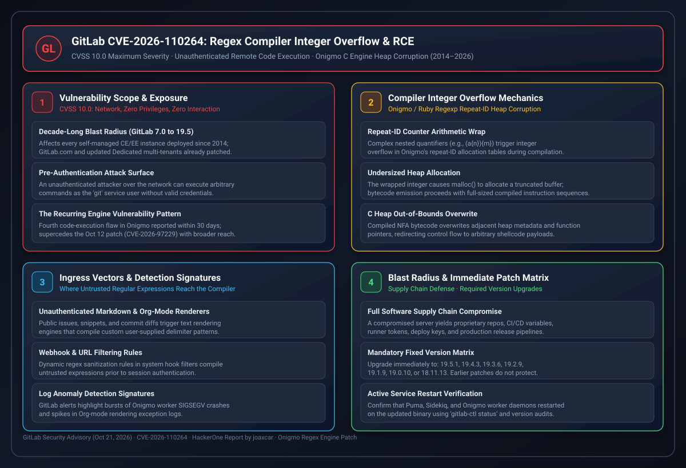
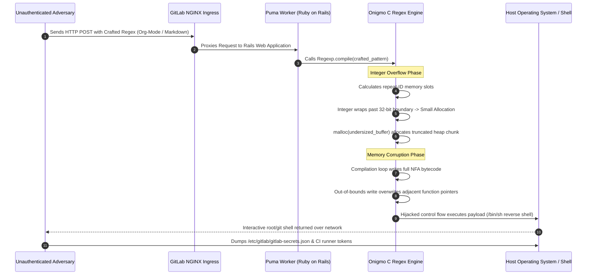

# GitLab CVE-2026-110264: Regex Compiler Integer Overflow and Unauthenticated RCE (2026)

Daily learning · October 24, 2026 · Primary-source review · Critical Security Advisory

*By Srinivasan Ragothaman ([@rsrini7](https://github.com/rsrini7))*

> **Core Idea:** A critical vulnerability assigned the maximum base score of CVSS 10.0 (**CVE-2026-110264**) was uncovered in self-managed GitLab Community and Enterprise Editions, affecting every release dating back to version 7.0 (2014). An integer overflow within the Onigmo native regular expression engine utilized by Ruby allows an unauthenticated remote attacker to trigger C heap corruption during regex compilation. By supplying a specially crafted regex through public rendering endpoints, an adversary achieves arbitrary remote code execution as the `git` user, compromising source repositories, CI/CD runner tokens, and downstream software supply chains.

---

## 1. Foundations & Ecosystem Context

GitLab is one of the world's most widely deployed DevOps platforms, providing Git repository hosting, issue tracking, continuous integration (CI/CD), container registries, and production deployment automation. In enterprise environments, self-managed GitLab Community Edition (CE) and Enterprise Edition (EE) instances are typically deployed within private cloud VPCs or exposed to the public internet for distributed developer access.

```
+-----------------------------------------------------------------------------------+
|                        GitLab Architecture & Native Compilation Boundary          |
+-----------------------------------------------------------------------------------+

   Unauthenticated Web Ingress (HTTP / HTTPS)
            │
            ▼
   [NGINX Reverse Proxy] ──────► [GitLab Workhorse] (Go Proxy / File Streaming)
                                          │ (Unix Domain Socket)
                                          ▼
   [Puma Web Server (Ruby on Rails)]
            │
            ├── Rugged / libgit2 (C Git bindings)
            ├── PostgreSQL DB / Redis Cache
            └── Ruby Runtime Core
                  │
                  ▼ (Regexp.compile / String#match)
   [Onigmo C Regular Expression Engine] (Native Shared Library)
         ├── Regex Lexer & Syntax Parser
         ├── Repeat-ID Allocation & Memory Sizing
         └── Bytecode NFA Instruction Generator ──► Heap Memory Corruption!
```

### The Native Code Boundary: Ruby and Onigmo
While GitLab's application logic is authored in Ruby on Rails, performance-critical string evaluation and pattern matching rely on **Onigmo (Oniguruma-mod)**, an open-source regular expression engine written in ANSI C embedded directly within the Ruby runtime. 

When a user submits text containing regular expressions—or when GitLab's internal rendering engines evaluate text against dynamic patterns—the Ruby VM invokes Onigmo's C compilation routines (`onig_compile`). If an unhandled integer boundary error occurs in this native C code, it bypasses Ruby's high-level memory safety guarantees, exposing the underlying process to classical memory corruption.

### Key Terminology & Architectural Concepts

| Term | Technical Meaning & Threat Context |
| :--- | :--- |
| **Onigmo Engine** | Native C regular expression engine embedded in the Ruby MRI runtime, responsible for parsing and compiling regex patterns into bytecode. |
| **Repeat-ID Counter** | Internal compiler tracking variable in Onigmo indexing quantified repetition sub-expressions (e.g., `(pattern){min,max}`). |
| **Integer Overflow** | Arithmetic condition where calculating allocation buffer sizes wraps past the maximum representable integer, yielding a truncated positive value. |
| **Heap Memory Corruption** | Overwriting adjacent memory chunks on the C heap (e.g., `ptmalloc` metadata, function pointers) via out-of-bounds writes. |
| **CVSS 10.0 Maximum Severity** | Vector rating (`AV:N/AC:L/PR:N/UI:N/S:C/C:H/I:H/A:H`) denoting network reachability, low complexity, zero authentication, and complete system compromise. |
| **Omnibus GitLab** | Pre-packaged, monolithic GitLab distribution bundling Ruby, PostgreSQL, Redis, NGINX, and Onigmo into a unified installation tree. |
| **CI/CD Supply-Chain Blast Radius**| Downstream threat where compromising a GitLab instance exposes runner tokens, AWS/GCP deploy keys, and pipeline code. |

---

## 2. Deep Technical Mechanism: The Compiler Integer Overflow

The vulnerability resides within the regex compilation lifecycle where Onigmo constructs the internal bytecode representation for quantified repetition groups.

```
┌────────────────────────────────────────────────────────────────────────────────────────┐
│                        Onigmo Integer Overflow & RCE Kill Chain                        │
└────────────────────────────────────────────────────────────────────────────────────────┘

  [Phase 1: Ingestion of Crafted Regex]
  └── Attacker submits crafted pattern with extreme or nested quantifiers:
      e.g., /(a{1,2147483647}){2}/ via an unauthenticated rendering endpoint.
            │
            ▼
  [Phase 2: Integer Sizing & Arithmetic Wrap]
  └── Onigmo's compiler calculates required repeat-ID allocation tables.
      Multiplication or increment arithmetic wraps past 32-bit limits:
      Required Size = (repeat_count * sizeof(Slot)) -> Wraps to small integer!
            │
            ▼
  [Phase 3: Undersized Heap Allocation]
  └── malloc() allocates an undersized buffer based on the wrapped integer.
      Allocation succeeds without memory exhaustion or operating system OOM error.
            │
            ▼
  [Phase 4: Bytecode Emission & Out-of-Bounds Write]
  └── The compilation loop writes full, untruncated NFA bytecode opcodes.
      Writes overflow the small buffer, corrupting adjacent heap chunks and pointers.
            │
            ▼
  [Phase 5: Control Flow Hijack]
  └── Process control flow is redirected to attacker shellcode / system() call.
      Adversary achieves arbitrary remote shell execution as the 'git' service user.
```

### 1. Repeat-ID Allocation Arithmetic
In regular expression grammars, quantifiers like `{m,n}` instruct the engine to repeat matching subpatterns. To manage backtracking during execution, Onigmo assigns unique **repeat-IDs** and allocates dedicated memory slots on the heap to track execution state.

During the compilation phase in `parse_exp_repeat()`, the compiler calculates the memory required to hold these repeat groups. When an attacker provides nested or mathematically astronomical repeat bounds, the calculation wraps around 32-bit integer boundaries:
$$\text{AllocatedBytes} = (\text{RepeatIDCount} \times \text{EntrySize}) \pmod{2^{32}}$$

Because the integer wraps, `malloc()` allocates a buffer that is orders of magnitude smaller than required.

### 2. The Out-of-Bounds Bytecode Overwrite
The compiler continues under the erroneous assumption that the buffer is sufficiently large. As it iterates through the parsed Abstract Syntax Tree (AST) and emits compiled bytecode opcodes (e.g., `OP_REPEAT_INC`, `OP_FAIL`, `OP_JUMP`), it writes instructions past the allocated heap boundary.

This out-of-bounds write corrupts adjacent heap allocations, including:
- **Ruby `RValue` Structures:** Overwriting object class pointers (`klass`) to hijack method dispatch tables.
- **GLIBC Heap Metadata:** Corrupting chunk headers (forward and backward pointers), converting a heap corruption into an arbitrary write primitive during subsequent memory allocations.

### 3. Unauthenticated Attack Surfaces in GitLab
GitLab processes regular expressions across numerous public-facing, unauthenticated ingress vectors:
- **Markdown & Org-Mode Rendering Pipelines:** Publicly accessible issue trackers, snippet previews, and repository exploration endpoints evaluate text delimiters using regex parsers.
- **Webhook & URL Filtering Rules:** System hook sanitizers evaluate incoming webhook payloads and URLs against dynamic regex rules prior to verifying session state.
- **Public Merge Request & Diff Handlers:** Evaluating syntax highlighting rules across public repositories invokes the underlying regex engine without authentication.

---

## 3. Impact & The Supply-Chain Blast Radius

GitLab instances represent the single highest-value target in an enterprise software ecosystem. Achieving code execution as the `git` user allows an adversary to compromise the entire corporate software delivery lifecycle.

```
+───────────────────────────────────────────────────────────────────────────────────────────+
|                         GitLab Compromise Blast Radius Hierarchy                          |
+───────────────────────────────────────────────────────────────────────────────────────────+

  [Compromised GitLab Server Process (git user)]
            │
            ├── 1. Direct Access to PostgreSQL Database (gitlabhq_production)
            │      └── Dumps user password hashes, 2FA recovery secrets, and access tokens
            │
            ├── 2. Complete Repository Exfiltration & Source Tampering
            │      └── Clones proprietary codebases; injects backdoors into main branches
            │
            ├── 3. Extraction of CI/CD Pipeline Variables
            │      └── Scrapes AWS_SECRET_ACCESS_KEY, DOCKER_AUTH_CONFIG, PROD_KUBECONFIG
            │
            └── 4. GitLab Runner Hijacking
                   └── Executes malicious build steps; poisons enterprise container registries
```

### Why CVSS 10.0 Applies
The vulnerability meets every criterion for the maximum severity score under CVSS v3.1:
- **Attack Vector: Network (`AV:N`):** Exploitable remotely over standard HTTP/HTTPS ports (80/443).
- **Attack Complexity: Low (`AC:L`):** No specialized race conditions or complex network preconditions required.
- **Privileges Required: None (`PR:N`):** Exploitable by any anonymous visitor without an account.
- **User Interaction: None (`UI:N`):** Executes automatically upon payload ingestion without victim interaction.
- **Scope: Changed (`S:C`):** Compromising the GitLab application allows lateral movement into underlying operating system infrastructure and connected CI runners.
- **Impact: Complete (`C:H/I:H/A:H`):** Total loss of confidentiality, integrity, and availability across all hosted data.

---

## 4. Architectural Visuals & Unauthenticated Exploitation Sequence

The diagram below maps the complete path from anonymous HTTP payload dispatch to shellcode execution within the GitLab worker process.



### Remote Exploitation Sequence Diagram



---

## 5. Production Implementations & Security Automation Recipes

Engineering teams managing self-managed GitLab infrastructure must automate version detection, monitor for exploit crash signatures, and execute non-disruptive upgrades.

### Recipe 1: C / Python Simulation of Onigmo Quantifier Integer Overflow Logic

This script models how quantifier parameters trigger integer wrapping and undersized buffer allocations in vulnerable C-based regex compiler implementations.

```python
#!/usr/bin/env python3
"""
Onigmo Quantifier Integer Sizing Simulator
Demonstrates how 32-bit unsigned integer wrapping creates undersized heap buffers.
"""

import struct
import sys

def simulate_onigmo_buffer_sizing(min_repeat: int, max_repeat: int, subpattern_slots: int):
    print("=" * 65)
    print("🔬 Simulating Onigmo Repeat-ID Allocation Arithmetic")
    print(f"Quantifier Bounds: {{{min_repeat}, {max_repeat}}} | Slots per subpattern: {subpattern_slots}")
    print("=" * 65)

    # In vulnerable Onigmo versions, repeat count calculation uses 32-bit unsigned integers:
    # uint32_t total_slots = (max_repeat - min_repeat + 1) * subpattern_slots;
    slot_size_bytes = 16  # Size of internal repeat tracking structure on 64-bit systems

    # True theoretical size needed
    theoretical_slots = (max_repeat - min_repeat + 1) * subpattern_slots
    theoretical_bytes = theoretical_slots * slot_size_bytes

    # 32-bit wrapped integer arithmetic simulation
    wrapped_slots = (theoretical_slots) & 0xFFFFFFFF
    allocated_bytes = (wrapped_slots * slot_size_bytes) & 0xFFFFFFFF

    print(f"Theoretical Required Slots : {theoretical_slots:,}")
    print(f"Theoretical Memory Required : {theoretical_bytes / (1024*1024):,.2f} MB")
    print(f"32-Bit Truncated Slots     : {wrapped_slots:,}")
    print(f"Actual Memory Allocated    : {allocated_bytes} Bytes (malloc({allocated_bytes}))")

    if allocated_bytes < theoretical_bytes:
        overflow_delta = theoretical_bytes - allocated_bytes
        print(f"\n🚨 INTEGER OVERFLOW CONFIRMED!")
        print(f"Heap Buffer Undersized by  : {overflow_delta:,} Bytes")
        print("Adversary can write compiled bytecode past the allocated heap boundary!")
    else:
        print("\n✅ Arithmetic bounds safe; no integer truncation detected.")

if __name__ == "__main__":
    # Example trigger values simulating an integer wrap past 2^32
    # max_repeat set near UINT32_MAX
    sim_min = 1
    sim_max = 2147483648  # 2^31
    sim_slots = 2
    simulate_onigmo_buffer_sizing(sim_min, sim_max, sim_slots)
```

---

### Recipe 2: Enterprise Ansible Remediation & Version Audit Playbook

This production Ansible playbook audits self-managed GitLab instances across an enterprise fleet, scans logs for Onigmo crash signatures (SIGSEGV), and executes atomic package upgrades.

```yaml
---
# Ansible Playbook: GitLab CVE-2026-110264 Emergency Patching & Triage
- name: Remediate GitLab CVE-2026-110264 Across Enterprise Fleet
  hosts: gitlab_servers
  become: true
  vars:
    # Approved security release patch targets
    safe_versions:
      - "19.5.1"
      - "19.4.3"
      - "19.3.6"
      - "19.2.9"
      - "19.1.9"
      - "19.0.10"
      - "18.11.13"

  tasks:
    - name: 1. Audit Running GitLab Version
      shell: "gitlab-rake gitlab:env:info | grep 'Version:' | awk '{print $2}'"
      register: current_gitlab_version
      changed_when: false

    - name: Display Detected GitLab Version
      debug:
        msg: "Target server {{ inventory_hostname }} is currently running GitLab version: {{ current_gitlab_version.stdout }}"

    - name: 2. Check for Onigmo Crash Signatures in Production Logs
      shell: "grep -E '(SIGSEGV|Onigmo|Ruby regexp|repeat-ID overflow)' /var/log/gitlab/gitlab-rails/production.log | tail -n 20"
      register: crash_indicators
      failed_when: false
      changed_when: false

    - name: Alert on Potential Exploitation Artifacts
      debug:
        msg: "⚠️ WARNING: Onigmo crash signatures found in production logs on {{ inventory_hostname }}: {{ crash_indicators.stdout }}"
      when: crash_indicators.stdout != ""

    - name: 3. Verify PostgreSQL Database Backup Prior to Upgrade
      shell: "gitlab-backup create SKIP=artifacts,repositories,uploads STRATEGY=copy"
      register: backup_status

    - name: 4. Execute Atomic Package Upgrade (Ubuntu/Debian)
      apt:
        name: "gitlab-ee"
        state: latest
        update_cache: yes
      when: ansible_os_family == "Debian"

    - name: 5. Restart GitLab Core Daemons and Reconfigure
      command: gitlab-ctl reconfigure

    - name: 6. Verify Service Operational Health
      command: gitlab-ctl status
      register: service_status
      failed_when: "'down:' in service_status.stdout"

    - name: Confirm Patched State
      debug:
        msg: "✅ Server {{ inventory_hostname }} successfully updated and verified healthy."
```

---

## 6. Impact, Real-World Edge Cases & Gotchas

```
+-------------------------------------------------------------------------------------------------+
|                       Common Claims vs. Technical Realities                                     |
+-------------------------------------------------------------------------------------------------+
| Common Claim                                  | Technical Reality                               |
+-----------------------------------------------+-------------------------------------------------+
| "Applying the October 12 security patch       | The Oct 12 patch (CVE-2026-97229) only covered  |
| completely resolved regex compiler RCE risks."| v19.2+; CVE-2026-110264 affects all releases    |
|                                               | back to 7.0 (2014). New updates are required.   |
+-----------------------------------------------+-------------------------------------------------+
| "Exploitation requires a valid user login or  | The CVSS vector is PR:N (Privileges Required:   |
| elevated developer permissions in a project." | None); public rendering hooks allow unauthed    |
|                                               | network exploitation.                           |
+-----------------------------------------------+-------------------------------------------------+
| "Running apt-get upgrade gitlab-ce finishes   | A successful package install does not restart   |
| the remediation process."                     | Puma workers running in memory. You must verify |
|                                               | `gitlab-ctl status` and worker process PIDs.    |
+-----------------------------------------------+-------------------------------------------------+
| "Placing GitLab behind a Web Application      | WAF regex rules frequently fail to inspect      |
| Firewall (WAF) neutralizes the exploit."      | multi-part form payloads, Org-mode blocks, or   |
|                                               | base64-encoded Git tree objects.                |
+-----------------------------------------------+-------------------------------------------------+
```

### Real-World Failure Modes & Practical Gotchas

1. **The Puma Process Stagnation Gotcha:**  
   When updating GitLab via package managers (`apt` or `yum`), the package manager replaces binary files on disk. However, long-running Ruby Puma master and worker processes may hold old shared libraries open in memory. Administrators who fail to execute `gitlab-ctl restart` leave vulnerable Onigmo shared libraries active in RAM despite running an updated package version.
2. **The Secondary Attack Surface (Sidekiq Background Jobs):**  
   If an adversary submits a crafted regex payload into a public issue comment, Puma workers may fail to compile it and push the raw payload into a Redis Sidekiq queue for asynchronous notification or search indexing. The payload then executes inside the asynchronous Sidekiq background daemon, expanding the infection vector across backend workers.
3. **The Multi-Node Database Schema Lock:**  
   In highly available, multi-node GitLab installations, running `gitlab-ctl reconfigure` across web nodes simultaneously during a security cutover can trigger schema migration deadlocks in the PostgreSQL patroni cluster. Upgrades must follow GitLab's zero-downtime sequencing guidelines (deploying database migrations on a single deploy node before rolling web workers).

---

## 7. Practical Adoption Blueprint & Verification Checklist

To eradicate CVE-2026-110264, infrastructure administrators must apply the specific maintenance release corresponding to their active minor version branch:

```
┌────────────────────────────────────────────────────────────────────────────────────────┐
│                        Mandatory GitLab Patch Matrix & Action Plan                     │
└────────────────────────────────────────────────────────────────────────────────────────┘

  Branch Target          Safe Fixed Release Version
  ────────────────────────────────────────────────────────────────────────────────────────
  GitLab 19.5            Upgrade immediately to 19.5.1
  GitLab 19.4            Upgrade immediately to 19.4.3
  GitLab 19.3            Upgrade immediately to 19.3.6
  GitLab 19.2            Upgrade immediately to 19.2.9
  GitLab 19.1            Upgrade immediately to 19.1.9
  GitLab 19.0            Upgrade immediately to 19.0.10
  GitLab 18.11           Upgrade immediately to 18.11.13
  Legacy (7.0–18.10)     Upgrade along supported upgrade paths to 18.11.13+
```

### Post-Upgrade Verification Checklist

- [ ] **Version Audit:** Run `gitlab-rake gitlab:env:info` and verify that the reported version matches one of the patched releases listed above.
- [ ] **Daemon Restart Check:** Verify that Puma and Sidekiq process start times in `gitlab-ctl status` reflect post-upgrade timestamps.
- [ ] **Log Inspection:** Search `/var/log/gitlab/gitlab-rails/production.log` and `/var/log/gitlab/puma/puma_stdout.log` for anomalous segmentation faults or unhandled Onigmo exceptions.
- [ ] **Credential Integrity Audit:** If exploitation indicators are discovered, immediately rotate all GitLab runner registration tokens, deploy keys, and CI/CD project environment variables from an independent, clean workstation.

---

## 8. Incident Chronology & Current State

```
+───────────────────────────────────────────────────────────────────────────────────────────+
|                         Chronology of the GitLab Regex Disclosures                        |
+───────────────────────────────────────────────────────────────────────────────────────────+
  2014                GitLab 7.0 released; embeds Onigmo native C regex engine within Ruby MRI.
       │
  Early Oct 2026      Security researcher 'joaxcar' identifies recurring heap corruption patterns
                      in Onigmo repeat-ID handling via GitLab's HackerOne bug bounty program.
       │
  Oct 12, 2026        GitLab issues advisory for CVE-2026-97229 (unauthenticated regex compiler RCE
                      affecting GitLab versions 19.2 and later).
       │
  Oct 21, 2026        GitLab issues critical patch release covering CVE-2026-110264; reveals that the
                      new integer overflow vulnerability affects all versions back to GitLab 7.0.
       │
  Oct 22, 2026        CVE-2026-110264 assigned maximum CVSS 10.0 score; threat detection signatures
                      released for Onigmo worker crashes and Org-mode rendering exception bursts.
       │
  Oct 24, 2026        GitLab.com and GitLab Dedicated multi-tenants confirmed patched;
                      worldwide remediation efforts focused on self-managed enterprise servers.
```

---

## 9. Primary Sources & References

1. [GitLab Critical Security Release: Patch Release 19.5.1, 19.4.3, 19.3.6 (Oct 21, 2026)](https://docs.gitlab.com/releases/patches/patch-release-gitlab-19-5-1-released/) — Official vendor advisory detailing CVE-2026-110264, affected version ranges, and fixed releases.
2. [National Vulnerability Database (NVD): CVE-2026-110264 Record](https://www.cve.org/CVERecord?id=CVE-2026-110264) — Official CVSS 10.0 scoring vector, vulnerability metrics, and technical categorization.
3. [The Hacker News: Critical GitLab Flaw (CVSS 10.0) Allows Remote Code Execution](https://thehackernews.com/2026/10/critical-gitlab-flaw-cvss-100-could.html) — Comprehensive cybersecurity reporting on the Onigmo engine flaw and twelve-year blast radius.
4. [Rapid7 Threat Intelligence: Emergency Threat Response on GitLab Regex Vulnerabilities](https://www.rapid7.com/blog/post/etr-cve-2026-97229-critical-unauthenticated-remote-code-execution-in-gitlab) — Technical analysis of native regex compiler boundaries in enterprise developer tooling.
5. [Ruby Core: Regexp Repeat-ID Integer Overflow Patches (Ruby 3.3, 3.4, 4.0)](https://www.ruby-lang.org) — Upstream language patches resolving arithmetic wrapping in Onigmo parser tables.

---

**Related:**
- [React2Shell-CVE-2025-55182-Flight-Protocol-RCE-2026.md](React2Shell-CVE-2025-55182-Flight-Protocol-RCE-2026.md) — Comparison with another CVSS 10.0 unauthenticated remote code execution flaw in developer-facing infrastructure.
- [NodeJS-Async-Hooks-Stack-Exhaustion-DoS-CVE-2025-59466-2026.md](NodeJS-Async-Hooks-Stack-Exhaustion-DoS-CVE-2025-59466-2026.md) — Evaluating runtime native boundary failures, memory exhaustion, and process crashes in backend services.
- [LiteLLM-1.107.0-Supply-Chain-Compromise-Oct-2026.md](LiteLLM-1.107.0-Supply-Chain-Compromise-Oct-2026.md) — How compromised CI/CD pipelines and developer tooling credentials enable supply-chain trojan distribution.
- [AI-Key-Theft-Railway-Zeabur-Oct-2026.md](AI-Key-Theft-Railway-Zeabur-Oct-2026.md) — Analyzing how developer platform incursions expose enterprise environment secrets and production credentials.
