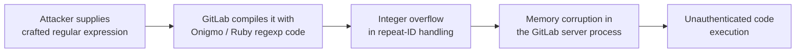

# GitLab CVE-2026-110264: A CVSS 10 Regex Compiler RCE

**Daily learning · 24 October 2026 · Primary-source review**

> **Core idea:** An integer overflow while compiling a crafted regular expression let an unauthenticated user run code on a self-managed GitLab server. The maximum-severity flaw affected every GitLab release back to 7.0 (2014), while GitLab.com and updated GitLab Dedicated tenants already include the fix.

> **If you operate GitLab:** upgrade to **19.5.1, 19.4.3, 19.3.6, 19.2.9, 19.1.9, 19.0.10, or 18.11.13** immediately. If you patched the 12 October regex flaw, you are still affected by this one.

## 1. Foundations: where a regex compiler sits

| Term | Meaning here |
|---|---|
| GitLab CE/EE | Community and Enterprise editions; both self-managed and GitLab-hosted deployments exist. |
| Regular-expression compiler | Native code that parses and compiles a regex before matching. GitLab uses Onigmo, the Ruby regex engine. |
| Integer overflow | Arithmetic wraps past the representable range, producing an undersized allocation or incorrect length. |
| Unauthenticated RCE | Code execution without a valid login. |
| CVSS 10.0 | Maximum base score: network-reachable, low complexity, no privileges, no user interaction, high impact. |

GitLab is not just source hosting. A compromised instance can expose repositories, CI/CD variables, runner credentials, deploy keys, and the software supply chain built from them.

## 2. Mechanism: what broke, and what remains unknown

GitLab's advisory states that a **specially crafted regular expression** triggers an **integer overflow during compilation**, and that under certain conditions this allows an unauthenticated user to execute arbitrary code on the server. The patch includes Ruby regexp repeat-ID overflow fixes for Ruby 3.3, 3.4, and 4.0. [GitLab patch release](https://docs.gitlab.com/releases/patches/patch-release-gitlab-19-5-1-released/), [CVE-2026-110264](https://www.cve.org/CVERecord?id=CVE-2026-110264).

GitLab has **not published the full trigger path**. Earlier related flaws in the same engine were reached through CI/CD configuration, but this note does not assert that every exploitation path uses CI/CD. What is established is the vulnerable component, the missing authentication requirement, and the maximum impact rating.

The diagram is a conceptual chain from the advisory. It omits the exact input surface and exploit primitive because GitLab has not disclosed them.

## 3. Impact and limits

| Claim | What the evidence supports |
|---|---|
| “Only GitLab.com customers are affected.” | No. GitLab.com is patched; the risk is **self-managed** CE/EE installations that have not upgraded. |
| “The 12 October patch covers this.” | No. CVE-2026-97229 affected 19.2 and later; CVE-2026-110264 reaches back to 7.0. Administrators must apply the new fixed release. |
| “A login is required.” | No. The CVSS vector is `PR:N` (no privileges) and `AV:N` (network). |
| “Exploitation has been confirmed in the wild.” | Not established. GitLab published threat detections but no confirmed exploitation report. |

The blast radius depends on what the GitLab server can reach. A typical self-managed instance holds source code, CI secrets, runner tokens, and deployment authority, so treating it as “just a code host” understates the consequence. [Rapid7 on the earlier regex flaw](https://www.rapid7.com/blog/post/etr-cve-2026-97229-critical-unauthenticated-remote-code-execution-in-gitlab).

## 4. Timeline

| Date (2026) | Event |
|---|---|
| **12 Oct** | GitLab fixes CVE-2026-97229, an unauthenticated regex-compiler RCE affecting 19.2 and later. |
| **21 Oct** | GitLab releases 19.5.1, 19.4.3, 19.3.6, 19.2.9, 19.1.9, 19.0.10, and 18.11.13 for CVE-2026-110264. GitLab.com is patched; Dedicated tenants on 19.3.5-internal0 or 19.4.2-internal0 and later already include the fix. |
| **22 Oct** | CVE record published. GitLab releases detections for an Onigmo native worker crash and an Org-mode render error burst. |

The vulnerability was reported by researcher **joaxcar** through GitLab's HackerOne programme. It is the fourth code-execution flaw in the same regex engine reported in a month, which makes the pattern more important than any single CVE: parser and compiler code that handles untrusted input remains a recurring native-code boundary. [The Hacker News summary](https://thehackernews.com/2026/10/critical-gitlab-flaw-cvss-100-could.html).

## 5. Practical response

1. **Identify the exact version** from the GitLab admin area or `/help`, then upgrade to the fixed release for that branch. Do not assume a recent patch level covers this CVE.
2. **Prioritise internet-facing instances and those with broad CI/CD authority.** A short maintenance window is preferable to leaving a CVSS 10 unauthenticated RCE exposed.
3. **Apply GitLab's detections** for unusual Onigmo worker crashes and Org-mode render errors while monitoring for exploitation attempts.
4. **Investigate before rotating blindly.** If compromise is suspected, preserve logs, review CI variables, runner registration, deploy keys, and repository changes, then rotate credentials from a clean system.
5. **Verify the running version after the upgrade** and confirm the instance is healthy. A successful package upgrade is not proof that the service restarted on the fixed build.

---

**Related:**
- [Node.js Brotli Decoder](Node.js-Brotli-Node2Shell-RCE-Oct-2026.md) — Another same-week runtime/parser memory-safety failure requiring a version upgrade.
- [PHP2Shell: History, UAF and ASLR](PHP2Shell-History-UAF-And-ASLR-Oct-2026.md) — Compare a pre-authentication RCE in a widely deployed runtime.
- [React2Shell Whitepaper](10.0_CVE_React2Shell_Whitepaper.md) — Another maximum-severity RCE affecting a developer-facing platform.
- [LiteLLM 1.107.0 Supply-Chain Compromise](LiteLLM-1.107.0-Supply-Chain-Compromise-Oct-2026.md) — Why CI/CD credentials and release pipelines are high-value targets once a developer platform is compromised.
