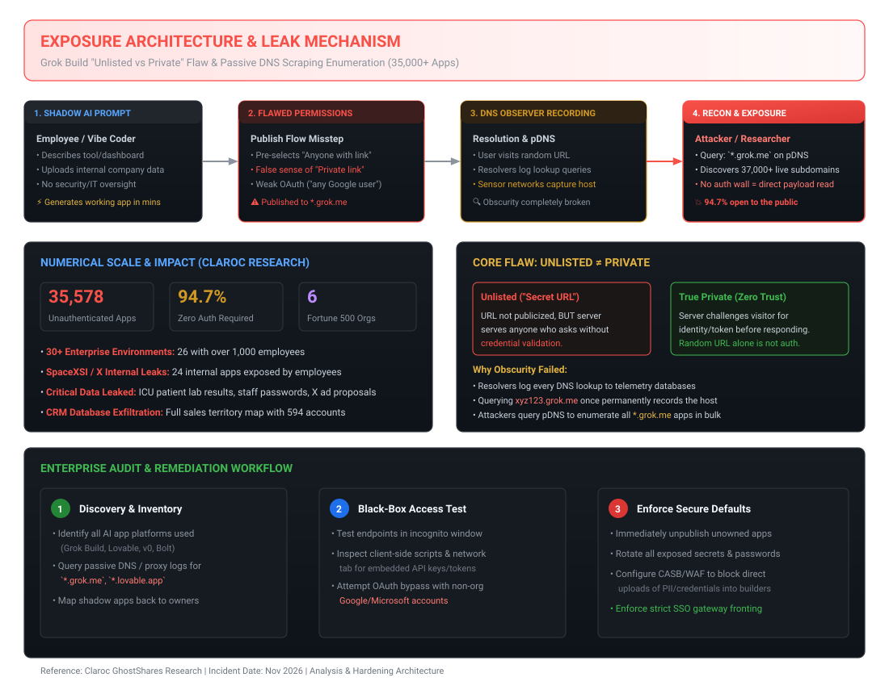
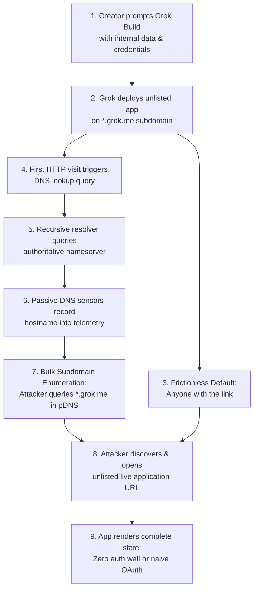
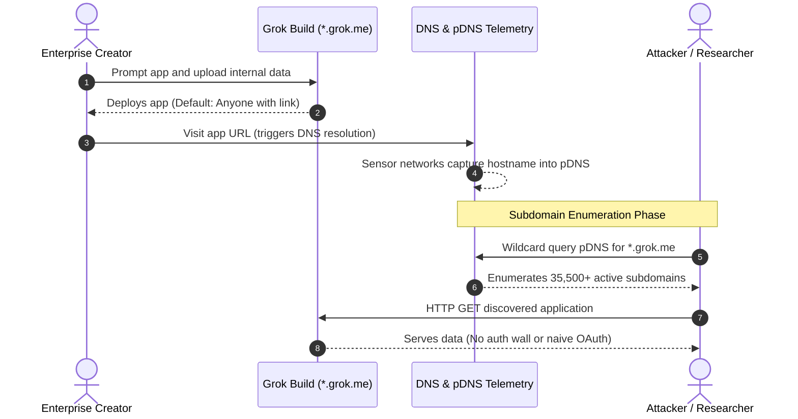

# Grok Build: "Unlisted" Subdomains and Passive DNS Expose 35,500+ Apps

**Daily learning · 12 November 2026 · Primary-source review · Exposure analysis**

> **Core idea:** Security researchers at Claroc uncovered that 35,578 out of 37,571 live applications built with SpaceXSI's Grok Build on `grok.me` subdomains were completely accessible without authentication. Users relied on randomized URLs for secrecy, but passive DNS sensors continuously ingested those lookups into global telemetry databases, exposing intensive care patient data, corporate employee passwords, internal API keys, and vendor roadmaps.



## 1. Foundations: why "unlisted" was not "private"

**What is Grok Build?** It is an AI-powered application generator developed by SpaceXSI (formerly xAI) that runs on the web and through developer tooling. A user enters natural-language prompts describing an application—such as a shift schedule, an enterprise dashboard, or an internal tracker—and the AI generates working front-end code, mock data or connected backend endpoints, and immediately publishes it to a live public subdomain under `*.grok.me`.

**What is Shadow AI?** In enterprise IT, "Shadow IT" refers to software deployed without central IT or security review. "Shadow AI" or "vibe coding" accelerates this dynamic: non-technical employees, sales directors, or clinical staff can assemble functional applications in minutes by uploading corporate spreadsheets, database excerpts, or operational rosters into AI builder interfaces. Because these applications solve urgent operational problems quickly, creators deploy them into daily operations without standard single sign-on (SSO), data loss prevention (DLP), or security logging.

**How does Grok Build compare to other platforms?** Prototyping platforms like Bolt.new, v0.dev, Replit, and Lovable also generate hosted web applications from prompts. However, hosting models differ fundamentally in how they handle obscurity and naming:
- **Path-based sharing (e.g., Google Docs, YouTube unlisted):** The resource sits under a shared, high-traffic domain (`docs.google.com/document/d/<secret-token>`). The DNS query reveals only `docs.google.com`. The path itself remains encrypted inside the TLS handshake (HTTPS) and is never transmitted over DNS.
- **Dedicated subdomain hosting (e.g., Grok Build):** The platform provisions a distinct DNS hostname for every application (`<random-words>.grok.me`). The moment any user or automated runner resolves that address, a DNS query containing the full name travels across public network infrastructure.

| Party | Role in the ecosystem | Practical effect in this incident |
|---|---|---|
| **SpaceXSI (formerly xAI)** | Platform developer and hosting operator (`grok.me`). | Defaulted publishing to "Anyone with the link", assigned unique subdomains, and lacked tenant-scoped auth enforcement. Removed 24 internal employee apps following notification. |
| **Claroc Research** | Independent cybersecurity research firm. | Disclosed the "GhostShares 2" investigation on 11 November 2026 after auditing 43,551 hostnames and identifying 35,578 unprotected apps. |
| **Enterprise Employees & Creators** | Non-technical and engineering staff deploying ad-hoc tools. | Uploaded live company rosters, hospital shifts, patient metrics, and corporate pipelines into unvetted public prototypes. |
| **Recursive Resolvers & pDNS Collectors** | DNS infrastructure operators (e.g., ISPs, public resolvers, telemetry networks). | Automatically recorded resolved `*.grok.me` hostnames into passive DNS telemetry streams, eliminating obscurity. |
| **External Visitors / Threat Actors** | Any unauthenticated internet user with DNS query access. | Able to discover active endpoints in bulk and inspect raw application state, client-side source code, and backend databases. |

| Term | Meaning in this context |
|---|---|
| **Passive DNS (pDNS)** | Telemetry systems that collect and index query/response data between recursive resolvers and authoritative nameservers without querying targets directly. |
| **Subdomain Enumeration** | The process of discovering all valid third-level hostnames (e.g., `*.grok.me`) belonging to a parent domain. |
| **Security through Obscurity** | Relying on an unguessable URL or hidden address rather than an explicit identity challenge to protect sensitive assets. |
| **Naive OAuth Authorization** | An authentication implementation that confirms *who* a user is (e.g., any valid Google account) but fails to enforce *authorization* (whether that identity belongs to the permitted company domain). |
| **Client-Side Secret Embedding** | Hardcoding API credentials, tokens, or plaintext passwords directly into the JavaScript or HTML downloaded by the client browser. |

---

## 2. Mechanism: how passive DNS broke link-only obscurity

The failure resulted from the intersection of three factors: frictionless insecure defaults, flawed AI-generated authorization, and the fundamental mechanics of the Domain Name System.



### Step 1: Frictionless Publishing and Randomized Subdomains
When a user finishes prompting Grok Build, the platform offers an immediate deployment flow. To minimize onboarding friction, the default option presented to creators is **"Anyone with the link"**. The tool assigns a four-word hyphenated subdomain (for example, `fast-copper-river-hawk.grok.me`). Because the string has significant entropy, users treat the URL as private, assuming that nobody can find it unless explicitly given the link.

### Step 2: The Naive OAuth Flaw
In applications where creators instructed the model to add login requirements (such as "Add a Continue with Google button"), the AI-generated boilerplate frequently implemented **authentication without authorization**:
1. The client prompted the user to sign in via Google OAuth.
2. The authorization callback verified that the Google ID token was cryptographically valid.
3. The application granted full read, edit, and administrative permissions without validating the user's email domain against an allowlist (such as verifying the `hd` claim matches `@company.com`).
4. Any external visitor possessing a free personal Gmail address could log in and modify or exfiltrate all stored records.

### Step 3: Passive DNS Logging
The Domain Name System is public by design. When a browser attempts to connect to `fast-copper-river-hawk.grok.me`:
1. The browser queries a local stub resolver, which queries a recursive resolver (operated by an ISP or public service like Cloudflare or Google).
2. If the recursive resolver does not have the record cached, it queries the authoritative nameservers for `grok.me`.
3. Sensor networks deployed across recursive resolvers and authoritative links capture this exchange. The sensor records:
   - Timestamp
   - Query name (`fast-copper-river-hawk.grok.me`)
   - Record type (`A`, `CNAME`)
   - Returned IP address (`rdata`)
4. This data is streamed into commercial and open-source passive DNS (pDNS) repositories (such as Farsight DNSDB, SecurityTrails, Censys, and VirusTotal).

### Step 4: Bulk Wildcard Enumeration
Because all applications were deployed as subdomains of a single base domain (`grok.me`), an attacker does not need to guess individual random words. A simple wildcard query (`*.grok.me`) against any pDNS service immediately returns every subdomain that has ever been visited by any browser or automated scanner in the world. Obscurity collapsed instantly upon the first DNS lookup.



---

## 3. Impact and limits: what the audit established

The Claroc Research audit evaluated 43,551 candidate `grok.me` addresses collected via passive DNS and enumeration between 8 November and 10 November 2026:

| Metric | Measured result | Meaning and scope |
|---|---|---|
| **Total URLs Tested** | 43,551 | Historical and active subdomains identified in DNS telemetry. |
| **Live Applications Online** | 37,571 | Applications currently responding with HTTP 200/300 status codes. |
| **Completely Open Apps** | 35,578 (94.7%) | Live applications requiring zero login or credentials to inspect. |
| **Identified Enterprise Orgs** | 30+ | Organizations identifiable via corporate logos, domain names, or uploaded documents. |
| **Large Enterprises (>1,000 Staff)** | 26 | Includes 6 confirmed Fortune 500 companies. |
| **SpaceXSI / X Internal Apps** | 24 | Internal tools built by staff members containing confidential business data. |

### Categories of Exposed Data
- **Critical Healthcare Information:** Intensive Care Unit (ICU) patient briefing boards displaying real-time patient lab results, arterial blood gas metrics, ventilator statuses, and medical records. Hospital staffing rotas and emergency physician on-call rosters were also openly accessible.
- **Corporate Credentials & Timesheets:** Internal employee time-tracking systems where employee usernames and plaintext passwords were hardcoded into client-side JavaScript or stored in unauthenticated mock database schemas.
- **Proprietary Sales & Strategy:** A complete SpaceXSI sales territory map detailing 594 active enterprise sales accounts, regional account assignments, and conversion pipelines.
- **Federal Proposals:** A confidential advertising pitch deck and proposal prepared by X for a United States federal agency.
- **API Keys and Cloud Secrets:** Third-party API keys (OpenAI, Anthropic, AWS, Stripe) hardcoded into front-end scripts by users who instructed the builder to connect external services.

| Claim | What the investigation supports | What remains unproven or incorrect |
|---|---|---|
| *"Grok's core AI model was breached."* | **False.** The issue is a web-application configuration and DNS architecture flaw in the hosting environment, not a compromise of model weights or inference pipelines. | Model training and core weights were never exposed. |
| *"All 35,500 apps contained enterprise data."* | **False.** Claroc estimated that approximately 10% of exposed apps contained internal business data. The remaining ~90% were hobbyist projects, calculators, games, and personal landing pages. | The scale of vulnerable endpoints is vast, but high-impact enterprise leakage was concentrated in hundreds of apps. |
| *"Attackers had already exfiltrated all data."* | **Unproven.** The audit demonstrated open access, but passive DNS records are public. Whether malicious third parties scraped the database prior to Claroc's audit has not been publicly confirmed. | Passive DNS is widely monitored by threat actors; absence of public leak dumps does not prove non-exploitation. |
| *"SpaceXSI fixed the entire issue by pulling 24 apps."* | **False.** SpaceXSI removed its own 24 employee-built tools, but thousands of third-party enterprise and user apps remained live and unauthenticated until creators manually revoked them. | Vendor containment protected the vendor's own secrets, not customer applications. |

---

## 4. Timeline and recurring patterns

This incident is not an isolated occurrence; it is the fourth significant exposure event involving Grok web interfaces and shadow deployments:

| Date | Incident and mechanism | Resolution |
|---|---|---|
| **August 2025** | Grok shared chat conversations generated public links that were scraped via search engine bots and pDNS resolvers. | Platform modified indexing headers and removed public listings. |
| **July 2026** | Grok Build CLI pushed entire local project directories, including `.git` histories and local `.env` secret files, to public CDN endpoints. | CLI updated to respect `.gitignore` rules by default. |
| **October 2026** | Metamuse workflow integration exposed workspace prompts and raw training excerpts. | Integration paused and authorization token scopes restricted. |
| **8–10 Nov 2026** | Claroc researchers scan 43,551 `*.grok.me` subdomains, finding 35,578 active endpoints completely open. | Research finalized and private disclosure initiated. |
| **11 Nov 2026** | Claroc publishes "GhostShares 2"; tech security media cover the report; SpaceXSI takes down 24 internal employee apps. | Third-party apps remain exposed; enterprise response begins. |
| **12 Nov 2026** | Security teams implement CASB and DNS egress blocks for `*.grok.me`; community technical reviews publish mitigation guidance. | Ongoing monitoring and credential rotation. |

---

## 5. Practical response: audit, containment, and hardening

Organizations must assume that employees have experimented with Grok Build, Lovable, v0, Bolt, or similar tools, and that sensitive internal data may be hosted on public subdomains.

### Enterprise Audit and Discovery Playbook

#### Step 1: Passive DNS Wildcard Enumeration
Security teams should use passive DNS APIs (SecurityTrails, Censys, VirusTotal) or OSINT enumeration tools to discover hostnames associated with company names or keywords:

```bash
# Query passive DNS for grok.me subdomains containing enterprise keywords
curl -s "https://api.securitytrails.com/v1/domain/grok.me/subdomains" \
  -H "APIKEY: ${SECURITYTRAILS_API_KEY}" | \
  jq -r '.subdomains[]' | \
  grep -iE '(corp|internal|portal|roster|patient|timesheet|crm|billing)'
```

#### Step 2: Proxy and Firewall Log Egress Inspection
Search network egress logs, secure web gateway (SWG) logs, or Cloudflare/Zscaler telemetry for outbound traffic to AI app hosting domains over the last 90 days:

```bash
# Search archived access logs for connections to grok.me or similar builders
rg -i '(grok\.me|lovable\.app|bolt\.new|v0\.build|replit\.app)' /path/to/proxy-logs/
```

#### Step 3: Hardened Authorization Pattern for AI-Generated Code
When instructing AI tools to write authentication, prompt explicitly for **domain-restricted tenancy** and never rely on client-side authentication checks:

```typescript
// SECURE: Enforce hosted domain (hd) check in OAuth token verification
import { OAuth2Client } from 'google-auth-library';
const client = new OAuth2Client(process.env.GOOGLE_CLIENT_ID);

export async function verifyEnterpriseUser(idToken: string) {
  const ticket = await client.verifyIdToken({
    idToken,
    audience: process.env.GOOGLE_CLIENT_ID,
  });
  
  const payload = ticket.getPayload();
  if (!payload) throw new Error('Invalid token payload');

  // CRITICAL: Restrict access strictly to the corporate Google Workspace domain
  const ALLOWED_DOMAIN = 'enterprise.com';
  if (payload.hd !== ALLOWED_DOMAIN || !payload.email?.endsWith(`@${ALLOWED_DOMAIN}`)) {
    throw new Error(`Unauthorized domain: ${payload.hd}. Access restricted to ${ALLOWED_DOMAIN}`);
  }

  return { email: payload.email, name: payload.name };
}
```

### Open-Source Tools for Discovery and Assessment

| Tool | Purpose in this workflow | Limitations |
|---|---|---|
| [subfinder](https://github.com/projectdiscovery/subfinder) | Fast passive subdomain enumeration across 40+ free and paid sources without touching target infrastructure. | Requires API keys for maximum coverage; discovers only previously resolved hostnames. |
| [httpx](https://github.com/projectdiscovery/httpx) | Probes a list of discovered subdomains for live HTTP status codes, title tags, and authentication challenges. | Active network scanning; ensure scans are scoped to owned or authorized assets. |
| [trufflehog](https://github.com/trufflesecurity/trufflehog) | Scans client-side JavaScript bundles and HTML responses of discovered apps for embedded API keys and tokens. | Identifies leaked keys; cannot assess backend database authorization logic. |
| [nuclei](https://github.com/projectdiscovery/nuclei) | Runs community templates to detect exposed debug panels, admin routes, or unauthenticated API endpoints. | Template-dependent; does not replace manual business logic review. |

---

## 6. Enterprise Governance Lessons

1. **Unlisted is never private on dedicated subdomains:** Never rely on a long or random subdomain for confidentiality. If an endpoint does not require an identity challenge (OAuth, mTLS, SAML) before serving data, it is a public website.
2. **Path-based vs. Subdomain-based risk:** When deploying temporary tools, prefer path-based routing behind an existing domain (`app.company.com/preview/<id>`) rather than provisioning third-level subdomains on public infrastructure.
3. **Identity-Aware Proxies (IAP):** Front all internal prototypes with a zero-trust tunnel (such as Cloudflare Access, AWS Verified Access, or Tailscale) before entering data.
4. **CASB and Data Loss Prevention:** Configure CASB solutions to detect and block file uploads of `.csv`, `.xlsx`, or `.json` files to unapproved AI domains (`*.grok.me`, `*.lovable.app`, `*.v0.build`).

---

## 7. Source context

User-provided details supplied the starting context. Claims were verified against Claroc Research's primary publication (*"GhostShares 2: Grok Apps Exposed xAI's Business Secrets and People's Private Data"*), reporting from SC Media and Crypto Briefing, and the architectural specifications of passive DNS (RFC 8499). Descriptions of third-party open-source tools come from their official project documentation.

---

**Related:**
- [AI Key Theft from Railway and Zeabur](AI-Key-Theft-Railway-Zeabur-Oct-2026.md) — How developer platform credential stores and exposed runtime variables lead to infrastructure takeover.
- [Local AI & Agent Security Threat Model](Local-AI-And-Agent-Security-Threat-Model-Nov-2026.md) — Threat models for unauthenticated local runners, shadow AI instances, and agent tool execution.
- [OpenCode Console API-Key Breach](OpenCode-Console-API-Key-Breach-And-Distillation-Oct-2026.md) — Credential isolation and identity boundaries when developer tools expose internal infrastructure.
- [Banks and Third-Party AI Agents](Banks-Third-Party-AI-Agents-Oct-2026.md) — The failure of authorization boundaries when delegated AI agents act on sensitive records.
- [HTTP Egress Credential Proxies vs MCP Gateways](HTTP-Egress-Credential-Proxies-Vs-MCP-Gateways-Nov-2026.md) — Architectures for preventing client-side secret exposure and unvetted outbound connections.
