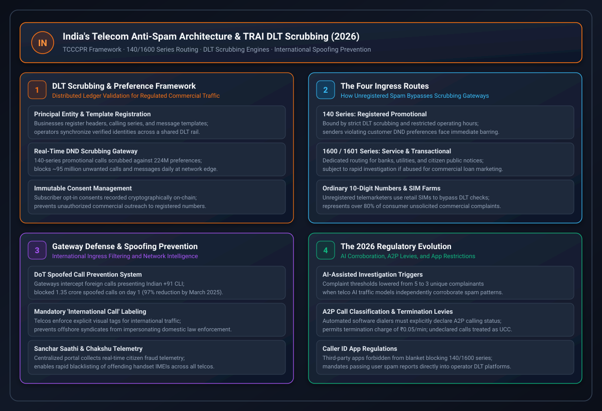
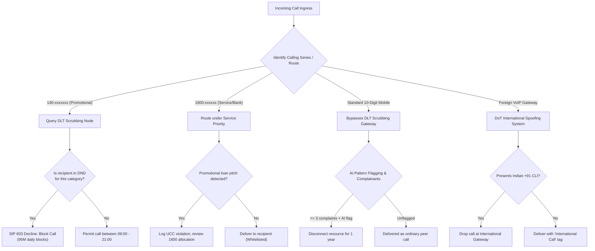

# India’s Spam-Call Defences: DND, Number Series and the Gaps

**Daily learning · 25 October 2026 · Primary-source review**  
*By Srinivasan Ragothaman ([@rsrini7](https://github.com/rsrini7))*

> **Core idea:** India operates one of the world's largest regulatory telecom frameworks—the Telecom Commercial Communications Customer Preference Regulations (TCCCPR)—which uses a multi-operator Distributed Ledger Technology (DLT) platform to scrub commercial calls and SMS against 224 million Do Not Disturb (DND) subscriber preferences, blocking roughly 95 million unsolicited contacts daily. However, unwanted calls continue to reach citizens through unregistered 10-digit SIM farms, promotional misuse of 1600-series service numbers, and spoofed international VoIP gateways. TRAI's landmark September 2026 amendments introduce AI-corroborated enforcement, Application-to-Person (A2P) termination charges, and strict integration mandates for third-party caller ID applications. [TRAI TCCCPR Regulations Archive](https://trai.gov.in/tcccpr), [PIB TRAI September 2026 Enforcement Release](https://www.pib.gov.in/PressReleasePage.aspx?PRID=2311989&lang=1&reg=19), [DoT Spoofed Calls Prevention Announcement](https://www.pib.gov.in/PressReleasePage.aspx?PRID=2067113&lang=2&reg=3).

---

## 1. Foundations: Understanding India's Regulated Telecom Architecture

Combating unsolicited commercial communications (UCC) across India's 1.348 billion active mobile subscriptions requires coordinating four major private telecom service providers (Airtel, Reliance Jio, Vodafone Idea, BSNL) and thousands of commercial telemarketers.

### The Governing Framework: TCCCPR and DLT Scrubbing
* **TCCCPR Framework:** Established under TRAI's *Telecom Commercial Communications Customer Preference Regulations, 2018 (as amended in 2026)*, this framework mandates that all commercial voice calls and SMS must be registered, verified, and audited prior to network transmission.
* **Distributed Ledger Technology (DLT) Rails:** Telecom operators maintain interconnected, permissioned blockchain nodes (developed with enterprise partners such as Microsoft and Tech Mahindra). Senders, principal entities, SMS header strings, voice calling identities, and message templates are cryptographically anchored to this distributed ledger.
* **Network-Level Scrubbing:** Before a telemarketer's call or SMS is routed to an end subscriber, the originating telecom switch queries the DLT ledger to verify:
  1. Is the sender registered as a verified Principal Entity (PE)?
  2. Does the message/call match an approved template and calling number series?
  3. Has the recipient opted into that commercial category, or is the number registered in the national Do Not Disturb (DND) registry?

| Telephony Series | Designated Purpose | Governing Verification & Rules |
|---|---|---|
| **140 Series** | Commercial Promotional Calls | Strictly scrubbed against DND preferences; restricted to calling hours between 09:00 and 21:00; immediate blacklisting if DND preferences are violated. |
| **1600 / 1601 Series** | Transactional & Service Calls | Reserved for financial institutions (banks, credit card fraud alerts), statutory entities, and government public notices; exempted from promotional DND blocks but barred from marketing pitches. |
| **10-Digit Retail Numbers** | Personal Subscriber Lines | Ordinary mobile numbers; strictly forbidden for automated telemarketing campaigns; heavily exploited by illegal unregistered telemarketers (UTMs). |
| **International Gateway (+91)** | Inbound Foreign Interconnects | Foreign calls presenting Indian CLI; monitored by DoT's International Spoofed Call Prevention System to block caller ID masquerading. |

| Term | Meaning in this incident |
|---|---|
| **UCC (Unsolicited Commercial Communication)** | Any commercial call or message that violates a subscriber's registered DND preference or lacks explicit consent. |
| **DND (Do Not Disturb) Registry** | The national preference registry where subscribers opt out of specific commercial categories (e.g. Banking, Real Estate, Education). |
| **Scrubbing** | The real-time algorithmic check that queries DLT nodes to match outgoing commercial traffic against subscriber preferences before circuit setup. |
| **Calling-Line Identification (CLI)** | The telephone number presented to the recipient's handset during call setup (susceptible to VoIP PBX spoofing). |
| **A2P (Application-to-Person)** | Voice calls or SMS initiated automatically by software, dialers, or bots without manual human dialing. |
| **Sanchar Saathi / Chakshu** | Department of Telecommunications (DoT) citizen portal for reporting suspicious communications, financial cyber fraud, and handset theft. |

---

## 2. Deep Technical Mechanism: The Four Ingress Routes and Scrubbing Gaps

Telecommunication traffic in India enters citizen handsets through four primary network routes, each subject to distinct technical controls and evasion vectors.

### Route 1: 140-Series Registered Promotional Calls
The 140 series is the authorized rail for commercial telemarketing:
* **The Scrubbing Mechanism:** When a telemarketer initiates a 140 call, the originating telecom switch performs a real-time DLT lookup. If the destination mobile number is registered in the DND database for that category, the switch rejects call setup with a SIP `603 Decline` or ISUP cause code.
* **Performance Realities:** For the April–June 2026 quarter, TRAI recorded **13.16 billion** 140-series promotional calls, with DLT scrubbing successfully blocking **1.48 billion** calls (~11.2%). Across calls and registered commercial SMS, DLT checks block an average of **95 million spam attempts daily**.
* **The Registration Gap:** Out of 1.348 billion subscriptions, only **224 million** (~16%) have explicitly registered DND preferences. Senders calling un-registered numbers comply with the law, even if the recipient considers the call annoying.

### Route 2: 1600 / 1601-Series Transactional & Service Calls
Introduced to eliminate consumer confusion between marketing and critical account notices, the 1600 series is reserved exclusively for transactional and service communications:
* **Whitelisted Delivery:** Calls from banks (e.g. OTP verification, fraud alerts) or airlines bypass promotional DND blocks to ensure critical alerts are delivered.
* **The Misuse Vector:** Unscrupulous financial entities frequently abuse 1600 lines by placing outbound loan and credit-card marketing calls. TRAI's 2026 amendments establish rapid-investigation procedures to bar 1600 resources if marketing pitches occur on service channels.

### Route 3: Ordinary 10-Digit Mobile Numbers & SIM Farms
The largest volume of spam arrives through ordinary 10-digit consumer numbers:
* **The Evasion Route:** Unregistered telemarketers (UTMs) bypass the entire DLT scrubbing infrastructure by purchasing hundreds of consumer SIM cards (often using mule identities) and placing them into automated GSM gateway boxes (**SIM farms**).
* **Parliamentary Data:** The Government informed Parliament in February 2026 that over **80% of all consumer UCC complaints** stem from unregistered senders utilizing standard 10-digit retail connections.
* **Enforcement Disconnects:** Telcos flag billions of suspicious calls algorithmically (operators flagged **22.99 billion incoming calls as suspected spam** in Q2 2026), but taking punitive action requires verifiable complaint records to avoid disconnecting legitimate high-volume subscribers.

```
+--------------------------------------------------------------------------+
| India Telecom Anti-Spam Scrubbing Architecture                           |
|                                                                          |
| 1. Regulated Promotional Route (140 Series):                             |
|    Telemarketer -> [ Originating Telco Switch ]                          |
|                          |                                               |
|                          v Queries DLT Node                              |
|                    [ DLT Blockchain: PE + Template + Consent ]           |
|                          |                                               |
|             +------------+------------+                                  |
|             | Matches DND Preference  | Allowed Category                 |
|             v                         v                                  |
|       [ Call Blocked ]          [ Delivered to Recipient ]               |
|       (95M Daily Blocks)                                                 |
|                                                                          |
| 2. Unregistered Evasion Route (10-Digit SIM Farms):                      |
|    Unregistered Sender -> SIM Farm Box -> Consumer Switch -> Delivered  |
|    (Completely Bypasses DLT Scrubbing Rails)                             |
|                                                                          |
| 3. International Spoofing Route:                                         |
|    Foreign VoIP SIP Trunk -> DoT International Gateway -> Filtered       |
|    (Drops foreign calls spoofing Indian +91 CLI)                         |
+--------------------------------------------------------------------------+
```

### Route 4: International Incoming Spoofed Calls
Offshore cyber syndicates (operating investment and digital arrest scams) route VoIP traffic through international long-distance operators (ILDOs), spoofing the Calling-Line Identification (CLI) to display domestic Indian numbers (+91):
* **DoT Prevention System:** On 22 October 2024, the Department of Telecommunications launched the **International Incoming Spoofed Calls Prevention System**. Deployed at international gateways, the system cross-references inbound foreign calls presenting +91 CLI against domestic telecom location registers.
* **Results:** The system blocked **1.35 crore** spoofed calls in its first 24 hours (~90% of spoofed traffic). By March 2025, daily blocked spoofed attempts dropped by **97% to ~4 lakh daily**, forcing fraudsters to migrate to visible foreign numbers (+92, +855) or WhatsApp.

---

## 3. Architectural Visuals (SVGs & Mermaid)

The following architectural diagram illustrates the DLT preference scrubbing rail, the four telephony ingress routes, the DoT international spoofing gateway, and the 2026 TRAI regulatory framework:



### Call Routing and Scrubbing Decision Flow



---

## 4. Production Implementations & Code Recipes

The following production scripts demonstrate how telecom engineers and PBX administrators simulate DLT scrubbing, enforce series compliance on SIP trunks, and format automated UCC complaints.

### Recipe 1: Telecom DLT Header & Consent Scrubbing Simulator (Python)

This script simulates real-time DLT ledger querying for commercial calls, validating sender registration, calling series validity, and subscriber DND preferences:

```python
#!/usr/bin/env python3
"""
dlt_scrubbing_simulator.py - Simulates real-time DLT scrubbing of commercial
telecommunications traffic against subscriber DND preferences.
"""

from typing import Dict, Optional
import time

class DLTScrubbingEngine:
    def __init__(self):
        # Mock DLT Registry: Registered Principal Entities & Approved Calling Headers
        self.registered_headers = {
            "1409823451": {"pe_id": "PE_HDFC_001", "category": "BANKING_PROMO", "active": True},
            "1401234567": {"pe_id": "PE_AIRTEL_09", "category": "TELECOM_PROMO", "active": True},
            "1600123456": {"pe_id": "PE_SBI_TXN", "category": "SERVICE_TXN", "active": True}
        }
        # Mock Subscriber Preference Registry (DND)
        self.dnd_registry = {
            "9876543210": {"opt_out_all": True, "categories": []},
            "9123456789": {"opt_out_all": False, "categories": ["BANKING_PROMO", "REAL_ESTATE"]},
            "9999999999": {"opt_out_all": False, "categories": []}  # Fully opted-in
        }

    def scrub_call_setup(self, caller_cli: str, recipient_msisdn: str) -> Dict[str, any]:
        now = time.localtime()
        current_hour = now.tm_hour

        # Rule 1: Validate 140 Series Time Window (09:00 - 21:00)
        if caller_cli.startswith("140"):
            if current_hour < 9 or current_hour >= 21:
                return {"status": "BLOCKED", "reason": "CALLING_HOURS_VIOLATION", "sip_code": 403}

            # Rule 2: Verify DLT Registration
            sender_meta = self.registered_headers.get(caller_cli)
            if not sender_meta or not sender_meta["active"]:
                return {"status": "BLOCKED", "reason": "UNREGISTERED_PROMOTIONAL_CLI", "sip_code": 403}

            # Rule 3: Check Subscriber DND Preferences
            pref = self.dnd_registry.get(recipient_msisdn)
            if pref:
                if pref["opt_out_all"] or sender_meta["category"] in pref["categories"]:
                    return {"status": "BLOCKED", "reason": "DND_PREFERENCE_MATCH", "sip_code": 603}

            return {"status": "ALLOWED", "routing": "PROMOTIONAL_DLT_VERIFIED", "sip_code": 200}

        # Rule 4: Handle 1600 Series Service Whitelist
        if caller_cli.startswith("1600") or caller_cli.startswith("1601"):
            sender_meta = self.registered_headers.get(caller_cli)
            if sender_meta and sender_meta["category"] == "SERVICE_TXN":
                return {"status": "ALLOWED", "routing": "SERVICE_TRANSACTIONAL_WHITELIST", "sip_code": 200}
            return {"status": "FLAGGED", "reason": "UNVERIFIED_1600_SERVICE_ENTITY", "sip_code": 403}

        # Rule 5: Ordinary 10-Digit Numbers Bypass DLT Scrubbing
        return {"status": "ALLOWED", "routing": "UNREGULATED_PEER_ROUTE", "sip_code": 200}

if __name__ == "__main__":
    engine = DLTScrubbingEngine()
    
    # Test 1: Blocked by DND
    res1 = engine.scrub_call_setup("1409823451", "9123456789")
    print(f"Test 1 (140 to DND Subscriber) : {res1}")
    
    # Test 2: Allowed Service Call
    res2 = engine.scrub_call_setup("1600123456", "9123456789")
    print(f"Test 2 (1600 Bank Service Call) : {res2}")
```

### Recipe 2: Asterisk SIP Trunk Number Series Routing Policy (extensions.conf)

For enterprise PBX systems and call centers, this Asterisk dialplan snippet enforces TRAI series segregation, preventing marketing calls from emitting on non-140 trunks:

```ini
; /etc/asterisk/extensions.conf - TRAI Number Series Compliance Dialplan
[outbound-campaigns]
; Force all outbound telemarketing campaigns to use registered 140 CLI
exten => _X.,1,NoOp(Evaluating Outbound Campaign Call to ${EXTEN})
 same => n,Set(CALL_TYPE=${CDR(userfield)})
 
 ; Check if campaign is tagged as commercial promotional
 same => n,GotoIf($["${CALL_TYPE}" = "PROMOTIONAL"]?promo:service)

 same => n(promo),NoOp(Enforcing 140 Series CLI)
 same => n,Set(CALLERID(num)=1409823451)
 same => n,Set(CALLERID(name)=RegisteredPromo)
 ; Enforce dialing hours (09:00 - 21:00)
 same => n,GotoIfTime(09:00-21:00,*,*,*?dial_promo:reject_time)
 same => n(dial_promo),Dial(PJSIP/${EXTEN}@dlt_scrubbed_trunk,60)
 same => n,Hangup()
 
 same => n(reject_time),NoOp(Rejecting call outside legal promotional hours)
 same => n,Playback(cannot-complete-as-dialed)
 same => n,Hangup()

 same => n(service),NoOp(Routing Service / Transactional Call)
 same => n,Set(CALLERID(num)=1600123456)
 same => n,Dial(PJSIP/${EXTEN}@service_trunk,60)
 same => n,Hangup()
```

---

## 5. Impact, Real-World Edge Cases & Gotchas

The scale and legal structure of India's telecom anti-spam regime lead to persistent real-world implementation gotchas.

### Common Claims vs. Technical Realities

| Claim or misconception | Technical reality established as of October 2026 |
|---|---|
| **"Registering on DND stops all unwanted calls."** | **False.** DND legally binds only *registered* telemarketers operating through the 140 series. Fraudsters, rogue loan agents, and unregistered telemarketers using 10-digit consumer SIMs bypass DLT scrubbing entirely. |
| **"The DLT blockchain inspects every live audio call."** | **Misconception.** DLT platforms manage cryptographic registrations (entities, headers, templates, preferences). The audio call itself is not recorded or stored on the blockchain; only metadata scrubbing occurs at call setup. |
| **"Operators flagged 23 billion calls as illegal spam."** | **Terminology error.** In Q2 2026, operators flagged **22.99 billion calls as suspected spam** using AI heuristic traffic models. A heuristic flag is an investigative indicator, not an adjudicated legal violation. |
| **"A 1600-series caller ID proves the bank is calling."** | **Dangerous assumption.** While 1600 numbers are assigned to verified institutions, fraudsters exploit private PBXs or compromised SIP trunks to spoof 1600 CLIs. Citizens should never disclose OTPs or passwords on incoming calls. |
| **"DoT's gateway blocked 97% of all phone scams."** | **Narrow scope.** The 97% decline specifically measured *international incoming calls presenting spoofed Indian (+91) caller IDs*. It does not measure domestic SIM-farm spam, WhatsApp scams, or legitimate international calls. |

### Real-World Architectural Gotchas
1. **The SIM-Farm Whack-a-Mole:** As telcos disconnect unregistered telemarketers, syndicates purchase fresh prepaid SIMs using forged or mule Aadhaar e-KYC credentials. A single hardware GSM box can rotate 64 SIMs simultaneously, distributing call volume below algorithmic threshold triggers.
2. **Channel Migration to WhatsApp & RCS:** Stricter enforcement on traditional cellular voice and SMS has accelerated spam migration to Over-the-Top (OTT) data applications (such as WhatsApp, Telegram, and Google RCS), which operate outside TRAI's telecom licensing jurisdiction.
3. **The 3-Complaint AI Corroboration Trigger:** Under the September 2026 amendments, action against an unregistered telemarketer requires 3 unique consumer complaints corroborated by telco AI traffic patterns (down from 5 complaints). If victims merely reject or block calls locally without submitting a formal 1909/app report, no formal regulatory record is created.

---

## 6. Practical Adoption Blueprint & Verification Checklist

To maximize protection against unwanted commercial communications and telephone fraud, subscribers and enterprise operators should execute the following controls:

### Citizen & Enterprise Telecom Defense Checklist
- [ ] **Activate Full DND Registration:** Register full DND blocking by sending `START 0` to `1909` via SMS, or configure granular category blocks using the official **TRAI DND App** or telecom provider web portal.
- [ ] **Report Unregistered Spam Promptly:** Submit UCC reports within **7 days** via `1909` or the TRAI DND app, including the originating CLI, date, time, and commercial audio pitch.
- [ ] **Report Suspected Cybercrime & Spoofing:** Immediately report digital arrest calls, fake courier threats, and police impersonation to **Sanchar Saathi's Chakshu facility** (`sancharsaathi.gov.in`) or call **1930**.
- [ ] **Enterprise 1600 Migration:** Transition all customer service, banking alerts, and OTP voice broadcasts to verified 1600/1601 number series; never broadcast marketing campaigns over service channels.
- [ ] **Audit PBX Trunk CLI Policies:** Ensure enterprise VoIP gateways strictly validate outbound CLI tags to prevent internal users from generating spoofed Caller IDs.

### Essential Telecom Diagnostic Shortcodes

```bash
# 1. Register Full DND via SMS (All Categories Blocked)
# Send text to 1909:
START 0

# 2. Check current DND Registration Status via SMS
# Send text to 1909:
STATUS

# 3. Report Unsolicited Commercial Call via SMS to 1909
# Format: COMP TEL NO, XXXXXXXXXX, dd/mm/yy, Brief Description
# Example:
COMP TEL NO, 9876543210, 25/10/26, Unsolicited pre-approved personal loan offer
```

---

## 7. Timeline and Current State

The evolution of India's telecom anti-spam regulatory framework spans nearly two decades:

| Date / Period | Regulatory Milestone and Technical Development |
|---|---|
| **2007** | TRAI establishes the initial National Do Not Call (NDNC) registry; voluntary participation results in high commercial evasion. |
| **2010–2011** | National Customer Preference Register (NCPR) established under amended regulations, introducing category-based DND preferences. |
| **2018** | TRAI enacts the Telecom Commercial Communications Customer Preference Regulations (TCCCPR), mandating the world's first multi-operator DLT scrubbing rail. |
| **2024, 22 Oct** | DoT deploys the **International Incoming Spoofed Calls Prevention System**, blocking 1.35 crore incoming spoofed calls displaying Indian CLI in its first 24 hours. |
| **2025, Mar** | Parliamentary records confirm that daily blocked international spoofed calls dropped by 97% to ~4 lakh daily as fraudsters abandoned direct CLI spoofing. |
| **2026, Jun** | TRAI reports quarterly scrubbing data: 224M DND registrations, 1.48B promotional calls blocked, and 22.99B calls flagged as suspected spam. |
| **2026, 18 Sep** | TRAI publishes landmark 2026 TCCCPR amendments introducing AI-assisted investigation, 3-complaint corroboration, A2P call levies (₹0.05/min), and caller ID app mandates. |
| **2026, Oct** | Phased commencement of the 2026 regulations begins across 30, 60, and 90-day gazette windows. |

---

## 8. Primary Sources & References

1. [TRAI: Telecom Commercial Communications Customer Preference Regulations Archive](https://trai.gov.in/tcccpr) — Official regulatory repository for the 2018 regulations and subsequent amendments.
2. [PIB: TRAI Press Release on September 2026 Regulations Amendment](https://www.pib.gov.in/PressReleasePage.aspx?PRID=2311989&lang=1&reg=19) — Official government disclosure detailing AI investigation triggers, A2P dialer rules, and third-party app restrictions.
3. [PIB: TRAI Quarterly Telecom Services Performance Indicators (April–June 2026)](https://www.pib.gov.in/PressReleasePage.aspx?PRID=2294234&lang=1&reg=3) — Audited quarterly figures documenting 13.16B promotional calls, 224M DND subscriptions, and 22.99B suspected spam flags.
4. [PIB: DoT International Incoming Spoofed Calls Prevention System Launch](https://www.pib.gov.in/PressReleasePage.aspx?PRID=2067113&lang=2&reg=3) — Official announcement of gateway-level filtering blocking +91 spoofed calls.
5. [PIB: Rajya Sabha Parliamentary Reply on Unregistered Telemarketing (February 2026)](https://www.pib.gov.in/PressReleasePage.aspx?PRID=2223950&lang=1&reg=3) — Ministerial disclosures detailing ₹153.8 crore in operator disincentives and 10-digit SIM-farm complaints.
6. [Tech Mahindra & Microsoft: Preventing UCC with Distributed Ledger Technology](https://cache.techmahindra.com/static/img/pdf/fe-prevent-ucc-with-dlt.pdf) — Architectural case study detailing enterprise DLT node synchronization, template scrubbing, and consent registries.

---

## 9. Supplementary visuals

The following architectural diagram illustrates the DLT preference scrubbing rail, the four telephony ingress routes, the DoT international spoofing gateway, and the 2026 TRAI regulatory framework:


*Figure 1: High-level architectural overview of India's telecom anti-spam defense ecosystem, DLT scrubbing engines, 140/1600 series routing, and DoT international gateway spoofing filters.*

---

**Related:**
- [Global AI Scam Landscape & Defense Playbook](../Weekly-Updates/Global-AI-Scam-Landscape-And-Defense-Playbook-2026.md) — Places phone impersonation within broader fraud patterns and victim reporting.
- [Distributed Ledger Technology](../../Blockchain/reference/DLT.md) — Explains the ledger concept used for shared commercial-communication records.
- [Banks and Third-Party AI Agents](Banks-Third-Party-AI-Agents-Oct-2026.md) — Another case where an apparent identity or permission does not prove an action was authorised.
- [French Supermarket Refrigeration Cyber-Sabotage](French-Supermarket-Refrigeration-Cyber-Sabotage-Nov-2026.md) — Architectural analysis of credential boundaries and operational parameters in connected critical systems.
- [WhatsApp Contact Enumeration and Data Leak](WhatsApp-Contact-Enumeration-And-Data-Leak-2026.md) — Mobile phone number harvesting and address book scraping vectors.
