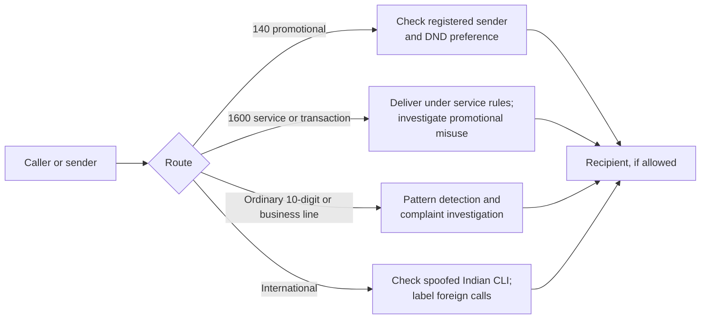

# India’s Spam-Call Defences: DND, Number Series and the Gaps

**Daily learning · 25 October 2026 · Primary-source review**

> **Core idea:** India checks registered commercial traffic against sender records and customer preferences, but unwanted calls can still arrive through ordinary numbers, misused service lines or foreign routes. DND limits eligible promotions; reporting gives operators evidence to investigate callers that bypass those checks.

## 1. First understand the system

| Term | Meaning |
|---|---|
| UCC | Unsolicited commercial communication: a call or message that conflicts with the recipient’s applicable consent or registered preference. |
| DND / preference register | The network-level record of which promotional categories a subscriber wishes to receive. It is separate from a phone’s local “Do Not Disturb” setting. |
| Sender / telemarketer | The business seeking to communicate, and an intermediary that may deliver its campaigns. |
| DLT platform | The distributed-ledger-based registration and audit system for senders, headers, templates, consents and preferences. |
| Scrubbing | Checking a proposed commercial communication against registered details and recipient preferences before delivery. |
| CLI | Calling-line identification: the number presented for a call. It can be misleading, especially when spoofed. |

The governing framework is TRAI’s [Telecom Commercial Communications Customer Preference Regulations, 2018, as amended](https://trai.gov.in/release-publication/regulations/amendments-page/7617). A ledger records and shares regulated identities and permissions; **the ledger is not itself a guarantee that every phone call is legitimate**. Tech Mahindra’s case study describes preference registration, template registration, scrubbing and immutable audit records in a deployment built **with Microsoft**. It does not support attributing that deployment to IBM, establish that every operator uses one identical implementation, or document the video’s claimed off-chain checking design. [Tech Mahindra case study](https://cache.techmahindra.com/static/img/pdf/fe-prevent-ucc-with-dlt.pdf).

The history matters: TRAI had a **2007** Do Not Call register, the **2010** regulations established a National Customer Preference Register that took effect in **2011**, and the DLT-based framework came with the **2018** regulations. The video compresses these into a 2011 “blockchain” launch; that date belongs to the earlier preference regime. [TRAI’s 2010 regulation](https://trai.gov.in/sites/default/files/201205301159277252627regulation1dec2010.pdf); [TRAI’s 2012 annual report](https://trai.gov.in/sites/default/files/2024-10/201301150318386780062Annual%20Report%20English%202012.pdf); [2018 framework](https://trai.gov.in/tcccpr).

## 2. The four routes a call can take

This is a **conceptual routing sketch**, not a claim that every call passes through the same equipment.

1. **140-series promotions.** These registered promotional calls are checked against DND preferences before delivery. A subscriber with no preference registered remains reachable by compliant registered senders. In June 2026, TRAI counted **224 million preference registrations against 1.348 billion subscriptions**, about **16%**; that is a subscription measure, not proof that 84% of individual people consented to every advertisement. [TRAI’s April–June 2026 figures](https://www.pib.gov.in/PressReleasePage.aspx?PRID=2294234&lang=1&reg=3).
2. **1600-series service and transactional calls.** This series is assigned to financial-sector and government-to-citizen communications. A number in that series is a routing and accountability signal, **not proof that a loan pitch is permitted or that the person on the line is trustworthy**. Promotional misuse can be reported and investigated. [TRAI quarterly figures](https://www.pib.gov.in/PressReleasePage.aspx?PRID=2294234&lang=1&reg=3); [2026 amendment summary](https://www.pib.gov.in/PressReleasePage.aspx?PRID=2311989&lang=1&reg=19).
3. **Ordinary 10-digit numbers and business connections.** Unregistered telemarketers using these routes can evade the *registered-channel* preference check. The government told Parliament that most recorded UCC complaints concerned unregistered senders using ordinary numbers. Detection then depends on reports, calling patterns and enforcement; an ordinary number does not make a commercial campaign lawful. [Rajya Sabha reply, 5 February 2026](https://www.pib.gov.in/PressReleasePage.aspx?PRID=2223950&lang=1&reg=3).
4. **International calls.** A foreign call displaying an Indian number may be spoofing its CLI. India’s gateway checks target that specific pattern. A genuine international number, or a domestic fraudulent call, requires different controls. An “International Call” label informs the recipient; it does not authenticate the caller’s story. [DoT announcement](https://www.pib.gov.in/PressReleasePage.aspx?PRID=2067113&lang=2&reg=3); [DoT follow-up](https://www.pib.gov.in/PressReleaseIframePage.aspx?PRID=2095917&lang=2&reg=48).

## 3. What the numbers actually show

For **April–June 2026**, TRAI reported **13.16 billion** 140-series promotional calls, of which **1.48 billion** were blocked by DND checks (about **11.2%**). It also reported **248.06 billion** registered commercial SMS, with **7.30 billion** promotional SMS blocked. Together the blocked calls and SMS average roughly **95 million per day over the 91-day quarter**. This measures blocked *registered-channel traffic*, not every attempted spam contact in India. [TRAI quarterly report](https://www.pib.gov.in/PressReleasePage.aspx?PRID=2294234&lang=1&reg=3).

Operators separately **flagged 22.99 billion incoming calls as suspected spam** in the same quarter. A flag is a warning or investigation lead, **not a confirmed violation or evidence that the call was blocked**. TRAI reported **1.085 million UCC complaints**, **0.553 million actionable complaints**, **137,053 resources barred for 15 days**, and **46,786 resources disconnected for a year**. These are different stages and units; they should not be added together as “spam calls stopped.” [TRAI quarterly report](https://www.pib.gov.in/PressReleasePage.aspx?PRID=2294234&lang=1&reg=3).

The February parliamentary reply gave an earlier snapshot: in **December 2025**, DLT checks blocked **more than 7.5 crore calls and SMS a day on average**. It also reported **₹153.8 crore in financial disincentives imposed** on operators for mishandling UCC complaints. “Imposed” does not by itself establish how much was collected. [Rajya Sabha reply](https://www.pib.gov.in/PressReleasePage.aspx?PRID=2223950&lang=1&reg=3).

| Easy conclusion | More precise reading |
|---|---|
| “DND should stop all spam.” | It enforces registered promotional preferences; fraud and unregistered calling need other detection and reporting. |
| “Only five complaints make a report useful.” | A report creates a record. The older enforcement trigger used five unique complainants in ten days; the 2026 amendment also allows a three-complaint trigger when AI flags the same CLI. |
| “AI detected 23 billion illegal calls.” | The figure is **suspected** spam calls flagged, not adjudicated violations. |
| “A 1600 or caller-ID label proves the bank called.” | Numbering and labels help classify calls, but do not verify the speaker or the request. Call the institution using a number from its official app, card or website. |

The complaint thresholds and AI corroboration are described in [TRAI’s 18 September 2026 amendment release](https://www.pib.gov.in/PressReleasePage.aspx?PRID=2311989&lang=1&reg=19). The same release says five or more **CLIs linked to one sender** flagged within ten days can prompt investigation; that is a separate trigger from five **consumer complaints**.

## 4. What changed in 2026—and when

The **18 September 2026** amendment introduced AI-assisted investigation, an appeal route for complaint decisions, and rules for **application-to-person (A2P) calls**—calls initiated by software without direct human dialling. Entities using A2P calls must declare that use and the calling numbers to their operator; undeclared A2P calls are treated as UCC. The amendment also allows a termination charge of up to **₹0.05 per minute** for covered A2P calls, with exceptions for designated regulated series and authorised calls. A recording or autodialler does not, by itself, prove fraud. [TRAI amendment release](https://www.pib.gov.in/PressReleasePage.aspx?PRID=2311989&lang=1&reg=19).

The [published regulation](https://trai.gov.in/sites/default/files/2026-09/Regulation_18092026.pdf) phases commencement **30, 60 and 90 days after Official Gazette publication**, depending on the provision. As of this note’s date, do not treat every A2P and AI-corroboration requirement as already operational. TRAI’s release announces the rules; actual rollout and enforcement are distinct questions.

The amendment also forbids call-management apps from **blanket** blocking or spam-tagging regulated 140/1600/1601 series, while leaving users free to block numbers on their own phones. Apps that offer UCC reporting must pass reports into operators’ DLT systems. This is meant to preserve legitimate service calls and make user reports actionable. [TRAI amendment release](https://www.pib.gov.in/PressReleasePage.aspx?PRID=2311989&lang=1&reg=19).

TRAI also says operators have sometimes left strict compliance terms out of sender contracts because of competitive pressures, and the amendment lets it prescribe essential contract conditions. That is an identified enforcement problem, **not evidence that a particular operator intentionally carried spam for profit**. The video’s broader claim about weak incentives is a possible explanation, but the cited public figures alone cannot establish each operator’s motive. [TRAI amendment release, contract provisions](https://www.pib.gov.in/PressReleasePage.aspx?PRID=2311989&lang=1&reg=19).

## 5. The international-spoofing result has a narrow scope

DoT announced the International Incoming Spoofed Calls Prevention System on **22 October 2024**. It said the system blocked **1.35 crore** inbound calls displaying Indian numbers in its first reported 24 hours—about **90% of that specific traffic class**. A later parliamentary reply said the daily number identified and blocked had fallen to about **4 lakh on 3 March 2025**, a roughly **97% decline** from the initial count. This is evidence of a sharp reduction in the measured spoofing pattern, **not a 97% fall in all spam or fraud calls**. [Launch announcement](https://www.pib.gov.in/PressReleasePage.aspx?PRID=2067113&lang=2&reg=3); [March 2025 parliamentary reply](https://www.pib.gov.in/PressReleasePage.aspx?PRID=2117716&lang=2&reg=48).

DoT later observed fraudsters using international numbers and asked operators to display an international-call label. That shift shows why one effective network check cannot settle every route of abuse. [DoT’s January 2025 update](https://www.pib.gov.in/PressReleaseIframePage.aspx?PRID=2095917&lang=2&reg=48).

## 6. What to do when a call arrives

1. **Register or review DND preferences** through the official [TRAI DND app](https://www.trai.gov.in/portals-apps/trai-apps), your operator’s app or website, or **1909**. Choose full or category-specific blocking. A phone’s silent mode does not update the network register. [TRAI quarterly guidance](https://www.pib.gov.in/PressReleasePage.aspx?PRID=2294234&lang=1&reg=3).
2. **Report unwanted commercial calls and SMS promptly** in TRAI DND or through your operator/1909. Keep the number, date, time and content. TRAI’s 2025 guidance says complaints may be lodged within **seven days**; an older TRAI FAQ still says **three days**, so reporting immediately is safest. Unregistered senders can be reported even without prior DND registration. Track the complaint reference and, where applicable, use the new appeal route. [TRAI’s 2025 clarification](https://www.trai.gov.in/sites/default/files/rti/RTI_Sept_10112025.pdf); [2026 DND app update](https://www.trai.gov.in/sites/default/files/2026-02/PR_No.21of2026.pdf).
3. **Treat suspected fraud separately.** If someone claims to be a bank, courier, police officer or regulator, end the call and contact the organisation through an independent official channel. Report suspected fraud through [Sanchar Saathi’s Chakshu facility](https://www.sancharsaathi.gov.in/sfc/); if money has been lost, use **1930** or [cybercrime.gov.in](https://www.cybercrime.gov.in/). DoT distinguishes suspicious communications from completed cybercrime reports. [DoT guidance](https://www.pib.gov.in/PressReleasePage.aspx?PRID=2067113&lang=2&reg=3).

## 7. Source context and lesson

Based on the [user-shared video](https://www.youtube.com/watch?v=JgpQKbYOyUo) and transcript, with material figures, dates and mechanisms checked against TRAI, DoT and parliamentary records. The four calls in the video illustrate possible routes; their exact origin and compliance status cannot be established from the transcript alone. The linked [TRAI DND demonstration](https://www.youtube.com/watch?v=XIhJhkC-YAI) is supplementary to TRAI’s current app guidance.

The central design lesson is to **match the control to the route**: preferences for registered promotions, shared reports and investigation for unregistered callers, declared use for automated campaigns, and gateway validation for spoofed international numbers. Each control measures a different failure mode.

---

**Related:**
- [Global AI-Driven Scam Landscape](../Weekly-Updates/Global_AI_Scam_Landscape_2026.md) — Places phone impersonation within broader fraud patterns and victim reporting.
- [Distributed Ledger Technology](../../Blockchain/reference/DLT.md) — Explains the ledger concept used for shared commercial-communication records.
- [Banks and Third-Party AI Agents](Banks-Third-Party-AI-Agents-Oct-2026.md) — Another case where an apparent identity or permission does not prove an action was authorised.
