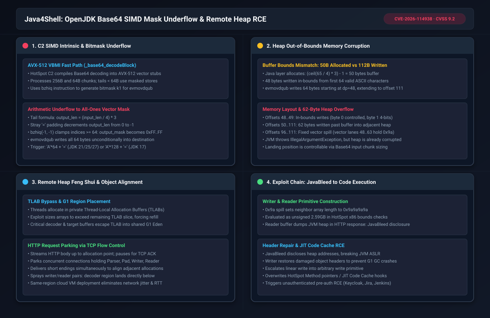
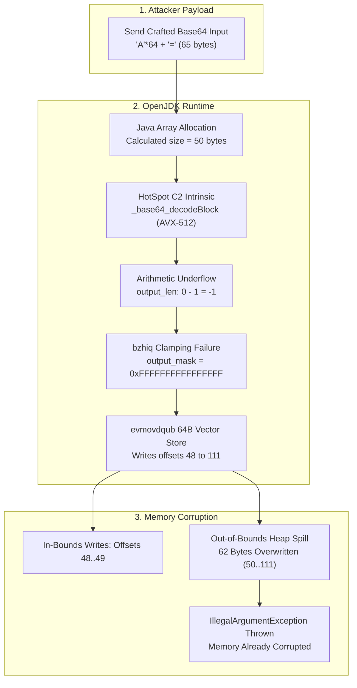
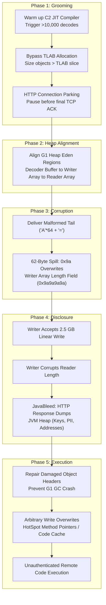
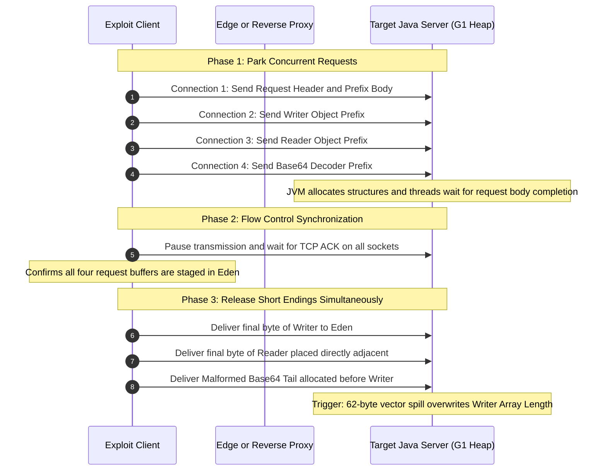
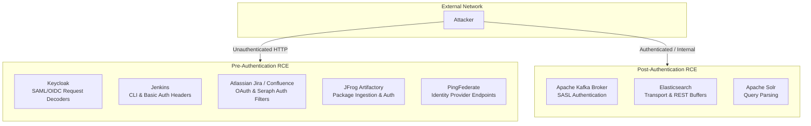
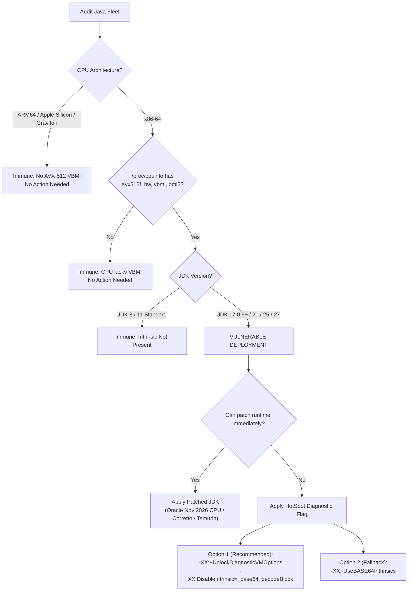

# Java4Shell: OpenJDK Base64 Intrinsic Memory Corruption and RCE (CVE-2026-114938)

Daily learning · November 18, 2026 · Technical deep dive  
*By Srinivasan Ragothaman ([@rsrini7](https://github.com/rsrini7))*

> **Core idea:** An integer underflow in OpenJDK's hardware-accelerated AVX-512 VBMI Base64 decoder intrinsic miscalculates the SIMD bitmask for malformed padding, writing 64 bytes into memory when only 2 bytes are expected. Attackers exploit this 62-byte heap out-of-bounds write via Remote Heap Feng Shui to construct linear read/write primitives, leaking heap secrets (JavaBleed) and achieving pre-authentication remote code execution across enterprise Java servers.



---

## 1. What actually broke?

On **November 17, 2026**, offensive security research firm **Calif** (the team that previously uncovered PHP2Shell) disclosed **Java4Shell** (**CVE-2026-114938**), a critical memory-corruption vulnerability in OpenJDK's core library runtime. Under **CVSS v4.0**, the vulnerability scores **9.2 / Critical** (**CVSS v3.1 8.1**).

Java is historically celebrated for runtime memory safety: garbage collection, strict array bounds checking, and bytecode verification protect application developers from buffer overflows, use-after-free bugs, and arbitrary pointer manipulation. However, beneath the JVM bytecode interpreter sits the **HotSpot C2 JIT (Just-In-Time) compiler**, which compiles performance-critical standard library methods directly into hand-tuned native assembly routines called **intrinsics**.

In OpenJDK 17.0.6 and newer, HotSpot introduced an optimized assembly fast-path for `java.util.Base64.Decoder` leveraging modern x86-64 vector extensions: **AVX-512 VBMI** (Vector Byte Manipulation Instructions). When handling malformed Base64 inputs containing a misplaced padding character (`=`), an arithmetic underflow inside the intrinsic assembly logic generates an invalid SIMD write mask of all ones (`0xFFFFFFFFFFFFFFFF`). Instead of storing the expected remaining bytes, the instruction executes an unconditional **64-byte vector store** into a newly allocated heap array, spilling **62 bytes out of bounds** directly onto the JVM heap.

By combining this out-of-bounds write with remote heap manipulation (Heap Feng Shui) over HTTP, researchers demonstrated **unauthenticated, pre-authentication Remote Code Execution (RCE)** out-of-the-box in default configurations of enterprise products including **Keycloak, Atlassian Jira, Atlassian Confluence, Jenkins, JFrog Artifactory, and PingFederate**.



### Essential terms

| Term | Technical Meaning |
|---|---|
| **JVM Intrinsic** | A native assembly implementation of a core standard library method directly emitted by the HotSpot C2 compiler, bypassing standard bytecode execution and Java bounds checks. |
| **AVX-512 VBMI** | Intel/AMD Vector Byte Manipulation Instructions (512-bit SIMD) that operate on 64 separate byte elements simultaneously in a single CPU cycle. |
| **`bzhiq`** | x86-64 Bit Manipulation Instruction 2 (BMI2) that zeroes all bits in a 64-bit register starting from a specified index position (`bzhi dst, src, index`). |
| **`evmovdqub`** | AVX-512 masked unaligned byte move instruction (`VMOVDQU8`). Transmits 64 bytes to or from memory, controlled by a 64-bit opmask register (`k1`). |
| **Opmask Register (`k1`)** | A dedicated 64-bit hardware register in AVX-512 where each bit controls whether the corresponding byte lane in the vector operation is written to memory. |
| **TLAB** | Thread-Local Allocation Buffer; a dedicated memory buffer within the JVM Eden space assigned to a worker thread to allow lock-free object allocation. |
| **Heap Feng Shui** | The disciplined technique of manipulating an application's memory layout (allocations and deallocations) to place target objects directly adjacent to a buffer overflow. |
| **JavaBleed** | The heap disclosure primitive in Java4Shell where corrupting a neighboring array's length field causes subsequent HTTP responses to dump megabytes of JVM heap contents. |

### Parties and roles involved

| Organization / Party | Role in CVE-2026-114938 |
|---|---|
| **Calif Research** | Discovered the vulnerability via AI-assisted code auditing ("Centaur Hacking") and authored the weaponized proof-of-concept exploits. |
| **Oracle Corporation** | Coordinated vulnerability disclosure and released the emergency Critical Security Patch Update on November 17, 2026. |
| **OpenJDK Project** | Upstream open-source repository governing HotSpot C2 compiler intrinsics and baseline patch commits. |
| **Enterprise Java Ecosystem** | Maintainers of downstream distributions (Amazon Corretto, Eclipse Temurin, Azul Zulu, Red Hat OpenJDK, Microsoft Build of OpenJDK) rolling out patched runtimes. |
| **Cloud & Infrastructure Providers** | AWS, Google Cloud, Microsoft Azure assessing hypervisor and container workloads across x86-64 AVX-512 instances. |

---

## 2. Foundations: How Java hardware acceleration works
### Base64 in one minute

Base64 is a way to write bytes using a set of 64 text characters. Systems use it to carry binary data through places that expect text. It is encoding, not encryption, so anyone can decode it.

For example, the ASCII word `Man` is three bytes. Base64 joins their 24 bits, splits them into four 6-bit values, and maps each value to one character:

```text
Man        01001101 01100001 01101110
24 bits    010011 010110 000101 101110
Base64     T      W      F      u     → TWFu
```

The decoder reverses that mapping. In the standard padded form, `M` becomes `TQ==` and `Ma` becomes `TWE=`. The `=` characters mark unused positions in the last group. The issue described here is in one optimized Java decoder's handling of malformed final groups and padding. Base64 itself is not the vulnerability.


### The role of HotSpot C2 and SIMD intrinsics

When standard Java code executes `java.util.Base64.getDecoder().decode(src)`, the JVM does not immediately execute native assembly. HotSpot begins by running bytecode in its Tier 1/2 interpreters. When a method or loop executes repeatedly (crossing default invocation thresholds around 10,000 runs), HotSpot's C2 compiler identifies it as a hot path.

Base64 decoding translates four 6-bit ASCII characters (24 bits) into three 8-bit bytes (24 bits). In software scalar implementations, this requires multiple bit shifts, bitwise ANDs, and lookup table fetches for each 3-byte quartet. 

To optimize high-throughput data processing, OpenJDK maintainers introduced SIMD (Single Instruction, Multiple Data) intrinsics. When running on modern x86-64 hardware, HotSpot replaces the scalar Java loop with `_base64_decodeBlock`:
1. **256-Byte Blocks:** Using AVX-512 vector registers (`zmm0`–`zmm31`), the intrinsic decodes up to 192 output bytes per instruction block.
2. **64-Byte Blocks:** Smaller intermediate blocks are decoded 64 input bytes at a time.
3. **Tail Processing (< 64 Bytes):** For remaining inputs smaller than 64 bytes, standard unaligned loads cannot read past the end of the input buffer without triggering hardware memory page faults. To prevent segfaults, the intrinsic utilizes **masked vector operations** (`evmovdqub` with opmask `k1`), which selectively read and write only the valid byte lanes.

### Why AVX-512 VBMI matters

The hardware requirement for this specific execution path is narrow but represents modern server infrastructure. The vulnerable fast-path is enabled only when the host CPU supports:
- `avx512f` (AVX-512 Foundation)
- `avx512bw` (Byte and Word Extensions)
- `avx512vbmi` (Vector Byte Manipulation Instructions)
- `bmi2` (Bit Manipulation Instruction Set 2)

These instructions were introduced in Intel Xeon Ice Lake (3rd Gen Xeon Scalable, 2021), Sapphire Rapids (4th Gen, 2023), Emerald Rapids (5th Gen), and Granite Rapids (6th Gen), as well as AMD EPYC and Ryzen processors based on the **Zen 4** and **Zen 5** microarchitectures. 

Workloads running on older x86-64 CPUs (e.g., Intel Haswell/Skylake or AMD Zen 2/Zen 3) or **ARM64 architectures** (such as AWS Graviton, Apple Silicon, or Ampere Altra) do not support `avx512vbmi` and consequently fall back to safe scalar or SSE/AVX2 routines that do not contain this flaw.

---

## 3. Deep Technical Mechanism: The Bitmask Underflow

### The assembly intrinsic logic

HotSpot's assembly stub for the x86-64 Base64 decoder tail calculates the output length and bitmask using the following logic (represented in architectural pseudocode):

```c
// Step 1: Calculate input mask for the remaining tail bytes
input_mask = bzhiq(-1, input_length);

// Step 2: Compute expected decoded output length (4 input bytes -> 3 output bytes)
output_len = (input_length / 4) * 3;

// Step 3: Handle Base64 trailing padding characters ('=')
if (input[input_length - 1] == '=') {
    output_len -= 1;
    input_mask >>= 1;
}
if (input[input_length - 2] == '=') {
    output_len -= 1;
    input_mask >>= 1;
}

// Step 4: Generate output write mask
output_mask = bzhiq(-1, output_len);

// Step 5: Execute masked vector store into destination array
evmovdqub(
    Address(dest, dp),          // Memory destination buffer at offset dp
    k1,                         // Opmask register k1 loaded with output_mask
    tmp,                        // 512-bit vector register containing decoded bytes
    true,                       // Zero-masking / merge flag
    Assembler::AVX_512bit       // 512-bit vector length
);
```

### The arithmetic underflow bug

The flaw occurs when the remaining input tail contains padding (`=`) but has a length of less than 4 bytes (specifically when `input_length < 4`).

Consider an input string of **65 bytes** consisting of 64 valid ASCII characters followed by a single `=` sign:

$$
\text{Payload} = \underbrace{\text{A}\dots\text{A}}_{64\text{ bytes}} + \text{"="}
$$

1. **Vectorized Loop Iteration:** The first 64 bytes are processed in the primary 64-byte vector loop. 64 input bytes produce 48 decoded bytes ($64 \times \frac{3}{4} = 48$). The destination pointer `dp` advances to offset **48**.
2. **Tail Processing:** The remaining input chunk is 1 byte: `"=\""`. Therefore, `input_length = 1`.
3. **Output Length Calculation:**

$$
\text{len}_{\text{out}} = \lfloor 1 / 4 \rfloor \times 3 = 0 \times 3 = 0
$$

4. **Padding Adjustment Underflow:**
   The intrinsic checks the last byte: `input[0] == '='` evaluates to **true**.
   The assembly executes:

$$
\text{len}_{\text{out}} = \text{len}_{\text{out}} - 1 = 0 - 1 = -1
$$

   In 64-bit unsigned register arithmetic, `-1` becomes `0xFFFFFFFFFFFFFFFF`.
5. **BMI2 `bzhiq` Clamping Failure:**
   The instruction `bzhiq(src, index)` is defined by Intel as: *"Copy bits from src to dst starting at bit 0 and stopping before the index bit specified in index. If index $\ge 64$, all bits from src are copied without change."*
   Because `output_len` is `-1` (or interpreted as an unsigned 64-bit integer $\ge 64$), `bzhiq(-1, -1)` **does not zero any bits**.
   The result in opmask register `k1` is:

$$
\text{mask}_{\text{out}} = \mathtt{0xFFFFFFFFFFFFFFFF}
$$

   Every single one of the 64 mask bits is set to **1**!

### The out-of-bounds write

In Java, before calling the intrinsic, the runtime calculates the required destination buffer size:

$$
\text{len}_{\text{buffer}} = \lceil \text{len}_{\text{input}} / 4 \rceil \times 3 - \text{padding}
$$

For our 65-byte payload:

$$
\lceil 65 / 4 \rceil \times 3 - 1 = 17 \times 3 - 1 = 51 - 1 = 50\text{ bytes}
$$

The JVM allocates a byte array on the heap: `byte[] target = new byte[50]`.

Next, the intrinsic executes `evmovdqub` at destination pointer `dp = 48` with `k1 = 0xFFFFFFFFFFFFFFFF`. Because all 64 mask bits are active, the hardware unconditionally copies **64 bytes** from the vector register `tmp` to memory:

$$
\text{Memory Range Written} = [\text{target} + 48, \; \text{target} + 48 + 64) = [\text{target} + 48, \; \text{target} + 112)
$$

```
Destination byte array [0 .. 49] (50 bytes total)
┌───────────────────────────────────────────────┬───────┬────────────────────────────────────────────────────────┐
│ Decoded Valid Data (Offsets 0 .. 47)          │ 48 49 │ Offsets 50 .. 111 (62 Bytes Overwritten Out-of-Bounds) │
│ (48 Bytes successfully decoded from 64 'A's)  │ In-Bnd│ Land past array boundary directly into JVM Heap!       │
└───────────────────────────────────────────────┴───────┴────────────────────────────────────────────────────────┘
▲                                               ▲       ▲                                                        ▲
Offset 0                                        Offset 48 Offset 50 (Array End)                                Offset 112
```

- **Offsets 48 and 49:** Overwrite the last 2 bytes of the allocated array (in-bounds).
- **Offsets 50 through 111:** **62 bytes are written past the end of the array**, overwriting whatever heap object lies immediately after it.

Once the intrinsic finishes the store, HotSpot checks whether the decoded characters were valid Base64. Detecting invalid padding format, the native stub exits with an error code, and the Java layer throws an `IllegalArgumentException`. However, the CPU hardware write instruction has already executed. **The memory corruption on the JVM heap is permanent.**

### Version differences: OpenJDK 17 vs. OpenJDK 21/25/27

In OpenJDK 21, 25, and 27, the minimum threshold to enter the vectorized intrinsic fast-path is 64 bytes. The trigger payload is:

$$
\text{Trigger}_{\text{JDK 21+}} = \text{"A"} \times 64 + \text{"="} \quad (\text{65 bytes})
$$

In OpenJDK 17, the intrinsic was initially tuned with a 128-byte block loop threshold. Consequently, to reach the vulnerable tail handler in JDK 17, the input requires 128 valid Base64 characters before the padding character:

$$
\text{Trigger}_{\text{JDK 17}} = \text{"A"} \times 128 + \text{"="} \quad (\text{129 bytes})
$$

---

## 4. Exploitation: Remote Heap Feng Shui and Primitive Escalation

A 62-byte out-of-bounds write might initially appear difficult to exploit because the attacker does not control all 64 bytes. Analysis of the vector register contents reveals:
- **Offset 48 (Vector Byte 0):** Fully controlled by the attacker (in-bounds).
- **Offset 49 (Vector Byte 1):** 4 bits controlled (in-bounds).
- **Offsets 50..95 (Vector Bytes 2..47):** Uncontrolled values left over from SIMD register arithmetic (out-of-bounds).
- **Offsets 96..111 (Vector Bytes 48..63):** Static vector constants, where the byte values are fixed at `0x9a` (out-of-bounds).

Calif's researchers bridged the gap between this fixed-byte spill and arbitrary remote code execution by adapting classic JavaScript engine browser exploitation paradigms to the JVM.



### 1. Bypassing Thread-Local Allocation Buffers (TLABs)

HotSpot manages memory using the **G1 Garbage Collector** (or Parallel GC). To avoid lock contention across CPU threads, each thread is allocated a private Thread-Local Allocation Buffer (TLAB) inside Eden space. 

If thread A (processing an HTTP request with the Base64 decoder) allocates in TLAB A, and thread B (handling a victim data structure) allocates in TLAB B, their allocations reside in completely different memory pages. A buffer overflow in TLAB A cannot reach an object in TLAB B.

To defeat TLAB isolation, the exploit leverages **HotSpot allocator sizing policies**:
- In OpenJDK's allocator ([`memAllocator.cpp`](https://github.com/openjdk/jdk/blob/master/src/hotspot/share/gc/shared/memAllocator.cpp)), HotSpot first attempts fast-path thread-local allocation via `allocate_inside_tlab()`.
- If the requested array size exceeds the remaining free space in the thread's current TLAB, HotSpot evaluates whether to retire and refill the TLAB or allocate outside it ([`threadLocalAllocBuffer.cpp`](https://github.com/openjdk/jdk/blob/master/src/hotspot/share/gc/shared/threadLocalAllocBuffer.cpp)). The allocator checks whether the discarded remaining space is below `_refill_waste_limit` (initialized to `desired_size() / TLABRefillWasteFraction` and dynamically incremented on slow-path allocations).
- If the requested allocation is too large for the refill-waste threshold or exceeds the maximum single-object TLAB capacity, HotSpot falls back to `allocate_outside_tlab()`.
- Objects routed outside TLABs bypass thread-local buffers entirely and are allocated directly from the shared **G1 Eden space**, where allocations across concurrent worker threads land in common heap regions with contiguous addresses.

### 2. Remote Heap Feng Shui via HTTP Connection Parking

JVM garbage collectors are non-deterministic, and enterprise servers process multiple asynchronous threads simultaneously. To achieve reliable spatial alignment over the internet, Calif developed **HTTP Connection Parking**:



By staging HTTP request bodies in chunks and waiting for TCP ACKs before delivering the final packets, the attacker forces the JVM to allocate:

$$
\text{[Base64 Output Buffer]} \longrightarrow \text{[Writer Array]} \longrightarrow \text{[Reader Array]}
$$

### 3. Constructing the Writer Primitive

In Java, every array object stored on the heap begins with a standard header (under 64-bit Compressed OOPs):
- **Mark Word:** 8 bytes (locking state, GC age, hash code).
- **Klass Word:** 4 bytes (compressed pointer to the array class metadata).
- **Array Length:** 4 bytes (32-bit signed integer defining `array.length`).
- **Array Elements:** Contiguous payload data.

When the 62-byte vector spill occurs, the `0x9a` constants (spilling from vector lanes 48..63 at destination offsets 96..111) overwrite the `length` field of the immediately following `byte[]` array (the **Writer**).
Instead of its original small size (e.g., 64 bytes), its 32-bit length field becomes:

$$
\text{Corrupted Raw Bitmask} = \mathtt{0x9a9a9a9a}
$$

### Why a negative signed length unlocks an unsigned linear write

In the Java Language Specification, array lengths and indices are 32-bit signed two's complement integers (`jint`). Interpreted literally in signed arithmetic, the raw bit pattern `0x9a9a9a9a` is negative:
$$\text{Signed Integer Value} = -1{,}701{,}143{,}910$$

If bounds checks performed signed comparisons (`if (index >= length)`), any non-negative index $0 \le \text{index}$ would appear greater than $-1,701,143,910$, immediately throwing an `ArrayIndexOutOfBoundsException` and halting access.

However, HotSpot's x86 execution engines implement array bounds checking using an **unsigned comparison** across both interpreted and JIT-compiled execution:
1. **Unsigned Comparison in Interpreter and JIT (`jae`):** To test both the lower bound ($< 0$) and upper bound ($\ge \text{length}$) in a single CPU instruction, both the template interpreter ([`templateTable_x86.cpp`](https://github.com/openjdk/jdk/blob/master/src/hotspot/cpu/x86/templateTable_x86.cpp) in `index_check_without_pop`) and the C2 JIT compiler emit an unsigned comparison:
   ```assembly
   cmpl index, Address(array, length_offset)   ; edx = index, [rax + 12] = array.length
   jae  .out_of_bounds_stub                    ; Jump if Above or Equal (unsigned CF=0)
   ```
2. **Unsigned Evaluation of `0x9a9a9a9a`:** In x86 assembly unsigned arithmetic (`jae` / `jnb`), `0x9a9a9a9a` is evaluated as an unsigned 32-bit integer: $2^{31} + 446{,}339{,}738 = 2{,}593{,}823{,}386$ (approx. 2.59 billion).
3. **Bypassing the Trap:** As long as Java code indexes with standard non-negative integer offsets ($0 \le \text{index} < 2^{31}-1$), the unsigned condition $\text{index} < 2,593,823,386$ evaluates to **true**. The `jae` exception branch is never taken!
4. **Range Check Elimination (RCE):** In compiled tight loops, C2 further hoists or eliminates bounds checks entirely. Subsequent writes through this array bypass memory limits, transforming the fixed 62-byte spill into an **arbitrary linear write across gigabytes of JVM memory**.

### 4. Constructing the Reader Primitive: JavaBleed

To achieve code execution, the attacker must bypass Address Space Layout Randomization (ASLR) and locate JVM internal data structures. The Writer primitive is used to overwrite the length field of a third adjacent array: the **Reader**.

When the application finishes processing the request associated with the Reader array and serializes the response back to the client over HTTP, the JVM reads past the array's original data and transmits raw heap memory over the network. 

Dubbed **JavaBleed** (analogous to OpenSSL's Heartbleed), this leak exposes:
- Application session tokens and API keys.
- Decrypted TLS credentials and database connection strings.
- Java object pointers, klass pointers, and HotSpot internal virtual method tables (vtables), completely disclosing the JVM's memory layout.

### 5. Object Header Repair and Code Cache Hijacking

A major obstacle in JVM heap exploitation is the garbage collector: if G1 GC runs while an object header or klass pointer is corrupted with `0x9a`, the GC thread will crash the JVM (`SIGSEGV` during mark-sweep phase).

Using the memory disclosures obtained from JavaBleed:
1. **Header Repair:** The attacker uses the Writer primitive to restore the original Mark Word, Klass Word, and boundary padding of all damaged neighboring objects, allowing G1 GC cycles to complete cleanly without crashing.
2. **Arbitrary Write Escalation:** By overwriting object references, the attacker constructs an arbitrary memory read/write primitive.
3. **Control Flow Hijack:** The attacker targets HotSpot internal `Method` structures or writes shellcode into JIT Code Cache memory, achieving native Remote Code Execution as the operating system user running the JVM.

---

## 5. Enterprise Impact: Pre-Auth RCE Target Analysis

Because Base64 is used ubiquitously across standard enterprise protocols (HTTP Basic Authentication, SAML 2.0 assertions, OAuth/OIDC state parameters, JWT signatures, CSRF tokens, and MIME email bodies), the vulnerability can be reached prior to authentication.



### Pre-Authentication Targets (Default Configurations)

1. **Keycloak (Identity & Access Management):**
   - **Vector:** Keycloak processes Base64-encoded SAML assertions (`SAMLRequest` / `SAMLResponse`) and OIDC tokens on public login endpoints.
   - **Impact:** An unauthenticated remote attacker can trigger the intrinsic decoder and execute code before any user credentials are validated, compromising single sign-on (SSO) infrastructure across entire corporate networks.
2. **Jenkins Automation Server:**
   - **Vector:** The Jenkins Remoting protocol, CLI port, and HTTP basic authorization filters pass Base64 headers to standard decoders.
   - **Impact:** Immediate unauthenticated takeover of CI/CD build controllers, granting access to source code repositories, deployment credentials, and cloud secrets.
3. **Atlassian Jira & Confluence:**
   - **Vector:** Authentication filters and gadget endpoints decode Base64-encoded cookies and parameters prior to session validation.
4. **JFrog Artifactory & PingFederate:**
   - **Vector:** API tokens, repository sync endpoints, and federation metadata parsers process incoming Base64 streams directly via `java.util.Base64`.

### Client-Side Attack Vector (samczsun Finding)

Independent security researcher **samczsun** confirmed that Java4Shell extends beyond inbound enterprise web servers to client-side Java applications:
- Calif corroborated a working exploit where an outbound TLS connection opened by a Java client program to a malicious remote server triggers the vulnerable Base64 decoder during network or transport processing.
- This allows a malicious server to achieve code execution on a connecting client workstation, worker node, or backend microservice, even if that client exposes no inbound open ports or external attack surface.
- Calif and samczsun verified the feasibility of the client-side attack vector while withholding the exact internal protocol parsing path reaching `_base64_decodeBlock` to prevent premature weaponization.

---

## 6. Common Claims vs. Technical Realities

The rapid disclosure of Java4Shell created widespread confusion across security teams. The table below contrasts prevalent misconceptions against verified technical facts:

| Common Claim | Technical Reality |
|---|---|
| *"Java is a memory-safe language, so buffer overflows are impossible."* | **False.** While Java bytecode has bounds checks, HotSpot C2 **intrinsics are native assembly routines**. A bug in HotSpot's C2 assembly bypasses Java language protections entirely, causing native heap corruption. |
| *"Every Java server running Java 17+ in the world is vulnerable."* | **False.** The vulnerability strictly requires **x86-64 CPUs with AVX-512 VBMI** (`avx512f`, `avx512bw`, `avx512vbmi`, `bmi2`). Workloads running on older x86 CPUs or **ARM64 (AWS Graviton, Apple Silicon, Ampere)** are completely unaffected. |
| *"This is identical to Log4Shell (CVE-2021-44228)."* | **False.** Log4Shell was a high-level application logic flaw (JNDI injection) that worked identically on every OS and architecture. Java4Shell is a **low-level SIMD memory corruption** bug requiring specific hardware, JIT warm-up, and heap alignment. |
| *"Standard WAF request buffering completely eliminates the threat."* | **Partially True.** Proxies that buffer complete request bodies (like standard Nginx) disrupt chunked connection parking. However, single-request payloads (such as Elasticsearch chains) and WebSocket upgraded tunnels completely bypass buffering protections. |
| *"Setting `-XX:UseAVX=2` is a safe drop-in flag for all environments."* | **Dangerous.** `-XX:UseAVX=2` is an **x86-64 specific HotSpot flag**. If passed to an ARM64 JVM, the JVM **refuses to recognize the flag and immediately terminates on startup**. |
| *"Disabling Base64 intrinsics causes severe enterprise-wide performance degradation."* | **Misleading.** Disabling `_base64_decodeBlock` routes Base64 decoding to scalar or AVX2 fallbacks. This increases CPU cycles strictly during Base64 decoding routines, leaving non-Base64 HotSpot operations unaffected. For applications where Base64 operations represent a minor fraction of overall request handling (such as token or header parsing), overall request latency impact is typically negligible, whereas heavy Base64 data streaming workloads will see increased decoding latency that should be measured in staging. |

---

## 7. Production Implementations & Verification Recipes

### 1. Bounded Reproduction PoC (Safe Standalone Harness)

The following self-contained Java harness safely reproduces the memory corruption bug without crashing the JVM. It warms the C2 compiler until the intrinsic is compiled, decodes the malformed 65-byte payload into a 4096-byte array, and verifies that exactly **62 bytes** past the expected 50-byte buffer (offsets 50 to 111) are overwritten with vector constants:

```java
package com.security.research;

import java.nio.charset.StandardCharsets;
import java.util.Arrays;
import java.util.Base64;

/**
 * Bounded standalone trigger for CVE-2026-114938 (Java4Shell).
 * Verifies the 62-byte out-of-bounds write inside a safe 4096-byte buffer.
 * Automatically selects 128-byte payload on JDK 17 vs 64-byte payload on JDK 21+.
 */
public final class Java4ShellReproductionHarness {
    private static volatile int sink;

    public static void main(String[] args) {
        String runtimeVersion = System.getProperty("java.runtime.version", "");
        String specVersion = System.getProperty("java.specification.version", "");
        System.out.println("[+] Java Runtime: " + runtimeVersion);
        System.out.println("[+] JVM Name:     " + System.getProperty("java.vm.name"));

        // OpenJDK 17 requires 128 characters due to a higher vector loop threshold
        boolean isJdk17 = "17".equals(specVersion) || runtimeVersion.startsWith("17.");
        int prefixLength = isJdk17 ? 128 : 64;
        int expectedFirst = isJdk17 ? 98 : 50;
        int expectedLast = isJdk17 ? 159 : 111;
        int expectedChanged = 62;

        System.out.printf("[*] Selected payload length: %d ASCII characters + 1 '=' (Target JDK: %s)%n",
                prefixLength, isJdk17 ? "OpenJDK 17" : "OpenJDK 21+");

        Base64.Decoder decoder = Base64.getDecoder();
        byte[] valid = "A".repeat(prefixLength).getBytes(StandardCharsets.US_ASCII);
        byte[] malformed = ("A".repeat(prefixLength) + "=").getBytes(StandardCharsets.US_ASCII);
        byte[] target = new byte[4096];

        // Step 1: Warm up C2 JIT compiler to ensure _base64_decodeBlock intrinsic is compiled
        System.out.println("[*] Warming up C2 JIT compiler (200,000 iterations)...");
        for (int i = 0; i < 200_000; i++) {
            sink += decoder.decode(valid, target);
        }

        // Step 2: Poison target array with marker byte 0x5a ('Z')
        Arrays.fill(target, (byte) 0x5a);

        // Step 3: Trigger the vulnerability with malformed tail
        boolean rejected = false;
        try {
            decoder.decode(malformed, target);
        } catch (IllegalArgumentException expected) {
            rejected = true;
        }

        // Step 4: Scan for corrupted bytes beyond the expected output buffer
        int changed = 0;
        int first = -1;
        int last = -1;

        for (int i = expectedFirst; i < target.length; i++) {
            if (target[i] != (byte) 0x5a) {
                changed++;
                if (first < 0) first = i;
                last = i;
            }
        }

        System.out.printf("[*] Result: rejected=%b, changed_bytes=%d, first_offset=%d, last_offset=%d%n",
                rejected, changed, first, last);

        if (rejected && changed == expectedChanged && first == expectedFirst && last == expectedLast) {
            System.err.println("[!] CRITICAL: SYSTEM VULNERABLE TO CVE-2026-114938!");
            System.err.printf("[!] 62 bytes (offsets %d..%d) were overwritten past the buffer bounds.%n",
                    expectedFirst, expectedLast);
            System.exit(100);
        } else {
            System.out.println("[?] INCONCLUSIVE: Out-of-bounds corruption was not observed.");
            System.out.println("[?] Possible causes: host CPU lacks AVX-512 VBMI instructions (avx512vbmi + bmi2),");
            System.out.println("[?] intrinsics are disabled via JVM flags, C2 tiering threshold was not crossed,");
            System.out.println("[?] or the runtime is patched. Verify hardware flags and JVM options before concluding clean.");
            System.exit(0);
        }
    }
}
```

### 2. Automated Host & CPU Hardware Verification Script

Execute the following bash one-liner to verify if a Linux host satisfies the four hardware CPU instruction flags required for exploitation:

```bash
#!/usr/bin/env bash
# Hardware vulnerability audit for CVE-2026-114938
set -euo pipefail

echo "=== Auditing Host CPU for AVX-512 VBMI Support ==="
ARCH=$(uname -m)

if [ "$ARCH" != "x86_64" ]; then
    echo "[+] Architecture is $ARCH (Not x86_64). SYSTEM NOT VULNERABLE."
    exit 0
fi

# Extract flags line; handle grep exit code explicitly to prevent pipefail abort
CPU_FLAGS=$(grep -m1 '^flags' /proc/cpuinfo 2>/dev/null || true)
MATCHED_FLAGS=$(echo "$CPU_FLAGS" | tr ' ' '\n' | (grep -E '^(avx512f|avx512bw|avx512vbmi|bmi2)$' || true) | sort -u)

if [ -n "$MATCHED_FLAGS" ]; then
    COUNT=$(echo "$MATCHED_FLAGS" | grep -c .)
else
    COUNT=0
fi

if [ "$COUNT" -eq 4 ]; then
    echo "[!] DANGER: Host CPU supports all 4 required instruction sets:"
    echo "$MATCHED_FLAGS"
    echo "[!] Hardware path is active. Immediate JDK patching or flag mitigation required."
    exit 1
else
    echo "[+] CPU lacks full AVX-512 VBMI feature set. Present flags: $(echo $MATCHED_FLAGS | tr '\n' ' ')"
    echo "[+] Hardware fast-path cannot trigger CVE-2026-114938."
    exit 0
fi
```

### 3. Edge Reverse Proxy Mitigation (Nginx Configuration)

To defeat multi-stage chunked HTTP connection parking at the reverse proxy layer, enforce strict request body buffering and disable streaming passes to backends:

```nginx
# /etc/nginx/conf.d/java4shell_mitigation.conf

server {
    listen 443 ssl http2;
    server_name sso.enterprise.internal;

    # Force Nginx to buffer request bodies in memory before proxying to JVM
    # This prevents attackers from holding open chunked bodies for heap grooming
    proxy_request_buffering on;
    client_body_buffer_size 128k;
    client_max_body_size 10m;

    # Enforce strict client body delivery timeouts
    client_body_timeout 10s;
    client_header_timeout 10s;

    location / {
        proxy_pass http://keycloak_upstream;
        proxy_set_header Host $host;
        proxy_set_header X-Real-IP $remote_addr;
        proxy_set_header X-Forwarded-For $proxy_add_x_forwarded_for;

        # Block requests attempting WebSocket upgrades on non-WebSocket endpoints
        if ($http_upgrade ~* "websocket") {
            return 403 "WebSocket not permitted on authentication endpoints\n";
        }
    }
}
```

> [!WARNING]
> While `proxy_request_buffering on` neutralizes connection-parking heap grooming profiles, **it does not prevent single-request exploit chains** (such as Elasticsearch transport payloads) or compromised internal networks. It is a temporary defense-in-depth shield, not a substitute for runtime patching.

### 4. Linux Kernel Auditd & eBPF Threat Detection Rules

Because RCE exploits against Java runtimes typically culminate in spawning an interactive shell, reverse shell, or interpreter from the compromised worker, monitoring process execution lineages provides vital post-exploitation visibility.

> [!NOTE]
> In Linux `auditctl`, syscall arguments (`a0`–`a3`) are raw numeric values (register addresses), and string comparisons are not supported. Furthermore, matching `exe=/usr/bin/java` on `execve` selects processes executing *as* Java, not child processes spawned *by* Java. Reliable detection requires either file execution watches paired with parent-PID (`ppid`) correlation or in-kernel eBPF process lineage tracking.

#### Option A: Valid Auditd File Watches & Parent-Process Correlation

Configure `auditd` rules to monitor execution of common shells and network tools:

```bash
# /etc/audit/rules.d/99-detect-jvm-rce.rules

# Monitor execution of shell and scripting interpreters
-w /bin/sh -p x -k jvm_shell_exec
-w /bin/bash -p x -k jvm_shell_exec
-w /usr/bin/python3 -p x -k jvm_shell_exec
-w /usr/bin/nc -p x -k jvm_shell_exec
```

Correlate audit log events by matching the child process's parent PID (`ppid`) against running Java instances:

```bash
# Correlate shell execution against active JVM process IDs
JAVA_PIDS=$(pgrep -x -d '|' java || true)
if [ -n "$JAVA_PIDS" ]; then
    ausearch -k jvm_shell_exec -i | grep -E "ppid=(${JAVA_PIDS})([[:space:]]|$)" || true
fi
```

#### Option B: In-Kernel eBPF Process Lineage Rule (Falco)

Modern runtime security engines leveraging eBPF can evaluate the full task process tree in real time:

```yaml
- rule: JVM Spawning Shell Child Process
  desc: Detects an interactive shell or interpreter spawned by a Java parent
  condition: >
    evt.type = execve and
    proc.pname in (java, jsvc) and
    proc.name in (sh, bash, dash, zsh, python, python3, perl, nc, ncat, curl, wget)
  output: >
    Suspicious child process spawned by Java runtime
    (parent=%proc.pname parent_pid=%proc.ppid child=%proc.name child_pid=%proc.pid cmdline=%proc.cmdline user=%user.name)
  priority: CRITICAL
  tags: [cve_2026_114938, rce, jvm]
```

---

## 8. Practical Adoption Blueprint & Verification Checklist

When remediating Java4Shell across enterprise infrastructure, teams must follow an ordered triage process to avoid breaking production workloads:



### Remediation Hierarchy (Ranked by Operational Safety)

1. **Tier 1: Upgrade to Vendor-Patched OpenJDK Runtimes (Immediate)**
   Apply official out-of-band updates released November 17, 2026:
   - **Oracle Java SE:** `17.0.21.1`, `21.0.13.1`, `25.0.5.1`, `27.0.1.1`
   - **Amazon Corretto:** `17.0.21.1.2`, `21.0.13.1`
   - **Eclipse Temurin / Red Hat OpenJDK / Azul Zulu:** Latest November 2026 security spins.
2. **Tier 2: Targeted Intrinsic Disabling (Minimal Scope Workaround)**
   If binary upgrades require testing cycles, add the following JVM argument to service startup scripts:
   ```bash
   -XX:+UnlockDiagnosticVMOptions -XX:DisableIntrinsic=_base64_decodeBlock
   ```
   *Advantage:* Selectively disables only the vulnerable Base64 decoding routine while keeping all other cryptographic, string, and math SIMD intrinsics active. Base64 decoding will fall back to scalar or AVX2 routines, which should be profiled if workloads process high-volume Base64 streams.
3. **Tier 3: Global Base64 Intrinsic Disabling**
   ```bash
   -XX:-UseBASE64Intrinsics
   ```
   *Advantage:* Supported across all OpenJDK releases without requiring diagnostic VM options.
4. **Tier 4: Vector Instruction Throttling (x86-64 Only)**
   ```bash
   -XX:UseAVX=2
   ```
   > [!CAUTION]
   > Apply `-XX:UseAVX=2` **strictly on x86-64 machines**. Passing this flag to ARM64 JVMs will trigger an unrecoverable startup failure: `Unrecognized VM option 'UseAVX'`.

### Container image remediation

1. **Inventory by digest.** Map the images actually running in each cluster and namespace to their registry digests. Include workers, sidecars, init containers, scheduled jobs, and vendor appliances that bundle Java. Check the runtime in the final image. A build-stage JDK, a copied or `jlink` runtime, and a JVM bundled by an application vendor can each track different release schedules.
2. **Resolve a fixed build for each platform.** Match the final image's Java distribution and exact build to its vendor's advisory. Check each architecture your image tag serves. For a third-party application image, obtain a fixed application image or a vendor-supported mitigation. Updating a parent tag in the registry or patching the Kubernetes node does not replace Java inside an existing application image.
3. **Rebuild and publish each affected application image.** Update the final-stage `FROM` digest and any separate JDK or JRE copied into it. For multi-stage builds that generate a runtime with `jlink`, update the stage supplying that runtime as well. When the Dockerfile uses a base tag, build with `--pull` to refresh it and record the resolved digest. Publish a new application digest after scanning each platform image and checking its Java build against the advisory. Minimal images and copied runtimes may lack package metadata, so a clean scanner result alone is insufficient. [Docker build best practices](https://docs.docker.com/build/building/best-practices/#pin-base-image-versions)
4. **Roll out the new application digest.** Update deployment manifests or GitOps configuration and verify rollout completion. An unchanged tag does not update running Pods, and `imagePullPolicy: Always` applies when starting a container. Check live Pod image IDs across namespaces and verify that no old revisions remain in service. For multi-platform images, the runtime may report the platform-specific image digest rather than the top-level index digest. Update CronJob and job templates too. [Kubernetes image names and pull policy](https://kubernetes.io/docs/concepts/containers/images/) · [Kubernetes Deployment rollouts](https://kubernetes.io/docs/concepts/workloads/controllers/deployment/#updating-a-deployment)
5. **Verify the Java executable the application uses.** In a test Pod built from the same digest, run that executable with `-version` and compare the complete vendor build to the advisory. For example, `kubectl -n <namespace> exec <pod> -c <container> -- /opt/java/openjdk/bin/java -version` runs the executable directly, including in shell-less images when that path exists. Derive the actual path from the entrypoint or startup configuration. Keep a verified fixed digest available for rollback, and update base-image pins in all supported release branches.

If a fixed image is pending, apply a vendor-supported workaround through the workload's JVM startup configuration, roll out the configuration change, and verify the effective JVM flags on the running process. Keep the affected image in the remediation inventory until a fixed digest has replaced it.

### Production Verification Checklist

- [ ] **Fleet Inventory:** Match deployed image digests and their bundled Java builds to the runtime vendor advisory. Verify workload rollouts against the approved fixed digests.
- [ ] **CPU Flag Auditing:** Run hardware checks across bare-metal nodes and Kubernetes worker pools to identify clusters hosting AVX-512 VBMI processors.
- [ ] **Runtime Flag Verification:** Validate that running JVM processes have the mitigation active using `jcmd`:
  ```bash
  jcmd <PID> VM.flags | grep -E '(DisableIntrinsic|UseBASE64Intrinsics|UseAVX)'
  ```
- [ ] **Edge Proxy Buffering:** Ensure reverse proxies (Envoy, Nginx, Cloudflare) enforce request body buffering on public authentication endpoints.
- [ ] **Secret Rotation:** If an internet-facing unauthenticated service (such as Keycloak or Jira) ran vulnerable builds on AVX-512 hardware, rotate SAML signing certificates, OAuth secrets, and database credentials to mitigate potential JavaBleed exposure.

---

## 9. Timeline and Current State

| Date & Time (UTC) | Milestone | Significance |
|---|---|---|
| **Early 2026** | Calif researchers begin AI-assisted code auditing ("Centaur Hacking") of OpenJDK HotSpot. | Codex-driven search identifies potential mask calculation anomaly in C2 Base64 intrinsic. |
| **Late 2026** | Working exploit chain achieved; pre-auth RCE demonstrated on Keycloak and Jenkins. | Total discovery and exploit development token cost under $200. |
| **Nov 2026** | Coordinated vulnerability report submitted to Oracle and OpenJDK maintainers. | Fast-tracked out-of-band security patch development. |
| **Nov 17, 2026, 21:00 UTC** | Oracle releases emergency Critical Security Patch Update; OpenJDK posts advisory. | CVE-2026-114938 formally assigned with CVSS 9.2 Critical score. |
| **Nov 17, 2026, 21:30 UTC** | Calif publishes technical analysis: *"Java4Shell: Write once, RCE everywhere"*. | Technical mechanism detailed; weaponized application chains withheld for patching grace period. |
| **Nov 18, 2026** | SANS ISC, watchTowr, SentinelOne, Datadog issue global alerts. | Downstream distributors roll out fixed container images; threat actors begin internet-wide reconnaissance. |

---

## 10. Primary Sources & References

1. [Calif Research: Java4Shell (CVE-2026-114938) Technical Disclosure](https://calif.io/java4shell/) — Foundational vulnerability disclosure, root-cause disassembly, and Remote Heap Feng Shui methodology by Quang Luong and Jenish Rakholiya.
2. [Oracle Critical Patch Update Advisory (Nov 2026)](https://www.oracle.com/security-alerts/cspunov2026.html) — Official vendor security advisory documenting affected Oracle Java SE versions, CVSS metrics, and CVE assignments.
3. [OpenJDK Vulnerability Advisory: CVE-2026-114938](https://openjdk.org) — Upstream OpenJDK bug report and C2 compiler intrinsic patch commit details.
4. [SANS Internet Storm Center: Podcast & Diary by Dr. Johannes Ullrich](https://isc.sans.edu/diary/33526/) — Expert analysis of Java4Shell OpenJDK RCE and threat exposure across enterprise infrastructure.
5. [SentinelOne Security Research: Java4Shell Advisory & Threat Detection](https://www.sentinelone.com) — Behavioral detection guidance, eBPF telemetry patterns, and post-exploitation monitoring strategies.
6. [watchTowr Threat Intelligence: Java4Shell Enterprise Risk FAQ](https://watchtowr.com) — Analysis of attack surface exposure across Jenkins, Jira, Confluence, and Keycloak environments.
7. [Intel 64 and IA-32 Architectures Software Developer's Manual](https://www.intel.com/content/www/us/en/developer/articles/technical/intel-sdm.html) — Reference specification for BMI2 `bzhiq` bit manipulation and AVX-512 `evmovdqub` vector instructions.

8. [IETF RFC 4648: Base-N Encodings](https://www.rfc-editor.org/rfc/rfc4648) — Defines Base64 alphabets, 24-bit input blocks, 6-bit values, and padding.

### Source Context & Evidence

| Source | Reference Type | Evidence / Finding Verified |
|---|---|---|
| **Calif Advisory** | Primary Disclosure | Exact 62-byte spill mechanism, `bzhiq` underflow mathematics, and TLAB bypass strategy. |
| **Oracle Security Bulletin** | Vendor Advisory | CVSS v3.1 score 8.1 / CVSS v4.0 score 9.2; affected versions spanning JDK 17, 21, 25, 27. |
| **OpenJDK Source Repository** | Code Base | `_base64_decodeBlock` implementation in `hotspot/src/cpu/x86/macroAssembler_x86.cpp`. |
| **Hadrian / Upwind Reports** | Security Analysis | Verification of `-XX:+UnlockDiagnosticVMOptions -XX:DisableIntrinsic=_base64_decodeBlock` mitigation. |
| **SANS ISC Report** | Threat Intelligence | Independent correlation of affected enterprise deployments and patch timelines. |

---

## 11. Supplementary visuals

The architectural visual below provides the authoritative structural overview governing the technical analysis in this document:


*Figure: End-to-end breakdown of the AVX-512 VBMI SIMD mask underflow, heap buffer bounds mismatch, HTTP connection-parking heap grooming, and the JavaBleed to RCE escalation pipeline.*

---

**Related:**
- [NGINX2Root: HTTP/2 Send Window Overflow and Linux Kernel SCTP LPE](NGINX2Root-HTTP2-RCE-And-Kernel-SCTP-LPE-CVE-2026-123007-Nov-2026.md) — Integer underflow and heap buffer bounds mismatch in HTTP/2 flow control chained with kernel privilege escalation.
- [PHP2Shell-History-UAF-And-ASLR-Oct-2026.md](PHP2Shell-History-UAF-And-ASLR-Oct-2026.md) — Analysis of Calif's prior disclosure on ZendMM heap memory corruption, connection-parking, and ASLR bypass.
- [Java-Next-Gen-Programming-Models-Babylon-Panama-Nov-2026.md](../../Engineering/JVM/Java-Next-Gen-Programming-Models-Babylon-Panama-Nov-2026.md) — Deep dive into OpenJDK HotSpot C2 compiler intrinsics, foreign memory safety, and native compilation.
- [NodeJS-Brotli-Node2Shell-RCE-Oct-2026.md](NodeJS-Brotli-Node2Shell-RCE-Oct-2026.md) — Native C/assembly decoder memory corruption embedded within a high-level managed runtime.
- [AWS-Firecracker-MicroVM-Escape-Vulnerabilities-Nov-2026.md](AWS-Firecracker-MicroVM-Escape-Vulnerabilities-Nov-2026.md) — Low-level hardware virtualization boundaries and hypervisor memory safety.
