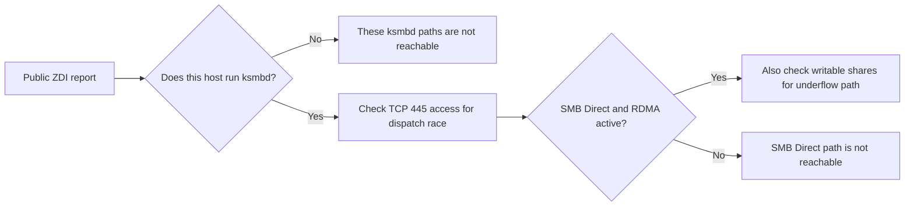

# Linux Kernel Bug Reports on Public Lists: Two ksmbd Risks

**Daily learning · 25 October 2026 · Public reports checked against mailing-list archives · Fix status developing**

> **Core idea:** On 21 October UTC, Trend Micro's Zero Day Initiative (ZDI) sent several Linux vulnerability reports to public lists while fixes were still being prepared. Two reports concern `ksmbd`, Linux's in-kernel SMB file server, and carry ZDI CVSS 3.0 scores of 9.0. The published demonstrations establish memory-safety failures; they do not demonstrate a working code-execution chain.

## 1. Foundations: which SMB server is involved?

| Term | Meaning here |
|---|---|
| SMB | Network file-sharing protocol. A shared drive may use it. |
| `ksmbd` | An optional SMB **server in the Linux kernel**, started with the `ksmbd.mountd` userspace helper. |
| Samba `smbd` | A separate userspace SMB server. These `ksmbd` reports do not describe a Samba flaw. |
| SMB Direct | SMB transport over remote direct memory access (RDMA); it needs additional kernel support and an RDMA-capable device or software driver. |
| ZDI-CAN | ZDI's candidate tracking ID. It is not a CVE or evidence that a fix is available. |

The two reported flaws are in **server-side** `ksmbd` paths. A machine that merely uses the Linux SMB client or runs Samba should not be counted as exposed to these specific paths. Kernel configuration, whether `ksmbd` is running, share permissions and network reachability all matter. [Kernel SMB server documentation](https://docs.kernel.org/filesystems/smb/ksmbd.html), [ZDI's original SMB Direct report](https://lkml.iu.edu/2610.2/14779.html), [original dispatch-race report](https://lkml.iu.edu/2610.2/14807.html).

## 2. What the public reports show

| Report | Reported failure and demonstrated result | Conditions |
|---|---|---|
| [ZDI-CAN-33774](https://lkml.iu.edu/2610.2/14807.html) | A request can be queued under one SMB protocol and processed after the connection's handler table changes. ZDI's test reads beyond a short SMB1 buffer as though it held an SMB2 header, leaking heap data; the report also describes a path to an out-of-bounds write. ZDI rates potential RCE at **9.0**. | A running, reachable `ksmbd` server. The published test uses a guest-accessible share and wins a dispatch race before authentication. |
| [ZDI-CAN-33549](https://lkml.iu.edu/2610.2/14779.html) | In an SMB Direct transfer, a descriptor larger than the remaining data sets the length to zero, then a second subtraction wraps it. ZDI's test records a kernel AddressSanitizer out-of-bounds write and crash. ZDI rates potential RCE at **9.0**. | `ksmbd` with SMB Direct, an RDMA device or software RDMA driver, and access to a writable share; guest write access can qualify. |

This is an exposure checklist, not an exploit sequence. A **CVSS impact rating** describes assessed potential; a local sanitizer finding or heap leak does not by itself prove reliable remote code execution. The reports were tested on Linux **7.3-rc3** (SMB Direct and dispatch race); deployment-specific version and backport assessment requires the running kernel's vendor advisory. [Original reports](https://lkml.iu.edu/2610.2/14779.html), [dispatch-race report](https://lkml.iu.edu/2610.2/14807.html).

The other public reports address a [`skb_zerocopy` ownership error](https://lkml.iu.edu/2610.2/14824.html) with a local privilege-escalation claim, a `vmwgfx` graphics-driver write, and an `nvmet` information-disclosure issue. A separate report concerned **ConnMan's DNS proxy**, which is userspace software rather than the Linux kernel. These are distinct flaws with different reachability and fixes; the two `ksmbd` mitigations do not resolve them. [Phoronix's index of the original posts](https://www.phoronix.com/news/LKML-New-Trend-Vulnerabilities).

## 3. Disclosure and fix status

| When (UTC, 2026) | What is established |
|---|---|
| **20–21 Oct** | ZDI sent the ConnMan report and five kernel-related reports to public mailing lists. The public addressing is observable; **an accidental send is a plausible interpretation, not a confirmed admission by ZDI**. |
| **22 Oct** | Greg Kroah-Hartman questioned sending unpatched reports to public lists. `ksmbd` maintainer Namjae Jeon pointed to a fix already queued in his tree for the dispatch race. SMB Direct maintainer Stefan Metzmacher asked ZDI to test a development branch that he believed might already fix the underflow. |
| **25 Oct review** | The cited maintainer branches are **not a released distro kernel**. No released-version fix for these two reports was verified here; use your distributor's actual kernel advisory before calling a system patched. |

The [dispatch-race maintainer commit](https://git.kernel.org/pub/scm/linux/kernel/git/ksmbd/linux.git/commit/?id=68f410faedaf) describes waiting for negotiation to finish before another request is received. The [SMB Direct maintainer's reply](https://lkml.iu.edu/2610.2/14845.html) expresses a hypothesis about his branch, not confirmation from ZDI that it fixes the report. Do not treat a patch in a development tree as a deployable general fix.

Linux's [security-reporting guidance](https://docs.kernel.org/process/security-bugs.html) now says AI-assisted findings should be treated as public because similar findings often surface independently. It also says **not to publish a reproducer**, to verify the report and to propose a fix. There is no evidence in the reviewed ZDI reports that AI found these specific bugs. The guidance does not mean every security bug must be posted publicly.

## 4. Practical response

1. **Identify the actual server.** Check whether `ksmbd.mountd` is running, whether a `ksmbd` kernel module is loaded, and which process owns a listener on TCP 445. Do not assume every SMB share uses `ksmbd`.
2. **Limit exposure now.** If `ksmbd` is unnecessary, stop its service and verify the listener is gone. If it is needed, restrict TCP 445 to trusted clients. For SMB Direct, assess RDMA availability and remove guest or untrusted write access where possible.
3. **Track vendor fixes by kernel build.** Follow the Linux and distribution advisories for both ZDI IDs, install the released fixed kernel once available, reboot into it and verify `uname -r` plus the vendor build identifier. A queued maintainer commit or installed-but-not-booted package is insufficient.
4. **Check the other components separately.** The networking, VMware graphics, NVMe target and ConnMan reports have different prerequisites. Inventory those components before applying a blanket severity label to every Linux host.

The UK's [NCSC vulnerability patch-wave guidance](https://www.ncsc.gov.uk/blogs/prepare-for-vulnerability-patch-wave) recommends frequent, risk-prioritised updating and an “update by default” policy, with accelerated handling for actively exploited internet-facing systems. That is general preparation; it does not establish active exploitation of these `ksmbd` reports. The video also mentions Chrome and Microsoft vulnerability totals. Those cross-product counts are not needed to assess these kernel bugs and are not used here as evidence of exploitation.

## 5. Source context

Based on the [user-shared Better Stack video](https://www.youtube.com/watch?v=sZaMmVUmq-I) and transcript, with the kernel details cross-checked against the linked original mailing-list posts, maintainer replies and kernel reporting guidance. Phoronix's [22 October report](https://www.phoronix.com/news/LKML-New-Trend-Vulnerabilities) connects the posts and gives contemporaneous context. “Black October” is a video label for concurrent disclosures, not a single attack campaign.

---

**Related:**
- [PHP2Shell: History, UAF and ASLR](PHP2Shell-History-UAF-And-ASLR-Oct-2026.md) — A separate same-week memory-safety disclosure with different exposure and released fixes.
- [GitLab Regex Compiler RCE](GitLab-Regex-Compiler-RCE-Oct-2026.md) — Another same-week severe report where the running product version determines exposure.
- [Node.js Brotli Decoder](Node.js-Brotli-Node2Shell-RCE-Oct-2026.md) — Compare a runtime memory error with an optional kernel server path.
- [eMudhra Weak CA Keys](EMudhra-Weak-CA-Keys-And-PKI-Trust-Oct-2026.md) — A concurrent security incident with a distinct trust-chain response.
