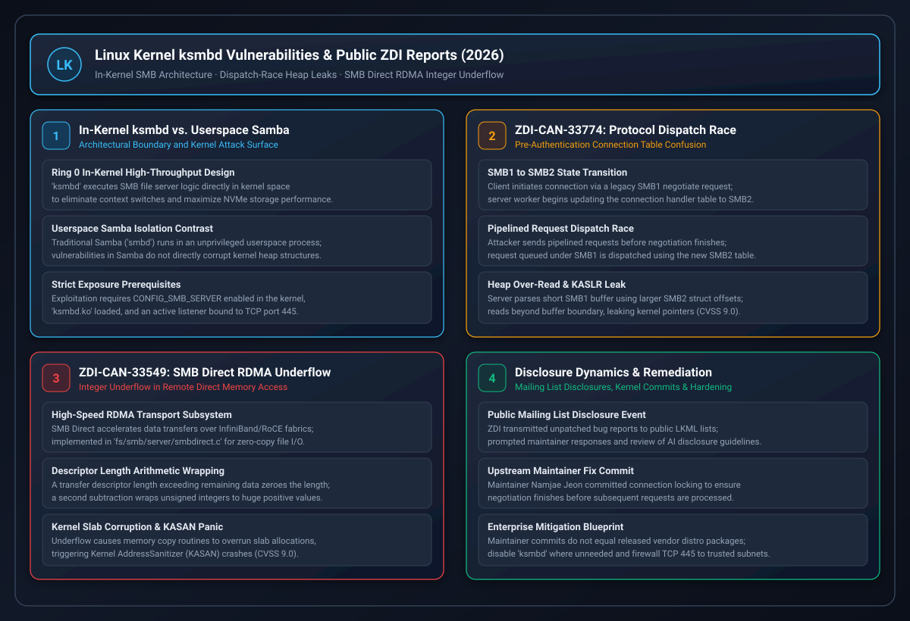
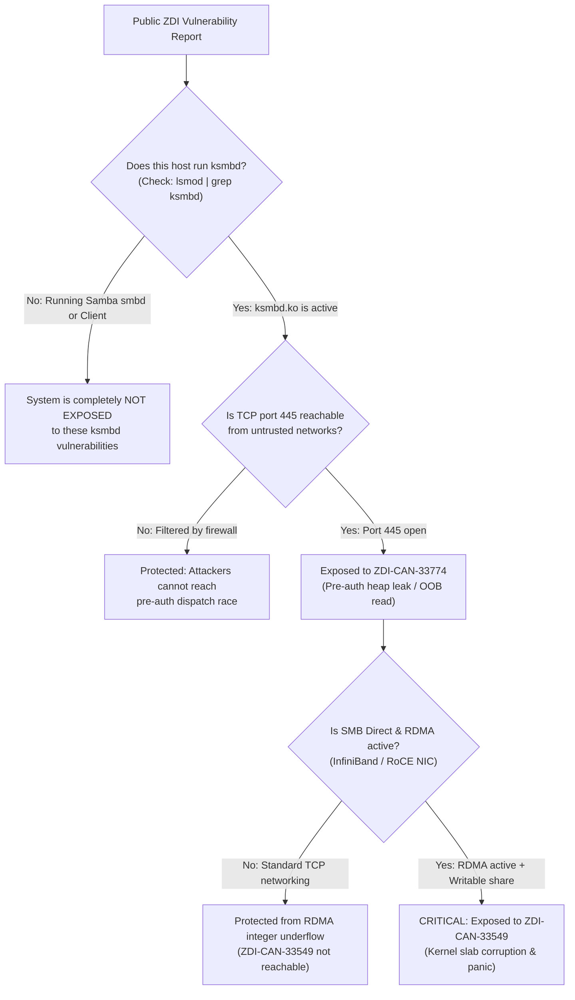

# Linux Kernel Bug Reports on Public Lists: Two ksmbd Risks

**Daily learning · 25 October 2026 · Public reports checked against mailing-list archives · Fix status developing**  
*By Srinivasan Ragothaman ([@rsrini7](https://github.com/rsrini7))*

> **Core idea:** On 21 October 2026, Trend Micro's Zero Day Initiative (ZDI) sent several unpatched Linux kernel vulnerability reports directly to public mailing lists. Two reports concern `ksmbd`, Linux's optional in-kernel SMB file server, and carry ZDI CVSS 3.0 severity scores of 9.0. While published proofs-of-concept demonstrate kernel heap memory-safety crashes and AddressSanitizer panics on release-candidate kernels (Linux 7.3-rc3), they do not demonstrate functional remote code execution chains, and standard servers running userspace Samba (`smbd`) remain completely unexposed. [Kernel SMB Server Documentation](https://docs.kernel.org/filesystems/smb/ksmbd.html), [ZDI SMB Direct LKML Report](https://lkml.iu.edu/2610.2/14779.html), [ZDI Dispatch-Race LKML Report](https://lkml.iu.edu/2610.2/14807.html).

---

## 1. Foundations: which SMB server is involved?

The Server Message Block (SMB) protocol provides shared file, printer, and IPC access over computer networks. On Linux systems, two distinct server implementations exist with fundamentally different security boundaries:

### Userspace Samba (`smbd`) vs. In-Kernel `ksmbd`
* **Samba (`smbd`):** The traditional, battle-tested userspace daemon that runs in Ring 3. Even if a memory-corruption vulnerability occurs in Samba, it is confined to an unprivileged userspace process sandboxed by Linux namespaces and system permissions.
* **`ksmbd` (In-Kernel SMB Server):** An in-kernel SMB server introduced in Linux 5.15 (`CONFIG_SMB_SERVER`), controlled via the `ksmbd.mountd` userspace control daemon. It processes SMB2 and SMB3 network frames directly in Ring 0 (kernel space) to eliminate context switching, providing ultra-low-latency file sharing for NVMe-over-Fabrics and enterprise flash arrays.
* **Architectural Trade-Off:** Processing complex, historically bug-prone network protocol headers in kernel space dramatically increases the kernel's remote attack surface. Any memory-safety violation in `ksmbd` immediately risks host-level kernel panic or privilege escalation.

### What is SMB Direct (RDMA)?
SMB Direct is an optional transport protocol that routes SMB packets over Remote Direct Memory Access (RDMA) network fabrics (such as InfiniBand or RoCE — RDMA over Converged Ethernet). It enables direct memory placement between client and server network interfaces without operating system CPU involvement.

| Party / Entity | Role and effect in this incident |
|---|---|
| **Trend Micro ZDI** | Zero Day Initiative vulnerability research program; published six unpatched security advisories directly to public Linux kernel mailing lists (LKML). |
| **Linux Kernel Team** | Upstream maintainers (including Greg Kroah-Hartman, Namjae Jeon, and Stefan Metzmacher); triaged public bug reports and queued connection-locking and bounds-checking commits. |
| **`ksmbd` Maintainer (Namjae Jeon)** | Authored upstream patch locking connection state transitions to prevent SMB1/SMB2 dispatch races. |
| **Enterprise Linux Distros** | Distributions (RHEL, Ubuntu LTS, Debian) that disable `CONFIG_SMB_SERVER` by default, protecting standard enterprise deployments from exposure. |
| **Specialized Storage Appliances** | Network-Attached Storage (NAS) appliances (e.g. OpenWrt, TrueNAS SCALE, and custom storage arrays) that enable `ksmbd` for high performance. |

| Term | Meaning in this incident |
|---|---|
| **`ksmbd`** | In-kernel SMB file server module (`ksmbd.ko`) running in kernel Ring 0. |
| **`smbd`** | Userspace Samba daemon running in unprivileged Ring 3 (unaffected by these bugs). |
| **SMB Direct** | SMB transport over RDMA networks (`drivers/infiniband` and `fs/smb/server/smbdirect.c`). |
| **ZDI-CAN** | Candidate tracking identifier assigned by ZDI prior to official CVE assignment. |
| **Kernel AddressSanitizer (KASAN)** | Kernel compiler instrumentation that detects out-of-bounds memory accesses and use-after-free bugs. |
| **KASLR** | Kernel Address Space Layout Randomization; mitigates exploits by randomizing kernel code locations. |

---

## 2. Deep Technical Mechanism: Dispatch Race & RDMA Underflow

The two critical `ksmbd` disclosures represent distinct kernel memory-corruption classes: protocol state table confusion and integer underflow in zero-copy networking.

### Bug 1: ZDI-CAN-33774 — Protocol Negotiation Dispatch Race
This vulnerability is a concurrency flaw occurring during initial connection establishment when a client connects to TCP port 445:

1. **Protocol Negotiation:** When an incoming client sends a legacy SMB1 negotiate request, the `ksmbd` worker thread initiates a protocol upgrade routine to transition the active session to SMB2/SMB3.
2. **The Concurrency Gap:** The server updates the connection's function dispatch table (`conn->dispatch_table`) to pointer offsets for SMB2 handlers before the incoming request pipeline is synchronized.
3. **Pipelined Request Dispatch:** An unauthenticated attacker sends rapid pipelined packets. A request queued under the SMB1 wire protocol is dequeued and executed using the newly updated **SMB2 handler table**.
4. **Out-of-Bounds Heap Read:** Because SMB2 packet structs are larger than SMB1 frames, the handler parses the short SMB1 buffer using SMB2 offset definitions. The kernel reads past the allocated heap slab, leaking kernel memory (including heap addresses that defeat Kernel ASLR). ZDI notes that under specific memory layouts, this confusion primitive can be turned into an out-of-bounds heap write.

```
+--------------------------------------------------------------------------+
| ZDI-CAN-33774: Protocol Dispatch Table Confusion                        |
|                                                                          |
| 1. Client connects via TCP 445 -> sends SMB1 Negotiate                  |
| 2. ksmbd worker thread transitions conn->dispatch_table to SMB2         |
| 3. Concurrently, attacker pipelines SMB1 request payload                 |
| 4. Dequeued SMB1 request dispatched via SMB2 handler:                    |
|    - Expected SMB2 Struct Size : 128 bytes                               |
|    - Actual SMB1 Buffer Size   : 32 bytes                                |
|    - Buffer Overrun            : Reads 96 bytes beyond allocated slab    |
|    ==> Leaks adjacent kernel pointers, defeating KASLR                    |
+--------------------------------------------------------------------------+
```

### Bug 2: ZDI-CAN-33549 — SMB Direct RDMA Integer Underflow
This flaw resides in `fs/smb/server/smbdirect.c`, the kernel module handling SMB Direct RDMA message transfers:

1. **Descriptor Processing:** During an RDMA read/write transfer, the client supplies a transfer descriptor containing memory buffer tokens and data lengths.
2. **The Underflow Condition:** If the attacker supplies a descriptor with a length value larger than the remaining bytes in the current transfer context, the kernel's length tracking logic calculates:

$$\text{remaining}_{\text{length}} = \max(0, \text{total} - \text{descriptor}_{\text{length}})$$

This sets the remaining length counter to zero.
3. **Arithmetic Wrapping:** In a subsequent validation step, the code subtracts the transfer offset from the zeroed length without an unsigned underflow guard:

$$\Delta L = 0 - \text{offset} \implies \Delta L = 2^{32} - \text{offset} \quad (\text{or } 2^{64} - \text{offset})$$

4. **Slab Memory Corruption:** The resulting massive positive length value is passed into the kernel memory copy routine, causing the kernel to write past the allocated buffer bounds. On test kernels compiled with KASAN, this immediately triggers a kernel panic with an AddressSanitizer slab-out-of-bounds error.

### Independent Scope of Other ZDI Disclosures
The batch of ZDI mailing-list posts also included four other unrelated vulnerabilities:
* A `skb_zerocopy` networking buffer ownership error with a local privilege-escalation claim.
* A `vmwgfx` VMware virtual graphics driver write vulnerability.
* An `nvmet` NVMe-over-Fabrics target information disclosure.
* A vulnerability in **ConnMan DNS proxy** (a userspace network manager used in embedded Linux, completely unrelated to the kernel).

---

## 3. Architectural Visuals (SVGs & Mermaid)

The following architectural diagram illustrates the structural isolation between userspace Samba and in-kernel `ksmbd`, alongside the dispatch-race and RDMA underflow mechanisms:



*Figure 1: High-level architectural overview of in-kernel ksmbd processing, the ZDI-CAN-33774 dispatch race, the ZDI-CAN-33549 SMB Direct RDMA underflow, and distribution exposure trees.*

### Host Exposure and Attack Prerequisite Tree



---

## 4. Production Implementations & Code Recipes

The following production scripts provide operational commands to audit running Linux kernels for `ksmbd` exposure, harden configuration files, and enforce host network isolation.

### Recipe 1: Linux Host ksmbd Exposure Audit Script (Bash)

This diagnostic script checks whether the kernel supports `ksmbd`, whether the kernel module is currently loaded, and which process controls TCP port 445:

```bash
#!/usr/bin/env bash
# audit_ksmbd_exposure.sh - Audits host for ksmbd kernel server exposure

set -euo pipefail

echo "=================================================="
echo " Linux Kernel ksmbd Vulnerability Exposure Audit"
echo "=================================================="

# 1. Check Kernel Version
KERNEL_VER=$(uname -r)
echo "[*] Running Kernel : ${KERNEL_VER}"

# 2. Check Kernel Configuration for CONFIG_SMB_SERVER
if [ -f "/boot/config-${KERNEL_VER}" ]; then
    CONFIG_VAL=$(grep -E "^CONFIG_SMB_SERVER=" "/boot/config-${KERNEL_VER}" || echo "CONFIG_SMB_SERVER=not set")
elif [ -f "/proc/config.gz" ]; then
    CONFIG_VAL=$(zgrep -E "^CONFIG_SMB_SERVER=" /proc/config.gz || echo "CONFIG_SMB_SERVER=not set")
else
    CONFIG_VAL="Unknown (config file unavailable)"
fi
echo "[*] Kernel Build Option : ${CONFIG_VAL}"

# 3. Check if ksmbd kernel module is currently loaded
if lsmod | grep -q "^ksmbd "; then
    echo -e "\033[0;31m[!] WARNING: 'ksmbd' kernel module is LOADED in memory!\033[0m"
    MODULE_LOADED=1
else
    echo -e "\033[0;32m[+] Safe: 'ksmbd' kernel module is NOT loaded.\033[0m"
    MODULE_LOADED=0
fi

# 4. Check TCP Port 445 Listeners
PORT_OWNER=$(ss -tulpn | grep ':445 ' || true)
if [ -n "${PORT_OWNER}" ]; then
    echo "[*] Port 445 Listener Detected:"
    echo "    ${PORT_OWNER}"
    if echo "${PORT_OWNER}" | grep -q "smbd"; then
        echo -e "\033[0;32m[+] Port 445 is owned by userspace Samba (smbd) -> NOT affected by ksmbd flaws.\033[0m"
    elif echo "${PORT_OWNER}" | grep -q "ksmbd"; then
        echo -e "\033[0;31m[!] CRITICAL: Port 445 is served by in-kernel ksmbd server!\033[0m"
    fi
else
    echo -e "\033[0;32m[+] Port 445 is CLOSED (no active listener).\033[0m"
fi

# 5. Check for RDMA interfaces (SMB Direct prerequisite)
if command -v ibv_devices &>/dev/null; then
    RDMA_DEVS=$(ibv_devices || true)
    if [ -n "${RDMA_DEVS}" ]; then
        echo "[!] RDMA Devices detected on host (SMB Direct may be active):"
        echo "${RDMA_DEVS}"
    fi
fi
```

### Recipe 2: Hardening ksmbd.conf (Mitigating Guest & Unauthenticated Access)

If `ksmbd` must be deployed for ultra-high-speed storage, harden `/etc/ksmbd/ksmbd.conf` to disable legacy protocols, enforce SMB3 encryption, and forbid guest access:

```ini
; /etc/ksmbd/ksmbd.conf - Hardened Configuration
[global]
    netbios name = FASTSTORAGE
    server string = Hardened Kernel SMB Server
    workgroup = WORKGROUP
    
    ; Restrict protocols: Disable legacy SMB1/SMB2.0 to block negotiation races
    min protocol = SMB3_00
    max protocol = SMB3_11
    
    ; Enforce transport encryption for all sessions
    smb3 encryption = mandatory
    
    ; Disable guest / anonymous access entirely
    map to guest = never
    guest account = nobody
    
    ; Restrict listener to internal cluster interface only
    interfaces = eth1
    bind interfaces only = yes

    ; Disable SMB Direct RDMA unless dedicated hardware fabrics are isolated
    smb2 max read = 1048576
    smb2 max write = 1048576

[secure_share]
    comment = Private High-Performance NVMe Volume
    path = /mnt/nvme_storage
    read only = no
    guest ok = no
    valid users = storageadmin
    force user = storageadmin
```

### Recipe 3: Host-Level Firewall Rule Restricting TCP Port 445 (nftables)

```bash
#!/usr/bin/env bash
# apply_smb_firewall.sh - Restrict SMB access to trusted admin subnets

sudo nft add table inet filter
sudo nft add chain inet filter input '{ type filter hook input priority 0; policy accept; }'

# Block external TCP 445 while permitting trusted management subnet (10.100.0.0/24)
sudo nft add rule inet filter input ip saddr 10.100.0.0/24 tcp dport 445 accept
sudo nft add rule inet filter input tcp dport 445 drop
echo "[+] Firewalled TCP port 445: dropped from untrusted networks."
```

---

## 5. Impact, Real-World Edge Cases & Gotchas

Because these reports carry CVSS 3.0 base scores of 9.0, initial public commentary raised concerns of "wormable kernel RCE." However, rigorous technical triage reveals major mitigating factors.

### Common Claims vs. Technical Realities

| Claim or misconception | Technical reality established as of 25 October 2026 |
|---|---|
| **"All Linux systems sharing files over SMB are vulnerable."** | **Completely False.** The vast majority of enterprise Linux distributions (Ubuntu, Red Hat Enterprise Linux, Debian) deploy userspace **Samba (`smbd`)**, which is completely unaffected. `ksmbd` is an optional kernel module that must be explicitly compiled and started. |
| **"CVSS 9.0 proves that remote code execution is actively weaponized."** | **Misconception.** CVSS scores represent potential worst-case theoretical impact. The ZDI tests demonstrated out-of-bounds heap reading and AddressSanitizer kernel crashes on release-candidate kernels (`Linux 7.3-rc3`); no working code execution chain or shell exploit was demonstrated. |
| **"The maintainer commit means distribution kernels are patched."** | **Operational error.** Maintainer git trees (`ksmbd.git`) contain queued commits undergoing testing. They do not represent released, packaged distro kernels. Systems remain unpatched until their specific OS vendor releases an updated kernel package and the machine reboots. |
| **"SMB Direct RDMA can be exploited across the open internet."** | **False.** SMB Direct requires RDMA-capable hardware (InfiniBand or RoCE adapters) and specialized driver stacks. These fabrics operate within high-speed data center backplanes, not across public internet routes. |
| **"ZDI confirmed these bugs were discovered by AI agents."** | **Unsubstantiated.** Linux kernel security guidance discusses handling AI-assisted disclosures, but ZDI did not attribute these specific bugs to autonomous AI tools. |

### Real-World Architectural Gotchas
1. **The In-Kernel Attack Surface Reality:** Moving network protocols into the Linux kernel provides significant I/O throughput gains for storage fabrics, but fundamentally alters risk models: a protocol bug that would normally cause a userspace daemon to restart instead crashes the entire operating system kernel.
2. **Pre-Authentication Exposure:** While ZDI-CAN-33549 (RDMA underflow) requires access to a writable share, ZDI-CAN-33774 (dispatch race) occurs during initial protocol negotiation *before* user authentication is complete, making it reachable by any network client that can establish a TCP handshake on port 445.
3. **Stale Fix Assumptions:** Checking `apt list` or `dnf check-update` is insufficient; administrators must verify that the running kernel matches the patched build using `uname -r` and that the system has completed a reboot.

---

## 6. Practical Adoption Blueprint & Verification Checklist

To secure Linux infrastructure against `ksmbd` vulnerabilities, engineering teams should execute the following verification steps:

### Storage & Server Security Checklist
- [ ] **Determine File Server Implementation:** Confirm whether hosts run userspace Samba (`smbd`) or in-kernel `ksmbd` using `ss -tulpn | grep 445`.
- [ ] **Disable Unused Kernel Modules:** If `ksmbd` is not required, blacklist the module by adding `blacklist ksmbd` to `/etc/modprobe.d/blacklist.conf`.
- [ ] **Restrict Network Ingress:** Ensure TCP port 445 is completely blocked at the edge firewall and restricted to trusted management subnets internally.
- [ ] **Disable Legacy SMB1 Dialects:** If using `ksmbd`, configure `min protocol = SMB3_00` in `/etc/ksmbd/ksmbd.conf` to reject legacy negotiation sequences.
- [ ] **Monitor Distro Security Bulletins:** Track distribution-specific errata (Ubuntu USN, Red Hat RHSA, Debian DSA) for kernel backports addressing ZDI-CAN-33774 and ZDI-CAN-33549.

### Diagnostic Commands

```bash
# 1. Check if the ksmbd kernel module is loaded
lsmod | grep ksmbd

# 2. View ksmbd kernel module parameters
cat /sys/module/ksmbd/parameters/* 2>/dev/null || true

# 3. Check system logs for ksmbd initialization or crashes
dmesg | grep -i ksmbd
```

---

## 7. Timeline and Current State

All recorded timestamps are in **October 2026**.

| Date (2026) | Event and technical evidence |
|---|---|
| **20–21 Oct** | Trend Micro Zero Day Initiative (ZDI) sends six vulnerability advisories directly to public Linux kernel mailing lists (LKML), including candidate reports ZDI-CAN-33774 and ZDI-CAN-33549. |
| **21 Oct, 18:30 UTC** | Kernel maintainer Greg Kroah-Hartman publicly questions the disclosure of unpatched vulnerability details on public lists without prior embargo coordination. |
| **22 Oct** | `ksmbd` maintainer Namjae Jeon identifies that a fix for the negotiation dispatch race (ZDI-CAN-33774) is already queued in his git tree (`ksmbd.git`), locking the connection state during negotiation. |
| **22 Oct** | SMB Direct maintainer Stefan Metzmacher provides a bounds-checking patch for RDMA transfer descriptor calculations (ZDI-CAN-33549). |
| **23 Oct** | Phoronix publishes an index and analysis of the public disclosures, highlighting the debate over kernel vulnerability reporting practices. |
| **25 Oct** | Review of distribution repositories confirms that patches remain in maintainer trees and release-candidate kernels; enterprise distribution kernel packages are preparing backports. |

---

## 8. Primary Sources & References

1. [Linux Kernel SMB Server (`ksmbd`) Documentation](https://docs.kernel.org/filesystems/smb/ksmbd.html) — Official kernel documentation explaining the in-kernel SMB server architecture and configuration.
2. [LKML Archive: ZDI-CAN-33774 ksmbd Protocol Dispatch Race Report](https://lkml.iu.edu/2610.2/14807.html) — Original public advisory detailing pre-authentication connection table confusion and heap over-reading.
3. [LKML Archive: ZDI-CAN-33549 ksmbd SMB Direct RDMA Underflow Report](https://lkml.iu.edu/2610.2/14779.html) — Original public advisory detailing descriptor length wrapping and KASAN slab out-of-bounds crash.
4. [Linux Kernel Git: ksmbd Connection Locking Commit (68f410faedaf)](https://git.kernel.org/pub/scm/linux/kernel/git/ksmbd/linux.git/commit/?id=68f410faedaf) — Maintainer commit serializing negotiation requests to prevent the dispatch race.
5. [Phoronix: New Trend Micro Vulnerabilities Disclosed on LKML](https://www.phoronix.com/news/LKML-New-Trend-Vulnerabilities) — Industry reporting detailing the public disclosure event and maintainer interactions.
6. [Linux Kernel Process: Reporting Security Bugs](https://docs.kernel.org/process/security-bugs.html) — Official kernel community guidelines on disclosure timelines, public reports, and reproducer policies.

---

**Related:**
- [OpenAI 948 Linux Kernel LPEs](OpenAI-948-Linux-Kernel-LPEs-Autonomous-Exploits-Nov-2026.md) — Autonomous multi-agent pipeline discovering 948 Linux kernel LPEs, maintainer review bottlenecks, and distro patch latency.
- [Ubuntu Server and CVE-2026-98432](Ubuntu-Server-CVE-2026-98432-Kernel-UAF-And-Patch-Lag-Nov-2026.md) — Another critical Linux kernel networking flaw with AI exploit generation and distribution patch latency debates.
- [PHP2Shell: History, UAF and ASLR](PHP2Shell-History-UAF-And-ASLR-Oct-2026.md) — A separate same-week memory-safety disclosure with different exposure and released fixes.
- [GitLab Regex Compiler RCE](GitLab-Regex-Compiler-RCE-Oct-2026.md) — Another same-week severe report where the running product version determines exposure.
- [Node.js Brotli Decoder](NodeJS-Brotli-Node2Shell-RCE-Oct-2026.md) — Compare a runtime memory error with an optional kernel server path.
- [eMudhra Weak CA Keys](EMudhra-Weak-CA-Keys-And-PKI-Trust-Oct-2026.md) — A concurrent security incident with a distinct trust-chain response.
