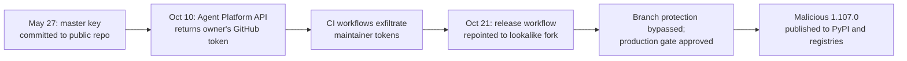

# LiteLLM 1.107.0: A Release Pipeline Compromise and Credential Stealer

**Daily learning · 24 October 2026 · Primary-source review · Vendor investigation completed; no public attribution**

> **Core idea:** A master key committed to a public repository in May was never revoked. In October it gave an attacker a GitHub organisation-owner token, then maintainer tokens, then the release workflow itself. The result was a malicious `litellm==1.107.0` on PyPI and in Docker images, designed to steal cloud, developer, and AI credentials.

> **If you installed or ran 1.107.0:** assume the host was compromised. Do not start with `pip install` — Python startup can re-run the payload. Remove `cook.pth`, `cook.py`, and `sitecustomize.py`, kill the detached loader, rebuild the environment, and rotate every reachable secret. Details in §5.

## 1. Foundations: why a Python package can run code at startup

| Term | Meaning here |
|---|---|
| LiteLLM | A Python SDK and proxy that normalises calls to many LLM providers. |
| `.pth` file | A Python `site-packages` file processed at interpreter startup; it can execute code. |
| `sitecustomize.py` | A module Python imports automatically at startup. |
| Release pipeline | The CI/CD workflow that builds, signs, and publishes artifacts. |
| Provenance | Evidence linking a published artifact to a specific source revision and build process. |

LiteLLM is widely embedded in AI applications and gateways. Compromising its release means the malicious code inherits the trust of every project that upgrades or rebuilds from the affected tag. [LiteLLM incident post](https://docs.litellm.ai/blog/security-incident-oct-21-2026).

## 2. Mechanism: from a leaked key to a signed malicious release

The vendor's reconstruction identifies these steps:

1. **The root credential was never rotated.** A configuration file containing the LiteLLM Agent Platform master key was committed to the public `LiteLLM-Labs/lite-harness` repository on **27 May 2026**. The commit was force-pushed over, but the key itself was not revoked.
2. **The key disclosed a more powerful token.** On **10 October**, an attacker called the Agent Platform API and retrieved the GitHub CLI OAuth token of a GitHub organisation owner.
3. **CI became the exfiltration channel.** Throwaway branches posted repository secrets, including two maintainers' tokens, to an attacker-controlled endpoint. The actor deleted the workflow records afterwards.
4. **The release source was changed.** On **21 October**, the attacker modified the release workflow to build from `Berri-AI/litellm` — a lookalike of `BerriAI/litellm` — and used the stolen identities to bypass branch protection and approve the production gate.
5. **The published git tag was clean.** The malicious files existed only in the built artifacts, not in the official `v1.107.0` source tag. This is why comparing the tag to the wheel is not enough.

The payload used `cook.pth`, `cook.py`, and `sitecustomize.py` to run at Python startup, installed a credential stealer, and loaded a remote-code tool. It targeted cloud and developer credentials, AI provider keys, and LiteLLM proxy secrets. [Attack-chain report](https://docs.litellm.ai/blog/security-incident-oct-21-2026-attack-chain), [Socket analysis](https://socket.dev/blog/litellm-compromise).

## 3. Exposure window and affected artifacts

| Artifact | Affected window (UTC, 21 Oct 2026) | Notes |
|---|---|---|
| PyPI `litellm==1.107.0` | 11:39:51 – 13:23 | All seven wheels; removed by PyPI. |
| Docker Hub `v1.107.0`, `latest`, `main-latest`, `main-stable` | 11:46:56 – 14:20 | Removed or repointed to verified clean images. |
| GHCR `v1.107.0`, `latest`, `main-latest`, `main-stable` | 11:46:56 – 13:51 | Made unavailable earlier than Docker Hub. |
| Official `v1.107.0` git tag | Not affected | Malicious files were injected into the build tree. |
| LiteLLM enterprise private release | Not affected | Separate private registry. |

Pin to **1.106.2** or another known-clean release. The compromise was detected publicly when a community member opened [issue #47826](https://github.com/BerriAI/litellm/issues/47826) at 12:06 UTC. The exposure window is short, but any process that started Python with the affected package should be treated as compromised. [LiteLLM incident post](https://docs.litellm.ai/blog/security-incident-oct-21-2026).

## 4. Impact and limits

| Claim | What the evidence supports |
|---|---|
| “Only CI was compromised.” | No. The attacker obtained organisation-owner access and multiple maintainer tokens. |
| “The git tag is malicious.” | No. The official source tag was clean; the wheels and images were built from an attacker-controlled fork. |
| “Pulling the package removed the risk.” | No. Environments that already installed it remain compromised until cleaned and rotated. |
| “A short exposure window means little risk.” | Not safe. The payload runs at Python startup and targets credentials; a single successful run is enough. |
| “This is the March 2026 LiteLLM incident.” | No. It is a separate, second supply-chain compromise in the same year, with a different attack chain. [March summary](../Weekly-Updates/Mar-29-2026.md). |

The vendor's statement that the key “was not revoked” is the central lesson: a secret removed from the current branch is still live in Git history, forks, caches, and anyone who copied it. Force-pushing is not revocation.

## 5. Practical response

1. **Do not run `pip install` first.** In an affected environment, Python startup may execute the payload again. Use the shell and remove `cook.pth`, `cook.py`, `sitecustomize.py`, and matching `__pycache__` files from every `site-packages` directory.
2. **Kill the detached loader process** and remove `/tmp/remote_code_loader.lock` where present.
3. **Rebuild rather than repair.** Recreate the virtual environment, container image, or host from a trusted base, pinned to a clean LiteLLM version.
4. **Assume exfiltration if the host had outbound internet.** Rotate the instance or task IAM role, every provider key stored in the LiteLLM proxy database, the master and virtual keys, `DATABASE_URL`, and every secret in the host's process environment.
5. **Check cloud audit logs** for `GetCallerIdentity` from the instance role around installation time, then for use of that role's credentials from outside your infrastructure.
6. **Search for residual evidence** such as `litellm-1.107.0.dist-info`, but remember that absence of files does not prove a clean host.

---

**Related:**
- [OpenCode Console API-Key Breach](OpenCode-Console-API-Key-Breach-And-Distillation-Oct-2026.md) — Compare platform-held AI credentials with a compromised package release.
- [Railway, Zeabur and the Hunt for AI Provider Keys](AI-Key-Theft-Railway-Zeabur-Oct-2026.md) — A related campaign against platforms that store inference keys.
- [Node.js Brotli Decoder](Node.js-Brotli-Node2Shell-RCE-Oct-2026.md) — Another trust boundary where rebuilding the runtime, not the application package, is the fix.
- [eMudhra Weak CA Keys](EMudhra-Weak-CA-Keys-And-PKI-Trust-Oct-2026.md) — LiteLLM delayed a release while removing the affected CA from its trust store, showing how trust updates cascade.
