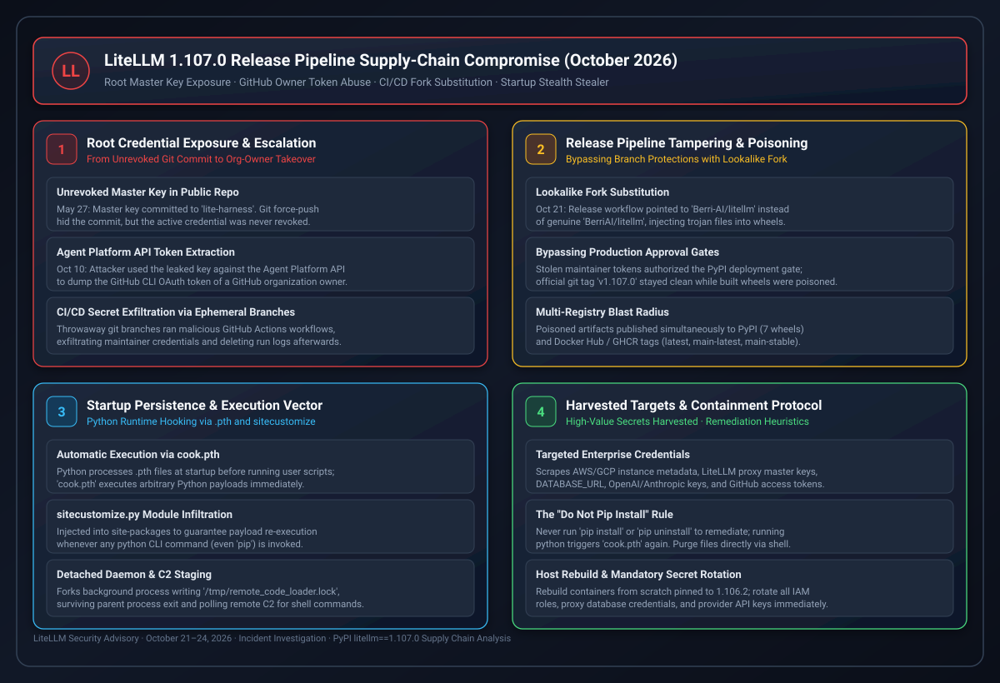
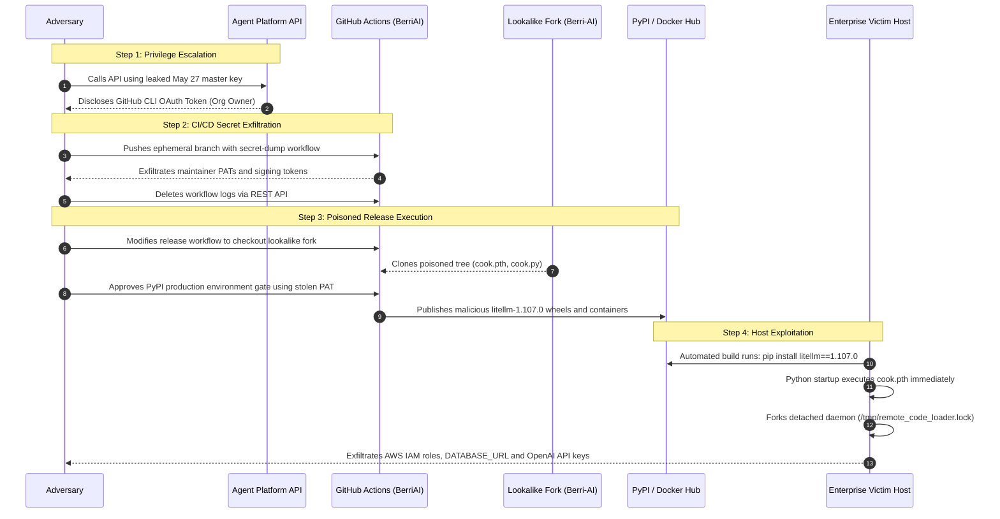

# LiteLLM 1.107.0: Release Pipeline Supply-Chain Compromise and Credential Stealer (2026)

Daily learning · October 24, 2026 · Vendor Investigation Completed

*By Srinivasan Ragothaman ([@rsrini7](https://github.com/rsrini7))*

> **Core Idea:** On October 21, 2026, a malicious supply-chain trojan was published to PyPI and major container registries as `litellm==1.107.0`. The compromise originated from a master API key committed to a public repository five months earlier (May 2026) that was hidden via git force-push but never revoked. The attacker used this unrevoked credential to harvest GitHub organization-owner tokens, exfiltrate maintainer secrets via ephemeral CI branches, substitute a lookalike fork (`Berri-AI/litellm`) into the release pipeline, and inject a stealth credential stealer using Python's startup `.pth` and `sitecustomize.py` execution hooks.

---

## 1. Foundations & Ecosystem Context

In modern artificial intelligence architectures, **LiteLLM** (maintained by BerriAI) functions as a foundational gateway middleware. It provides a unified, OpenAI-compatible proxy interface that translates requests across more than 100 large language model APIs (including OpenAI, Anthropic, AWS Bedrock, Google Vertex AI, and Azure OpenAI), while managing routing, load balancing, budget tracking, and virtual API key issuance.

```
+-----------------------------------------------------------------------------------+
|                         LiteLLM Gateway Deployment Architecture                   |
+-----------------------------------------------------------------------------------+

   Client Applications / Microservices
            │ (OpenAI-Compatible REST Calls)
            ▼
   [LiteLLM Proxy Gateway] ──────► [PostgreSQL Database] (User Keys & Budgets)
            │
            ├── OpenAI API Key
            ├── Anthropic API Key
            ├── AWS IAM Credentials (Bedrock)
            ├── Azure Managed Identities
            └── Master Proxy Virtual Keys
            │
            ▼
   Upstream LLM Providers (OpenAI, Anthropic, Bedrock, Vertex AI)
```

Because LiteLLM sits directly at the junction between client applications and upstream model providers, it holds immense credential density. Compromising the LiteLLM package distribution channel grants an attacker direct access to the operational crown jewels of enterprise AI infrastructure.

### The Python Startup Execution Mechanism: `.pth` and `sitecustomize`

The Python runtime incorporates legacy extensibility mechanisms that execute arbitrary code prior to user script execution:

1. **Path Configuration Files (`.pth`):** When the Python interpreter initializes, the standard library `site` module scans all `site-packages` directories for `.pth` files. If a line begins with `import ` (or contains arbitrary code preceded by `import sys; exec(...)`), Python parses and evaluates it immediately.
2. **`sitecustomize.py` Hook:** If present in the module search path, Python automatically imports `sitecustomize.py` during runtime startup, executing its top-level module statements before any user entry point (including the `pip` executable itself) runs.

### Key Terminology & Architectural Concepts

| Term | Technical Meaning & Threat Context |
| :--- | :--- |
| **LiteLLM Proxy** | High-performance Python gateway centralizing multi-provider LLM API calls, credential pooling, and usage monitoring. |
| **`.pth` Startup Hook** | Text file in Python's `site-packages` parsed at interpreter startup; lines starting with `import` execute arbitrary Python bytecode. |
| **`sitecustomize.py`** | Standard Python startup module automatically loaded by the `site` package before executing user scripts. |
| **Lookalike Fork Substitution** | Supply-chain attack vector where CI/CD workflows are modified to clone an attacker-controlled mirror repository (`Berri-AI` vs. `BerriAI`). |
| **Ephemeral CI Secret Exfiltration** | Pattern where attackers push throwaway git branches with malicious GitHub Actions workflows to dump environment secrets, deleting run logs afterward. |
| **Trusted Publisher (PyPI OIDC)** | Cryptographic authentication standard binding package releases directly to signed GitHub Actions workflow claims, eliminating long-lived PyPI API tokens. |
| **Detached Loader Daemon** | Background payload process that decouples from the parent process group, persists across application crashes, and writes `/tmp/remote_code_loader.lock`. |

---

## 2. Deep Technical Mechanism: Anatomy of the Attack Chain

The vendor's post-incident reconstruction established a multi-month persistence chain progressing from a leaked configuration key to automated registry poisoning.

```
┌────────────────────────────────────────────────────────────────────────────────────────┐
│                        The LiteLLM 1.107.0 Supply-Chain Kill Chain                     │
└────────────────────────────────────────────────────────────────────────────────────────┘

  [Phase 1: Root Exposure (May 27, 2026)]
  └── Master key committed to public repo 'LiteLLM-Labs/lite-harness'.
      Force-push overwrote git history, but active API key was never revoked.
            │
            ▼
  [Phase 2: Privilege Escalation (October 10, 2026)]
  └── Leaked key used to query internal Agent Platform API.
      API returned GitHub CLI OAuth token belonging to an organization owner.
            │
            ▼
  [Phase 3: CI/CD Secret Exfiltration (Mid-October 2026)]
  └── Attacker pushed ephemeral throwaway branches with modified CI scripts.
      Dumped repository secrets and two maintainer personal access tokens.
            │
            ▼
  [Phase 4: Pipeline Tampering & Release Bypass (October 21, 2026)]
  └── Release workflow repointed to lookalike fork 'Berri-AI/litellm'.
      Stolen maintainer identities bypassed branch protections and production gates.
            │
            ▼
  [Phase 5: Artifact Poisoning & Distribution (11:39–14:20 UTC)]
  └── PyPI wheels and Docker Hub / GHCR tags built with trojan payload.
      Official git tag 'v1.107.0' remained clean; build artifacts were poisoned.
```

### 1. Root Exposure: Force-Pushing is Not Revocation (May 27, 2026)
On May 27, 2026, an engineer committed an administrative configuration file containing the **LiteLLM Agent Platform master key** into the public GitHub repository `LiteLLM-Labs/lite-harness`. Recognizing the leak, the maintainers force-pushed a revised commit history to remove the file from the main branch. 

However, **the underlying API credential was never rotated or revoked in the backend**. The active key remained valid in cached git objects, third-party GitHub archival mirrors, and scrapers monitoring public commits.

### 2. Privilege Escalation via Agent Platform API (October 10, 2026)
On October 10, the adversary utilized the unrevoked master key to query the LiteLLM Agent Platform internal API. The API returned sensitive session telemetry, including the active **GitHub CLI OAuth token belonging to a GitHub organization owner** of `BerriAI`.

### 3. CI/CD Secret Exfiltration via Ephemeral Branches
Possessing organization-owner permissions, the attacker created ephemeral git branches within the core `BerriAI/litellm` repository. These branches executed customized GitHub Actions workflow steps that extracted environment secrets, repository secrets, and personal access tokens (PATs) belonging to two core maintainers. To evade detection, the attacker utilized GitHub API calls to delete the workflow run logs immediately following exfiltration.

### 4. Lookalike Fork Substitution & Production Gate Bypass (October 21, 2026)
On October 21, 2026, the attacker executed the final supply-chain injection:
- The release workflow file (`.github/workflows/deploy.yml`) was modified to pull source code from `https://github.com/Berri-AI/litellm`—a typo-squatted, lookalike fork controlled by the adversary—rather than the legitimate repository `BerriAI/litellm`.
- The attacker used the compromised maintainer credentials to satisfy required environment protection rules and approve the automated PyPI production release gate.
- **The Divergence of Git Tag vs. Built Artifact:** The official source repository tag `v1.107.0` in `BerriAI/litellm` remained completely clean and free of malicious code. The malicious files were injected strictly during the wheel building and container packaging phase inside the compromised CI runner.

---

## 3. The Trojan Payload & Stealth Persistence Architecture

Once installed on a victim host, `litellm==1.107.0` deployed a sophisticated three-stage persistence and credential-harvesting harness.

```
+───────────────────────────────────────────────────────────────────────────────────────────+
|                         Injected Payload Execution Flow                                   |
+───────────────────────────────────────────────────────────────────────────────────────────+

  [Python Interpreter Start] (e.g. `python`, `gunicorn`, `uvicorn`, `pip`)
            │
            ├── 1. Site module scans site-packages
            │
            ▼
  [cook.pth Executed Automatically]
            │
            ├── 2. Reads payload from `cook.py`
            ├── 3. Injects persistent hook into `sitecustomize.py`
            │
            ▼
  [Fork Detached Background Daemon]
            │
            ├── Writes lockfile: `/tmp/remote_code_loader.lock`
            ├── Daemonizes process (disconnects stdin/stdout/stderr)
            │
            ▼
  [Credential Harvesting & Exfiltration Loop]
            ├── Cloud Metadata (AWS IMDSv1/v2, GCP Metadata Token)
            ├── Environment Variables (DATABASE_URL, OPENAI_API_KEY, ANTHROPIC_API_KEY)
            ├── LiteLLM Proxy Master Keys & DB Config
            └── Outbound HTTPS POST to Attacker C2 Infrastructure
```

### Injected Files and Startup Hooking
The poisoned wheel packages contained three primary malicious files injected into the Python `site-packages` root:
1. `cook.pth`: Contains an executable import statement that forces the interpreter to load `cook.py` every time Python initializes.
2. `cook.py`: The primary staging dropper that forks the background stealer daemon and ensures `sitecustomize.py` is patched.
3. `sitecustomize.py`: A secondary fallback persistence hook ensuring that even if `cook.pth` is removed, any Python process loading modules will execute the payload.

### The Detached Daemon & Lockfile
The payload decouples from the parent process group using double-forking (`os.fork()`), preventing process termination when the primary application (e.g., LiteLLM proxy server or FastAPI worker) exits. It writes a lockfile to `/tmp/remote_code_loader.lock` to prevent redundant daemon instances from consuming excessive CPU, and begins continuous polling of an external C2 server for secondary remote code payloads.

### Harvested Enterprise Targets
The stealer targeted high-value enterprise secrets:
- **Cloud IAM Credentials:** Probed AWS metadata service (`http://169.254.169.254/latest/meta-data/iam/security-credentials/`) and GCP metadata endpoints.
- **Model Provider API Keys:** Scraped `OPENAI_API_KEY`, `ANTHROPIC_API_KEY`, `COHERE_API_KEY`, `GEMINI_API_KEY`, and `AZURE_OPENAI_KEY` from process memory and environment blocks.
- **Database Connection Strings:** Harvested `DATABASE_URL` containing administrative PostgreSQL credentials used by LiteLLM proxy databases.
- **LiteLLM Master Keys:** Extracted proxy master tokens allowing arbitrary LLM API query spoofing and budget bypasses.

---

## 4. Exposure Window & Compromised Artifacts

The vulnerability window on October 21, 2026, was brief but catastrophic for automated CI/CD pipelines:

| Artifact & Registry | Exposure Window (UTC, 21 Oct 2026) | Distribution Scope & Remediation |
| :--- | :--- | :--- |
| **PyPI `litellm==1.107.0`** | **11:39:51 – 13:23 UTC** (~104 minutes) | All 7 compiled wheel files poisoned; removed by PyPI security team. |
| **Docker Hub `litellm`** | **11:46:56 – 14:20 UTC** (~154 minutes) | Tags `v1.107.0`, `latest`, `main-latest`, `main-stable` poisoned; purged. |
| **GitHub Container Registry (GHCR)** | **11:46:56 – 13:51 UTC** (~125 minutes) | Tags `v1.107.0`, `latest`, `main-latest` poisoned; access blocked. |
| **Official Git Tag `v1.107.0`** | **Not Compromised** | Source tree remained clean; trojan existed only in built wheels. |
| **LiteLLM Enterprise Private Repo** | **Not Compromised** | Isolated build pipeline; separate private registry. |

The compromise was publicly flagged at **12:06 UTC** when an alert community developer opened [GitHub Issue #47826](https://github.com/BerriAI/litellm/issues/47826), pointing out unauthorized `.pth` files and unexpected network sockets spawned by the package.

---

## 5. Architectural Visuals & CI/CD Pipeline Attack Sequence

The following diagram illustrates how the leaked credential compromised release gates to inject trojan artifacts.



### End-to-End Attack & Exfiltration Sequence



---

## 6. Production Implementations & Forensic Code Recipes

When handling an infected host, executing standard Python commands like `pip uninstall litellm` will trigger interpreter startup, re-executing the malicious `.pth` payload. Remediation must be executed strictly at the POSIX shell layer.

### Recipe 1: Shell & Python Forensic Triage and Eradication Script

This production bash script detects and eradicates the LiteLLM 1.107.0 payload, terminates the detached daemon, and scans `site-packages` without initializing the Python runtime.

```bash
#!/usr/bin/env bash
# ==============================================================================
# LiteLLM 1.107.0 Forensic Detection and Emergency Eradication Script
# CAUTION: Do NOT invoke `python` or `pip` until all .pth hooks are purged!
# ==============================================================================
set -euo pipefail

echo "================================================================="
echo "🚨 Scanning for LiteLLM 1.107.0 Supply-Chain Compromise Artifacts"
echo "================================================================="

# 1. Terminate detached remote code loader processes
echo "[*] Checking for detached loader daemon..."
if pgrep -f "remote_code_loader" > /dev/null 2>&1; then
    echo "[-] ACTIVE MALWARE DETECTED: Killing remote_code_loader process(es)..."
    pkill -9 -f "remote_code_loader" || true
else
    echo "[+] No active remote_code_loader processes running."
fi

# 2. Remove malware lockfile
if [ -f "/tmp/remote_code_loader.lock" ]; then
    echo "[-] REMOVING lockfile /tmp/remote_code_loader.lock"
    rm -f /tmp/remote_code_loader.lock
fi

# 3. Locate and purge malicious startup hooks across all virtualenvs and system paths
echo "[*] Searching for poisoned .pth and sitecustomize files..."
FOUND_THREATS=0

# Locate site-packages directories without invoking python
SITE_DIRS=$(find / -type d \( -name "site-packages" -o -name "dist-packages" \) 2>/dev/null || true)

for dir in $SITE_DIRS; do
    # Check for cook.pth
    if [ -f "$dir/cook.pth" ]; then
        echo "[-] FOUND MALICIOUS HOOK: $dir/cook.pth -> REMOVING"
        rm -f "$dir/cook.pth"
        FOUND_THREATS=$((FOUND_THREATS + 1))
    fi

    # Check for cook.py
    if [ -f "$dir/cook.py" ]; then
        echo "[-] FOUND MALICIOUS SCRIPT: $dir/cook.py -> REMOVING"
        rm -f "$dir/cook.py"
        FOUND_THREATS=$((FOUND_THREATS + 1))
    fi

    # Check for compromised sitecustomize.py
    if [ -f "$dir/sitecustomize.py" ]; then
        if grep -qE "(cook|remote_code|b64decode)" "$dir/sitecustomize.py" 2>/dev/null; then
            echo "[-] FOUND POISONED sitecustomize.py: $dir/sitecustomize.py -> REMOVING"
            rm -f "$dir/sitecustomize.py"
            FOUND_THREATS=$((FOUND_THREATS + 1))
        fi
    fi

    # Check for litellm-1.107.0 dist-info metadata
    if [ -d "$dir/litellm-1.107.0.dist-info" ]; then
        echo "[-] FOUND COMPROMISED PACKAGE METADATA: $dir/litellm-1.107.0.dist-info -> REMOVING"
        rm -rf "$dir/litellm-1.107.0.dist-info"
        FOUND_THREATS=$((FOUND_THREATS + 1))
    fi
done

echo "-----------------------------------------------------------------"
if [ "$FOUND_THREATS" -gt 0 ]; then
    echo "⚠️  CRITICAL: $FOUND_THREATS threat artifacts were identified and purged."
    echo "⚠️  ASSUME CREDENTIAL EXFILTRATION: Immediately rotate all cloud IAM"
    echo "⚠️  roles, database passwords, and AI provider API keys!"
else
    echo "✅ No trojan artifacts found on this host filesystem."
fi
echo "================================================================="
```

---

### Recipe 2: GitHub Actions Hardening with PyPI Trusted Publishers (OIDC)

To prevent release pipeline hijacking via stolen maintainer tokens, open-source maintainers must eliminate long-lived PyPI API tokens in favor of cryptographic OpenID Connect (OIDC) identity federation (PEP 740 / Sigstore).

```yaml
name: Secure PyPI Release Pipeline

on:
  push:
    tags:
      - 'v*.*.*'

# Require explicit least-privilege token permissions
permissions:
  contents: read
  id-token: write # Mandatory for PyPI Trusted Publishing via OIDC

jobs:
  build-and-publish:
    name: Build wheels and publish to PyPI
    runs-on: ubuntu-latest
    environment:
      name: pypi
      url: https://pypi.org/p/litellm

    steps:
      - name: Checkout Source Code
        uses: actions/checkout@v4
        with:
          # Verify exact repository origin to prevent fork-checkout hijacking
          repository: ${{ github.repository }}
          ref: ${{ github.ref }}
          persist-credentials: false

      - name: Assert Repository Authenticity
        run: |
          if [ "${{ github.repository }}" != "BerriAI/litellm" ]; then
            echo "🚨 Pipeline execution attempted from unauthorized repository: ${{ github.repository }}"
            exit 1
          fi

      - name: Set up Python
        uses: actions/setup-python@v5
        with:
          python-version: '3.11'

      - name: Build Isolated Wheels
        run: |
          python -m pip install --upgrade pip build twine
          python -m build

      - name: Verify Wheel Integrity (Anti-Trojan Audit)
        run: |
          # Ensure no unexpected .pth or sitecustomize files are packaged into the wheel
          for whl in dist/*.whl; do
            echo "Auditing package contents for $whl..."
            if unzip -l "$whl" | grep -qE "(\.pth|sitecustomize\.py|cook\.py)"; then
              echo "🚨 REJECTED: Suspicious startup hook detected in built artifact $whl!"
              exit 1
            fi
          done

      - name: Publish Package to PyPI via OIDC
        uses: pypa/gh-action-pypi-publish@release/v1
        with:
          # Uses ambient OIDC claims; zero long-lived API tokens stored in repo secrets
          packages-dir: dist/
          verbose: true
```

---

## 7. Impact, Real-World Edge Cases & Gotchas

```
+-------------------------------------------------------------------------------------------------+
|                       Common Claims vs. Technical Realities                                     |
+-------------------------------------------------------------------------------------------------+
| Common Claim                                  | Technical Reality                               |
+-----------------------------------------------+-------------------------------------------------+
| "Running 'pip uninstall litellm' safely       | Invoking pip executes Python, which executes    |
| remediates the compromised environment."      | `cook.pth` before uninstalling. Eradication     |
|                                               | must be performed via shell commands first.    |
+-----------------------------------------------+-------------------------------------------------+
| "Comparing the official git tag v1.107.0      | The official git tag was clean; malicious files |
| against the wheel reveals clean source code." | were injected exclusively in the build runner   |
|                                               | via an attacker-controlled fork.                |
+-----------------------------------------------+-------------------------------------------------+
| "A short exposure window (~100 minutes)       | The payload executes instantly upon package     |
| means risk was strictly limited."             | install; a single automated build during that   |
|                                               | window fully exfiltrated host credentials.      |
+-----------------------------------------------+-------------------------------------------------+
| "Force-pushing a commit that removes a secret | Force-pushing overwrites branch tips but leaves |
| revokes the exposed API key."                 | the key active in git object caches and external|
|                                               | scrapers. The credential must be rotated.       |
+-----------------------------------------------+-------------------------------------------------+
```

### Real-World Failure Modes & Forensic Gotchas

1. **The Phantom Clean Host:**  
   Engineers frequently scan hosts for `litellm==1.107.0` using `pip list`. If the host ran automated containers that pulled `latest` on October 21 and subsequently reverted to `1.106.2`, `pip list` will show a clean version while the underlying host IAM role was already harvested by the C2 server hours earlier.
2. **Container Cache Poisoning:**  
   Docker daemon layers that built from `ghcr.io/berriai/litellm:latest` or `litellm:main-stable` during the 154-minute window cached the poisoned layer. CI/CD runners with persistent Docker layer caching continued deploying the infected image long after registries purged the tags.
3. **Downstream CA Trust Cascades:**  
   The LiteLLM release delay also coincided with removal of weak certificate authorities (such as eMudhra root certificates). Compromising proxy trust stores allows adversaries to mount intermediate TLS interception on downstream LLM provider API traffic.

---

## 8. Practical Adoption Blueprint & Incident Response Playbook

Any organization that executed builds or deployed LiteLLM containers between **11:39 UTC and 14:20 UTC on October 21, 2026**, must execute the following response protocol:

```
┌────────────────────────────────────────────────────────────────────────────────────────┐
│                        LiteLLM Incident Containment Playbook                           │
└────────────────────────────────────────────────────────────────────────────────────────┘

  Step 1: Network Quarantine & Process Termination
  ├── Terminate all running LiteLLM container instances and background daemons.
  ├── Kill any process matching `/tmp/remote_code_loader.lock`.
  └── Sever outbound egress from the host subnet pending credential rotation.

  Step 2: Immediate Credential Revocation Matrix
  ├── Rotate AWS/GCP instance profile credentials (revoke active IAM session tokens).
  ├── Rotate all provider API keys stored in LiteLLM (OpenAI, Anthropic, Bedrock, Vertex).
  ├── Rotate `DATABASE_URL` master passwords for the PostgreSQL state database.
  └── Regenerate LiteLLM proxy master keys and virtual team tokens.

  Step 3: Environment Rebuild from Clean Base
  ├── Completely purge existing Python virtualenvs and Docker build caches.
  ├── Rebuild containers explicitly pinned to verified clean release `litellm==1.106.2`.
  └── Implement binary hash verification (SHA-256) for all downloaded wheel artifacts.

  Step 4: Cloud Audit Log Triage
  ├── Query AWS CloudTrail / GCP Audit Logs for `sts:GetCallerIdentity` around build time.
  └── Flag API calls originating from anomalous external IP addresses using instance IAM roles.
```

---

## 9. Timeline of the Incident

```
+───────────────────────────────────────────────────────────────────────────────────────────+
|                         Incident Chronology (October 2026)                                |
+───────────────────────────────────────────────────────────────────────────────────────────+
  May 27, 2026       LiteLLM Agent Platform master key committed to public 'lite-harness' repo.
                     Commit force-pushed over; API key never revoked in backend.
       │
  Oct 10, 2026       Attacker uses leaked key to query Agent Platform API; extracts GitHub
                     CLI OAuth token belonging to organization owner.
       │
  Oct 18–20, 2026    Attacker pushes ephemeral branches; dumps repository secrets and maintainer PATs.
       │
  Oct 21, 11:39 UTC  Release workflow repointed to lookalike 'Berri-AI/litellm';
                     Malicious wheels published to PyPI as `litellm==1.107.0`.
       │
  Oct 21, 11:46 UTC  Docker Hub and GHCR publish poisoned container tags (`latest`, `v1.107.0`).
       │
  Oct 21, 12:06 UTC  Community member flags issue #47826 reporting unexpected socket connections.
       │
  Oct 21, 13:23 UTC  PyPI security team removes all `litellm==1.107.0` wheel files.
       │
  Oct 21, 14:20 UTC  Docker Hub and GHCR container tags removed or repointed to verified clean bases.
       │
  Oct 24, 2026       Vendor investigation completed; post-mortem published with attack chain audit.
```

---

## 10. Primary Sources & References

1. [LiteLLM Official Security Incident Post (Oct 21, 2026)](https://docs.litellm.ai/blog/security-incident-oct-21-2026) — Official vendor disclosure detailing the root credential leak, exposure window, and remediation steps.
2. [LiteLLM Technical Attack-Chain Reconstruction](https://docs.litellm.ai/blog/security-incident-oct-21-2026-attack-chain) — In-depth architectural breakdown of organization-owner token abuse, lookalike fork substitution, and GitHub Actions tampering.
3. [GitHub Issue #47826: BerriAI/litellm Public Compromise Flag](https://github.com/BerriAI/litellm/issues/47826) — Initial community detection report documenting unauthorized `.pth` execution hooks and `/tmp` lockfile behavior.
4. [Socket Threat Research: Deep Dive into the LiteLLM PyPI Supply Chain Compromise](https://socket.dev/blog/litellm-compromise) — Malware reverse-engineering analysis of `cook.pth`, `cook.py`, and detached daemon persistence.
5. [Python Packaging Authority (PyPA): PEP 740 - Digital Signatures and Attestation in Python Packaging](https://peps.python.org/pep-0740/) — Technical specifications for cryptographic provenance and Trusted Publishers.

---

**Related:**
- [Optimizely-Optimjack-Supply-Chain-Attack-Nov-2026.md](Optimizely-Optimjack-Supply-Chain-Attack-Nov-2026.md) — Cross-tenant A/B testing CDN injection vs. package build runner subversion in modern software supply chains.
- [AI-Key-Theft-Railway-Zeabur-Oct-2026.md](AI-Key-Theft-Railway-Zeabur-Oct-2026.md) — Analysis of environment variable harvesting and API key exfiltration across PaaS cloud platforms.
- [HTTP-Egress-Credential-Proxies-Vs-MCP-Gateways-Nov-2026.md](HTTP-Egress-Credential-Proxies-Vs-MCP-Gateways-Nov-2026.md) — Architectural evaluation of credential proxies, least-privilege token issuance, and MCP security boundaries.
- [Local-AI-And-Agent-Security-Threat-Model-Nov-2026.md](Local-AI-And-Agent-Security-Threat-Model-Nov-2026.md) — Threat modeling for local model runtimes, prompt injection vectors, and tool-calling backdoors.
- [Polymarket-DebugBear-Supply-Chain-Attack-Oct-2026.md](Polymarket-DebugBear-Supply-Chain-Attack-Oct-2026.md) — Comparative supply-chain analysis of compromised frontend monitoring scripts vs. backend Python packages.
