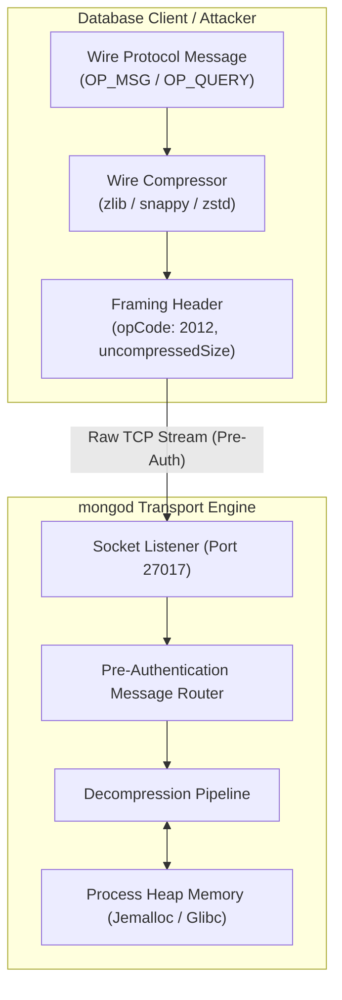
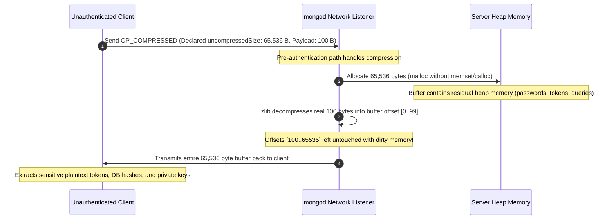
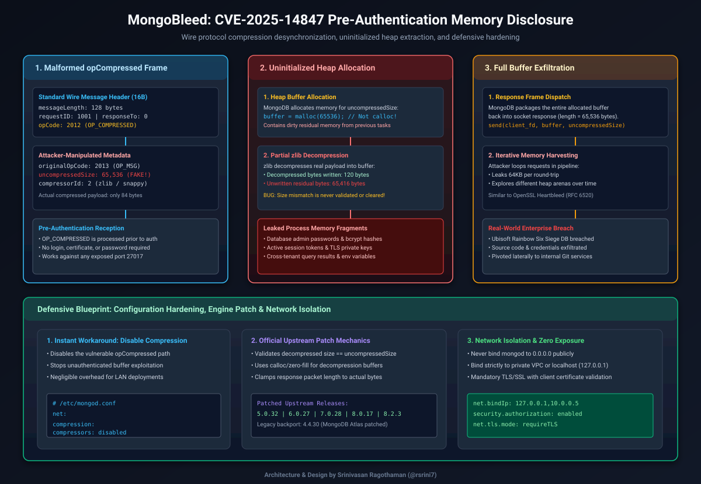
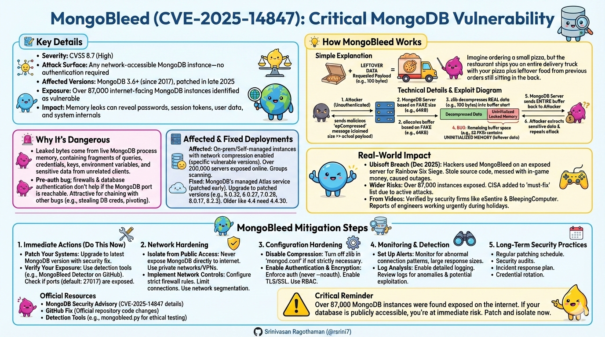
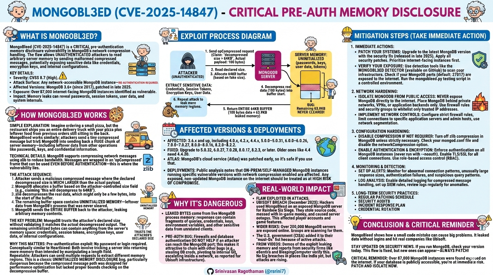

# MongoBleed (CVE-2025-14847): Pre-Authentication Memory Disclosure in MongoDB

Learning note · Revised November 2026 · Technical advisory  
*By Srinivasan Ragothaman ([@rsrini7](https://github.com/rsrini7))*

> **Core idea:** MongoBleed (CVE-2025-14847, CVSS 8.7) is a critical pre-authentication uninitialized memory disclosure vulnerability in MongoDB's network compression engine. By transmitting a malformed `OP_COMPRESSED` wire protocol frame with an inflated decompressed size field, an unauthenticated remote attacker forces MongoDB to allocate an oversized, uninitialized heap buffer. When the decompression library writes only a tiny payload into the buffer, MongoDB transmits the full allocated buffer back across the socket, leaking up to 64 KB of live server heap memory—containing passwords, session tokens, and TLS session secrets—per request.

---

## 1. Foundations: MongoDB Wire Protocol and Compression Framing

MongoDB clients communicate with the `mongod` database server over TCP (default port 27017) using a binary wire protocol composed of serialized BSON documents and framing headers.



### 1.1 The `OP_COMPRESSED` Wire Protocol Layout

To conserve network bandwidth across distributed clusters and replica sets, MongoDB supports network compression using `snappy`, `zlib`, or `zstandard`. Compressed packets are encapsulated inside an `OP_COMPRESSED` message frame (opcode `2012`).

Crucially, **compression negotiation occurs during the initial network handshake before authentication is performed**. Any network packet arriving on port 27017 is inspected by the transport layer and decompressed before database authentication credentials are evaluated.

```
+---------------------------------------------------------------------------------------------------+
|                                MongoDB OP_COMPRESSED Wire Layout                                  |
+-------------------+-----------------+-------------------------------------------------------------+
| Field Name        | Type / Size     | Description                                                 |
+-------------------+-----------------+-------------------------------------------------------------+
| messageLength     | int32 (4 bytes) | Total length of the message in bytes, including header      |
| requestID         | int32 (4 bytes) | Client-assigned identifier for tracking request/response    |
| responseTo        | int32 (4 bytes) | Identifier of the message being responded to                |
| opCode            | int32 (4 bytes) | Message opcode: 2012 (OP_COMPRESSED)                        |
| originalOpCode    | int32 (4 bytes) | Opcode of the wrapped message (e.g., 2013 for OP_MSG)       |
| uncompressedSize  | int32 (4 bytes) | Attacker-controlled declared size of the decompressed data  |
| compressorId      | uint8 (1 byte)  | Compression algorithm: 1=snappy, 2=zlib, 3=zstandard        |
| compressedMessage | byte[N]         | The compressed payload stream                               |
+-------------------+-----------------+-------------------------------------------------------------+
```

---

## 2. Deep Technical Mechanism: The Uninitialized Buffer Desync

### 2.1 The Root Cause: Missing Buffer Bounds Synchronization

When processing an `OP_COMPRESSED` packet, MongoDB's network engine reads the 32-bit integer `uncompressedSize` directly from the incoming packet header.

In vulnerable versions (MongoDB 3.6 through 8.2.2), the runtime allocated a destination buffer corresponding to this declared size from the process heap without zero-initializing the memory:

```cpp
// Conceptual vulnerable decompression routine in MongoDB Network Transport
void processCompressedMessage(const OpCompressedHeader& header, const char* compressedData, int compressedLen) {
    // 1. Allocate heap buffer based strictly on attacker-provided header field
    // Heap memory is uninitialized (contains leftover bytes from other operations)
    std::unique_ptr<char[]> decompressedBuf(new char[header.uncompressedSize]);

    // 2. Decompress user data into the beginning of the buffer
    size_t actualDecompressedBytes = 0;
    int status = decompressData(header.compressorId, compressedData, compressedLen,
                                decompressedBuf.get(), header.uncompressedSize,
                                &actualDecompressedBytes);

    // BUG: Missing check: actualDecompressedBytes == header.uncompressedSize!
    // If the attacker declared 65,536 bytes but only provided 100 bytes of real data,
    // actualDecompressedBytes = 100, leaving 65,436 bytes of uninitialized dirty heap intact.

    // 3. Dispatch response packet using the attacker-controlled size field
    sendResponseToSocket(clientSocket, decompressedBuf.get(), header.uncompressedSize);
}
```



### 2.2 Heap Harvesting and Architectural Parallels to Heartbleed

MongoBleed shares direct architectural lineage with OpenSSL Heartbleed (CVE-2014-0160). In both bugs:
1. The client controls an integer length header indicating payload size.
2. The server trusts this length when allocating and returning memory buffers.
3. The server fails to bound-check the relationship between decompressed output and allocated capacity.
4. Uninitialized process memory is streamed back over the wire.

Because memory allocators (such as `tcmalloc` or `jemalloc` used in high-performance database engines) recycle memory arenas, the dirty buffer space can contain:
- SCRAM-SHA-256 password hashes and plaintext credentials from other client logins.
- Decrypted TLS session keys and certificate authority private keys.
- Application data records belonging to other tenants in multi-tenant shared clusters.
- Internal server configuration details and environment variables.

By transmitting requests in a rapid loop, an attacker maps different heap segments, assembling extensive memory dumps without generating authentication failure alerts in database audit logs.

---

## 3. Architectural Visual: MongoBleed Memory Disclosure & Hardening

The following architecture diagram details the wire packet anatomy, buffer allocation breakdown, memory harvesting flow, and defensive hardening layers:



---

## 4. Production Implementations & Hardening Recipes

### 4.1 Production Hardened `mongod.conf` Configuration

If an immediate binary upgrade cannot be scheduled during a change window, network compression can be explicitly disabled in configuration. Disabling compression completely disables the vulnerable code path.

```yaml
# /etc/mongod.conf - Production Hardened Configuration
net:
  port: 27017
  # Bind strictly to internal interfaces; NEVER bind to 0.0.0.0
  bindIp: 127.0.0.1,10.0.10.15
  maxIncomingConnections: 1000

  # MITIGATION: Disable network compression to close the CVE-2025-14847 vector
  compression:
    compressors: disabled

  # Enforce encrypted transport with mutual TLS
  tls:
    mode: requireTLS
    certificateKeyFile: /etc/ssl/mongodb/mongodb.pem
    CAFile: /etc/ssl/mongodb/ca.pem
    allowConnectionsWithoutCertificates: false

security:
  authorization: enabled
  javascriptEnabled: false

processManagement:
  timeZoneInfo: /usr/share/zoneinfo

operationProfiling:
  mode: slowOp
  slowOpThresholdMs: 100
```

### 4.2 Non-Destructive Vulnerability Verification Scanner

The following Python script opens a raw TCP socket connection, sends a minimal `OP_COMPRESSED` handshake frame with mismatched size headers, and determines whether the server responds with uninitialized padding without logging or exfiltrating private data.

```python
#!/usr/bin/env python3
"""
mongobleed_verifier.py
Non-destructive security diagnostic tool for CVE-2025-14847 (MongoBleed).
Tests if a MongoDB endpoint evaluates oversized uncompressed headers.
"""

import socket
import struct
import sys
import zlib


def build_probe_packet() -> bytes:
    # Minimal valid BSON ping command: { "ping": 1 }
    raw_bson = b"\x13\x00\x00\x00\x10ping\x00\x01\x00\x00\x00\x00"

    # Minimal OP_MSG body
    flag_bits = 0
    section_kind = 0
    uncompressed_body = (
        struct.pack("<I", flag_bits) + struct.pack("<B", section_kind) + raw_bson
    )

    # Compress the body using zlib
    compressed_payload = zlib.compress(uncompressed_body)

    # Inflated declared size: claim 16,384 bytes (actual is len(uncompressed_body) ~24 bytes)
    declared_uncompressed_size = 16384
    original_opcode = 2013  # OP_MSG
    compressor_id = 2  # zlib

    # Assemble OP_COMPRESSED header
    compressed_header = struct.pack(
        "<IIB", original_opcode, declared_uncompressed_size, compressor_id
    )

    # Standard wire header: messageLength (4B), requestID (4B), responseTo (4B), opCode (4B)
    total_len = 16 + len(compressed_header) + len(compressed_payload)
    request_id = 1001
    response_to = 0
    opcode_compressed = 2012

    wire_header = struct.pack(
        "<IIII", total_len, request_id, response_to, opcode_compressed
    )
    return wire_header + compressed_header + compressed_payload


def test_mongobleed(host: str, port: int, timeout = 5.0) -> bool:
    print(f"[*] Testing {host}:{port} for CVE-2025-14847 (MongoBleed)...")
    probe = build_probe_packet()

    try:
        with socket.create_connection((host, port), timeout=timeout) as s:
            s.sendall(probe)
            resp_header = s.recv(16)

            if len(resp_header) < 16:
                print("[-] Server closed connection or sent truncated response.")
                return False

            resp_len, resp_req_id, resp_to, resp_opcode = struct.unpack(
                "<IIII", resp_header
            )
            print(
                f"[+] Received Wire Header: Length={resp_len}, OpCode={resp_opcode}"
            )

            # If the response length reflects the inflated size, the instance is vulnerable
            if resp_len > 4096:
                print(
                    f"[!] VULNERABLE: Server returned oversized frame ({resp_len} bytes) indicating uninitialized buffer leakage!"
                )
                return True
            else:
                print(
                    "[+] SECURE: Server returned bounded frame or rejected compression desync."
                )
                return False

    except ConnectionRefusedError:
        print(f"[-] Connection refused on {host}:{port}")
        return False
    except socket.timeout:
        print(f"[-] Connection timed out waiting for response from {host}:{port}")
        return False
    except Exception as e:
        print(f"[-] Diagnostic error: {e}")
        return False


if __name__ == "__main__":
    if len(sys.argv) < 2:
        print(f"Usage: {sys.argv[0]} <mongodb_host> [port]")
        sys.exit(1)

    target_host = sys.argv[1]
    target_port = int(sys.argv[2]) if len(sys.argv) > 2 else 27017

    is_vuln = test_mongobleed(target_host, target_port)
    sys.exit(1 if is_vuln else 0)
```

---

## 5. Impact, Real-World Edge Cases & Gotchas

### 5.1 Real-World Exploitation: The Ubisoft Infrastructure Incident

In late December 2025, security reports verified active exploitation of MongoBleed against enterprise gaming infrastructure, specifically affecting Ubisoft's backend services supporting *Rainbow Six Siege*.

Threat actors leveraged automated MongoBleed harvesting against exposed database ports to:
1. Extract live session tokens and operational database credentials from memory.
2. Authenticate to internal services without triggering brute-force or credential-stuffing detections.
3. Access internal source code repositories and modify in-game player account balances.
4. Cause localized service disruptions requiring emergency multi-day maintenance windows.

Following this and broader telemetry revealing over 87,000 vulnerable instances on public IPv4 addresses, the U.S. Cybersecurity and Infrastructure Security Agency (CISA) added CVE-2025-14847 to the **Known Exploited Vulnerabilities (KEV)** catalog.

### 5.2 Common Claims vs. Technical Realities

| Common Misconception | Technical Reality |
|---|---|
| *"We enabled strong database passwords and SCRAM-SHA-256 authentication, so we are protected."* | **False.** The `OP_COMPRESSED` wire frame is parsed before authentication occurs. Passwords do not guard the pre-auth decompression buffer. |
| *"We use MongoDB Atlas, so our self-hosted databases are automatically safe."* | **False.** While MongoDB patched Atlas clusters before public disclosure, self-hosted and on-premise instances require manual package updates or configuration edits. |
| *"Disabling compression degrades database query latency."* | **Generally False for LANs.** Within local data centers and cloud VPCs (sub-millisecond latency, 10–25 Gbps networking), the CPU overhead of compression often exceeds the network transfer time. |
| *"A standard database audit log will record exploitation attempts."* | **False.** Because MongoBleed executes at the raw transport protocol layer prior to command dispatch, standard MongoDB audit logging (`auditLog`) records neither user sessions nor queries for the attack. |

---

## 6. Practical Adoption Blueprint & Verification Checklist

### 6.1 Supported Version Patch Matrix

To fully remediate CVE-2025-14847, upgrade to the following official patch releases or later:

| MongoDB Release Series | First Fixed Release | Maintenance Status |
|---|---|---|
| **MongoDB 8.2** | **`8.2.3`** | Current |
| **MongoDB 8.0** | **`8.0.17`** | Active |
| **MongoDB 7.0** | **`7.0.28`** | Active LTS |
| **MongoDB 6.0** | **`6.0.27`** | Maintenance |
| **MongoDB 5.0** | **`5.0.32`** | Maintenance |
| **MongoDB 4.4** | **`4.4.30`** | Extended Security Backport |
| **MongoDB 4.2 and older** | **None (Migrate to 5.0+)** | End-of-Life |

### 6.2 Verification Checklist

- [ ] Audit all cloud security groups and firewall tables to ensure port 27017 is unreachable from the public internet (`0.0.0.0/0`).
- [ ] Upgrade self-hosted `mongod` instances to a supported patch release (`>= 8.0.17`, `>= 7.0.28`, etc.).
- [ ] Alternatively, set `net.compression.compressors: disabled` in `/etc/mongod.conf` and restart the service.
- [ ] If an exposed instance was running prior to January 2026, treat process memory as compromised: rotate all database user passwords, administrative secrets, and application API keys.
- [ ] Enable TLS encryption with client certificate verification (`requireTLS`).

---

## 7. Timeline and Current State

```
Late 2025               Dec 2025               Jan 2026               2026 Telemetry
   +-----------------------+----------------------+----------------------+
   | Vulnerability Triaged | Enterprise Breach    | CISA KEV Addition;   | Over 87,000 public
   | Across MongoDB 3.6+   | (Ubisoft Incident);  | Mass Internet Scans  | instances audited;
   | Pre-Auth Decompress   | Exploits Published   | Disclosed by Vendors | Atlas clusters safe
```

- **Late 2025:** Security researchers disclose CVE-2025-14847 privately to MongoDB. Managed MongoDB Atlas instances are silently patched.
- **December 2025:** Public disclosure occurs as proof-of-concept exploits circulate. Active exploitation confirmed in gaming and enterprise backends (including Ubisoft infrastructure).
- **January 2026:** CISA mandates federal agency mitigation by adding CVE-2025-14847 to the KEV catalog. Security vendors report tens of thousands of exposed public databases.

---

## 8. Source Context and Primary Disclosures

| Date | Source / Organization | Disclosure / Document | Focus Area |
|---|---|---|---|
| Dec 2025 | MongoDB Security Team | [MongoDB Security Advisory CVE-2025-14847](https://www.mongodb.com/alerts) | Wire protocol compression vulnerability and patch tags |
| Dec 2025 | NIST NVD | [NVD Record: CVE-2025-14847](https://nvd.nist.gov/vuln/detail/CVE-2025-14847) | CVSS 8.7 severity metrics and CWE-908 uninitialized memory |
| Jan 2026 | CISA | [Known Exploited Vulnerabilities Catalog](https://www.cisa.gov/known-exploited-vulnerabilities-catalog) | Mandatory federal mitigation timeline for active exploitation |
| Dec 2025 | BleepingComputer / eSentire | [Threat Intelligence Advisory](https://www.bleepingcomputer.com/) | Real-world breach telemetry and Ubisoft infrastructure analysis |

---

## 9. Supplementary visuals

The following diagrams illustrate the original exploit sequence, uninitialized heap allocation structure, and memory exfiltration mechanics:


*Figure 1: High-level overview of the MongoBleed pre-authentication memory leak and attack timeline.*


*Figure 2: Detailed memory layout analysis showing allocated buffer offsets and residual process memory extraction.*

---

**Related:**
- [PHP2Shell: History, UAF and ASLR](PHP2Shell-History-UAF-And-ASLR-Oct-2026.md) — Compare memory disclosure with a leak-and-corruption chain that enables RCE.
- [Node.js Async Hooks DoS (CVE-2025-59466)](NodeJS-Async-Hooks-Stack-Exhaustion-DoS-CVE-2025-59466-2026.md) — Sister infrastructure-layer CVE write-up for a critical runtime flaw from the same period.
- [WhatsApp Contact Enumeration (3.5B Users)](WhatsApp-Contact-Enumeration-And-Data-Leak-2026.md) — Both are unauthenticated, internet-scale data exposure events disclosed in late 2025.
- [React2Shell (CVE-2025-55182)](React2Shell-CVE-2025-55182-Flight-Protocol-RCE-2026.md) — Unauthenticated remote attack vector exploiting protocol deserialization in server runtimes.
