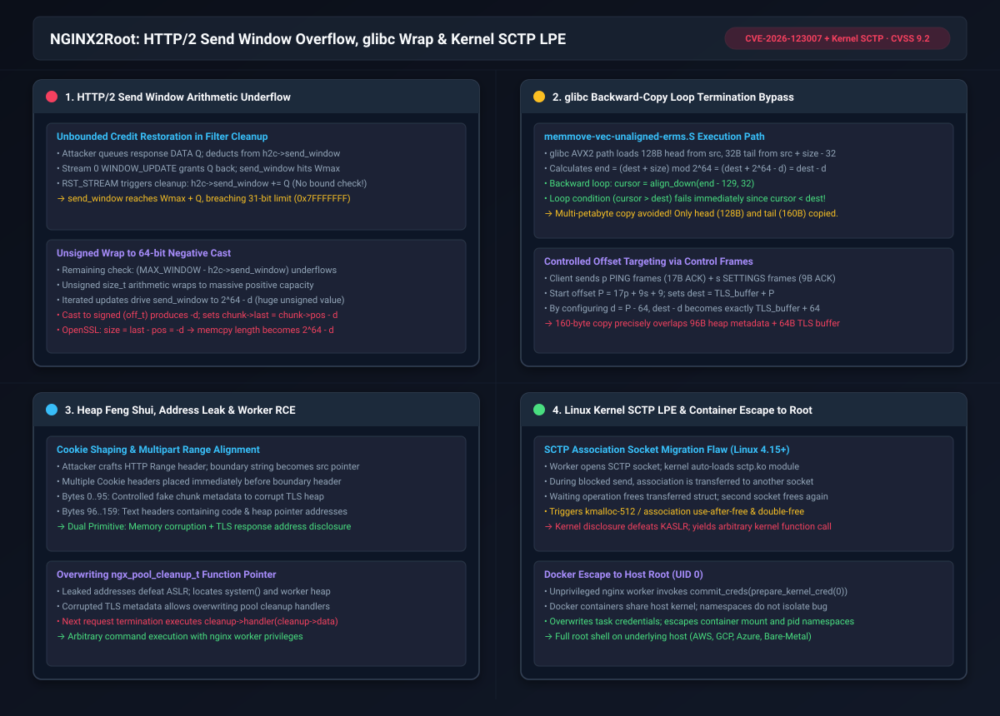
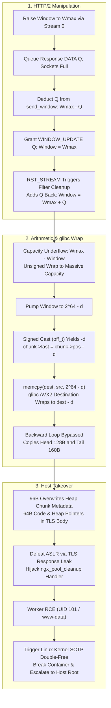
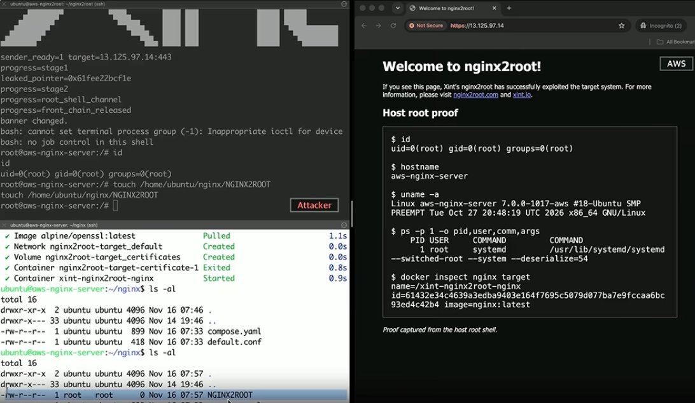
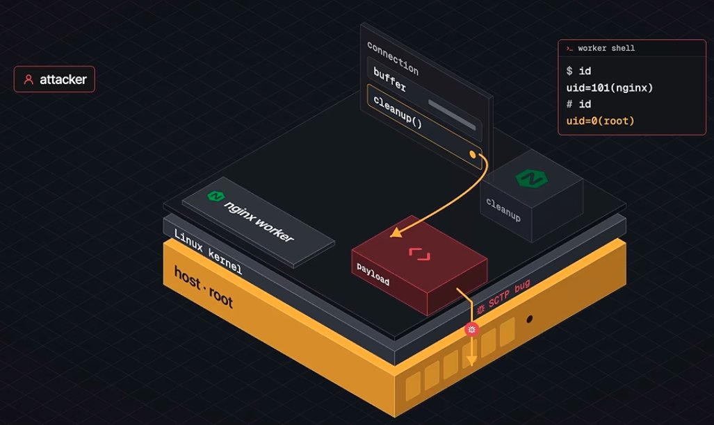

# NGINX2Root: HTTP/2 Send Window Overflow and Linux Kernel SCTP LPE (CVE-2026-123007 & Vulnerability Suite)

Daily learning · November 19, 2026 · Technical deep dive

*By Srinivasan Ragothaman ([@rsrini7](https://github.com/rsrini7))*

> **Core idea:** An integer underflow in NGINX's HTTP/2 flow control window accounting allows unauthenticated remote attackers to trigger an out-of-bounds heap write and leak memory pointers via an unintended interaction with glibc's vector backward-copy routine. By chaining this worker-level remote code execution primitive with an unpatched Linux kernel SCTP association migration double-free vulnerability, attackers escape Docker containers and achieve full root privileges on the underlying host.



---

## 1. What actually broke?

On **November 18, 2026**, offensive security research firm **Xint** publicly disclosed **NGINX2Root**, a coordinated vulnerability suite exposing six critical zero-day vulnerabilities across core Internet infrastructure. Five vulnerabilities reside in **NGINX Open Source** and **NGINX Plus** (maintained by F5), and a sixth unpatched privilege escalation flaw resides in the **Linux kernel's SCTP subsystem**.

F5 scopes CVE-2026-123007 to the HTTP/2 data plane and reports potential code execution when ASLR is disabled or bypassed. Xint’s host-root result applies to its tested environment with access to the separate SCTP flaw. [F5 CVE record](https://www.cve.org/CVERecord?id=CVE-2026-123007) · [Xint disclosure](https://xint.io/blog/nginx2root-remote-code-execution)

The flagship vulnerability, **CVE-2026-123007** (**CVSS v4.0 9.2 / Critical**, **CVSS v3.1 8.1**), is an unauthenticated Remote Code Execution (RCE) flaw present in NGINX's HTTP/2 module (`ngx_http_v2_module`). It has existed unnoticed in the codebase since NGINX first introduced HTTP/2 support in version 1.9.5 in September 2015—surviving in production environments for more than eleven years.

When handling HTTP/2 connections, NGINX fails to enforce an upper bound on connection send windows during stream cleanup. An attacker manipulates stream cancellation and flow-control updates to inflate the connection send window beyond its signed 31-bit maximum. Subsequent arithmetic operations cast this oversized unsigned 64-bit integer into a negative signed value ($-d$), causing an integer underflow in the output frame length. When passed to `memcpy()`, the length converts to an astronomical unsigned value ($2^{64} - d$).

Crucially, instead of causing a multi-petabyte segmentation fault, glibc's modern AVX2 vector implementation (`memmove-vec-unaligned-erms.S`) calculates the destination boundary via 64-bit modular arithmetic. The address wraps around, causing the backward vector loop to terminate after a single iteration. This copies exactly 160 bytes: 96 bytes overwrite heap allocation metadata preceding the TLS buffer, while 64 bytes overwrite the buffer with code and heap pointers. The server returns these pointers in the TLS response, defeating Address Space Layout Randomization (ASLR). The attacker then overwrites a pool cleanup callback to achieve arbitrary command execution as the `nginx` worker process.

To escalate privileges from the worker process to the host operating system, the exploit chains a newly uncovered zero-day in the Linux kernel: an SCTP association migration double-free introduced in Linux 4.15 (2018). This kernel flaw breaks container isolation in default Docker environments, elevating the unprivileged worker directly to `root` on the underlying host.



### Essential terms

| Term | Technical Meaning |
|---|---|
| **HTTP/2 Flow Control** | A credit-based mechanism using `WINDOW_UPDATE` frames preventing a sender from overwhelming a receiver's internal processing buffers. |
| **`send_window`** | An internal credit counter tracking how many octets of `DATA` frames NGINX is permitted to transmit on an individual stream or the overall connection (`h2c`). |
| **`NGX_HTTP_V2_MAX_WINDOW`** | The protocol-mandated maximum window capacity, defined in NGINX as `(1U << 31) - 1` (`0x7FFFFFFF` or 2,147,483,647 bytes). |
| **Shadow Buffer (`ngx_buf_t`)** | An NGINX buffer structure referencing a slice of another memory buffer using `pos` (start) and `last` (end) memory addresses. |
| **`memmove-vec-unaligned-erms.S`** | The hardware-optimized glibc assembly implementation of `memcpy` and `memmove` on x86-64 that employs 256-bit AVX2 vector registers. |
| **Pool Cleanup (`ngx_pool_cleanup_t`)** | An NGINX linked-list structure storing callback function pointers (`handler`) executed when a request or memory pool is destroyed. |
| **SCTP Association** | A connection abstraction in the Stream Control Transmission Protocol that supports multi-homing across multiple IP network interfaces. |
| **KASLR** | Kernel Address Space Layout Randomization; an OS security defense that randomizes the memory location of kernel code and structures on boot. |

### Parties and roles involved

| Organization / Party | Role in NGINX2Root Disclosure |
|---|---|
| **Xint Research Team** | Discovered all five NGINX CVEs and the Linux kernel zero-day; developed weaponized proof-of-concept exploits across AWS, GCP, and Azure. |
| **F5 Inc. / NGINX Team** | Coordinated vulnerability remediation through HackerOne; developed and released patches for NGINX 1.31.9 (Mainline), 1.30.7 (Stable), and NGINX Plus. |
| **Linux Kernel Maintainers** | Governing the upstream `net/sctp` networking subsystem and evaluating fixes for the association migration race condition. |
| **Operating System Vendors** | Red Hat, Canonical (Ubuntu), Debian, SUSE backporting security hotfixes into enterprise Linux long-term support (LTS) distributions. |
| **Cloud Service Providers** | AWS, Google Cloud, Microsoft Azure assessing ingress reverse proxies, API gateways, and Kubernetes ingress controllers. |

---

## 2. Foundations: HTTP/2 Flow Control & Connection Lifecycles

To understand why NGINX failed to validate its window counters, we must trace how HTTP/2 multiplexing and buffer recycling operate under high load.

### HTTP/2 multiplexing and dual-window accounting

Unlike HTTP/1.1, which transmits requests sequentially or requires multiple TCP connections, HTTP/2 multiplexes concurrent requests over a single TCP connection. Each request-response exchange runs inside a **stream** identified by an integer (e.g., Stream 1, 3, 5).

HTTP/2 flow control governs data flow at two distinct levels:
1. **Stream-level flow control:** Restricts the volume of `DATA` frames sent across an individual stream.
2. **Connection-level flow control (`h2c`):** Restricts the total volume of `DATA` frames sent across the entire shared TCP connection.

```text
+---------------------------------------------------------------+
|                       HTTP/2 Connection                       |
|           Shared Connection Send Window (h2c->send_window)    |
+---------------------------------------------------------------+
        |                               |
        v                               v
+-------------------------------+ +-------------------------------+
|       Stream 1 (Headers/Body) | |       Stream 3 (Headers/Body) |
| stream->send_window: 65,535 B | | stream->send_window: 65,535 B |
+-------------------------------+ +-------------------------------+
```

When NGINX queues response data to be written to the socket, it invokes `ngx_http_v2_send_chain()`. This deducts the frame size from **both** the stream's window and the connection's window:

```c
// src/http/v2/ngx_http_v2_filter_module.c
ngx_http_v2_queue_frame(h2c, frame);
h2c->send_window -= frame_size;
stream->send_window -= frame_size;
stream->queued++;
```

If the client needs more data, it transmits a `WINDOW_UPDATE` frame. If the frame's Stream ID is 0, the credit applies to `h2c->send_window`. If the Stream ID is non-zero, it applies to that specific stream.

### Asynchronous cancellation and credit restoration

HTTP/2 allows a client to cancel a stream abruptly by issuing a `RST_STREAM` frame. When NGINX processes a cancellation, any response frames remaining in the output queue that have not yet reached the network socket must be discarded.

Because NGINX deducted credit when queuing those frames, discarding them requires refunding that credit back to the shared connection window. This cleanup logic is handled by `ngx_http_v2_filter_cleanup()`:

```c
// src/http/v2/ngx_http_v2_filter_module.c
if (frame->stream == stream && !frame->blocked) {
    *fn = frame->next;
    window += frame->length;
}
h2c->send_window += window;
```

Notice the critical architectural omission: **there is no upper-bound validation on `h2c->send_window += window`**.

In standard operation, `h2c->send_window` is checked when processing incoming `WINDOW_UPDATE` frames. But NGINX assumed internal cleanup returns could never exceed protocol maximums. That assumption collapses when an attacker interweaves network latency, socket buffer saturation, and explicit window updates.

---

## 3. Deep Technical Mechanism: The NGINX2Root Vulnerability Suite

The NGINX2Root disclosure spans five distinct vulnerabilities in NGINX, plus one local privilege escalation vulnerability in the Linux kernel. Each NGINX flaw is an independent attack path that leads to memory corruption and code execution under different configuration baselines.

```
+---------------------------------------------------------------------------------------------------+
|                                  The NGINX2Root Vulnerability Suite                               |
+------------------+-----------------------------+-----------------------+--------------------------+
| Identifier       | Component                   | Vulnerability Type    | Affected Configuration   |
+------------------+-----------------------------+-----------------------+--------------------------+
| CVE-2026-123007  | ngx_http_v2_module          | Integer Underflow/OOB | HTTP/2 enabled (Default) |
| CVE-2026-123634  | ngx_resolver.c              | Use-After-Free        | Resolver + mirror / SSI  |
| CVE-2026-123633  | ngx_http_v2_module          | Connection Drain UAF  | HTTP/2 + upstream proxy  |
| CVE-2026-121810  | ngx_event_quic_streams.c    | QUIC Drain UAF        | HTTP/3 + upstream proxy  |
| CVE-2026-113425  | ngx_mail_proxy_module       | Mail Proxy Auth UAF   | proxy on + auth_http     |
| Linux Kernel LPE | net/sctp (Kernel 4.15-6.12) | Double-Free / UAF     | SCTP module auto-loading |
+------------------+-----------------------------+-----------------------+--------------------------+
```

---

### Part A: CVE-2026-123007 — HTTP/2 Flow Control Underflow to RCE

CVE-2026-123007 represents the most severe attack surface because it requires no specialized directives or proxy features; **any NGINX server with HTTP/2 enabled is vulnerable**.

The exploit unfolds across five deterministic phases:

#### Phase 1: Window Inflation via Stream Cancellation Race

The maximum permitted window size $W_{\max}$ in HTTP/2 is $2^{31} - 1$ (`0x7FFFFFFF` or 2,147,483,647 bytes).

1. **Initial Window Saturation:** The client sends a `WINDOW_UPDATE` on Stream ID 0 to raise `h2c->send_window` to $W_{\max}$.
2. **Buffer Choking:** The client advertises `SETTINGS_INITIAL_WINDOW_SIZE = 0` in an initial `SETTINGS` frame. This instructs NGINX that new streams have zero send credit. NGINX will parse HTTP request headers and generate response headers, but will hold all response `DATA` frames in memory.
3. **Socket Saturation:** The client stops reading from the TCP socket and transmits a burst of `PING` frames. NGINX prioritizes control frames (such as `PING` ACKs) ahead of response data. The `PING` acknowledgments completely fill the kernel TCP send buffers and TLS records.
4. **Queueing Response Data:** The client now issues individual `WINDOW_UPDATE` frames to each open stream, granting enough credit for their response bodies (totalling $Q$ bytes). NGINX queues the response `DATA` frames. As it queues them, `ngx_http_v2_send_chain()` deducts $Q$:

$$\text{send window} = W_{\max} - Q$$

Because the socket send buffers are saturated, these frames remain queued in NGINX's output chain.

5. **Double Credit Addition:** The client sends a `WINDOW_UPDATE` on Stream ID 0 granting $Q$ bytes of credit back to the connection. NGINX verifies that $(W_{\max} - Q) + Q \le W_{\max}$, accepts the update, and resets the window to $W_{\max}$.
6. **The Fatal Reset:** The client immediately sends `RST_STREAM` frames canceling the streams. NGINX invokes `ngx_http_v2_filter_cleanup()`, which discards the unsent queued frames and adds their length $Q$ back to `h2c->send_window`:

$$\text{send window} = W_{\max} + Q$$

Because `ngx_http_v2_filter_cleanup()` lacks an upper-bound check, `h2c->send_window` breaches the 31-bit protocol ceiling and enters an illegal state.

#### Phase 2: Unsigned Underflow in Capacity Verification

The NGINX HTTP/2 state engine verifies incoming `WINDOW_UPDATE` increments using this check:

```c
// src/http/v2/ngx_http_v2.c
if (window > NGX_HTTP_V2_MAX_WINDOW - h2c->send_window) {
    return ngx_http_v2_connection_error(h2c, NGX_HTTP_V2_FLOW_CTRL_ERROR);
}
h2c->send_window += window;
```

The variable `h2c->send_window` is an unsigned 64-bit integer (`size_t` on x86-64).

When `h2c->send_window` is already $W_{\max} + Q$, the expression:

$$\text{NGX HTTP V2 MAX WINDOW} - \text{h2c->send window}$$

becomes $W_{\max} - (W_{\max} + Q) = -Q$.

Because this arithmetic is performed using unsigned integers, $-Q$ wraps around modulo $2^{64}$ into an enormous positive number:

$$2^{64} - Q \approx 18,446,744,073,709,551,616 - Q$$

NGINX evaluates this enormous number as available capacity! Consequently, the sanity check succeeds for every subsequent `WINDOW_UPDATE` frame sent by the attacker. By repeating this sequence, the attacker can inflate `h2c->send_window` to any arbitrary 64-bit value, specifically calibrating it to:

$$\text{h2c->send window} = 2^{64} - d$$

where $d$ is a small, precisely chosen positive integer offset.

#### Phase 3: Signed Type Conversion to Negative Frame Size

When NGINX transmits pending data, `ngx_http_v2_send_chain()` limits the frame size against available credit. In doing so, it casts the unsigned window into a signed `off_t` (a 64-bit signed integer):

```c
// src/http/v2/ngx_http_v2_filter_module.c
if (limit == 0 || limit > (off_t) h2c->send_window) {
    limit = h2c->send_window;
}
```

When `h2c->send_window` is $2^{64} - d$, casting to signed `off_t` converts the bit pattern into a negative number:

$$(\text{off t})(2^{64} - d) = -d$$

Any positive `limit` is greater than $-d$. Therefore, `limit` is assigned $-d$.

The function then evaluates `frame_size`:

```c
if ((off_t) frame_size > limit) {
    frame_size = (size_t) limit;
}
```

Because `(off_t) frame_size` (positive) is greater than `limit` ($-d$), the condition evaluates to true. Converting `limit` ($-d$) back to `size_t` yields $2^{64} - d$!

NGINX passes this length into `ngx_http_v2_filter_get_shadow()` to establish buffer boundaries:

```c
static ngx_chain_t *
ngx_http_v2_filter_get_shadow(ngx_http_v2_stream_t *stream, ngx_buf_t *buf,
    off_t offset, off_t size)
{
    // size holds -d
    chunk->last = chunk->pos + size;
}
```

Because `size` is $-d$, `chunk->last` points **$d$ bytes before `chunk->pos`** in memory!

When the buffer reaches the OpenSSL event loop in `ngx_event_openssl.c`:

```c
ssize_t size;
size = in->buf->last - in->buf->pos;  // Evaluates to -d
ngx_memcpy(buf->last, in->buf->pos, size);
```

The length argument passed to `memcpy()` is typed as `size_t`. The signed $-d$ is cast back to $2^{64} - d$, requesting an in-memory copy of nearly 18 exabytes.

#### Phase 4: glibc Vector Backward-Copy Wrap-Around

Under naive byte-by-byte copying, copying $2^{64} - d$ bytes would instantly crash the worker process via a page fault when crossing unmapped memory.

However, since version 2.24 (2016), GNU C Library (glibc) on x86-64 implements `memcpy` and `memmove` using AVX2 SIMD vectors in `sysdeps/x86_64/multiarch/memmove-vec-unaligned-erms.S`.

```assembly
# glibc 2.24+ AVX2 memmove implementation logic
head = load128(src)
tail = load32(src + size - 32)
end = (dest + size) mod 2^64
cursor = align_down(end - 129, 32)
do {
    copy128(dst = cursor, src = src + (cursor - dest))
    cursor -= 128
} while (cursor > dest);
store128(dst = dest, data = head)
store32(dst = end - 32, data = tail)
```

Notice the critical mathematics of `end`:

$$\text{end} = (\text{dest} + \text{size}) \pmod{2^{64}} = (\text{dest} + 2^{64} - d) \pmod{2^{64}} = \text{dest} - d$$

The calculated end pointer **wraps around the 64-bit address space** and lands $d$ bytes *below* `dest`.

When glibc initializes the loop cursor:

$$\text{cursor} = \text{align down}((\text{dest} - d) - 129, 32)$$

The condition `while (cursor > dest)` is **immediately false on the very first evaluation**, because `cursor` is already lower than `dest`!

The entire multi-petabyte copy loop is completely skipped! glibc executes only:
1. `store128` at `dest` (the first 128 bytes).
2. The final fixed vector write at `end - 32` (copying 160 bytes ending at `dest - d`).

```
Virtual Address Space
+--------------------------------------------------------------------------------+
| ... [96B Corrupted Heap Metadata] [64B TLS Plaintext Buffer] ... [dest]        |
+--------------------------------------------------------------------------------+
                                    ^                               ^
                                    |--- 160B Vector Tail Write ----|
```

#### Phase 5: Heap Grooming, ASLR Bypass & RCE

The attacker controls the destination offset `dest` inside the TLS plaintext buffer by sending $p$ `PING` frames (17-byte ACK) and $s$ `SETTINGS` frames (9-byte ACK):

$$P = 17p + 9s + 9$$
$$\text{dest} = \text{TLS buffer} + P$$

By calibrating $d = P - 64$, the copy termination point becomes:

$$\text{dest} - d = (\text{TLS buffer} + P) - (P - 64) = \text{TLS buffer} + 64$$

The 160-byte tail write lands precisely across:
* **The 96 bytes immediately preceding the TLS buffer:** Containing glibc heap chunk headers and allocation metadata.
* **The first 64 bytes inside the TLS buffer:** Which NGINX encrypts and transmits back to the client as the HTTP response!

To position controlled data at `src`, the attacker sends a multipart HTTP `Range` request accompanied by multiple `Cookie` headers. NGINX allocates multipart boundary headers and concatenated cookie headers sequentially within the request pool (`r->pool`).

The result is a simultaneous two-pronged exploit primitive:
1. **ASLR Defeat (Information Disclosure):** The 64 bytes written into the TLS buffer capture internal pointers into NGINX's binary image and heap. When NGINX sends the response, the attacker recovers the base addresses of libc and NGINX.
2. **Control Flow Hijack:** The 96 bytes written before the TLS buffer corrupt heap metadata. In a subsequent request, the attacker overwrites an `ngx_pool_cleanup_t` structure:

```c
struct ngx_pool_cleanup_s {
    ngx_pool_cleanup_pt   handler;  // Function pointer
    void                 *data;     // Argument pointer
    ngx_pool_cleanup_t   *next;
};
```

The attacker sets `handler` to `system()` (located via the leaked libc base) and `data` to an arbitrary shell command string. When NGINX destroys the request pool, it invokes `cleanup->handler(cleanup->data)`, executing commands with `nginx` worker privileges.

---

### Part B: The Four Additional NGINX Vulnerabilities

Beyond CVE-2026-123007, Xint uncovered four additional use-after-free vulnerabilities affecting distinct architectural configurations:

#### 1. CVE-2026-123634 — Asynchronous DNS Resolver Use-After-Free

* **Trigger Configuration:** `resolver` defined, `proxy_pass` destination derived from a request variable (e.g., `proxy_pass http://$host;`), and `mirror` subrequests enabled.
* **Vulnerability Mechanism:** When NGINX resolves upstream hostnames asynchronously, pending lookups for the same domain are queued on an `ngx_resolver_node_t` waiting list (`rn->waiting`). When the DNS answer arrives, `ngx_resolver.c` detaches the waiting list and iterates through contexts:

```c
// src/core/ngx_resolver.c
next = rn->waiting;
rn->waiting = NULL;
while (next) {
    ctx = next;
    next = ctx->next;
    ctx->handler(ctx);
}
```

If the main request fails (e.g., the DNS resolution fails and the client resets the TCP connection), `ngx_http_terminate_request()` tears down the main request and runs its cleanup handlers. The cleanup list includes the subrequest mirror's cleanup handler, which calls `ngx_resolve_name_done()` on the mirror's context.

Because the resolver loop already detached the list (`rn->waiting = NULL`), `ngx_resolve_name_done()` cannot find the mirror context in the list, but frees it anyway! The outer resolver loop then advances to `next`—which points directly to the freshly freed mirror context. The loop writes to `ctx->state` and executes `ctx->handler(ctx)` on dangling memory.

* **Weaponization:** Attackers leverage fixed `vsyscall gettimeofday()` addresses to forge heap chunk headers, leak libc pointers via outbound DNS query packets, and overwrite `handler` with `system()`.

#### 2. CVE-2026-123633 — HTTP/2 Connection Drain Use-After-Free

* **Trigger Configuration:** HTTP/2 enabled and forwarding requests to backend upstreams (`proxy_pass`).
* **Vulnerability Mechanism:** When worker connection slots (`worker_connections`) run low, NGINX reclaims idle connections via `ngx_drain_connections()`. If a client sends an incomplete HTTP/2 `HEADERS` frame, NGINX marks the connection as reusable in `ngx_http_v2_handle_connection()`. When the remaining header bytes arrive, NGINX opens a stream but fails to remove the parent connection from `reusable_connections_queue`.
* When the stream initiates an upstream connect, slot pressure triggers `ngx_drain_connections()`. The drain selects the active HTTP/2 connection and closes it. If the client resets TCP, NGINX invokes `ngx_http_free_request()`, freeing the request pool containing `r` and `u` (upstream state). When the upstream connect call returns, NGINX continues executing proxy handlers using the freed request and upstream structures.

#### 3. CVE-2026-121810 — HTTP/3 (QUIC) Stream Creation Drain UAF

* **Trigger Configuration:** HTTP/3 (QUIC) enabled and proxying requests to an upstream backend.
* **Vulnerability Mechanism:** Parallels the HTTP/2 connection drain flaw. During QUIC stream creation in `ngx_quic_create_stream()`, the parent QUIC connection is temporarily marked reusable before the newly created stream is inserted into the stream red-black tree (`streams.tree`). If allocating a connection slot triggers `ngx_drain_connections()`, the parent QUIC connection is reclaimed, freeing active request memory while upstream socket processing continues.

#### 4. CVE-2026-113425 — Mail Proxy `auth_http` Session UAF

* **Trigger Configuration:** Mail proxy enabled (`mail { ... }`) with `proxy on` and `auth_http` authentication.
* **Vulnerability Mechanism:** Exists in the codebase since NGINX 0.5.15 (2007). When a client sends a login command (IMAP/POP3/SMTP) and simultaneously issues a TCP reset in the same epoll event loop, NGINX invokes the read handler (starting an asynchronous HTTP auth query) followed immediately by the write handler.
* The write handler fails on the reset socket, closing the client connection and destroying its pool `c->pool`. However, the asynchronous authentication connection remains active, with its `data` pointer still referencing the destroyed session `s`. When the authentication HTTP backend responds or times out, NGINX dereferences `s->ctx->handler`, triggering a control-flow hijack to `system()`.

---

### Part C: Linux Kernel SCTP Association Migration Double-Free (LPE)

Achieving RCE in an NGINX worker yields an unprivileged shell (typically `nobody`, `www-data`, or UID `101`). Furthermore, modern containerized NGINX instances run within isolated namespaces.

To achieve complete host compromise, Xint chained the NGINX exploits with a zero-day vulnerability in the **Linux kernel SCTP subsystem** (`net/sctp`).

```text
+-----------------------------------------------------------------------------------+
| Host Kernel Space (Ring 0)                                                        |
|                                                                                   |
|  [Socket A] ---> [SCTP Association] <--- Blocked sctp_sendmsg()                   |
|                        |                                                          |
|                        | (Socket Migration via sctp_sock_migrate)                 |
|                        v                                                          |
|  [Socket B] ---> [SCTP Association]                                               |
|                        |                                                          |
|   1. Waking send operation frees association: kfree(addr)                         |
|   2. Socket B teardown frees association again: kfree(addr) -> DOUBLE FREE!       |
+-----------------------------------------------------------------------------------+
```

#### Vulnerability Mechanics

1. **Auto-Loading Module:** On standard Linux distributions (Ubuntu, Debian, RHEL, CentOS), the `sctp.ko` kernel module is installed by default. When an unprivileged process calls `socket(AF_INET, SOCK_SEQPACKET, IPPROTO_SCTP)`, the Linux kernel's `net_families` handler automatically loads the module via `modprobe`.
2. **Socket Migration Race:** SCTP associations can migrate between sockets via `sctp_sock_migrate()`. If an SCTP send operation is blocked waiting for buffer space, its parent association can be migrated to a second socket.
3. **The Double-Free:** When the waiting send operation wakes up or is aborted, it calls `sctp_association_free()` on the transferred association. Later, when the destination socket closes, it invokes `sctp_association_free()` on the identical pointer, triggering a kernel double-free in the slab allocator (`kmalloc-512`).

```text
BUG: KASAN: double-free in sctp_association_free+0x170/0x490
Free of addr ffff8880021b0880 by task t306/838
Call Trace:
  kfree+0x170/0x490
  sctp_association_free+0x170/0x490
Freed by task 836:
  kfree+0x23c/0x490
  sctp_association_free+0x23c/0x490
```

The double-free provides two vital exploitation primitives:
1. **Kernel Address Leak:** Leaks kernel heap and code pointers, defeating Kernel ASLR (KASLR).
2. **Arbitrary Kernel Function Call:** Overwrites kernel object pointers to execute `commit_creds(prepare_kernel_cred(0))` inside Ring 0.

#### Docker Container Escape

Because Docker containers share the host operating system kernel, container boundary namespaces (PID, Mount, Network, UTS) do not isolate kernel vulnerabilities. Once the exploit executes in the host kernel context:
* It sets the current task credentials to root (`uid=0, gid=0`).
* It switches `task->nsproxy` to the initial system namespace (`init_nsproxy`).
* It spawns a root shell on the underlying bare-metal or cloud host, breaking out of the container completely.




---

## 4. Full-Stack Exploit Execution Flow

The full attack chain bridges network-level HTTP/2 frame manipulation with kernel-level memory corruption:




---

## 5. Production Verification, Detection & Mitigation Recipes

### 5.1 Checking for Exposure

To determine whether an environment is vulnerable to CVE-2026-123007:

#### 1. Audit Installed NGINX Version
Run `nginx -v` or query the operating system package manager:

```bash
# Direct binary check
nginx -v

# Debian / Ubuntu package verification (accounts for backported security patches)
dpkg -l | grep nginx

# RHEL / Rocky / AlmaLinux package verification
rpm -qa | grep nginx
```

> [!WARNING]
> Do not rely solely on `nginx -v`. Linux distributions frequently backport security fixes into LTS packages without changing the upstream version string. For example, Ubuntu 20.04 LTS may display `nginx version: nginx/1.18.0`, but the fixed package version is `1.18.0-6ubuntu14.22`. Always verify the package build revision.

#### 2. Verify Compiled Modules
Check whether the HTTP/2 module is compiled into the binary:

```bash
nginx -V 2>&1 | grep -o -- '--with-http_v2_module'
```

If this prints `--with-http_v2_module`, HTTP/2 support is present.

#### 3. Audit Active Configuration Files
Scan configuration directories for enabled HTTP/2 listeners:

```bash
# Check for legacy 'http2' parameter on listen directives
grep -rnE 'listen.*http2' /etc/nginx/

# Check for modern 'http2 on;' directives (NGINX 1.25.1+)
grep -rnE 'http2\s+on;' /etc/nginx/
```

#### 4. Active Network Probing (ALPN Check)
Verify whether public-facing endpoints negotiate HTTP/2 via TLS Application-Layer Protocol Negotiation (ALPN):

```bash
openssl s_client -connect target-domain.com:443 -servername target-domain.com -alpn h2 </dev/null 2>&1 | grep -F 'ALPN protocol: h2'
```

If `ALPN protocol: h2` appears in the output, the server is actively exposed over the network.

---

### 5.2 Threat Hunting & Active Attack Detection

Because CVE-2026-123007 corrupts memory during flow-control accounting, active exploitation attempts leave distinctive forensic artifacts.

#### 1. Detect Byte-Count Discrepancies in Access Logs
Exploiting the integer underflow requires sending bursts of control frames (`PING`, `SETTINGS`, `WINDOW_UPDATE`) while holding response data. In standard NGINX access logs configured with `$bytes_sent` and `$request_length`, exploitation attempts exhibit a massive ratio of network bytes received versus HTTP body bytes:

```bash
# Search access logs for connections with abnormal byte counts or HTTP/2 protocol resets
awk '$8 == "400" || $8 == "499" || $8 == "502" { print $0 }' /var/log/nginx/access.log | grep 'HTTP/2.0'
```

#### 2. Monitor for Abnormal Worker Segmentation Faults
During exploit development, heap layout grooming failures cause worker segmentation faults. NGINX's master process will log abnormal worker termination to `/var/log/nginx/error.log`:

```text
2026/11/18 14:22:01 [alert] 18422#18422: worker process 18425 exited on signal 11 (core dumped)
2026/11/18 14:22:03 [alert] 18422#18422: worker process 18429 exited on signal 11
```

A cluster of worker exits on Signal 11 (`SIGSEGV`) or Signal 6 (`SIGABRT`) on an HTTP/2 port is a high-fidelity indicator of exploit attempts.

#### 3. Kernel eBPF / Auditd Trace for SCTP Socket Invocations
Detect attempts by worker processes to spawn SCTP sockets:

```bash
# Auditd rule to detect sctp socket creation
auditctl -a always,exit -F arch=b64 -S socket -F a0=2 -F a2=132 -k sctp_socket_creation

# Check audit log for hits from 'nginx' or www-data
ausearch -k sctp_socket_creation -i
```

---

### 5.3 Emergency Workarounds & Mitigations (Pre-Patching)

If immediate upgrading to NGINX 1.31.9 or 1.30.7 is not feasible, apply the following mitigations:

#### Mitigation 1: Disable HTTP/2 (Blocks CVE-2026-123007 and CVE-2026-123633)

* **For NGINX 1.25.1 and newer:** Set `http2 off;` in every `server` block and remove any `http2` keyword from `listen` directives:

```nginx
server {
    listen 443 ssl;
    server_name example.com;

    http2 off;

    ssl_certificate /etc/ssl/certs/bundle.crt;
    ssl_certificate_key /etc/ssl/private/server.key;
    # ...
}
```

* **For NGINX 1.9.5 through 1.25.0:** Remove `http2` from all `listen` directives:

```nginx
# Replace: listen 443 ssl http2;
listen 443 ssl;
```

Validate syntax and reload:

```bash
nginx -t && nginx -s reload
```

#### Mitigation 2: Hardening Upstream Resolver (Blocks CVE-2026-123634)
Avoid variable-driven `proxy_pass` destinations alongside subrequest directives (`mirror`, `ssi`):

```nginx
# VULNERABLE:
# proxy_pass http://$host;

# HARDENED: Point proxy_pass to explicit static upstream blocks
upstream backend_cluster {
    server 10.0.1.20:8080 max_fails=3 fail_timeout=10s;
    keepalive 32;
}

server {
    listen 443 ssl;
    location / {
        proxy_pass http://backend_cluster;
    }
}
```

#### Mitigation 3: Disable HTTP/3 / QUIC Listeners (Blocks CVE-2026-121810)
Comment out all `quic` listening sockets, disable HTTP/3, and clear the `Alt-Svc` header:

```nginx
server {
    listen 443 ssl;
    # listen 443 quic reuseport;

    http3 off;
    add_header Alt-Svc 'clear' always;
}
```

Verify that UDP port 443 is no longer listening:

```bash
ss -lunp 'sport = :443'
```

#### Mitigation 4: Restrict SCTP module autoload on hosts that do not use it
If SCTP is unused, this measure can reduce exposure on hosts where SCTP is a loadable module. It leaves an already loaded module resident and has no effect on SCTP compiled into the kernel. Check kernel package status with your distributor separately.

```bash
# Create modprobe blacklist configuration
cat << 'EOF' | sudo tee /etc/modprobe.d/sctp-blacklist.conf
# Block automatic loading of vulnerable SCTP driver (NGINX2Root LPE mitigation)
install sctp /bin/false
blacklist sctp
EOF

# If the module is already loaded in the running kernel, unload it
sudo modprobe -r sctp 2>/dev/null || true
```

> [!IMPORTANT]
> A configuration reload (`nginx -s reload`) **does not** terminate existing worker processes handling open client connections. Old workers remain active in memory under `nginx: worker process is shutting down`. To eliminate the vulnerable state completely, perform a **full service restart**:
> ```bash
> systemctl restart nginx
> ```

---

## 6. Common Claims vs. Technical Realities

| Common Claim / Misconception | Technical Reality |
|---|---|
| *"Running NGINX inside Docker completely prevents root host takeover."* | **False.** Docker containers share the host operating system kernel by design. The SCTP double-free flaw executes within Ring 0 kernel space, allowing attackers to overwrite credentials (`commit_creds`) and escape namespaces directly onto the host. |
| *"A multi-exabyte `memcpy` length ($2^{64} - d$) will always crash the process immediately."* | **False.** In glibc 2.24+ on x86-64, `memmove-vec-unaligned-erms.S` calculates the buffer end pointer using 64-bit modular arithmetic. The address wraps around, causing the loop termination check (`cursor > dest`) to exit after copying only 160 bytes. |
| *"Disabling HTTP/2 makes the server safe from all NGINX2Root vulnerabilities."* | **False.** Disabling HTTP/2 mitigates CVE-2026-123007 and CVE-2026-123633. However, CVE-2026-123634 (DNS resolver), CVE-2026-121810 (HTTP/3 / QUIC), and CVE-2026-113425 (Mail proxy) remain fully exploitable if their respective features are enabled. |
| *"Checking `nginx -v` is sufficient to verify patch installation."* | **False.** Linux distribution package managers (Debian, Ubuntu, Red Hat) backport security patches into existing version strings. A system reporting `nginx/1.18.0` may be fully patched. The package build version (`dpkg -l` or `rpm -qa`) must be inspected. |
| *"Executing `nginx -s reload` ensures the server is patched."* | **False.** A reload leaves old worker processes running existing HTTP/2 connections until those connections are closed by clients. Attackers maintaining long-lived HTTP/2 streams can continue exploiting the old workers. A full process restart is mandatory. |

---

## 7. Practical Adoption & Hardening Blueprint

```
+-----------------------------------------------------------------------------------+
|                        NGINX Incident Response & Remediation Flow                 |
+-----------------------------------------------------------------------------------+
                                          |
                                          v
                         +----------------------------------+
                         |  Audit Ingress & Package Status  |
                         |  Verify NGINX & Linux Kernel rev |
                         +----------------------------------+
                                          |
                                          v
                         +----------------------------------+
                         |     Is HTTP/2 Enabled on Edge?   |
                         +----------------------------------+
                                  /                \
                           YES   /                  \   NO
                                v                    v
               +-----------------------------+  +-------------------------------+
               | Upgrade to 1.31.9 / 1.30.7  |  | Check Secondary Attack Paths: |
               | or execute 'http2 off;'     |  | DNS Resolver, HTTP/3, Mail    |
               +-----------------------------+  +-------------------------------+
                                \                    /
                                 \                  /
                                  v                v
                         +----------------------------------+
                         | Blacklist SCTP Module in Kernel  |
                         | install sctp /bin/false          |
                         +----------------------------------+
                                          |
                                          v
                         +----------------------------------+
                         | Perform Hard Service Restart     |
                         | systemctl restart nginx          |
                         +----------------------------------+
                                          |
                                          v
                         +----------------------------------+
                         | Threat Hunting & Log Inspection  |
                         | Audit for Signal 11 Worker Exits |
                         +----------------------------------+
```

### Remediation Checklist

- [ ] **Inventory Edge Proxies:** Locate all instances of NGINX Open Source, NGINX Plus, Kubernetes Ingress-NGINX controllers, and API gateways.
- [ ] **Package Update:** Upgrade NGINX to **1.31.9** (Mainline) or **1.30.7** (Stable), or apply distribution security updates (e.g., Ubuntu DSA / RHEL RHSA).
- [ ] **Emergency Config Hotfix:** If binary patching is delayed, inject `http2 off;` across all listening server blocks.
- [ ] **Blacklist Kernel SCTP:** Deploy `/etc/modprobe.d/sctp-blacklist.conf` containing `install sctp /bin/false` across all container hosts and bare-metal servers.
- [ ] **Service Hard Restart:** Execute `systemctl restart nginx` or trigger binary upgrades via `kill -USR2` followed by `kill -QUIT` on old master processes.
- [ ] **Log Forensics:** Search `/var/log/nginx/error.log` for worker crashes on signal 11 (`SIGSEGV`).
- [ ] **Network Verification:** Confirm via `openssl s_client -alpn h2` that edge endpoints no longer negotiate HTTP/2 if workarounds were applied.

---

## 8. Timeline & Vulnerability Governance

| Date | Milestone |
|---|---|
| **September 2015** | NGINX 1.9.5 is released, introducing the initial HTTP/2 implementation containing the unvalidated `h2c->send_window` cleanup logic. |
| **January 2018** | Linux kernel 4.15 is released, introducing the SCTP association socket migration logic containing the double-free race condition. |
| **October 11, 2026** | Xint dates its discovery of the vulnerabilities to October 11. Its account says a researcher found CVE-2026-123007 while preparing for ZeroDay Cloud and an automated scan found four more flaws a few days later. |
| **October 16, 2026** | Xint reports the vulnerabilities to F5 through HackerOne. |
| **October 20, 2026** | HackerOne completes validation, according to Xint. |
| **October 27, 2026** | The reports reach F5’s NGINX development team, according to Xint. |
| **November 9, 2026** | The NGINX team requests patch validation, according to Xint. |
| **November 10, 2026** | Xint completes patch validation. |
| **November 18, 2026** | F5 publishes the CVE record, and NGINX releases versions 1.31.9 and 1.30.7. [CVE record](https://www.cve.org/CVERecord?id=CVE-2026-123007) · [Mainline changelog](https://nginx.org/en/CHANGES) · [Stable changelog](https://nginx.org/en/CHANGES-1.30) |

Xint provides the October 11 through November 10 dates in its disclosure timeline and specifies UTC. The November 18 release date is also documented in the upstream changelogs. [Xint disclosure timeline](https://xint.io/blog/nginx2root-remote-code-execution)

---

## 9. Supplementary Visuals

The empirical and architectural evidence captured during the Xint security research disclosure illustrates the precise mechanics of memory layout hijacking and privilege boundary traversal:

### Empirical Container Breakout & Host Root Proof


*Figure 1. Xint’s recording of its AWS test environment. The researchers report gaining host root in this setup using a separate SCTP flaw. The result depends on the host kernel and SCTP access from the workload.*

### Full-Stack Architecture: HTTP/2 Worker Hijack to Host Root


*Figure 2: Conceptual 3D architectural elevation of the NGINX2Root attack chain. An incoming HTTP/2 connection buffer corruption overwrites the `cleanup()` callback handler to execute an arbitrary payload within the unprivileged NGINX worker process (`uid=101`). The worker payload subsequently triggers the unpatched Linux kernel SCTP association migration double-free to penetrate the kernel boundary and acquire `host root` (`uid=0`).*

---

## 10. Primary Sources & References

1. [Xint Security Research: NGINX2Root Remote Code Execution Full Writeup](https://xint.io/blog/nginx2root-remote-code-execution) — Foundational technical disclosure detailing the five NGINX vulnerabilities, glibc backward-copy exploitation, and the Linux kernel SCTP privilege escalation chain.
2. [NGINX2Root Portal: Exploit Demos & Verification Hub](https://nginx2root.com/) — Official proof-of-concept video demonstrations across AWS, GCP, Azure, and bare-metal host environments.
3. [F5 Security Advisory K000163926 (NPS-368): NGINX HTTP/2 Vulnerability](https://my.f5.com/manage/s/article/K000163926) — Vendor advisory detailing affected versions across NGINX Open Source and NGINX Plus, CVSS metrics, and official patch releases.
4. [CVE-2026-123007 Official Record](https://www.cve.org/CVERecord?id=CVE-2026-123007) — F5’s CVE Program submission describing the affected HTTP/2 data plane, potential impact and severity ratings.
5. [NGINX Security Advisories](https://nginx.org/en/security_advisories.html) — Upstream affected versions and fixes for each of the five NGINX findings.
6. [glibc Source: sysdeps/x86_64/multiarch/memmove-vec-unaligned-erms.S](https://sourceware.org/git/?p=glibc.git;a=blob;f=sysdeps/x86_64/multiarch/memmove-vec-unaligned-erms.S) — Upstream glibc vector implementation explaining the 64-bit modular boundary calculation and backward loop execution.
7. [Linux Kernel SCTP Implementation: net/sctp/socket.c](https://git.kernel.org/pub/scm/linux/kernel/git/torvalds/linux.git/tree/net/sctp/socket.c) — Linux kernel source code governing association transfer, socket migration, and cleanup lifecycles.

---

**Related:**
- [Java4Shell: OpenJDK Base64 Intrinsic Memory Corruption and RCE](Java4Shell-OpenJDK-Base64-AVX512-RCE-CVE-2026-114938-Nov-2026.md) — Critical CVSS 9.2 memory corruption flaw in core language runtime SIMD intrinsics leading to remote code execution.
- [Brotli: HTTP2Shell and Node2Shell Memory Corruption](Brotli-HTTP2Shell-Node2Shell-CVE-2026-111497-Nov-2026.md) — Integer underflow and buffer overflow in Brotli decompression within HTTP/2 reverse proxy pipelines.
- [PHP2Shell: History, UAF and ASLR Exploitation](PHP2Shell-History-UAF-And-ASLR-Oct-2026.md) — In-depth analysis of use-after-free heap grooming, information disclosure primitives, and ASLR bypass strategies.
- [OpenAI 948 Linux Kernel LPEs: Autonomous Exploitation](OpenAI-948-Linux-Kernel-LPEs-Autonomous-Exploits-Nov-2026.md) — Analysis of autonomous AI systems discovering and chaining zero-day kernel privilege escalation vulnerabilities.
- [Ubuntu Server CVE-2026-98432: Kernel UAF & Patch Lag](Ubuntu-Server-CVE-2026-98432-Kernel-UAF-And-Patch-Lag-Nov-2026.md) — Investigation into Linux distribution patch backporting delays and kernel privilege escalation risks.
