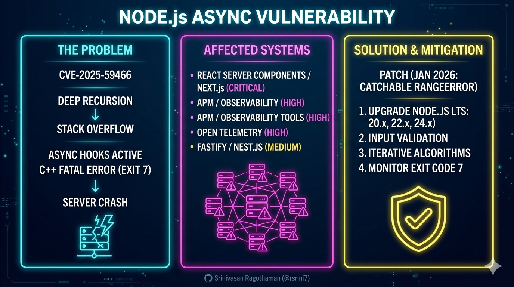
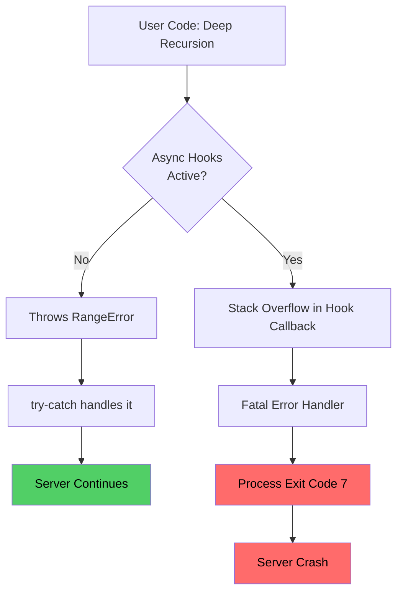
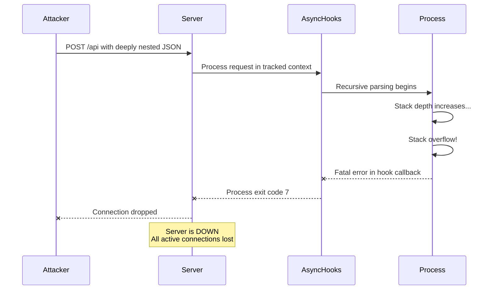

# Node.js Async Hooks DoS Vulnerability (CVE-2025-59466)



---

## Complete Technical Guide for Developers and Architects

## 1. Executive Summary

A denial-of-service (DoS) vulnerability affects Node.js applications when untrusted input can cause deep recursion while the affected `async_hooks` path is active. Instead of surfacing a catchable stack-overflow error, the process can terminate. Node.js rates this issue **Medium**; NVD's CVSS v3.1 assessment is **7.5 (High)**. [Node.js security release](https://nodejs.org/en/blog/vulnerability/december-2025-security-releases), [NVD record](https://nvd.nist.gov/vuln/detail/CVE-2025-59466).

**Real-World Spotlight:**
Node.js identifies **React Server Components and Next.js on Node 20 and 22** as affected through their use of `AsyncLocalStorage`. On Node 24 and 25, that API uses a different implementation; tools that directly enable `async_hooks.createHook()` can still expose the issue. An application also needs an input path that reaches stack exhaustion. [Node.js framework-specific guidance](https://nodejs.org/en/blog/vulnerability/january-2026-dos-mitigation-async-hooks).

**Key Facts:**

* **CVE ID:** CVE-2025-59466
* **Severity:** Node.js Medium; NVD CVSS v3.1 7.5 (High). These are different assessors.
* **Impact:** A process crash under the affected async-hooks and stack-exhaustion conditions; do not assume every recursive input reaches this path.
* **Affected:** Node.js 20, 22, 24 and 25 before the January patches, plus end-of-life 8–18 versions. Framework exposure differs by version.
* **Mitigation Released:** January 13, 2026.

---

## 2. What are Async Hooks and AsyncLocalStorage?

**Async hooks** is a Node.js API that tracks the lifecycle of asynchronous operations, maintaining context across HTTP requests, database queries, and timers.

**AsyncLocalStorage (ALS)** is a higher-level API built on async hooks that provides "thread-local storage" for Node.js. It is widely used for:

* Request ID tracking across async chains.
* Distributed tracing and performance monitoring (APM tools).
* React Server Components (RSC) rendering context.

---

## 3. The Problem: Why Does the Vulnerability Exist?

### Normal vs. Broken Behavior

Normally, V8 throws a catchable `RangeError` on stack overflow. However, when async hooks wrap callbacks, they use an internal C++ `TryCatchScope` with `CatchMode::kFatal`. This causes the process to abort immediately because Node.js assumes the environment is corrupted beyond recovery.



### The V8 Context & The "JavaScript Irony"

* **Browser-Centric Design:** V8’s primary threat model is the browser, where a tab crashing is a safe "fail-soft." In a server environment, this leads to a total DoS.
* **Lack of TCO:** Despite the ECMAScript spec, V8 does not implement **Tail Call Optimization (TCO)**, meaning recursive calls cannot be optimized into loops, making stack limits a hard boundary.
* **OS Enforcement:** Stack limits are enforced by the Operating System, not JavaScript.

---

## 4. Who is Affected?

| Technology | Why Affected | Risk Level |
| --- | --- | --- |
| **Next.js / RSC on Node 20/22** | Uses the affected `AsyncLocalStorage` path when stack exhaustion is reachable. | **Affected under those conditions** |
| **Next.js / RSC on Node 24/25** | `AsyncLocalStorage` was reimplemented without `async_hooks.createHook()`. | **Not affected through ALS alone** |
| **APM or other tools** | May directly enable `async_hooks.createHook()`; check the actual library and configuration. | **Potentially affected across versions** |
| **Other frameworks** | Assess whether they use the affected hook and process attacker-influenced recursion. | **Configuration dependent** |

---

## 5. Attack Scenario: The Next.js / RSC Vector

This example is a **conceptual Node 20/22 case**: a reachable recursive handler and active affected hooks are required. The JSON parser or framework may reject the input first; the code below does not prove an exploit against every Next.js deployment.

```javascript
// Vulnerable Next.js API route (app/api/process/route.js)
import { NextResponse } from 'next/server';

export async function POST(req) {
  const data = await req.json(); // Malicious payload: { "a": { "a": { ... 50k levels ... } } }

  function recursiveProcess(obj) {
    return Object.keys(obj).map(key => ({ [key]: recursiveProcess(obj[key]) }));
  }

  try {
    const result = recursiveProcess(data);
    return NextResponse.json(result);
  } catch (e) {
    // On an affected runtime and hook path, stack exhaustion can bypass this catch.
    return NextResponse.json({ error: 'Invalid data' }, { status: 400 });
  }
}

```



---

## 6. The Mitigation (The Patch)

The January 13, 2026, releases are a **mitigation**, not a complete fix for recursion-based DoS.

**What the Patch Does:**
The patch modifies the internal `TryCatchScope` to detect stack overflow exceptions specifically and **re-throw** them as normal `RangeErrors`. This allows `try/catch` or `process.on('uncaughtException')` to work as developers expect.

**Patched Versions:**
| Node.js Line | Minimum Patched Version |
| :--- | :--- |
| **20.x LTS** | **20.20.0** |
| **22.x LTS** | **22.22.0** |
| **24.x LTS** | **24.13.0** |
| **25.x Current** | **25.3.0** |

**Note:** Node 18.x and older are **End-of-Life** and will **not** receive a patch.

---

## 7. Action Plan & Remediation

### 1. Upgrade Node.js (Critical)

Update to a supported fixed release. If you are on an end-of-life version (18.x or below), migrate to a supported release or obtain a maintained vendor backport.

### 2. Implement Input Validation (The "Real" Fix)

Do not rely on the patch to protect your server. Always implement explicit depth limits for recursive data processing.

```javascript
function safeProcess(data, maxDepth = 50, currentDepth = 0) {
  if (currentDepth >= maxDepth) throw new Error('Maximum nesting depth exceeded');
  // ... process logic ...
}

```

### 3. Replace Recursion with Iteration

Convert recursive algorithms to iterative loops using an explicit stack or queue to avoid call stack limits entirely.

### 4. Monitor Process Exits

Alert on unexpected process exits and stack-overflow failures. Exit code 7 can be a useful clue, but it is not unique proof of this CVE.

---

## 8. Frequently Asked Questions

**Q: Do I need to upgrade if I don't use React or Next.js?**
**A:** Check whether the application uses the affected `async_hooks.createHook()` path or, on Node 20/22, affected `AsyncLocalStorage`, and whether untrusted input can exhaust the stack. Patch supported runtimes regardless; the presence of an APM package alone does not prove exploitability.

**Q: Can I just disable async hooks?**
**A:** No. Many modern frameworks and monitoring tools enable them automatically. Disabling them would break your observability and request context management.

**Q: Does this affect Deno or Bun?**
**A:** No. This is specific to Node.js's internal C++ implementation of `async_hooks`.

---

## 9. References & Further Reading

* **Official Node.js Advisory:** [CVE-2025-59466 Mitigations](https://nodejs.org/en/blog/vulnerability/january-2026-dos-mitigation-async-hooks)
* **Technical Deep Dive:** ["javascript can't stop winning"](https://www.youtube.com/watch?v=y2ujgpIZ5O8) by *Low Level Learning* (Jan 2026).
* **Source Code Patch:** [Commit ddadc31f09](https://github.com/nodejs/node/commit/ddadc31f09)
* **Framework Impact:** [Vercel Security Blog](https://vercel.com/blog/security)

---

### Conclusion

CVE-2025-59466 represents a significant fragility in the Node.js ecosystem. While the 2026 patches restore the ability to **catch** errors, the fundamental risk of stack exhaustion remains a developer's responsibility. **Defense-in-depth—combining immediate patching with strict input validation—is the only complete solution.**

**Related:**
- [Deno Joins Cloudflare](../../Engineering/Languages/Deno-Joins-Cloudflare-Adoption-And-Runtime-Lessons-Oct-2026.md) — Places Node's ecosystem maturity and maintenance model beside Deno's final supported year and hosting shutdown.
- [PHP2Shell: History, UAF and ASLR](PHP2Shell-History-UAF-And-ASLR-Oct-2026.md) — Compare unsafe runtime error handling across request and process lifecycles.
- [Node.js Brotli Decoder](Node.js-Brotli-Node2Shell-RCE-Oct-2026.md) — Another Node.js runtime failure, this one a memory-safety bug rather than stack exhaustion.
- [10.0_CVE_React2Shell_Whitepaper](10.0_CVE_React2Shell_Whitepaper.md) — RSC/Next.js SSR stacks named in this advisory are the same surface exploited by React2Shell.
- [10.0_CVE_n8n-vulnerability](10.0_CVE_n8n-vulnerability.md) — Both describe critical Node.js ecosystem CVEs affecting widely deployed workflow tooling.
