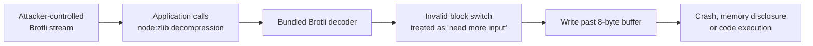

# Node.js Brotli Decoder: Node2Shell and the Runtime You Ship

**Daily learning · 24 October 2026 · Primary-source review**

> **Core idea:** Node.js bundles its own Brotli decoder. A malformed compressed stream could make that decoder write past an eight-byte internal buffer, corrupting process memory. Applications were exposed only if they decompressed attacker-controlled Brotli data, but fixing the bug required a runtime upgrade — not an npm package update.

> **If you run Node.js:** upgrade to **22.23.4**, **24.22.1**, or **26.12.1** (or later), rebuild container images, and check other software that bundles Brotli separately. As of 23 October, no confirmed in-the-wild exploitation had been reported.

## 1. Foundations: why a runtime bug bypasses dependency scanning

| Term | Meaning here |
|---|---|
| Node.js runtime | The `node` binary, including bundled native libraries such as Brotli and OpenSSL. |
| `node:zlib` | Node's built-in compression API, including Brotli decompression. |
| Bundled dependency | Code compiled into the runtime rather than installed in `node_modules`. |
| Out-of-bounds write | A memory write outside an allocated buffer, which can corrupt adjacent data. |
| RCE | Remote code execution: an attacker causes the process to run their instructions. |

`npm audit`, Dependabot, and lockfile review see JavaScript packages. They do not replace the Node.js binary. The same distinction applies to container base images and single-executable applications.

## 2. Mechanism: an eight-byte buffer with no stopping condition

The vulnerable path is in the Brotli decoder shipped with Node.js:

1. A crafted stream contains an **invalid block switch**.
2. The decoder reports the condition as **“needs more input”** instead of a permanent format error.
3. The streaming decoder keeps appending input bytes to an **eight-byte internal buffer**.
4. The write continues past the buffer, corrupting decoder state or adjacent process memory.

The result can be a crash, disclosure of process memory, or code execution with the Node.js process's permissions. Node's advisory describes the root cause as an invalid error classification in the streaming decoder, not a flaw in application JavaScript. [Node.js security release](https://nodejs.org/en/blog/vulnerability/october-2026-security-releases), [CVE-2026-111497](https://www.cve.org/CVERecord?id=CVE-2026-111497).

**Exposure is conditional.** A server is not automatically vulnerable just because it runs Node.js. The application must pass attacker-controlled Brotli data to `node:zlib` — for example, a service that accepts compressed request bodies, archives, or messages and explicitly decompresses them, or a client that automatically decodes a compressed HTTP response. A framework or middleware that does this on the application's behalf creates the same path.

This is a simplified data-flow diagram. It does not imply that every Node.js HTTP server decompresses request bodies automatically.

## 3. Impact and limits

| Claim | What the evidence supports |
|---|---|
| “Every Node.js site was exploitable.” | No. The vulnerable code shipped widely, but exploitation required an application path that decoded untrusted Brotli input. |
| “This is an npm supply-chain attack.” | No. The official Node.js runtime bundled the flawed decoder; installing a newer application package does not replace it. |
| “A WAF blocks it.” | Not established. A WAF may reject some payloads, but it is not a substitute for upgrading the runtime. |
| “The bug is only a denial of service.” | Too narrow. The advisory lists crash, memory disclosure, and potential remote code execution. |

The practical risk is highest where a public service decompresses user-supplied data and runs with broad filesystem, network, or cloud-credential access. Container isolation reduces some consequences but does not make an unpatched runtime safe. Imperva's red team demonstrated code execution on the official Node.js **24.22.0** Linux arm64 image through both a consumed Brotli response and configured Express/body-parser request paths; the fixed 24.22.1 rejected the same inputs. This is a controlled demonstration, not evidence of in-the-wild exploitation. No confirmed exploitation was reported as of 23 October; absence of reports is not proof that none occurred. [Imperva analysis](https://www.imperva.com/blog/node2shell-from-brotli-data-to-remote-code-execution/), [Qualys analysis](https://blog.qualys.com/product-tech/2026/10/23/node-js-patches-brotli-remote-code-execution-flaw-find-vulnerable-runtimes-before-attackers-do).

## 4. Timeline and fixes

| Date (2026) | Event |
|---|---|
| **21 Oct** | Node.js releases 22.23.4, 24.22.1, and 26.12.1, fixing CVE-2026-111497 and nine other issues. Brotli upstream publishes 1.0.10, 1.1.1, and 1.2.1. |
| **21–22 Oct** | CVE record and GitHub advisory available; downstream Python packages that bundle Brotli are also marked affected. |
| **23 Oct** | No confirmed exploitation reported; security scanners add runtime-version checks. |

Node.js credits **OpenAI Codex Security** researchers Khai Tran and Sylvie Mayer for reporting the flaw, with fixes by mcollina and aduh95. The upstream fix shipped in Brotli 1.0.10, 1.1.1, and 1.2.1 on 21 October; other software that embeds Brotli needs its own update. [Brotli changelog](https://github.com/google/brotli/blob/v1.2.1/CHANGELOG.md).

## 5. Practical response

1. **Check the deployed runtime**, not just `package.json`: `node -p process.versions` and `node -p process.versions.brotli`.
2. **Upgrade to a fixed release** for the branch you run. Rebuild images and redeploy rather than patching a running container.
3. **Inventory bundled copies.** Python `brotli`/`brotlicffi`, reverse proxies, and other applications that embed Brotli need their own fixed builds. [GitHub advisory](https://github.com/advisories/GHSA-9v8h-qqgm-4m35).
4. **Reduce unnecessary exposure** while patching: do not decompress untrusted input unless required, cap decompressed size, and isolate services that do.
5. **Verify after rollout.** Confirm the running process reports the fixed version and that a crafted test input no longer crashes a staging instance. A successful `npm audit` says nothing about the runtime.

---

**Related:**
- [PHP2Shell: History, UAF and ASLR](PHP2Shell-History-UAF-And-ASLR-Oct-2026.md) — Compare another runtime-level memory-corruption path from the same week.
- [GitLab CVE-2026-110264](GitLab-Regex-Compiler-RCE-Oct-2026.md) — Same-week unauthenticated RCE in developer infrastructure rather than the application runtime.
- [LiteLLM 1.107.0 Supply-Chain Compromise](LiteLLM-1.107.0-Supply-Chain-Compromise-Oct-2026.md) — Shows the other direction: a package release, not a runtime binary, as the compromised artifact.
- [Node.js Async Hooks DoS](Node.js-Async-Hooks-DoS-Vulnerability.md) — Earlier Node.js failure mode where request handling becomes a process-level problem.
