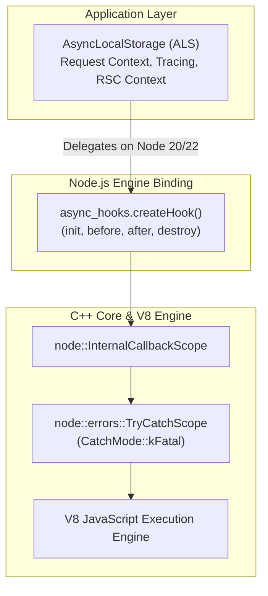
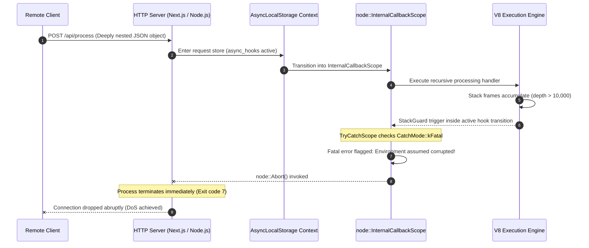
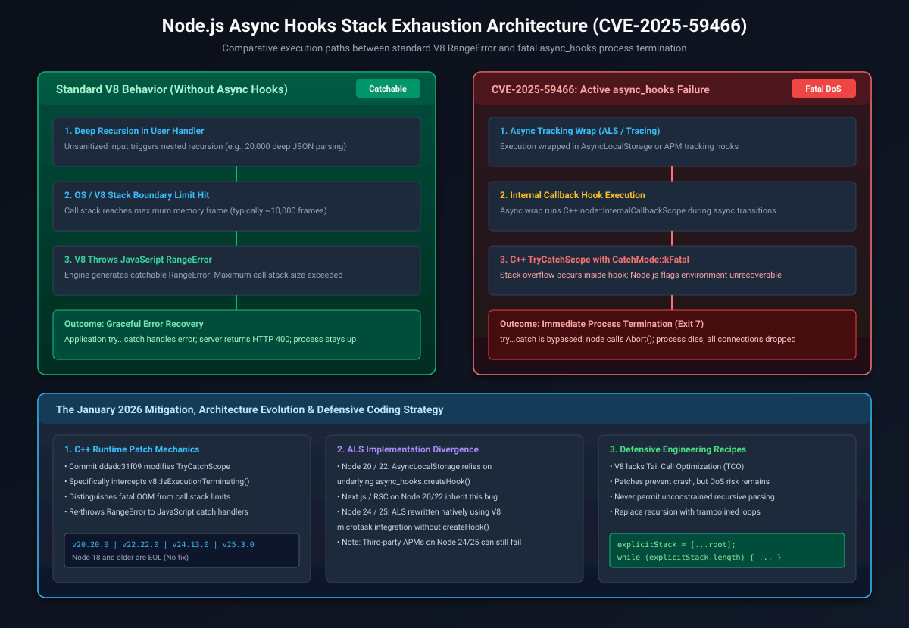
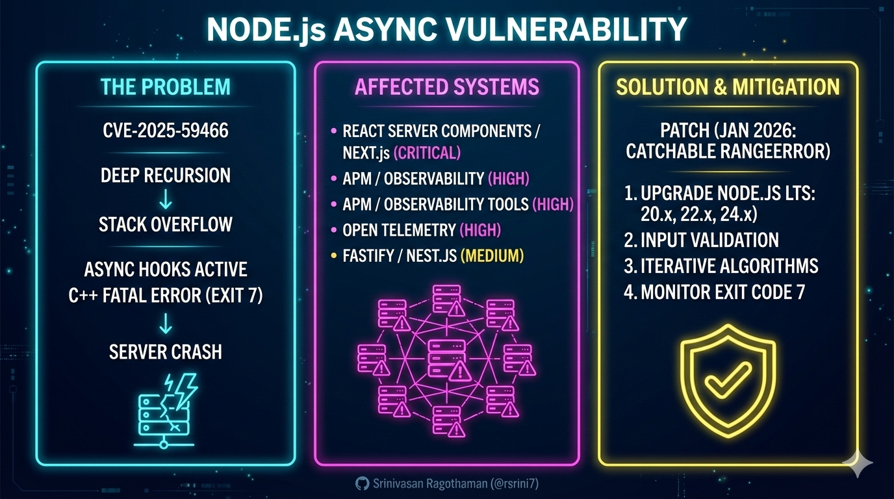

# Node.js Async Hooks Stack Exhaustion DoS: CVE-2025-59466 and AsyncLocalStorage Aborts

Learning note · Revised November 2026 · Technical advisory  
*By Srinivasan Ragothaman ([@rsrini7](https://github.com/rsrini7))*

> **Core idea:** Under normal runtime execution, the V8 engine translates recursion-induced stack overflows into catchable JavaScript `RangeError` exceptions. However, when asynchronous execution tracking is enabled via Node.js's internal `async_hooks` API—such as through `AsyncLocalStorage` in Next.js and React Server Components—a stack overflow occurring within the hook callback boundary encounters a C++ `TryCatchScope` configured with fatal catch mode (`CatchMode::kFatal`). This bypasses all JavaScript `try...catch` blocks and immediately terminates the Node.js process (Exit Code 7), transforming unvalidated deep client inputs into unrecoverable Denial-of-Service (DoS) crashes.

---

## 1. Foundations: Async Hooks and Request Context Propagation

In single-threaded asynchronous runtimes, maintaining execution context across asynchronous boundaries (e.g. tracking an incoming HTTP request ID across database queries, Redis lookups, and downstream RPCs) cannot rely on thread-local storage.

Node.js addresses this through two related layers:



### Key Architectural Components

| Subsystem | Functionality | Implementation Details |
|---|---|---|
| **`async_hooks`** | Low-level C++ / JS bridge tracking the lifecycle of async resources. | Hooks into promises, timers, file handles, and TCP sockets with `init`, `before`, `after`, and `destroy` callbacks. |
| **`AsyncLocalStorage`** | Public API providing ambient context storage across asynchronous workflows. | On Node 20 and 22, it delegates directly to `async_hooks.createHook()`. On Node 24 and 25, it uses native V8 promise execution contexts. |
| **`InternalCallbackScope`** | C++ class managing transitions between user JS code and native libuv callbacks. | Enforces tick depth, microtask queue drainage, and unhandled rejection tracking. |
| **`TryCatchScope`** | C++ wrapper governing how V8 exceptions are handled during internal transitions. | Configured with `CatchMode::kFatal` to prevent corrupted native runtime states from proceeding. |

---

## 2. Deep Technical Mechanism: The Fatal Abort Sequence

### 2.1 The JavaScript Stack Boundary Irony

The ECMAScript specification defines formal syntax for Tail Call Optimization (TCO), but the V8 engine does not implement TCO due to debugging complexity, stack trace fidelity requirements, and web platform compatibility. Consequently, every nested function invocation consumes a physical stack frame.

Operating systems allocate a fixed stack size per thread (typically 1 MB to 8 MB on Linux/macOS). In standard JavaScript:

```javascript
function recurse() {
  recurse();
}

try {
  recurse();
} catch (err) {
  console.log(err instanceof RangeError); // true: "Maximum call stack size exceeded"
  // Server recovers smoothly; process stays online
}
```

V8 monitors the thread stack pointer (`v8::internal::StackGuard`). When the pointer breaches the guard boundary, V8 terminates execution and instantiates a catchable JavaScript `RangeError`.

### 2.2 The `CatchMode::kFatal` Trap

When an application registers an `async_hooks` listener (either explicitly or implicitly through `AsyncLocalStorage` or APM tracing agents like OpenTelemetry, Datadog, or New Relic), Node.js wraps asynchronous dispatch inside `node::InternalCallbackScope`.

During this scope, internal callback execution is guarded by `node::errors::TryCatchScope`:



Because the exception occurs while the C++ runtime is actively executing internal hook bookkeeping, the `TryCatchScope` assumes that an internal invariant has been irrevocably corrupted. Rather than allowing the exception to bubble back into the JavaScript stack, it triggers `node::Abort()`, resulting in immediate process exit with **Code 7**.

### 2.3 The January 13, 2026 Mitigation

The upstream Node.js security fix (commit `ddadc31f09`) modified the internal exception handling logic within `TryCatchScope`:

```cpp
// Conceptual logic of the Node.js mitigation (commit ddadc31f09)
if (try_catch.HasTerminated()) {
  // Check if termination was caused by stack exhaustion rather than fatal memory corruption
  if (isolate->IsExecutionTerminating() && is_stack_overflow) {
    try_catch.Reset();
    isolate->ThrowException(v8::Exception::RangeError(
        v8::String::NewFromUtf8Literal(isolate, "Maximum call stack size exceeded")));
    return; // Re-surfaces exception as a normal, catchable JavaScript error
  }
  FatalException(isolate, try_catch);
}
```

The patch intercepts the termination signal, verifies whether the root cause was call stack exhaustion, and explicitly re-throws a standard `RangeError`. This restores the ability of JavaScript `try...catch` handlers and `process.on('uncaughtException')` hooks to capture the failure.

---

## 3. Architectural Visual: Resilient Path vs. Fatal Abort

The following architecture diagram contrasts standard V8 error recovery against the CVE-2025-59466 failure mode, along with the 2026 mitigation structure:



---

## 4. Production Implementations & Hardening Recipes

Applying the engine patch prevents the process from crashing, but deep recursion still consumes CPU cycles and risks thread starvation. True operational resilience requires replacing recursive traversal with iterative, trampolined algorithms and bounded context wrappers.

### 4.1 Trampolined Iterative Object Transformer

The following production TypeScript utility replaces deep recursion with an explicit heap-allocated stack, completely eliminating call stack exhaustion regardless of input depth.

```typescript
// utils/safeObjectTransformer.ts

interface StackFrame {
  source: Record<string, unknown>;
  target: Record<string, unknown>;
  keys: string[];
  keyIndex: number;
}

/**
 * Recursion-free, stack-safe object transformer.
 * Uses an explicit heap array to prevent call stack exhaustion (CVE-2025-59466).
 */
export function safeDeepTransform(
  input: unknown,
  transformValue: (val: unknown) => unknown,
  maxNestingDepth = 1000
): unknown {
  if (input === null || typeof input !== 'object') {
    return transformValue(input);
  }

  const rootTarget: Record<string, unknown> = Array.isArray(input) ? [] : {};
  const stack: StackFrame[] = [
    {
      source: input as Record<string, unknown>,
      target: rootTarget,
      keys: Object.keys(input),
      keyIndex: 0,
    },
  ];

  while (stack.length > 0) {
    if (stack.length > maxNestingDepth) {
      throw new RangeError(
        `Payload exceeds maximum allowable object nesting depth of ${maxNestingDepth}`
      );
    }

    const currentFrame = stack[stack.length - 1];

    if (currentFrame.keyIndex >= currentFrame.keys.length) {
      stack.pop();
      continue;
    }

    const key = currentFrame.keys[currentFrame.keyIndex];
    currentFrame.keyIndex++;

    const val = currentFrame.source[key];

    if (val !== null && typeof val === 'object') {
      const childTarget: Record<string, unknown> = Array.isArray(val) ? [] : {};
      currentFrame.target[key] = childTarget;

      stack.push({
        source: val as Record<string, unknown>,
        target: childTarget,
        keys: Object.keys(val),
        keyIndex: 0,
      });
    } else {
      currentFrame.target[key] = transformValue(val);
    }
  }

  return rootTarget;
}
```

### 4.2 Depth-Bounded AsyncLocalStorage Wrapper

When using `AsyncLocalStorage` in high-throughput microservices, wrap context execution in a depth-bounded guard to log warnings and shed load before approaching runtime stack limits:

```typescript
// context/boundedContext.ts
import { AsyncLocalStorage } from 'node:async_hooks';

export interface RequestContext {
  requestId: string;
  depth: number;
}

export class BoundedContextManager {
  private static storage = new AsyncLocalStorage<RequestContext>();
  private static readonly MAX_ASYNC_CALL_DEPTH = 100;

  public static run<R>(requestId: string, fn: () => R): R {
    const current = this.storage.getStore();
    const currentDepth = current ? current.depth + 1 : 1;

    if (currentDepth > this.MAX_ASYNC_CALL_DEPTH) {
      throw new Error(
        `Async context depth limit reached (${currentDepth} > ${this.MAX_ASYNC_CALL_DEPTH}). Potential loop detected.`
      );
    }

    return this.storage.run({ requestId, depth: currentDepth }, fn);
  }

  public static getContext(): RequestContext | undefined {
    return this.storage.getStore();
  }
}
```

---

## 5. Impact, Real-World Edge Cases & Gotchas

### 5.1 The Version Divergence: Node 20/22 vs. Node 24/25

A common source of confusion during the CVE-2025-59466 disclosure was the disparate impact across Node.js release lines:

```
+---------------------------------------------------------------------------------------------------+
|                                 AsyncLocalStorage Implementation                                 |
+--------------------+------------------------------------------+-----------------------------------+
| Node.js Line       | ALS Underlying Mechanism                 | Vulnerability Scope               |
+--------------------+------------------------------------------+-----------------------------------+
| Node.js 20.x (LTS) | async_hooks.createHook()                 | Vulnerable via standard ALS / RSC |
| Node.js 22.x (LTS) | async_hooks.createHook()                 | Vulnerable via standard ALS / RSC |
| Node.js 24.x       | Native V8 Promise Hook Integration       | Immune via ALS; vulnerable if     |
| Node.js 25.x       | Native V8 Promise Hook Integration       | third-party APM calls createHook()|
+--------------------+------------------------------------------+-----------------------------------+
```

- **Next.js & React Server Components on Node 20 / 22:** Because React Server Components rely on `AsyncLocalStorage` to store the active request rendering store, any Next.js App Router application processing deeply nested JSON structures or recursive layout components on Node 20/22 was directly vulnerable to fatal process termination.
- **Node 24 and 25:** Node.js refactored `AsyncLocalStorage` in version 24 to leverage native V8 microtask state storage rather than `async_hooks.createHook()`. Consequently, Next.js applications on Node 24/25 were not vulnerable through `AsyncLocalStorage` alone. However, if an APM package (such as Datadog or New Relic) explicitly called `async_hooks.createHook()`, the vulnerability remained active.

### 5.2 Common Claims vs. Technical Realities

| Industry Assumption | Technical Reality |
|---|---|
| *"Wrapping our API request handlers in `try...catch` prevents unhandled crashes."* | **False.** Under CVE-2025-59466, the fatal error is triggered inside C++ `InternalCallbackScope` before execution ever returns to JavaScript catch blocks. |
| *"Registering `process.on('uncaughtException')` allows graceful failover."* | **False.** The process terminates via `node::Abort()` (Exit code 7), which does not dispatch `uncaughtException` events. |
| *"Only applications explicitly using `async_hooks` are affected."* | **False.** `AsyncLocalStorage` is embedded deep inside modern server frameworks (Next.js, Fastify, NestJS, Astro) and APM agents. |
| *"The January 2026 patch eliminates recursion DoS attacks."* | **Partially True.** The patch prevents fatal process crashes by restoring `RangeError`, but an attacker sending recursive payloads can still cause high CPU load and trigger 500 error cascades. |

---

## 6. Practical Adoption Blueprint & Verification Checklist

### 6.1 Supported Version Patch Matrix

To mitigate CVE-2025-59466, upgrade Node.js runtimes to the minimum patched releases:

| Node.js Release Line | Status | Minimum Patched Version | Release Date |
|---|---|---|---|
| **Node.js 20.x (Iron LTS)** | Maintained | **`v20.20.0`** | January 13, 2026 |
| **Node.js 22.x (Jod LTS)** | Active LTS | **`v22.22.0`** | January 13, 2026 |
| **Node.js 24.x** | Current | **`v24.13.0`** | January 13, 2026 |
| **Node.js 25.x** | Current | **`v25.3.0`** | January 13, 2026 |
| **Node.js 18.x and older** | End-of-Life | **None (Unpatched)** | N/A |

### 6.2 Diagnostic Verification Commands

```bash
# 1. Verify installed Node.js runtime version
node -v

# 2. Check for active APM or async_hooks modules in dependencies
npm list | grep -E "async_hooks|@opentelemetry|dd-trace|newrelic"

# 3. Test stack overflow error handling behavior (diagnostic verification)
node -e '
  const { AsyncLocalStorage } = require("async_hooks");
  const als = new AsyncLocalStorage();
  als.run(new Map(), () => {
    function f() { f(); }
    try {
      f();
    } catch (e) {
      console.log("SUCCESS: Caught " + e.name + " (" + e.message + ")");
      process.exit(0);
    }
  });
'
# Patched Output: SUCCESS: Caught RangeError (Maximum call stack size exceeded)
# Vulnerable Output: Process aborts immediately with Exit Code 7 (or illegal instruction)
```

---

## 7. Timeline and Current State

```
Dec 2025             Early Jan 2026         Jan 13, 2026           Late Jan 2026
   +-----------------------+----------------------+----------------------+
   | Node.js Security Team | Framework Guidance   | Security Releases:   | Global Deployment;
   | Triages Fatal Abort   | Disclosed by Vercel  | v20.20.0, v22.22.0,  | APM Vendor Updates
   | Under async_hooks     | & Next.js Core       | v24.13.0, v25.3.0    | Validated
```

- **December 2025:** Security researchers identify that V8 stack overflows under active `async_hooks` bypass JavaScript catch semantics, causing hard process crashes in Node.js.
- **Early January 2026:** Framework advisories clarify the differential vulnerability of `AsyncLocalStorage` across Node 20/22 versus Node 24/25.
- **January 13, 2026:** Node.js officially publishes the January Security Releases containing commit `ddadc31f09`, restoring `RangeError` re-throwing.

---

## 8. Source Context and Primary Disclosures

| Date | Source / Organization | Disclosure / Document | Focus Area |
|---|---|---|---|
| Jan 2026 | Node.js Security Team | [January 2026 Security Release](https://nodejs.org/en/blog/vulnerability/january-2026-dos-mitigation-async-hooks) | CVE-2025-59466 mitigation and affected version tags |
| Jan 2026 | NIST NVD | [NVD Record: CVE-2025-59466](https://nvd.nist.gov/vuln/detail/CVE-2025-59466) | CVSS v3.1 7.5 scoring and vulnerability metrics |
| Jan 2026 | Node.js GitHub Repository | [Commit ddadc31f09](https://github.com/nodejs/node/commit/ddadc31f09) | Core runtime patch in `node::InternalCallbackScope` |
| Jan 2026 | Vercel Security Blog | [Framework-Specific Guidance](https://vercel.com/blog/security) | RSC and Next.js App Router interaction with ALS |

---

## 9. Supplementary visuals

The following diagram illustrates the original exploit sequence, fatal error propagation, and application availability impact:


*Figure 1: Sequence flow of unvalidated recursive input leading to fatal process crash and dropped client sessions.*

---

**Related:**
- [React2Shell (CVE-2025-55182)](React2Shell-CVE-2025-55182-Flight-Protocol-RCE-2026.md) — RSC/Next.js SSR stacks named in this advisory are the same surface exploited by React2Shell.
- [PHP2Shell: History, UAF and ASLR](PHP2Shell-History-UAF-And-ASLR-Oct-2026.md) — Compare unsafe runtime error handling across request and process lifecycles.
- [Node.js Brotli Decoder](NodeJS-Brotli-Node2Shell-RCE-Oct-2026.md) — Another Node.js runtime failure, this one a memory-safety bug rather than stack exhaustion.
- [n8n Automation RCE Suite](N8n-Workflow-Automation-RCE-Suite-CVE-2025-68613-2026.md) — Both describe critical Node.js ecosystem CVEs affecting widely deployed workflow tooling.
- [Deno Joins Cloudflare](../../Engineering/Languages/Deno-Joins-Cloudflare-Adoption-And-Runtime-Lessons-Oct-2026.md) — Places Node's ecosystem maturity and maintenance model beside Deno's final supported year and hosting shutdown.
