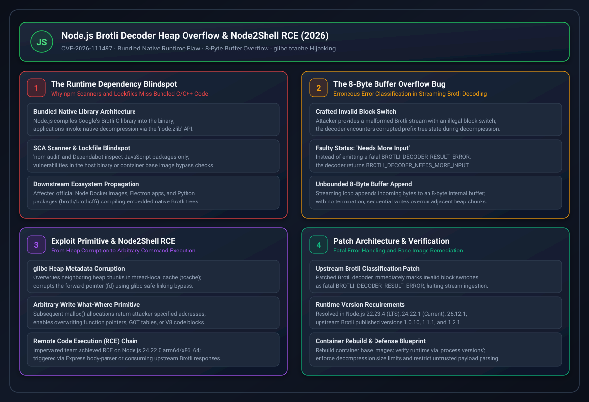
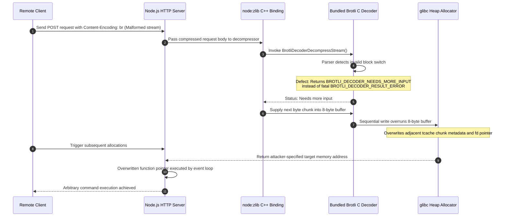

# Node.js Brotli Decoder: Node2Shell and the Runtime You Ship

**Daily learning · 24 October 2026 · Primary-source review**  
*By Srinivasan Ragothaman ([@rsrini7](https://github.com/rsrini7))*

> **Core idea:** Node.js bundles Google's native Brotli C compression library directly inside the binary. A vulnerability in the streaming decoder caused malformed compressed streams with invalid block switches to be misclassified as "needs more input" rather than a fatal format error, causing the decoder to continuously write input bytes past a fixed 8-byte internal buffer into adjacent heap memory. Because the defect resides in the compiled Node.js binary rather than a JavaScript dependency, traditional tools like `npm audit` and Dependabot fail to detect it, requiring teams to upgrade the Node.js runtime itself (versions 22.23.4, 24.22.1, 26.12.1) and rebuild container base images. [Node.js October 2026 Security Release](https://nodejs.org/en/blog/vulnerability/october-2026-security-releases), [CVE-2026-111497](https://www.cve.org/CVERecord?id=CVE-2026-111497).

---

## 1. Foundations: why a runtime bug bypasses dependency scanning

Modern server-side JavaScript applications rely on multi-tiered software supply chains. While developers focus heavily on the thousands of packages in `node_modules`, the execution runtime itself contains bundled, compiled native C and C++ libraries.

### Bundled Native Dependencies vs. npm Packages
* **npm Packages (`node_modules`):** Third-party JavaScript and TypeScript libraries declared in `package.json` and tracked in `package-lock.json`. Standard Software Composition Analysis (SCA) scanners (such as `npm audit`, Snyk, and GitHub Dependabot) parse these manifests to identify known Common Vulnerabilities and Exposures (CVEs).
* **Bundled Native Libraries:** Native C and C++ libraries compiled directly into the `node` executable during the upstream build process. These include V8 (JavaScript engine), libuv (asynchronous I/O), OpenSSL (cryptography), and Brotli/zlib (compression).
* **The Scanning Blindspot:** Because bundled libraries do not appear in `package.json`, manifest scanners report zero vulnerabilities even when the underlying runtime binary harbors critical memory corruption flaws.

### What is Brotli and `node:zlib`?
Brotli is a generic-purpose lossless compression algorithm developed by Google that uses a combination of the LZ77 algorithm, Huffman coding, and second-order context modeling. In Node.js, Brotli support is exposed via the built-in `node:zlib` module (`createBrotliDecompress`, `brotliDecompress`, and `brotliDecompressSync`).

| Party / Entity | Role and effect in this incident |
|---|---|
| **Node.js Project** | Upstream runtime maintainer; released emergency security updates (22.23.4, 24.22.1, 26.12.1) patching CVE-2026-111497 across maintained release lines. |
| **OpenAI Codex Security** | Security research team (credited: Khai Tran and Sylvie Mayer) that discovered and responsibly disclosed the heap buffer overflow in the Brotli streaming decoder. |
| **Google Brotli Upstream** | Maintainer of the canonical Brotli C library; released versions 1.0.10, 1.1.1, and 1.2.1 correcting the decoder state machine. |
| **Imperva Red Team** | Published independent exploitation research ("Node2Shell") demonstrating working remote code execution against Node.js 24.22.0 on Linux arm64/x86_64 via glibc heap corruption. |
| **Downstream Applications** | Web servers (Express, Fastify), reverse proxies, and microservices that automatically decompress untrusted Brotli request bodies or client responses. |

| Term | Meaning in this incident |
|---|---|
| **Node.js Runtime** | The compiled `node` binary containing the V8 engine, libuv, and statically linked native libraries. |
| **`node:zlib`** | The built-in Node.js module providing compression and decompression streams. |
| **Out-of-Bounds (OOB) Write** | A memory safety violation where data is written beyond the boundary of an allocated buffer, corrupting adjacent heap structures. |
| **glibc tcache** | Thread-local cache introduced in modern glibc to speed up repeated small heap allocations (`malloc`/`free`). |
| **Safe-Linking** | A glibc heap protection mechanism that obfuscates pointer addresses in singly linked bins using ASLR address masking. |
| **Remote Code Execution (RCE)** | An exploit primitive that allows an attacker to execute arbitrary machine instructions within the host process context. |

---

## 2. Deep Technical Mechanism: The 8-Byte Buffer Overflow and Node2Shell

The vulnerability (CVE-2026-111497) is an out-of-bounds write occurring inside the streaming Brotli decoder implementation (`BrotliDecoderDecompressStream`).

### Step 1: Upstream C Decoder Architecture
When Node.js invokes Brotli decompression via `node:zlib`, the C++ binding initializes a `BrotliDecoderState` struct. The decoder operates as a streaming state machine, reading bitstreams, identifying meta-block headers, and expanding compressed data into an internal ring buffer.

### Step 2: The Flawed Error State Transition
In Brotli compressed streams, data is divided into blocks of three types: literal, insert-and-copy length, and distance. Block switches change the active Huffman trees used to decode subsequent symbols.

When processing an **invalid or malformed block switch**, the decoder logic encounters an illegal state:
1. Under normal operation, a malformed stream header should trigger a terminal error:
   ```c
   return BROTLI_DECODER_RESULT_ERROR;
   ```
2. In the flawed implementation, the decoder state machine incorrectly classified this format violation as a temporary, recoverable condition:
   ```c
   return BROTLI_DECODER_NEEDS_MORE_INPUT;
   ```

### Step 3: The 8-Byte Buffer Overrun
Because the decoder returned `BROTLI_DECODER_NEEDS_MORE_INPUT`, the outer Node.js decompression loop assumed that the stream was valid but incomplete:
* The caller read subsequent chunks from the input stream and passed them back to the decoder.
* The internal streaming accumulator maintained a fixed **8-byte internal buffer** intended to hold cross-chunk prefix bits.
* With no error-stopping condition active, the decoder continued copying input bytes into this 8-byte structure.
* Successive writes overran the 8-byte boundary, writing attacker-controlled bytes directly into neighboring memory on the glibc heap.

```
+--------------------------------------------------------------------------------+
| Heap Memory Layout during Brotli Streaming Decompression                       |
|                                                                                |
| [ Chunk A: BrotliDecoderState ]                                                |
|   |-- ...                                                                      |
|   |-- prefix_buffer [8 bytes]  --> [ 0x41 0x41 0x41 0x41 0x41 0x41 0x41 0x41 ] |
| +------------------------------------------------------------------------------+
| | OVERFLOW BOUNDARY                                                            |
| +------------------------------------------------------------------------------+
|   |-- Adjacent Heap Chunk (glibc malloc_chunk)                                 |   
|       |-- prev_size   [8 bytes] --> [ OVERWRITTEN BY ATTACKER ]                |
|       |-- size | flags [8 bytes] --> [ OVERWRITTEN (Corrupted chunk size)]     |
|       |-- fd pointer  [8 bytes] --> [ CORRUPTED TCACHE FORWARD POINTER ]       |
+--------------------------------------------------------------------------------+
```

### Step 4: The Node2Shell Exploitation Chain
In independent security analysis, the Imperva Red Team demonstrated that this out-of-bounds write could be weaponized into full Remote Code Execution (dubbed **Node2Shell**):

1. **Heap Grooming:** By sending tailored HTTP requests to a Node.js server (e.g. using `body-parser` or `express-compression`), the attacker grooms the glibc heap so that a `tcache` (thread-local cache) chunk sits immediately adjacent to the Brotli decoder's internal buffer.
2. **tcache Poisoning:** The overflow overwrites the `fd` (forward pointer) of a freed chunk in the tcache bin. Even though modern glibc employs **safe-linking** (pointer mangling via `P = (L >> 12) ^ Target`), attackers can de-mangle pointers if heap addresses are partially known or leakable.
3. **Arbitrary Write Primitive:** Once the tcache forward pointer points to a target memory location, subsequent `malloc()` calls return the attacker's chosen memory address.
4. **Hijacking Control Flow:** The attacker overwrites an active C++ virtual method table (`vtable`) pointer or a function pointer within a Node.js C++ object (such as an active `uv_async_t` handle or V8 internal structures). When Node.js next executes its event loop callback, control jumps directly to the attacker's shellcode or `system()` execution chain.

---

## 3. Architectural Visuals (SVGs & Mermaid)

The following architectural diagram illustrates the bundled runtime blindspot, the 8-byte buffer overflow state machine flaw, and the heap corruption execution chain:



### Vulnerability and Attack Flow Sequence



---

## 4. Production Implementations & Code Recipes

To protect production Node.js services, teams must audit the runtime binary itself, implement defensive decompression guards, and enforce container base image immutability.

### Recipe 1: Runtime Binary & Brotli Version Audit Script (Bash / Node.js)

Because manifest scanners miss bundled binaries, this script verifies the exact version of Node.js and its statically compiled Brotli library:

```bash
#!/usr/bin/env bash
# audit_node_runtime.sh - Verifies running Node.js and Brotli versions

set -euo pipefail

echo "=================================================="
echo " Node.js Runtime & Brotli Vulnerability Audit"
echo "=================================================="

# Check Node version
NODE_VERSION=$(node -v | tr -d 'v')
BROTLI_VERSION=$(node -p 'process.versions.brotli || "none"')

echo "[*] Node.js Version : ${NODE_VERSION}"
echo "[*] Brotli Version  : ${BROTLI_VERSION}"

# Vulnerable Version Check Logic:
# Fixed releases: >= 22.23.4 (for v22), >= 24.22.1 (for v24), >= 26.12.1 (for v26)
MAJOR=$(echo "${NODE_VERSION}" | cut -d. -f1)
MINOR=$(echo "${NODE_VERSION}" | cut -d. -f2)
PATCH=$(echo "${NODE_VERSION}" | cut -d. -f3)

IS_VULNERABLE=0

if [ "${MAJOR}" -eq 22 ]; then
    if [ "${MINOR}" -lt 23 ] || ([ "${MINOR}" -eq 23 ] && [ "${PATCH}" -lt 4 ]); then
        IS_VULNERABLE=1
    fi
elif [ "${MAJOR}" -eq 24 ]; then
    if [ "${MINOR}" -lt 22 ] || ([ "${MINOR}" -eq 22 ] && [ "${PATCH}" -lt 1 ]); then
        IS_VULNERABLE=1
    fi
elif [ "${MAJOR}" -eq 26 ]; then
    if [ "${MINOR}" -lt 12 ] || ([ "${MINOR}" -eq 12 ] && [ "${PATCH}" -lt 1 ]); then
        IS_VULNERABLE=1
    fi
fi

if [ "${IS_VULNERABLE}" -eq 1 ]; then
    echo -e "\033[0;31m[!] CRITICAL: Node.js ${NODE_VERSION} contains vulnerable Brotli decoder (CVE-2026-111497)!\033[0m"
    echo "    Immediate action: Upgrade to >= 22.23.4, >= 24.22.1, or >= 26.12.1."
    exit 1
else
    echo -e "\033[0;32m[+] SUCCESS: Node.js runtime is patched against CVE-2026-111497.\033[0m"
    exit 0
fi
```

### Recipe 2: Defensive Brotli Decompression Wrapper (Node.js)

If an application must decompress user-supplied Brotli archives or request streams before runtimes can be patched, use this defensive streaming wrapper to enforce byte limits and prevent unconstrained buffer feeding:

```javascript
// safeBrotliDecompress.js - Hardened Brotli streaming decompression wrapper
const zlib = require('node:zlib');

/**
 * Safely decompresses an untrusted Brotli buffer with strict resource limits.
 * @param {Buffer} inputBuffer - Untrusted compressed payload
 * @param {number} maxOutputBytes - Maximum allowed decompressed size (default: 5MB)
 * @returns {Promise<Buffer>}
 */
function safeBrotliDecompress(inputBuffer, maxOutputBytes = 5 * 1024 * 1024) {
  return new Promise((resolve, reject) => {
    // Prevent zero-length or enormous compressed input payloads
    if (!Buffer.isBuffer(inputBuffer) || inputBuffer.length === 0) {
      return reject(new Error('Invalid input: payload must be a non-empty Buffer'));
    }
    if (inputBuffer.length > maxOutputBytes) {
      return reject(new Error('Compressed payload exceeds maximum size limit'));
    }

    const decompressor = zlib.createBrotliDecompress({
      chunkSize: 16 * 1024,
      maxOutputLength: maxOutputBytes,
      params: {
        // Enforce strict memory consumption limits on the native decoder
        [zlib.constants.BROTLI_PARAM_LARGE_WINDOW]: false
      }
    });

    const chunks = [];
    let totalBytesDecompressed = 0;

    decompressor.on('data', (chunk) => {
      totalBytesDecompressed += chunk.length;
      if (totalBytesDecompressed > maxOutputBytes) {
        decompressor.destroy(new Error('Decompression bomb detected: output exceeded threshold'));
        return;
      }
      chunks.push(chunk);
    });

    decompressor.on('end', () => {
      resolve(Buffer.concat(chunks));
    });

    decompressor.on('error', (err) => {
      reject(new Error(`Brotli decompression failure: ${err.message}`));
    });

    // Write input and flush
    decompressor.end(inputBuffer);
  });
}

module.exports = { safeBrotliDecompress };
```

---

## 5. Impact, Real-World Edge Cases & Gotchas

While the underlying buffer overflow is severe, real-world exploitation depends on specific application data paths.

### Common Claims vs. Technical Realities

| Claim or misconception | Technical reality established as of 24 October 2026 |
|---|---|
| **"Every application running Node.js is vulnerable to RCE."** | **False.** A server is not vulnerable simply by executing on Node.js. Exploitation strictly requires that untrusted, attacker-controlled data reaches a Brotli decompression routine (`node:zlib`). Servers that do not accept or decompress Brotli are unaffected. |
| **"`npm audit` confirms our systems are secure."** | **Dangerous fallacy.** `npm audit` only evaluates JavaScript package manifests (`package-lock.json`). It cannot inspect the compiled C++ Node.js binary or base container image where this flaw resides. |
| **"A Web Application Firewall (WAF) completely prevents exploitation."** | **Unsubstantiated.** While some WAFs inspect compression headers, Brotli streams can be chunked, obfuscated, or embedded inside custom API payloads, bypassing perimeter inspection. |
| **"The vulnerability is merely a Denial-of-Service crash."** | **Refuted by security demonstrations.** While unoptimized payloads cause segmentation faults, the Imperva Red Team achieved stable remote code execution on Linux arm64/x86_64 through glibc tcache corruption. |
| **"Containerization makes unpatched runtimes safe."** | **False.** While Docker/Kubernetes namespaces restrict host-level lateral movement, an attacker achieving RCE within a container can exfiltrate environment variables, cloud IAM instance tokens, and database credentials. |

### Real-World Architectural Gotchas
1. **Implicit Middleware Decompression:** Many developers believe their code never touches Brotli. However, popular HTTP middleware frameworks (such as Express `body-parser` or Fastify decompression plugins) automatically decompress request bodies when the `Content-Encoding: br` header is present.
2. **Outbound Response Poisoning (SSRF / Webhooks):** Applications that fetch external URLs (e.g. webhook delivery, web scrapers, link preview generators) can be exploited if they request remote content with `Accept-Encoding: br` and decode the response via `node:zlib`.
3. **Standalone Single-Executable Applications (Node SEA / pkg):** Applications packaged as single binaries bundle their own fixed Node.js runtime. Updating the system's global Node.js binary has zero effect on single-executable artifacts until they are recompiled with the updated runtime.

---

## 6. Practical Adoption Blueprint & Verification Checklist

Organizations running Node.js workloads should execute the following verification steps:

### Runtime Security Audit Checklist
- [ ] **Audit Deployed Binary Versions:** Run `node -p 'process.versions'` across all production container pods, serverless functions, and VM instances.
- [ ] **Update Base Docker Images:** Rebuild container images referencing updated official images (`node:22.23.4-alpine`, `node:24.22.1-slim`, etc.); ensure base image digest pinning is refreshed.
- [ ] **Audit Downstream Runtimes:** Check Python environments running `brotli` or `brotlicffi`, as well as Electron desktop applications and Nginx reverse proxy modules that bundle Brotli natively.
- [ ] **Disable Unnecessary Decompression:** Configure API gateways and reverse proxies to reject `Content-Encoding: br` requests unless Brotli request body decompression is explicitly required.
- [ ] **Enforce Decompression Ceilings:** Apply strict maximum-byte thresholds to all decompression streams to defend against memory exhaustion and decompression bomb attacks.

### Exact Diagnostic Commands

```bash
# 1. Inspect exact runtime and bundled component versions
node -p 'process.versions'

# 2. Check specifically for Brotli engine version in Node.js
node -p 'process.versions.brotli'

# 3. Scan a container image for binary-level vulnerabilities using Trivy
trivy image --severity CRITICAL,HIGH my-node-service:latest

# 4. Search codebase for explicit Brotli decompression calls
rg -n 'createBrotliDecompress|brotliDecompress' /path/to/src/
```

---

## 7. Timeline and Current State

All recorded timestamps are in **October 2026**.

| Date (2026) | Event and technical evidence |
|---|---|
| **Prior to Oct 21** | OpenAI Codex Security researchers Khai Tran and Sylvie Mayer discover the 8-byte buffer overflow in the Brotli streaming decoder and coordinate responsible disclosure with the Node.js security team and Google Brotli maintainers. |
| **21 Oct, ~16:00 UTC** | Google Brotli upstream releases versions 1.0.10, 1.1.1, and 1.2.1 patching the error state machine logic. |
| **21 Oct, 18:00 UTC** | Node.js releases emergency security updates: 22.23.4 (LTS), 24.22.1 (Current), and 26.12.1, addressing CVE-2026-111497 alongside nine other issues. |
| **22 Oct** | National Vulnerability Database (NVD) and GitHub Advisory Database publish GHSA-9v8h-qqgm-4m35, marking downstream Python and native packages affected. |
| **23 Oct** | Imperva Red Team publishes the "Node2Shell" analysis detailing working RCE on Linux arm64 through glibc tcache heap metadata corruption. |
| **24 Oct** | Cloud container registries and base image maintainers complete deployment of patched Node.js images; no confirmed in-the-wild exploitation reported. |

---

## 8. Primary Sources & References

1. [Node.js Official Security Releases: October 2026](https://nodejs.org/en/blog/vulnerability/october-2026-security-releases) — Primary security advisory detailing CVE-2026-111497 and patched runtime versions.
2. [CVE-2026-111497 Record](https://www.cve.org/CVERecord?id=CVE-2026-111497) — Common Vulnerabilities and Exposures database entry documenting the Brotli streaming decoder out-of-bounds write.
3. [Google Brotli Repository Release v1.2.1](https://github.com/google/brotli/blob/v1.2.1/CHANGELOG.md) — Upstream changelog confirming fix for streaming decoder state classification.
4. [Imperva Red Team: Node2Shell Exploitation Research](https://www.imperva.com/blog/node2shell-from-brotli-data-to-remote-code-execution/) — Technical deep dive demonstrating glibc heap corruption and control flow hijacking in Node.js 24.22.0.
5. [Qualys Threat Research: Finding Vulnerable Node.js Runtimes](https://blog.qualys.com/product-tech/2026/10/23/node-js-patches-brotli-remote-code-execution-flaw-find-vulnerable-runtimes-before-attackers-do) — Analysis of runtime discovery and vulnerability management beyond package manifests.
6. [GitHub Advisory GHSA-9v8h-qqgm-4m35](https://github.com/advisories/GHSA-9v8h-qqgm-4m35) — Ecosystem advisory tracking downstream Python and bundled Brotli package impacts.

---

## 9. Supplementary visuals

The following architectural diagram illustrates the bundled runtime blindspot, the 8-byte buffer overflow state machine flaw, and the heap corruption execution chain:


*Figure 1: High-level architectural breakdown of the Node.js native Brotli decoder flaw, streaming error misclassification, glibc tcache heap corruption, and runtime remediation.*

---

**Related:**
- [Linux Kernel ZDI Public Reports](Linux-Kernel-ZDI-Public-Reports-KSMBD-Oct-2026.md) — Distinguish an optional kernel file server from a bundled runtime decoder.
- [PHP2Shell: History, UAF and ASLR](PHP2Shell-History-UAF-And-ASLR-Oct-2026.md) — Compare another runtime-level memory-corruption path from the same week.
- [GitLab CVE-2026-110264](GitLab-Regex-Compiler-RCE-Oct-2026.md) — Same-week unauthenticated RCE in developer infrastructure rather than the application runtime.
- [LiteLLM 1.107.0 Supply-Chain Compromise](LiteLLM-1.107.0-Supply-Chain-Compromise-Oct-2026.md) — Shows the other direction: a package release, not a runtime binary, as the compromised artifact.
- [Node.js Async Hooks DoS (CVE-2025-59466)](NodeJS-Async-Hooks-Stack-Exhaustion-DoS-CVE-2025-59466-2026.md) — Earlier Node.js failure mode where request handling becomes a process-level problem.
