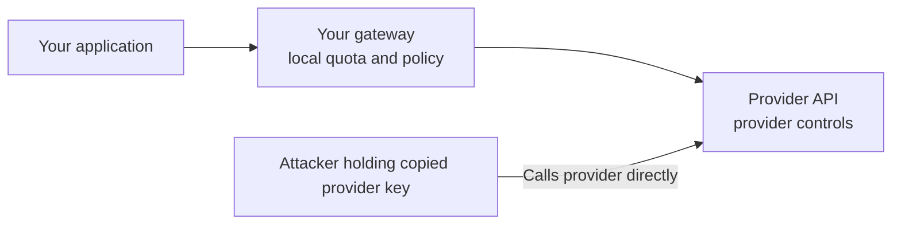

# OpenCode Console: API-Key Exposure, Distillation and the Credential Trust Boundary

**Daily learning · 22 October 2026 · Secondary-source review of the incident; primary documentation for product and provider controls**

> **Core idea:** A hosted coding platform can become a store of credentials that spend money at other companies. OpenCode disclosed a Console breach involving a legacy system; the important technical boundary is between the gateway that holds a key and the provider that ultimately accepts and bills it.

> **If you are in this incident now:** revoke the credential **at the provider**, not just in the Console (deleting an integration is not revocation); for a Google service account, delete the **key** in IAM; then reconcile provider usage from **00:30 UTC on 17 October — or earlier, if your own logs show anything unusual** — and keep the invoices and request IDs. The company's 00:30 UTC figure is the earliest *stated* exposure, not a confirmed start; assume nothing before it is clean. Detail in §5.

## 1. Claims and confidence

**Sourcing.** OpenCode's product and provider documentation and the provider spend-control documents cited below were read directly. The incident facts come from indexed reproductions of OpenCode's own statements and from press coverage, because the original X posts were not readable by the research reader; no complete forensic report has been published, so entry path, attribution and reimbursement remain open.

**Claims being tested.** Four commonly repeated claims are carried into the sections below rather than repeated as fact.

| Claim | Tested in | Result |
|---|---|---|
| Frontier labs have hardened their defenses, so distillation-focused attackers now go after developer-platform keys and accounts instead. | §4 | Plausible as an incentive argument — a working developer account already has access, billing and quotas — but it does not establish the cause of this breach. |
| One affected user lost close to $5,000. | §2, §5 | Not established here; separate user reports include figures above $1,700 ([BleepingComputer](https://www.bleepingcomputer.com/news/security/opencode-hack-exposes-api-keys-amid-ai-distillation-attacks/)). |
| A four-hour audit of your own code is the appropriate response. | §5, §6 | Not a billing control — an audit need not observe a copied key used directly against the provider. |
| Continuous defensive work should be split into zones (authentication, secret storage and legacy infrastructure, dependencies, web/API, runtime usage), each with its own question. | §6 | Useful when every zone carries one concrete question and an explicit authority limit. |

**Evidence boundaries.** The questions a reader is most likely to ask, and what the reviewed material supports.

| Question | Evidence boundary as of this review |
|---|---|
| Was the local CLI supply chain compromised? | The disclosure concerns hosted Console credentials; the reviewed material does not establish a malicious CLI release. |
| Was a particular vulnerability exploited? | No entry-point exploit, affected route or CVE was established in the reviewed incident material. |
| Was encryption absent or defeated? | The storage format and relevant key-management controls were not disclosed. |
| Were all linked users affected? | The company's stated scope is a subset; no absolute number was provided. |
| Were every exposed key and every fraudulent bill verified? | The notification uses conditional exposure language; individual billing reports are not a complete forensic accounting. |
| Does “distillation attack” identify an attacker? | No. The reviewed disclosure names no responsible lab, group or country. |

**Sources for the incident, in one place:** [Techmeme's collection of the original statements](https://www.techmeme.com/261017/p18), [BleepingComputer's reproduced notice](https://www.bleepingcomputer.com/news/security/opencode-hack-exposes-api-keys-amid-ai-distillation-attacks/), [the customer-notice transcription with original links](https://dev.to/gabrielanhaia/opencode-told-14-of-console-users-to-revoke-their-openai-and-anthropic-keys-561), [The Hacker News summary](https://thehackernews.com/2026/10/opencode-console-breach-may-have.html). Provider security and billing documentation takes precedence over generalized advice when choosing controls.

## 2. Incident facts and timeline

OpenCode is an AI coding agent. Its **Console** is an optional hosted service that stores a workspace's external provider credentials and serves those providers through a gateway, so members use the models without seeing the key; the external provider bills the account owner. That is a **bring your own key (BYOK)** arrangement, and it is documented for API keys and for cloud credentials such as Google Vertex AI service-account JSON. [Console provider documentation](https://opencode.ai/v2/docs/console/providers). The architecture is a current product description, not a reconstruction of the legacy backend.

| Term | Plain-language meaning |
|---|---|
| Provider API key | A secret used to authenticate requests to a model service. |
| Bearer credential | Possession of the secret authorizes requests within its permissions; a copied key can work from another client. |
| Gateway | An intermediary that receives requests and forwards them using an upstream credential. |
| Workspace | A team boundary for members, provider configuration and usage controls. |
| Revocation | The issuer stops accepting a credential; deleting one stored copy is a different action. |

**What OpenCode disclosed.** Its **17 October** statement put the affected population at **1.4% of Console users**, a subset with external providers linked. It said affected users had been emailed, described the breach as related to a large-scale distillation attack, and said remediation involved Anthropic, OpenAI and Google. The percentage refers to Console users, not to all local installations or to the share of all provider keys stolen. [OpenCode's disclosure](https://x.com/opencode/status/2111519637049319818).

**What the customer notice said.** It described unauthorized access to a **legacy system being decommissioned** and possible exposure of third-party provider keys saved in workspaces. That establishes a reported exposure location; it does not identify the exploited bug or prove that credentials were stored as plaintext. [Notice shared by Matt Johansen](https://x.com/mattjay/status/2111480005435719885).

**What the co-founder scoped.** Dax Raad distinguished the Console incident from locally configured OpenCode, saying local provider keys were not sent to the company. That does not certify every local installation against unrelated malware or vulnerabilities. OpenCode said people without an incident email were outside its identified affected group; treat that as a notification-based scope assessment and still inventory the keys you supplied. [Raad's scope clarification](https://x.com/thdxr/status/2111572618340188393).

All dates below are **2026**; UTC is stated where a time is available.

| When | Event and qualification |
|---|---|
| **16 Oct, night (reported)** | [Reporting](https://thehackernews.com/2026/10/opencode-console-breach-may-have.html) describes an intruder reaching a legacy OpenCode system on the night of 16 October; no UTC time was disclosed. |
| **17 Oct, 00:30 UTC** | Earliest possible provider-key exposure stated in the customer notice — **06:00 IST**. This is not a disclosed intrusion-start time. |
| **17 Oct** | Public disclosure and notification of the identified Console users. Anthropic's Lydia Hallie said Claude keys believed affected had been revoked and advised creating a replacement for extra caution. |
| **17–18 Oct** | Users reported unexpected provider charges and Google project restrictions, including [one report of more than $1,700 in charges overnight](https://www.bleepingcomputer.com/news/security/opencode-hack-exposes-api-keys-amid-ai-distillation-attacks/). These are individual reports, not an audited total. |
| **18 Oct** | Raad described roughly 48 hours of continued attack attempts and the need for agents operating continuously; this is the co-founder's account, not independently published attack telemetry. |
| **22 Oct, review date** | Still no complete entry-point analysis, exact affected-key inventory or independently established loss total. |

**Money.** No verified aggregate loss or reliable maximum is available. The near-$5,000 figure in the supplied summary is therefore not used as an incident statistic, and a temporarily suspended project is an availability consequence separate from the bill. **Provider response:** Anthropic's statement covers keys it believed affected, not certification that every exposed credential was identified; equivalent blanket revocation by OpenAI or Google was not established. **Refunds:** the reproduced notice discusses possible reimbursement and Raad posted about refunds, which does not establish universal eligibility or completed payouts. [Hallie's statement](https://x.com/lydiahallie/status/2111563956666110287), [Raad's refund update](https://x.com/thdxr/status/2111608620441817449).

## 3. The mechanism: credential theft can bypass the original application

The **reported incident fact** is access to a legacy system and possible provider-key exposure. What follows is the **general abuse path if a usable key is copied**; the exact extraction route has not been disclosed.

```mermaid
sequenceDiagram
    participant U as Legitimate customer
    participant C as Hosted Console
    participant A as Attacker
    participant P as Model provider
    U->>C: Save provider credential
    Note over C,A: Reported legacy-system access; exact exploit unknown
    C-->>A: Possible credential exposure
    A->>P: Direct requests using copied credential
    P-->>A: Model responses, if request is allowed
    Note over U,P: Usage billed to credential owner's account
    U->>P: Revoke old credential
    A->>P: Later request with old credential
    P-->>A: Authentication rejected after revocation takes effect
```

The engineering implication is **control placement**. A gateway can restrict requests it receives; it cannot enforce its own model allowlist, member budget or logs on a request sent straight to the external provider with the provider's key. Therefore:

1. Disabling a Console workspace stops traffic through that workspace while a stolen upstream key remains usable elsewhere.
2. Removing a saved key from the platform does not invalidate copies already obtained.
3. Provider-side restrictions and revocation stay relevant even when the gateway has strong access controls.
4. Comparing gateway usage with provider usage can reveal traffic that bypassed the gateway; reporting delays and price differences must be reconciled before treating a mismatch as fraud — a gateway-to-provider usage diff is a usable detection check in its own right.

This is why the customer email directs users to revoke keys **at the provider**. [Console's credential and billing model](https://opencode.ai/v2/docs/console/providers).

### Why a retired service is still a live security asset

“Being decommissioned” describes an operational plan. A system stays inside the trust boundary while it can read usable credentials, decrypt credential records, access backups or authenticate to an upstream service. Retirement should therefore end with explicit completion evidence: disabled inbound routes, removed service identities and database grants, invalidated credentials where necessary, reviewed backups, retired decryption permissions, and an owner who verifies the result.

## 4. Distillation: relevance and limits

Distillation is a legitimate machine-learning technique: a student model is trained on a teacher model's behaviour. The security problem appears when actors obtain model outputs through stolen credentials or fraudulent accounts. A stolen, billable account can supply answers for a training dataset while passing the cost to its owner; a large bill demonstrates resource consumption, not successful distillation, and the same access serves ordinary inference or token resale.

OpenCode used the distillation label. The reviewed material does not establish which models were queried, the harvested dataset size, whether hidden reasoning was extracted, or that a resulting model was trained. The video's incentive argument — better-defended labs pushing attackers toward developer-platform credentials — is plausible because an established developer account already has working access, billing and quotas, but the sequence “lab defenses improved, then OpenCode was breached” neither proves causation nor identifies who commissioned the intrusion. [OpenCode's statement](https://x.com/opencode/status/2111519637049319818).

Anthropic's **February** report describes coordinated fraudulent accounts, proxy networks and capability-focused traffic, with behavioural fingerprinting and stronger verification as countermeasures; those are its findings about **separate campaigns**, not attribution of this incident. Its **12 October** update describes three control layers — constraining movement of protected reasoning between contexts, models and organizations; classifying extraction attempts; and restricting repeat abusers — and reports a 10–100× reduction in extracted reasoning tokens on its own platform. [Anthropic, 23 February 2026](https://www.anthropic.com/news/detecting-and-preventing-distillation-attacks), [Anthropic's October defenses](https://www.anthropic.com/news/distillation-defenses).

## 5. Containment: provider caps, cost exposure and a runbook

Controls as documented on **22 October 2026**. Every row is worth re-checking in your own console, because plan types and eligibility differ by account.

| Provider / surface | Control |
|---|---|
| OpenAI API | Organization and project monthly spend limits enforce a cap only when **Enforce a hard limit** is on; affected requests then return `429 insufficient_quota`. A spend alert alone leaves traffic running. Enforcement is not instantaneous, so recorded spend can slightly exceed the limit. Verify: the hard-limit toggle at organization and project level. |
| Direct Anthropic API | Each usage tier carries a monthly organization spend cap, and you can set a lower organization or per-workspace limit; requests stop when usage reaches the limit you set. Verify: the Billing page limit and the workspace's own limit. Claude Platform on AWS bills through AWS Marketplace and handles tiers differently. |
| Gemini API / AI Studio | Project-level monthly spend caps exist (marked experimental) on top of tier caps, and are unavailable on invoiced billing accounts; batch mode can still overage. Verify: the AI Studio **Spend** page. Billing data can lag by around ten minutes, so charges can accrue past the cap before it trips. |
| Google Cloud Billing | Alerts-only budgets do not stop spending. Spend cap budgets enforce, but only for a single project and a single eligible service (Gemini API, Gemini Enterprise Agent Platform, Cloud Run, Cloud Run functions), monthly only; enforcement is not instant and overages are billed. Verify: budget scope and eligible-service list. |

Sources: [OpenAI spend limits](https://developers.openai.com/api/docs/guides/spend-limits), [Anthropic rate and spend limits](https://platform.claude.com/docs/en/api/rate-limits), [Gemini API billing](https://ai.google.dev/gemini-api/docs/billing/), [Cloud Billing spend caps](https://docs.cloud.google.com/billing/docs/how-to/budgets-spend-caps).

Combine enforced provider controls with low appropriate quotas, early alerts and a revocation procedure — and verify the configuration in the provider account rather than assuming a tool's displayed “budget” stops direct API calls.



Conceptual bypass, not an observed OpenCode packet trace. To make a gateway a meaningful boundary, keep provider credentials out of downstream clients and enforce provider-side source restrictions where the chosen authentication route supports them.

### Estimate exposure without pretending the estimate is a guarantee

For one model, a useful planning approximation is:

```text
cost_per_minute = (input_tokens_per_minute × input_price_per_million
                + output_tokens_per_minute × output_price_per_million) / 1,000,000
potential_loss ≈ cost_per_minute × minutes_until_effective_containment
```

For an **invented example**, 2 million input tokens/minute at $3/million and 200,000 output tokens/minute at $15/million cost $9/minute: $90 in ten minutes or $2,160 in four hours. Those are illustrative numbers, not current model prices or measured incident traffic. Real exposure also depends on bursts, multiple models and keys, caching, tool charges, quotas and in-flight requests.

### Runbook for users who entrusted credentials to Console

1. **Identify the actual credential and issuer** — provider, project or workspace, key ID or safe suffix, where it was uploaded, and whether it was reused. Never paste full secrets into tickets or chat.
2. **Contain at the issuer immediately.** Revoke in the provider account; deleting a Console integration or creating a replacement does not invalidate a stolen copy. Where scope is uncertain, rotate conservatively, preserving non-secret identifiers without delaying revocation.
3. **Replace through a trusted path** with a dedicated project and credential, updating legitimate clients only after the destination's remediation is established.
4. **Reconcile usage.** Compare hourly requests, tokens, model mix and cost against your baseline; preserve UTC timestamps, invoices and the incident notice, and record when revocation took effect.
5. **Verify both outcomes** — old credential disabled at the provider, legitimate applications on the replacement. Authentication rejection is evidence of revocation; a timeout or generic rate-limit error is inconclusive.
6. **Keep watching.** Separate newly timestamped requests from delayed billing entries; persistent new traffic can mean another exposed credential or still-accessible workload.

| Credential type | What revocation actually means | Safer replacement |
|---|---|---|
| Provider API key (OpenAI, Anthropic, Gemini, custom) | The key itself must be revoked or deleted. OpenAI keys can be project-scoped, so revoke at the project that holds it and check whether an organization key also existed. | A separate project and key for the integration, with its own spend limit and quota. |
| Google Cloud service-account JSON (Vertex AI) | Deleting the Console integration is not revocation: delete the **key** on the service account in IAM, then review Cloud Audit Logs for that identity and check whether it gained roles, resources or billing access. | Workload identity federation or another short-lived identity where the integration supports it, so no long-lived key sits in a database. |
| Cloud provider credential (AWS Bedrock, Azure, Databricks, Cloudflare) | Rotate or delete the access key or token in the cloud account, then review the principal's recent activity, not just the platform's settings. | A scoped principal with least-privilege policy and its own budget alert. |

Revocation instructions follow [OWASP's secret lifecycle and revocation guidance](https://cheatsheetseries.owasp.org/cheatsheets/Secrets_Management_Cheat_Sheet.html). MFA protects account login, but a copied bearer credential usually authenticates API requests without an interactive challenge.

## 6. Design lessons

These are **design recommendations**, not a reconstruction of undisclosed OpenCode internals.

| Boundary | Design objective | Evidence to check |
|---|---|---|
| Secret ingestion | Accept credentials through a dedicated path; redact them from telemetry. | Logs, errors and traces contain safe IDs, not credential values. |
| Storage | Encrypt secrets with separately controlled key management; constrain decrypt permissions. | A database-export identity cannot also decrypt credentials. |
| Runtime use | Only the necessary connector can retrieve the necessary tenant's secret. | Tenant isolation and secret-access audit events are tested. |
| Delegation | Give tools narrowly scoped or short-lived identity where supported. | Revoking one integration leaves unrelated workloads functional. |
| Retirement | Remove obsolete services' routes, identities and secret access; track retained copies. | Old workloads cannot decrypt, retrieve or use live credentials. |

Encryption at rest protects particular storage-compromise scenarios; if an attacker controls a process legitimately authorized to decrypt credentials, encryption alone does not remove runtime exposure — unlike a hashed password, a connector must recover a usable provider credential to authenticate downstream. Retirement needs explicit completion evidence, and retained backups need an access and retention policy so recovery cannot silently reactivate obsolete credentials. [OWASP secrets management](https://cheatsheetseries.owasp.org/cheatsheets/Secrets_Management_Cheat_Sheet.html), [OWASP legacy application management](https://cheatsheetseries.owasp.org/cheatsheets/Legacy_Application_Management_Cheat_Sheet.html).

The alternative to this whole risk class is to stop holding the key: send users to the provider's own authorization flow (per-user OAuth) and have the gateway forward requests under a short-lived, narrowly scoped token, keeping a local-only key as the fallback for single-operator setups — where the provider supports it, since many model APIs still issue only long-lived static keys. The variants differ in convenience and vendor support; they share the property that matters here — a credential that expires, or is scoped to one principal, bounds what a stolen copy is worth.

Continuous or agentic security work pays off the same way — per zone, with one concrete question and a stated authority limit:

| Zone | Question to investigate | Trigger and limit |
|---|---|---|
| Authentication and authorization | Can tenant A read tenant B's secret or change B's integration? | Every relevant change, plus periodic deeper review. |
| Secret storage and legacy infrastructure | Which live identities can retrieve or decrypt keys, including retired services? | Deployment and IAM changes plus a scheduled inventory diff. |
| Dependencies and build pipeline | Did the lockfile, install scripts, provenance or advisories change? | Every dependency update plus advisory monitoring. |
| Web and API integration | Can an endpoint disclose a credential, bypass authorization or reach internal services? | Relevant changes and scoped tests in staging with synthetic secrets. |
| Runtime and provider usage | Is traffic inconsistent with the workload's historical model, token and spend pattern? | Continuous telemetry for gateway usage plus a periodic diff against provider usage reports. |

Scans, dependency checkers, dynamic testing and agents cover different ground; “no finding” only means the checks performed found none. [OWASP's agent-security controls](https://cheatsheetseries.owasp.org/cheatsheets/AI_Agent_Security_Cheat_Sheet.html) are worth keeping for the agent runs themselves:

- Give each run an explicit authorized target, time and token budget and allowed network destinations, and enforce permissions outside the model rather than in the prompt. Keep production credentials, host control sockets and developer home directories out of the environment.
- Treat repository text, dependencies, web pages and tool output as untrusted data that can carry prompt injection — instructions addressed to the agent rather than to you.
- Use synthetic secrets and test tenants, and separate the authority to analyse from the authority to deploy, change IAM, delete data or exploit production.
- Require each finding to name a reproducible observation and the affected revision, then deduplicate, track remediation and re-test whether the fix closes the demonstrated path.
- Measure reproducible findings, false positives, coverage, repair time and operating cost; repeated runs without useful findings are not a security metric.

Raad attributes the sustained attacks to AI agents, but no independently inspectable telemetry was published, and neither his account nor the video makes manual security review obsolete.

---

**Related:**
- [Anthropic API Restrictions](../../AI-ML/LLMs/models/anthropic/Anthropic-API-Restrictions.md) — Distinguish the earlier subscription-access dispute from this hosted credential incident.
- [OpenClaw Security Analysis](../../AI-ML/Agents/openclaw/OpenClaw%28Moltbot-or-Clawdbot%29-Security-Analysis-Jan-2026.md) — Compare agent permissions, exposed secrets and isolation boundaries.
- [Railway, Zeabur and the Hunt for AI Provider Keys](AI-Key-Theft-Railway-Zeabur-Oct-2026.md) — Compare this period's platform breaches targeting inference credentials.
- [PHP2Shell: History, UAF and ASLR](PHP2Shell-History-UAF-And-ASLR-Oct-2026.md) — Contrast only: separate a vulnerability primitive from the conditions needed for practical exploitation.
