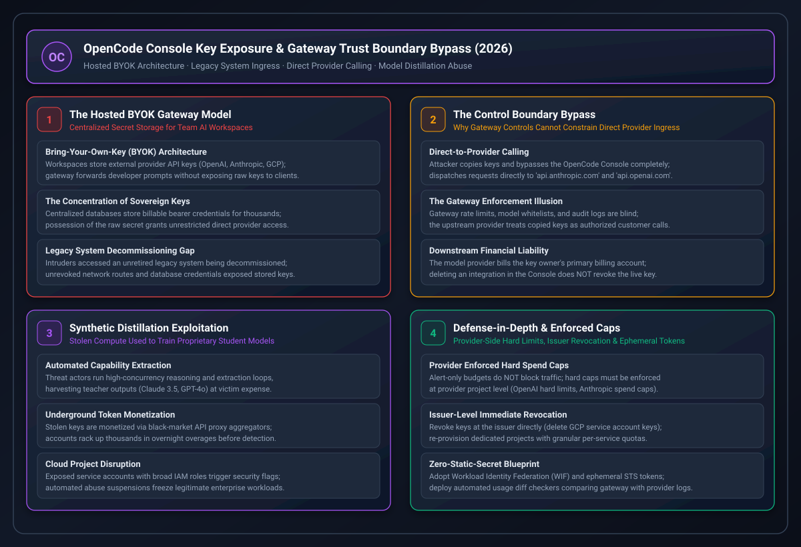
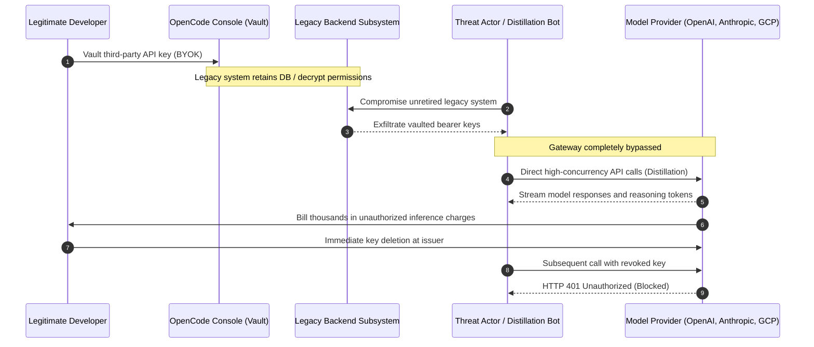

# OpenCode Console: API-Key Exposure, Distillation and the Credential Trust Boundary

**Daily learning · 22 October 2026 · Secondary-source review of the incident; primary documentation for product and provider controls**  
*By Srinivasan Ragothaman ([@rsrini7](https://github.com/rsrini7))*

> **Core idea:** Hosted AI coding assistants and proxy gateways that store users' third-party model credentials (Bring-Your-Own-Key / BYOK) create a high-value concentration of bearer secrets. In October 2026, OpenCode disclosed that attackers gained unauthorized access to an unretired legacy system, potentially exposing external provider keys (OpenAI, Anthropic, Google Vertex AI) saved by 1.4% of Console workspaces. Because API keys are bearer credentials, threat actors bypassed the gateway entirely, querying model APIs directly to extract synthetic distillation datasets and resell compute while passing thousands of dollars in overnight usage bills to victims. Deleting a saved key inside a developer console does not invalidate it at the provider; true containment requires immediate issuer-level revocation and hard provider spend caps. [OpenCode Security Statement](https://x.com/opencode/status/2111519637049319818), [BleepingComputer Incident Analysis](https://www.bleepingcomputer.com/news/security/opencode-hack-exposes-api-keys-amid-ai-distillation-attacks/).

---

## 1. Foundations: why hosted gateways concentrate credential risk

Developer tools and AI coding platforms increasingly adopt **Bring-Your-Own-Key (BYOK)** models. Rather than reselling model access at marked-up subscription tiers, platforms allow development teams to supply their own commercial API credentials.

### How BYOK Gateways Operate
* **Credential Vaulting:** A developer or workspace administrator saves an upstream provider API key (e.g. Anthropic, OpenAI) or cloud service account (e.g. Google Cloud Vertex AI JSON) into the hosted platform's settings.
* **Proxy Routing:** Team members execute coding prompts within IDE extensions or web clients. The client communicates with the platform's hosted **gateway**, which authenticates the user, attaches the vaulted upstream API key, and forwards the prompt to the model provider.
* **The Sovereign Key Dilemma:** The provider bills the credential owner directly based on raw token consumption. Because standard API keys are **bearer credentials**, anyone in possession of the raw cryptographic string can dispatch requests directly to `api.openai.com` or `api.anthropic.com` without routing through the gateway.

| Party / Entity | Role and effect in this incident |
|---|---|
| **OpenCode** | AI coding assistant platform; operates an optional hosted **Console** where teams store provider API keys; disclosed unauthorized access to a decommissioned legacy system exposing ~1.4% of Console workspaces. |
| **Model Providers (OpenAI, Anthropic, Google)** | Upstream AI infrastructure vendors; billed credential owners directly for high-velocity API usage dispatched with stolen keys; collaborated on key invalidation and abuse mitigation. |
| **Threat Actors** | Exploited legacy system access to harvest vaulted provider keys; bypassed the OpenCode Console to query models directly for synthetic training data distillation and token resale. |
| **Affected Workspace Owners** | Developers and enterprises whose external keys were compromised; suffered unexpected billing spikes (overnight bills exceeding $1,700) and temporary Google Cloud project suspensions. |

| Term | Meaning in this incident |
|---|---|
| **BYOK (Bring Your Own Key)** | An architectural pattern where customers store their private model credentials in a third-party tool to centralize team access. |
| **Bearer Credential** | An authentication secret (e.g. `sk-...`) whose mere presentation grants full access to associated services without client verification. |
| **AI Model Distillation** | A machine-learning training technique where a smaller "student" model is trained on outputs generated by a larger, expensive "teacher" model. |
| **Legacy Decommissioning Gap** | The security risk where partially retired systems retain network routes, database access, or decrypt permissions to live operational secrets. |
| **Provider Hard Limit** | An upstream billing control that programmatically terminates API calls (`HTTP 429`) once a dollar cap is reached, distinct from soft email alerts. |

---

## 2. Deep Technical Mechanism: The Gateway Control Boundary Bypass

The fundamental security lesson of the OpenCode Console breach is **control placement**. A gateway can enforce rate limits, model whitelists, and access logging *only on requests that pass through it*. Once an attacker extracts a raw bearer key, the gateway ceases to be a boundary.

### Step 1: Ingress via Decommissioned Legacy Infrastructure
According to customer notices and company disclosures, the intrusion originated in an internal legacy system that was undergoing decommissioning:
* The system was slated for retirement but remained network-accessible and retained credentials or decryption keys capable of reading third-party provider secrets stored in workspace configurations.
* Systems "being decommissioned" remain fully within the corporate trust boundary until all database grants, IAM permissions, network routes, and decryption keys are definitively revoked.

### Step 2: The Direct-to-Provider Exfiltration Path
Once attackers harvested the stored API keys and Google Cloud service account JSON files, they did not route subsequent traffic through OpenCode's infrastructure:
* The attacker crafted automated HTTP clients pointing directly at upstream provider endpoints:
  - `POST https://api.anthropic.com/v1/messages`
  - `POST https://api.openai.com/v1/chat/completions`
  - `POST https://us-central1-aiplatform.googleapis.com/...`
* **The Enforcement Illusion:** Any security controls configured within OpenCode Console—such as per-user token quotas, workspace member limits, or allowed model lists—were completely bypassed.
* **Downstream Financial Billing:** The upstream providers received valid bearer credentials matching legitimate customer accounts, authorizing the requests and charging the victims' credit cards.

```
+--------------------------------------------------------------------------+
| Gateway Trust Boundary Bypass Architecture                               |
|                                                                          |
| 1. Legitimate Workspace Flow:                                            |
|    Developer IDE -> [ OpenCode Gateway ] -> [ Model Provider API ]       |
|                     - Vaults API Key        - Processes Inference        |
|                     - Applies Quotas        - Bills Customer Account     |
|                                                                          |
| 2. Compromise & Exfiltration:                                             |
|    Attacker -> Compromised Legacy System -> Steals Raw Bearer Keys       |
|                                                                          |
| 3. Direct Attack Flow (Gateway Completely Bypassed):                     |
|    Attacker Tool -> Direct API Requests -> [ Model Provider API ]        |
|    (No Gateway Ingress)                     - Validates Bearer Key       |
|                                             - Executes Distillation      |
|                                             - Bills Victim ($1,700+)     |
+--------------------------------------------------------------------------+
```

### Step 3: Model Distillation Abuse and Underground Resale
OpenCode characterized the unauthorized usage as part of a large-scale **AI distillation attack**:
* **High-Throughput Synthetic Generation:** Frontier reasoning models (such as Claude 3.5 Sonnet and GPT-4o) generate high-quality step-by-step reasoning outputs. Attackers use automated script loops to submit thousands of complex prompts per minute, harvesting the synthetic outputs to fine-tune open-weight student models.
* **Externalizing Compute Costs:** Distilling a capable coding or reasoning model requires tens of millions of generated tokens. By distributing queries across stolen developer keys, attackers acquire massive proprietary datasets while forcing the victimized accounts to absorb thousands of dollars in cloud inference costs.
* **Underground Proxy Resale:** Stolen keys with active tier limits and high concurrency quotas are also aggregated into black-market "reverse proxy" services, where unauthorized users buy cheap access to frontier models.

### Step 4: The Elevated Risk of Service Account JSON
While standard OpenAI and Anthropic API keys only grant access to language models, **Google Cloud Service Account JSON** keys pose severe infrastructure risks:
* Developers frequently assign overly broad IAM roles (such as `roles/editor` or `roles/aiplatform.user`) to service accounts uploaded to BYOK platforms.
* An attacker with service-account JSON can escalate privileges within Google Cloud, exfiltrating cloud storage buckets, querying database snapshots, or creating compute instances.

---

## 3. Architectural Visuals (SVGs & Mermaid)

The following architectural diagram illustrates the BYOK gateway pattern, the legacy system decommissioning gap, the direct provider calling bypass, and provider spend cap defenses:



*Figure 1: High-level architectural breakdown of the OpenCode Console BYOK model, the legacy system exposure gap, direct-to-provider API bypass, and provider spend-limit enclaves.*

### End-to-End Attack and Remediation Lifecycle



---

## 4. Production Implementations & Code Recipes

Securing AI developer platforms and detecting credential leaks requires automated usage reconciliation, rapid multi-provider key revocation, and moving away from static bearer keys.

### Recipe 1: Gateway-to-Provider Usage Diff Anomaly Detector (Python)

Because direct-to-provider key abuse bypasses gateway logs, this script fetches live usage metrics from the model provider's billing API and compares them against internal gateway request counters to detect out-of-band key usage:

```python
#!/usr/bin/env python3
"""
usage_diff_detector.py - Compares internal gateway request logs against
upstream provider billing API telemetry to detect out-of-band key abuse.
"""

import datetime
import requests
import sys

def check_openai_usage_anomaly(admin_api_key: str, gateway_recorded_tokens: int, threshold_pct: float = 15.0):
    """
    Fetches official usage telemetry from OpenAI and detects out-of-band drift.
    """
    now = datetime.datetime.now(datetime.timezone.utc)
    date_str = now.strftime("%Y-%m-%d")

    headers = {
        "Authorization": f"Bearer {admin_api_key}",
        "Content-Type": "application/json"
    }

    # Query official OpenAI Usage API for current date
    url = f"https://api.openai.com/v1/usage?date={date_str}"
    response = requests.get(url, headers=headers, timeout=15)
    
    if response.status_code != 200:
        raise ConnectionError(f"Failed to query provider API: {response.text}")

    data = response.json()
    total_provider_tokens = sum(item.get("n_context_tokens", 0) + item.get("n_generated_tokens", 0) for item in data.get("data", []))

    diff_tokens = total_provider_tokens - gateway_recorded_tokens
    
    print(f"[*] Audit Date               : {date_str}")
    print(f"[*] Provider Reported Tokens : {total_provider_tokens:,}")
    print(f"[*] Gateway Recorded Tokens  : {gateway_recorded_tokens:,}")
    print(f"[*] Discrepancy (Out-of-band): {diff_tokens:,}")

    if total_provider_tokens > 0:
        drift_pct = (diff_tokens / total_provider_tokens) * 100.0
        if drift_pct > threshold_pct:
            print(f"\033[0;31m[!] CRITICAL ALERT: Out-of-band usage detected! ({drift_pct:.2f}% drift)\033[0m")
            print("    The API key is being actively used outside the official gateway!")
            return True

    print("\033[0;32m[+] SUCCESS: Usage is aligned within expected variance.\033[0m")
    return False

if __name__ == "__main__":
    # Example usage: Replace with actual admin token and internal token tally
    if len(sys.argv) < 3:
        print("Usage: python3 usage_diff_detector.py <OPENAI_ADMIN_KEY> <INTERNAL_TOKEN_COUNT>")
        sys.exit(1)
    
    check_openai_usage_anomaly(sys.argv[1], int(sys.argv[2]))
```

### Recipe 2: Emergency Multi-Provider Key Invalidation & IAM Deletion (Bash)

If a developer platform credential exposure is suspected, execute immediate issuer-level revocation rather than modifying gateway settings:

```bash
#!/usr/bin/env bash
# emergency_key_revocation.sh - Immediate multi-provider credential revocation

set -euo pipefail

echo "=================================================="
echo " Emergency Model Provider Credential Revocation"
echo "=================================================="

# 1. Google Cloud Service Account Key Deletion
# Deleting in the tool leaves the GCP key active! Delete key directly in IAM:
SA_EMAIL="opencode-integration@my-company-gcp.iam.gserviceaccount.com"
KEY_ID="a1b2c3d4e5f6g7h8"

if command -v gcloud &>/dev/null; then
    echo "[*] Revoking Google Cloud Service Account Key..."
    gcloud iam service-accounts keys delete "${KEY_ID}" \
        --iam-account="${SA_EMAIL}" \
        --quiet || true
    echo "[+] GCP Service Account Key invalidated."
fi

# 2. OpenAI API Key Revocation
# Use OpenAI Admin Key to delete the compromised project API key
OPENAI_ADMIN_KEY="sk-admin-..."
KEY_TO_DELETE_ID="key_abc123"

echo "[*] Revoking OpenAI API Key via REST API..."
curl -s -X DELETE "https://api.openai.com/v1/organization/projects/proj_default/api_keys/${KEY_TO_DELETE_ID}" \
    -H "Authorization: Bearer ${OPENAI_ADMIN_KEY}" \
    -H "Content-Type: application/json" || true
echo "[+] OpenAI Key deletion command dispatched."

# 3. Check for Active Anthropic Workspace Keys
echo "[*] ACTION REQUIRED: Log in to https://console.anthropic.com/settings/keys"
echo "    Delete all active keys generated prior to the incident timestamp."
```

---

## 5. Impact, Real-World Edge Cases & Gotchas

The OpenCode Console incident illuminated critical misunderstandings regarding the boundaries of third-party SaaS integrations.

### Common Claims vs. Technical Realities

| Claim or misconception | Technical reality established as of 22 October 2026 |
|---|---|
| **"The local OpenCode CLI was compromised with malware."** | **Refuted by disclosure.** The incident occurred strictly within the optional hosted Console web platform. Local OpenCode CLI installations storing credentials locally in user dotfiles were unaffected. [Raad Scope Clarification](https://x.com/thdxr/status/2111572618340188393). |
| **"Deleting the integration in the Console stops the attacker."** | **Dangerous fallacy.** Deleting a saved key in a developer platform only deletes that platform's local database record. The raw key string remains completely valid at the provider until deleted in the provider's IAM console. |
| **"Our budget alert will stop billing spikes automatically."** | **False.** Standard billing alerts (e.g. AWS budget alarms or Google Cloud budget emails) merely send notifications; they do not drop HTTP connections. Only explicit **hard spend limits** terminate requests (`429 insufficient_quota`). |
| **"Model distillation requires state-sponsored resources."** | **Misconception.** Any script utilizing basic Python concurrency (`asyncio`/`aiohttp`) can consume thousands of tokens per second across multiple API keys, generating training corpora in hours. |
| **"A 4-hour code review protects against stolen keys."** | **Irrelevant.** Reviewing application code does not stop an external actor calling the model provider directly with a stolen bearer credential. The control must be executed at the identity issuer. |

### Real-World Architectural Gotchas
1. **The Legacy Decommissioning Trap:** Organizations frequently shut down old web interfaces while leaving database clusters, read-only replicas, or IAM service accounts active in the background. A system is not decommissioned until its cryptographic access to operational vaults is severed.
2. **Provider Billing Latency:** Cloud billing metrics and usage charts lag real-time traffic by 10 to 60 minutes. An attacker can consume thousands of dollars in high-tier models before an operator sees a single spike on a dashboard.
3. **IAM Privilege Drift in Service Accounts:** Unlike simple API keys that can only generate text, GCP service accounts uploaded for Vertex AI often carry broader permissions across the Google Cloud project, allowing attackers to pivot into BigQuery, Cloud Storage, or Kubernetes clusters.

---

## 6. Practical Adoption Blueprint & Verification Checklist

To eliminate the risks inherent in static credential vaulting, engineering teams should execute the following controls:

### Credential Architecture Security Checklist
- [ ] **Enforce Hard Spend Limits:** Configure enforced hard monthly spend caps in OpenAI, Anthropic, and Google Cloud project settings; verify that limits return `429` errors rather than advisory emails.
- [ ] **Eliminate Long-Lived Service Account Keys:** For Google Cloud Vertex AI, replace static service account JSON keys with **Workload Identity Federation (WIF)** to issue short-lived, ephemeral OIDC tokens.
- [ ] **Segregate Integration Projects:** Never use organization-wide master API keys for third-party developer tools. Create dedicated, isolated sub-projects with restricted budgets.
- [ ] **Automate Decommissioning Audits:** Ensure the decommissioning checklist includes: disabling DNS routes, deleting IAM credentials, rotating encryption keys, and revoking database service roles.
- [ ] **Implement Usage Diff Reconciliations:** Run scheduled scripts comparing proxy gateway token logs with provider billing API logs to identify unauthorized out-of-band traffic.

### Exact Diagnostic Commands

```bash
# 1. Audit active Google Cloud Service Account keys to detect unrotated credentials
gcloud iam service-accounts keys list --iam-account=my-service-account@project.iam.gserviceaccount.com

# 2. Check current OpenAI project API keys via curl
curl -s -X GET https://api.openai.com/v1/organization/projects \
  -H "Authorization: Bearer $OPENAI_ADMIN_KEY" | jq .

# 3. Search local code repositories for hardcoded bearer keys before upload
rg -n 'sk-ant-[a-zA-Z0-9_-]{90,}|sk-[a-zA-Z0-9]{48}' /path/to/src/
```

---

## 7. Timeline and Current State

All recorded timestamps are in **October 2026**.

| Date & Time (UTC) | Event and technical evidence |
|---|---|
| **16 Oct, Night** | Unauthorized threat actors gain access to a decommissioned legacy OpenCode backend system containing vaulted third-party API keys. |
| **17 Oct, 00:30** | Earliest stated potential credential exposure timestamp documented in customer notification emails (06:00 IST). |
| **17 Oct, ~14:00** | OpenCode publicly discloses the breach affecting 1.4% of Console users with linked external providers; begins emailing affected account holders. |
| **17 Oct, ~16:00** | Anthropic security team confirms active collaboration with OpenCode; revokes known affected Claude API keys and recommends generating replacements. |
| **17–18 Oct** | Affected users report unexpected overnight billing surges exceeding $1,700 on OpenAI and Anthropic accounts, as well as automatic GCP project policy suspensions. |
| **18 Oct** | Co-founder Dax Raad reports sustained automated traffic against Console endpoints and outlines user reimbursement procedures. |
| **22 Oct** | Upstream model providers enhance automated distillation anomaly detection filters; enterprise teams complete credential rotations. |

---

## 8. Primary Sources & References

1. [OpenCode Official Incident Statement](https://x.com/opencode/status/2111519637049319818) — Official disclosure confirming the legacy system breach and 1.4% Console user impact.
2. [BleepingComputer: OpenCode Hack Exposes API Keys Amid AI Distillation Attacks](https://www.bleepingcomputer.com/news/security/opencode-hack-exposes-api-keys-amid-ai-distillation-attacks/) — Independent reporting detailing unauthorized provider usage and overnight billing spikes.
3. [OpenCode Console Provider Documentation](https://opencode.ai/v2/docs/console/providers) — Architectural overview of the BYOK gateway and external model routing.
4. [Anthropic Research: Detecting and Preventing Distillation Attacks](https://www.anthropic.com/news/detecting-and-preventing-distillation-attacks) — Technical analysis of capability extraction tactics and behavioral classification defenses.
5. [OWASP Secrets Management Cheat Sheet](https://cheatsheetseries.owasp.org/cheatsheets/Secrets_Management_Cheat_Sheet.html) — Comprehensive standard reference for bearer token revocation and secret lifecycle boundaries.
6. [OpenAI API Documentation: Enforcing Spend Limits](https://developers.openai.com/api/docs/guides/spend-limits) — Standard implementation guide for hard project quotas and programmatic usage controls.

---

**Related:**
- [Grok Build Passive DNS Exposure](Grok-Build-Passive-DNS-Data-Exposure-Nov-2026.md) — How shadow AI app builders leave internal corporate data and API keys unauthenticated on public subdomains.
- [Anthropic API Restrictions](../../AI-ML/LLMs/models/anthropic/Anthropic-API-Restrictions.md) — Distinguish the earlier subscription-access dispute from this hosted credential incident.
- [OpenClaw Security Analysis](../../AI-ML/Agents/openclaw/OpenClaw-Moltbot-Security-Analysis-2026.md) — Compare agent permissions, exposed secrets and isolation boundaries.
- [Railway, Zeabur and the Hunt for AI Provider Keys](AI-Key-Theft-Railway-Zeabur-Oct-2026.md) — Compare this period's platform breaches targeting inference credentials.
- [PHP2Shell: History, UAF and ASLR](PHP2Shell-History-UAF-And-ASLR-Oct-2026.md) — Contrast only: separate a vulnerability primitive from the conditions needed for practical exploitation.
