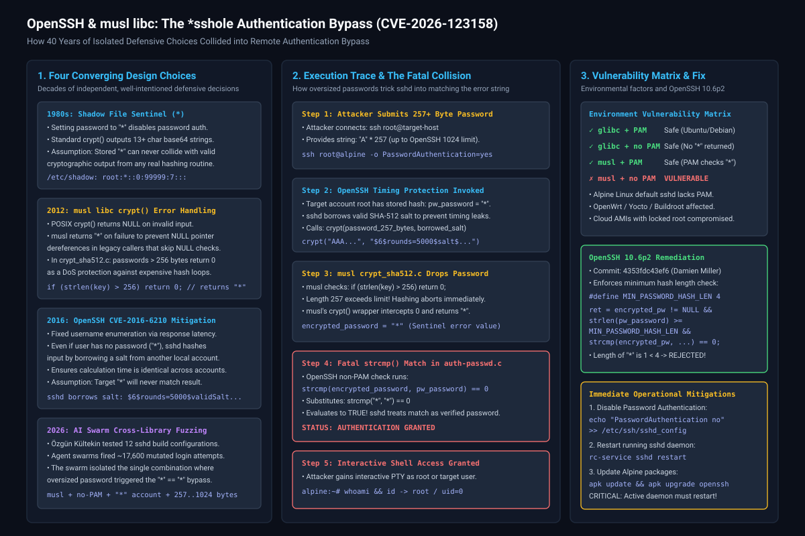
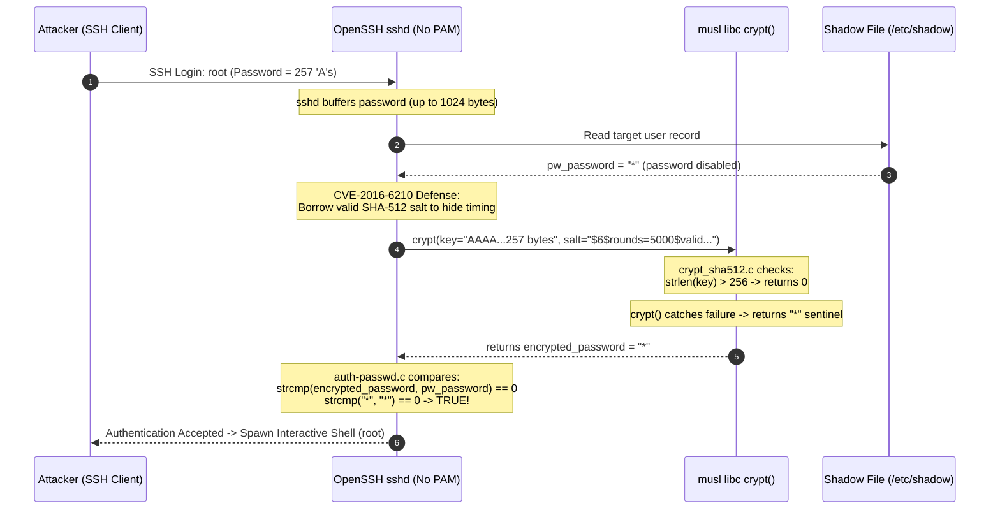
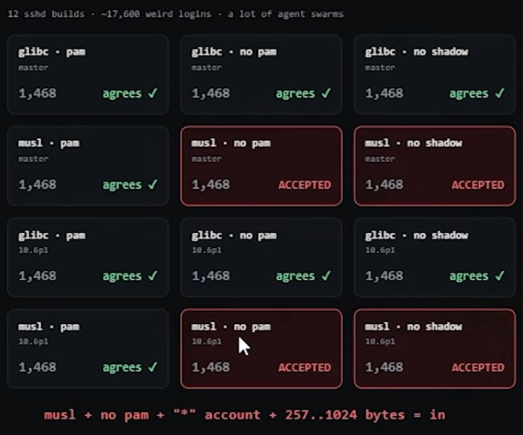

# OpenSSH and musl libc: The *sshole Logic Flaw and Authentication Bypass (CVE-2026-123158)

**Daily learning · 06 November 2026 · Technical deep dive cross-checked against vendor advisories and primary sources**

> **Core idea:** An attacker supplying an oversized password (between 257 and 1,024 bytes) to an OpenSSH server running on `musl libc` without PAM can bypass authentication entirely against accounts configured with no password (`*` in `/etc/shadow`). The flaw is not a memory corruption bug, but a multi-decade logic collision where an error-sentinel return value from `musl`'s `crypt()` matched a 40-year-old shadow file account-disabling convention.

---

## 1. Foundations: why OpenSSH, musl, and shadow files collided

To understand how entering 257 characters unlocks a secure server, one must examine three independent software components that each made logical design choices over four decades:

1. **OpenSSH (`sshd`):** The standard Unix suite for encrypted remote access and administration. When compiling and running on traditional Linux systems, OpenSSH typically relies on Pluggable Authentication Modules (PAM) or standard C library routines to verify submitted passwords against password hashes stored in `/etc/shadow`.
2. **The C Standard Library (`libc`):** The runtime layer between the operating system kernel and application programs. While mainstream enterprise distributions (Ubuntu, Debian, Red Hat) use the GNU C Library (**`glibc`**), lightweight distributions, embedded systems, and minimal containers (such as **Alpine Linux**, OpenWrt, Buildroot, and Yocto) use **`musl libc`** to minimize binary footprint and resource consumption.
3. **The Shadow Password System (`/etc/shadow`):** Introduced in Unix in the 1980s to remove password hashes from world-readable `/etc/passwd`. Accounts reserved for SSH public-key authentication or system tasks without password access traditionally store an asterisk (`*`) or exclamation mark (`!`) in their password hash field.

| Party or Component | Standard Role in Authentication | Behavior in This Vulnerability |
|---|---|---|
| **OpenSSH (`sshd`)** | Manages encrypted tunnels and verifies login credentials. | In non-PAM builds, compares `crypt(user_input, salt)` directly with `/etc/shadow` using `strcmp()`. Implemented timing defenses (CVE-2016-6210) that borrow valid salts for disabled accounts. |
| **musl libc** | Lightweight C library providing standard POSIX functions including `crypt()`. | Truncates SHA-512 input at 256 bytes and returns an in-band error string (`"*"`) rather than a `NULL` pointer on failure to prevent calling applications from crashing. |
| **GNU C Library (`glibc`)** | Default C library on Ubuntu/Debian/Fedora/RHEL. | Handles passwords of arbitrary length without failing at 256 bytes, or returns failure codes that do not match shadow sentinels; immune to this bypass. |
| **Pluggable Authentication Modules (PAM)** | Modular subsystem separating authentication policy from application logic. | Explicitly validates shadow account flags and rejects accounts marked with `*` before string matching; immune to this bypass. |
| **Alpine Linux** | Minimal Linux distribution built on `musl libc` and BusyBox. | Packages `openssh-server` compiled **without PAM support** by default (`UsePAM no`), creating the exact intersection required for exploitation. |

### Essential terminology

| Term | Meaning in Unix Security |
|---|---|
| **Contract Drift** | When two independent software systems interact based on outdated or implicit assumptions about each other's return values and error states. |
| **In-Band Error Sentinel** | Returning an error indicator within the normal data type (e.g. returning the string `"*"` instead of an out-of-band indicator like `NULL` or error code `-1`). |
| **Salt Borrowing** | An OpenSSH defense against username enumeration (CVE-2016-6210) where `sshd` hashes incoming passwords against a dummy or neighbor salt even if the target account has no password. |
| **PAM (`UsePAM`)** | Pluggable Authentication Modules. When enabled, authentication delegates to `/etc/pam.d/sshd` rather than internal `sshd` string comparisons. |
| **Skeleton Key** | An arbitrary credential that unlocks access to multiple accounts without knowledge of actual secrets. |

---

## 2. Mechanism: the four-decade contract collision

The vulnerability (tracked as **CVE-2026-123158** and named `*sshole`) was discovered by security researcher **Özgün Kültekin** ([@kultekin](https://x.com/kultekin)) at **Wakefield** and published at [sshhole.com](https://sshhole.com/). It stems from four independent, well-intentioned defensive decisions that aligned over 40 years:

```
[1980s Shadow Standard]     --> Uses "*" to designate accounts with no password
[2012 musl libc crypt()]    --> Returns "*" on failure (caps SHA-512 input at 256 bytes)
[2016 OpenSSH CVE-2016-6210] --> Borrows valid salts to hash inputs for "*" accounts
                                          │
                                          ▼
                      Attacker sends password >= 257 bytes
                                          │
                                          ▼
                      musl crypt() fails and returns "*"
                                          │
                                          ▼
                   sshd evaluates: strcmp("*", "*") == 0
                                          │
                                          ▼
                             [AUTHENTICATION BYPASS]
```



### The four converging milestones

1. **The 1980s Sentinel Convention:** In standard Unix `/etc/shadow`, an asterisk (`*`) placed in the password field indicates that password logins are disabled or that the account only permits public key authentication. Historically, the standard Unix DES `crypt` output was always 13 base64 characters. Because `*` is not in the base64 character set used by `crypt` and is only 1 character long, matching `*` by typing a password was mathematically impossible.
2. **2012: musl libc switches error return to `"*"`:** In 2012, `musl libc` maintainers observed that many third-party C programs failed to check for `NULL` returns from `crypt()`, causing segmentation faults when running `strcmp(crypt(pass, salt), hash)`. To make `crypt()` safer against null pointer dereferences, `musl` modified its error return: rather than returning `NULL` on invalid algorithms or failures, it returned a pointer to a static string containing `*`. Simultaneously, in `crypt_sha512.c`, `musl` enforced a strict limit:
   ```c
   /* musl libc: crypt_sha512.c */
   if (strlen(key) > 256)
       return 0; /* triggers musl's crypt() wrapper to return "*" */
   ```
   This 256-byte limit was implemented as a Denial-of-Service (DoS) mitigation to prevent attackers from consuming excessive CPU time by submitting multi-megabyte strings to expensive hash functions.
3. **2016: OpenSSH timing attack defense (CVE-2016-6210):** In 2016, researchers discovered that attackers could enumerate valid usernames by measuring `sshd` response times: non-existent accounts or accounts with `*` returned failure instantly, whereas accounts with valid SHA-512 hashes took several milliseconds of CPU time to hash. To equalize latency, OpenSSH introduced salt borrowing: when a user attempts to log into an account that has no valid password hash (such as `*`), `sshd` finds a valid hash from another account on the system (or generates a dummy hash) and executes `crypt()` anyway.
4. **2026: AI agent swarms uncover the intersection:** In late 2026, researcher Özgün Kültekin set up an automated testing harness compiling 12 distinct `sshd` build permutations across C libraries, PAM configurations, and shadow storage. Fuzzing the builds with ~17,600 mutated login payloads, the agent swarm isolated the single combination where an oversized password bypassed authentication.

### Detailed execution walkthrough

Consider an attacker attempting to log into `root` on an Alpine Linux server where `root` is locked or key-only (`root:*::0:99999:7:::`):



1. **Password submission:** The attacker initiates an SSH password login for `root` (or any account with `*` in `/etc/shadow`) and provides a password string between 257 and 1,024 bytes (OpenSSH's internal buffer limit in `read_passphrase()`).
2. **Timing equalization:** OpenSSH reads the user record. Seeing that `root` has `*` as its password hash, OpenSSH activates its CVE-2016-6210 countermeasure. It borrows a valid `$6$` (SHA-512) salt from another account on the system.
3. **Length ceiling violation:** OpenSSH passes the 257-byte password and the valid `$6$` salt to `crypt()`.
4. **musl aborts hashing:** Musl's `crypt_sha512.c` checks `strlen(key) > 256`. Because 257 > 256, it returns `0`.
5. **Sentinel return:** The musl `crypt()` wrapper catches the error and returns a pointer to `"*"`.
6. **Fatal comparison:** Inside OpenSSH's `auth-passwd.c` (the non-PAM authentication handler), the code executes:
   ```c
   /* OpenSSH auth-passwd.c (vulnerable logic) */
   ret = strcmp(encrypted_password, pw->pw_passwd) == 0;
   ```
   Substituting the runtime variables:
   ```c
   ret = strcmp("*", "*") == 0; /* Evaluates to TRUE! */
   ```
7. **Access granted:** OpenSSH concludes the user provided the correct password, terminates authentication, and spawns an interactive shell with the privileges of the target account.

---

## 3. The OpenSSH 10.6p2 patch

OpenSSH maintainers, led by Damien Miller, addressed the vulnerability in **OpenSSH 10.6p2** (released 05 November 2026). While maintainers noted that returning `"*"` as an error string violates standard POSIX `crypt()` semantics, OpenSSH added defensive validation directly into `auth-passwd.c`.

### Git commit details
- **Commit:** `4353fdc43ef646c43a8dda7025cc1a898caf1482`
- **Branch:** `master` (backported to `V_10_6` as `90f9c2f7330b3b417b7d6202cd393ef3c226722c`)
- **Author:** Damien Miller (`djm@mindrot.org`)
- **Subject:** `avoid password authn bypass`

```c
/* openbsd-compat/auth-passwd.c */
#define MIN_PASSWORD_HASH_LEN 4
#define MAX_PASSWORD_LEN 1024

    /* ... inside sys_auth_passwd() ... */
    ret = encrypted_password != NULL &&
        strlen(pw_password) >= MIN_PASSWORD_HASH_LEN &&
        strcmp(encrypted_password, pw_password) == 0;
    freezero(pw_password, strlen(pw_password));
    return ret;
```

Because an account placeholder of `"*"` has a length of 1, `strlen(pw_password) >= MIN_PASSWORD_HASH_LEN` evaluates to `1 >= 4` (**FALSE**). The comparison immediately aborts without granting access.

---

## 4. Impact and limits: who is vulnerable?

The vulnerability received widespread attention because Alpine Linux is one of the most widely deployed container base images in cloud and Kubernetes environments. However, successful exploitation requires an exact combination of prerequisites.



### Vulnerability matrix across configurations

| C Library | Authentication Mechanism | Target Shadow Field | Vulnerable? | Technical Reason |
|---|---|---|---|---|
| **musl libc** | **No PAM (`UsePAM no`)** | `*` (Disabled / Key-only) | **YES** | musl returns `*` on passwords > 256 chars; `sshd` matches against stored `*`. |
| **musl libc** | **No PAM (`UsePAM no`)** | Valid Hash (`$6$...`) | **NO** | `crypt()` returns `*`, but `strcmp("*", "$6$...")` evaluates to false. |
| **musl libc** | **PAM (`UsePAM yes`)** | `*` (Disabled / Key-only) | **NO** | PAM module (`pam_unix`) explicitly checks account validity and rejects `*`. |
| **glibc** | **No PAM (`UsePAM no`)** | `*` (Disabled / Key-only) | **NO** | glibc's SHA-512 `crypt` does not cap input at 256 bytes and does not return `*`. |
| **glibc** | **PAM (`UsePAM yes`)** | `*` (Disabled / Key-only) | **NO** | Protected by both glibc behavior and PAM validation layers. |

### Prerequisites for exploitation

All five of the following conditions must be met simultaneously:

1. **musl libc execution environment:** The SSH daemon must be dynamically or statically linked against `musl libc` (standard in Alpine Linux, OpenWrt, Buildroot, and Yocto).
2. **OpenSSH built or running without PAM:** The daemon must execute internal password authentication (`auth-passwd.c`) rather than delegating to PAM. Alpine Linux's default `openssh-server` package compiles without PAM support.
3. **Password authentication enabled:** `/etc/ssh/sshd_config` must allow password authentication (`PasswordAuthentication yes`, which is frequently enabled or left at upstream default).
4. **Target account has `*` in shadow:** The target account must exist on the system and have an asterisk as its password field in `/etc/shadow` (typical for `root` on cloud instances or service accounts intended solely for SSH keys).
5. **System contains a valid SHA-256 or SHA-512 salt:** OpenSSH requires at least one account on the system with a valid `$5$` or `$6$` hash to borrow a salt for its CVE-2016-6210 timing protection. If the system has only empty accounts or DES salts, the SHA-512 branch is not triggered.

### The critical shadow field distinction: `*` vs. `!`

A key subtlety highlighted in security discussions concerns how Unix disables or locks accounts:
- **Locked accounts (`!`):** When an administrator locks an account via `passwd -l <user>` or `usermod -L <user>`, Unix utilities prepend an exclamation mark (`!`) to the hash, or write `!*`. When `musl`'s `crypt()` fails on an oversized password and returns `"*"`, OpenSSH evaluates `strcmp("*", "!*") == 0` or `strcmp("*", "!") == 0`, which evaluates to **false**. Therefore, **explicitly locked accounts using `!` are immune**.
- **Passwordless / key-only accounts (`*`):** When an account is created without a password or explicitly configured for public-key authentication only (common in cloud initialization scripts and minimal distribution bootstrap tools), `/etc/shadow` contains a bare `*`. Only bare `*` entries trigger the exact string match `strcmp("*", "*") == 0`.

### The deployment reality: Docker vs. Alpine Cloud VMs vs. Embedded Systems

A common early reaction to the disclosure was skepticism: *"Why would anyone run OpenSSH inside an Alpine container when you have `docker exec`?"* As commentators including ThePrimeagen emphasized, containerized microservices are only a subset of the affected attack surface:

1. **Alpine Cloud VMs and Micro-VMs:** Because Alpine consumes less than 100 MB of RAM, cloud architects increasingly deploy it as a standalone virtual machine on AWS (EC2 AMIs), Azure, GCP, and micro-VM hypervisors (Firecracker, Fly.io, Proxmox LXC). On these systems, OpenSSH is the primary administrative remote ingress.
2. **Embedded Linux, Routers, and IoT:** Embedded distributions like **OpenWrt**, Buildroot, and Yocto power millions of consumer routers, industrial controllers, and network appliances. These environments almost universally link against `musl libc` without PAM to conserve flash storage and RAM.
3. **Remote Developer Containers & CI/CD Runners:** In enterprise environments using remote IDEs (VS Code Remote-SSH, Cursor SSH) or self-hosted CI/CD runners, developers routinely inject `openssh-server` into Alpine containers to facilitate automated SSH tunnels and debugging sessions.

### Cloud environment exposure & privilege escalation

On default cloud images (such as Alpine Linux EC2 AMIs or cloud-init instances):
- Cloud initialization often configures a default unprivileged user (e.g. `alpine`) or disables `root` password access by writing `*` into `/etc/shadow`.
- If administrative tools like `doas` or `sudo` are configured with `NOPASSWD` (standard in cloud bootstrap scripts to allow initial setup via SSH keys), an attacker exploiting `*sshole` against the `alpine` user can immediately run:
  ```bash
  doas su -
  ```
  This achieves immediate, unauthenticated remote root takeover.

### Common misconceptions vs. demonstrated facts

| Misconception | Demonstrated Reality |
|---|---|
| *"This is a buffer overflow or RCE memory corruption."* | **No.** It is a pure logic bug caused by contract mismatch between return sentinels and shadow conventions. |
| *"Ubuntu, Debian, and CentOS servers are vulnerable."* | **No.** Enterprise distributions run `glibc` and use PAM by default; neither trigger the `*` collision. |
| *"Disabling root login (`PermitRootLogin no`) stops the attack."* | **Partial.** It protects `root`, but any other non-root account configured for SSH key-only access (`*`) remains vulnerable unless password auth is globally disabled. |
| *"SSH keys are broken or leaked."* | **No.** Cryptographic SSH keys and signatures remain completely unaffected; the vulnerability purely abuses the fallback password authentication path. |
| *"Upgrading packages via `apk` is sufficient on running servers."* | **No.** Upgrading replaces the binary on disk, but the listening `sshd` process running in memory remains vulnerable until restarted (`rc-service sshd restart`). |

---

## 5. Timeline and current state

All dates are in **November 2026** unless otherwise indicated.

| Timestamp | Milestone |
|---|---|
| **1980** | Unix System V shadow password conventions introduce `*` to designate locked or passwordless accounts. |
| **2012** | `musl libc` maintainers change `crypt()` failure output from `NULL` to `"*"` to prevent caller segfaults, and introduce a 256-byte limit in `crypt_sha512.c`. |
| **2016** | OpenSSH patches CVE-2016-6210, adding salt borrowing for non-existent and passwordless accounts to prevent timing enumeration attacks. |
| **Late Oct 2026** | Security researcher Özgün Kültekin ([@kultekin](https://x.com/kultekin)) at **Wakefield** deploys automated AI agent swarms testing ~17,600 mutated login payloads across 12 `sshd` build permutations, uncovering the bypass. |
| **05 Nov 2026** | **OpenSSH 10.6p2** is released with commit `4353fdc43ef6` adding `MIN_PASSWORD_HASH_LEN 4`. |
| **05 Nov 2026** | Alpine Linux issues security advisory and publishes backported patches across all supported stable releases (v3.18 through edge). |
| **05 Nov 2026** | Özgün Kültekin launches [sshhole.com](https://sshhole.com/) detailing the vulnerability mechanics, test matrix, and threat model. |
| **05 Nov 2026** | OpenSSH project leadership announces policy change: moving to rapid, out-of-band releases to counter AI agent swarms independently discovering identical vulnerabilities. |

### The AI discovery paradigm shift

The discovery of CVE-2026-123158 marks a documented turning point in vulnerability disclosure dynamics:
- As detailed on [sshhole.com](https://sshhole.com/), researcher Özgün Kültekin ([@kultekin](https://x.com/kultekin)) configured 12 distinct `sshd` builds across compiler and environment configurations (`glibc` vs. `musl`, `PAM` vs. `no-PAM`, shadow storage, across `master` and `10.6p1` releases).
- AI agent swarms fired ~17,600 anomalous login variations against this differential test matrix. The matrix cleanly flagged an anomaly: every standard `glibc` build and every PAM-enabled build agreed on rejection (`agrees ✓`), whereas the `musl` non-PAM builds returned `ACCEPTED`.
- In their 10.6p2 release announcement, OpenSSH developers explicitly addressed the influx of AI-assisted discoveries: because AI agent harnesses allow independent researchers and adversaries to uncover subtle, multi-decade logic bugs in parallel, multi-month disclosure embargoes are no longer viable. OpenSSH has moved toward immediate, accelerated releases.

---

## 6. Practical response, auditing, and remediation

System administrators managing Alpine Linux instances, Docker containers exposing SSH, or embedded devices must immediately verify and patch their deployments.

### Immediate remediation steps

#### 1. Upgrade OpenSSH and restart the daemon
On Alpine Linux systems:
```bash
apk update
apk upgrade openssh
# CRITICAL: Restart the running daemon so the updated binary loads into memory
rc-service sshd restart
```

#### 2. Immediate configuration workaround (no reboot/upgrade required)
If upgrading packages is not immediately possible, disable password authentication globally across all SSH interfaces. Open `/etc/ssh/sshd_config` and set:
```text
PasswordAuthentication no
KbdInteractiveAuthentication no
```
Reload or restart the SSH service:
```bash
rc-service sshd reload || kill -HUP $(pgrep sshd | head -n1)
```

### Verification and audit commands

Administrators can use the following commands to determine whether a server is exposed:

```bash
# 1. Check if the server is running musl libc
ldd /usr/sbin/sshd 2>&1 | grep -i musl

# 2. Check if OpenSSH is running without PAM
sshd -V 2>&1 | grep -i "no-pam" || ! ldd /usr/sbin/sshd | grep -q libpam

# 3. Check if password authentication is enabled in active configuration
sshd -T | grep -i "passwordauthentication"

# 4. Identify accounts with "*" in shadow that could be targeted
awk -F: '$2 == "*" {print $1}' /etc/shadow
```

If commands 1, 2, and 3 confirm `musl`, no PAM, and `passwordauthentication yes`, and command 4 lists user accounts, the system is **actively vulnerable** unless patched to OpenSSH 10.6p2 or later.

---

## 7. Architectural lessons: the peril of in-band sentinels

The `*sshole` vulnerability provides crucial lessons for systems programming and distributed security architecture:

1. **In-Band Sentinels are Toxic Across Boundaries:** Returning an error indicator (`"*"`) within the same data type and domain as valid output violates type safety. A function returning a string should never use a valid string character to signify an exceptional state unless the entire downstream ecosystem is contractually aware of that sentinel.
2. **Defensive Assumptions Erode Over Decades:**
   - The 1980s shadow design assumed: *"A crypt hash will never be a single asterisk."*
   - The 2012 musl design assumed: *"Returning `*` is safe because `*` never matches any real password."*
   - The 2016 OpenSSH design assumed: *"Borrowing a salt to compute a hash against `*` will safely fail every time."*
   Each developer made a reasonable, localized decision to protect against crashes, DoS, or side channels. When combined across decades and library boundaries, their assumptions collapsed into complete authentication bypass.
3. **Defense-in-Depth Requires Architectural Decoupling:** Systems using PAM were completely immune because PAM treats account state (`account locked`) as a first-class boolean flag checked before string comparison occurs. Systems that flattened authentication into a single `strcmp()` function call exposed themselves directly to libc implementation quirks.
4. **Semantic State Fuzzing vs. Crash Fuzzing:** Traditional fuzzers (AFL, libFuzzer, ASan) look for memory faults, panics, and crashes. Because `*sshole` involved zero memory corruption and produced a clean `return 1` / `ACCEPTED` response, crash-oriented fuzzers ran past it for a decade. Only multi-agent swarms evaluating logical state transitions across differential build matrices could detect the anomaly.
5. **Hyrum's Law and Deviating from POSIX Standards:** POSIX specifies that `crypt()` returns `NULL` on failure. `musl` intentionally deviated from the standard in 2012 by returning `"*"` to protect buggy legacy applications from dereferencing null pointers. When a system library attempts to be "helpful" by substituting non-standard in-band values, callers that rely on standard behavior fail catastrophically.

---

## 8. Source context

User-provided details supplied the starting video summaries and commentary:
- [SSH situation is insane](https://www.youtube.com/watch?v=ErB1SRcksDc) (overview of the vulnerability and test-matrix results).
- [ThePrimeagen's commentary on the Alpine Linux OpenSSH vulnerability](https://www.youtube.com/watch?v=B3_Ftfhkzz0).

Material technical claims, commit hashes, and historical milestones were checked against:
- [Primary research disclosures and test matrix by Özgün Kültekin](https://sshhole.com/) at Wakefield.
- [Özgün Kültekin on X (@kultekin)](https://x.com/kultekin).
- [OpenSSH 10.6p2 Release Announcement and Git Tree](https://www.openssh.com/txt/release-10.6p2) (Damien Miller's patch in `auth-passwd.c`).
- [OpenSSH CVE-2016-6210 Timing Attack Mitigation History](https://www.openssh.com/txt/release-7.3).
- [musl libc crypt source tree](https://git.musl-libc.org/cgit/musl/tree/src/crypt/crypt_sha512.c) (256-byte ceiling and sentinel error handling).
- [Alpine Linux Security Advisory for CVE-2026-123158](https://security.alpinelinux.org/).

---

**Related:**
- [Ubuntu Server CVE-2026-98432 Kernel UAF and Patch Lag](Ubuntu-Server-CVE-2026-98432-Kernel-UAF-And-Patch-Lag-Nov-2026.md) — Compare how Linux distribution packaging choices and patch lag affect real-world vulnerability exposure.
- [HTTP Egress Credential Proxies vs MCP Gateways](HTTP-Egress-Credential-Proxies-Vs-MCP-Gateways-Nov-2026.md) — Architectural analysis of security boundaries and credential isolation in modern systems.
- [Local AI and Agent Security Threat Model](Local-AI-And-Agent-Security-Threat-Model-Nov-2026.md) — How AI swarms and agentic systems discover and exploit vulnerabilities across complex software stacks.
- [PHP2Shell: History, UAF and ASLR](PHP2Shell-History-UAF-And-ASLR-Oct-2026.md) — Another multi-decade vulnerability arising from broken state assumptions and contract drift across components.
- [Polymarket: Compromised Monitoring Script](Polymarket-DebugBear-Supply-Chain-Attack-Oct-2026.md) — Examining the collapse of trust boundaries between independent software dependencies.
