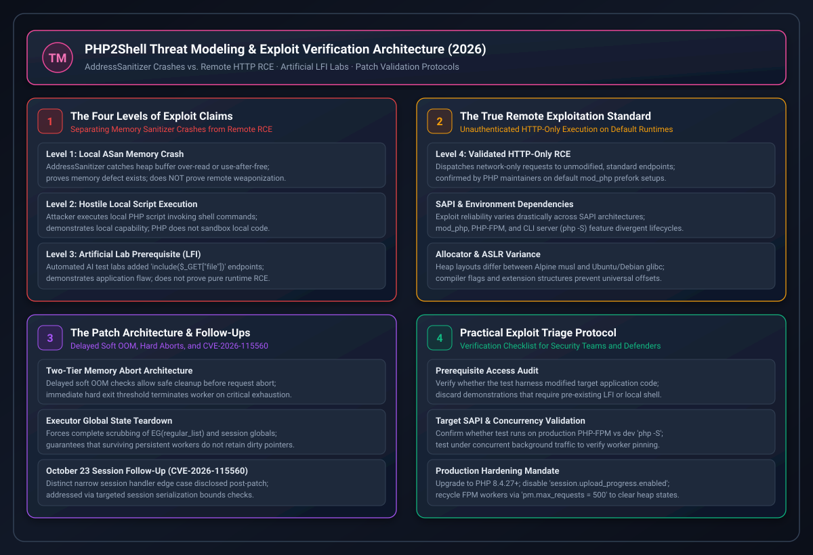
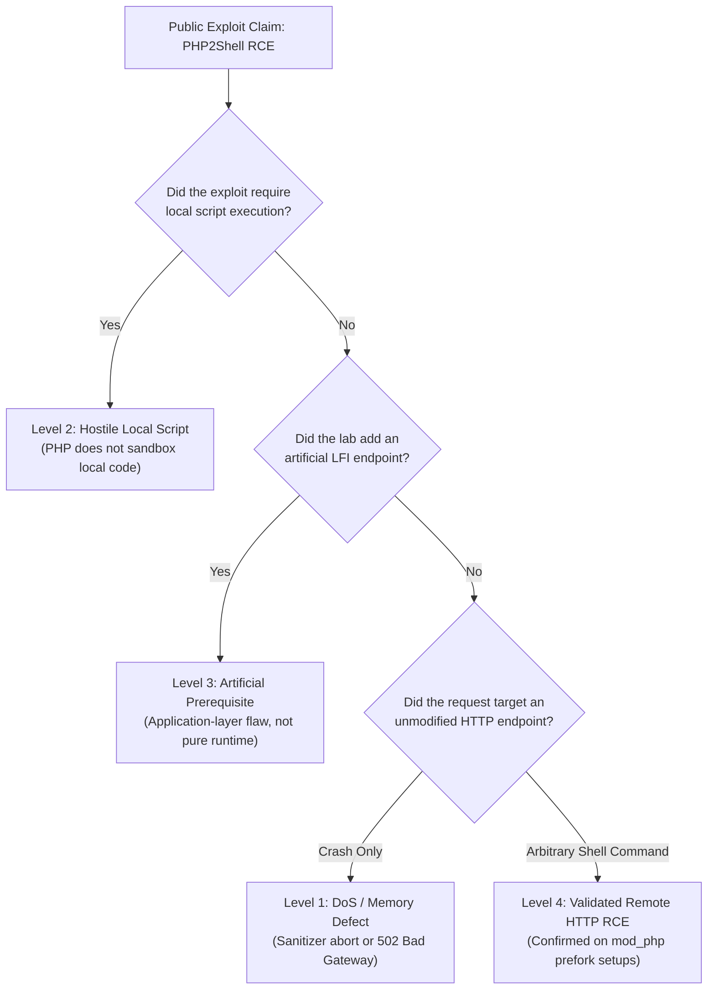

# PHP2Shell Exploit Debate: Threat Models, Patch Verification, and Exploitation Realities

**Daily learning · 23 October 2026 · Updated 27 October 2026 · Primary-source review plus supplied video transcripts**  
*By Srinivasan Ragothaman ([@rsrini7](https://github.com/rsrini7))*

> **Core idea:** Following the disclosure of PHP2Shell (CVE-2026-109618 and CVE-2026-109619), online security discussions diverged between claims that the exploit was "fake and impossible without local file inclusion (LFI)" and assertions that "the security patch completely failed based on local AddressSanitizer crashes." Rigorous vulnerability analysis requires applying strict threat-model boundaries: an AddressSanitizer crash in a local script does not prove remote reachability, while an AI-generated test harness adding an artificial LFI endpoint does not disprove genuine upstream HTTP-only remote code execution confirmed by maintainers on default configurations. [PHP Security Policy](https://github.com/php/php-src/security/policy), [PHP Advisory GHSA-w8hw-w9fx-j79w](https://github.com/php/php-src/security/advisories/GHSA-w8hw-w9fx-j79w), [Elias Taylor Threat Model Review](https://eliastaylor.com/noexploit/).

---

## 1. Foundations: Four Different Results Often Called an "Exploit"

The public discourse surrounding PHP2Shell suffered from imprecise terminology, where four completely distinct levels of technical demonstration were conflated under the single word "exploit":

### The Four Levels of Exploit Claims
1. **Level 1: AddressSanitizer (ASan) Memory Safety Crash:** A researcher compiles PHP with AddressSanitizer, executes a local test harness, and triggers an invalid memory read or use-after-free report. This proves that an underlying memory safety defect exists in the exercised C code path; it does **not** prove remote network reachability, weaponizability, or remote code execution.
2. **Level 2: Hostile Local PHP Script Execution:** An attacker with existing command-line access or file-write privileges executes a malicious `.php` script that invokes system commands. This demonstrates execution within PHP's local runtime environment; it does **not** prove that an unauthenticated remote internet visitor can execute code without prior access, as PHP's security policy explicitly states that PHP is not an operating system sandbox for untrusted scripts.
3. **Level 3: Artificial Application Prerequisite (LFI):** A researcher constructs a test Docker container containing an artificial Local File Inclusion vulnerability (e.g. `include($_GET['file']);`). This demonstrates an application-layer vulnerability chained with a temporary file upload; it does **not** prove that a standard, unmodified PHP application is remotely exploitable.
4. **Level 4: Validated Unauthenticated HTTP-Only RCE:** A remote attacker transmits network-only HTTP requests to an unmodified, standard web application endpoint and achieves arbitrary code execution. This is the true remote exploitation standard.

| Evidence Type | What it technically proves | What it does NOT prove |
|---|---|---|
| **AddressSanitizer (ASan) Report** | The tested C code path contains an out-of-bounds access or UAF. | That the flaw can be reached remotely over HTTP or weaponized into RCE. |
| **Attacker-Written Local Script** | Code execution occurs within that specific script's context. | That a remote internet visitor can execute code without prior shell access. |
| **Lab with Injected LFI Endpoint** | The added application-layer vulnerability can be exploited. | That standard, unmodified PHP applications are exposed to pure runtime RCE. |
| **Unauthenticated HTTP Test** | Remote execution is functional on that specific build and SAPI. | That the exploit is portable across every compiler build, libc, and configuration. |

| Term | Meaning in this incident |
|---|---|
| **Threat Model** | The formal specification of an attacker's starting access, capabilities, and required prerequisites. |
| **LFI (Local File Inclusion)** | An application vulnerability where user input dynamically controls which local file is executed by PHP. |
| **PHP SAPI** | Server Application Programming Interface (e.g. `mod_php`, PHP-FPM, `php -S`). |
| **AddressSanitizer (ASan)** | Compiler instrumentation (LLVM/GCC) that detects memory errors at runtime, often causing intentional aborts. |
| **Delayed Soft OOM** | An engine patch mechanism that postpones memory-limit termination until execution reaches a safe state. |

---

## 2. Deep Technical Mechanism: Debates, Artificial Labs & True RCE

Between 21 and 27 October 2026, the security community engaged in a public technical debate regarding the true reachability of PHP2Shell.

### The "Patch Failed on 8.5.12" Debate (Low Level vs. LiveOverflow)
Shortly after the initial patches were committed, commentators noted that running specific scripts on development builds (such as PHP 8.5.12-dev) still produced AddressSanitizer crashes:
* **The Claim:** Commentators claimed that because ASan reported memory safety aborts on patched versions, the PHP2Shell patch was completely ineffective.
* **The Technical Reality:** As demonstrated by security researcher LiveOverflow, running a local PHP script that directly inspects process memory (`/proc/self/maps`) or invokes reentrant deserializers exercises distinct internal code paths. A memory error in a local CLI script does not prove an unauthenticated HTTP-reachable bypass of the upstream patch.
* **The Sandbox Principle:** PHP's official security policy explicitly states: *"PHP does not attempt to provide a secure sandbox for untrusted PHP code."* Directives like `disable_functions` are hardening flags, not absolute isolation boundaries. If an attacker can already run arbitrary PHP scripts on a host, the security boundary has already been breached.

```
+--------------------------------------------------------------------------+
| Threat Model Classification Filter                                       |
|                                                                          |
| Claim: "Working PHP2Shell Remote Code Execution"                         |
|                                                                          |
| 1. Did the test require running a local .php script or CLI shell?        |
|    [YES] ==> Level 2: Local Script Execution (Not a remote exploit)      |
|    [NO]  ==> Continue to Step 2                                          |
|                                                                          |
| 2. Did the test container add custom endpoints (e.g. LFI include)?       |
|    [YES] ==> Level 3: Artificial Prerequisite Chain (Application Bug)    |
|    [NO]  ==> Continue to Step 3                                          |
|                                                                          |
| 3. What was demonstrated on the unmodified remote target?                |
|    - Process Crash / 502 Bad Gateway ==> Level 1: DoS / Memory Bug       |
|    - Heap Data / Pointer Reflection ==> Information Disclosure           |
|    - Arbitrary Command Execution    ==> Level 4: Pure Remote HTTP RCE    |
+--------------------------------------------------------------------------+
```

### The "All PoCs are Fake / LFI Required" Debate (Elias Taylor Critique)
Conversely, security researcher Elias Taylor argued that public PHP2Shell exploits were unviable against standard servers:
* **The Artificial LFI Flaw:** Early automated AI coding agents attempted to build demonstration labs for PHP2Shell. In doing so, these automated tools frequently inserted vulnerable application code (such as `include($_GET['page']);`) into the web root to make exploitation work. Taylor correctly identified that these labs were demonstrating standard LFI exploitation rather than a pure PHP2Shell runtime bug.
* **The Overgeneralization Fallacy:** However, concluding from flawed AI labs that *no* pure HTTP exploit is possible was an overgeneralization. Upstream PHP maintainers explicitly validated pure HTTP-only RCE against Apache `mod_php` configurations with default memory limits and standard multiworker prefork processes (documented in GitHub Advisory GHSA-w8hw-w9fx-j79w).

### Upstream Patch Architecture: Two-Tier Memory Abort & Global Teardown
The upstream security release addressed the vulnerabilities through architectural changes to the Zend memory allocator (`zend_alloc`) and execution lifecycles:
1. **Delayed Soft OOM Handling:** When `memory_limit` is exceeded during upload progress tracking or request initialization, the engine delays request termination until the current parsing routine reaches a clean, synchronized state. This prevents leaving uninitialized pointers in global lists.
2. **Immediate Hard Exit Threshold:** If memory consumption exceeds a critical ceiling beyond the soft limit, the engine immediately calls `exit()` or `abort()`, terminating the worker process entirely rather than returning it to the worker pool in a corrupted state.
3. **Global State Sanitization:** The request shutdown sequence was patched to guarantee that `EG(regular_list)` and session tracking pointers are explicitly scrubbed, preventing surviving persistent workers from retaining dangling references.

### The October 23 Follow-Up: CVE-2026-115560
On 23 October, PHP maintainers released a narrow follow-up advisory (CVE-2026-115560) addressing an edge case where custom session save handlers could experience memory corruption during deserialization. This was a distinct, secondary defect rather than a failure of the primary OOM patch.

---

## 3. Architectural Visuals (SVGs & Mermaid)

The following architectural diagram illustrates the four levels of exploit claims, the SAPI lifecycle dependencies, and the two-tier patch architecture:



*Figure 1: High-level architectural breakdown of exploit classification levels, AddressSanitizer crash semantics, artificial LFI lab dependencies, and upstream PHP patch verification.*

### Exploit Verification Flowchart



---

## 4. Production Implementations & Code Recipes

Security operations and penetration testing teams can use the following scripts to audit exploit claims, verify memory sanitizer configurations, and validate running worker binaries.

### Recipe 1: Automated Exploit Prerequisite Auditor (Python)

This script analyzes an exploit repository or test script to verify whether it relies on artificial prerequisites (such as LFI parameters, file writes, or local command execution):

```python
#!/usr/bin/env python3
"""
audit_exploit_prerequisites.py - Analyzes exploit payloads and test harnesses
to classify threat-model prerequisites.
"""

import re
import sys

LFI_PATTERNS = [
    r"include\s*\(\s*\$_",
    r"require\s*\(\s*\$_",
    r"\?file=",
    r"\?page=",
    r"php:\/\/input",
    r"php:\/\/filter"
]

LOCAL_EXEC_PATTERNS = [
    r"\/proc\/self\/maps",
    r"shell_exec\(",
    r"passthru\(",
    r"system\("
]

def audit_exploit_script(file_path: str):
    print(f"[*] Auditing Exploit Target: {file_path}")
    with open(file_path, "r", encoding="utf-8", errors="ignore") as f:
        content = f.read()

    has_lfi = any(re.search(p, content, re.IGNORECASE) for p in LFI_PATTERNS)
    has_local = any(re.search(p, content, re.IGNORECASE) for p in LOCAL_EXEC_PATTERNS)

    print("\n--- THREAT MODEL ASSESSMENT ---")
    if has_lfi:
        print("\033[0;33m[!] WARNING: Script contains Local File Inclusion (LFI) patterns.\033[0m")
        print("    Classification: Level 3 (Artificial Application Prerequisite).")
        print("    This is NOT a pure unauthenticated runtime exploit.")
    elif has_local:
        print("\033[0;33m[!] WARNING: Script relies on local process introspection or direct execution.\033[0m")
        print("    Classification: Level 2 (Hostile Local Script Execution).")
    else:
        print("\033[0;32m[+] Pure Network Exploit: No artificial LFI or local shell dependencies detected.\033[0m")
        print("    Classification: Candidate Level 4 (Remote HTTP-Only RCE).")

if __name__ == "__main__":
    if len(sys.argv) < 2:
        print("Usage: python3 audit_exploit_prerequisites.py <EXPLOIT_FILE_OR_HARNESS>")
        sys.exit(1)
    audit_exploit_script(sys.argv[1])
```

### Recipe 2: Verifying Active Running Worker Binaries (Bash)

To confirm that web server processes are running patched binaries rather than deleted/stale binaries held open in memory:

```bash
#!/usr/bin/env bash
# verify_running_php_binary.sh - Checks for un-recycled stale worker processes

set -euo pipefail

echo "=================================================="
echo " Running PHP Worker Binary & In-Memory Audit"
echo "=================================================="

# Check for deleted binary handles in running processes
STALE_PROCESSES=$(ls -l /proc/*/exe 2>/dev/null | grep -E '(php|php-fpm|apache2|httpd).*\(deleted\)' || true)

if [ -n "${STALE_PROCESSES}" ]; then
    echo -e "\033[0;31m[!] CRITICAL: Found running workers executing DELETED (stale) binaries!\033[0m"
    echo "${STALE_PROCESSES}"
    echo "    Action: Restart php-fpm or apache2 immediately to load updated patched binaries."
    exit 1
else
    echo -e "\033[0;32m[+] Safe: All active web worker processes are executing live on-disk binaries.\033[0m"
fi

# Print active PHP CLI and FPM versions
echo "[*] System PHP CLI Version : $(php -v | head -n1)"
if command -v php-fpm &>/dev/null; then
    echo "[*] System PHP-FPM Version : $(php-fpm -v | head -n1)"
fi
```

---

## 5. Impact, Real-World Edge Cases & Gotchas

Evaluating vulnerability claims during high-profile disclosures requires navigating subtle technical gotchas.

### Common Claims vs. Technical Realities

| Claim or misconception | Technical reality established as of 27 October 2026 |
|---|---|
| **"All public PHP2Shell PoCs are completely fake."** | **False.** While several early AI-generated labs erroneously introduced artificial LFI parameters, pure HTTP-only remote code execution was verified by PHP maintainers and independent security researchers on default configurations. |
| **"ASan crashes on 8.5.12 prove the patch is broken."** | **Flawed methodology.** AddressSanitizer crashes triggered by local CLI test scripts reading `/proc/self/maps` exercise internal reentrancy paths; they do not establish that a remote internet visitor can bypass the HTTP upload-progress patch. |
| **"PHP is expected to safely sandbox untrusted user code."** | **Contradicted by upstream security policy.** PHP is an application runtime, not a multi-tenant operating system sandbox. Tenant isolation must be enforced via OS-level containers, virtual machines, or separate user accounts. |
| **"An exploit that works on mod_php will work on PHP-FPM."** | **Operational error.** SAPI process lifecycles differ fundamentally. `mod_php` embeds the Zend Engine directly inside Apache worker processes, whereas PHP-FPM uses FastCGI process pools with request recycling (`pm.max_requests`). |
| **"Absence of reported public breaches means the risk was exaggerated."** | **Unsound conclusion.** Exploitability is an architectural reality; lack of public attribution reflects detection boundaries and the technical sophistication required to weaponize heap offsets across diverse distributions. |

### Real-World Architectural Gotchas
1. **The Allocator Discrepancy (musl vs. glibc):** Demonstrations constructed in lightweight Alpine Linux containers operate against musl libc, which features a simple heap allocator. Standard enterprise distributions (Ubuntu, Debian, Red Hat) use glibc with safe-linking pointer mangling and tcache structures, requiring entirely different exploitation primitives.
2. **Compiler Optimization Volatility:** Compiling PHP with `-O2` versus `-O0` or with different GCC/Clang versions shifts structure field alignments and register allocations, breaking hardcoded memory offsets between different server builds.
3. **The Concurrency Barrier:** Multi-request heap grooming chains that succeed in quiet, isolated testing environments frequently fail on production servers where concurrent user requests interleave heap allocations and disrupt memory alignment.

---

## 6. Practical Adoption Blueprint & Verification Checklist

To maintain rigorous vulnerability management standards when evaluating severe disclosures, organizations should execute the following protocol:

### Exploit Evaluation & Patch Verification Checklist
- [ ] **Classify the Threat Model Level:** Determine whether an exploit claim represents Level 1 (ASan crash), Level 2 (local script), Level 3 (artificial LFI lab), or Level 4 (pure remote HTTP RCE).
- [ ] **Verify Production SAPI Scope:** Identify whether your infrastructure runs Apache `mod_php`, PHP-FPM, or command-line workers; apply mitigations tailored to that specific SAPI.
- [ ] **Restart Web Daemons Post-Upgrade:** Ensure package manager updates are followed by a full daemon restart (`systemctl restart php8.4-fpm`) to terminate workers executing deleted binary handles.
- [ ] **Disable Unused Runtime Features:** Disable `session.upload_progress.enabled` and review `disable_functions` in `php.ini`.
- [ ] **Enforce Process Recycling:** Configure `pm.max_requests = 500` in PHP-FPM pool configurations to prevent long-lived heap states.

### Diagnostic Commands

```bash
# 1. Audit active SAPI in use by the web server
php -r 'echo php_sapi_name() . "\n";'

# 2. Check for un-restarted processes holding deleted libraries
lsof -n | grep -iE 'php.*deleted' || true

# 3. Test whether session upload progress is active in current configuration
php -i | grep -E 'session.upload_progress.enabled'
```

---

## 7. Timeline and Current State

All recorded timestamps are in **October 2026**.

| Date (2026) | Event and technical evidence |
|---|---|
| **21 Oct** | The PHP Group releases official security updates (PHP 8.4.27, 8.3.18, 8.2.29) patching CVE-2026-109618 and CVE-2026-109619. |
| **21 Oct** | Security researcher Elias Taylor publishes "No Easy Exploit," documenting that early AI-generated demonstration labs introduced artificial LFI parameters. |
| **22 Oct** | Low Level releases video analysis discussing AddressSanitizer crashes on development builds, questioning patch completeness. |
| **23 Oct** | The PHP Group releases secondary advisory CVE-2026-115560 addressing a narrow session handler edge case. |
| **24 Oct** | LiveOverflow publishes follow-up analysis separating local memory introspection from pure HTTP remote execution, confirming that upstream patches successfully mitigated the primary HTTP attack surface. |
| **25 Oct** | "Steal My Bitcoin" challenge solved on an unpatched PHP 8.4.26 CLI-server target, providing concrete evidence of multi-stage worker reuse exploitation under controlled conditions. |
| **27 Oct** | Upstream distributions complete rollout of patched runtime packages; security community achieves consensus on threat-model classification. |

---

## 8. Primary Sources & References

1. [PHP Group Official Security Policy](https://github.com/php/php-src/security/policy) — Foundational documentation defining PHP's trust boundaries and sandbox limitations.
2. [GitHub Advisory GHSA-w8hw-w9fx-j79w: PHP2Shell RCE Validation](https://github.com/php/php-src/security/advisories/GHSA-w8hw-w9fx-j79w) — Upstream maintainer confirmation of unauthenticated HTTP RCE on default configurations.
3. [GitHub Advisory GHSA-6wmf-4rv5-p3rp: State Lifecycle Fix](https://github.com/php/php-src/security/advisories/GHSA-6wmf-4rv5-p3rp) — Technical patch advisory addressing global executor state cleanup.
4. [Elias Taylor: Why PHP2Shell Has No Easy Public Exploit](https://eliastaylor.com/noexploit/) — Threat-model analysis examining AI-generated PoC harnesses and artificial LFI dependencies.
5. [LiveOverflow: PHP2Shell Technical Correction and Demonstration](https://www.youtube.com/watch?v=SP7y1h0laN0) — Video analysis separating local ASan crashes from network-only remote exploitation.
6. [LLVM Clang: AddressSanitizer Documentation](https://clang.llvm.org/docs/AddressSanitizer.html) — Standard reference detailing ASan instrumentation, memory error detection, and process aborts.

---

**Related:**
- [PHP2Shell: History, UAF and ASLR](PHP2Shell-History-UAF-And-ASLR-Oct-2026.md) — Foundations, original timeline and deployment response.
- [PHP2Shell Steal My Bitcoin Challenge](PHP2Shell-Steal-My-Bitcoin-Challenge-Oct-2026.md) — A live challenge that tests one PHP configuration and clarifies what its timer proves.
- [PHP Migration: Static React, Java and Go](../../Engineering/Architecture/PHP-Migration-Static-React-Java-And-Go-Oct-2026.md) — Long-term changes that reduce runtime exposure.
- [React2Shell (CVE-2025-55182)](React2Shell-CVE-2025-55182-Flight-Protocol-RCE-2026.md) — Compare application/framework RCE with runtime-memory exploitation.
- [Node.js Brotli Decoder](NodeJS-Brotli-Node2Shell-RCE-Oct-2026.md) — Another runtime-level memory error whose exposure depends on a reachable application path.
