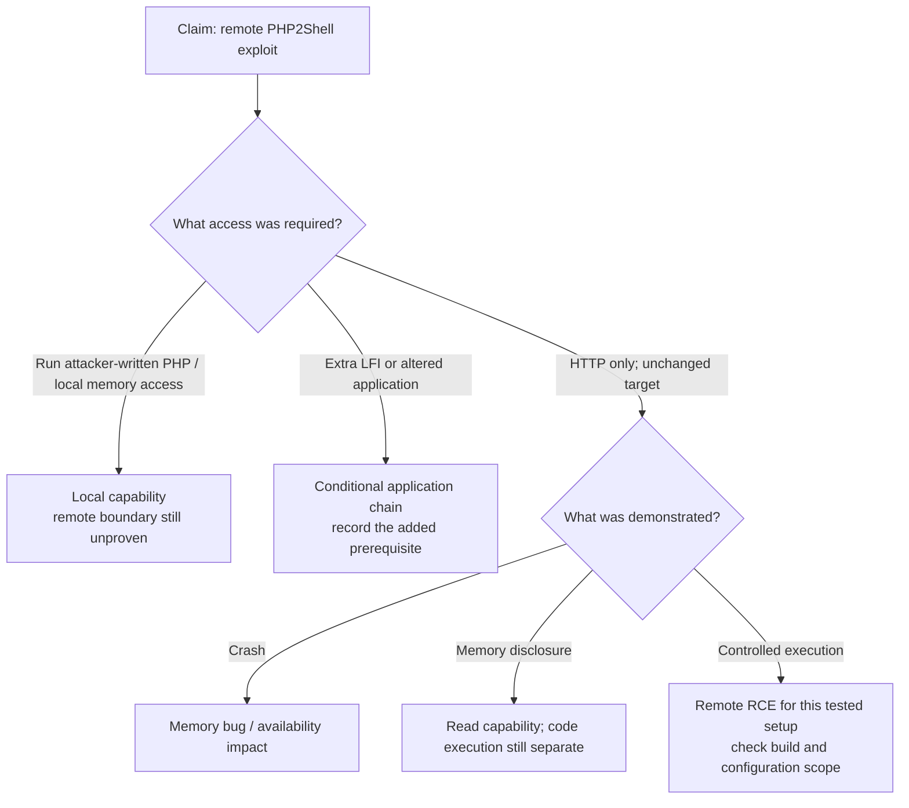

# PHP2Shell Exploit Debate: What Does the Evidence Prove?

**Daily learning · 23 October 2026 · Primary-source review plus supplied video transcripts**

> **Core idea:** PHP2Shell is a real remote-code-execution vulnerability. A fake or incomplete demonstration does not disprove it; a local memory-corruption crash does not prove that its security patch failed. Compare the attacker's starting access, the actual code path and the demonstrated result.

## 1. Four different results often called an “exploit”

| Evidence | What it proves | What it does not prove |
|---|---|---|
| AddressSanitizer (ASan) reports invalid memory access | The exercised path has a memory error | Remote reachability or controlled code execution |
| Attacker-written PHP script executes commands | Execution within that script's environment | An internet visitor can execute PHP without prior access |
| HTTP-only test executes code on an unchanged target | A remote chain works for the tested build/configuration | Portability to every PHP deployment |
| Published report of a production compromise | Incident evidence within that report's scope | Every observed probe succeeded |

**Threat model** means what the attacker can already do. **LFI** means local file inclusion: an application lets input influence which server-side file it includes. Adding an LFI endpoint to a lab adds a separate application vulnerability.

The distinction follows [PHP's security policy](https://github.com/php/php-src/security/policy), [ASan's documented purpose](https://clang.llvm.org/docs/AddressSanitizer.html) and the [official HTTP-RCE validation](https://github.com/php/php-src/security/advisories/GHSA-w8hw-w9fx-j79w).

## 2. Low Level's patch warning and LiveOverflow's correction

| Disputed claim | Finding | Simple interpretation |
|---|---|---|
| “A crash on 8.5.12 means PHP2Shell is still unfixed.” | **Not established by that evidence.** | Identify the bug and prove its remote path; version number plus ASan output is insufficient. |
| “A local PHP script means it must be a different bug.” | **Transport alone is insufficient.** | Local tests can reproduce real bugs. The important question is whether an HTTP attacker can trigger the same failure without installing the script. |
| “Such local bugs do not matter.” | **Too broad.** | They can affect reliability or restricted hosting. They do not automatically create the same internet-to-code-execution boundary as PHP2Shell. |
| “PHP should safely execute hostile PHP code.” | **Not PHP's promised boundary.** | Its policy does not treat PHP as a sandbox for untrusted programs. Tenant isolation needs an operating-system boundary. |

Sources: [Low Level discussion, supplied transcript at 08:54](https://www.youtube.com/watch?v=QRABrn606LE&t=534), [LiveOverflow correction, supplied transcript at 00:40](https://www.youtube.com/watch?v=SP7y1h0laN0&t=40), [PHP policy](https://github.com/php/php-src/security/policy). PHP also explicitly warns that `disable_functions` is insufficient to secure shared hosting. [Configuration manual](https://www.php.net/manual/en/ini.core.php#ini.disable-functions).

We cannot identify every original screenshot's code path from these transcripts. The issue tracker supplies concrete examples:

| Report | Evidence and limit as checked 23 Oct |
|---|---|
| [#24481: unserializer reentrancy UAF](https://github.com/php/php-src/issues/24481) | Submitted example executes PHP on the target and reads process maps. The original result section contains placeholders; follow-up reproduction reports do not turn it into a demonstrated HTTP-only patch bypass. |
| [#24488: SimpleXML double-free](https://github.com/php/php-src/issues/24488) | Separate regression attributed to a GC change. Verified and closed with a source fix on 22 Oct; closure alone does not prove your vendor package contains that fix. |
| [#24493: session deletion](https://github.com/php/php-src/issues/24493) | Open compatibility report, labelled Needs Triage. Session loss is not evidence of RCE. |

**An additional boundary matters:** an existing application's unsafe handling of attacker input can still be exploitable without accepting arbitrary PHP programs. PHP warns against passing untrusted data to `unserialize()`. The correct assessment is specific to that application path. [PHP manual](https://www.php.net/manual/en/function.unserialize.php).

## 3. Elias Taylor's “no easy exploit” argument

Elias's article is dated **21 Oct** and describes the early public-PoC situation. It explicitly says to patch. Its strongest point is that demonstrations can introduce the very flaw they claim to discover. Its universal claims about absent working exploits require much stronger evidence. [Original article](https://eliastaylor.com/noexploit/).

| Claim | Finding | Why |
|---|---|---|
| “Some AI-generated labs add an existing vulnerability.” | **Corroborated for a cited lab path.** | One linked setup creates an endpoint that includes an input-selected file. Its LFI chain depends on that application flaw. [Lab source](https://github.com/ikow/php2shell-poc/blob/main/lab/setup.sh) |
| “That proves all PHP2Shell exploits are fake.” | **Unsupported generalization.** | A bad demonstration says nothing about independently validated chains. |
| “No exploit works against a normal vulnerable PHP server.” | **Contradicted as a universal statement.** | PHP confirms HTTP RCE against mod_php with default input/memory limits and ordinary multiworker prefork configurations. [Official evidence](https://github.com/php/php-src/security/advisories/GHSA-w8hw-w9fx-j79w) |
| “It is less portable than a simple reusable payload.” | **Supported in substance.** | PHP says reliability varies with build, extensions, frontend and allocator layout. |
| “No successful public incident report means little danger.” | **The conclusion does not follow.** | Detection and public reporting are separate from technical exploitability; known remote capability still requires patching. |

A repository can contain several chains with different prerequisites. The cited [repository's current README](https://github.com/ikow/php2shell-poc) distinguishes LFI, local-PHP and other claimed paths. Demonstrating a weakness in one chain does not audit them all. Repositories also change; a 21 Oct critique is not a permanent verdict on later revisions.

## 4. LiveOverflow's newer remote demonstration

In the supplied follow-up transcript, LiveOverflow acknowledges that the earlier agent used local process-memory access. He reports replacing that setup with a separate host, network-only attacker access and a manually chosen secret, then demonstrating remote execution against selected Apache/PHP and WordPress images. [Method and result, 07:10–09:39](https://www.youtube.com/watch?v=SP7y1h0laN0&t=430).

| Claim | Finding |
|---|---|
| “The new lab is stronger evidence than the local demo.” | **Yes, if the described access restrictions hold.** It removes a major source of unintended local assistance. |
| “The agent succeeded in under two hours.” | **Attributed lab result.** We reviewed the supplied transcript, not the full agent logs or an independent reproduction. |
| “One prompt works on any image.” | **Not established.** The same transcript acknowledges per-target layout, offsets and reliability work. |
| “AI lowers adaptation effort.” | **Supported by first-person research accounts**, but universal success or timing is not proven. [Calif's methodology](https://calif.io/php2shell/), [Wiz's research](https://www.wiz.io/blog/php2shell-php-rce) |

“Easy” describes two different things: **running one portable exploit** versus **developing/adapting a chain for a particular target**. Failed copy-paste attempts do not settle the second question. Successful adaptation to one build does not settle the first.

## 5. What the patch changes—and the October 23 update

For the original OOM issue, PHP documents delayed soft OOM at a safe execution point and immediate process exit at a higher hard threshold. The state-reset fix addresses request-owned globals surviving teardown. Memory limits remain. [OOM patch design](https://github.com/php/php-src/security/advisories/GHSA-w8hw-w9fx-j79w), [state lifecycle fix](https://github.com/php/php-src/security/advisories/GHSA-6wmf-4rv5-p3rp).

**23 Oct update:** PHP announced a narrow follow-up, **CVE-2026-115560**. Its conditions and interim action are recorded in the [main learning note](PHP2Shell-History-UAF-And-ASLR-Oct-2026.md#october-23-follow-up-a-distinct-session-handler-path). This official finding is separate from the local-crash arguments. [PHP notice](https://www.php.net/archive/2026.php#2026-10-23-1).

## 6. A simple evidence filter

Conceptual assessment flow. These paths are not mutually exclusive; a full chain may combine disclosure and corruption. Nothing in this review establishes immunity for a deployment that was not tested.

## 7. Practical conclusion and source context

Patch the original CVEs, apply the latest PHP follow-up guidance, restart workers and verify the live runtime. Treat suspicious traffic as investigation evidence, not automatic proof of compromise. Use exact build/configuration and before/after behavior when evaluating a patch claim.

This review compares the supplied [LiveOverflow follow-up](https://www.youtube.com/watch?v=SP7y1h0laN0), the earlier [Low Level transcript](https://www.youtube.com/watch?v=QRABrn606LE) and [Elias Taylor's article](https://eliastaylor.com/noexploit/) against primary disclosures and source. Repository text was inspected; exploit programs were not executed. No claim is made that every public PoC was audited or that a video demonstration was independently reproduced.

---

**Related:**
- [PHP2Shell: History, UAF and ASLR](PHP2Shell-History-UAF-And-ASLR-Oct-2026.md) — Foundations, original timeline and deployment response.
- [PHP Migration: Static React, Java and Go](../../Engineering/Architecture/PHP-Migration-Static-React-Java-And-Go-Oct-2026.md) — Long-term changes that reduce runtime exposure.
- [React2Shell](10.0_CVE_React2Shell_Whitepaper.md) — Compare application/framework RCE with runtime-memory exploitation.
