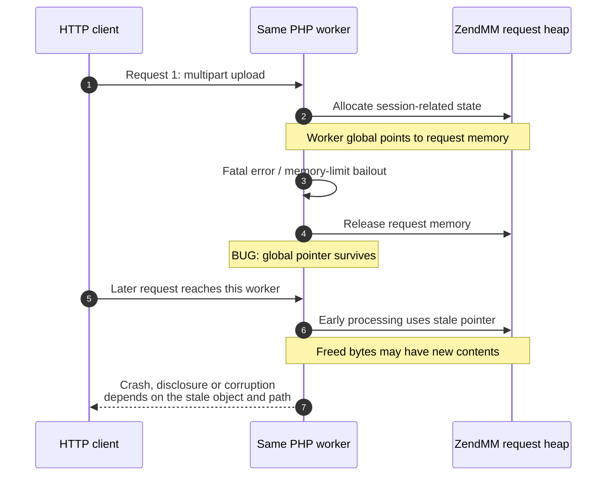
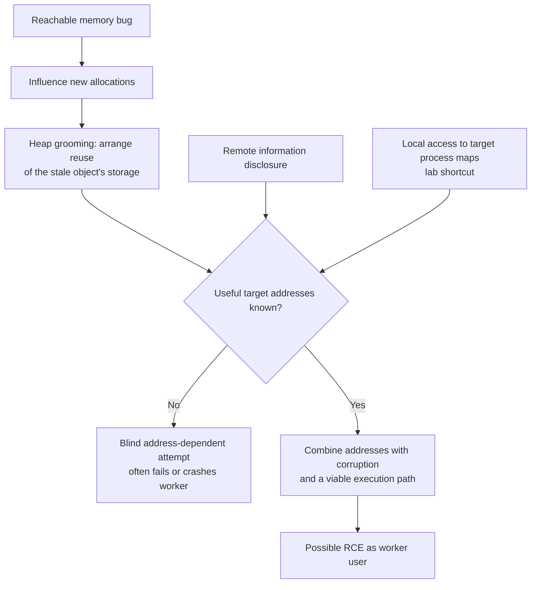
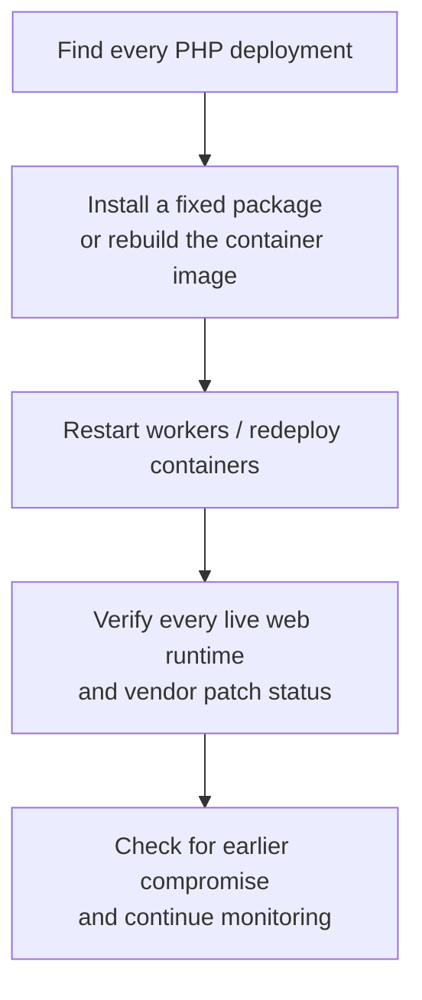

# PHP2Shell: History, Use-After-Free and ASLR

**Daily learning · 22 October 2026 · Updated 23 October 2026 · Technical details cross-checked against primary sources**

> **Core idea:** PHP can leave request state unfinished or retain a pointer after freeing its memory. Cleanup or a later request then trusts invalid data. Disclosure plus controlled corruption can turn this into RCE.

## 1. What actually broke?

### What does “70% of the internet” mean?

**69.3% = PHP-using websites ÷ websites with an identified server-side language**, in W3Techs' survey dated **22 Oct 2026**. Think “about 7 in 10 identifiable website stacks.” [W3Techs PHP usage](https://w3techs.com/technologies/details/pl-php).

| It measures | It does not measure |
|---|---|
| Website technology adoption in the survey | Share of internet traffic, users, IPs or physical servers |
| PHP detected somewhere on a site | Proof that every page uses PHP or that the deployment is exploitable |
| Sites grouped using W3Techs' counting rules | Each hosted blog, subdomain or application as a separate site |

W3Techs surveys over 20 million relevant sites and groups subdomains: its example treats WordPress.com subdomains as one website. **Adoption ≠ vulnerable deployments ≠ successful compromises.** [Survey methodology](https://w3techs.com/technologies).

### Essential terms

| Term | Simple meaning |
|---|---|
| Request heap | Memory managed by PHP's Zend Memory Manager (`ZendMM`), normally through `emalloc()` / `efree()`. |
| Pointer | An address pointing to an object in memory. |
| Dangling pointer | The address remains after its object has been freed. |
| Use-after-free (UAF) | PHP uses that address as though the old object still exists. |
| Worker | A server process that can handle multiple requests. |
| RCE | Attacker-controlled code runs with the worker's permissions; this does **not** automatically mean root. |

**PHP2Shell covers two bug classes, with multiple variants:**

| CVE | Broken assumption | Consequence |
|---|---|---|
| **CVE-2026-109618** | An out-of-memory bailout can interrupt partially initialized state. | Shutdown treats invalid data as valid; corruption can become RCE. |
| **CVE-2026-109619** | Request-owned state remains reachable after its memory is freed. | A later request in the same worker consumes stale state: UAF. |

Both: **CVSS v4.0 9.2 / Critical**. Sources: [PHP OOM advisory](https://github.com/php/php-src/security/advisories/GHSA-w8hw-w9fx-j79w), [PHP stale-state advisory](https://github.com/php/php-src/security/advisories/GHSA-6wmf-4rv5-p3rp).

## 2. History: warning signs → working exploits → emergency release

Times below are **UTC**; October dates are **2026**.

| When | What happened | Why it matters |
|---|---|---|
| 2004 / 2020 | Earlier PHP memory-limit vulnerabilities / multipart OOM report. | Historical precedents, not the same CVEs. |
| 1 Mar 2012 | PHP 5.4.0 released; Calif traces the session-upload path back to this version. | About 14 years before disclosure; the 2004 precedent is a different vulnerability. |
| 2024 | Audit follow-up exposed signs of the OOM problem; exploitation remained unproven. | Fix stalled over compatibility, design trade-offs and limited resources. |
| Aug 1–21 | Calif found RCE paths; first report Aug 11, working PoC Aug 14, second bug Aug 21. | Earlier than “mid-to-late August” alone suggests. |
| Aug 11 / Aug 24 | OpenAI independently reported the root cause / Wiz reported its findings. | Independent research converged. |
| Aug–Sep | Private fixes, additional variants and distributor coordination. | Engine-wide repair required more than a local patch. |
| Oct 20, ~15:00 | CVE IDs circulated with incorrect score/release information. | **Initially no technical details**, per the Foundation. |
| Oct 20, 19:30 / ~20:00 | PHP issued advance warning; Calif mistakenly published a demo video shortly afterward. | Limited technical details then spread. |
| Oct 21, 07:41 | Patched Chainguard images appeared early, per the Foundation. | Fix could be studied before coordinated release. |
| Oct 21, 14:00 scheduled | Coordinated release day; originally Oct 22. | Accelerated by one day; scheduled time **19:30 IST**. |
| Oct 23 | PHP announces a narrow session-handler follow-up, CVE-2026-115560. | Further configuration guidance while awaiting a regular bugfix release; see Section 6. |

Sources: [Calif's research history](https://calif.io/php2shell/), [PHP Foundation's disclosure account](https://thephp.foundation/blog/2026/10/21/todays-php-security-release-and-how-were-strengthening-php-security/), [Wiz's independent timeline](https://www.wiz.io/blog/php2shell-php-rce).

PHP 5.4.0 dates to **March 2012**; the **2004** vulnerability is a historical precedent, not the start date of this session-upload path. [PHP release announcement](https://www.php.net/archive/2012.php#id2012-03-01-1).

## 3. Mechanisms: unfinished state and cross-request UAF

### First finding: cleanup sees an unfinished object

Calif first describes a **PHP ≥7.3 HashTable path**, distinct from the cross-request session path:

| Step | Plain meaning |
|---|---|
| 1. Increase the table's live-entry count | Mark a new slot as present. |
| 2. Allocate its key | This allocation can fail before the slot is fully initialized. |
| 3. Fatal bailout skips remaining assignments | The count says “valid entry”; the slot is unfinished. |
| 4. mod_php runs request cleanup | Cleanup trusts the count and consumes invalid slot contents. |

This path can fail **within one request**; two requests are not required for every PHP2Shell variant. Calif generalized the finding into a research `SKILL.md`: **publish/change state → fallible work → commit/reset**. An interruption can skip that last step. [Calif: first finding and generalized pattern](https://calif.io/php2shell/).

### Session finding: state outlives its request

Simplified session path: **worker survives and handles both requests**. [Calif's lifecycle analysis](https://calif.io/php2shell/).

**Why does the worker survive “out of memory”?** In the vulnerable path, `memory_limit` is PHP's software ceiling, not the Linux OOM killer. A `zend_bailout()` / `longjmp()` jumps to an error handler, bypassing intervening cleanup. With mod_php, request shutdown still runs and the worker can survive. [PHP OOM advisory](https://github.com/php/php-src/security/advisories/GHSA-w8hw-w9fx-j79w), [Calif's startup/shutdown analysis](https://calif.io/php2shell/).

Upload progress can run **before the script**, without `session_start()`. [PHP lifecycle details](https://github.com/php/php-src/security/advisories/GHSA-6wmf-4rv5-p3rp), [upload-progress manual](https://www.php.net/manual/en/session.upload-progress.php).

**Allocator detail:** request allocations use ZendMM; persistent allocations such as `pemalloc(size, 1)` use the system allocator. Recycled storage can hold different data, making allocation placement another exploitation hurdle. “Freed” does not necessarily mean “unmapped”; neither page retention nor reliable reuse is guaranteed. [Zend Memory Manager](https://www.phpinternalsbook.com/php7/memory_management/zend_memory_manager.html).

**Two rules that should hold:** cleanup sees only initialized state; worker globals stop referring to request memory before it is freed. These are a plain-language synthesis of [Calif's interrupted-state pattern](https://calif.io/php2shell/) and [PHP's stale-state advisory](https://github.com/php/php-src/security/advisories/GHSA-6wmf-4rv5-p3rp).

The second request is a **new HTTP request** reaching leftover state, not necessarily a continuation of the first upload. Destruction can follow pointers and release nested objects; it is more than simply writing a zero. [Calif's session teardown](https://calif.io/php2shell/).

### Why reused data can become a function pointer

The video's cat/dog example is a **conceptual analogy**, not PHP's actual object layout:

| Same memory slot | First field | Second field |
|---|---|---|
| Old object: Cat | Name | Speak-function pointer |
| Replacement object: Dog | Speak-function pointer | Name |

A stale Cat pointer still treats the second field as callable, even though the replacement uses it as data. That illustrates how reuse can cross the data/control boundary; a real exploit still needs suitable layout, controlled bytes and valid target addresses. [Supplied video, 06:14–07:30](https://www.youtube.com/watch?v=QRABrn606LE&t=374).

### The missing distinction: leak ≠ corruption ≠ shell

| Piece | What happens | Role in the chain |
|---|---|---|
| Stale session ID: `PS(id)` | Freed memory can be encoded into a `PHPSESSID` response cookie. | **Disclosure:** potentially exposes secrets and useful addresses. |
| Stale unserializer state: `BG(unserialize)` | PHP follows reclaimed memory as internal bookkeeping. | **Corruption:** enables manipulation of program state. |
| Combined chain | Disclosure removes address uncertainty; corruption redirects execution. | **RCE**, demonstrated by Wiz against WordPress, Drupal and Joomla. |

Variants can be combined; **both CVEs are not prerequisites for every exploit**. [Wiz technical breakdown](https://www.wiz.io/blog/php2shell-php-rce).

## 4. ASLR: why a crash PoC is not yet a remote shell

Conceptual **address-dependent** chain; leaks are not universal prerequisites. [Linux ASLR](https://docs.kernel.org/admin-guide/sysctl/kernel.html#randomize-va-space), [Wiz demonstration](https://www.wiz.io/blog/php2shell-php-rce).

| Claim | Precise interpretation |
|---|---|
| “ASLR changes addresses every request.” | Usually **no**: requests reuse workers; ASLR randomizes process mappings. Heap contents can still change between requests. |
| “One pointer reveals every address.” | Matching build offsets may reveal **that module's** base. Heap, stack and other modules remain separate. |
| “Prefork defeats ASLR.” | `fork()` inherits mappings; this may preserve useful addresses. It does not itself disclose them or make worker heaps identical forever. |
| “The AI read `/proc/self/maps`.” | `self` means the **reader**, not necessarily PHP. Target mappings require extra access unavailable through ordinary HTTP. |
| “An ASan crash proves RCE.” | ASan demonstrates invalid memory access. Controlled execution and a remotely viable chain require additional evidence. |

Sources: [Linux ASLR](https://docs.kernel.org/admin-guide/sysctl/kernel.html#randomize-va-space), [fork semantics](https://man7.org/linux/man-pages/man2/fork.2.html), [process maps](https://man7.org/linux/man-pages/man5/proc_pid_maps.5.html), [AddressSanitizer](https://clang.llvm.org/docs/AddressSanitizer.html). Module-offset explanation is an inference from mapped binaries.

## 5. Deployment and fixes

| Question | Answer as of 23 Oct 2026 |
|---|---|
| Only Apache? | No. PHP lists FPM, mod_php, CGI, FrankenPHP and LiteSpeed; exploit paths differ. |
| First fixed upstream versions? | **8.2.35 · 8.3.36 · 8.4.27 · 8.5.12**. |
| PHP 8.1 and older? | Upstream EOL. Minimal source backports cover **7.4, 8.0, 8.1**; vendor/LTS packages may also contain fixes. This does not promise patches for every 5.x/7.x branch. |
| What changed internally? | OOM patch replaces unsafe immediate bailout with soft OOM at a VM safe point / hard process exit. Stale-state patch resets request-owned state. |
| `display_errors=Off`? | Does **not** fix stale state or guarantee prevention of leaks/exploitation. A crash is an availability failure, not harmless proof of protection. |
| Disable upload progress? | Partial mitigation for confirmed session paths; other variants remain. Apply before request parsing and restart workers. |
| FPM `pm.max_requests=1`? | Recycles each child after one request, breaking the demonstrated same-worker, cross-request sequence. Temporary containment with process-startup overhead; it does **not** fix OOM corruption or replace patching. |
| Original two CVEs? | Install the upstream or vendor-fixed package and restart every PHP worker. Also check the **23 Oct follow-up guidance** below. |

Sources: [PHP release and remediation notice](https://www.php.net/archive/2026.php#2026-10-21-1), [OOM patch design](https://github.com/php/php-src/security/advisories/GHSA-w8hw-w9fx-j79w), [state-reset guidance](https://github.com/php/php-src/security/advisories/GHSA-6wmf-4rv5-p3rp), [Ubuntu vendor backports](https://ubuntu.com/blog/php2shell-vulnerability-fixes-available).

### “PHP engines”: one core, different ways to run it

**Zend Engine** executes PHP code. A **SAPI** (Server Application Programming Interface) connects PHP to its host environment. FPM manages FastCGI workers; `mod_php` embeds PHP in Apache. These deployment choices change request handling and worker lifetime.

[PHP's SAPI definitions](https://www.php.net/manual/en/function.php-sapi-name.php). Also, “PHP 8” alone does not mean supported: **8.0 and 8.1 are EOL** as of this note's date.

| Deployment | Simplified request path | Why it matters here |
|---|---|---|
| Apache + `mod_php` | Browser → Apache worker containing PHP | Highest risk in PHP's notice. Pre-script failure can leave the worker alive with stale state. |
| PHP-FPM | Browser → Nginx/Apache → FastCGI → PHP worker pool | Failed startup exits the child. Fatal errors **after successful startup** can leave a reusable worker; application-dependent paths remain. |
| PHP-CGI | Browser → web server → PHP CGI handler | Also in the advisory's web-serving scope. Actual process reuse depends on how it is deployed. |
| FrankenPHP | Browser → Caddy-based app server with embedded PHP | Shares PHP core; its classic/worker modes differ. OOM advisory identifies likely application-independent susceptibility. |
| LiteSpeed / LSAPI | Browser → LiteSpeed → PHP via LiteSpeed API | Shares PHP core; OOM advisory describes an FPM-like lifecycle, with application-specific risk. |
| Standalone CLI / cron | Shell or scheduler → PHP script | Not directly exposed through the demonstrated HTTP path merely by running PHP. This is not a claim that CLI builds lack the affected core code. |

Sources: [PHP web-serving scope](https://www.php.net/archive/2026.php#2026-10-21-1), [FPM manual](https://www.php.net/manual/en/install.fpm.php), [FrankenPHP documentation](https://frankenphp.dev/docs/), [LiteSpeed integration](https://www.php.net/manual/en/install.unix.litespeed.php), [Calif's lifecycle comparison](https://calif.io/php2shell/), [OOM susceptibility analysis](https://github.com/php/php-src/security/advisories/GHSA-w8hw-w9fx-j79w). Paths are simplified; a `500` or persistent client connection does not establish worker survival or reuse.

**Applications sit above this layer:** WordPress, Drupal, Joomla, Magento and custom frameworks use PHP; they are not PHP engines. Updating an application alone does not replace vulnerable PHP core. Wiz's RCE demonstrations against WordPress, Drupal and Joomla show exploit chains in test deployments, not proof those public services were breached. [Wiz's research](https://www.wiz.io/blog/php2shell-php-rce).

## 6. “Patched” does not always mean the running website is fixed

> **Deployment gap:** the fixed package may be on disk while old workers or containers still serve traffic. This is different from a demonstrated bypass of the PHP fix.

Practical verification flow, based on [Google's deployment guidance](https://cloud.google.com/blog/products/identity-security/responding-to-core-php-vulnerabilities-cve-2026-109618-cve-2026-109619) and [NCSC's response guidance](https://www.ncsc.gov.uk/news/critical-security-issue-affecting-php).

| Blind spot | Simple action / evidence |
|---|---|
| Forgotten PHP copies | Inventory every site, worker pool, container and product that bundles PHP; assign an owner. |
| `php -v` looks fixed | It checks the command-line installation. Verify the **web-serving runtime**, its executable/package and every active pool or replica through internal diagnostics. |
| Package updated; workers still old | Replace/restart all affected workers. Confirm the replacement processes use the fixed build. |
| Host patched; container unchanged | Rebuild with fixed PHP, redeploy and confirm all running containers use the new image. Updating only the VM is insufficient. |
| Version number still looks old | Check the vendor's **package revision and CVE status**. Backports can fix an older upstream version: Ubuntu lists `8.3.6-0ubuntu0.24.04.13` as fixed. |
| “Managed cloud handles it” | Verify the service and update mode. Google says supported App Engine Standard runtimes update automatically; custom Cloud Run images and GKE pods need updated images and redeployment. |
| WAF or hidden version header | Neither proves remediation. WAF rules cover known patterns; protect the origin from direct bypass and still patch PHP. |

Sources: [Google Cloud bulletin GCP-2026-070](https://docs.cloud.google.com/support/bulletins#GCP-2026-070), [Google's service-by-service instructions](https://cloud.google.com/blog/products/identity-security/responding-to-core-php-vulnerabilities-cve-2026-109618-cve-2026-109619), [Ubuntu's fixed package revisions](https://ubuntu.com/blog/php2shell-vulnerability-fixes-available), [VirusTotal's origin/WAF guidance](https://blog.virustotal.com/2026/10/sizing-php-exposure-window-for-cve-2026.html), [Cloudflare's protections and limits](https://blog.cloudflare.com/php-vulnerabilities-waf-protection). Runtime verification steps are operational checks derived from these deployment requirements.

### Exposure is not a count of successful attacks

| Evidence, dated 21 Oct 2026 | What it establishes |
|---|---|
| VirusTotal: ~5.1M PHP-fingerprinted IPs; ~3.8M with at least one open port; ~1.1M advertising a version | A measured footprint, **not 5.1M confirmed vulnerable servers**. The open port need not be the PHP port. |
| VirusTotal: ~758K advertising EOL PHP 5.4–8.1 | A legacy-patching problem within the version-visible sample; not a percentage of the whole web. |
| watchTowr reports active exploitation attempts against both CVEs | Observed attempts; this statement alone does not establish successful compromise of production websites. |
| AWS: MadPot detected an attempt on **17 Oct**, four days before disclosure | AWS says success against real systems remains unclear. Its guidance starts investigation from at least 17 Oct. |

Sources: [VirusTotal's dated scan and methodology](https://blog.virustotal.com/2026/10/sizing-php-exposure-window-for-cve-2026.html), [watchTowr's observations](https://watchtowr.com/intelligence/php-remote-code-execution-php2shell/). Other exposed services can increase impact depending on permissions and accessible secrets; PHP RCE does not automatically grant root or compromise SSH/MySQL.

**Why scanner totals differ:** websites, IP addresses, ports/services and virtual hosts are different units. One IP can serve many sites; one site can use many IPs. Detection methods, dates and hidden version banners also differ. Do not average these totals or treat package-download counts as production market share. This is a measurement comparison, based on [W3Techs' methodology](https://w3techs.com/technologies) and [VirusTotal's IP-based methodology](https://blog.virustotal.com/2026/10/sizing-php-exposure-window-for-cve-2026.html).

**Response window:** AWS reports new PoCs reaching its sensors within hours of disclosure and recommends patch/mitigation timelines measured in hours. That supports urgency, not a universal “working exploit for under $1” claim. [AWS's telemetry and recommendations](https://aws.amazon.com/blogs/security/amazon-threat-intelligence-identifies-php2shell-exploitation-prior-to-public-disclosure-in-madpot/).

**Patching closes the flaw; it does not remove an existing backdoor.** Review web/PHP/WAF logs and unexpected files or processes; investigate suspicious findings and rotate exposed secrets where indicated. NCSC recommends monitoring internet-facing PHP and considering taking systems offline when prompt remediation is not feasible. [NCSC guidance](https://www.ncsc.gov.uk/news/critical-security-issue-affecting-php), [Google monitoring and auditing](https://cloud.google.com/blog/products/identity-security/responding-to-core-php-vulnerabilities-cve-2026-109618-cve-2026-109619).

### “The patch is incomplete”: what the evidence establishes

PHP's original advisories identify **8.2.35 / 8.3.36 / 8.4.27 / 8.5.12** as patched releases for the original two CVEs. A local-script crash alone does not establish an unauthenticated HTTP bypass. A separate, official **23 Oct follow-up** changes the advice for a specific configuration; see below.

| Evidence | Interpretation |
|---|---|
| SimpleXML garbage-collection double-free on 8.4.27/8.5.12; **Verified**, closed 22 Oct with a source fix | Separate GC regression, not proof the original HTTP chain still works. Verify which vendor release contains the fix. [#24488](https://github.com/php/php-src/issues/24488) |
| Unserializer UAF report; **Needs Triage** | The submitted example requires PHP code execution on the target and reads local process maps. Those prerequisites differ from unauthenticated remote HTTP access. [#24481](https://github.com/php/php-src/issues/24481) |
| Upload-progress session-data deletion; **Needs Triage** | A reported compatibility regression, not evidence of code execution. [#24493](https://github.com/php/php-src/issues/24493) |

Test affected application behavior, track vendor follow-ups and avoid reverting public services to vulnerable builds. Sources: [PHP OOM advisory](https://github.com/php/php-src/security/advisories/GHSA-w8hw-w9fx-j79w), [PHP stale-state advisory](https://github.com/php/php-src/security/advisories/GHSA-6wmf-4rv5-p3rp). Issue labels describe repository status, not independent reproduction here.

### October 23 follow-up: a distinct session-handler path

PHP's new notice identifies **CVE-2026-115560** under this unusual combination:

| Required condition | Meaning |
|---|---|
| Configured `session.serialize_handler` is `php_binary` or `php_serialize` | One session format is selected in configuration. |
| Application changes it to `php` with `ini_set()` before `session_start()` | The format is switched at runtime. |
| Session upload progress remains enabled | Early upload handling can participate in the affected path. |

PHP suggests **`session.upload_progress.enabled=0` until the next regular bugfix release**; keep it disabled if already applied. Applications that never switch the handler at runtime can keep the feature enabled, according to the notice. A full advisory is planned with the next release. [PHP informational advisory, 23 Oct](https://www.php.net/archive/2026.php#2026-10-23-1).

For the claim-by-claim review of local crashes, misleading labs, real HTTP exploitation and the “easy exploit” debate, see [PHP2Shell: Exploit Debate and Evidence](PHP2Shell-Exploit-Debate-Threat-Models-And-Patch-Status-Oct-2026.md).

## 7. Research lessons: AI, fuzzing and memory safety

| Common claim | Precise lesson |
|---|---|
| “AI found related bugs from a skill.” | Calif reports encoding an interrupted-state pattern, then using it to find another variant. The useful artifact was the failure pattern, not a generic “find bugs” prompt. [Calif](https://calif.io/php2shell/) |
| “Fuzzers cannot find temporal bugs.” | Too strong. Fuzzing with AddressSanitizer can detect UAFs. For cross-request bugs, the test harness must exercise the relevant request sequence and worker lifetime. [LLVM fuzzing](https://llvm.org/docs/LibFuzzer.html), [ASan](https://clang.llvm.org/docs/AddressSanitizer.html) |
| “Rust would prevent this.” | Safe Rust is designed to prevent dangling-reference access, but that guarantee also depends on compiler correctness and sound unsafe code/C integration. Compiler soundness bugs can violate it even without user-written `unsafe`. [Rust memory-safety boundaries](https://doc.rust-lang.org/nomicon/what-unsafe-does.html), [Rust issue #164250](https://github.com/rust-lang/rust/issues/164250) |

**Rust caveat — 23 Oct 2026:** [#164250](https://github.com/rust-lang/rust/issues/164250), discussed in [this video](https://www.youtube.com/watch?v=4iAi5exNHv8), is an open, high-priority compiler **soundness hole**: safe-looking field assignment bypasses a lifetime requirement, letting a custom destructor (`Drop`) retain a reference after its data is freed. Rust maintainers describe it as an 11-year-old bug requiring an intentionally malicious `Drop` implementation. It demonstrates a broken safety guarantee, not evidence of a PHP2Shell-like remote attack. [Rust's Project Zero](https://goals.rust-lang.org/2026/roadmap-project-zero.html) aims to fix all known type-system soundness bugs.

**Spatial bug:** access outside an allocation's bounds. **Temporal bug:** access after its lifetime ends. Both can be found dynamically; source reasoning can complement testing by identifying the missing lifetime/reset rule.

## 8. Source context

Based on user-shared summaries of [This PHP vulnerability is a big deal](https://www.youtube.com/watch?v=cBD1AgkM1VQ), [LiveOverflow: php2shell is crazy!](https://www.youtube.com/watch?v=7CiZmq2llDg), [Base Config: Patched PHP2Shell? You Might Still Be Vulnerable](https://www.youtube.com/watch?v=ST8bY4N6CMU), and [“70% of the Internet”? (PHP2SHELL)](https://www.youtube.com/watch?v=vN-byUxXApY), with technical, measurement and operational details cross-checked against the primary reports linked above. The first fixed 8.3 release is **8.3.36**; discovery involved Calif, OpenAI and Wiz.

**23 Oct addition:** based on the supplied transcript of [the PHP2Shell explainer](https://www.youtube.com/watch?v=QRABrn606LE): [first finding / variant search, 03:34](https://www.youtube.com/watch?v=QRABrn606LE&t=214), [cat/dog UAF analogy, 06:14](https://www.youtube.com/watch?v=QRABrn606LE&t=374), [patch warning, 08:54](https://www.youtube.com/watch?v=QRABrn606LE&t=534), [AI and temporal bugs, 09:46](https://www.youtube.com/watch?v=QRABrn606LE&t=586). Primary reference: [Ryan Austin / Calif Research — php2shell](https://calif.io/php2shell/). Transcript claims are distinguished from official patch status and issue-tracker evidence above.

Follow-up sources: [LiveOverflow: php2shell 24 hours later](https://www.youtube.com/watch?v=SP7y1h0laN0), supplied transcript; [Elias Taylor's exploit-complexity argument](https://eliastaylor.com/noexploit/). Their disputed claims are evaluated in the linked companion review.

---

**Related:**
- [Linux Kernel ZDI Public Reports](Linux-Kernel-ZDI-Public-Reports-KSMBD-Oct-2026.md) — Separate same-week kernel disclosures; distinguish reported RCE impact from demonstrated memory corruption.
- [eMudhra Weak CA Keys](EMudhra-Weak-CA-Keys-And-PKI-Trust-Oct-2026.md) — Compare a broken security primitive with the extra conditions required for real-world exploitation.
- [MongoBleed](MongoBleed-Dec2025.md) — Compare unauthenticated memory disclosure with the leak stage here.
- [Node.js Async Hooks DoS](Node.js-Async-Hooks-DoS-Vulnerability.md) — Compare runtime error handling that turns a request failure into a process failure.
- [React2Shell](10.0_CVE_React2Shell_Whitepaper.md) — Compare another widely deployed, unauthenticated RCE surface.
- [PHP2Shell Exploit Debate](PHP2Shell-Exploit-Debate-Threat-Models-And-Patch-Status-Oct-2026.md) — Distinguish local bugs, conditional chains, remote proofs and the October 23 follow-up.
- [PHP Migration: Static React, Java and Go](../../Engineering/Architecture/PHP-Migration-Static-React-Java-And-Go-Oct-2026.md) — Long-term migration choices that separate runtime removal from language-level memory safety.
