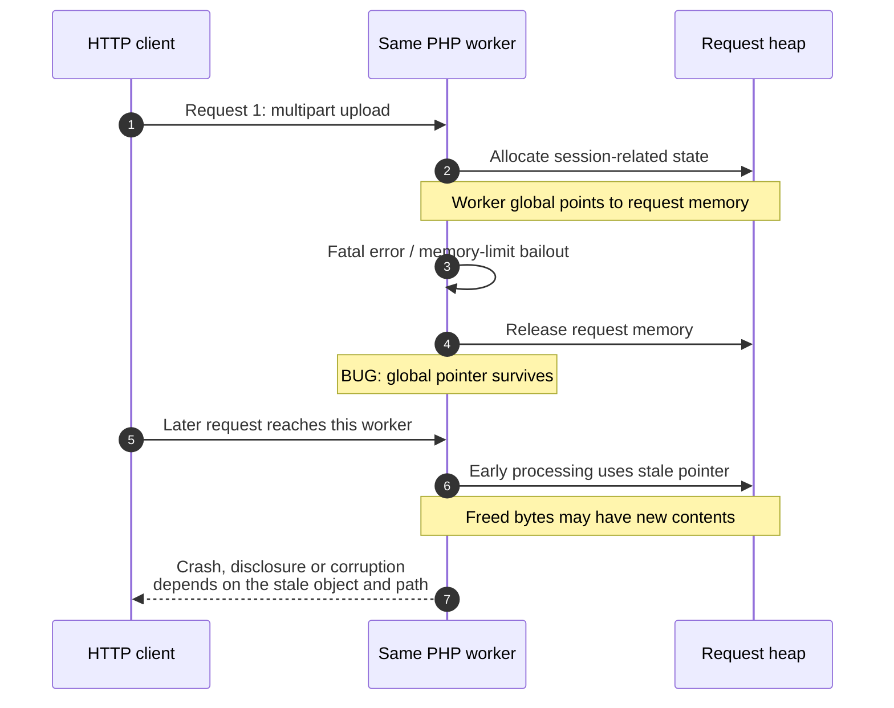
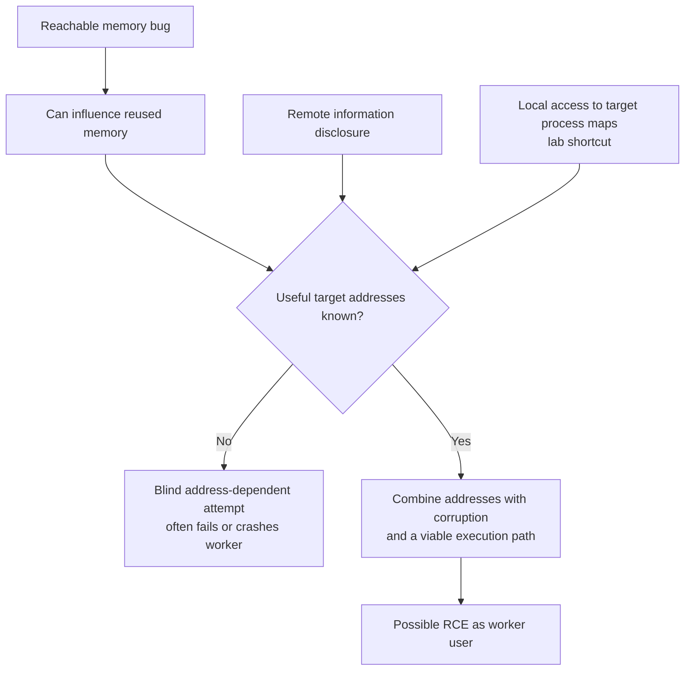

# PHP2Shell: History, Use-After-Free and ASLR

**Daily learning · 22 October 2026 · Verified against primary sources**

> **Core idea:** A worker retains a pointer after freeing request memory. A later request uses it. Disclosure plus controlled corruption can turn the bug into RCE.

## 1. What actually broke?

| Term | Simple meaning |
|---|---|
| Heap | Memory allocated while the program runs. |
| Pointer | An address pointing to an object in memory. |
| Dangling pointer | The address remains after its object has been freed. |
| Use-after-free (UAF) | PHP uses that address as though the old object still exists. |
| Worker | A server process that can handle multiple requests. |
| RCE | Attacker-controlled code runs with the worker's permissions; this does **not** automatically mean root. |

**PHP2Shell covers two bug classes, with multiple variants:**

| CVE | Broken assumption | Consequence |
|---|---|---|
| **CVE-2026-109618** | An out-of-memory bailout can interrupt partially initialized state. | Shutdown treats invalid data as valid; corruption can become RCE. |
| **CVE-2026-109619** | Request-owned state remains reachable after its memory is freed. | A later request in the same worker consumes stale state: UAF. |

Both: **CVSS v4.0 9.2 / Critical**. Sources: [PHP OOM advisory](https://github.com/php/php-src/security/advisories/GHSA-w8hw-w9fx-j79w), [PHP stale-state advisory](https://github.com/php/php-src/security/advisories/GHSA-6wmf-4rv5-p3rp).

## 2. History: warning signs → working exploits → emergency release

Times below are **UTC**; October dates are **2026**.

| When | What happened | Why it matters |
|---|---|---|
| 2004 / 2020 | Earlier PHP memory-limit vulnerabilities / multipart OOM report. | Historical precedents, not the same CVEs. |
| 2024 | Audit follow-up exposed signs of the OOM problem; exploitation remained unproven. | Fix stalled over compatibility, design trade-offs and limited resources. |
| Aug 1–21 | Calif found RCE paths; first report Aug 11, working PoC Aug 14, second bug Aug 21. | Earlier than “mid-to-late August” alone suggests. |
| Aug 11 / Aug 24 | OpenAI independently reported the root cause / Wiz reported its findings. | Independent research converged. |
| Aug–Sep | Private fixes, additional variants and distributor coordination. | Engine-wide repair required more than a local patch. |
| Oct 20, ~15:00 | CVE IDs circulated with incorrect score/release information. | **Initially no technical details**, per the Foundation. |
| Oct 20, 19:30 / ~20:00 | PHP issued advance warning; Calif mistakenly published a demo video shortly afterward. | Limited technical details then spread. |
| Oct 21, 07:41 | Patched Chainguard images appeared early, per the Foundation. | Fix could be studied before coordinated release. |
| Oct 21, 14:00 scheduled | Coordinated release day; originally Oct 22. | Accelerated by one day; scheduled time **19:30 IST**. |

Sources: [Calif's research history](https://calif.io/php2shell/), [PHP Foundation's disclosure account](https://thephp.foundation/blog/2026/10/21/todays-php-security-release-and-how-were-strengthening-php-security/), [Wiz's independent timeline](https://www.wiz.io/blog/php2shell-php-rce).

## 3. Two-request UAF: the lifecycle failure

Simplified session path: **worker survives and handles both requests**. [Calif's lifecycle analysis](https://calif.io/php2shell/).

Upload progress can run **before the script**, without `session_start()`. [PHP lifecycle details](https://github.com/php/php-src/security/advisories/GHSA-6wmf-4rv5-p3rp), [upload-progress manual](https://www.php.net/manual/en/session.upload-progress.php).

### The missing distinction: leak ≠ corruption ≠ shell

| Piece | What happens | Role in the chain |
|---|---|---|
| Stale session ID: `PS(id)` | Freed memory can be encoded into a `PHPSESSID` response cookie. | **Disclosure:** potentially exposes secrets and useful addresses. |
| Stale unserializer state: `BG(unserialize)` | PHP follows reclaimed memory as internal bookkeeping. | **Corruption:** enables manipulation of program state. |
| Combined chain | Disclosure removes address uncertainty; corruption redirects execution. | **RCE**, demonstrated by Wiz against WordPress, Drupal and Joomla. |

Variants can be combined; **both CVEs are not prerequisites for every exploit**. [Wiz technical breakdown](https://www.wiz.io/blog/php2shell-php-rce).

## 4. ASLR: why a crash PoC is not yet a remote shell

Conceptual **address-dependent** chain; leaks are not universal prerequisites. [Linux ASLR](https://docs.kernel.org/admin-guide/sysctl/kernel.html#randomize-va-space), [Wiz demonstration](https://www.wiz.io/blog/php2shell-php-rce).

| Claim | Precise interpretation |
|---|---|
| “ASLR changes addresses every request.” | Usually **no**: requests reuse workers; ASLR randomizes process mappings. Heap contents can still change between requests. |
| “One pointer reveals every address.” | Matching build offsets may reveal **that module's** base. Heap, stack and other modules remain separate. |
| “Prefork defeats ASLR.” | `fork()` inherits mappings; this may preserve useful addresses. It does not itself disclose them or make worker heaps identical forever. |
| “The AI read `/proc/self/maps`.” | `self` means the **reader**, not necessarily PHP. Target mappings require extra access unavailable through ordinary HTTP. |
| “An ASan crash proves RCE.” | ASan demonstrates invalid memory access. Controlled execution and a remotely viable chain require additional evidence. |

Sources: [Linux ASLR](https://docs.kernel.org/admin-guide/sysctl/kernel.html#randomize-va-space), [fork semantics](https://man7.org/linux/man-pages/man2/fork.2.html), [process maps](https://man7.org/linux/man-pages/man5/proc_pid_maps.5.html), [AddressSanitizer](https://clang.llvm.org/docs/AddressSanitizer.html). Module-offset explanation is an inference from mapped binaries.

## 5. Deployment and fixes

| Question | Answer as of 22 Oct 2026 |
|---|---|
| Only Apache? | No. PHP lists FPM, mod_php, CGI, FrankenPHP and LiteSpeed; exploit paths differ. |
| Why does mod_php matter? | Demonstrated attacks can run before application code. FPM terminates workers on failed startup, blocking that exact sequence; application-dependent paths remain. |
| First fixed upstream versions? | **8.2.35 · 8.3.36 · 8.4.27 · 8.5.12**. |
| PHP 8.1 and older? | Upstream EOL. Minimal source backports cover **7.4, 8.0, 8.1**; vendor/LTS packages may also contain fixes. This does not promise patches for every 5.x/7.x branch. |
| What changed internally? | OOM patch replaces unsafe immediate bailout with soft OOM at a VM safe point / hard process exit. Stale-state patch resets request-owned state. |
| `display_errors=Off`? | Does **not** fix stale state or guarantee prevention of leaks/exploitation. A crash is an availability failure, not harmless proof of protection. |
| Disable upload progress? | Partial mitigation for confirmed session paths; other variants remain. Apply before request parsing and restart workers. |
| Complete remedy? | Install the upstream or vendor-fixed package and restart every PHP worker. WAF/ASLR/configuration changes are additional layers. |

Sources: [PHP release and remediation notice](https://www.php.net/archive/2026.php#2026-10-21-1), [OOM patch design](https://github.com/php/php-src/security/advisories/GHSA-w8hw-w9fx-j79w), [state-reset guidance](https://github.com/php/php-src/security/advisories/GHSA-6wmf-4rv5-p3rp), [Ubuntu vendor backports](https://ubuntu.com/blog/php2shell-vulnerability-fixes-available).

## 6. Video context

Starting points: [This PHP vulnerability is a big deal](https://www.youtube.com/watch?v=cBD1AgkM1VQ) and [LiveOverflow: php2shell is crazy!](https://www.youtube.com/watch?v=7CiZmq2llDg). Transcripts were unavailable for independent checking. Discovery credit follows the primary reports. The quoted “48%” estimate is omitted because its date and denominator were unverified.

---

**Related:**
- [MongoBleed](MongoBleed-Dec2025.md) — Compare unauthenticated memory disclosure with the leak stage here.
- [Node.js Async Hooks DoS](Node.js-Async-Hooks-DoS-Vulnerability.md) — Compare runtime error handling that turns a request failure into a process failure.
- [React2Shell](10.0_CVE_React2Shell_Whitepaper.md) — Compare another widely deployed, unauthenticated RCE surface.
