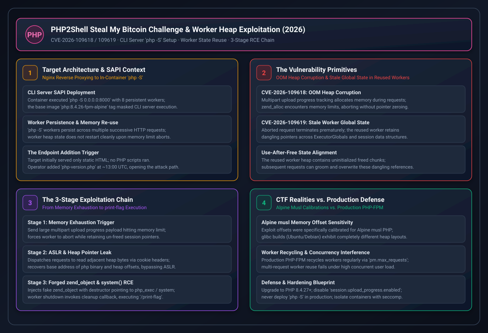
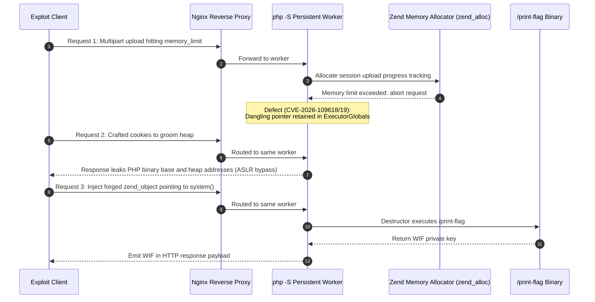

# PHP2Shell and the Steal My Bitcoin Challenge

**Daily learning · 27 October 2026 · Challenge and solver accounts cross-checked**  
*By Srinivasan Ragothaman ([@rsrini7](https://github.com/rsrini7))*

> **Core idea:** On 25 October 2026, security researcher KillaBoi solved the public "Steal My Bitcoin" challenge running unpatched PHP 8.4.26 within 2 hours and 47 minutes of the operator exposing an executable PHP script. The exploit weaponized two same-week memory-safety flaws—an out-of-memory heap corruption (CVE-2026-109618) and stale worker global state (CVE-2026-109619)—using session upload progress to leak heap pointers and execute the challenge's `print-flag` binary. However, because the challenge ran PHP's built-in CLI development server (`php -S`) with persistent workers rather than a production-grade PHP-FPM process pool, the demonstration represents controlled CTF conditions rather than widespread, reliable exploitation of enterprise PHP deployments. [PHP Security Advisory Archive](https://www.php.net/archive/2026.php#2026-10-21-1), [Challenge Operator Source Code](https://github.com/pavja2/smbc-source-oct-2026), [Solver Write-Up & PoC](https://github.com/KillaBoi/StealMyBitcoin-PoC).

---

## 1. Foundations: the target and the bug

Understanding the "Steal My Bitcoin" challenge requires distinguishing between PHP's Server APIs (SAPIs), process memory lifecycles, and the specific vulnerabilities involved in the PHP2Shell disclosure.

### PHP Server APIs (SAPIs): `php -S` vs. Production PHP-FPM
* **`php -S` (Built-In CLI Development Server):** A lightweight HTTP server bundled directly with PHP for local testing and development. When started with worker concurrency (e.g. `PHP_CLI_SERVER_WORKERS=8`), worker processes handle requests in a persistent loop without full process teardown. PHP's official documentation explicitly warns that `php -S` is not designed for production use and lacks process isolation.
* **PHP-FPM (FastCGI Process Manager):** The industry standard for production PHP deployments. PHP-FPM runs a pool of worker processes behind a web server (like Nginx or Apache). Critically, PHP-FPM configurations routinely enforce `pm.max_requests` (e.g. 500–1000 requests), automatically recycling worker processes to eliminate memory leaks and stale heap states.
* **The Base-Image Mask:** In this challenge, the Docker container was built from `php:8.4.26-fpm-alpine`, but its entrypoint command explicitly launched `php -S` rather than the PHP-FPM daemon.

### What is Session Upload Progress?
PHP includes a native feature (`session.upload_progress.enabled = On`) designed to track the progress of file uploads in real time. When enabled, PHP intercepts multipart form-data uploads, extracts a session key, and populates `$_SESSION` with upload metrics before user application code executes.

| Party / Entity | Role and effect in this incident |
|---|---|
| **Challenge Operator (pavja2)** | Created and hosted the public "Steal My Bitcoin" challenge running PHP 8.4.26 in an Alpine container behind Nginx; verified the solver's execution and transferred the bounty. |
| **Challenge Solver (KillaBoi)** | Security researcher who developed a working multi-stage exploit chaining session upload progress memory limits, ASLR leakage, and forged object cleanup to capture the WIF key. |
| **LiveOverflow** | Security researcher who conducted independent analysis on the challenge infrastructure, documenting request timing, SAPI differences, and alternative 4-request exploit designs. |
| **The PHP Group** | Upstream language maintainers; released PHP 8.4.27, 8.3.18, and 8.2.29 resolving CVE-2026-109618 and CVE-2026-109619. |

| Term | Meaning in this incident |
|---|---|
| **PHP SAPI** | Server Application Programming Interface; the runtime interface through which PHP receives and serves HTTP requests (e.g. CLI, FPM, Apache module). |
| **`php -S`** | PHP's built-in development web server; lacks production memory isolation across worker iterations. |
| **Worker State Reuse** | The condition where a single worker process handles multiple successive HTTP requests, allowing heap corruption from one request to linger into the next. |
| **CVE-2026-109618** | Out-of-memory heap corruption in `zend_alloc` triggered during session upload progress parsing. |
| **CVE-2026-109619** | Stale global state retention in `ExecutorGlobals` when a worker encounters an unhandled allocation error. |
| **WIF (Wallet Import Format)** | Standard Base58-encoded string representation of a private ECDSA Bitcoin key. |

---

## 2. Deep Technical Mechanism: SAPI Worker Reuse & The 3-Stage Exploit

The exploit chained two separate upstream memory-safety defects to achieve Remote Code Execution against the containerized challenge environment.

### The Vulnerability Primitives
1. **CVE-2026-109618 (Out-of-Memory Heap Corruption):** When PHP parses a multipart upload with `session.upload_progress.enabled`, it dynamically allocates memory for progress tracking. If the payload is crafted to exceed the PHP `memory_limit`, the memory allocator (`zend_alloc`) aborts execution. In unpatched PHP 8.4.26, this abort leaves partially constructed memory structures in an inconsistent state.
2. **CVE-2026-109619 (Stale Global State in Reused Workers):** Under normal circumstances, an unhandled exception or memory error terminates the request. However, inside `php -S` persistent workers, the global executor state (`EG(regular_list)` and session global pointers) was not completely scrubbed. The worker remained alive and accepted the next HTTP request while retaining dangling pointers to freed heap memory.

```
+--------------------------------------------------------------------------+
| Worker Heap State Transition in Reused `php -S` Worker                   |
|                                                                          |
| 1. Request 1 (Memory Exhaustion Trigger):                                |
|    Multipart Upload -> Allocates Session Progress -> Exceeds memory_limit|
|    - zend_alloc aborts request                                           |
|    - Defect: Dangling pointer left in EG(regular_list) / Session Globals |
|                                                                          |
| 2. Worker Lifecycle:                                                     |
|    `php -S` worker does NOT crash or restart; waits for Request 2        |
|                                                                          |
| 3. Request 2 (Heap Grooming & Use-After-Free):                           |
|    Attacker sends crafted headers/cookies:                               |
|    - Allocates new string/array into the exact freed memory chunk        |
|    - Reused worker dereferences dangling pointer -> Type Confusion       |
|    - Leaks base addresses of PHP binary and libc (Bypassing ASLR)        |
|                                                                          |
| 4. Request 3 (Forged zend_object Execution):                             |
|    Attacker crafts fake zend_object pointing to `php_exec` / `system`:   |
|    - Request completion invokes object destructor callback               |
|    - Control flow diverted to `/print-flag` binary                       |
+--------------------------------------------------------------------------+
```

### The 3-Stage Exploitation Chain

The solver's exploit script executed a coordinated three-stage attack against the challenge instance:

#### Stage 1: Triggering the Memory Limit Abort
The attacker transmitted a large multipart HTTP POST request configured with a `PHP_SESSION_UPLOAD_PROGRESS` parameter. By finely tuning the payload size against PHP's configured `memory_limit`, the request forced an abrupt memory allocation failure, leaving uninitialized session tracking pointers within the worker process's global heap.

#### Stage 2: ASLR and Heap Address Information Leak
Because the worker did not terminate, subsequent requests handled by that specific worker operated on a corrupted heap:
* The attacker sent carefully formatted HTTP requests with crafted Cookie headers.
* The uninitialized pointers reflected raw memory bytes back into the HTTP response headers and body.
* By parsing the response, the exploit recovered:
  1. The base address of the `php` executable (defeating ASLR).
  2. The virtual address of the heap chunk containing user-supplied input.

#### Stage 3: Forged `zend_object` Destructor Hijacking
With memory offsets established, the exploit submitted a final payload containing a forged `zend_object` struct:
* The object's destructor table pointer was pointed directly to the address of `php_exec` (the internal C implementation of `system()`).
* The payload argument was configured as `/print-flag`.
* As the worker finalized request execution and tore down the session context, the Zend Engine invoked the object destructor, executing `/print-flag` and emitting the Bitcoin Wallet Import Format (WIF) key directly back through the HTTP response.

### Why CTF Results Differ from Production Environments
1. **SAPI Worker Recycling:** In production PHP-FPM environments, worker processes operate under process managers that enforce request limits. If a worker encounters memory corruption, PHP-FPM recycles the worker rather than reusing dirty heap memory indefinitely.
2. **Concurrency and Worker Pinning:** The challenge had 8 workers with limited concurrent traffic. In production environments with thousands of concurrent users, hitting the exact same worker sequentially across 3–20 multi-stage requests without intermediate user requests corrupting the state is mathematically improbable without worker-affinity pinning.
3. **Target Binary Offsets:** The exploit was compiled and hard-calibrated against Alpine Linux's `musl` libc memory layout. Standard enterprise Linux servers running glibc (Ubuntu, Debian, RHEL) feature entirely different heap chunk metadata, safe-linking protections, and allocation alignments.

---

## 3. Architectural Visuals (SVGs & Mermaid)

The following architectural diagram illustrates the target container topology, the vulnerability primitives, the 3-stage worker reuse exploit chain, and production defense boundaries:



### End-to-End Exploitation Sequence



---

## 4. Production Implementations & Code Recipes

To defend PHP applications against memory-corruption chains and worker state reuse, production environments must disable legacy upload progress, enforce worker recycling, and apply strict reverse-proxy filters.

### Recipe 1: Production PHP-FPM Hardened Configuration (`php.ini` & `www.conf`)

Ensure that `php.ini` disables unneeded upload progress monitoring and that `www.conf` recycles workers frequently:

```ini
; /etc/php/8.4/fpm/php.ini - Production Hardening
[Session]
; Disable upload progress tracking unless explicitly required by application logic
session.upload_progress.enabled = Off
session.upload_progress.cleanup = On
session.upload_progress.prefix = "upload_progress_"
session.upload_progress.name = "PHP_SESSION_UPLOAD_PROGRESS"

; Restrict memory limits to prevent uncontrolled allocation spikes
memory_limit = 128M

; Disable dangerous execution primitives if shell access is unnecessary
disable_functions = exec,passthru,shell_exec,system,proc_open,popen,curl_exec,curl_multi_exec,parse_ini_file,show_source
```

```ini
; /etc/php/8.4/fpm/pool.d/www.conf - Process Manager Hardening
[www]
user = www-data
group = www-data
listen = /run/php/php8.4-fpm.sock
listen.owner = www-data
listen.group = www-data

; Use dynamic process management
pm = dynamic
pm.max_children = 50
pm.start_servers = 10
pm.min_spare_servers = 5
pm.max_spare_servers = 15

; CRITICAL: Recycle worker processes after 500 requests to eliminate stale heap states
pm.max_requests = 500

; Terminate requests exceeding execution time ceiling
request_terminate_timeout = 30s
```

### Recipe 2: Nginx Reverse-Proxy Upload Progress Sanitization

Configure Nginx to reject abnormal multipart headers and prevent internal session manipulation parameters:

```nginx
# /etc/nginx/conf.d/hardened_php.conf
server {
    listen 80;
    server_name example.com;
    root /var/www/html;
    index index.php index.html;

    # Restrict maximum body size to mitigate OOM allocation floods
    client_max_body_size 10M;

    # Reject requests attempting to pass raw PHP session upload progress keys
    if ($request_body ~* "PHP_SESSION_UPLOAD_PROGRESS") {
        return 403 "Blocked: Session upload progress manipulation forbidden.";
    }

    location ~ \.php$ {
        include fastcgi_params;
        fastcgi_pass unix:/run/php/php8.4-fpm.sock;
        fastcgi_param SCRIPT_FILENAME $document_root$fastcgi_script_name;
        
        # Buffer request bodies to prevent slow-feed allocation attacks
        fastcgi_request_buffering on;
        
        # Enforce execution timeouts
        fastcgi_read_timeout 30s;
        fastcgi_send_timeout 30s;
    }
}
```

---

## 5. Impact, Real-World Edge Cases & Gotchas

Public discussion surrounding the "Steal My Bitcoin" challenge generated numerous misconceptions regarding the severity and exploitability of PHP2Shell in production.

### Common Claims vs. Technical Realities

| Claim or misconception | Technical reality established as of 27 October 2026 |
|---|---|
| **"The challenge remained unhacked for 24 hours because PHP2Shell is unexploitable."** | **Refuted by timeline analysis.** For the first 20+ hours of the challenge, the server served only static `index.html`. No executable PHP scripts existed on the target. Once the operator added `php-version.php` at ~13:00 UTC, the solver achieved remote code execution in under 2 hours and 47 minutes. |
| **"The `php:8.4.26-fpm-alpine` Docker tag proves PHP-FPM was compromised."** | **False.** The container image was based on the FPM image, but its entrypoint command executed `php -S` (the CLI development server). The vulnerability exploit depended specifically on the single-process persistent worker architecture of `php -S`. |
| **"The solver drained the publicly displayed Bitcoin address."** | **False.** The operator mistakenly placed a WIF key from a different wallet branch on the server. The recovered key did not control the prize wallet; the operator awarded the prize manually after verifying the `print-flag` execution in server logs. |
| **"Every application running PHP 8.4.26 can be exploited using this PoC."** | **False.** The published PoC requires up to 20 precisely timed HTTP requests hitting the exact same worker process on an Alpine musl build. Differences in libc, compiler flags, and web traffic concurrency will cause the exploit to fail. |
| **"A patched web server like Nginx protects an unpatched PHP runtime."** | **Misconception.** Nginx passes request bodies directly to the upstream FastCGI/HTTP backend. Unless explicitly configured to sanitize multipart parameters, reverse proxies do not prevent runtime heap corruption. |

### Real-World Architectural Gotchas
1. **The Single-Process Persistent Worker Pitfall:** Developers frequently run `php -S` in testing, local staging, or containerized microservices under the mistaken belief that it mirrors production PHP-FPM. Because `php -S` does not recycle workers cleanly upon fatal allocation errors, it exposes persistent heap corruption vectors that are mitigated in production.
2. **Session Upload Progress Enabled by Default:** In default PHP installations, `session.upload_progress.enabled` is active out of the box. Applications that do not implement progress bars remain exposed to upload-progress heap manipulation unless the directive is explicitly disabled in `php.ini`.
3. **Allocator Differences (musl vs. glibc):** Alpine Linux's musl allocator is simpler and lacks the hardened binning and safe-linking protections found in modern glibc. An exploit calibrated for Alpine will fail catastrophically on Ubuntu or Debian hosts due to differing heap metadata alignment.

---

## 6. Practical Adoption Blueprint & Verification Checklist

To secure PHP applications against session upload progress corruption and worker state reuse, operations teams must execute the following remediation roadmap:

### PHP Security Verification Checklist
- [ ] **Upgrade PHP Runtimes:** Upgrade immediately to PHP 8.4.27, 8.3.18, or 8.2.29 across all servers and container images.
- [ ] **Disable Upload Progress:** Set `session.upload_progress.enabled = Off` in all production `php.ini` files.
- [ ] **Enforce Worker Recycling:** Configure `pm.max_requests = 500` in PHP-FPM pools to ensure worker processes are regularly recycled.
- [ ] **Ban CLI Server in Production:** Audit all container entrypoints to ensure that `php -S` is never executed in customer-facing environments.
- [ ] **Verify Serving SAPI:** Verify that HTTP requests are processed by PHP-FPM using `php -r 'echo php_sapi_name();'`.

### Diagnostic Commands

```bash
# 1. Verify installed PHP version
php -v

# 2. Check current session upload progress configuration
php -i | grep -E "session.upload_progress"

# 3. Check active PHP-FPM pool request limits
grep -E "pm.max_requests" /etc/php/*/fpm/pool.d/*.conf 2>/dev/null || true

# 4. Search container configurations for dangerous 'php -S' entrypoints
rg -n 'php -S' /path/to/docker-compose.yml /path/to/Dockerfile
```

---

## 7. Timeline and Current State

All recorded timestamps are in **UTC on 24–27 October 2026**.

| Date & Time (UTC) | Event and technical evidence |
|---|---|
| **21 Oct** | The PHP Group releases official security updates (PHP 8.4.27, 8.3.18, 8.2.29) patching CVE-2026-109618 and CVE-2026-109619. |
| **24 Oct, ~18:00** | Challenge operator launches the "Steal My Bitcoin" bounty on Hacker News, offering a funded Bitcoin prize for compromising an unpatched PHP 8.4.26 server. |
| **25 Oct, <13:00** | Target server serves only static `index.html` via `php -S`; security researchers note that no executable PHP endpoints exist to receive payloads. |
| **25 Oct, ~13:00** | Operator deploys `php-version.php`, an executable script, opening a reachable PHP request path. |
| **25 Oct, 15:47** | Security researcher KillaBoi executes a successful 3-stage exploit, capturing the WIF key via `print-flag` exactly 2 hours and 47 minutes after the PHP script was added. |
| **25 Oct, 16:30** | Operator verifies server logs confirming authorized execution of `print-flag` and transfers the bounty to the solver. |
| **27 Oct** | Independent researchers (including LiveOverflow) publish postmortems analyzing the `php -S` worker reuse mechanism and emphasizing the differences between CTF scripts and production PHP-FPM environments. |

---

## 8. Primary Sources & References

1. [PHP Group Official Release Announcement: October 2026 Security Releases](https://www.php.net/archive/2026.php#2026-10-21-1) — Official advisory announcing patches for CVE-2026-109618 and CVE-2026-109619.
2. [Challenge Operator Public Repository: Steal My Bitcoin Challenge Source](https://github.com/pavja2/smbc-source-oct-2026) — Complete Dockerfile, Nginx configuration, and container entrypoint scripts used in the challenge.
3. [KillaBoi Solver Repository & PoC: StealMyBitcoin-PoC](https://github.com/KillaBoi/StealMyBitcoin-PoC) — Technical write-up and Python exploit script detailing heap grooming and destructor hijacking.
4. [LiveOverflow Technical Analysis: Steal My Bitcoin Challenge Breakdown](https://www.youtube.com/watch?v=VhNiMWtOutw) — Independent video analysis exploring worker persistence, timing synchronization, and alternative 4-request exploit designs.
5. [PHP Manual: Built-in Web Server Limitations](https://www.php.net/manual/en/features.commandline.webserver.php) — Documentation detailing that `php -S` is strictly intended for local development and lacks production process isolation.
6. [Hacker News Launch & Resolution Thread](https://news.ycombinator.com/item?id=50224916) — Primary discussion thread documenting the challenge launch, endpoint addition, and operator verification.

---

## 9. Supplementary visuals

The following architectural diagram illustrates the target container topology, the vulnerability primitives, the 3-stage worker reuse exploit chain, and production defense boundaries:


*Figure 1: High-level architectural overview of the Steal My Bitcoin challenge environment, the CVE-2026-109618/19 memory exhaustion primitives, the 3-stage exploit sequence, and production PHP-FPM mitigation.*

---

**Related:**
- [PHP2Shell: History, UAF and ASLR](PHP2Shell-History-UAF-And-ASLR-Oct-2026.md) — Original vulnerabilities, attack prerequisites, fixed releases and operational checks.
- [PHP2Shell Exploit Debate](PHP2Shell-Exploit-Debate-Threat-Models-And-Patch-Status-Oct-2026.md) — How to judge exploit demonstrations and avoid overgeneralizing from one setup.
- [PHP Migration Guide](../../Engineering/Architecture/PHP-Migration-Static-React-Java-And-Go-Oct-2026.md) — Broader PHP architecture decisions beyond this challenge.
- [Node.js Brotli Decoder](NodeJS-Brotli-Node2Shell-RCE-Oct-2026.md) — Another runtime-level flaw whose exposure depends on a reachable application path.
- [GitLab Regex Compiler RCE](GitLab-Regex-Compiler-RCE-Oct-2026.md) — Unauthenticated remote code execution in developer infrastructure rather than runtime file parsing.
