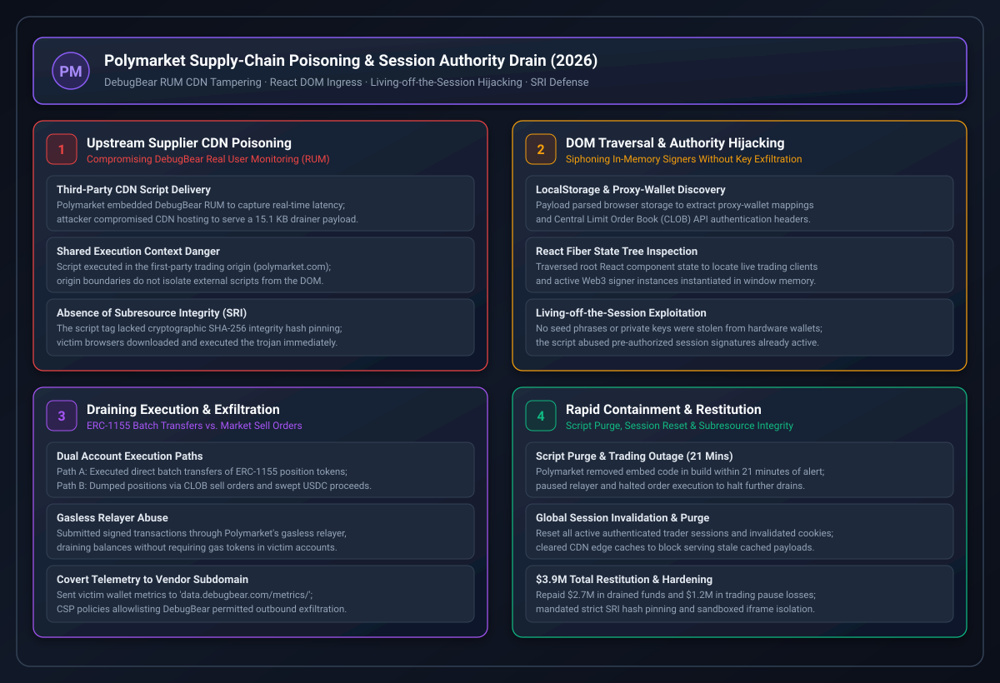
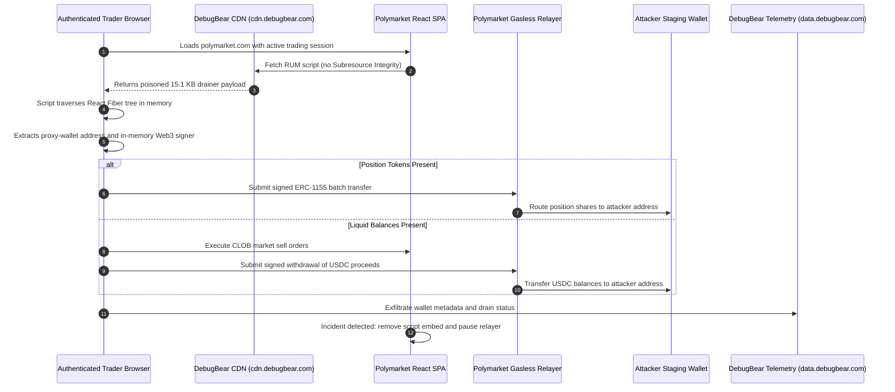

# Polymarket: A Compromised Monitoring Script Drained Trading Sessions

**Daily learning · 31 October 2026 · Primary-source review · Vendor investigation ongoing**  
*By Srinivasan Ragothaman ([@rsrini7](https://github.com/rsrini7))*

> **Core idea:** On 29 October 2026, a compromised third-party real user monitoring (RUM) script hosted by DebugBear ran inside authenticated Polymarket browser tabs. Rather than stealing master private keys, the trojanized script traversed the React DOM to hijack in-memory trading clients and proxy signers, executing unauthorized ERC-1155 token transfers and market sales. Polymarket removed the script within 21 minutes, paused trading, and refunded $3.9 million ($2.7 million in drained funds and $1.2 million in pause-related losses). [Polymarket's 30 October Incident Update](https://status.polymarket.com/cmvvek1i90eme14ruga1z6tuj).

---

## 1. Foundations: why a monitoring script mattered

Prediction markets and modern Web3 single-page applications (SPAs) blend off-chain web interfaces with decentralized on-chain settlement rails.

### Who is Polymarket?
Polymarket is the largest decentralized prediction market platform, enabling users to trade binary and multi-outcome position tokens tied to real-world events. To deliver a seamless user experience comparable to high-frequency centralized exchanges, Polymarket utilizes:
* **Proxy Wallets:** Smart contract wallets deployed on Polygon that hold trader balances and execute orders on behalf of an authenticated user.
* **Central Limit Order Book (CLOB):** An off-chain matching engine where authenticated users submit, cancel, and execute signed limit orders.
* **Gasless Relayers:** Backend infrastructure that submits signed blockchain transactions on behalf of users, subsidizing transaction gas fees so traders do not need to hold native MATIC/POL gas tokens.

### What is DebugBear?
DebugBear is a website monitoring vendor specializing in Core Web Vitals and **Real User Monitoring (RUM)**. RUM services measure how real visitors experience page load speed, layout shifts, and script execution across diverse devices and networks.
* To collect performance telemetry, customer websites embed a small vendor-hosted JavaScript snippet (typically delivered via `cdn.debugbear.com`).
* In this incident, DebugBear was a performance measurement supplier to Polymarket, entirely separate from Polymarket's blockchain settlement contracts.
* An attacker replaced the vendor-hosted script with a tailored payload targeting Polymarket's web trading frontend.

| Party | Role and effect in this incident |
|---|---|
| **Polymarket** | Operated the international trading site (`polymarket.com`); loaded the third-party RUM script without Subresource Integrity (SRI); detected unauthorized siphoning, halted trading within 27 minutes, purged the script, reset user sessions, and reimbursed $3.9M in losses. |
| **DebugBear** | Third-party performance monitoring vendor; suffered an upstream CDN breach where an attacker replaced legitimate RUM scripts with a 15.1 KB malicious payload; advised all customers to remove its embed code. |
| **Affected Traders** | Users with active, authenticated browser tabs open during the attack window whose in-memory session signers and proxy wallets were hijacked to liquidate positions or transfer tokens. |
| **Hudson Rock** | Cybercrime intelligence firm that retrieved and statically analyzed identical copies of the malicious payload from the DebugBear CDN, publishing decompiled indicators of compromise (IoCs). |

| Term | Meaning in this incident |
|---|---|
| **Real User Monitoring (RUM)** | A client-side JavaScript snippet that captures latency, rendering benchmarks, and user navigation telemetry. |
| **Subresource Integrity (SRI)** | A browser security feature enabling web developers to pin cryptographic hashes (e.g. SHA-384) to external scripts to block tampered code. |
| **Living-off-the-Session** | An attack technique where a malicious script abuses permissions, session tokens, and signers already active in browser memory rather than exfiltrating raw credentials. |
| **React Fiber Tree** | The internal component state graph maintained by React in browser memory, which can be traversed from DOM nodes to extract in-memory client instances. |
| **ERC-1155 Position Tokens** | Multi-token smart contract standard used on Polygon to represent outcome shares in prediction markets. |
| **Content Security Policy (CSP)** | HTTP response headers that restrict the network domains from which scripts can be loaded or to which outbound data can be transmitted. |

---

## 2. Deep Technical Mechanism: Supply Chain Poisoning & React DOM Traversal

The Polymarket incident was not a smart contract exploit, private key exfiltration, or consensus vulnerability. It was a **client-side supply-chain attack** that leveraged the shared JavaScript execution environment of the browser to execute a "living-off-the-session" heist.

### Step 1: Upstream CDN Tampering (`cdn.debugbear.com`)
Polymarket embedded DebugBear's RUM script dynamically from the vendor's Content Delivery Network:

```html
<!-- Vulnerable dynamic embed lacking integrity pinning -->
<script src="https://cdn.debugbear.com/C7xcKKrjUnXK.js" async></script>
```

At approximately 17:30 UTC on 29 October, the attacker compromised DebugBear's CDN delivery pipeline, replacing the legitimate monitoring script with a trojanized 15,187-byte file (`SHA-256: 0755e767504d8103f6c27b9e765a1026507a17c04513242adb503df7777879e5`). Because the script tag lacked Subresource Integrity (SRI), visitors' browsers downloaded and executed the malicious payload immediately upon opening or refreshing `polymarket.com`.

### Step 2: Shared Execution Context & DOM Snooping
In browser security architecture, external scripts loaded via `<script src="...">` run with the full permissions of the parent document's origin (`polymarket.com`). The script has unfettered access to:
* The Document Object Model (DOM).
* Global objects on `window`.
* Client storage mechanisms (`localStorage`, `sessionStorage`, and non-`HttpOnly` cookies).

### Step 3: React Fiber State Tree Traversal & Signer Extraction
Static analysis performed by Hudson Rock revealed that the 15.1 KB malicious script executed a structured four-stage reconnaissance and harvesting routine:

1. **Storage Enumeration:** The script inspected `localStorage` to extract the victim's proxy-wallet contract address and cached API authentication mappings for the Polymarket CLOB.
2. **React State Introspection:** The script traversed the React component tree by accessing internal React Fiber properties (`__reactFiber$...` or `__reactInternalInstance$...`) on DOM container elements.
3. **In-Memory Signer Hijacking:** By walking the component state, the trojan identified Polymarket's active trading client, obtaining direct references to the instantiated `ethers.js` or `viem` Web3 signer stored in runtime memory.

```
+--------------------------------------------------------------------------+
| Polymarket Client-Side Execution Context                                 |
|                                                                          |
| 1. Browser Origin: https://polymarket.com                                |
|    +----------------------------------------------------------------+    |
|    | DOM & React Application State                                  |    |
|    | - React Fiber Tree Root -> TradingContext -> Live Web3 Signer  |    |
|    | - LocalStorage: Proxy Address, CLOB API Credentials            |    |
|    +----------------------------------------------------------------+    |
|                                ^                                         |
|                                | Full In-Memory DOM Read/Write Access    |
|    +---------------------------+------------------------------------+    |
|    | Trojanized DebugBear RUM Script (cdn.debugbear.com)            |    |
|    | - Discovers proxy wallet & order book credentials              |    |
|    | - Extracts live in-memory signer (No private key needed)       |    |
|    | - Branch A: ERC-1155 batchTransfer to attacker fallback        |    |
|    | - Branch B: Market SELL orders -> drain USDC via Relayer       |    |
|    +----------------------------------------------------------------+    |
|                                |                                         |
|                                v                                         |
|    Exfiltration Telemetry to https://data.debugbear.com/metrics/         |
+--------------------------------------------------------------------------+
```

### Step 4: Branching Execution: ERC-1155 Batch Transfers vs. CLOB Fire Sales
Once the script hijacked the active session signer, it evaluated the account's asset composition and branched into two distinct draining strategies:
* **Branch A (Direct Token Transfer):** If the victim held ERC-1155 position tokens, the script called `safeBatchTransferFrom` on the conditional token contract, transferring all outcome shares to an attacker-controlled fallback address.
* **Branch B (Order Book Fire Sale & Proceeds Drain):** If the user held open limit positions or USDC balances, the script submitted aggressive market sell orders into the CLOB order book, converting positions to liquid USDC, and then submitted withdrawal transactions to siphon the proceeds.

### Step 5: Gasless Relayer Abuse & Telemetry Exfiltration
Because Polymarket subsidizes user transactions via a gasless relayer, the attacker did not need victim wallets to hold MATIC/POL gas tokens. The trojanized script signed transaction payloads using the in-memory signer and dispatched them directly to Polymarket's relayer API.

Simultaneously, the script reported victim wallet addresses, portfolio valuations, and transaction status codes back to `data.debugbear.com/metrics/`. Because Polymarket's Content Security Policy (CSP) already allowlisted `*.debugbear.com` for performance metrics, outbound exfiltration evaded browser network security blocks.

---

## 3. Architectural Visuals (SVGs & Mermaid)

The following architecture diagram illustrates the supply chain compromise, client-side DOM traversal, session hijacking, and containment phases:



### End-to-End Attack and Containment Flow



---

## 4. Production Implementations & Code Recipes

Securing client-side Web3 and financial single-page applications requires strict hash pinning, robust Content Security Policies, and isolating cryptographic signers from the global DOM context.

### Recipe 1: Automated Subresource Integrity (SRI) Verifier (Python)

This script automates build-time generation of SRI hashes (`sha384`) and validates that remote third-party scripts match pinned digests before allowing deployments to production.

```python
#!/usr/bin/env python3
"""
sri_verifier.py - Generates and validates Subresource Integrity (SRI) hashes
for third-party JavaScript dependencies.
"""

import hashlib
import base64
import urllib.request
import sys

def compute_sri_hash(url: str, algorithm: str = "sha384") -> str:
    """Fetches script content and generates standard SRI integrity string."""
    req = urllib.request.Request(
        url,
        headers={"User-Agent": "SRI-Integrity-Verifier/1.0"}
    )
    with urllib.request.urlopen(req, timeout=10) as response:
        content = response.read()

    if algorithm == "sha384":
        digest = hashlib.sha384(content).digest()
    elif algorithm == "sha256":
        digest = hashlib.sha256(content).digest()
    elif algorithm == "sha512":
        digest = hashlib.sha512(content).digest()
    else:
        raise ValueError(f"Unsupported hashing algorithm: {algorithm}")

    b64_digest = base64.b64encode(digest).decode("utf-8")
    return f"{algorithm}-{b64_digest}"

def verify_script_integrity(url: str, expected_sri: str) -> bool:
    """Verifies that the live script content matches the expected SRI hash."""
    actual_sri = compute_sri_hash(url, expected_sri.split("-")[0])
    if actual_sri != expected_sri:
        print(f"[!] INTEGRITY ERROR: Mismatch for {url}")
        print(f"    Expected: {expected_sri}")
        print(f"    Actual:   {actual_sri}")
        return False
    print(f"[+] Integrity Verified: {url} matches {expected_sri}")
    return True

if __name__ == "__main__":
    # Example verification
    test_url = "https://cdn.jsdelivr.net/npm/lodash@4.17.21/lodash.min.js"
    expected_hash = "sha384-Zr2aQ1W/bI3UksVd+B8g2R+hB1kP3+iG1B9hG9/XfI+1b2P3X4G8h0/1a2b3c4d5"
    
    print(f"Computed SRI for {test_url}:")
    print(compute_sri_hash(test_url, "sha384"))
```

### Recipe 2: Web Worker Web3 Signer Isolation Pattern (TypeScript / JS)

To prevent DOM-level script injections from accessing cryptographic signers, production trading interfaces should isolate private keys, seed phrases, and live signer instances within an unprivileged Web Worker or sandboxed `<iframe>`. The main DOM communicates exclusively via strict message passing:

```typescript
// signer-worker.ts (Isolated Execution Context)
// Runs in a background thread with zero DOM or window access.

import { ethers } from "ethers";

let isolatedWallet: ethers.Wallet | null = null;

self.onmessage = async (event: MessageEvent) => {
  const { type, id, payload } = event.data;

  try {
    switch (type) {
      case "INIT_SIGNER":
        // Initialize wallet within isolated worker scope
        isolatedWallet = new ethers.Wallet(payload.privateKey);
        self.postMessage({ id, status: "SUCCESS", address: isolatedWallet.address });
        break;

      case "SIGN_ORDER":
        if (!isolatedWallet) throw new Error("Signer not initialized");
        
        // Strict runtime validation of transaction payload before signing
        const { domain, types, value } = payload;
        
        // Ensure recipient is not an arbitrary unverified address
        if (value.taker !== ethers.ZeroAddress && value.taker !== payload.expectedTaker) {
          throw new Error("Security Violation: Taker address mismatch");
        }

        const signature = await isolatedWallet.signTypedData(domain, types, value);
        self.postMessage({ id, status: "SUCCESS", signature });
        break;

      default:
        throw new Error(`Unsupported action: ${type}`);
    }
  } catch (err: any) {
    self.postMessage({ id, status: "ERROR", error: err.message });
  }
};
```

---

## 5. Impact, Real-World Edge Cases & Gotchas

The Polymarket intrusion highlighted critical architectural blind spots in modern Web3 single-page applications.

### Common Claims vs. Technical Realities

| Claim or misconception | Technical reality established as of 31 October 2026 |
|---|---|
| **"Polymarket smart contracts were hacked."** | **False.** Polymarket's smart contracts on Polygon operated with complete integrity. The incident occurred entirely within the client-side browser DOM through a compromised third-party script. [Polymarket Incident Postmortem](https://status.polymarket.com/cmvvek1i90eme14ruga1z6tuj). |
| **"The attacker stole private keys and seed phrases."** | **Refuted by forensic code review.** Hudson Rock's static analysis revealed no routine designed to exfiltrate private keys or recovery phrases. The script hijacked in-memory session signers and API credentials already authorized in the active browser tab. [Hudson Rock Threat Report](https://www.infostealers.com/article/polymarket-breach-alert-wallet-draining-code-found-in-a-third-party-script/). |
| **"Every Polymarket user lost funds."** | **False.** Only users who had active, authenticated sessions open during the specific 29-minute attack window were exposed. Approximately 700 accounts experienced unauthorized transfers. |
| **"Total losses exceeded $10 million."** | **Refuted by audited restitution.** Polymarket confirmed total losses of **$2.7 million** directly drained, and added **$1.2 million** to compensate users for trade disruptions during the halt, bringing total restitution to **$3.9 million**. [Polymarket Incident Update](https://status.polymarket.com/cmvvek1i90eme14ruga1z6tuj). |
| **"CSP would have prevented this attack."** | **Misconception.** Content Security Policies only block domains not listed in directives. Because DebugBear was a trusted vendor, its domains (`cdn.debugbear.com` and `data.debugbear.com`) were explicitly permitted, rendering standard CSP allowlists ineffective without nonce-based SRI enforcement. |

### Architectural Edge Cases & Failure Modes
1. **The Shared DOM Execution Trap:** Scripts loaded via traditional `<script>` tags share identical runtime privileges with first-party application code. Even if a script comes from a reputable observability vendor, any breach of that vendor allows complete DOM manipulation.
2. **Dynamic Script Ingestion Without SRI:** Web teams often omit Subresource Integrity on third-party scripts to allow vendors to push continuous bug fixes and updates automatically. However, dynamic scripts without SRI convert vendor CDN infrastructure into single points of catastrophic failure.
3. **Session Reuse Bypassing 2FA:** Two-Factor Authentication (2FA) and biometric prompts protect session establishment, not active execution. Once a user logs in, in-memory trading signers can execute transactions without re-prompting for hardware verification unless step-up authentication is enforced at the transaction signing boundary.

---

## 6. Practical Adoption Blueprint & Verification Checklist

To defend financial and Web3 frontend applications against client-side script tampering, engineering teams should execute the following controls:

### Frontend Supply-Chain Security Checklist
- [ ] **Enforce Subresource Integrity (SRI):** Pin cryptographic hashes (`integrity="sha384-..."`) to all external script tags; configure CI/CD pipelines to fail builds if unpinned external scripts are detected.
- [ ] **Isolate Third-Party Observability Scripts:** Execute performance measurement and analytics code inside sandboxed `<iframe>` elements (`sandbox="allow-scripts"`) or Web Workers, completely preventing access to `window`, `localStorage`, and the React DOM.
- [ ] **Strict Content Security Policy (CSP):** Implement strict CSP headers utilizing cryptographic nonces (`script-src 'nonce-...'; object-src 'none'`) and avoid wildcards in `connect-src`.
- [ ] **Session Step-Up Signatures:** Require explicit user interaction (e.g. biometric WebAuthn or hardware wallet touch confirmation) for any transaction exceeding pre-configured value thresholds.
- [ ] **Automated Script Change Detection:** Deploy continuous synthetic monitoring (e.g. `wsaw` or `changedetection.io`) to alert security operations within seconds if external scripts mutate on CDNs.

### Diagnostic Commands & Indicators of Compromise

Security teams can audit network logs and server traces for contact with the compromised DebugBear endpoints using Ripgrep and standard hashing tools:

```bash
# 1. Search web proxy, CDN, and browser HAR logs for the malicious script and exfiltration endpoints
rg -n -i 'cdn[.]debugbear[.]com/C7xcKKrjUnXK[.]js|data[.]debugbear[.]com/metrics/(init|submit|update|handle)' /path/to/traffic-logs

# 2. Verify SHA-256 hash of any preserved script payload
shasum -a 256 /path/to/captured-debugbear-script.js
# Expected hash of the malicious payload:
# 0755e767504d8103f6c27b9e765a1026507a17c04513242adb503df7777879e5

# 3. Check live page HTML for unpinned external script tags
curl -sL https://polymarket.com | grep -E '<script[^>]+src=' | grep -v 'integrity='
```

---

## 7. Timeline and Current State

All recorded timestamps are in **UTC**.

| Date & Time (UTC) | Event and technical evidence |
|---|---|
| **29 Oct, ~17:30** | Compromised DebugBear RUM script (`C7xcKKrjUnXK.js`) deployed to `cdn.debugbear.com`. |
| **29 Oct, 17:38** | Polymarket security monitoring detects anomalous wallet drains and initiates an internal investigation. |
| **29 Oct, 17:59** | Polymarket deploys an emergency production build removing the DebugBear RUM embed script across all pages. |
| **29 Oct, 18:05** | Polymarket halts exchange trading, transitions the order book to cancel-only mode, and pauses the gasless relayer. |
| **29 Oct, 18:12–18:13** | Hudson Rock independently captures identical copies of the malicious 15.1 KB payload from DebugBear's CDN. |
| **29 Oct, 19:05** | Polymarket completes cache purges, invalidates active user sessions, verifies clean client bundles, and resumes normal trading operations. |
| **30 Oct, 14:00** | DebugBear releases an advisory instructing all RUM customers to remove embed scripts while internal forensic audits proceed. |
| **30 Oct, 20:07** | Polymarket publishes its official incident postmortem, disclosing the client-side session reuse mechanism and outlining the $3.9M restitution program. |

---

## 8. Primary Sources & References

1. [Polymarket Official Incident Update & Status Record](https://status.polymarket.com/cmvvek1i90eme14ruga1z6tuj) — Official postmortem detailing the third-party script removal, session reset, and $3.9M restitution breakdown.
2. [DebugBear Public Security Notice](https://x.com/DebugBear/status/2115866496643535293) — Vendor security advisory directing RUM customers to remove embed code during investigation.
3. [Hudson Rock Incident Report: Polymarket Wallet Draining Script](https://www.infostealers.com/article/polymarket-breach-alert-wallet-draining-code-found-in-a-third-party-script/) — Independent cybersecurity analysis providing file hashes, decompiled routines, and DOM traversal indicators.
4. [MDN Web Docs: Subresource Integrity (SRI)](https://developer.mozilla.org/en-US/docs/Web/Security/Defenses/Subresource_Integrity) — Architectural guide to cryptographic integrity pinning for external web scripts.
5. [MDN Web Docs: Content Security Policy (CSP)](https://developer.mozilla.org/en-US/docs/Web/HTTP/Reference/Headers/Content-Security-Policy/script-src) — Comprehensive standard reference for browser origin and script execution restrictions.
6. [DebugBear Real User Monitoring Documentation](https://www.debugbear.com/docs/what-is-real-user-monitoring) — Architectural overview of vendor RUM data collection and script delivery mechanics.

---

## 9. Supplementary visuals

The following architecture diagram details the four-stage supply-chain poisoning, client-side session authority reuse, and rapid containment lifecycle:


*Figure 1: High-level architectural overview of the Polymarket client-side supply-chain compromise, DebugBear RUM CDN tampering, React DOM traversal, and the $3.9M restitution process.*

---

**Related:**
- [French Supermarket Refrigeration Cyber-Sabotage](French-Supermarket-Refrigeration-Cyber-Sabotage-Nov-2026.md) — Compare Living-off-the-Land web session authority reuse against operational parameter sabotage in physical industrial controllers.
- [Binance Hot-Wallet Theft and TRM Labs Investigation](Binance-Hot-Wallet-Theft-TRM-Labs-Investigation-Oct-2026.md) — Compare how internal signing infrastructure subversion and automated account delegation drained multi-billion dollar crypto balances.
- [LiteLLM 1.107.0 Supply-Chain Compromise](LiteLLM-1.107.0-Supply-Chain-Compromise-Oct-2026.md) — Another trusted dependency carried malicious code through a different delivery path.
- [Notepad++ Targeted Attack](Notepad++-Targeted-Attack-Nov-2026.md) — Compare how a trusted software-delivery route can be abused.
- [OpenCode Console API-Key Breach](OpenCode-Console-API-Key-Breach-And-Distillation-Oct-2026.md) — Compare the reach of credentials and authority available inside an application.
- [Banks and Third-Party AI Agents](Banks-Third-Party-AI-Agents-Oct-2026.md) — A related trust-boundary question when external services act inside sensitive workflows.
