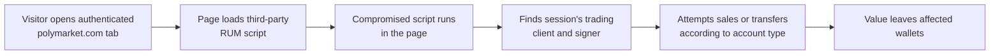

# Polymarket: A Compromised Monitoring Script Drained Trading Sessions

**Daily learning · 31 October 2026 · Primary-source review · Vendor investigation ongoing**

> **Core idea:** On 29 October, a compromised third-party performance-monitoring script ran inside some visitors' authenticated Polymarket tabs. It used the authority already present in those sessions to sell positions or move funds. Polymarket says it removed the script, restored trading and is returning $3.9 million, including compensation for losses during the pause. [Polymarket's 30 October incident update](https://status.polymarket.com/cmvvek1i90eme14ruga1z6tuj).

## 1. Foundations: why a monitoring script mattered

**Who is Polymarket?** It is a prediction-market platform: people buy and sell shares tied to possible outcomes of future events, such as whether an event will happen. The company operates separate international and US exchanges. This incident concerned its **international website, polymarket.com**. [Polymarket's explanation of prediction markets](https://help.polymarket.com/en/articles/13364272-what-is-a-prediction-market), [Polymarket's exchange descriptions](https://data.polymarket.com/), [incident record](https://status.polymarket.com/cmvvek1i90eme14ruga1z6tuj).

**What is DebugBear?** It is a service that helps website teams measure page speed and user experience. It offers scheduled tests that open a site under controlled conditions and **real user monitoring (RUM)** that measures what actual visitors experience. Think of its RUM feature as being in the same category as the browser-monitoring features of Datadog or Dynatrace; those products have different broader capabilities. DebugBear was a performance-measurement supplier to Polymarket, not part of the exchange or its blockchain. Datadog and Dynatrace are comparisons here; the reviewed incident sources do not implicate them. [DebugBear's monitoring overview](https://www.debugbear.com/docs/what-is-real-user-monitoring), [Datadog's browser RUM setup](https://docs.datadoghq.com/real_user_monitoring/application_monitoring/browser/setup/), [Dynatrace's RUM setup](https://docs.dynatrace.com/docs/observe/digital-experience/rum-classic/web-applications/initial-setup/rum-injection).

To use RUM, a site places a small script on its pages. A visitor's browser downloads the monitoring code, which measures page loading and sends measurements to the provider. In this incident, Polymarket says an attacker **replaced the vendor-hosted script** with code aimed at traders. The monitoring task was ordinary; the replacement code was malicious. The public record establishes a compromised delivery path, but does **not** yet explain how the attacker gained control at DebugBear or identify a flaw in the normal measurement feature. [DebugBear's RUM setup](https://www.debugbear.com/docs/rum/setup), [Polymarket's postmortem](https://status.polymarket.com/cmvvek1i90eme14ruga1z6tuj).

| Party | Role and effect in this incident |
|---|---|
| **DebugBear** | Supplied the monitoring script. It reported a security incident and told RUM customers to remove its embed code. Its initial compromise path remains undisclosed. |
| **Polymarket** | Put the script on its international trading site. Its web app was exposed through that dependency; it removed the script, paused trading, reset sessions and began reimbursing traders. |
| **Some Polymarket traders** | People with the site open during the attack window could have their active sessions used to sell positions or move funds. Others qualified for compensation for losses during the trading pause. This does not mean every user was drained. |

The supplier was compromised, Polymarket's site **loaded the compromised code**, and users' browsers executed it. That is the connection between DebugBear and the affected traders. [Polymarket's incident update](https://status.polymarket.com/cmvvek1i90eme14ruga1z6tuj), [DebugBear's notice](https://x.com/DebugBear/status/2115866496643535293), [Hudson Rock's file capture](https://www.infostealers.com/article/polymarket-breach-alert-wallet-draining-code-found-in-a-third-party-script/).

| Term | Meaning here |
|---|---|
| Real user monitoring (RUM) | JavaScript embedded in a site to measure visitors' actual page performance. |
| CLOB | Polymarket's central limit order book, where authenticated users place and cancel orders. |
| Relayer | A service that submits signed wallet transactions without requiring the user to hold gas tokens. |
| Position token | A token representing a prediction-market outcome held by a trader. |
| Supply-chain attack | Malicious code arrives through a dependency the site normally trusts. |

DebugBear's [RUM installation guide](https://www.debugbear.com/docs/rum/setup) describes adding a snippet to a site's HTML or tag manager; its [delivery guide](https://www.debugbear.com/docs/rum/snippet-performance) says the full script comes from `cdn.debugbear.com`. An external script included directly in a page runs in that page's JavaScript environment. Its network origin does **not** isolate it from the host page's application objects and storage. [MDN on external script execution](https://developer.mozilla.org/en-US/docs/Web/API/HTMLScriptElement/src#security_considerations).

Polymarket's [API documentation](https://docs.polymarket.com/getting-started/api) distinguishes authenticated order requests, wallet signatures and gasless relayer transactions. A script running beside an active trading interface can therefore be dangerous even if the exchange contracts and settlement network work as designed.



This diagram simplifies the observed attack path. Whether a particular action succeeded depended on the account, available authority, market liquidity, signature behavior and transaction execution. [Hudson Rock's static analysis](https://www.infostealers.com/article/polymarket-breach-alert-wallet-draining-code-found-in-a-third-party-script/), [Polymarket's incident update](https://status.polymarket.com/cmvvek1i90eme14ruga1z6tuj).

## 2. Mechanism: a page script reused the user's authority

Polymarket says an attacker replaced a vendor's performance-monitoring script with code built to target its users. People who had the international site open during a short window could have their active sessions used to sell positions and move funds. The company did not describe a smart-contract exploit. [Polymarket's incident update](https://status.polymarket.com/cmvvek1i90eme14ruga1z6tuj).

Hudson Rock independently retrieved the suspect DebugBear CDN file twice at **18:12 and 18:13 UTC** on 29 October. Both copies were 15,187 bytes and identical. Its static review found that the file:

1. Read account context from browser storage, including the proxy-wallet address and a map of CLOB API credentials.
2. Searched the running application's React component objects for its existing trading client and signer.
3. Inspected positions and balances, then branched by account type: one path attempted an ERC-1155 batch transfer of position tokens; another attempted sell orders followed by movement of available proceeds.
4. Sent wallet and portfolio information, plus attempted-action results, to paths under `data.debugbear.com`.

These are **observed instructions in the captured file**, not proof that every branch succeeded for every user. Hudson Rock found no routine in the sample that exported the credential map, a seed phrase or a private key. The stronger finding is **reuse of live session authority**, not theft of a wallet's underlying secret. Its analysis also warns that a configured recipient could differ from the file's hard-coded fallback address. [Hudson Rock's acquisition and analysis](https://www.infostealers.com/article/polymarket-breach-alert-wallet-draining-code-found-in-a-third-party-script/).

## 3. Impact: company totals versus early estimates

| Claim or figure | What is established as of 31 October |
|---|---|
| **$2.7 million lost** | Polymarket's 30 October update uses **$2.7 million** for the attack-related amount it is returning. Earlier wallet-balance snapshots and analyst estimates were provisional and are not an additional loss to add. |
| **$3.9 million in total reimbursements** | Polymarket says it is returning the $2.7 million above **plus $1.2 million for pause-related losses**. The pause compensation is distinct from funds drained by the script; the full $3.9 million had not yet been confirmed paid. |
| **Refund progress** | The company said **95% of affected wallets** had been refunded in full as of the afternoon of 30 October. This is a dated progress report, not confirmation that every payment is complete. |
| **About 700 affected accounts; 689 of 726 refunded** | These exact account and wallet counts appear in early summaries, but the official update gives a percentage and does not publish those denominators. A wallet count should not be relabeled as a count of unique people. |
| **Other DebugBear customers were breached** | DebugBear warned RUM customers to remove its embed code; that establishes a precaution across customers, not documented compromise or theft at another organization. |

Polymarket says it identified eligible wallets using on-chain and trading data, with no claim required. Its refund policy covers forced sales at the position's value when taken, including slippage, and qualifying losses caused by the trading pause. It offers a review form for people who think a payment is missing or incorrect. [Polymarket's 30 October incident update](https://status.polymarket.com/cmvvek1i90eme14ruga1z6tuj).

The captured script's fallback recipient address and a screenshot of its holdings were useful early clues, but one address balance cannot establish the total loss: the remote configuration could select another address, and a balance can include or exclude unrelated flows. Polymarket's own accounting is the current source for the aggregate reimbursement amount. [Hudson Rock's evidence limits](https://www.infostealers.com/article/polymarket-breach-alert-wallet-draining-code-found-in-a-third-party-script/).

## 4. Timeline and current state

All times are **UTC**. Polymarket published two overlapping status records: one for the web app and authentication incident, and one for the trading pause. They describe different affected components, not two demonstrated attacks. [Security incident record](https://status.polymarket.com/cmvvek1i90eme14ruga1z6tuj), [status history](https://status.polymarket.com/history/1).

| When | Event and evidence |
|---|---|
| 29 Oct, 17:38 | Polymarket's web app/authentication incident record begins with an investigation of unauthorized wallet activity. |
| 29 Oct, 17:59:20 | A production build inspected by Hudson Rock records removal of the DebugBear RUM script. **Build time is not verified deployment or containment time.** |
| 29 Oct, 18:05 | Polymarket's separate trading status record says the exchange is in cancel-only mode and relayer actions are paused. |
| 29 Oct, 18:12–18:13 | Hudson Rock retrieves identical malicious script bytes twice from the DebugBear CDN; its unauthenticated homepage snapshot no longer references the script. Existing open tabs are outside that snapshot's scope. |
| 29 Oct, 19:05 | Polymarket marks the trading outage resolved after approximately one hour. |
| 30 Oct, 20:07 | Polymarket publishes its update with the mechanism, response and reimbursement figures. |

Sources: [Polymarket incident record](https://status.polymarket.com/cmvvek1i90eme14ruga1z6tuj), [trading status history](https://status.polymarket.com/history/1), [Hudson Rock's timestamped captures](https://www.infostealers.com/article/polymarket-breach-alert-wallet-draining-code-found-in-a-third-party-script/).

Polymarket says it removed the script, cleared caches, paused trading and the relayer, then reopened after cleaning the site. It also reset active login sessions, referred the case to law enforcement, and is adding integrity controls and monitoring for third-party scripts. The status page now lists the affected services as operational. The initial method of compromise at DebugBear, the exact malicious delivery window, the threat actor and the final reimbursement completion are still open questions in the sources reviewed. [Polymarket's update](https://status.polymarket.com/cmvvek1i90eme14ruga1z6tuj).

## 5. Practical response and lessons

**For traders who had an open authenticated tab on 29 October:** review orders, position movements, wallet transfers and Polymarket's reimbursement record through a fresh session. Reject unexpected signature requests and preserve transaction hashes, timestamps and screenshots if activity is unexplained. Use the review route linked from [Polymarket's incident update](https://status.polymarket.com/cmvvek1i90eme14ruga1z6tuj) if a refund appears wrong. A session reset and a clean site do not undo a transaction that already settled.

**For sites embedding third-party scripts:** inventory them on authenticated and payment pages, remove unnecessary ones, and record the exact bytes and hashes when investigating an incident. Subresource Integrity (SRI) can make a browser reject a changed external file **if the site pins an expected hash and maintains it as versions change**. A restrictive Content Security Policy (CSP) can reduce where scripts load from or send data, while sandboxing can reduce their access to sensitive page state. A CSP rule that already permits the compromised script, or merely blocks an exfiltration destination, cannot by itself prevent that script from calling allowed trading functions in the same page. [MDN on SRI](https://developer.mozilla.org/en-US/docs/Web/Security/Defenses/Subresource_Integrity), [MDN on CSP](https://developer.mozilla.org/en-US/docs/Web/HTTP/Reference/Headers/Content-Security-Policy/script-src).

DebugBear publicly told customers using its RUM product to remove the embed during its security incident. That advice applied broadly, while the analyzed payload was tailored to Polymarket; public evidence reviewed here does not establish an incident at another customer. [DebugBear's 29 October notice](https://x.com/DebugBear/status/2115866496643535293), [Hudson Rock's analysis](https://www.infostealers.com/article/polymarket-breach-alert-wallet-draining-code-found-in-a-third-party-script/).

## 6. Open-source detection: what to search and monitor

| Tool | Useful for | Limit |
|---|---|---|
| [wsaw](https://github.com/pflege-de-labs/wsaw) | Loads configured pages in a browser, records network requests and SHA-256 digests, and reports when a script changes under the same URL. | Its documented authenticated-flow support is limited to basic auth and injected headers; a public-page scan may miss code loaded only after login. |
| [suricatajs](https://github.com/nkalexiou/suricatajs) | Hashes external and inline scripts, alerts on new or changed scripts, and offers a Playwright mode for JavaScript-heavy pages. | A small project to evaluate in a test environment; a changed hash needs review, not automatic attribution to an attack. |
| [changedetection.io](https://github.com/dgtlmoon/changedetection.io) | Watches a **known script URL** for a changed response and sends notifications. | It does not inventory every script a page loads or decide whether a change is malicious. |
| [CSP Evaluator](https://github.com/google/csp-evaluator) | Reviews a site's Content Security Policy for weak allowlists and other bypasses. | A prevention review, not a detector for a compromised script already allowed to run. |

For **this incident**, Hudson Rock published the captured script URL `cdn.debugbear.com/C7xcKKrjUnXK.js` and its SHA-256 digest `0755e767504d8103f6c27b9e765a1026507a17c04513242adb503df7777879e5`. It also identified reporting paths under `data.debugbear.com/metrics/`. Search archived browser HAR files, proxy/CDN logs or security telemetry for the exact URL and paths; hash a preserved response body if one exists. [Hudson Rock's sample and indicators](https://www.infostealers.com/article/polymarket-breach-alert-wallet-draining-code-found-in-a-third-party-script/).

```bash
rg -n -i 'cdn[.]debugbear[.]com/C7xcKKrjUnXK[.]js|data[.]debugbear[.]com/metrics/(init|submit|update|handle)' /path/to/traffic-logs
shasum -a 256 /path/to/preserved-script.js
```

The first command finds **contact with those endpoints**, not proof that the malicious bytes ran: the same vendor URL could have served legitimate content at another time. The hash is stronger evidence for the captured sample. A missing hit is inconclusive if logs were not retained, the page loaded a cached copy, or an authenticated flow was never recorded. Continuous script monitoring needs an approved baseline and a controlled test session for login-only pages. [Hudson Rock's evidence limits](https://www.infostealers.com/article/polymarket-breach-alert-wallet-draining-code-found-in-a-third-party-script/), [wsaw's documented limitations](https://github.com/pflege-de-labs/wsaw).

## 7. Source context

This note began with user-shared video summaries and a pasted incident account. Material claims were checked against [Polymarket's status and postmortem](https://status.polymarket.com/cmvvek1i90eme14ruga1z6tuj), [DebugBear's RUM documentation](https://www.debugbear.com/docs/rum/setup), [DebugBear's public incident notice](https://x.com/DebugBear/status/2115866496643535293), and [Hudson Rock's first-person file capture and static review](https://www.infostealers.com/article/polymarket-breach-alert-wallet-draining-code-found-in-a-third-party-script/). The supplied video summaries are context, not independent proof of exact wallet counts, script behavior or completed refunds. Tool descriptions in §6 come from their project documentation; the tools were not deployed against Polymarket.

---

**Related:**
- [LiteLLM 1.107.0 Supply-Chain Compromise](LiteLLM-1.107.0-Supply-Chain-Compromise-Oct-2026.md) — Another trusted dependency carried malicious code through a different delivery path.
- [Notepad++ Targeted Attack](Notepad++-Targetted-Attach.md) — Compare how a trusted software-delivery route can be abused.
- [OpenCode Console API-Key Breach](OpenCode-Console-API-Key-Breach-And-Distillation-Oct-2026.md) — Compare the reach of credentials and authority available inside an application.
- [Banks and Third-Party AI Agents](Banks-Third-Party-AI-Agents-Oct-2026.md) — A related trust-boundary question when external services act inside sensitive workflows.
