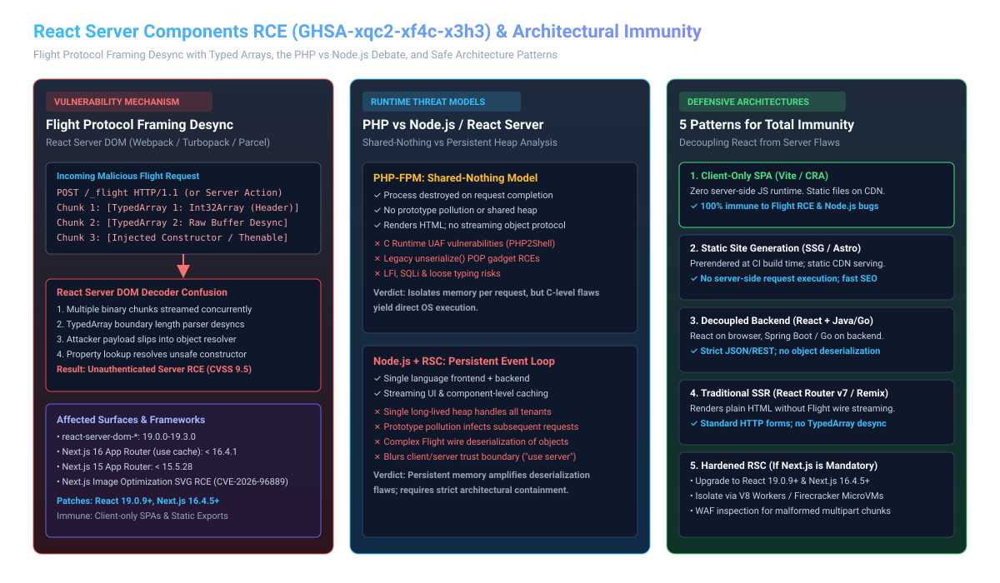
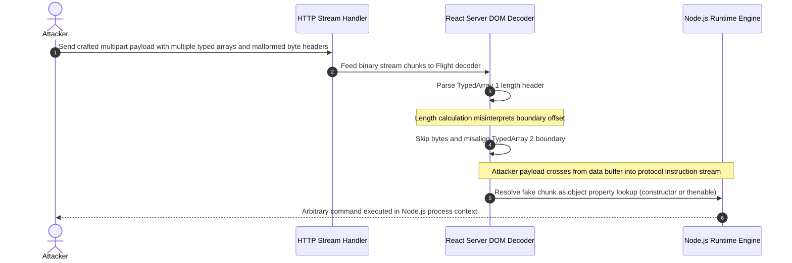
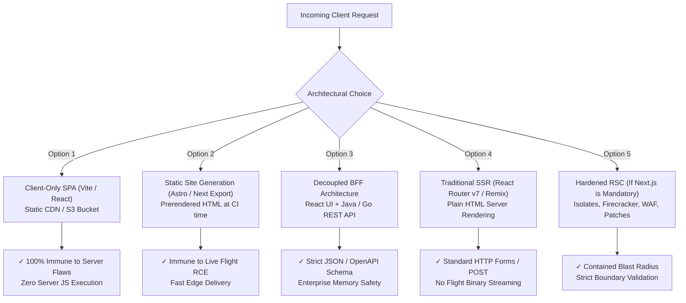

# React Server Components RCE: GHSA-xqc2-xf4c-x3h3, Flight Framing Desync, and the PHP-to-React Debate

**Daily learning · 10 November 2026 · Primary-source security analysis and architectural evaluation**

> **Core idea:** An unauthenticated Remote Code Execution (RCE) vulnerability (GHSA-xqc2-xf4c-x3h3 / Next.js GHSA-673q-mjm6-r5xr, CVSS v4: 9.5 Critical) in React Server DOM packages stems from a streaming deserialization framing desync when handling multiple JavaScript typed arrays alongside attacker-controlled values. While this incident illustrates the distinct hazards of running complex object-streaming protocols inside persistent Node.js server heaps, it does not prove that React is inherently worse than PHP—rather, it exposes the danger of treating fullstack server-side components as a mandatory default when decoupled or client-only architectures offer total immunity.

---

## 1. Foundations: Demystifying React Server Components and the Flight Protocol

To understand this vulnerability and evaluate the architectural debate, we must separate the traditional React UI library running in web browsers from the newer server execution model introduced in React 19 and fullstack frameworks like Next.js.



### 1.1 What Are React Server Components (RSC)?
Historically, React was strictly a client-side JavaScript library. A web server served a static HTML shell and JavaScript bundles; the user's browser executed that code, rendered the Document Object Model (DOM), and made separate `fetch()` API calls to retrieve data.

React Server Components (RSC) inverted this model by allowing React components to execute directly on the server before sending data to the browser:
- **Server execution:** The component reads directly from a database, file system, or internal microservice on the server.
- **Payload generation:** Instead of sending raw HTML or client JavaScript, the server streams a specialized wire format called the **React Flight Protocol**.
- **Client reconstruction:** The browser receives the Flight stream, merges it with interactive client components, and updates the UI without a full page refresh.

### 1.2 What Is the Flight Protocol?
The Flight protocol is React's internal streaming serialization engine. Standard web APIs communicate using JSON (which only supports primitive strings, numbers, booleans, arrays, and plain objects). RSC requires serializing much richer JavaScript constructs across the network:
- Component trees and virtual DOM references
- Pending asynchronous Promises
- Server Action references (functions living on the server callable from the client)
- Binary buffers and typed arrays (`Uint8Array`, `Float32Array`, `Int32Array`)
- Symbol identifiers and error boundaries

This serialization and deserialization is performed by dedicated bundler-specific packages: `react-server-dom-webpack`, `react-server-dom-turbopack`, and `react-server-dom-parcel`.

### 1.3 Key Terminology

| Term | Meaning and Role in Web Architecture |
|---|---|
| **React Server DOM** | The low-level runtime packages (`react-server-dom-*`) that serialize and deserialize Flight streams between Node.js servers and clients. |
| **TypedArray** | JavaScript binary buffer views (`Uint8Array`, `Int32Array`) used to stream raw binary data, files, or cached snapshots efficiently. |
| **Framing Desync** | A parsing flaw where the deserializer loses track of data boundaries in a multi-part stream, misinterpreting binary data as structural protocol commands. |
| **Shared-Nothing (PHP)** | Execution model where every incoming HTTP request runs in an isolated process that is completely destroyed after sending the response. |
| **Persistent Heap (Node.js)** | Execution model where a single, long-running Node.js process handles thousands of concurrent requests within a shared memory space. |
| **Cache Components (`use cache`)** | Next.js 16 feature allowing server functions to cache rendered component output or binary payloads across requests. |

---

## 2. The Technical Mechanism: How GHSA-xqc2-xf4c-x3h3 Leads to RCE

The vulnerability tracked under [GHSA-xqc2-xf4c-x3h3](https://github.com/react/react/security/advisories/GHSA-xqc2-xf4c-x3h3) (with companion Next.js advisories `GHSA-673q-mjm6-r5xr` and `CVE-2026-96889`) carries a CVSS v4 score of **9.5 Critical**. It is an unauthenticated remote code execution flaw in the React Server DOM deserialization pipeline.

### 2.1 The Wire Protocol and Typed Array Serialization
When a React Server Component streams data, it breaks the output into numbered chunks over an HTTP response or multipart POST body:

```http
1:I["$","div",null,{"children":"Hello World"}]
2:T4,AAAA
3:HL["/styles.css","style"]
```

In the Flight wire format:
- `1:` denotes a component model chunk.
- `2:T<byte_length>,<base64_data>` denotes a **TypedArray binary chunk**.
- References within chunk 1 can point to chunk 2 via reference markers (e.g., `"$2"`).

To minimize memory copies and optimize high-throughput streaming, `react-server-dom-*` parses these chunks incrementally as raw network buffers arrive from the TCP stream.

### 2.2 The Framing Desync Flaw
The core defect occurs when an incoming request transports **multiple typed arrays alongside an attacker-controlled value**:



1. **Stream Multiplexing:** When multiple binary typed arrays are transferred simultaneously, the parser calculates byte offsets to slice binary buffers from the stream.
2. **Length Confusion:** Under specific input sequences where user input is passed into a streaming response or server action handler, the length header parsing logic in `react-server-dom-*` fails to correctly validate the delimiter boundary between successive typed array chunks.
3. **Data/Control Plane Boundary Collapse:** Because the boundary offset is miscalculated, the parser reads the bytes of the *second* typed array not as raw binary data, but as **Flight protocol control tokens**.
4. **Object Confusion & Gadget Trigger:** In React Server DOM, control tokens can define object models, references, and promise resolvers (`then`ables). By injecting crafted tokens through the desynchronized stream, the attacker crafts a synthetic internal `Chunk` object whose properties point to native JavaScript constructors (`Function`, `process.mainModule.require`).
5. **Code Execution:** When React attempts to resolve the synthetic chunk during stream completion, it invokes the injected constructor, achieving unauthenticated remote code execution with the permissions of the Node.js process.

### 2.3 Companion Flaws: Next.js Cache Components and Image Optimization
The disclosure on October 14, 2026, coincided with two related vulnerabilities in Next.js:

1. **Next.js Cache Components (`GHSA-673q-mjm6-r5xr`):**
   In Next.js 15 and 16, functions utilizing the `use cache` directive serialize their cached return values through React's binary transport. If a cached server function returned multiple typed arrays and accepted untrusted query parameters, the cached output was vulnerable to this framing desynchronization, allowing external HTTP clients to trigger remote code execution.
2. **Image Optimization API SVG UAF (`CVE-2026-96889` / `GHSA-2464-fhr4-w9xw`):**
   Next.js's built-in image optimization endpoint (`/_next/image`) processed SVG images via the `sharp` library, which bound to an underlying native `librsvg` C library. Specially crafted SVGs containing recursive XML inclusions (XIncludes) triggered a Use-After-Free (UAF) memory corruption bug on glibc-based Linux systems, demonstrating that native C dependencies in the Node.js ecosystem share the same class of memory flaws historically associated with PHP.

---

## 3. Impact, Scope, and Misconceptions

### 3.1 Affected vs. Patched Versions

| Component / Framework | Vulnerable Package | Vulnerable Versions | Patched Safe Versions |
|---|---|---|---|
| **React Server DOM (Webpack)** | `react-server-dom-webpack` | `19.0.0` – `19.0.8`<br>`19.1.0` – `19.1.9`<br>`19.2.0` – `19.2.8`<br>`19.3.0` | **`19.0.9`**<br>**`19.1.10`**<br>**`19.2.9`**<br>**`19.3.1`** |
| **React Server DOM (Turbopack)** | `react-server-dom-turbopack` | Same version ranges as above | Same patched releases as above |
| **React Server DOM (Parcel)** | `react-server-dom-parcel` | Same version ranges as above | Same patched releases as above |
| **Next.js (App Router)** | `next` (Cache Components & SVG) | `< 16.4.1`<br>`< 15.5.28` | **`16.4.5+`** *(recommended)*<br>**`15.5.29+`** *(recommended)* |
| **Image Pipeline** | `sharp` (via Next.js Image API) | `< 0.35.5` | **`0.35.5+`** |

### 3.2 Prerequisites and Exploitation Realities
The vulnerability carries a CVSS score of 9.5 because, when present, an attacker requires **no authentication, no prior privileges, and no user interaction**.

However, the React core team emphasized that exploitation requires a specific application pattern:
- The server application must execute React Server Components or Server Actions on an active server.
- The server response or action pipeline must transport **multiple typed arrays simultaneously** alongside an **untrusted, attacker-controlled parameter**.

Applications that do not stream binary typed arrays via RSC are substantially harder or impossible to exploit via this specific framing bug, though running unpatched code remains an unacceptable operational risk.

### 3.3 What Is 100% Unaffected?
- **Client-only React applications:** Traditional single-page applications (SPAs) built with Vite, Create React App, or plain script tags that run entirely in the browser.
- **Static Site Generation (SSG):** Sites built using `next build && next export` or Astro where HTML and JS assets are generated at CI build time and served via Nginx, Apache, or CDNs (Cloudflare, AWS S3/CloudFront).
- **React Native applications:** Mobile apps running on iOS/Android devices.
- **Traditional SSR without Flight:** Frameworks like Remix or React Router v7 configured for standard HTML server-side rendering without React Server Components or binary Flight streaming.

### 3.4 Common Misconceptions

| Misconception | Technical Reality |
|---|---|
| *"React itself has an unpatchable security flaw."* | The core React UI library (`react`, `react-dom`) is not vulnerable. The flaw exists exclusively in the server-side streaming transport packages (`react-server-dom-*`). |
| *"PHP is immune to RCE, unlike React."* | PHP has suffered severe unauthenticated RCEs (such as PHP2Shell in October 2026, a native Zend engine UAF bypassing ASLR, and decades of `unserialize()` POP gadget chains). |
| *"Upgrading from PHP to React requires running Next.js server components."* | React is a UI library, not a server framework. Migrating a frontend to React can be done using a static build served by a CDN, with zero Node.js server presence. |

---

## 4. Architectural Evaluation: PHP-FPM vs. Server-Side JavaScript Runtimes

When modernizing web applications from traditional PHP architectures to modern JavaScript stacks, architectural discussions often contrast PHP's shared-nothing process lifecycle against the persistent memory model of Node.js and React Server Components.

Evaluating whether server-side React is structurally more vulnerable than PHP requires analyzing how their respective execution models manage memory, state, and attack surfaces.

### 4.1 Side-by-Side Runtime Architecture Comparison

| Architectural Property | PHP-FPM (Traditional PHP) | Node.js + React Server Components |
|---|---|---|
| **Process Lifecycle** | **Shared-Nothing:** Each HTTP request runs in a worker that initializes, executes, and wipes its entire memory pool upon termination. | **Persistent Event Loop:** A single process handles thousands of requests over days/weeks within a continuous V8 memory heap. |
| **Cross-Request Contamination** | **Virtually Impossible:** A memory leak, variable corruption, or error in request A cannot alter global variables in request B. | **High Risk:** Prototype pollution or modified module-level variables affect all subsequent requests and tenants. |
| **Deserialization Protocol** | Simple HTTP Form/JSON parsing. Deserialization only occurs if the developer explicitly calls `unserialize()`. | **Mandatory Flight Wire Protocol:** Automatically deserializes streaming JavaScript objects, typed arrays, and closures on every RSC call. |
| **Client / Server Boundary** | **Explicit & Physical:** `.php` files execute on the server. Client JS executes in the browser. Database calls cannot accidentally leak to client bundles. | **Blurred (`"use client"` / `"use server"`):** Components in the same directory compile to different targets; accidental credential leakage is a frequent operational issue. |
| **Native Runtime Safety** | **C-based (Vulnerable to memory corruption):** Buffer overflows, integer overflows, and Use-After-Free (PHP2Shell) allow direct OS shellcode execution. | **V8 Managed Memory (C++ core, JS sandbox):** Memory corruption in JS is rare; RCE typically requires gadget chains or native add-on vulnerabilities (`sharp`). |
| **Denial of Service Blast Radius** | Single worker crash affects only that request. Master process respawns workers automatically. | An unhandled exception or CPU-bound infinite loop in one request crashes or freezes the server for all active users. |

### 4.2 Structural Risks Inherent to Server-Side React
1. **State Persistence Amplifies Deserialization Bugs:**
   PHP-FPM's design guarantees that when a request finishes, its entire memory space is freed. In contrast, Node.js retains heap memory indefinitely. If an attacker partially corrupts an object or pollutes `Object.prototype`, that payload persists in memory, compromising subsequent requests handled by the same process.
2. **Streaming Object Deserialization Is a High-Risk Primitive:**
   In security engineering, deserializing untrusted complex data over a network is a classic source of critical vulnerabilities (evident in Java deserialization flaws, Python `pickle`, and Ruby `Marshal`). By introducing the Flight Protocol to stream live JavaScript object graphs, React Server Components adopted the same protocol complexity that enterprise backend systems actively avoid.
3. **Blurred Execution Boundaries:**
   Blending frontend UI rendering and backend database queries in one unified component tree makes rapid prototyping easy, but expands the attack surface for accidental data leakage and unauthenticated RPC invocation.

### 4.3 Structural Risks Inherent to Legacy PHP and the Decoupled Alternative
1. **Low-Level Memory Corruption in Native C Runtimes:**
   PHP's core engine and extensions are written in C. When vulnerabilities occur in PHP (such as the recent **PHP2Shell** native Use-After-Free flaw, or historical flaws in `libxml`, `gd`, and `curl`), they allow attackers to corrupt raw memory pointers, bypass Address Space Layout Randomization (ASLR), and execute shellcode directly at the operating system level.
2. **PHP's Legacy Deserialization Surface:**
   PHP's native `unserialize()` has been the source of hundreds of critical RCE vulnerabilities via Property-Oriented Programming (POP) gadget chains across open-source frameworks.
3. **The Decoupled Reality (UI != Server Execution):**
   The comparison between PHP and fullstack React often rests on a false dilemma—assuming that adopting React requires running React Server Components on a live Node.js server. React is fundamentally a client-side UI library; deploying it statically on a CDN entirely eliminates server-side JavaScript execution and its associated attack surface.

---

## 5. Five Architectural Approaches to Avoid RSC Vulnerabilities

Organizations seeking to modernize from PHP without exposing themselves to React Server Component deserialization vulnerabilities have several battle-tested architectural alternatives.



### Approach 1: Client-Only React SPA (Recommended for Most Apps)
- **Architecture:** Build the UI using Vite or Create React App. Deploy the output HTML, CSS, and JS files to an object store (AWS S3, Cloudflare Pages, Vercel Static) backed by a CDN.
- **Why It Is Immune:** There is **zero Node.js code running on the server**. The server is merely an HTTP file server (like Nginx or Cloudflare's edge). Attacks targeting `react-server-dom-*` or Flight protocol streams cannot execute because the code is never invoked on a server.
- **Trade-offs:** Initial page load requires client-side JavaScript execution (client-side data fetching); less ideal for SEO-critical e-commerce public landing pages, but ideal for internal dashboards, SaaS portals, and administrative tools.

### Approach 2: Static Site Generation (SSG / Astro / Next Export)
- **Architecture:** Pre-render all pages at CI/CD build time using Astro or `next build && next export`. The build process queries databases or CMS endpoints during compilation and writes static `.html` files to disk.
- **Why It Is Immune:** Incoming user requests do not trigger dynamic server-side rendering or Flight deserialization. Malicious requests cannot exploit server-side runtime hooks because requests are served directly from cache or static disk storage.
- **Trade-offs:** Content updates require triggering a CI build or incremental static regeneration (ISR).

### Approach 3: Decoupled Backend-for-Frontend (React Frontend + Java/Go API)
- **Architecture:** Retain React purely for client-side view rendering, but delegate all server operations, authentication, business logic, and database access to a hardened backend service written in **Java (Spring Boot)** or **Go**.
- **Communication:** Communication occurs strictly via standard RESTful JSON APIs or gRPC with strongly-typed schemas (OpenAPI, Protocol Buffers).
- **Why It Is Immune:** Eliminates dynamic JavaScript object deserialization across the network boundary. Java and Go offer strict compile-time type safety and mature security models, preventing prototype pollution and binary stream desync.
- **Enterprise Alignment:** Fits organizations that already operate enterprise Java or Go services, providing separation of concerns between frontend presentation and backend data integrity.

### Approach 4: Traditional SSR Without Flight (Remix / React Router v7 Traditional)
- **Architecture:** If server-side rendering is strictly required for search engine optimization (SEO), use traditional SSR engines (like React Router v7 in standard SSR mode) that render full HTML strings using `renderToString()` or standard Web Streams.
- **Why It Is Immune:** Traditional SSR generates standard HTML markup and handles mutations via standard HTML `<form>` POST requests. It does not employ the React Flight protocol, binary chunk multiplexing, or client-to-server function closures, avoiding the entire attack surface of `react-server-dom-*`.

### Approach 5: Hardened RSC Deployment (When Next.js / RSC Is Mandatory)
If an organization determines that React Server Components and Next.js App Router are strictly necessary, the deployment must be hardened with defense-in-depth measures:

1. **Immediate Patch Maintenance:**
   Enforce continuous lockfile scanning and ensure dependencies satisfy the patched baselines:
   ```json
   {
     "overrides": {
       "react-server-dom-webpack": "^19.0.9",
       "react-server-dom-turbopack": "^19.0.9",
       "react-server-dom-parcel": "^19.0.9",
       "next": "^16.4.5"
     }
   }
   ```
2. **Runtime Isolation (V8 Isolates / MicroVMs):**
   Do not run Next.js in a monolithic Node.js process with root privileges. Run workloads inside lightweight isolated sandboxes:
   - **V8 Isolates:** Cloudflare Workers or Deno Deploy, where memory heaps are completely segregated per request.
   - **MicroVMs:** AWS Firecracker or gVisor containers with read-only root filesystems, minimal memory allocations, and no outbound network access to internal metadata endpoints (`169.254.169.254`).
3. **Web Application Firewall (WAF) Payload Filtering:**
   Deploy edge rules to inspect incoming multipart requests. Reject HTTP requests targeting RSC endpoints that contain unexpected binary headers, malformed chunk delimiters, or excessive nested parameters.
4. **Enforce `server-only` Barriers:**
   Use the official `server-only` package in all backend modules to guarantee that sensitive credentials, database clients, and server utilities cannot accidentally be bundled or invoked through client-facing interfaces:
   ```javascript
   import 'server-only';
   // If any client component imports this file, the build fails immediately
   ```

---

## 6. Incident Timeline and Current Status

| Date | Milestone / Event |
|---|---|
| **Dec 3, 2025** | Meta and Vercel disclose **React2Shell** (CVE-2025-55182, CVSS 10.0), a prototype-pollution deserialization flaw in the Flight protocol. |
| **Oct 14, 2026** | React core team publishes security advisory **GHSA-xqc2-xf4c-x3h3** (CVSS 9.5) covering unauthenticated RCE via typed array framing desync in `react-server-dom-*`. Pull Request #37845 merged. |
| **Oct 14, 2026** | Vercel issues emergency out-of-band updates for Next.js 16 (`16.4.1`) and Next.js 15 (`15.5.28`) addressing `GHSA-673q-mjm6-r5xr` (`use cache` typed arrays) and `CVE-2026-96889` (SVG RCE via `sharp`/`librsvg`). |
| **Late Oct 2026** | Security firms and threat intelligence providers report active scanning for unpatched RSC endpoints; patch adoption stabilizes across enterprise users. |
| **Nov 2026** | Cloud providers and CDN edge proxies deploy automated WAF rules to detect and filter malformed Flight framing payloads. |

---

## 7. Practical Response, Verification, and Hunting Guide

### 7.1 Verify Your Project's Vulnerability Status
Run the following audit command in your project root to identify affected packages:

```bash
# Check if vulnerable react-server-dom packages exist in the lockfile
npm ls react-server-dom-webpack react-server-dom-turbopack react-server-dom-parcel next sharp
```

If your project reports any of the following, it is vulnerable:
- `react-server-dom-*` between `19.0.0` and `19.0.8`, `19.1.0` – `19.1.9`, `19.2.0` – `19.2.8`, or `19.3.0`.
- `next` versions `< 16.4.1` (Next.js 16) or `< 15.5.28` (Next.js 15).
- `sharp` versions `< 0.35.5` (if using Next.js Image Optimization with SVGs).

### 7.2 Update and Enforce Fixed Versions
Update dependencies to safe versions immediately:

```bash
# For Next.js projects
npm install next@16.4.5 react@19.0.9 react-dom@19.0.9

# Ensure lockfile resolution resolves patched sub-dependencies
npm audit fix
```

For Yarn users (`package.json`):
```json
{
  "resolutions": {
    "react-server-dom-webpack": "^19.0.9",
    "sharp": "^0.35.5"
  }
}
```

### 7.3 Log Hunting and Retrospective Detection
Inspect your web server (Nginx, Envoy, Cloudflare) and application logs for suspicious Flight protocol patterns:

1. **Anomalous POST Requests to Server Action / RSC Endpoints:**
   Search for POST requests containing unexpected Content-Type headers combined with binary data payloads:
   ```bash
   grep -E 'POST /(_flight|api/actions|\?_rsc=)' access.log | grep -E 'multipart/form-data; boundary='
   ```
2. **Payload Size Spikes:**
   Look for unusually large multipart payloads with high concentrations of binary characters directed at lightweight routes.
3. **Node.js Process Anomalies:**
   Audit your runtime telemetry for sudden spawns of child processes from Node.js:
   ```bash
   # Audit child process spawns under Linux auditd
   ausearch -p $(pgrep node) -c execve
   ```

---

## 8. Source Context and Verification

Researched following public disclosures regarding React Server DOM and Next.js in October 2026. Material claims, package version boundaries, and protocol details have been cross-checked against primary disclosures:
- [React Security Advisory GHSA-xqc2-xf4c-x3h3](https://github.com/react/react/security/advisories/GHSA-xqc2-xf4c-x3h3)
- [Next.js Security Advisory GHSA-673q-mjm6-r5xr](https://github.com/vercel/next.js/security/advisories/GHSA-673q-mjm6-r5xr)
- [Next.js Security Advisory CVE-2026-96889 / GHSA-2464-fhr4-w9xw](https://github.com/vercel/next.js/security/advisories/GHSA-2464-fhr4-w9xw)
- [React GitHub Repository PR #37845](https://github.com/facebook/react/pull/37845)
- [ThreatDefence Technical Patch and Hunting Analysis](https://threatdefence.com/article/react-server-components-rce-ghsa-xqc2-xf4c-x3h3-patching-hunting)

---

**Related:**
- [React2Shell Whitepaper (CVE-2025-55182)](10.0_CVE_React2Shell_Whitepaper.md) — The earlier December 2025 prototype-pollution Flight protocol RCE that initiated the RSC security debate.
- [PHP Migration: Static React, Java or Go?](../../Engineering/Architecture/PHP-Migration-Static-React-Java-And-Go-Oct-2026.md) — Architectural strategy for decoupling web presentation from backend runtimes without taking on RSC complexity.
- [PHP2Shell: History, UAF and ASLR](PHP2Shell-History-UAF-And-ASLR-Oct-2026.md) — Technical analysis of the native C-runtime Use-After-Free in PHP that balances comparisons between PHP and Node.js security.
- [Node.js Brotli Node2Shell RCE](Node.js-Brotli-Node2Shell-RCE-Oct-2026.md) — Examination of native buffer manipulation and RCE vectors within the Node.js runtime environment.
- [HTTP Egress Proxies vs MCP Gateways](HTTP-Egress-Credential-Proxies-Vs-MCP-Gateways-Nov-2026.md) — Defense-in-depth credential isolation strategies to protect server processes against post-exploitation data exfiltration.
