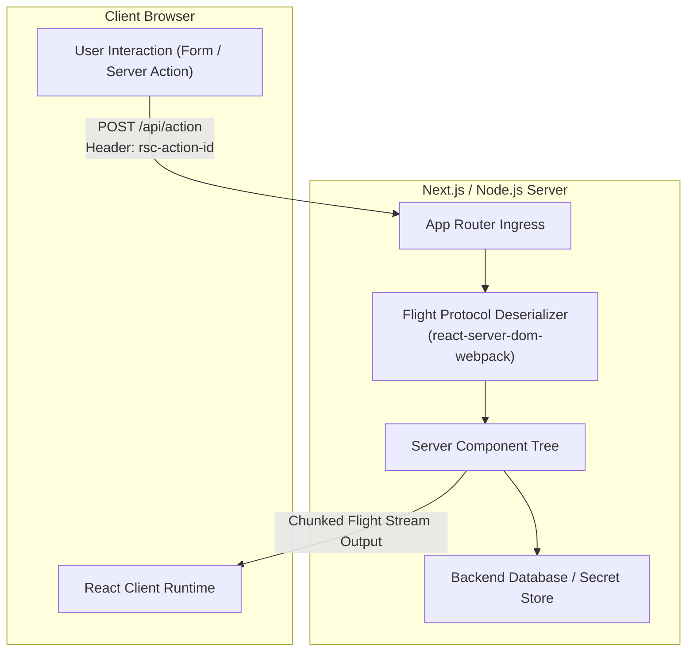
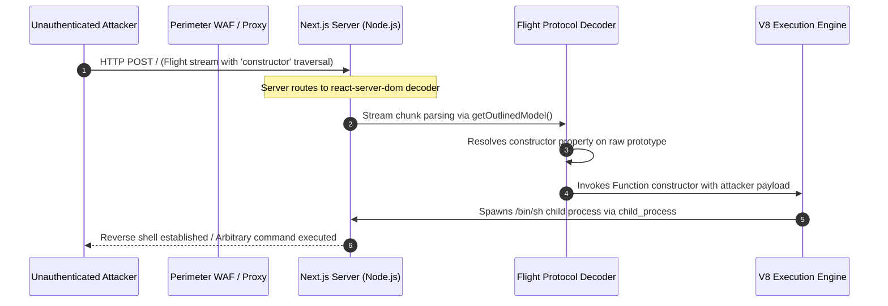
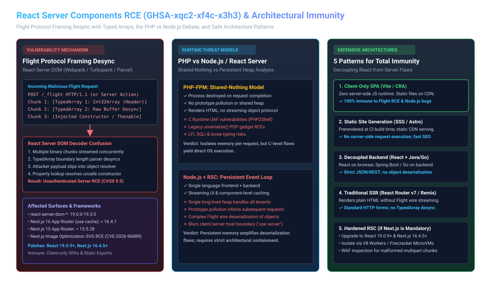
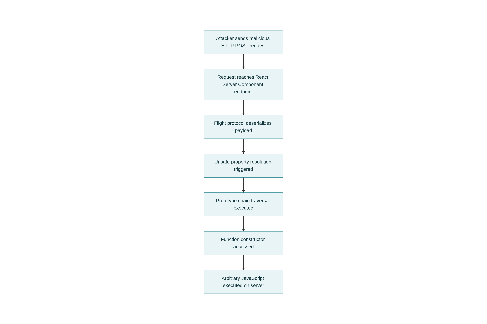
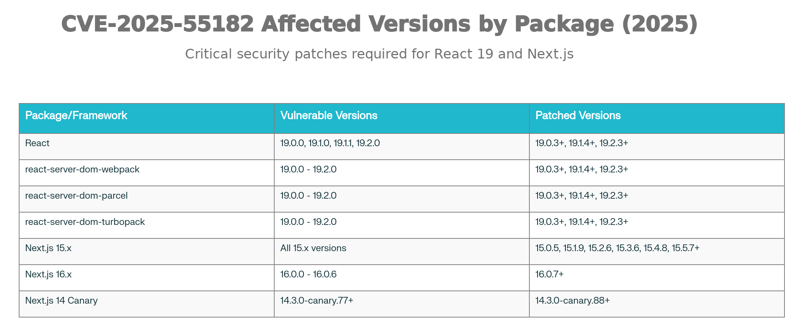
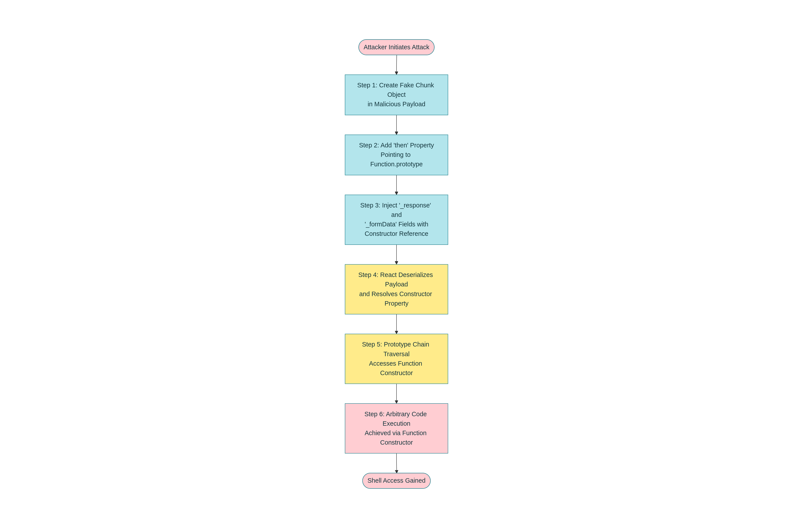
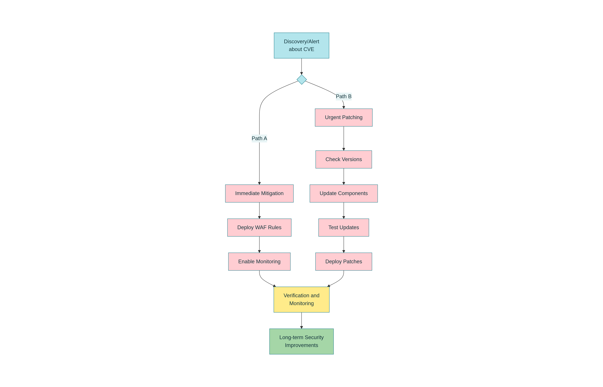

# React2Shell (CVE-2025-55182 / CVE-2025-66478): Flight Protocol Deserialization RCE

Learning note · Revised November 2026 · Technical advisory  
*By Srinivasan Ragothaman ([@rsrini7](https://github.com/rsrini7))*

> **Core idea:** React2Shell (CVE-2025-55182, CVSS 10.0) is a critical, unauthenticated remote code execution vulnerability residing in the React Server Components (RSC) Flight protocol deserialization layer. By transmitting a single crafted HTTP POST request with prototype-manipulation payloads into the Flight stream parser, an unauthenticated remote attacker can traverse JavaScript object prototypes to access the root `Function` constructor, executing arbitrary shell commands with Node.js host privileges across 165,000+ exposed servers worldwide.

---

## 1. Foundations: React Server Components and the Flight Protocol

To optimize performance and minimize client-side JavaScript bundles, React 19 introduced **React Server Components (RSC)** as a core architectural primitive. Frameworks such as Next.js (via the App Router introduced in v13 and default in v15/v16) execute components directly on the Node.js server.



### 1.1 The Flight Serialization Protocol

Client-to-server communication in RSC does not use standard REST or JSON-RPC. Instead, it relies on React's proprietary **Flight Protocol**—a chunked, line-delimited streaming serialization format that handles complex object graphs, promises, client references, and server actions.

```
+---------------------------------------------------------------------------------------------------+
|                               Typical Flight Protocol Chunk Stream                                |
+---------------------------------------------------------------------------------------------------+
| 0:{"id":"_action_id","bound":["$@1"]}                                                             |
| 1:{"name":"checkout","timestamp":1733241600}                                                      |
| 2:I["node_modules/next/dist/client/components/app-router.js",["default"],""]                      |
+---------------------------------------------------------------------------------------------------+
```

- Prefix `0:`, `1:`, `2:`: Unique chunk identifiers within the streaming response.
- Marker `$@1`: Lazy reference pointing to chunk ID 1.
- Prefix `I`: Module import directive instructing the client to load a client component reference.

When the server receives incoming arguments for a Server Action via HTTP POST (using `multipart/form-data` or `application/octet-stream`), the `react-server-dom` package deserializes the text stream back into live JavaScript objects.

---

## 2. Deep Technical Mechanism: Prototype Traversal to Arbitrary Code Execution

### 2.1 The Root Cause: Missing `hasOwnProperty` Validation

The vulnerability exists in `react-server-dom-webpack` (and its Parcel and Turbopack equivalents) within the model outlining logic `getOutlinedModel()`.

When reconstituting nested JavaScript objects from Flight stream chunks, the decoder iterated over object keys without checking whether those properties belonged to the instance itself or were inherited from `Object.prototype`.

```javascript
// Vulnerable Implementation in react-server-dom-webpack (< 19.0.3)
function getOutlinedModel(response, id, model) {
  const object = {};
  for (const key in model) {
    // BUG: Missing Object.prototype.hasOwnProperty.call(model, key)
    // Copies inherited properties directly from prototype!
    object[key] = model[key];
  }
  return object;
}
```

```javascript
// Patched Implementation (>= 19.0.3, >= 19.1.4, >= 19.2.3)
function getOutlinedModel(response, id, model) {
  const object = {};
  for (const key in model) {
    if (Object.prototype.hasOwnProperty.call(model, key)) {
      object[key] = model[key]; // SAFE: Enforces direct property ownership
    }
  }
  return object;
}
```

### 2.2 Exploitation Chain: From Deserialization to Shell

Because the decoder blindly resolved properties supplied by the attacker, an adversary could supply an object whose prototype chain points directly to the JavaScript `Function` constructor:



1. **Payload Transmission:** The attacker sends an HTTP POST to any App Router endpoint with the header `Next-Action` or `rsc-action-id`.
2. **Prototype Escalation:** The deserializer parses a chunk containing a crafted object graph referencing `constructor`.
3. **Constructor Execution:** The runtime invokes `object.constructor.constructor(payload)()`, resolving to the global `Function` constructor.
4. **Child Process Execution:** The arbitrary JavaScript payload calls `process.mainModule.require('child_process').execSync(...)` to drop an interactive shell or exfiltrate environment variables.

### 2.3 The Incomplete First Patch & Emergency Second Fix

On December 3, 2025, Meta released an initial patch (`19.0.1`). Within 12 hours, independent security researchers demonstrated that the initial patch only blocked direct `__proto__` string matches, leaving alternative property descriptors and nested Flight references exploitable. Meta and Vercel issued emergency second updates (`19.0.3+`, `Next.js 15.0.5+`) that universally enforced `hasOwnProperty` checks across all parser entry points.

---

## 3. Architectural Visual: Flight Protocol RCE & Attack Flow

The following architecture diagram illustrates the end-to-end Flight protocol pipeline, the prototype traversal vector, and perimeter defense layers:



---

## 4. Production Implementations & Hardening Recipes

### 4.1 Reverse Proxy & Gateway Sanitization Middleware

While applications are being rebuilt and redeployed with patched dependencies, deploy this Node.js / Express / Fastify perimeter middleware to inspect and reject Flight streams containing prototype pollution tokens before they reach React Server DOM.

```typescript
// middleware/rscSanitizer.ts
import { Request, Response, NextFunction } from 'express';

const FORBIDDEN_PATTERNS = [
  /constructor/i,
  /__proto__/i,
  /prototype/i,
  /\$@/, // Malicious Flight reference pointer hijacking
];

export function rscSecuritySanitizer(req: Request, res: Response, next: NextFunction): void {
  const isRscRequest = Boolean(
    req.headers['next-action'] ||
    req.headers['rsc-action-id'] ||
    req.headers['accept']?.includes('text/x-component')
  );

  if (!isRscRequest) {
    return next();
  }

  // Inspect raw body chunks if buffered
  if (req.body) {
    const serializedBody = typeof req.body === 'string' ? req.body : JSON.stringify(req.body);

    for (const pattern of FORBIDDEN_PATTERNS) {
      if (pattern.test(serializedBody)) {
        res.status(400).json({
          error: 'SecurityViolation',
          message: 'Malformed Flight protocol payload rejected by perimeter security.',
        });
        return;
      }
    }
  }

  next();
}
```

### 4.2 Perimeter WAF Rules (AWS WAF & Cloudflare)

#### AWS WAF Custom Rule (JSON)

```json
{
  "Name": "Block-React2Shell-Flight-Exploit",
  "Priority": 10,
  "Action": { "Block": {} },
  "VisibilityConfig": {
    "SampledRequestsEnabled": true,
    "CloudWatchMetricsEnabled": true,
    "MetricName": "React2ShellBlocked"
  },
  "Statement": {
    "AndStatement": {
      "Statements": [
        {
          "ByteMatchStatement": {
            "SearchString": "POST",
            "FieldToMatch": { "Method": {} },
            "TextTransformations": [{ "Priority": 0, "Type": "NONE" }],
            "PositionalConstraint": "EXACTLY"
          }
        },
        {
          "OrStatement": {
            "Statements": [
              {
                "ByteMatchStatement": {
                  "SearchString": "constructor",
                  "FieldToMatch": { "Body": {} },
                  "PositionalConstraint": "CONTAINS"
                }
              },
              {
                "ByteMatchStatement": {
                  "SearchString": "__proto__",
                  "FieldToMatch": { "Body": {} },
                  "PositionalConstraint": "CONTAINS"
                }
              }
            ]
          }
        }
      ]
    }
  }
}
```

#### Cloudflare WAF Expression

```
(http.request.method eq "POST") and
(any(http.request.headers.names[*] matches "(?i)next-action|rsc-action-id") or http.request.headers["accept"][0] contains "text/x-component") and
(http.request.body.raw contains "constructor" or http.request.body.raw contains "__proto__" or http.request.body.raw contains "$@")
```

### 4.3 Container Runtime Detection (Sysdig / Falco)

To detect active post-exploitation where an attacker has spawned a shell from inside a Node.js process:

```yaml
# falco_rules.local.yaml
- rule: Shell Spawned from Node.js (React2Shell Detection)
  desc: Detects interactive or scripting shells spawned as child processes of Node.js
  condition: >
    spawned_process and
    container and
    proc.pname = "node" and
    proc.name in (sh, bash, dash, zsh, powershell, cmd.exe)
  output: >
    CRITICAL: Potential React2Shell Exploitation (user=%user.name command=%proc.cmdline
    parent=%proc.pname pid=%proc.pid container_id=%container.id)
  priority: CRITICAL
  tags: [security, rce, cve-2025-55182]
```

---

## 5. Impact, Real-World Edge Cases & Gotchas

### 5.1 Threat Scope and Mass Weaponization

Within 30 hours of public disclosure on December 3, 2025, security monitoring telemetry from Palo Alto Unit 42, Google Cloud Threat Intelligence, and Shadowserver observed automated global botnet scanning. Over **165,000 unique IP addresses** and **644,000 public domains** running Next.js App Router applications were identified as vulnerable.

State-sponsored and financial threat groups leveraged the exploit to:
1. Harvest server-side cloud credentials (`AWS_ACCESS_KEY_ID`, `DATABASE_URL`).
2. Establish persistence via encrypted reverse shells and hidden cron tasks.
3. Deploy cryptocurrency miners and lateral network worms.

### 5.2 Common Claims vs. Technical Realities

| Common Misconception | Technical Reality |
|---|---|
| *"Our app only uses static Server Components and no Server Actions, so we are immune."* | **False.** The Flight protocol deserialization endpoint is activated by default on any route using App Router in Next.js, regardless of whether explicit Server Actions are coded. |
| *"Deploying Cloudflare / AWS WAF rules means we do not need to redeploy immediately."* | **High Risk.** WAF rules inspect body chunks with basic regex. Attackers frequently bypass WAFs using multipart chunk splitting, character encoding (`\u0063onstructor`), or compressed payloads. |
| *"Pages Router applications are equally vulnerable."* | **False.** Applications utilizing Next.js Pages Router exclusively do not mount the Flight protocol engine and are unaffected by CVE-2025-55182. |
| *"Updating `package.json` and restarting the app is sufficient."* | **Incomplete.** If `package-lock.json` or `node_modules` caches transitive dependencies (e.g. `react-server-dom-webpack`), the vulnerable code remains active until clean builds are verified. |

---

## 6. Practical Adoption Blueprint & Verification Checklist

### 6.1 Required Patched Versions Matrix

Verify that your installed dependencies meet or exceed the following version thresholds:

| Ecosystem Package | Vulnerable Versions | Patched Secure Versions |
|---|---|---|
| **React Core** | `19.0.0` – `19.0.2` | **`19.0.3+`** |
| **React Maintenance 19.1** | `19.1.0` – `19.1.3` | **`19.1.4+`** |
| **React Maintenance 19.2** | `19.2.0` – `19.2.2` | **`19.2.3+`** |
| **react-server-dom-*** | Pre-`19.0.3` | **`19.0.3+`** |
| **Next.js 15.0.x** | `15.0.0` – `15.0.4` | **`15.0.5+`** |
| **Next.js 15.1.x** | `15.1.0` – `15.1.8` | **`15.1.9+`** |
| **Next.js 15.2.x** | `15.2.0` – `15.2.5` | **`15.2.6+`** |
| **Next.js 15.3.x** | `15.3.0` – `15.3.5` | **`15.3.6+`** |
| **Next.js 15.4.x** | `15.4.0` – `15.4.7` | **`15.4.8+`** |
| **Next.js 15.5.x** | `15.5.0` – `15.5.6` | **`15.5.7+`** |
| **Next.js 16.0.x** | `16.0.0` – `16.0.6` | **`16.0.7+`** |

### 6.2 Diagnostic Audit & Verification Commands

```bash
# 1. Inspect installed Next.js version
npm list next

# 2. Inspect transitive React Server DOM packages
npm list react-server-dom-webpack react-server-dom-turbopack

# 3. Clean installation verification
rm -rf node_modules .next package-lock.json
npm install
npm audit

# 4. Probe endpoint for Flight protocol vulnerability (non-destructive diagnostic)
curl -X POST "https://app.example.com/" \
  -H "Next-Action: diagnostic-probe-test" \
  -H "Content-Type: multipart/form-data; boundary=----WebKitFormBoundaryX" \
  -H "Accept: text/x-component" \
  --data-binary $'------WebKitFormBoundaryX\r\nContent-Disposition: form-data; name="1_test"\r\n\r\n{"constructor":1}\r\n------WebKitFormBoundaryX--\r\n' \
  -i
```

---

## 7. Timeline and Current State

```
        Dec 03, 2025 (09:00)    Dec 03, 2025 (18:00)    Dec 04, 2025 (12:00)    Early 2026
       +-----------------------+-----------------------+---------------------+
       | CVE-2025-55182        | PoC Exploit Spreads;  | Secondary Bypasses; | Follow-up Advisories;
       | Disclosed (CVSS 10.0) | First Patch v19.0.1;  | Emergency Patch     | GHSA-xqc2 Framing
       | React & Next.js       | Mass Scanners Active  | v19.0.3+ Released   | Desync Analyzed
```

- **December 3, 2025 (Morning):** Lachlan Davidson coordinates public disclosure of CVE-2025-55182 with the React core team and Vercel. CVSS rated at maximum 10.0.
- **December 3, 2025 (Evening):** Public proof-of-concept exploits appear on GitHub and social media. Global scanning against exposed Next.js instances begins.
- **December 4, 2025:** Initial mitigation patches are found to be incomplete against advanced prototype descriptors. React releases `19.0.3`, `19.1.4`, and `19.2.3`; Vercel issues Next.js updates across all 15.x and 16.x minors.
- **January–November 2026:** Long-term architectural analysis continues as subsequent researchers evaluate streaming typed array desync vulnerabilities in the Flight protocol.

---

## 8. Source Context and Primary Disclosures

| Date | Source / Organization | Disclosure / Document | Focus Area |
|---|---|---|---|
| Dec 2025 | React Core Team | [React Blog: Critical Security Advisory](https://react.dev/blog/2025/12/03/critical-security-vulnerability-in-react-server-components) | Flaw in React Server Components Flight protocol decoder |
| Dec 2025 | Vercel Security | [Next.js CVE-2025-55182 Advisory](https://nextjs.org/docs/messages/cve-2025-55182) | Affected Next.js versions and framework patch guidance |
| Dec 2025 | NIST NVD | [NVD Record: CVE-2025-55182](https://nvd.nist.gov/vuln/detail/CVE-2025-55182) | Vulnerability metrics, CVSS 10.0 scoring, CWE-94 |
| Dec 2025 | Palo Alto Unit 42 | [Threat Intelligence: React2Shell](https://unit42.paloaltonetworks.com/) | Global telemetry, active in-the-wild exploitation vectors |

---

## 9. Supplementary visuals

The following diagrams illustrate the original disclosure timeline, affected version trees, prototype traversal vectors, and remediation timelines:


*Figure 1: Step-by-step attack progression from malicious HTTP request to deserialization and command execution.*


*Figure 2: Comprehensive breakdown of vulnerable and patched packages across React 19 and Next.js 15/16.*


*Figure 3: Technical illustration showing JavaScript prototype chain climbing to the Function constructor.*


*Figure 4: Parallel remediation flowchart combining perimeter WAF mitigation with dependency redeployment.*

---

**Related:**
- [React Server Components RCE (GHSA-xqc2-xf4c-x3h3)](React-Server-Components-RCE-GHSA-xqc2-xf4c-x3h3-Oct-2026.md) — Follow-up unauthenticated RCE involving Flight protocol typed array framing desync.
- [Node.js Async Hooks DoS (CVE-2025-59466)](NodeJS-Async-Hooks-Stack-Exhaustion-DoS-CVE-2025-59466-2026.md) — RSC/Next.js SSR stacks named in this advisory are the same surface exploited by React2Shell.
- [PHP2Shell: History, UAF and ASLR](PHP2Shell-History-UAF-And-ASLR-Oct-2026.md) — Compare unauthenticated RCE in a core runtime with the React server-component surface.
- [GitLab CVE-2026-110264](GitLab-Regex-Compiler-RCE-Oct-2026.md) — Another CVSS 10.0 unauthenticated RCE affecting enterprise developer tooling.
- [n8n Automation RCE Suite](N8n-Workflow-Automation-RCE-Suite-CVE-2025-68613-2026.md) — Sister CVSS-10.0-class RCE analysis against workflow automation platforms.
- [OpenClaw-Moltbot-Security-Analysis-2026](../../AI-ML/Agents/openclaw/OpenClaw-Moltbot-Security-Analysis-2026.md) — Parallel analysis of remote execution and boundary isolation failures in agent frameworks.
