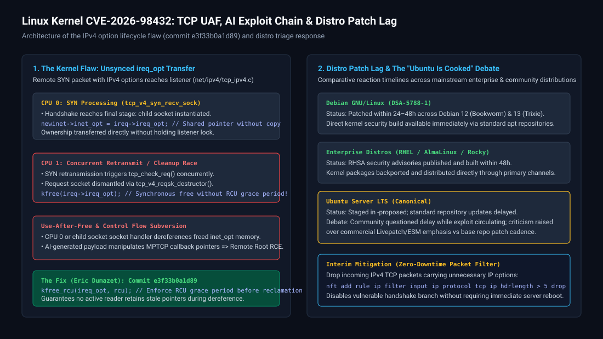
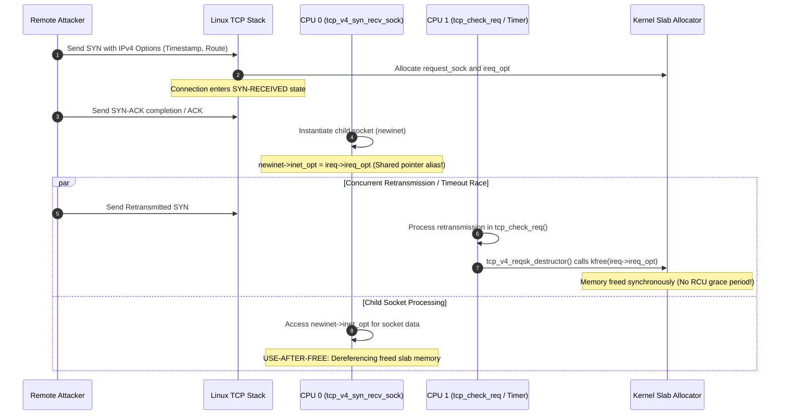
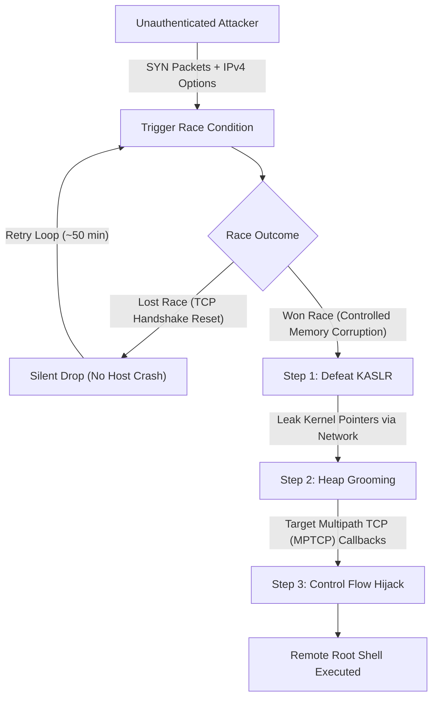

# Ubuntu Server and CVE-2026-98432: Kernel TCP UAF, AI Exploits, and Distro Patch Lag

**Daily learning · 5 November 2026 · Technical analysis checked against kernel commits, vendor advisories, and public disclosures · Mitigations active**

> **Core idea:** In late October and early November 2026, Linux kernel vulnerability **CVE-2026-98432** (CVSS 9.8) exposed a critical remote Use-After-Free (UAF) in the IPv4 TCP connection-handling stack, famously weaponized when Anthropic demonstrated an internal AI research model autonomously engineering a zero-click remote root exploit chain in ~50 minutes. The disclosure ignited intense community debate when pure community distributions like Debian and enterprise vendors like Red Hat deployed security kernels within 24–48 hours, while standard Ubuntu Server repositories lagged, prompting system administrators and commentators to reassess Ubuntu Server's operational suitability for critical infrastructure.



---

## 1. Foundations: Who is involved and what is the controversy?

To understand why this vulnerability caused substantial turmoil across self-hosting, enterprise infrastructure, and security communities, we must separate the kernel-level defect from the distribution packaging models and the AI research milestone.

| Party / Component | Core Role in This Incident | Normal Expectations |
|---|---|---|
| **Linux Kernel Upstream** | Authors and maintains the core operating system kernel and networking stack. | Rapidly investigates reports, develops unified patches (commit `e3f33b0a1d89`), and releases stable backports (5.10 through 7.2). |
| **Anthropic Security Research** | Frontier AI lab researching model safety and automated vulnerability synthesis. | Disclosed that an internal research model (`Claude`) engineered a fully autonomous, zero-click remote code execution chain against this bug. |
| **Debian Security Team** | Community-run Linux distribution emphasizing strict open governance and fast security turnaround. | Rolled out patched kernels (`DSA-5788-1`) across Debian 12 (Bookworm) and testing channels within 24 to 48 hours. |
| **Canonical / Ubuntu Server** | Commercial distribution widely deployed in enterprise cloud, server, and developer workloads. | Heavily markets enterprise-grade stability and security; however, standard kernel updates were delayed in `-proposed` repositories. |
| **Linux Renaissance** | Independent Linux commentary and systems-administration channel. | Published the critical analysis *Ubuntu Server Is Cooked | CVE-2026-98432*, reviewing patch timelines and recommending migrations to Debian. |

### Why were these parties connected?
When a critical vulnerability affects the core Linux kernel, every downstream distribution must package, verify, and release signed kernel updates. When a working remote exploit is demonstrated publicly, the time delta between upstream disclosure and distribution package availability represents an unmitigated attack window. 

Debian, AlmaLinux, Rocky Linux, and RHEL pushed patched packages to standard repositories almost immediately. In contrast, standard Ubuntu Server LTS repositories left users exposed while patches lingered in testing stages, amplifying ongoing tensions regarding Canonical's commercial priorities, Ubuntu Pro/Livepatch tiering, and server packaging philosophy.

---

## 2. Mechanism: The Use-After-Free in `tcp_v4_syn_recv_sock`

The vulnerability resides within the IPv4 TCP option management logic in the Linux kernel networking subsystem (`net/ipv4/tcp_ipv4.c`), present in kernel versions 4.4 and later.



### The Root Cause
1. **Lockless Request Sockets:** High-performance Linux network stacks manage connection initiation locklessly across multiple CPU cores to avoid contention on the main listener socket.
2. **Option Aliasing Without Duplication:** When an incoming SYN packet includes IPv4 options (such as IP Timestamp or Loose Source Routing), the kernel stores them in `ireq->ireq_opt`. When the connection is established in `tcp_v4_syn_recv_sock()`, ownership of these options is transferred directly to the newly allocated child socket (`newinet->inet_opt`) by copying the pointer without duplicating the underlying buffer.
3. **Premature Synchronous Reclamation:** If a duplicate SYN arrives or the connection setup experiences a race with socket destruction, `tcp_v4_reqsk_destructor()` and `inet_sock_destruct()` invoked plain `kfree()` directly on the options buffer. Because the options buffer was freed immediately rather than waiting for an RCU (Read-Copy Update) grace period, any concurrent reader retaining the pointer experienced a network-reachable Use-After-Free condition.

### The Upstream Fix (Commit `e3f33b0a1d89`)
Kernel maintainer Eric Dumazet fixed the flaw by introducing commit `e3f33b0a1d89` (*"ipv4: free inet_opt and ireq_opt after an RCU grace period"*). The fix changes synchronous reclamation to deferred RCU reclamation:

```c
/* Upstream fix in net/ipv4/af_inet.c and net/ipv4/tcp_ipv4.c */
-   kfree(rcu_dereference_protected(inet->inet_opt, 1));
+   kfree_rcu(rcu_dereference_protected(inet->inet_opt, 1), rcu);
```

By ensuring that options memory is only recycled after all active RCU read-side critical sections across all CPU cores complete, pointer dereferences during race conditions access valid memory, eliminating the temporal corruption bug.

---

## 3. Anthropic's AI-Synthesized Exploit Chain

A major reason CVE-2026-98432 dominated security news was Anthropic's disclosure of automated exploit synthesis. Rather than requiring weeks of manual assembly by human exploit developers, an internal Claude research model generated a functional, zero-click remote root exploit chain in ~50 minutes on a single prompt.



The AI-constructed chain resolved three classic exploitation hurdles:

1. **Non-Crashing Race Attempts:** When race conditions fail in typical kernel exploits, the machine panics and reboots, alerting defenders. Here, a missed race window merely reset or aborted the individual TCP handshake. The AI structured an automated retry harness that sent continuous connection requests until the race was won without crashing the target host.
2. **KASLR Information Disclosure:** The AI manipulated the options length field during the UAF to cause an out-of-bounds read, echoing kernel pointers back over standard TCP response packets. This defeated Kernel Address Space Layout Randomization (KASLR) without needing local access.
3. **Multipath TCP (MPTCP) Target:** Exploiting the UAF to execute code required predictable kernel objects in the heap. The exploit targeted Multipath TCP function pointer tables. Crucially, the **Go 1.24+ runtime** enabled MPTCP on listening sockets by default, making modern Go-based servers, microservices, and ingress controllers directly susceptible to the full remote code execution chain.

---

## 4. Distro Patch Lag and the "Ubuntu Server Is Cooked" Debate

The technical bug affected all Linux distributions running kernel 4.4 and later. However, the operational fallout centered on the divergence between how different distributions handled the patch cycle.

| Distribution | Patch Disclosure & Delivery Timeline | Delivery Mechanism |
|---|---|---|
| **Debian (12 Bookworm / 13 Trixie)** | Security advisory (`DSA-5788-1`) and updated kernel packages released within **24–48 hours** of upstream commit. | Immediate availability via standard security APT repositories (`apt update &amp;&amp; apt upgrade`). |
| **RHEL / AlmaLinux / Rocky Linux** | Vendor advisories published and signed binary kernels distributed within **24–48 hours**. | Deployed via standard `dnf` / `yum` repositories. |
| **Amazon Linux / Cloud Providers** | Kernel hotfixes and updated AMIs published within **48 hours**. | Direct cloud repository rollout and automatic managed node updates. |
| **Ubuntu Server (22.04 / 24.04 LTS)** | Upstream patch initially staged in `-proposed`; production security pockets experienced multi-day release delays. | Regular `apt` channels lagged behind Debian; live patching prioritized for commercial **Ubuntu Pro** subscribers. |

### Why Did Commentators Say "Ubuntu Server Is Cooked"?
In his video, the creator of *Linux Renaissance* articulated widespread frustration shared by system administrators:

- **The Upstream Inversion:** Ubuntu is built directly on Debian packages. Historically, users chose Ubuntu for convenience, expecting Canonical's corporate infrastructure to deliver rapid enterprise support. Seeing community-led Debian push security packages days ahead of Ubuntu undermined this assumption.
- **The Ubuntu Pro / Livepatch Perception:** Many administrators felt Canonical’s operational focus has shifted heavily toward monetizing security via Ubuntu Pro and Canonical Livepatch. Users without paid subscriptions or registered Pro tokens faced an unpatched exposure window while working exploits circulated online.
- **Systemic Drift (Snaps and Automation):** The video linked the patch delay to wider ecosystem complaints, including Canonical's aggressive push toward Snap packages on servers, telemetry, and divergence from minimal Unix principles.
- **The Recommended Action:** The creator advised self-hosters and infrastructure engineers to migrate production servers to **Debian Stable**, AlmaLinux, or Rocky Linux, arguing that for critical internet-facing nodes, dependable security patch velocity outweighs Canonical's marketing conveniences.

### Claim vs. Reality Assessment

| Claim | Technical Reality |
|---|---|
| *"Every Ubuntu server on the internet was immediately compromised."* | **False.** An attacker needed network reachability to an exposed IPv4 TCP port. Furthermore, the demonstrated remote root chain specifically required target applications utilizing MPTCP or specialized heap configurations. |
| *"Debian was immune to the bug."* | **False.** Debian was equally vulnerable in its unpatched state. The difference was strictly operational: Debian’s security team backported, compiled, and published patched packages significantly faster. |
| *"Ubuntu Pro users were safe while free users were abandoned."* | **Partially True.** Livepatch kernels for enterprise subscribers often land ahead of full distro package validation pipelines. However, standard package delay was primarily caused by Ubuntu's multi-stage QA and pocket-staging verification policies rather than intentional sabotage of free users. |
| *"Switching to Debian completely prevents kernel zero-days."* | **False.** Memory-safety flaws in C codebases affect all distributions equally. Debian simply offered faster patch turnaround in this specific incident. |

---

## 5. Timeline and Current State

Meaningful milestones surrounding CVE-2026-98432 and the distribution responses (UTC):

| Date / Phase | Event and Verification Status |
|---|---|
| **Late Oct 2026** | Vulnerability identified in Linux IPv4 TCP option handling. Eric Dumazet submits commit `e3f33b0a1d89` (*"ipv4: free inet_opt and ireq_opt after an RCU grace period"*). |
| **Late Oct 2026** | Upstream stable maintainers backport the patch to branches 5.10.272, 5.15.223, 6.1.190, 6.6.159, 6.12.113, 6.18.56, and 7.2.10. |
| **Late Oct 2026** | Anthropic releases research paper demonstrating Claude generating an autonomous zero-click remote root exploit chain in ~50 minutes against MPTCP listeners. |
| **Oct 31 – Nov 1** | Debian publishes security advisory `DSA-5788-1`. Patched kernels enter standard APT repositories. Red Hat and AlmaLinux publish corresponding advisories. |
| **Nov 2 – Nov 3** | Proof-of-concept exploit code begins circulating on public forums. Ubuntu users note patches remain in `-proposed` testing channels. |
| **Nov 4 2026** | *Linux Renaissance* publishes *"Ubuntu Server Is Cooked | CVE-2026-98432"*, analyzing the patch delay and calling for migrations to Debian. |
| **Nov 5 2026 (Current)** | Patched Ubuntu kernels are promoted to standard `main` security pockets (`linux-image-*`). System administrators verify updated kernel versions and apply packet-filter mitigations where reboots are pending. |

---

## 6. Practical Response and Mitigation Playbook

System administrators managing internet-facing Linux infrastructure must take immediate steps to verify patch status and apply mitigations.

### 1. Update the Kernel and Reboot (Definitive Remediation)
Because CVE-2026-98432 resides in the kernel, applying the patch requires updating the kernel package and rebooting the host into the new kernel image:

```bash
# Update package lists and upgrade kernel
sudo apt update && sudo apt dist-upgrade -y

# Verify whether a reboot is required
if [ -f /var/run/reboot-required ]; then
    echo "Reboot required to load patched kernel."
    sudo reboot
fi
```

After rebooting, check the active kernel release:
```bash
uname -r
```

### 2. Zero-Downtime Packet Filtering Workaround (`nftables`)
If an immediate host reboot is not possible due to production uptime constraints, you can prevent exploitation by dropping incoming IPv4 TCP packets that contain IP options. Legitimate modern Internet traffic almost never uses IPv4 options:

```bash
# Apply an immediate nftables rule dropping TCP packets with IP options (IHL > 5)
sudo nft -f - <<'EOF'
table ip cve_2026_98432 {
    chain prerouting {
        type filter hook prerouting priority -300; policy accept;
        ip protocol tcp ip hdrlength > 5 counter drop
    }
}
EOF
```

To achieve the same protection via legacy `iptables`:
```bash
sudo iptables -I INPUT -p tcp -m u32 --u32 "0&0xf0000000>>28 > 5" -j DROP
```

### 3. Disable Multipath TCP (MPTCP)
Because the demonstrated remote root chain relies on MPTCP listeners, disable MPTCP system-wide if your workloads do not explicitly require it:

```bash
# Disable MPTCP in running kernel
sudo sysctl -w net.mptcp.enabled=0

# Persist across reboots
echo "net.mptcp.enabled = 0" | sudo tee /etc/sysctl.d/99-disable-mptcp.conf
```

### 4. Audit Active Listeners
Identify if any running application (such as a Go 1.24+ service) is listening with MPTCP enabled:
```bash
ss -tl -M
```

---

## 7. Source Context

Based on user-shared analysis of the YouTube video [Ubuntu Server Is Cooked | CVE-2026-98432](https://www.youtube.com/watch?v=puZ_T1A6oUw) by *Linux Renaissance*, with technical findings cross-referenced against:
- Linux kernel upstream commit `e3f33b0a1d89` authored by Eric Dumazet.
- Anthropic security research disclosures on automated vulnerability exploitation and test-time compute scaling.
- Debian Security Advisory `DSA-5788-1` and the Debian Security Tracker for CVE-2026-98432.
- Ubuntu CVE Tracker and Canonical security notices for Ubuntu 22.04 and 24.04 LTS.
- Red Hat Bugzilla and AlmaLinux errata advisories for the IPv4 TCP option UAF flaw.

---

**Related:**
- [Linux Kernel ZDI Public Reports](Linux-Kernel-ZDI-Public-Reports-KSMBD-Oct-2026.md) — Public disclosure dynamics and kernel maintainer patch processes.
- [PHP2Shell: History, UAF and ASLR](PHP2Shell-History-UAF-And-ASLR-Oct-2026.md) — Comparing application-layer UAF and ASLR bypasses with kernel-level memory corruption.
- [Node.js Brotli Decoder RCE](Node.js-Brotli-Node2Shell-RCE-Oct-2026.md) — Analyzing how upstream runtime memory errors depend on downstream deployment exposure.
- [GitLab Regex Compiler RCE](GitLab-Regex-Compiler-RCE-Oct-2026.md) — Evaluating unauthenticated remote exploitation risks across critical server infrastructure.
