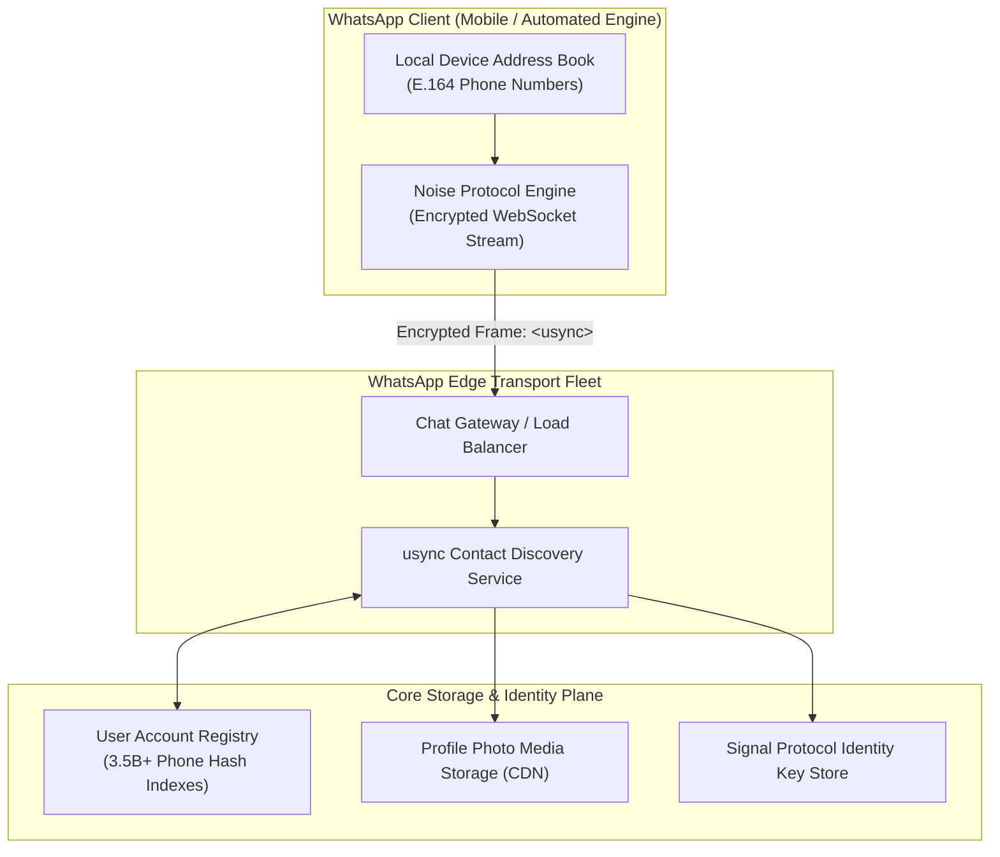
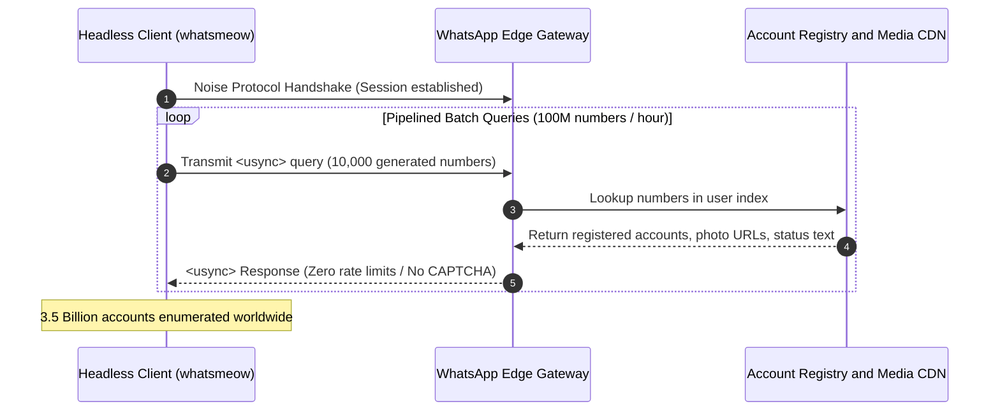
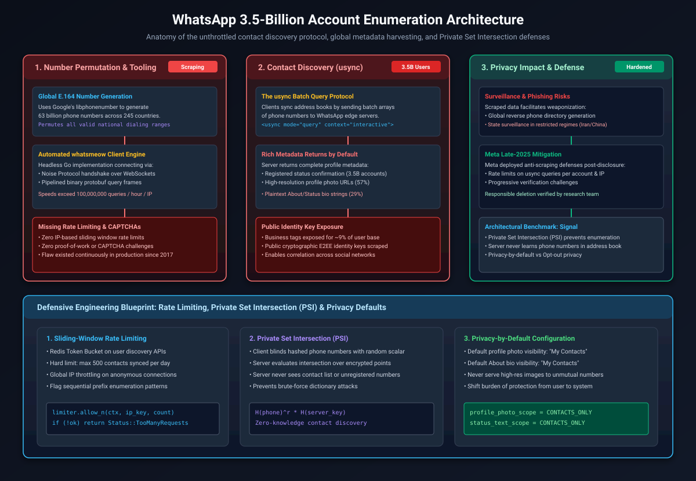

# WhatsApp 3.5-Billion User Enumeration: Unthrottled Contact Discovery & Metadata Harvesting

Daily learning · December 2025 · Incident review  
*By Srinivasan Ragothaman ([@rsrini7](https://github.com/rsrini7))*

> **Core idea:** In late 2025, security researchers from the University of Vienna and SBA Research disclosed a critical privacy and enumeration vulnerability in WhatsApp's contact synchronization protocol (`usync`). Due to the complete absence of server-side rate limiting and CAPTCHA gating on address book discovery endpoints, automated clients querying the binary protocol could test up to 100 million phone numbers per hour from a single IP address. By systematically generating 63 billion phone numbers across 245 countries, the researchers successfully enumerated 3.5 billion registered WhatsApp accounts—harvesting profile photos, status texts, business tags, and public cryptographic identity keys at planetary scale.

---

## 1. Foundations: Address Book Synchronization and Identity Architecture

Instant messaging platforms face a classic user-onboarding dilemma: how to instantly connect users with their real-world social graph without forcing manual username search. WhatsApp solves this through **address book contact synchronization**: users upload their mobile device's address book, and WhatsApp matches phone numbers against registered accounts.



### Architectural Roles & Responsibilities

| Subsystem | Functional Role | Operational Behavior |
|---|---|---|
| **E.164 Number Namespace** | International Numbering Plan | Global standardized telephone format (`+[country][national_number]`). Valid prefixes per country are publicly specified by the ITU and Google's `libphonenumber`. |
| **Noise Protocol Stream** | Transport Security Layer | End-to-end encrypted session established over WebSockets between client and WhatsApp edge chat gateways. |
| **`usync` Discovery Protocol** | Address Book Query Engine | XML/Protobuf-based protocol allowing clients to transmit batches of phone numbers and receive matching account profiles. |
| **User Profile Metadata** | Identity Information Layer | Contains account status, profile image CDN URLs, "About" status strings, business metadata, and public E2EE identity keys. |

---

## 2. Deep Technical Mechanism: Unthrottled Global Enumeration

### 2.1 Generating the Global Number Space

Because telephone numbers follow rigid mathematical and geographic allocations defined by the International Telecommunication Union (ITU-T E.164), the entire global space of possible mobile numbers is finite and predictable.

Using Google's open-source `libphonenumber` library, the researchers generated **63 billion valid phone number candidates** across 245 countries and territories:

```
+---------------------------------------------------------------------------------------------------+
|                                 Global E.164 Permutation Strategy                                 |
+----------------------+--------------------+---------------------+---------------------------------+
| Country Code         | Region             | Valid Length        | Permutations Tested             |
+----------------------+--------------------+---------------------+---------------------------------+
| +1                   | USA / Canada       | 10 digits           | ~1.2 Billion Valid Prefixes     |
| +91                  | India              | 10 digits           | ~1.8 Billion Valid Mobile Ranges|
| +55                  | Brazil             | 11 digits           | ~600 Million Mobile Allocations |
| 242 Other Jurisdictions | Worldwide       | 7–12 digits         | ~59.4 Billion Candidates        |
+----------------------+--------------------+---------------------+---------------------------------+
```

### 2.2 Exploiting the `usync` Protocol via Headless Clients

Rather than using physical mobile devices or Android emulators, the researchers utilized `whatsmeow`—an open-source Go implementation of the WhatsApp binary protocol.

When a client queries whether numbers are registered on the network, it issues a `usync` stanza:

```xml
<!-- Conceptual WhatsApp usync wire request -->
<iq to="s.whatsapp.net" type="get" id="sync_1001">
  <usync sid="1733241600" mode="query" context="interactive">
    <query>
      <status/>
      <picture/>
      <business/>
      <devices/>
    </query>
    <list>
      <user>+14155552671</user>
      <user>+14155552672</user>
      <!-- ... batches of up to 10,000 numbers ... -->
    </list>
  </usync>
</iq>
```



### 2.3 The Architectural Flaw: Absence of Rate Limiting

The vulnerability was not a cryptographic break of WhatsApp's end-to-end encryption; it was a **systemic authorization and rate-limiting failure**:
1. **Unconstrained Throughput:** The `usync` endpoint processed lookups at sustained rates exceeding **100,000,000 phone numbers per hour** from a single IP address.
2. **Missing Friction:** The server issued zero CAPTCHA challenges, zero cryptographic proof-of-work requirements, and zero account reputation gates.
3. **Flawed Trust Assumption:** The protocol assumed that because clients only upload legitimate address books, no user would possess millions of contacts. However, the server never enforced upper bounds on address book synchronization sizes.

### 2.4 Data Points Harvested Across 3.5 Billion Accounts

By running the automated permutation pipeline, the researchers confirmed the existence of 3.5 billion registered accounts and harvested extensive personal data:

- **Account Registration:** 100% confirmation of which phone numbers have active WhatsApp accounts globally.
- **Profile Photos (57% Globally):** High-resolution photo CDN URLs returned directly. In regions like India, Latin America, and Southeast Asia, photo visibility reached **80%** due to default open privacy configurations.
- **"About" / Bio Text (29% Globally):** Plaintext user-authored status strings often containing personal emails, secondary phone numbers, political or religious affiliations, and workplace titles.
- **Business Profile Tags (9% Globally):** Business operating hours, physical street addresses, and product categories.
- **Public Cryptographic Keys:** Public Identity Keys used in the Signal Protocol were returned to verify cryptographic session setup, enabling cross-platform identity correlation.

---

## 3. Architectural Visual: The Enumeration Vector & SRE Defenses

The following architecture diagram details the number generation pipeline, the unthrottled `usync` protocol, the harvesting blast radius, and SRE privacy defenses:



---

## 4. Production Implementations & Security Defensive Recipes

Preventing large-scale address book enumeration requires a multi-layered defense combining sliding-window rate limiting with cryptographic Private Set Intersection (PSI).

### 4.1 Distributed Sliding-Window Rate Limiter (Go & Redis)

Deploy this sliding-window token bucket filter in front of user lookup and contact synchronization APIs. It limits lookup volume per account identity and per IP address, enforcing exponential penalties when sequential prefix scans are detected.

```go
// ratelimit/contact_sync_limiter.go
package ratelimit

import (
	"context"
	"fmt"
	"time"

	"github.com/redis/go-redis/v9"
)

type ContactSyncLimiter struct {
	rdb              *redis.Client
	maxContactsPerDay int64
	maxQueriesPerMin  int64
}

func NewContactSyncLimiter(rdb *redis.Client) *ContactSyncLimiter {
	return &ContactSyncLimiter{
		rdb:              rdb,
		maxContactsPerDay: 500, // Reasonable daily address book sync budget
		maxQueriesPerMin:  10,  // Prevents rapid pipeline bursts
	}
}

// AllowSync checks whether a client account is permitted to sync N contacts.
func (l *ContactSyncLimiter) AllowSync(ctx context.Context, accountID string, count int64) (bool, error) {
	now := time.Now().Unix()
	dayKey := fmt.Sprintf("sync:day:%s:%d", accountID, now/86400)
	burstKey := fmt.Sprintf("sync:burst:%s", accountID)

	// Pipe commands to Redis atomically
	pipe := l.rdb.TxPipeline()
	dayTotal := pipe.IncrBy(ctx, dayKey, count)
	pipe.Expire(ctx, dayKey, 24*time.Hour)
	burstCount := pipe.Incr(ctx, burstKey)
	pipe.Expire(ctx, burstKey, 60*time.Second)

	_, err := pipe.Exec(ctx)
	if err != nil {
		return false, err
	}

	// Enforce daily ceiling and per-minute burst rate
	if dayTotal.Val() > l.maxContactsPerDay {
		return false, fmt.Errorf("daily contact discovery quota exceeded (%d > %d)", dayTotal.Val(), l.maxContactsPerDay)
	}
	if burstCount.Val() > l.maxQueriesPerMin {
		return false, fmt.Errorf("burst rate limit exceeded (%d requests/min)", burstCount.Val())
	}

	return true, nil
}
```

### 4.2 Cryptographic Private Set Intersection (PSI) Architecture

The state-of-the-art defense against contact enumeration (pioneered by Signal) is **Private Set Intersection (PSI)**. In PSI, the client and server find mutual phone numbers using homomorphic encryption or oblivious pseudorandom functions (OPRF) without the server ever discovering the client's contacts or the client discovering unregistered numbers:

$$\text{Match} = \text{ClientSet} \cap \text{ServerRegisteredSet}$$

1. **Client Blinding:** The client hashes its address book numbers $x$ and multiplies them by a secret random scalar $r$: $H(x)^r$.
2. **Server Evaluation:** The server signs the blinded hashes using its master private key $k$: $(H(x)^r)^k = H(x)^{rk}$, and returns pre-computed encrypted database hashes $(H(y))^k$.
3. **Client Unblinding:** The client divides out the random scalar $r$, yielding $H(x)^k$. The client locally intersects the sets.
4. **Zero Knowledge:** The server never learns which phone numbers were in the client's address book, completely eliminating mass enumeration attacks.

---

## 5. Impact, Real-World Edge Cases & Gotchas

### 5.1 Common Claims vs. Technical Realities

| Industry Assumption | Technical Reality |
|---|---|
| *"End-to-end encryption (Signal Protocol) makes WhatsApp immune to data breaches."* | **False.** End-to-end encryption protects message contents in transit. It does nothing to protect profile metadata, profile pictures, and registration status queried via discovery APIs. |
| *"Because users set their profile photo to 'Everyone', this is not a security flaw."* | **Misleading.** Users make profile photos public assuming individual humans will view them, not that automated bots will aggregate 3.5 billion records into searchable, weaponized intelligence databases. |
| *"Scraping cannot reveal sensitive information from phone numbers alone."* | **False.** Phone numbers serve as the universal identity anchor. Aggregating photos and 'About' text enables reverse-lookup directories, impersonation spear-phishing, and state surveillance of dissidents in restricted nations. |
| *"Requiring account login blocks mass enumeration."* | **False.** Attackers register disposable virtual numbers or use hacked accounts to establish authenticated Noise protocol sessions that stream millions of queries. |

---

## 6. Practical Engineering Blueprint & Verification Checklist

### 6.1 Platform Privacy & SRE Checklist

- [ ] **Enforce Privacy-by-Default:** Configure profile photo, last-seen timestamp, and "About" status visibility to **"My Contacts"** by default rather than "Everyone".
- [ ] **Implement Hard Daily Contact Sync Quotas:** Limit address book synchronization to reasonable human boundaries (e.g., maximum 500 phone lookups per 24 hours per account).
- [ ] **Deploy Global IP Sliding-Window Throttling:** Block automated connections generating sustained sequential prefix lookups across multiple country codes.
- [ ] **Migrate to Private Set Intersection (PSI):** Transition discovery protocols to zero-knowledge contact matching architectures so servers never process raw unblinded phone numbers.
- [ ] **Strip High-Resolution Media on Discovery:** Return low-resolution thumbnails or require explicit mutual contact handshake before serving full-resolution profile photos.

---

## 7. Timeline of Events

```
2017 - 2024            Late 2025              Late 2025              2026 Present
       +-----------------------+----------------------+----------------------+
       | Unthrottled usync     | Univ. of Vienna &    | Meta Deploys Anti-   | Global Privacy Debate;
       | Endpoint Active;      | SBA Research Scrapes | Scraping Controls;   | Research Datasets
       | Flaw Reported in BugB | 3.5B User Accounts   | Bug Bounty Awarded   | Responsibly Purged
```

- **2017:** Initial reports highlight potential address book enumeration weaknesses in early WhatsApp web and mobile clients; rate limits remain unaddressed on core sync endpoints.
- **Late 2025:** Researchers from the University of Vienna and SBA Research deploy automated `whatsmeow` scrapers, confirming 3.5 billion registered users across 63 billion generated numbers.
- **Late 2025:** Findings are responsibly disclosed to Meta under its Bug Bounty program. Meta deploys anti-scraping controls, query throttling, and account verification checks.
- **2026:** Researchers publish the comprehensive technical whitepaper; all harvested datasets are verified as securely purged to prevent commercial or adversarial exploitation.

---

## 8. Source Context and Primary Disclosures

| Date | Source / Organization | Disclosure / Document | Focus Area |
|---|---|---|---|
| Dec 2025 | Univ. of Vienna / SBA Research | [Academic Research Whitepaper](https://www.sba-research.org/) | Comprehensive technical analysis of unthrottled usync protocol enumeration |
| Dec 2025 | Meta Bug Bounty Team | [Meta Security Advisory & Response](https://www.meta.com/security/) | Acknowledgment of anti-scraping defenses and researcher bounty reward |
| Dec 2025 | BleepingComputer / Wired | [Global WhatsApp Enumeration Report](https://www.bleepingcomputer.com/) | Analysis of 3.5 billion affected users and privacy defaults debate |

---

## 9. Supplementary visuals

The following data table summarizes the global profile metadata exposure observed across the enumerated user base:

| Harvested Metadata Dimension | Observed Global Exposure | High-Exposure Regional Peak |
|---|---|---|
| **Confirmed Account Registration** | **100%** (3.5 Billion accounts) | 100% across all 245 jurisdictions |
| **Public Profile Photos** | **57%** (~2.0 Billion photos) | Up to 80% in India and Latin America |
| **Plaintext "About" Status Bio** | **29%** (~1.0 Billion accounts) | ~45% in Western Europe and North America |
| **Business Directory Tags** | **~9%** (~315 Million accounts) | Concentrated in commercial urban regions |
| **Signal Protocol Public Identity Keys** | **100%** of queried registered users | Universal cryptographic identity linkage |

---

**Related:**
- [MongoBleed (CVE-2025-14847)](MongoBleed-Dec2025.md) — Another major late-2025 unauthenticated data exposure event involving raw network protocol parsing.
- [PHP2Shell: History, UAF and ASLR](PHP2Shell-History-UAF-And-ASLR-Oct-2026.md) — Compare data harvesting and privacy boundary failures with memory corruption and code execution.
- [eMudhra Weak CA Keys](EMudhra-Weak-CA-Keys-And-PKI-Trust-Oct-2026.md) — Analyzes PKI trust boundaries and cryptographic key exposures across identity platforms.
- [React2Shell (CVE-2025-55182)](React2Shell-CVE-2025-55182-Flight-Protocol-RCE-2026.md) — Large-scale exploitation of web protocol deserialization across exposed internet infrastructure.
