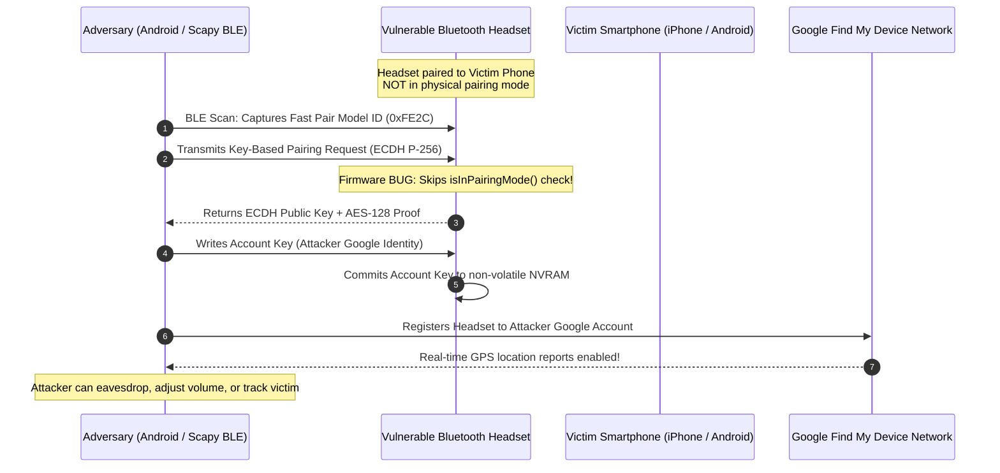
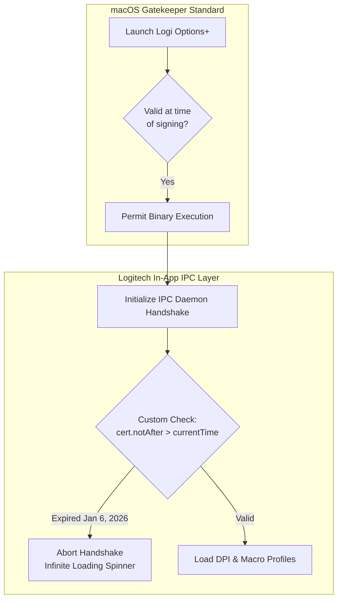
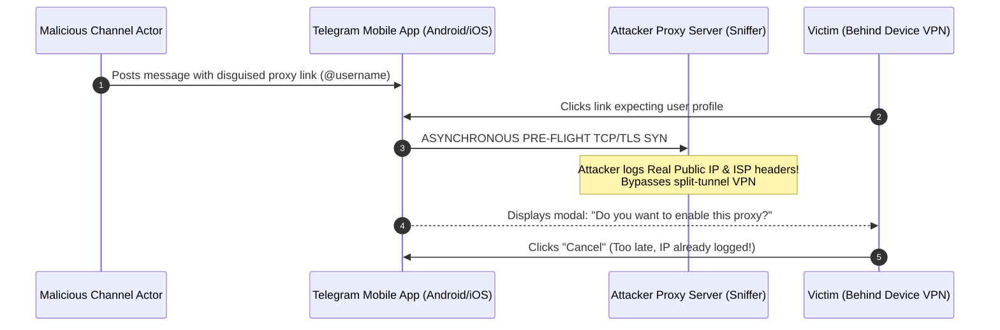
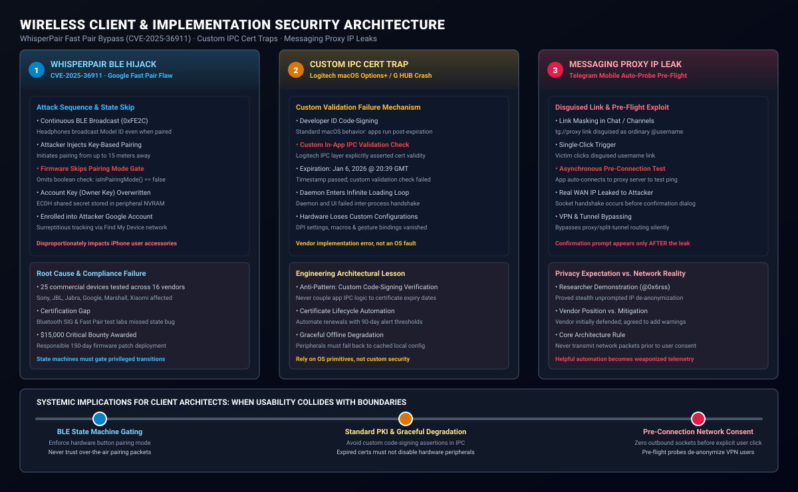
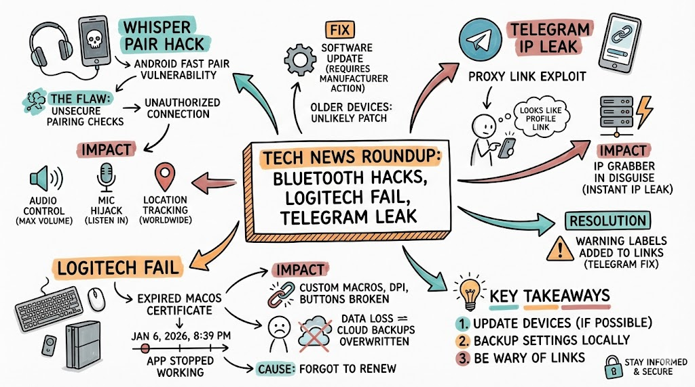

# Wireless Device & Client Security: WhisperPair (CVE-2025-36911), IPC Certificate Traps, and Proxy De-anonymization

Learning note · Revised March 2026 · Client & Wireless Security  
*By Srinivasan Ragothaman ([@rsrini7](https://github.com/rsrini7))*

> Convenience-first feature engineering and proprietary security assertions routinely erode critical operating system and wireless boundaries. In late 2025 and early 2026, three independent client-side vulnerabilities underscored this failure mode: the Google Fast Pair state-checking omission (WhisperPair, CVE-2025-36911), which enabled unauthenticated Bluetooth accessory hijacking and surreptitious geolocation tracking across hundreds of millions of audio devices; Logitech’s custom macOS IPC code-signing validation, which globally froze input peripherals upon certificate expiration; and Telegram’s mobile proxy pre-flight connection mechanism, which silently de-anonymized users' public IP addresses prior to confirmation prompts, bypassing active VPN tunnels.

---

## 1. Foundations: Convenience Features vs. Security Boundaries

Modern consumer technology heavily prioritizes zero-friction onboarding: Bluetooth accessories pair with a single tap, software suites seamlessly bind desktop daemons to hardware peripherals, and messaging platforms allow one-click network proxy sharing. However, when convenience abstractions bypass hardware state validation, rely on brittle client-side assertions, or initiate unprompted network connections, they introduce severe attack surfaces.

```
┌───────────────────────────────────────────────────────────────────────────┐
│                      THE USABILITY-SECURITY CONFLICT                      │
├───────────────────────────────────┬───────────────────────────────────────┤
│ Convenience Mechanism             │ Underlying Failure Mode               │
├───────────────────────────────────┼───────────────────────────────────────┤
│ Fast Pair One-Tap Discovery       │ Headset firmware skips physical       │
│ (Automatic BLE popups)            │ pairing-button state validation       │
├───────────────────────────────────┼───────────────────────────────────────┤
│ Logitech Background Peripherals   │ Custom IPC daemon asserts certificate │
│ (Automatic DPI & macro sync)      │ validity dates instead of OS trust    │
├───────────────────────────────────┼───────────────────────────────────────┤
│ One-Click Proxy Setup             │ Messaging client pre-connects to test │
│ (Instant network bypass links)    │ ping before user provides consent     │
└───────────────────────────────────┴───────────────────────────────────────┘
```

| Technology / Component | Architectural Role | Operational Security Mandate |
| :--- | :--- | :--- |
| **Google Fast Pair Service (GFPS)** | Standardized Bluetooth Low Energy (BLE) protocol on UUID `0xFE2C`. | Requires peripheral devices to verify physical button-driven pairing mode before accepting key-exchange packets. |
| **WhisperPair (CVE-2025-36911)** | Flaw in peripheral Bluetooth firmware implementations. | Exploits missing state gates to inject an Account Key over the air, hijacking device audio and enrolling it into Google's Find My Device network. |
| **Apple Developer ID Code-Signing** | macOS cryptographic integrity and provenance system. | Standard macOS behavior permits installed, notarized software to execute post-expiration; applications should not gate local IPC on certificate validity dates. |
| **Logitech Options+ / G HUB IPC** | Local Unix domain socket / HTTP IPC coordinating UI and background daemons. | Custom in-app security check enforced `notAfter` expiration, freezing mouse/keyboard macros on January 6, 2026. |
| **Pre-Flight Socket Probing** | Automated network diagnostic testing remote proxy availability. | Emitting network packets before displaying confirmation dialogs leaks the client's real IP address and circumvents VPN routing. |

---

## 2. Threat Modeling: Failure Vectors in Client & Wireless Environments

Each of these three incidents illustrates a breakdown in defensive assumptions at the boundary between application software, device firmware, and network transport:

```
[ Attacker within 15m ] ──> BLE Packet (UUID 0xFE2C) ──> [ Headset Firmware ]
                                                              │
                                            ❌ MISSING STATE VALIDATION:
                                            Firmware accepts pairing packet
                                            even when pairing button NOT pressed!
                                                              │
                                                              ▼
                                            [ Attacker Becomes "Owner" ]
                                            - Hijacks microphone & volume
                                            - Enrolls into Find My Device
                                            - Tracks iPhone victim globally

[ System Clock: Jan 06 2026 ] ──> Developer ID Expired ──> [ Logitech IPC Daemon ]
                                                              │
                                            ❌ CUSTOM IPC VALIDATION TRAP:
                                            App explicitly checks notAfter date;
                                            fails handshake despite valid notarization!
                                                              │
                                                              ▼
                                            [ Infinite Loading Freeze ]
                                            - Mice / keyboards lose DPI & macros

[ Malicious Proxy Link ] ──> User Clicks Link ───────> [ Telegram Mobile App ]
                                                              │
                                            ❌ UNPROMPTED PRE-FLIGHT PROBE:
                                            App auto-connects to test proxy latency
                                            BEFORE rendering confirmation modal!
                                                              │
                                                              ▼
                                            [ Real IP Leaked to Attacker ]
                                            - Bypasses active device VPN
```

---

## 3. Deep Technical Mechanisms

### 3.1 WhisperPair (CVE-2025-36911): Google Fast Pair State Omission

Developed by Google and adopted across Android and ChromeOS, Fast Pair simplifies Bluetooth pairing. A peripheral accessory continuously broadcasts BLE advertising packets containing its Service Data (UUID `0xFE2C`) and a 3-byte Model ID. When an Android device detects this broadcast, it queries Google servers for device metadata (image, name) and renders a system notification: *"Tap to pair"*.



#### The State Machine Bypass
Under the Fast Pair specification, when a peripheral receives a **Key-Based Pairing Request** from an unrecognized device, it **must reject the request unless the user has physically placed the peripheral into pairing mode** (e.g., holding the case button for 3 seconds).

Security researchers from COSIC at KU Leuven discovered that 25 commercial audio devices across 16 major manufacturers (including Sony, Jabra, JBL, Google, Marshall, Xiaomi, Nothing, OnePlus, and Soundcore) **omitted this state check entirely in firmware**. The headset accepted the pairing request, negotiated an Elliptic Curve Diffie-Hellman (ECDH) shared secret over the P-256 curve, derived an AES-128 Account Key, and stored it in non-volatile flash memory.

#### The iPhone Asymmetric Tracking Hazard
While Android devices notify users when a new accessory joins their account, **iOS devices have no native visibility into Google Fast Pair state**. If a victim uses a vulnerable pair of headphones with an iPhone, an attacker within 15 meters can inject an Account Key without any audio tone or visual alert appearing on the victim's phone. 

Once registered, the attacker becomes the cryptographic "Owner" within Google's crowdsourced **Find My Device** network. Millions of Android phones worldwide that pass near the victim's headset silently report its encrypted Bluetooth beacon coordinates back to Google, giving the attacker real-time, global tracking capability over the victim.

### 3.2 Logitech Developer ID Code-Signing Expiration: The Custom IPC Trap

On January 6, 2026, at precisely 20:39:41 GMT, millions of macOS users running Logitech Options+ and G HUB experienced sudden application failure. Peripheral mouse customizations, DPI profiles, and macro keybindings ceased functioning, leaving the software trapped in an infinite loading screen.

#### Apple Code-Signing Semantics vs. Logitech Implementation
On macOS, Apple's Developer ID code-signing architecture uses cryptographic timestamps:
- When a binary is built, signed, and notarized with a secure timestamp server, macOS Gatekeeper verifies that the certificate was **valid at the time of signing**.
- If the Developer ID certificate subsequently reaches its `notAfter` expiration date, Gatekeeper **continues to permit the application to execute**. Apple explicitly engineered this behavior so that software does not suddenly expire and break on consumer workstations.



Logitech engineers, however, implemented an internal security layer intended to prevent unauthorized local processes from communicating with the privileged background daemon (`logioptionsplus_agent`). Instead of utilizing Apple's standard `SecCodeCopyGuestWithAttributes` APIs or evaluating Team ID identity, the internal IPC code asserted that the loaded Developer ID certificate was currently active. When the clock struck 20:39:41 GMT, the custom assertion failed. The daemon refused client connections, causing the UI to hang indefinitely.

### 3.3 Telegram Mobile Proxy Link IP De-anonymization

Telegram allows users to configure MTProto or SOCKS5 proxies to bypass government censorship. To facilitate adoption, proxies can be shared via universal links (`tg://proxy?server=...` or `https://t.me/proxy?server=...`).

#### The Pre-Flight Leak
Security researcher `@0x6rss` demonstrated that attackers could mask proxy links within chat channels using hyperlink markdown or formatting that simulated normal user profile handles (e.g., rendering text as `@tech_news` while pointing the underlying URL to a malicious proxy endpoint).

When a user on Android or iOS clicked the disguised link, Telegram's mobile client executed an immediate asynchronous network probe to test whether the proxy server was responsive and measure round-trip latency. 



Crucially, **this network connection occurred before displaying the confirmation dialog** asking the user whether they wished to enable the proxy. By the time the user saw the dialog and pressed "Cancel", their real public IP address and ISP details had already been recorded in the attacker's server access logs. In censorship-heavy jurisdictions where users rely on Telegram for anonymous communications, this silent pre-flight probe enabled immediate de-anonymization.

---

## 4. Architectural Visual: Wireless & Client Failure Topology

The complete architectural interactions across Bluetooth Low Energy state bypasses, custom IPC certificate failures, and unprompted messaging proxy leaks are visualized below:



---

## 5. Production Implementations & Defensive Code Recipes

### Recipe 1: Embedded BLE State Machine Pairing Guard (C/C++)

To remediate CVE-2025-36911 in peripheral Bluetooth firmware, the device must verify hardware pairing state before dispatching Fast Pair cryptographic handshakes:

```c
/* gfps_state_manager.c - Hardened Fast Pair State Machine Guard */
#include <stdbool.h>
#include <stdint.h>

typedef enum {
    BLE_STATE_STANDBY,
    BLE_STATE_CONNECTED,
    BLE_STATE_PAIRING_MODE_ACTIVE
} ble_device_state_t;

static ble_device_state_t current_device_state = BLE_STATE_STANDBY;
static uint32_t pairing_mode_expiry_timestamp = 0;

/* Invoked by hardware interrupt when physical pairing button is held */
void on_hardware_pairing_button_pressed(uint32_t current_time_ms) {
    current_device_state = BLE_STATE_PAIRING_MODE_ACTIVE;
    pairing_mode_expiry_timestamp = current_time_ms + 120000; // 2-minute pairing window
}

/* Hardened GFPS Key-Based Pairing Request Handler */
bool handle_gfps_key_based_pairing_request(const uint8_t *request_payload, uint32_t current_time_ms) {
    // Check 1: Enforce hardware pairing mode gate
    if (current_device_state != BLE_STATE_PAIRING_MODE_ACTIVE) {
        // SECURITY VIOLATION: Unauthenticated over-the-air pairing attempt (CVE-2025-36911)
        log_security_event("REJECTED: Fast Pair request received while pairing mode inactive.");
        return false; // Drop packet immediately without computing ECDH
    }

    // Check 2: Verify pairing window has not timed out
    if (current_time_ms > pairing_mode_expiry_timestamp) {
        current_device_state = BLE_STATE_STANDBY;
        log_security_event("REJECTED: Fast Pair request received after pairing window expired.");
        return false;
    }

    // Process ECDH P-256 key exchange only if physical gate is satisfied
    return process_ecdh_key_exchange(request_payload);
}
```

### Recipe 2: Idiomatic macOS IPC Code Identity Validation (Swift)

Instead of inspecting certificate expiration timestamps, macOS daemons must validate client process authenticity using Apple's Security Framework Code Signing APIs:

```swift
// SafeIPCValidator.swift - Validates Client Code Signature Without Expiry Traps
import Foundation
import Security

public class SafeIPCValidator {
    private static let expectedTeamID = "2J8H252282" // Vendor Team ID
    private static let expectedBundleID = "com.logitech.optionsplus"

    public static func validateClientConnection(connection: NSXPCConnection) -> Bool {
        let auditToken = connection.auditToken
        
        var guestCode: SecCode?
        let tokenData = Data(bytes: auditToken, count: MemoryLayout<audit_token_t>.size)
        let attributes: [CFString: Any] = [kSecGuestAttributeAudit: tokenData]
        
        let status = SecCodeCopyGuestWithAttributes(nil, attributes as CFDictionary, [], &guestCode)
        guard status == errSecSuccess, let code = guestCode else {
            return false
        }
        
        // Requirement: Enforces Team ID and Bundle ID matching, allowing validly signed binaries post-cert expiry
        let requirementString = "anchor apple generic and certificate leaf[subject.OU] = \"\(expectedTeamID)\" and identifier \"\(expectedBundleID)\""
        var requirement: SecRequirement?
        
        guard SecRequirementCreateWithString(requirementString as CFString, [], &requirement) == errSecSuccess,
              let secRequirement = requirement else {
            return false
        }
        
        // SecCodeCheckValidity validates notarization and timestamp validity at signing time
        let validity = SecCodeCheckValidity(code, SecCSFlags(rawValue: 0), secRequirement)
        return validity == errSecSuccess
    }
}
```

### Recipe 3: Pre-Connection Network Intent Guard (Kotlin / Android)

To prevent pre-flight socket IP leaks when handling proxy and deep-link schemes:

```kotlin
// ProxyIntentHandler.kt - Enforces Explicit Consent Before Outbound Socket Binding
package com.security.privacy

import android.net.Uri
import kotlinx.coroutines.Dispatchers
import kotlinx.coroutines.withContext

class ProxyIntentHandler {
    fun handleIncomingProxyUri(uri: Uri, userConfirmed: Boolean) {
        // Enforce: Never perform automated socket testing before modal confirmation
        if (!userConfirmed) {
            // Render UI confirmation dialog without triggering network I/O
            displayProxyConfirmationDialog(
                serverHost = uri.getQueryParameter("server") ?: "Unknown",
                port = uri.getQueryParameter("port") ?: "Unknown",
                onUserAccepted = {
                    // Outbound socket initiated ONLY after explicit user consent
                    connectToProxy(uri)
                },
                onUserRejected = {
                    // Drop intent; zero network packets emitted
                }
            )
            return
        }
        
        connectToProxy(uri)
    }

    private fun connectToProxy(uri: Uri) {
        // Perform network connection
    }
}
```

---

## 6. Common Claims vs. Technical Realities

The table below contrasts common industry misconceptions with the underlying technical realities across wireless and client software security:

| Common Claim / Assumption | Technical Reality & Vulnerability | Production Architecture Standard |
| :--- | :--- | :--- |
| *"Fast Pair is secure because it uses standard ECDH P-256 and AES-128 encryption."* | Encryption strength is irrelevant if the firmware state machine fails to gate execution behind physical user intent. | Cryptographic operations must be conditional upon physical hardware state (hardware button pairing mode). |
| *"Bluetooth attacks require complex custom radios and zero-day exploits."* | WhisperPair executes using standard Android smartphones or inexpensive $10 BLE development boards (ESP32) from 15 meters away. | Defensive design must assume attacker proximity in public transit, airports, and shared workspaces. |
| *"Developer ID certificate expiration means software is no longer secure to run."* | Apple's Gatekeeper explicitly allows notarized binaries to run after cert expiry if signed with a valid timestamp. | Application IPC layers must rely on OS code-signing trust rather than custom `notAfter` date assertions. |
| *"Pre-connecting to a proxy is just standard latency optimization (ping)."* | Pre-flight socket handshakes expose the client's real IP address and ISP identity to the server owner, bypassing VPN tunnels. | Strictly prohibit background network probes on unverified external links prior to user confirmation. |
| *"Bluetooth audio accessories only pose audio listening risks."* | By enrolling the accessory into Google's Find My Device network, attackers turn consumer headphones into worldwide tracking bugs. | Limit accessory ownership binding to authenticated sessions; alert users when new management keys are provisioned. |

---

## 7. Impact, Real-World Edge Cases & Gotchas

### 1. The Multi-Tier Compliance Breakdown
WhisperPair was not a failure of a single obscure vendor; it affected 25 commercial devices across 16 leading manufacturers using 17 different Bluetooth chipsets. This reveals a systemic failure across three tiers:
1. **Implementation Tier**: Peripheral firmware engineers blindly copied reference implementations without testing negative test cases (sending pairing packets while unpaired).
2. **Vendor Validation Tier**: Quality assurance teams only tested happy-path pairing flows.
3. **Certification Tier**: Neither Google's Fast Pair compliance suites nor Bluetooth SIG certification labs included automated negative-state pairing tests.

### 2. High-Risk Surveillance Zones
For investigative journalists, corporate executives, and human rights defenders, the combination of WhisperPair and proxy pre-flight leaks represents a critical physical safety hazard:
- An adversary in an airport lounge can silently pair with an executive's headphones, listen to private phone calls, or track their international movements through crowdsourced location networks.
- A disguised proxy link shared in an activist group chat immediately de-anonymizes dissenters even if they have active VPN software running on their smartphones.

---

## 8. Practical Adoption Blueprint & Verification Checklist

Engineering teams developing client software, IoT peripherals, or messaging applications should implement the following validation protocol:

```
┌───────────────────────────────────────────────────────────────────────────┐
│               WIRELESS CLIENT & EMBEDDED DEFENSE CHECKLIST                │
├───────────────────────────────────────────────────────────────────────────┤
│ [ ] BLE Peripheral Firmware Auditing                                      │
│     ├─ Verify accessory drops GFPS pairing packets when unpaired          │
│     ├─ Automated CI negative test: Transmit pairing request while standby │
│     └─ Validate that Account Key overwrites require hardware confirmation │
│                                                                           │
│ [ ] Desktop Client Code-Signing & IPC Hardening                           │
│     ├─ Remove all custom expiration date (`notAfter`) checks in IPC       │
│     ├─ Enforce process validation via SecCodeCopyGuestWithAttributes      │
│     └─ Verify binaries with expired certs continue executing cleanly      │
│                                                                           │
│ [ ] Network Ingress & Deep-Link Isolation                                 │
│     ├─ Audit all deep-link URL handlers (`tg://`, `http://`, `custom://`) │
│     ├─ Ensure zero outbound TCP/UDP packets emit before user modal click  │
│     └─ Respect device-level VPN routing without socket interface bypasses │
│                                                                           │
│ [ ] Certificate Lifecycle Automation                                      │
│     ├─ Deploy automated monitoring for all developer certificates         │
│     └─ Configure alerting thresholds at 90, 60, and 30 days pre-expiry    │
└───────────────────────────────────────────────────────────────────────────┘
```

---

## 9. Timeline & Evolutionary Context

```
Aug 2025: WhisperPair Reported to Google
└─ COSIC researchers report BLE state omission; $15,000 maximum bounty awarded
└─ 150-day coordinated disclosure period initiated across 16 hardware vendors

Late 2025: Active Patching & Pixel Firmware Rollouts
└─ Google deploys fixes to Pixel Buds and releases updated Fast Pair compliance tests
└─ Select third-party vendors issue silent firmware updates

Jan 06, 2026: Logitech Global Certificate Expiration
└─ Logi Options+ and G HUB Developer ID cert expires at 20:39 GMT
└─ Custom IPC checks trigger global app lockouts; emergency patches deployed

Early 2026: WhisperPair Public Disclosure & Telegram Warnings
└─ COSIC publicly presents WhisperPair findings at major security symposium
└─ Telegram acknowledges proxy link de-anonymization and commits to pre-click warnings
```

---

## 10. Primary Sources & References

1. [COSIC Research Group, KU Leuven: WhisperPair Technical Report](https://whisperpair.eu) — Primary academic research uncovering CVE-2025-36911 across 25 commercial Bluetooth devices and 16 vendors.
2. [National Vulnerability Database: CVE-2025-36911 Detail](https://nvd.nist.gov/vuln/detail/CVE-2025-36911) — Official NIST vulnerability record for Google Fast Pair implementation bypasses.
3. [Google Developers: Fast Pair Service Specification](https://developers.google.com/nearby/fast-pair/spec) — Official technical documentation governing BLE pairing state machines and ECDH key exchanges.
4. [Logitech Support Knowledgebase: macOS Certificate Advisory](https://support.logi.com) — Official disclosure regarding the January 6, 2026 Options+ and G HUB code-signing expiration resolution.
5. [Apple Developer Documentation: Code Signing and Gatekeeper Architecture](https://developer.apple.com/documentation/security/code_signing_services) — Guidelines on Developer ID notarization, timestamping, and SecCode validation APIs.
6. [Security Research Disclosure: Telegram Proxy Pre-Flight IP Leak (@0x6rss)](https://t.me) — Technical demonstration of mobile proxy auto-probing bypassing active device VPN tunnels.

---

## 11. Supplementary Visuals

The original reference visual documenting wireless device and peripheral implementation vulnerabilities is preserved below:


*Figure: Overview of wireless device ecosystem vulnerabilities, Bluetooth pairing states, and client execution risks.*

---

**Related:**
- [EMudhra-Weak-CA-Keys-And-PKI-Trust-Oct-2026.md](EMudhra-Weak-CA-Keys-And-PKI-Trust-Oct-2026.md) — Comprehensive analysis of certificate authority trust boundaries and cryptographic key validation failures.
- [Notepad++-Targeted-Attack-Nov-2026.md](Notepad++-Targeted-Attack-Nov-2026.md) — Analyzes client-software update mechanisms, certificate verification, and delivery trust compromises.
- [WhatsApp-Contact-Enumeration-And-Data-Leak-2026.md](WhatsApp-Contact-Enumeration-And-Data-Leak-2026.md) — Large-scale client protocol enumeration exposing 3.5 billion users via address book discovery.
- [Securing-OpenClaw-Infrastructure-Setup-2026.md](../../AI-ML/Agents/openclaw/Securing-OpenClaw-Infrastructure-Setup-2026.md) — Defense-in-depth isolation protocols for securing autonomous client and agent runtimes.
- [Elecbrakes Trailer Brake Controllers: Bluetooth Access and Firmware Risks](Elecbrakes-Bluetooth-Brake-Controller-Vulnerabilities-Nov-2026.md) — A safety-critical BLE characteristic lacked device-side authorization, with replay and firmware-update issues as well.
