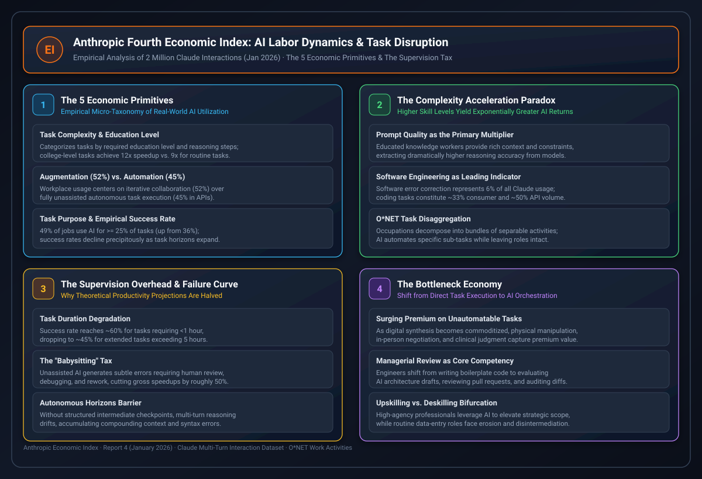
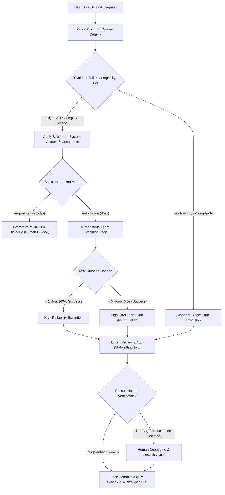
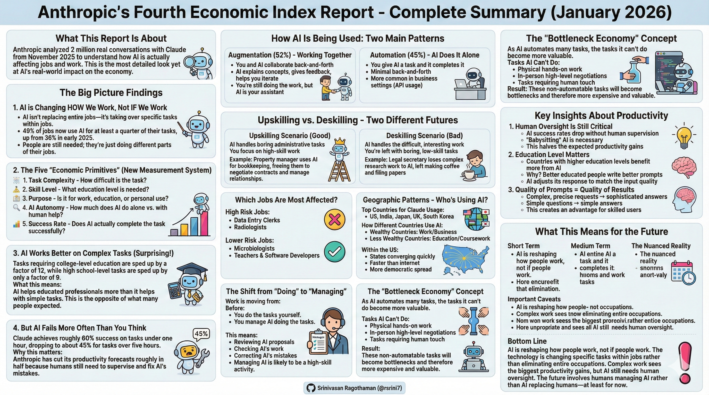

# Anthropic Fourth Economic Index: AI Labor Dynamics, Task Disruption, and the Supervision Tax (2026)

Daily learning · January 15, 2026

*By Srinivasan Ragothaman ([@rsrini7](https://github.com/rsrini7))*

> **Core Idea:** In January 2026, Anthropic published its *Fourth Economic Index Report*, analyzing 2 million multi-turn Claude conversations from November 2025 to measure real-world labor market impact. Introducing a micro-taxonomy of "Five Economic Primitives," the report revealed that AI speeds up complex college-level tasks (12x) faster than routine tasks (9x). However, autonomous failure rates across multi-hour horizons (dropping from 60% success under 1 hour to 45% beyond 5 hours) and human supervisory friction ("the babysitting tax") cut theoretical enterprise productivity gains in half.

---

## 1. Foundations & Ecosystem Context

Since the launch of large language models, macroeconomic debates have oscillated between extreme predictions of instantaneous mass technological unemployment and dismissals of AI as superficial predictive text. Most early economic forecasts suffered from methodological abstraction, relying on subjective surveys or high-level occupational titles rather than granular, empirical task execution telemetry.

```
┌────────────────────────────────────────────────────────────────────────────────────────┐
│                        Evolution of AI Economic Measurement                           │
└────────────────────────────────────────────────────────────────────────────────────────┘

  [Wave 1: Macro Projections (2023)]       Surveys & Keyword Matching ──► "80% of jobs exposed"
  Limitation: Static occupational labels   Assumes complete job replacement overnight
           │
           ▼
  [Wave 2: Controlled Benchmarks (2024)]   Synthetic Benchmarks (SWE-bench, HumanEval)
  Limitation: Isolated toy problems        Fails to reflect multi-turn production iteration
           │
           ▼
  [Wave 3: Anthropic Economic Index (2026)] Real-World Telemetry (2M Claude Interactions)
  Micro-Taxonomy: 5 Economic Primitives    Measures task-level augmentation vs automation,
                                           skill tiers, and empirical supervision overhead
```

Anthropic's Fourth Economic Index grounds the debate in observational micro-data. By mapping 2 million real-world multi-turn Claude interactions to the **Occupational Information Network (O*NET)** taxonomy developed by the U.S. Department of Labor, the report disaggregates occupations into discrete work activities. 

The core finding is structural: **AI is transforming how work is performed, not whether work exists.** While 49% of professional occupations now utilize AI for at least 25% of their core tasks (up from 36% in early 2025), occupations remain resilient bundles of complementary tasks.

### Key Terminology & Architectural Concepts

| Term | Technical Meaning & Economic Context |
| :--- | :--- |
| **Five Economic Primitives** | Anthropic's empirical framework measuring AI interactions across: (1) Task Complexity, (2) Skill Level, (3) Purpose, (4) AI Autonomy, and (5) Success Rate. |
| **Task Augmentation (52%)** | Collaborative, multi-turn interaction model where humans direct, iterate, and refine AI outputs while retaining execution ownership. |
| **Task Automation (45%)** | Unassisted execution model where the model receives an objective and autonomously executes steps to completion (predominant in API integrations). |
| **O*NET Taxonomy** | U.S. Department of Labor database decomposing 900+ occupations into standardized Generalized Work Activities (GWAs) and Detailed Work Activities (DWAs). |
| **The Supervision Tax ("Babysitting")** | Human cognitive overhead required to audit, verify, debug, and correct AI outputs, halving theoretical gross productivity gains. |
| **Complexity-Acceleration Paradox** | The empirical phenomenon where AI yields higher speedup factors on complex, college-level reasoning tasks (12x) than on routine high school-level tasks (9x). |
| **Autonomous Horizon Decay** | The observed mathematical degradation in model task success probability as time-to-completion and reasoning steps expand. |
| **The Bottleneck Economy** | Economic shift where commoditization of automated digital tasks causes wages and valuation to concentrate in remaining unautomatable physical and interpersonal activities. |

---

## 2. Deep Technical Mechanism: The Five Economic Primitives & Labor Dynamics

Anthropic's analysis introduces a structured measurement methodology to evaluate AI's footprint across human labor.

```
+---------------------------------------------------------------------------------------+
|                    The Five Economic Primitives (Anthropic Index 2026)                |
+---------------------------------------------------------------------------------------+

        [1. Task Complexity]                      [2. Skill Level Required]
        ├── Cognitive reasoning steps             ├── O*NET Educational Tiers
        └── Multi-domain synthesis                └── College (12x) vs High School (9x)
                          │                                         │
                          └───────────────────┬─────────────────────┘
                                              │
                                              ▼
        [3. Interaction Purpose]                  [4. AI Autonomy Model]
        ├── Enterprise Work vs Coursework         ├── Augmentation (52% Multi-Turn Chat)
        └── Global Geographic Divergence          └── Automation (45% Direct API Invocations)
                                              │
                                              ▼
        [5. Empirical Success Rate & Autonomous Horizon Decay]
        ├── &lt;1 Hour Tasks : 60% Success Rate
        └── &gt;5 Hour Tasks : 45% Success Rate ──► 50% Enterprise Productivity Discount
```

### 1. The Augmentation vs. Automation Bifurcation
Telemetry reveals two distinct interaction archetypes:
- **Augmentation (52% of interactions):** Users engage in conversational, iterative dialogue. The human provides domain constraints, reviews intermediate hypotheses, and guides code or prose generation. This pattern dominates consumer interfaces and creative engineering.
- **Automation (45% of interactions):** Users dispatch programmatic or batch directives requiring minimal intermediate clarification. This pattern dominates API workloads, background document processing, and deterministic data manipulation.

### 2. The Complexity-Acceleration Paradox
Prior automation revolutions (e.g., steam power, robotic assembly lines, early enterprise computing) systematically automated routine, manual, and low-skill operations first. Anthropic's telemetry reveals an inverted dynamic:

```
  Education Tier Required      Empirical Speedup Factor     Primary Dynamic
  ────────────────────────────────────────────────────────────────────────────────────────
  College / Graduate Degree            12x                  High prompt information density;
                                                            rich contextual specification.
  High School / Basic Routine           9x                  Simple deterministic workflows;
                                                            lower leverage on reasoning depth.
```

The underlying technical mechanism stems from **prompt information density and domain grounding**. Highly educated professionals possess specialized domain vocabularies, enabling them to formulate precise, constrained prompts. Large language models respond with exponentially higher accuracy when given clear boundary conditions, schema definitions, and explicit negative constraints. Conversely, low-skill queries often lack necessary context, forcing models into generic or hallucinated paths.

### 3. The Autonomous Horizon Decay Curve & The Supervision Tax
While AI generates code, drafts reports, and executes tool calls rapidly, its reliability degrades as task horizons expand. Anthropic measured empirical task completion success across varying time horizons:
- **Tasks under 1 hour:** ~60% completion success without critical failure.
- **Tasks between 1 and 5 hours:** ~52% completion success.
- **Tasks exceeding 5 hours:** ~45% completion success.

Because complex multi-hour tasks fail more than half the time when unassisted, enterprises cannot deploy models in an unmonitored state. Every generated output requires human review, edge-case testing, and debugging.

#### Mathematical Formulation of Net Productivity Multiplier

The net productivity multiplier $P_{\text{net}}$ accounts for the manual execution time $T_{\text{manual}}$, the model execution time $T_{\text{AI}}$, the success rate $S \in [0, 1]$, the human review latency $T_{\text{review}}$, and the debugging/rework latency $T_{\text{debug}}$ incurred upon failure:

$$P_{\text{net}} = \frac{T_{\text{manual}}}{T_{\text{AI}} + T_{\text{review}} + (1 - S) \cdot T_{\text{debug}}}$$

When $S$ drops to 0.45 on multi-hour tasks, the term $(1 - S) \cdot T_{\text{debug}}$ expands drastically. This reality led Anthropic to **cut its net enterprise productivity projections by roughly 50%**, transforming theoretical 10x gains into real-world 1.8x–2.5x net throughput enhancements.

### 4. Extreme Task Concentration: Software as the Leading Indicator
Despite Claude supporting over 3,000 unique work activities in the O*NET taxonomy, utilization exhibits extreme Pareto clustering:
- The **top 10 tasks account for 24%** of all global conversation volume.
- **Computer and mathematical tasks represent ~33%** of consumer usage and nearly **50% of API volume**.
- The single most frequent task across all 2 million conversations is **"Modifying software to correct errors" (debugging)**, representing **6% of all global Claude usage**.

Software engineering functions as the "canary in the coal mine." Because code execution environments provide immediate compiler feedback and unit test validation, programming was the first discipline to absorb agentic automation (via CLI tools such as Claude Code).

---

## 3. The Shift to the Bottleneck Economy

As generative models commoditize digital artifact creation (prose, boilerplate code, spreadsheet calculations), economic value reallocates toward non-automatable inputs—a direct manifestation of **Baumol's Cost Disease**.

```
┌────────────────────────────────────────────────────────────────────────────────────────┐
│                        The Bottleneck Economy Dynamics                                 │
└────────────────────────────────────────────────────────────────────────────────────────┘

  [Commoditized Activities (Falling Marginal Cost)]
  ├── Writing boiler-plate CRUD APIs
  ├── Summarizing legal depositions
  └── Formatting financial reports
            │
            ▼ (Value Migrates Downstream)
  [Scarce Bottleneck Activities (Surging Premium Value)]
  ├── Physical, hands-on mechanical execution (pipetting, robotics, hardware deployment)
  ├── In-person negotiation, stakeholder alignment, and boardroom mediation
  └── Architecture verification, security audits, and cryptographic sign-offs
```

In this regime, professionals do not lose employment; rather, their core daily activities shift from **execution to orchestration**:
- **Junior Developer Transition:** Shift from typing syntax to validating AI-generated pull requests, writing integration test suites, and defining interface boundaries.
- **Upskilling vs. Deskilling Bifurcation:**
  - *Upskilling:* A property manager uses AI for automated lease bookkeeping, elevating their time toward high-value tenant negotiations and portfolio acquisition.
  - *Deskilling:* A junior paralegal loses complex case research tasks to AI, relegated to administrative filing and manual document sorting.

---

## 4. Architectural Visuals & Task Routing Lifecycle

The Anthropic index illustrates how enterprise task requests route through complexity evaluation and human supervision gates.



### Enterprise Task Routing & Supervision Lifecycle



---

## 5. Production Implementations & Analytical Code Recipes

Workforce analytics and engineering leadership require programmatic models to evaluate the true economic ROI of AI adoption, accounting for human review friction, task duration, and error remediation.

### Recipe 1: Python O*NET Task Classification & Augmentation Analyzer

This production Python script parses conversation telemetry, maps inputs to O*NET task activities, and classifies sessions into Augmentation vs. Automation based on turn count and tool invocations.

```python
#!/usr/bin/env python3
"""
Anthropic Economic Index: Task Telemetry & Interaction Analyzer
Classifies conversation logs into O*NET Generalized Work Activities (GWAs)
and measures Augmentation vs Automation ratios.
"""

from dataclasses import dataclass
from typing import List, Dict, Any
import re
import json

@dataclass
class ConversationSession:
    session_id: str
    user_turn_count: int
    assistant_turn_count: int
    tool_call_count: int
    total_duration_minutes: float
    user_prompt_tokens: int
    sample_text: str

class EconomicTelemetryClassifier:
    def __init__(self):
        # O*NET Generalized Work Activities (GWAs) matching heuristics
        self.gwa_signatures = {
            "GWA_MODIFY_SOFTWARE": [r"bug", r"syntax error", r"refactor", r"function", r"git", r"stack trace"],
            "GWA_DATA_ANALYSIS": [r"dataframe", r"sql", r"regression", r"p-value", r"statistics", r"csv"],
            "GWA_COMMUNICATION": [r"draft email", r"meeting notes", r"executive summary", r"newsletter"],
            "GWA_DOCUMENT_SEARCH": [r"summarize", r"find reference", r"policy handbook", r"citation"]
        }

    def classify_gwa(self, text: str) -> str:
        text_lower = text.lower()
        for gwa, patterns in self.gwa_signatures.items():
            for pat in patterns:
                if re.search(r'\b' + pat + r'\b', text_lower):
                    return gwa
        return "GWA_GENERAL_INQUIRY"

    def evaluate_autonomy_mode(self, session: ConversationSession) -> str:
        """
        Bifurcates sessions into Augmentation vs Automation.
        Multi-turn interactions (>3 user turns) indicate Augmentation.
        High tool execution with low user turns indicates Automation.
        """
        if session.user_turn_count >= 3:
            return "AUGMENTATION"
        elif session.tool_call_count >= 2 and session.user_turn_count <= 2:
            return "AUTOMATION"
        return "SINGLE_TURN_ASSIST"

    def calculate_session_metrics(self, sessions: List[ConversationSession]) -> Dict[str, Any]:
        total = len(sessions)
        if total == 0:
            return {}

        counts = {"AUGMENTATION": 0, "AUTOMATION": 0, "SINGLE_TURN_ASSIST": 0}
        gwa_distribution = {}

        for s in sessions:
            mode = self.evaluate_autonomy_mode(s)
            counts[mode] += 1

            gwa = self.classify_gwa(s.sample_text)
            gwa_distribution[gwa] = gwa_distribution.get(gwa, 0) + 1

        return {
            "total_sessions_analyzed": total,
            "augmentation_ratio": round(counts["AUGMENTATION"] / total, 4),
            "automation_ratio": round(counts["AUTOMATION"] / total, 4),
            "single_turn_ratio": round(counts["SINGLE_TURN_ASSIST"] / total, 4),
            "gwa_distribution_percentages": {
                k: round((v / total) * 100, 2) for k, v in gwa_distribution.items()
            }
        }

if __name__ == "__main__":
    sample_dataset = [
        ConversationSession("S1", 5, 5, 1, 14.5, 420, "Fix NullPointerException in payment service controller"),
        ConversationSession("S2", 1, 1, 6, 45.0, 150, "Run SQL ETL script and export missing customer records"),
        ConversationSession("S3", 4, 4, 0, 8.2, 310, "Help refine quarterly OKR draft for platform engineering team"),
        ConversationSession("S4", 1, 1, 0, 1.2, 45, "What is the capital of Singapore?")
    ]

    analyzer = EconomicTelemetryClassifier()
    metrics = analyzer.calculate_session_metrics(sample_dataset)
    print(json.dumps(metrics, indent=2))
```

---

### Recipe 2: The Supervision Tax & Net Productivity Simulator

This script models Anthropic's net productivity discounting formula, simulating how task duration horizons and human review overhead degrade theoretical speedup factors.

```python
#!/usr/bin/env python3
"""
Net Productivity Simulator
Calculates true enterprise ROI factoring in autonomous failure rates,
review friction, and debugging overhead based on Anthropic Index findings.
"""

def compute_net_productivity(
    t_manual_hours: float,
    gross_speedup_factor: float,
    human_review_overhead_pct: float,
    rework_multiplier: float = 0.5
) -> dict:
    """
    Computes Net Speedup considering the supervision tax and duration decay.
    """
    # 1. Compute empirical success rate based on task horizon
    if t_manual_hours < 1.0:
        success_rate = 0.60
    elif t_manual_hours <= 5.0:
        success_rate = 0.52
    else:
        success_rate = 0.45

    # Raw model execution time
    t_ai = t_manual_hours / gross_speedup_factor

    # Human review time (e.g. 15% of manual time spent auditing code diffs)
    t_review = t_manual_hours * human_review_overhead_pct

    # Debugging / rework penalty incurred upon failure
    failure_probability = 1.0 - success_rate
    t_debug = failure_probability * (t_manual_hours * rework_multiplier)

    # Net wall-clock time required to deliver verified output
    total_elapsed_time = t_ai + t_review + t_debug
    net_speedup = t_manual_hours / total_elapsed_time

    # Productivity haircut percentage
    discount_pct = ((gross_speedup_factor - net_speedup) / gross_speedup_factor) * 100.0

    return {
        "manual_hours": t_manual_hours,
        "gross_speedup": f"{gross_speedup_factor:.1f}x",
        "empirical_success_rate": f"{success_rate * 100:.1f}%",
        "total_elapsed_hours": round(total_elapsed_time, 2),
        "net_speedup": f"{net_speedup:.2f}x",
        "supervision_haircut_pct": f"{discount_pct:.1f}%"
    }

if __name__ == "__main__":
    test_cases = [
        {"hours": 0.5, "speedup": 12.0, "review": 0.10},  # Small unit test / bugfix
        {"hours": 3.0, "speedup": 12.0, "review": 0.15},  # Moderate feature refactor
        {"hours": 8.0, "speedup": 12.0, "review": 0.20}   # Full architectural service migration
    ]

    print(f"{'Task Size':<12} | {'Gross':<6} | {'Success':<8} | {'Net Speedup':<12} | {'Productivity Cut'}")
    print("-" * 65)
    for c in test_cases:
        res = compute_net_productivity(c["hours"], c["speedup"], c["review"])
        print(f"{c['hours']:<4} hours   | {res['gross_speedup']:<6} | {res['empirical_success_rate']:<8} | "
              f"{res['net_speedup']:<12} | {res['supervision_haircut_pct']}")
```

---

## 6. Impact, Real-World Edge Cases & Gotchas

```
+-------------------------------------------------------------------------------------------------+
|                       Common Claims vs. Technical Realities                                     |
+-------------------------------------------------------------------------------------------------+
| Common Claim                                  | Technical Reality                               |
+-----------------------------------------------+-------------------------------------------------+
| "AI will eliminate entire job categories      | AI automates discrete tasks (DWAs), not full    |
| within 12 to 24 months."                      | occupations. 49% of jobs use AI for &gt;=25% of  |
|                                               | tasks, leaving core roles intact.               |
+-----------------------------------------------+-------------------------------------------------+
| "Entry-level routine tasks benefit the most   | The Complexity-Acceleration Paradox shows       |
| from LLM speedup factors."                    | college tasks gain 12x vs. 9x for routine tasks |
|                                               | due to prompt precision and context density.    |
+-----------------------------------------------+-------------------------------------------------+
| "Gross benchmark speedups (10x-15x) translate | Multi-hour autonomous failure rates (45% at     |
| directly to organizational cost savings."     | &gt;5h) and supervisory review cut net output    |
|                                               | gains in half (~2x-3x net).                     |
+-----------------------------------------------+-------------------------------------------------+
| "AI adoption spreads slowly, mirroring       | U.S. interstate adoption converged faster than   |
| historical enterprise software cycles."       | the internet; consumer and API access drive     |
|                                               | rapid geographic and cross-border parity.       |
+-----------------------------------------------+-------------------------------------------------+
```

### Real-World Failure Modes & Sociological Edge Cases

1. **The Phantom Completion Trap:**  
   Models frequently declare multi-step tasks "complete" while silently omitting edge cases (e.g., passing 9/10 unit tests while breaking an unstated backward-compatibility requirement). Without strict automated test harnesses, human reviewers miss these omissions, introducing technical debt.
2. **The Junior Mentorship Vacuum:**  
   Because junior developers historically learned software engineering by writing boilerplate CRUD code and resolving trivial bugs, automating these entry-level tasks eliminates the traditional apprenticeship pipeline. Organizations must deliberately construct synthetic review exercises to develop senior architectural judgment.
3. **The Prompt Inequality Divide:**  
   Because high-performing outputs require sophisticated context injection and boundary specification, workers lacking formal training or technical articulation achieve substantially lower output quality, widening internal team performance variance.

---

## 7. Practical Adoption Blueprint & Verification Checklist

Engineering and operational leaders implementing AI workflows should follow this structured deployment blueprint to maximize net productivity while accounting for the supervision tax:

```
┌────────────────────────────────────────────────────────────────────────────────────────┐
│                        Enterprise AI Workforce Adoption Framework                      │
└────────────────────────────────────────────────────────────────────────────────────────┘

  Step 1: O*NET Task Decomposition
  ├── [ ] Decompose department workflows into discrete tasks rather than full job roles.
  ├── [ ] Identify high-volume Pareto tasks (targeting the top 10 activities for automation).
  └── [ ] Segregate tasks into Augmentation (creative/exploratory) vs Automation (pipeline).

  Step 2: Calibrate Human Supervision
  ├── [ ] Budget 15-20% of manual task duration explicitly for human verification and review.
  ├── [ ] Enforce automated unit test and lint verification before human review dispatch.
  └── [ ] Cap unassisted autonomous execution horizons at < 1 hour to maintain 60%+ success.

  Step 3: Guard Against Deskilling
  ├── [ ] Shift junior engineers from syntax generation to pull-request auditing and system design.
  ├── [ ] Establish organizational prompt libraries and context-sharing repositories.
  └── [ ] Measure net productivity ($P_{\text{net}}$) rather than raw model generation velocity.
```

---

## 8. Geographic Adoption Patterns & Global Divergence

Anthropic's analysis of international telemetry revealed marked divergences in how distinct economies utilize frontier models:

### Top Five Nations by Claude Usage Volume
1. **United States:** Dominates in developer agent workflows, API integrations, and enterprise operational automation.
2. **India:** Rapidly surging in technical development, academic coursework, and software test automation.
3. **Japan:** Heavy concentration in document translation, business communication synthesis, and workflow augmentation.
4. **United Kingdom:** Enterprise finance, legal document analysis, and administrative productivity.
5. **South Korea:** Software engineering, gaming asset scripting, and academic research.

### The Wealth-Usage Divergence
- **High-Income Economies (US, UK, Japan):** Interaction telemetry centers overwhelmingly on **commercial work and business automation** (~70% of volume).
- **Emerging Economies (India, Brazil, Southeast Asia):** Interaction telemetry skews heavily toward **education, coursework, and technical upskilling** (~45% of volume). This dynamic suggests frontier models serve as an equalizing infrastructure for global technical education.

---

## 9. Primary Sources & References

1. [Anthropic: The Anthropic Economic Index (Fourth Report, January 2026)](https://www.anthropic.com/research/economic-index-january-2026) — Foundational whitepaper detailing empirical methodology, the 5 Economic Primitives, and 2 million conversation telemetry analysis.
2. [U.S. Department of Labor: Occupational Information Network (O*NET) Database](https://www.onetonline.org) — Standardized occupational taxonomy defining Generalized Work Activities (GWAs) and Detailed Work Activities (DWAs).
3. [National Bureau of Economic Research (NBER): Generative AI at Work (Brynjolfsson, Li, Raymond)](https://www.nber.org/papers/w31161) — Empirical analysis of customer support automation, productivity distribution, and skill-level acceleration factors.
4. [David Autor (MIT / NBER): The Labor Market Impacts of Technological Change](https://economics.mit.edu) — Theoretical foundations of task disaggregation, task-biased technological change, and Baumol's Cost Disease.

---

## 10. Supplementary Visuals


*Figure: Key findings and summary infographics from Anthropic's Fourth Economic Index Report (January 2026).*

---

**Related:**
- [Singapore-IMDA-Agentic-AI-Governance-Framework-2026.md](Singapore-IMDA-Agentic-AI-Governance-Framework-2026.md) — Operationalizing governance, safety interceptors, and human-in-the-loop oversight for autonomous agents.
- [HackerRank-Hiring-Agent-Architecture-And-Evaluation-2026.md](../../AI-ML/Agents/analysis/HackerRank-Hiring-Agent-Architecture-And-Evaluation-2026.md) — Empirical benchmarking and automated skill evaluation for software engineering agents.
- [Global-AI-Scam-Landscape-And-Defense-Playbook-2026.md](Global-AI-Scam-Landscape-And-Defense-Playbook-2026.md) — The dark side of task automation: analyzing scalable cybercrime, fraud networks, and automated economic attacks.
