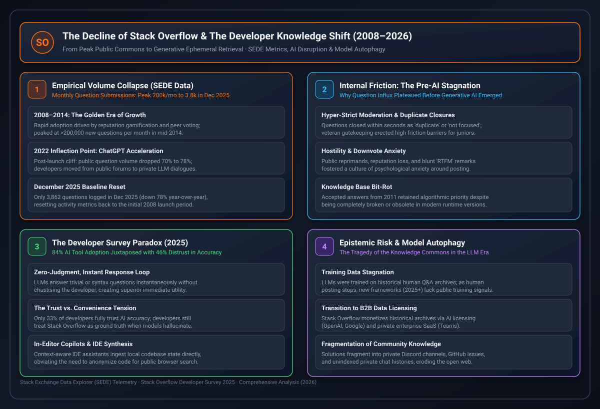

# The Decline of Stack Overflow and the Developer Knowledge Shift (2008–2026)

Daily learning · January 10, 2026

*By Srinivasan Ragothaman ([@rsrini7](https://github.com/rsrini7))*

> **Core Idea:** Once the undisputed town square of software engineering peaking at over 200,000 monthly questions in 2014, Stack Overflow experienced an unprecedented collapse in public activity by late 2025, recording just 3,862 questions in December 2025 (a 78% year-over-year decline) and resetting community metrics to its 2008 launch baseline. While accelerated by the zero-judgment immediacy of generative AI and in-editor copilots, the collapse was structurally seeded by years of hyper-strict moderation and community hostility, triggering an epistemic shift toward private synthetic retrieval and posing long-term risks of Model Autophagy Disorder (MAD) across the open web.

---

## 1. Foundations & Ecosystem Context

Founded in 2008 by Jeff Atwood and Joel Spolsky, Stack Overflow transformed how software engineers debugged code and acquired technical knowledge. Prior to its emergence, programming help was fragmented across gated forums (e.g., Experts-Exchange with paywalled answers), unindexed mailing lists, and IRC channels. 

```
┌────────────────────────────────────────────────────────────────────────────────────────┐
│                        Evolution of Developer Knowledge Retrieval                      │
└────────────────────────────────────────────────────────────────────────────────────────┘

  [Phase 1: Fragmented Forums (Pre-2008)]     Paywalled forums, Usenet & IRC channels
  Characteristics: High friction, paywalls    Knowledge lost in unindexed archives
           │
           ▼
  [Phase 2: The Public Commons (2008-2022)]   Stack Overflow & Stack Exchange Network
  Characteristics: Gamified peer curation,    Over 200,000 questions/mo at peak (2014);
                   accepted green checkmark   Indexed by Google; definitive global canonicals
           │
           ▼
  [Phase 3: Ephemeral AI Retrieval (2023-2026+)] In-Editor Copilots & Chat Assistants
  Characteristics: Zero latency, zero shame,  Private AST context; no public footprint;
                   conversational iteration   Public question volume collapses back to 2008
```

Stack Overflow pioneered an architectural synthesis of Wikipedia's crowd-sourced knowledge curation and gamified community mechanics. The platform's success relied on four core pillars:
1. **Reputation Engine:** Contributors gained points when peers upvoted their questions (+10 for answers, +5 for questions, -2 for downvotes), unlocking administrative moderation privileges (editing, closing, voting to delete).
2. **Accepted Answers:** Original askers pinned the definitive solution with a green checkmark, providing immediate visual confirmation for future searchers.
3. **Canonical Deduplication:** Veteran users closed redundant inquiries as "duplicates", pointing users toward centralized canonical answers to preserve high SEO value.
4. **Open Knowledge Commons:** Licensed under Creative Commons (CC BY-SA), Stack Overflow's database was publicly crawlable, powering search engine indexes and later serving as the primary pre-training corpus for large language models.

### Key Terminology & Architectural Concepts

| Term | Technical Meaning & Platform Context |
| :--- | :--- |
| **Stack Exchange Data Explorer (SEDE)**| Public T-SQL query interface allowing researchers to audit raw historical database snapshots of questions, votes, tags, and users. |
| **Canonical Duplicate Closing** | Moderation mechanism where high-reputation users flag a question as identical to an existing thread, locking it from receiving new answers. |
| **Downvote Friction** | Psychological and reputation penalty imposed on users who ask questions deemed unfocused, lacking minimal reproducible examples, or trivial. |
| **Model Autophagy Disorder (MAD)** | Epistemic failure mode where generative models recursively trained on synthetic data lose semantic diversity and accumulate hallucinations due to the absence of fresh human data. |
| **Zero-Judgment Synthesis** | Interaction model of generative AI where developers can ask fundamental syntax or debugging questions without fear of public ridicule or closure. |
| **B2B Knowledge SaaS** | Stack Overflow's enterprise business model (Stack Overflow for Teams), monetizing private, authenticated Q&A instances within corporate firewalls. |
| **AST Context Injection** | IDE-integrated copilots parsing the local Abstract Syntax Tree (AST), file imports, and git diffs to generate tailored code fixes without web searches. |

---

## 2. Deep Technical Mechanism: The Anatomy of Community Collapse

The collapse of Stack Overflow's public activity was not a sudden monocausal event triggered solely by OpenAI's release of ChatGPT in November 2022. Rather, empirical telemetry reveals a two-stage decline: an internal cultural plateau (2014–2021) followed by an external technological disruption (2022–2026).

```
+───────────────────────────────────────────────────────────────────────────────────────────+
|                         The Two-Stage Collapse Architecture                               |
+───────────────────────────────────────────────────────────────────────────────────────────+

  [Phase 1: Internal Cultural Friction (2014-2021)]
  ├── Hyper-strict duplicate closures by power users
  ├── Aggressive downvoting and "RTFM" hostile gatekeeping
  └── Knowledge base bit-rot: Accepted answers from 2011 breaking on modern runtimes
            │
            ▼ (Platform plateaus; beginner participation stagnates)
  [Phase 2: External Disruption & AI Shift (2022-2026)]
  ├── ChatGPT launch (Nov 2022): Immediate 70-78% volume drop
  ├── IDE Copilots (Claude Code, Cursor, Copilot) provide AST-aware local fixes
  └── Public questions plummet: 200,000/mo (2014) ──► 3,862/mo (Dec 2025)
            │
            ▼
  [Epistemic Outcome: The Public Commons Dilemma]
  ├── Developers consume LLMs trained on historical Stack Overflow archives
  ├── Zero new human questions posted for emerging frameworks (2025+)
  └── Risk of Model Autophagy Disorder (MAD) as synthetic code feeds back into AI
```

### 1. The Pre-AI Stagnation (2014–2021)
Stack Exchange Data Explorer (SEDE) metrics indicate that monthly question creation peaked in **mid-2014 at over 200,000 questions per month**. From 2015 onward, growth flattened and began a subtle structural decline long before LLMs existed:
- **Hyper-Strict Moderation:** As the repository accumulated millions of questions, veteran moderators aggressively closed new submissions as duplicates within seconds of posting. While technically accurate from an archival perspective, this practice created immense friction for junior engineers whose specific framework versions or build environments differed slightly from decade-old threads.
- **The Hostile Gatekeeping Culture:** Beginners asking fundamental questions were frequently met with harsh downvotes, abrupt closures, and dismissive comments ("What have you tried?", "Read the documentation"). In 2018, Stack Overflow leadership publicly acknowledged that the community had become "unwelcoming," yet algorithmic reputation incentives continued to favor gatekeeping over mentorship.
- **Knowledge Base Bit-Rot:** Accepted answers pinned in 2010 or 2012 retained algorithmic top billing despite referencing deprecated APIs, abandoned libraries (e.g., Python 2, old AngularJS), or obsolete security practices. Newer, correct answers posted in 2020 languished at the bottom of threads with single-digit votes.

### 2. The Generative AI Shockwave (2022–2026)
When ChatGPT debuted in November 2022, it exposed Stack Overflow's core structural vulnerability: **human friction**. 

Developers did not abandon Stack Overflow because AI wrote flawless code; they abandoned it because AI delivered **zero-latency, zero-judgment solutions**. A developer encountering a cryptic compiler warning could paste a raw stack trace into ChatGPT or Claude and receive an immediate, polite explanation with contextual code snippets—bypassing the arduous process of anonymizing proprietary code, drafting a "Minimal, Reproducible Example" (MRE), and bracing for community downvotes.

### 3. Empirical Telemetry: The December 2025 Baseline Reset
By late 2025, public platform telemetry confirmed a historic decline:
- **December 2025 Influx:** Only **3,862 questions** were posted across the entire month—representing a **78% year-over-year drop** from December 2024.
- **Historical Comparison:** Monthly question volume plunged below 50,000 in mid-2025, ultimately settling at numbers not seen since the platform's initial private beta in **late 2008 (~4,000 questions/month)**.
- **Organic Web Traffic:** Organic search traffic declined by 15% to 24% month-over-month throughout late 2025 as Google and Bing integrated AI overviews that summarized Stack Overflow answers without driving click-throughs.

---

## 3. The 2025 Developer Survey Paradox: Trust vs. Adoption

Stack Overflow's official **2025 Developer Survey** (encompassing over 49,000 respondents across 177 countries) revealed an acute behavioral paradox regarding developer tooling:

```
+───────────────────────────────────────────────────────────────────────────────────────────+
|                       Stack Overflow 2025 Developer Survey Metrics                        |
+───────────────────────────────────────────────────────────────────────────────────────────+

  AI Tool Adoption Rate:
  ████████████████████████████████████████ 84% (Actively using or adopting AI tools)

  Trust in AI Output Accuracy:
  █████████████ 33% (Trust AI output accuracy)
  ██████████████████ 46% (Actively distrust AI accuracy)

  Community Resource Usage:
  ████████████████████████████████████████ 84% (Still rely on community sites as backup)
```

The survey exposes a striking contradiction:
1. **Pervasive Adoption (84%):** Developers overwhelmingly use AI coding assistants in their daily workflows (up from 76% in 2024).
2. **Deep Distrust (46% vs. 33%):** Nearly half of developers **actively distrust** the accuracy of AI-generated code, with positive sentiment declining from >70% in 2023 to 60% in 2025.
3. **The "Second Opinion" Pattern:** Developers do not post questions to Stack Overflow, but they continue to read historical answers when AI tools hallucinate or fail on complex edge cases. Stack Overflow transitioned from an active dialogue platform to a static reference encyclopedia.

---

## 4. Architectural Visuals & Search Pattern Evolution

The disruption of Stack Overflow mirrors the transition from centralized public forums to private, localized context retrieval.



### Developer Knowledge Retrieval Workflow: 2014 vs. 2026

```mermaid
flowchart TD
    subgraph Era2014["The 2014 Workflow: Public Commons"]
        Bug1["Encounter Runtime Exception"] --> Scrub1["Sanitize Proprietary Code"]
        Scrub1 --> Search1["Google Search (Keywords)"]
        Search1 --> Forum["Stack Overflow Thread"]
        Forum --> Eval1["Evaluate Accepted vs Upvoted Answers"]
        Eval1 --> Copy1["Copy Snippet & Adapt Manually"]
        Forum -.->|"No Answer Found"| Post["Post Question (Risk Downvotes / MRE Friction)"]
    end

    subgraph Era2026["The 2026 Workflow: Ephemeral Retrieval"]
        Bug2["Encounter Runtime Exception"] --> IDE["IDE In-Editor Assistant (Claude Code / Copilot)"]
        IDE --> Context["Auto-Ingest AST, Git Diff & Error Stream"]
        Context --> LLM["Generative Model Synthesizes Fix"]
        LLM --> Test{"Unit Test Passes?"}
        Test -->|"Yes"| Commit["Commit to Branch (Zero Public Footprint)"]
        Test -->|"No (Hallucination)"| Fallback["Search Stack Overflow Archive as Second Opinion"]
    end
```



---

## 5. Production Implementations & Analytical Code Recipes

To verify platform health and analyze knowledge retention trends, data teams utilize the Stack Exchange Data Explorer (SEDE) and simulated data-freshness metrics.

### Recipe 1: Stack Exchange Data Explorer (SEDE) Historical Audit Query

This T-SQL query can be executed directly within the [Stack Exchange Data Explorer](https://data.stackexchange.com/stackoverflow/query/new) to extract monthly question volume, accepted answer percentages, and duplicate closure rates from 2008 through 2026.

```sql
-- SEDE T-SQL Query: Stack Overflow Monthly Health & Question Trajectory (2008-2026)
SELECT 
    DATEFROMPARTS(YEAR(p.CreationDate), MONTH(p.CreationDate), 1) AS [Month],
    COUNT(p.Id) AS [TotalQuestions],
    SUM(CASE WHEN p.AcceptedAnswerId IS NOT NULL THEN 1 ELSE 0 END) AS [QuestionsWithAcceptedAnswer],
    ROUND(CAST(SUM(CASE WHEN p.AcceptedAnswerId IS NOT NULL THEN 1 ELSE 0 END) AS FLOAT) / COUNT(p.Id) * 100.0, 2) AS [AcceptedAnswerRatePct],
    SUM(CASE WHEN p.ClosedDate IS NOT NULL THEN 1 ELSE 0 END) AS [ClosedQuestions],
    ROUND(CAST(SUM(CASE WHEN p.ClosedDate IS NOT NULL THEN 1 ELSE 0 END) AS FLOAT) / COUNT(p.Id) * 100.0, 2) AS [ClosureRatePct],
    AVG(CAST(p.Score AS FLOAT)) AS [AverageQuestionScore]
FROM 
    Posts p
WHERE 
    p.PostTypeId = 1 -- PostTypeId 1 = Question
    AND p.CreationDate >= '2008-08-01'
    AND p.CreationDate < '2026-01-01'
GROUP BY 
    DATEFROMPARTS(YEAR(p.CreationDate), MONTH(p.CreationDate), 1)
ORDER BY 
    [Month] ASC;
```

---

### Recipe 2: Python Simulation of Model Autophagy Disorder (MAD)

This Python script models how the cessation of fresh human programming Q&A data causes synthetic knowledge collapse over progressive recursive model training generations.

```python
#!/usr/bin/env python3
"""
Model Autophagy Disorder (MAD) Simulation in Developer Knowledge Bases
Models the divergence and quality degradation when frontier models are trained
on synthetic recursive code datasets in the absence of fresh human-verified answers.
"""

import numpy as np
import matplotlib.pyplot as plt
from typing import List, Dict

class KnowledgeAutophagySimulator:
    def __init__(self, initial_human_quality: float = 0.95, error_propagation_rate: float = 0.08):
        self.quality = initial_human_quality
        self.error_rate = error_propagation_rate
        self.history: List[Dict[str, float]] = []

    def simulate_generation(self, gen_idx: int, human_contribution_pct: float) -> Dict[str, float]:
        """
        Simulates one training iteration where models ingest a mix of
        human-verified code (high quality) and synthetic code outputs.
        """
        # Quality degradation governed by lack of fresh ground-truth anchoring
        synthetic_decay = (1.0 - self.quality) * self.error_rate
        
        # New quality = weighted blend of ground truth and decaying synthetic feedback
        self.quality = (self.quality * human_contribution_pct) + \
                       ((self.quality - synthetic_decay) * (1.0 - human_contribution_pct))
        
        # Ensure bounds
        self.quality = max(0.20, min(1.0, self.quality))
        
        metrics = {
            "generation": gen_idx,
            "human_contribution_pct": round(human_contribution_pct * 100, 1),
            "effective_knowledge_quality": round(self.quality, 4),
            "hallucination_drift_risk": round(1.0 - self.quality, 4)
        }
        self.history.append(metrics)
        return metrics

if __name__ == "__main__":
    sim = KnowledgeAutophagySimulator(initial_human_quality=0.98, error_propagation_rate=0.12)
    
    # Simulate collapse: Human contributions fall from 90% (2018) to 5% (2026)
    human_inflows = [0.90, 0.85, 0.70, 0.50, 0.30, 0.15, 0.05, 0.02]
    
    print(f"{'Year/Gen':<10} | {'Human Input':<12} | {'Quality Index':<15} | {'Hallucination Risk'}")
    print("-" * 60)
    for idx, human_pct in enumerate(human_inflows, start=2019):
        res = sim.simulate_generation(idx, human_pct)
        print(f"{res['generation']:<10} | {res['human_contribution_pct']:>5}%        | "
              f"{res['effective_knowledge_quality']:<15.4f} | {res['hallucination_drift_risk']:.4f}")
```

---

## 6. Impact, Real-World Edge Cases & Gotchas

```
+-------------------------------------------------------------------------------------------------+
|                       Common Claims vs. Technical Realities                                     |
+-------------------------------------------------------------------------------------------------+
| Common Claim                                  | Technical Reality                               |
+-----------------------------------------------+-------------------------------------------------+
| "ChatGPT alone killed Stack Overflow."        | Question volume peaked in 2014; decline was     |
|                                               | initiated by strict moderation, duplicate       |
|                                               | closures, and cultural hostility years prior.   |
+-----------------------------------------------+-------------------------------------------------+
| "Developers completely trust AI code and no   | Stack Overflow's 2025 survey shows 46% distrust |
| longer need human-verified answers."          | in AI accuracy; developers use historical Q&A   |
|                                               | threads as an essential verification backstop.  |
+-----------------------------------------------+-------------------------------------------------+
| "Stack Overflow is going bankrupt."           | Stack Overflow achieved 12% revenue growth in   |
|                                               | 2025 by pivoting to private enterprise B2B SaaS |
|                                               | (Teams) and licensing data to OpenAI & Google.  |
+-----------------------------------------------+-------------------------------------------------+
| "AI assistants eliminate the need for public  | When public Q&A ceases, emerging frameworks     |
| programming documentation."                   | lack training data, starving future models of   |
|                                               | ground truth (The Tragedy of the Commons).      |
+-----------------------------------------------+-------------------------------------------------+
```

### Real-World Failure Modes & Sociological Edge Cases

1. **The Modern Framework Blind Spot:**  
   Because Stack Overflow activity ceased for emerging technologies launched post-2023 (e.g., modern Next.js App Router patterns, Python 3.13 free-threaded GIL configurations, recent Rust async libraries), frontier LLMs have limited public human debugging traces to learn from. Consequently, AI models frequently generate hallucinated, outdated syntax when asked about bleeding-edge libraries.
2. **The Junior Developer Mentorship Void:**  
   While AI assistants provide immediate syntax fixes, they fail to cultivate the deep debugging heuristics historically forged through reading diverse peer debates on Stack Overflow. Junior engineers risk becoming "code assemblers" without internalizing memory layouts, algorithmic complexity, or runtime failure boundaries.
3. **The Fragmentation of Knowledge Commons:**  
   Programming knowledge has fragmented away from open, Google-indexed URLs into private Discord servers, Slack teams, gated enterprise wikis, and ephemeral LLM chat histories. This reverses two decades of open-source knowledge democratization.

---

## 7. Practical Adoption Blueprint: Enterprise Knowledge Management in 2026

With public Q&A platforms no longer functioning as real-time community hubs, enterprise engineering organizations must build robust internal knowledge capture pipelines:

```
┌────────────────────────────────────────────────────────────────────────────────────────┐
│                   Internal Knowledge Architecture Blueprint (2026)                    │
└────────────────────────────────────────────────────────────────────────────────────────┘

  Step 1: Private Enterprise Q&A Integration
  ├── Deploy internal B2B knowledge hubs (Stack Overflow for Teams, Notion, Confluence).
  ├── Reward senior engineers for documenting internal microservice post-mortems and runbooks.
  └── Enforce zero-shame contribution policies to avoid public platform cultural pitfalls.

  Step 2: Retrieval-Augmented Generation (RAG) on Internal Repositories
  ├── Index internal GitHub/GitLab discussions, PR comments, and design RFCs into vector DBs.
  ├── Expose context-aware internal MCP servers directly to developer IDE coding assistants.
  └── Maintain explicit version tagging to prevent obsolete architectural patterns from surfacing.

  Step 3: Verification & Ground-Truth Anchoring
  ├── Mandate executable unit tests and contract validation for all AI-generated code.
  └── Maintain a curated repository of validated engineering design patterns and golden paths.
```

---

## 8. Business & Financial Evolution: The Prosus Era

Despite the severe decline in consumer web traffic, Stack Overflow's business model underwent strategic transformations:

- **June 2021 Acquisition ($1.8 Billion):** Prosus (the Dutch-based international investment arm of Naspers) acquired Stack Overflow at what is now recognized as peak public platform valuation, anticipating enterprise synergies.
- **2025 Revenue Expansion (+12%):** Stack Overflow reported 12% top-line revenue growth in 2025, decoupled from consumer traffic trends. Growth was propelled by:
  1. **Stack Overflow for Teams:** Enterprise adoption among Fortune 500 engineering divisions seeking secure, internal knowledge sharing.
  2. **AI Data Licensing Partnerships:** Lucrative commercial data-licensing agreements signed with OpenAI, Google, and other frontier AI labs to license historical CC BY-SA datasets for model pre-training and alignment.
- **The Sustainability Question:** While licensing historical archives provides strong short-term cash flow, the long-term enterprise value of the dataset depends on content freshness. If new programming frameworks generate zero public Q&A volume, the historical corpus gradually deprecates in commercial utility.

---

## 9. Primary Sources & References

1. [Stack Overflow 2025 Developer Survey](https://survey.stackoverflow.co/2025/) — Official survey of 49,000+ developers documenting 84% AI adoption, 46% accuracy distrust, and community resource reliance.
2. [Stack Exchange Data Explorer (SEDE)](https://data.stackexchange.com/stackoverflow/query/new) — Authoritative historical repository database containing public question counts, closure flags, and voting records.
3. [DEVCLASS: Dramatic Drop in Stack Overflow Questions as Devs Look Elsewhere for Help (Jan 2026)](https://devclass.com/2026/01/05/dramatic-drop-in-stack-overflow-questions-as-devs-look-elsewhere-for-help/) — In-depth analysis of late 2025 question volume collapsing to 3,862/month.
4. [Techzine Global: Stack Overflow in Freefall: 78 Percent Drop in Number of Questions](https://www.techzine.eu/news/devops/137686/stack-overflow-in-freefall-78-percent-drop-in-number-of-questions/) — Empirical reporting on the 2008 baseline reset.
5. [The Pragmatic Engineer: Stack Overflow and the Changing Nature of Developer Help](https://blog.pragmaticengineer.com) — Architectural insights into developer community transitions and enterprise knowledge silos.
6. [Shumailov et al. (Nature / arXiv): The Curse of Recursion: Training on Generated Data Makes Models Forget](https://arxiv.org/abs/2305.17493) — Foundational academic paper defining Model Autophagy Disorder (MAD) and model collapse dynamics.

---

**Related:**
- [Anthropic-Fourth-Economic-Index-Report-Jan-2026.md](Anthropic-Fourth-Economic-Index-Report-Jan-2026.md) — Empirical analysis of 2M Claude interactions, software engineering task dominance, and the supervision tax.
- [Singapore-IMDA-Agentic-AI-Governance-Framework-2026.md](Singapore-IMDA-Agentic-AI-Governance-Framework-2026.md) — Technical governance, tool guardrails, and human-in-the-loop oversight in autonomous agentic workflows.
- [HackerRank-Hiring-Agent-Architecture-And-Evaluation-2026.md](../../AI-ML/Agents/analysis/HackerRank-Hiring-Agent-Architecture-And-Evaluation-2026.md) — How AI coding capabilities alter developer skill assessment, screening benchmarks, and evaluation integrity.
