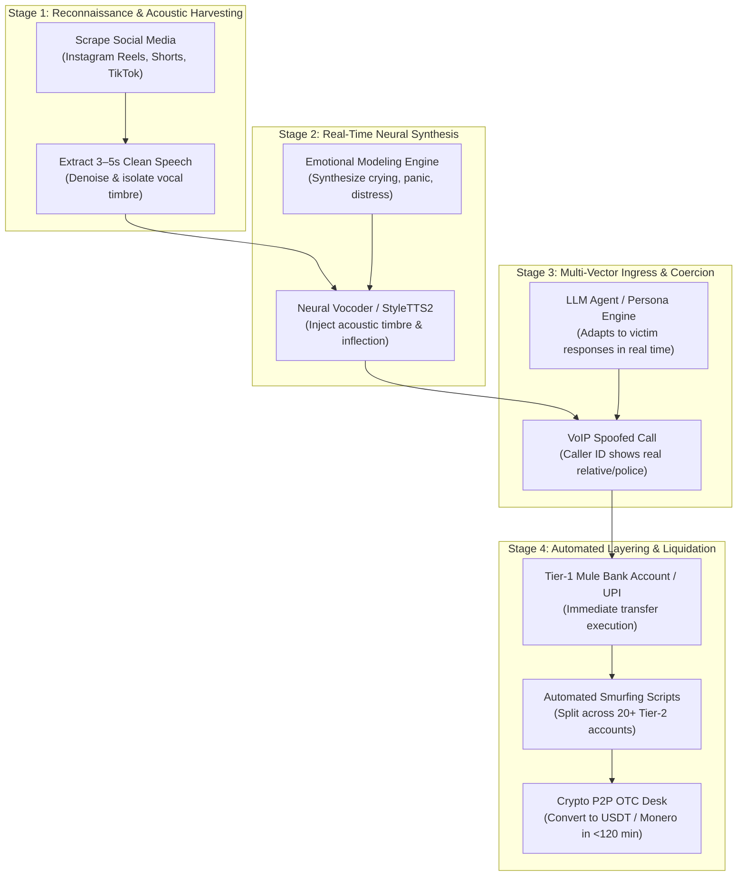
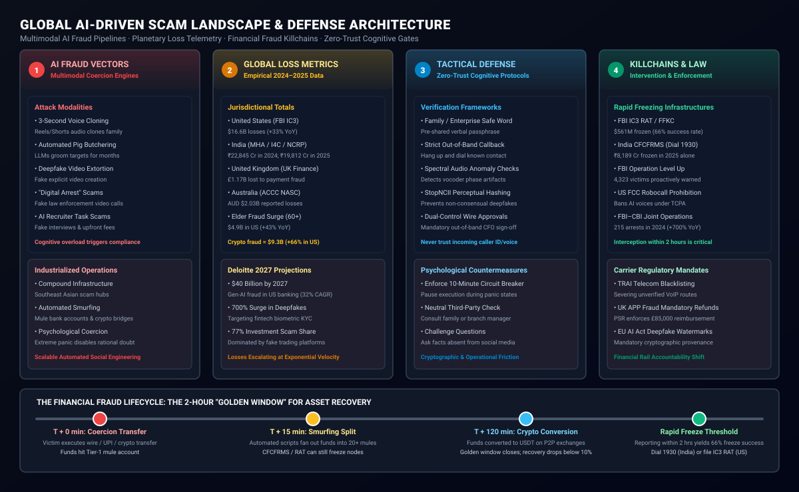

# Global AI-Driven Scam Landscape: Multimodal Threat Vectors, Empirical Losses, and Defensive Countermeasures

Learning note · Revised March 2026 · Cyber Intelligence & Fraud Architecture  
*By Srinivasan Ragothaman ([@rsrini7](https://github.com/rsrini7))*

> Generative artificial intelligence and autonomous agentic workflows have fundamentally industrialized cyber fraud, transforming fragmented social engineering into high-throughput, multimodal extortion pipelines. Empirical loss data across 2024 and 2025 demonstrates unprecedented global financial extraction: surpassing $16.6 billion in the United States (FBI IC3), ₹22,845 crore in India (Ministry of Home Affairs / I4C), £1.17 billion in the United Kingdom, and AUD $2.03 billion in Australia. By synthesizing realistic acoustic voice clones from 3-second social media samples, sustaining multi-month conversational grooming in cryptocurrency investment fraud ("pig butchering"), and deploying deepfake video avatars for executive impersonation and "digital arrest" coercion, adversaries routinely bypass traditional human suspicion. Countering this asymmetry requires out-of-band cryptographic authentication, automated financial fraud killchains capable of freezing assets within a critical two-hour window, and binding statutory telecom carrier liabilities.

---

## 1. Foundations: Artificial Intelligence as a Fraud Force Multiplier

Traditional cyber fraud (phishing emails, boiler-room cold calling, advance-fee fraud) was historically bounded by human labor constraints, language barriers, and static templates easily flagged by keyword heuristics. Generative AI eliminates these operational bottlenecks, acting as a force multiplier across traditional social engineering vectors:

```
┌───────────────────────────────────────────────────────────────────────────┐
│                       THE MANUAL FRAUD BOTTLENECK                         │
│                                                                           │
│   Human Scammer ──> Static Script / Cold Call ──> Grammatical Clues       │
│   • Highly linear: One scammer calls one victim at a time                 │
│   • Acoustic & linguistic mismatch gives away foreign boiler rooms        │
└─────────────────────────────────────┬─────────────────────────────────────┘
                                      │
                                      ▼ [Generative AI Acceleration]
┌───────────────────────────────────────────────────────────────────────────────┐
│                   THE MULTIMODAL AI ATTACK PIPELINE                           │
│                                                                               │
│   Target Audio Harvester ──> [ Acoustic Feature Extraction (3s Sample) ]      │
│                                      │                                        │
│   Autonomous LLM Persona ──> [ Contextual Script & Local Dialect ]            │
│                                      │                                        │
│   Real-Time Neural Vocoder ─> [ WebRTC / SIP Low-Latency Stream ]             │
│                                      │                                        │
│   Coercive Extortion Flow ─> [ Immediate P2P Mule / Crypto Splitting ]        │
│                                                                               │
│   • Zero grammatical or acoustic defects                                      │
│   • Infinite parallel concurrency: Thousands of targets groomed simultaneously│
│   • High emotional urgency disables victim's analytical verification          │
└───────────────────────────────────────────────────────────────────────────────┘
```

| Threat Vector / Mechanism | Architectural Subsystem | Operational Impact & Vulnerability |
| :--- | :--- | :--- |
| **Acoustic Voice Cloning** | Neural Text-to-Speech (TTS) & Vocoders (VITS, StyleTTS2). | Reconstructs vocal timbre, cadence, and emotional stress from $\le 3$ seconds of harvested audio; weaponized in family emergency scams. |
| **Pig Butchering (*Sha Zhu Pan*)** | Autonomous LLMs & Multimodal Agent Frameworks. | Sustains long-horizon emotional relationships across dating/messaging apps, systematically luring victims into rigged crypto investment platforms. |
| **"Digital Arrest" Coercion** | Deepfake Video Avatars & Fake Police Setups. | Impersonates law enforcement officers on Skype/WhatsApp video calls, placing victims under psychological isolation to extort life savings. |
| **Financial Fraud Kill Chain (FFKC)** | Inter-bank clearinghouse freezing protocols (FBI RAT / I4C CFCFRMS). | Rapid administrative freeze placed on recipient bank accounts before illicit funds are smurfed across mule networks or converted to crypto. |
| **Out-of-Band (OOB) Safe Word** | Pre-shared offline verbal authentication tokens. | Simple zero-trust cognitive defense: demanding a secret family or corporate passphrase before authorizing wire transfers or bail payments. |
| **The 2-Hour "Golden Window"** | Physical timeline of financial layering and smurfing. | Window of opportunity where reporting fraud to hotlines (1930 in India, IC3 in the US) yields a $\ge 66\%$ probability of asset freezing. |

---

## 2. Threat Modeling: The 4-Stage Multimodal AI Attack Pipeline

Analyzing modern AI scam operations reveals an automated, multi-tiered infrastructure operating at industrial scale:



### Stage 1: Reconnaissance & Acoustic Harvesting
Adversaries target public video platforms (Instagram Reels, YouTube Shorts, TikTok, LinkedIn video intros). Using automated scrapers, scripts extract audio streams, run noise-suppression algorithms (such as DeepFilterNet), and slice 3 to 5 seconds of uncompressed speech containing clear vocal formants.

### Stage 2: Real-Time Neural Voice Synthesis
Harvested acoustic embeddings are ingested into zero-shot neural vocoders (such as StyleTTS2 or fine-tuned VITS architectures). Scammers apply prosodic modifiers to simulate extreme physiological distress—shallow breathing, sobbing, background sirens, or ambient acoustics simulating police holding cells.

### Stage 3: Multi-Vector Coercion & Linguistic Adaptation
The synthesized audio is routed into virtual telephony (SIP/VoIP) pipes configured with spoofed Caller ID headers matching the victim's local jurisdiction or family member's real phone number. During investment and romance grooming ("pig butchering"), LLMs maintain long-term conversation logs in vector stores, generating contextually empathetic responses tailored to the victim's personal vulnerabilities, loneliness, or financial stress.

### Stage 4: Automated Financial Layering & Smurfing
Once the victim initiates a transfer (via wire, UPI, Zelle, or cryptocurrency), automated smurfing bots immediately fan out the capital across dozens of Tier-1 and Tier-2 mule bank accounts within 10 to 15 minutes. Within 90 to 120 minutes, the fiat currency is converted to Tether (USDT) on peer-to-peer (P2P) non-KYC cryptocurrency exchanges operating across Southeast Asian industrial scam compounds (Cambodia, Myanmar, Laos), permanently cutting off traditional banking recovery.

---

## 3. Deep Technical Mechanism: Global Empirical Loss Telemetry

Empirical loss data collected by international law enforcement agencies across 2024 and 2025 confirms the exponential scaling of AI-amplified financial crime.

```
+-----------------------------------------------------------------------------------------------------+
|                           GLOBAL CYBER FRAUD EMPIRICAL REPORTING (2024–2025)                        |
+--------------------+-------------------------+--------------------+---------------------------------+
| Jurisdiction       | Official Losses         | Reporting Agency   | Primary Structural Trend        |
+--------------------+-------------------------+--------------------+---------------------------------+
| United States      | $16.6 Billion (2024)    | FBI IC3 (Apr 2025) | +33% YoY; Crypto: $9.3B;        |
|                    |                         |                    | Elder Fraud (60+): $4.9B        |
| India              | ₹22,845 Cr ($2.7B, 2024)| MHA / I4C (Nov 24) | +206% YoY; 3.6M complaints;     |
|                    | ₹19,812–22,495 Cr (2025)| Lok Sabha (Dec 25) | 77% Investment & Digital Arrest |
| United Kingdom     | £1.17 Billion (2024)    | UK Finance (May 25)| APP Fraud: £459.7M;             |
|                    |                         |                    | Mandatory reimbursement rule    |
| Australia          | AUD $2.03 Billion (2024)| ACCC NASC (Mar 25) | Investment scams dominate;      |
|                    |                         |                    | National Anti-Scam Centre ops   |
| Global Projection  | $40.0 Billion by 2027   | Deloitte Banking   | Gen-AI fraud in US banking;     |
|                    |                         | Center (May 2024)  | 32% CAGR from $12.3B in 2023    |
+--------------------+-------------------------+--------------------+---------------------------------+
```

### 3.1 United States: FBI IC3 2024–2025 Metrics & Operation Level Up

The Federal Bureau of Investigation’s Internet Crime Complaint Center (IC3) 2024 Annual Report documented **$16.6 billion in total reported losses** across 859,532 complaints:
- **Cryptocurrency Surge**: Total crypto-related fraud reached **$9.3 billion** (+66% from $5.6B in 2023). Investment fraud schemes ("pig butchering") accounted for **$5.81 billion**.
- **Elder Exploitation**: Victims aged 60 and older suffered **$4.9 billion in losses** (+43% YoY), making them the single most vulnerable and heavily targeted demographic.
- **FBI Operation Level Up**: Launched in January 2024, this proactive threat-hunting initiative identified victims of cryptocurrency fraud *while the scam was actively occurring*:
  - **4,323 active victims notified** across all 50 states.
  - **76% of victims were completely unaware** they were being actively defrauded at the time of contact.
  - **$285.64 million in losses prevented** by interrupting transfers before final liquidation.
  - **42 victims referred to FBI victim specialists for suicide intervention**, exposing the profound mental health trauma inflicted by long-horizon romance and investment manipulation.
- **FBI–CBI Joint Bilateral Enforcement**: 11 joint operations conducted between the FBI and India's Central Bureau of Investigation (CBI) yielded **215 arrests in 2024**—a 700% increase over 2023.

### 3.2 India: MHA, I4C, and the "Digital Arrest" Crisis

Data tabled in the Parliament of India (Rajya Sabha and Lok Sabha) by the Ministry of Home Affairs (MHA) and the Indian Cyber Crime Coordination Centre (I4C) highlights massive scale:
- **2024 Losses**: Indians lost **₹22,845.73 crore (~$2.7 billion)** to cyber fraud in 2024—a **206% increase** from ₹7,465.18 crore in 2023. Over 2.26 million cybercrime incidents were logged on the National Cybercrime Reporting Portal (NCRP).
- **2025 Full-Year Telemetry**: Official parliamentary submissions recorded between **₹19,812 crore and ₹22,495 crore** in losses across 2.4 million complaints, with investment scams accounting for **77% of all financial damages**.
- **The "Digital Arrest" Mechanism**: Scammers call victims via WhatsApp or Skype wearing realistic police or judicial uniforms, staging mock courtroom backgrounds. Victims are told their identity was used in international money laundering (e.g., "drugs found in a FedEx parcel"). Under extreme fear of imminent arrest, victims are coerced into keeping video calls active for 24 to 72 hours while liquidating fixed deposits and transfering money to "government verification accounts" (which are instantly drained).
- **CFCFRMS Rapid Interception**: India's Citizen Financial Cyber Fraud Reporting and Management System (accessible via national helpline **1930**) demonstrated the power of automated banking intervention, **saving ₹5,489 crore in 2024 and ₹8,189 crore in 2025** across 2.36 million complaints.
- **Southeast Asian Scam Compound Linkages**: Analysis by I4C and cyber intelligence units revealed that approximately **45% of cyber fraud complaints** exhibited digital infrastructure links to trans-border crime syndicates operating in Cambodia, Myanmar, and Laos.

### 3.3 United Kingdom: UK Finance & The £85,000 Mandatory Reimbursement Standard

The UK Finance Annual Fraud Report documented **£1.17 billion in unauthorized and authorized fraud** across 2024:
- **Authorized Push Payment (APP) Fraud**: Accounted for **£459.7 million** in losses across 212,504 cases. In APP fraud, the victim is deceived into directly authorizing the bank transfer.
- **Statutory Regulatory Shift (October 2024)**: The UK Payment Systems Regulator (PSR) enacted historic mandatory reimbursement rules:
  - Banks and payment providers must **reimburse APP fraud victims up to £85,000 within 5 business days**.
  - Costs are split **50/50 between the sending bank and the receiving bank**, creating massive financial incentives for receiving banks to terminate mule accounts immediately.

### 3.4 Australia: ACCC National Anti-Scam Centre (NASC) Telemetry

The Australian Competition and Consumer Commission’s NASC reported **AUD $2.03 billion** in combined losses in 2024:
- Investment scams accounted for **AUD $1.3 billion** of the total.
- The NASC deployed dedicated cross-industry "fusion cells" uniting banks, telecommunications carriers, and social media platforms to identify and take down malicious investment websites within hours of registration.

---

## 4. Architectural Visual: Global Scam Landscape & Defensive Killchains

The multi-tiered threat modalities, global empirical loss vectors, tactical cognitive friction gates, and financial fraud killchains are visualized below:



---

## 5. Technical Mechanics: The Financial Fraud Kill Chain & The 2-Hour "Golden Window"

The single most critical variable governing whether stolen capital can be recovered is **time-to-reporting**:

```
T + 0 min                T + 15 min              T + 120 min             T + 240+ min
┌───────────────────────┬───────────────────────┬───────────────────────┬───────────────────────┐
│ Transfer Authorized   │ Rapid Smurfing Split  │ Crypto Conversion     │ Total Liquidation     │
│ Victim wires funds    │ Bot scripts fan out   │ Fiat converted to     │ Funds bridged to      │
│ to Tier-1 mule account│ funds to 20+ mules    │ USDT on non-KYC P2P   │ privacy coins / Monero│
├───────────────────────┴───────────────────────┼───────────────────────┴───────────────────────┤
│    ✅ 2-HOUR "GOLDEN WINDOW" FOR ASSET FREEZE │      ❌ RECOVERY PROBABILITY DROPS TO <10%    │
│  Dial 1930 (India) / IC3 RAT Triggered (US)   │ Permanent loss; funds cross into cold storage │
└───────────────────────────────────────────────┴───────────────────────────────────────────────┘
```

### How Inter-Bank Killchains Intercept Stolen Funds
When a victim reports a fraudulent transfer to the FBI IC3 Recovery Asset Team (RAT) in the US or calls the **1930** helpline in India:
1. **API Ingestion & Transaction Matching**: The system ingests the victim's bank name, account number, transaction UTR (Unique Transaction Reference) number, and timestamp.
2. **Clearinghouse Node Freezing**: Rather than filing police reports through local courts, the automated system pushes immediate administrative hold requests directly to the anti-fraud APIs of participating clearing banks (NPCI / IMPS / NEFT in India; Fedwire / ACH in the US).
3. **Mule Cascade Traversal**: If funds have already jumped from the Tier-1 mule to Tier-2 or Tier-3 accounts, the system recursively places partial freezes on all downstream recipient nodes before the cash can be withdrawn at an ATM or OTC desk.
4. **Empirical Success Rate**: Reporting within **0 to 2 hours** achieves a **66% asset recovery success rate** (as documented by FBI RAT freezing $561 million and CFCFRMS freezing ₹8,189 crore). Beyond 2 hours, recovery probability collapses below 10%.

---

## 6. Production Implementations & Defensive Code Recipes

The following recipes demonstrate actionable defensive tools for verifying caller authenticity, detecting synthetic voice anomalies, and automating financial freezing alerts.

### Recipe 1: Out-of-Band Challenge-Response Verification Protocol (Python)

To prevent voice-clone family emergency extortion, families and corporate finance teams should implement an automated or verbal challenge-response verification system:

```python
#!/usr/bin/env python3
"""
duress_verifier.py - Out-of-Band Challenge-Response Verification Engine
Generates cryptographically random daily verification codes and verifies safe words.
"""

import hmac
import hashlib
import time

class ZeroTrustVoiceAuth:
    def __init__(self, shared_secret_key: bytes):
        self.secret_key = shared_secret_key

    def generate_current_safe_code(self) -> str:
        """Generates a time-based 6-digit numeric token (TOTP principle)."""
        time_step = int(time.time() // 300) # 5-minute validity window
        msg = time_step.to_bytes(8, byteorder="big")
        signature = hmac.new(self.secret_key, msg, hashlib.sha256).hexdigest()
        # Truncate to 6 digits
        return str(int(signature[:8], 16) % 1_000_000).zfill(6)

    def verify_response(self, candidate_token: str, emergency_duress_code: str = "PINEAPPLE") -> dict:
        """
        Evaluates caller response.
        If caller provides the pre-shared verbal duress code, indicates coercion.
        """
        current_valid_token = self.generate_current_safe_code()
        
        if candidate_token == emergency_duress_code:
            return {
                "status": "DURESS_DETECTED",
                "message": "CRITICAL: Caller entered duress code. Immediate police dispatch required.",
                "action": "SILENT_ALERT"
            }
        
        if candidate_token == current_valid_token:
            return {
                "status": "AUTHENTICATED",
                "message": "Identity cryptographically verified. Caller is authentic.",
                "action": "PERMIT_COMMUNICATION"
            }

        return {
            "status": "AUTHENTICATION_FAILED",
            "message": "Invalid token. Suspected AI voice clone or adversary.",
            "action": "TERMINATE_CALL"
        }

if __name__ == "__main__":
    # Example setup: family or enterprise pre-shares a 256-bit secret key
    secret = b"my_family_airgapped_secret_token_2026"
    auth = ZeroTrustVoiceAuth(secret)
    valid_code = auth.generate_current_safe_code()
    print(f"Current valid verbal authentication code: {valid_code}")
    
    # Test fake voice call attempting extortion
    test_attempt = auth.verify_response("123456")
    print(f"Adversary response result: {test_attempt}")
```

### Recipe 2: Audio Deepfake & Vocoder Spectral Anomaly Detector (Python)

Neural vocoders (such as HiFi-GAN, StyleTTS2) introduce high-frequency phase inconsistencies and unnatural periodicity in acoustic waveforms. This script inspects audio files for spectral flux anomalies:

```python
#!/usr/bin/env python3
"""
detect_audio_deepfake.py - Phase & Spectral Inconsistency Heuristic Checker
Analyzes audio recordings for neural vocoder phase artifacts.
"""

import numpy as np
import scipy.io.wavfile as wav
import sys

def analyze_audio_spectral_variance(wav_path: str) -> dict:
    sample_rate, data = wav.read(wav_path)
    
    # Normalize data if stereo
    if len(data.shape) > 1:
        data = data.mean(axis=1)
        
    data = data.astype(float)
    if np.max(np.abs(data)) > 0:
        data /= np.max(np.abs(data))

    # Fast Fourier Transform over short windows
    fft_window_size = 1024
    hop_length = 512
    num_frames = (len(data) - fft_window_size) // hop_length
    
    spectral_centroids = []
    high_freq_energy_ratio = []

    for i in range(max(num_frames, 1)):
        window = data[i * hop_length : i * hop_length + fft_window_size] * np.hanning(fft_window_size)
        fft_spectrum = np.abs(np.fft.rfft(window))
        
        # Calculate spectral centroid
        freqs = np.fft.rfftfreq(fft_window_size, 1.0 / sample_rate)
        if np.sum(fft_spectrum) > 0:
            centroid = np.sum(freqs * fft_spectrum) / np.sum(fft_spectrum)
            spectral_centroids.append(centroid)
            
            # Neural vocoders often display unnaturally sharp high-frequency falloffs (>8kHz)
            high_freq = np.sum(fft_spectrum[freqs > 8000])
            total_energy = np.sum(fft_spectrum)
            high_freq_energy_ratio.append(high_freq / total_energy if total_energy > 0 else 0)

    avg_centroid_jitter = float(np.std(spectral_centroids)) if spectral_centroids else 0.0
    avg_high_freq = float(np.mean(high_freq_energy_ratio)) if high_freq_energy_ratio else 0.0

    # Synthetic voice vocoder heuristic: extremely low spectral jitter coupled with high-freq phase cuts
    is_synthetic = avg_centroid_jitter < 150.0 and avg_high_freq < 0.02

    return {
        "file": wav_path,
        "sample_rate": sample_rate,
        "centroid_variance": avg_centroid_jitter,
        "high_freq_ratio": avg_high_freq,
        "classification": "SYNTHETIC_VOICE_SUSPECTED" if is_synthetic else "ORGANIC_SPEECH_LIKELY"
    }

if __name__ == "__main__":
    if len(sys.argv) < 2:
        print("Usage: python3 detect_audio_deepfake.py <audio.wav>")
        sys.exit(1)
    results = analyze_audio_spectral_variance(sys.argv[1])
    print(f"Analysis Results: {results}")
```

### Recipe 3: Financial Fraud Kill Chain Rapid Freezing Dispatcher (Python)

When an unauthorized transaction occurs, this script formats an urgent alert payload compliant with standardized fraud exchange protocols:

```python
#!/usr/bin/env python3
"""
ffkc_emergency_dispatcher.py - Automated Inter-Bank Fraud Kill Chain Dispatcher
Formats and dispatches urgent freezing requests to banking clearinghouse endpoints.
"""

import json
import datetime
from dataclasses import dataclass, asdict

@dataclass
class FraudIncidentReport:
    incident_timestamp_utc: str
    victim_account_identifier: str
    victim_bank_bic: str
    transaction_reference_id: str
    transferred_amount: float
    currency: str
    recipient_mule_account: str
    recipient_mule_bank_bic: str
    fraud_modality: str  # "AI_VOICE_CLONE", "PIG_BUTCHERING", "DIGITAL_ARREST"
    evidence_summary: str

def generate_killchain_payload(report: FraudIncidentReport) -> str:
    payload = {
        "schema_version": "2026.03-FFKC",
        "priority": "P0_CRITICAL_IMMEDIATE_FREEZE",
        "data": asdict(report),
        "requested_action": "FREEZE_DOWNSTREAM_CREDIT_LINE",
        "statutory_reference": "INTER_BANK_FRAUD_PREVENTION_PROTOCOL"
    }
    return json.dumps(payload, indent=2)

if __name__ == "__main__":
    report = FraudIncidentReport(
        incident_timestamp_utc=datetime.datetime.now(datetime.timezone.utc).isoformat(),
        victim_account_identifier="ACC-9928172615",
        victim_bank_bic="HDFCINBB",
        transaction_reference_id="UTR-20260312-8829102",
        transferred_amount=250000.0,
        currency="INR",
        recipient_mule_account="MULE-1182736152",
        recipient_mule_bank_bic="SBININBB",
        fraud_modality="DIGITAL_ARREST",
        evidence_summary="Victim coerced into transfer via deepfake police video call."
    )
    print("EMERGENCY KILLCHAIN FREEZE DISPATCH PAYLOAD:")
    print(generate_killchain_payload(report))
```

---

## 7. Common Claims vs. Technical Realities

The table below contrasts common public assumptions regarding AI fraud with empirical security and behavioral realities:

| Common Public Claim | Technical & Empirical Reality | Defensive Architecture Standard |
| :--- | :--- | :--- |
| *"I can recognize my family member's voice over the phone; an AI cannot fool me."* | **False.** 69% of adults cannot distinguish clean AI voice clones from real voices. Add simulated crying, panic, and background noise, and human perception fails completely. | Never rely on acoustic recognition. Enforce a pre-shared verbal safe word or hang up and call back on a verified number. |
| *"Deepfakes only affect celebrities and high-profile politicians."* | **False.** Scammers routinely scrape ordinary private Instagram and TikTok accounts, harvesting photos to create explicit deepfake extortion images. | Register personal photos on **StopNCII.org** to create cryptographic hashes preventing unauthorized platform uploads. |
| *"Law enforcement in India or the US can place you under 'Digital Arrest' via video call."* | **Absolute Myth.** Neither Indian police, CBI, ED, nor the FBI conduct arrests, investigations, or financial verifications over Skype or WhatsApp video calls. | Any official demanding funds or demanding you remain on a video call under threat of arrest is an extortionist. |
| *"If I get scammed, I should file a local police complaint tomorrow morning."* | **Too Late.** Stolen funds are smurfed through mule networks into USDT within 120 minutes. Filing tomorrow ensures zero recovery. | Contact bank fraud hotlines and call **1930** (India) or file with **IC3** (US) within the first 2 hours. |
| *"Banks will automatically detect and reimburse all fraudulent wire transfers."* | **Jurisdiction Dependent.** In the US, authorized wires are rarely reimbursed. In the UK, PSR mandates up to £85,000 reimbursement. | Do not rely on bank restitution; establish out-of-band dual controls before sending wire payments. |

---

## 8. Practical Adoption Blueprint & Emergency Action Plan

### The Zero-Trust Personal Defense Playbook

```
┌───────────────────────────────────────────────────────────────────────────┐
│                    ZERO-TRUST PERSONAL SCAM DEFENSE                       │
├───────────────────────────────────────────────────────────────────────────┤
│ 1. Establish an Out-of-Band Family Safe Word                              │
│    └─ Pre-share a secret offline verbal passphrase (e.g., "BLUE-DOLPHIN") │
│    └─ If a caller claims to be a relative in jail/hospital, demand word   │
│    └─ If they cannot provide it, hang up immediately                      │
│                                                                           │
│ 2. Enforce the 10-Minute Circuit Breaker                                  │
│    └─ Scammers rely on manufactured urgency to bypass rational logic      │
│    └─ Never transfer money under pressure. Pause 10 minutes and consult   │
│       a trusted third party or family member                              │
│                                                                           │
│ 3. The Out-of-Band Callback Protocol                                      │
│    └─ Do not trust incoming caller ID (VoIP spoofing is trivial)          │
│    └─ Terminate call; dial the contact back on their saved known number   │
│                                                                           │
│ 4. "Digital Arrest" Immediate Response                                    │
│    └─ Disconnect immediately. No real agency conducts video-call trials   │
│    └─ Block caller and report handle to local cyber cell                  │
│                                                                           │
│ 5. The 2-Hour Golden Window Escalation                                    │
│    └─ In India: Dial 1930 immediately or log on to cybercrime.gov.in      │
│    └─ In the US: File immediately with ReportFraud.ftc.gov & ic3.gov      │
│    └─ In the UK: Contact your bank immediately and alert Action Fraud     │
│    └─ In Australia: Report immediately to Scamwatch & ReportCyber         │
└───────────────────────────────────────────────────────────────────────────┘
```

---

## 9. Timeline & Evolutionary Trajectory

```
2020–2022: Manual Boiler Rooms & Basic Phishing
└─ Script-driven call centers in South Asia; static phishing emails
└─ High grammatical errors; easily caught by human filters

2023: Generative AI Voice Cloning Emergence
└─ Voice synthesis tools require only 3 seconds of reference audio
└─ First high-profile deepfake CFO wire fraud incidents ($25M Hong Kong case)
└─ Deloitte projects Gen-AI fraud to hit $40B in US banking by 2027

2024: The $16.6B Cyber Extortion Peak
└─ US IC3 reports record $16.6B losses; crypto pig butchering hits $9.3B
└─ India MHA reports ₹22,845 crore lost; "Digital Arrest" scams explode
└─ FCC bans AI-generated voices in robocalls under TCPA
└─ UK PSR mandates 50/50 split reimbursement for APP fraud up to £85,000

2025–2026: Industrialized Scam Compounds & Regulatory Crackdowns
└─ Southeast Asian scam syndicates fully automate multilingual LLM grooming
└─ India CFCFRMS freezes ₹8,189 crore in 2025 via rapid 1930 interception
└─ EU AI Act enforces mandatory cryptographic watermarking for synthetic media
└─ Transnational law enforcement (FBI-CBI) executes hundreds of compound arrests
```

---

## 10. Primary Sources & References

1. [Federal Bureau of Investigation (FBI): 2024 Internet Crime Report (IC3)](https://www.ic3.gov/AnnualReport/Reports/2024_IC3Report.pdf) — Authoritative primary disclosure documenting $16.6B in total fraud, $9.3B in crypto fraud, and Operation Level Up statistics.
2. [Ministry of Home Affairs (MHA), Government of India: Rajya Sabha Parliamentary Response (Nov 2024)](https://mha.gov.in) — Official parliamentary record documenting ₹22,845.73 crore in cyber fraud losses and I4C intervention metrics.
3. [Ministry of Home Affairs (MHA), Government of India: Lok Sabha Unstarred Question No. 1341 (Dec 2025)](https://mha.gov.in) — Official parliamentary record tabling 2025 cyber fraud losses and CFCFRMS freezing statistics.
4. [UK Finance: Annual Fraud Report 2025 (Covering 2024 Data)](https://www.ukfinance.org.uk) — Authoritative industry telemetry documenting £1.17B in total payment fraud and APP fraud patterns.
5. [Australian Competition and Consumer Commission (ACCC): Targeting Scams Report 2025](https://www.scamwatch.gov.au) — Annual report by the National Anti-Scam Centre documenting AUD $2.03B in losses.
6. [Deloitte Center for Financial Services: Generative AI and Banking Fraud Projections](https://www2.deloitte.com) — Foundational projection modeling gen-AI-enabled banking fraud scaling to $40B by 2027.
7. [Federal Communications Commission (FCC): Declaratory Ruling on AI Voice Cloning (Feb 2024)](https://www.fcc.gov) — Regulatory finding classifying AI-generated voice cloning in robocalls as illegal under the Telephone Consumer Protection Act (TCPA).
8. [StopNCII.org: Non-Consensual Intimate Image Protection](https://stopncii.org) — Global platform utilizing cryptographic perceptual hashing to block non-consensual deepfake media uploads across major tech platforms.

---

**Related:**
- [India-Spam-Calls-DND-And-TRAI-Enforcement-Oct-2026.md](../Security/India-Spam-Calls-DND-And-TRAI-Enforcement-Oct-2026.md) — Analyzes telecom network-level controls, DND registry blacklisting, and TRAI carrier penalties.
- [Banks-Third-Party-AI-Agents-Oct-2026.md](../Security/Banks-Third-Party-AI-Agents-Oct-2026.md) — Examines authorization boundaries, synthetic identity fraud, and identity verification gaps in digital banking.
- [WhatsApp-Contact-Enumeration-And-Data-Leak-2026.md](../Security/WhatsApp-Contact-Enumeration-And-Data-Leak-2026.md) — Documents large-scale protocol scraping exposing 3.5 billion phone numbers that feed scam target databases.
- [Autonomous-AI-Agents-Cybersecurity-Governance-Infrastructure-2026.md](../../AI-ML/Agents/analysis/Autonomous-AI-Agents-Cybersecurity-Governance-Infrastructure-2026.md) — Strategic analysis of autonomous agent proliferation across cyber offense, automated extortion, and infrastructure risks.
- [Securing-OpenClaw-Infrastructure-Setup-2026.md](../../AI-ML/Agents/openclaw/Securing-OpenClaw-Infrastructure-Setup-2026.md) — Hardened infrastructure defense and channel pairing to prevent unauthorized agent execution.
