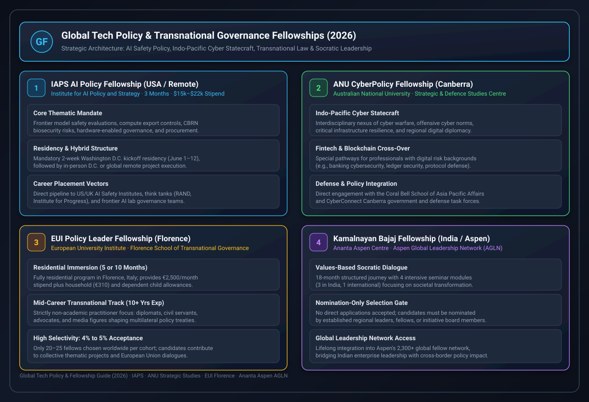
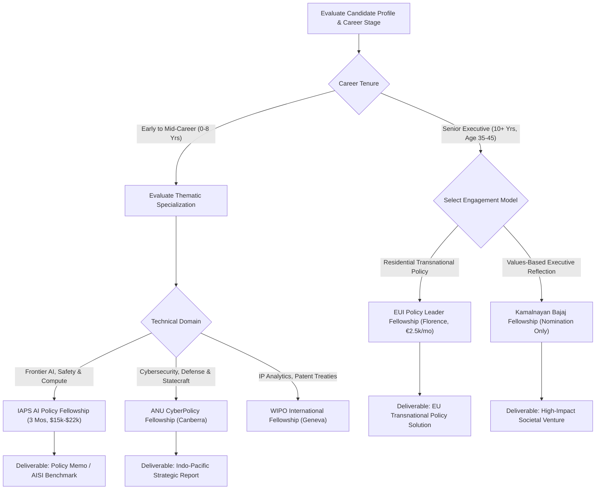
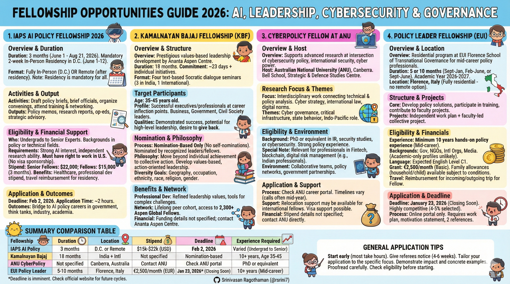

# Global Tech Policy, AI Governance, and Leadership Fellowships: Architecture and Strategic Guide (2026)

Daily learning · January 18, 2026

*By Srinivasan Ragothaman ([@rsrini7](https://github.com/rsrini7))*

> **Core Idea:** As frontier artificial intelligence, cyber statecraft, and transnational digital infrastructure collide with statutory regulations, global governance institutions increasingly rely on competitive fellowship pipelines to integrate high-agency technical practitioners into policy formulation. This comprehensive guide evaluates the programmatic architectures, selection heuristics, funding models, and strategic deliverables across four flagship fellowship ecosystems: the **IAPS AI Policy Fellowship** (Washington D.C. / Remote), the **ANU CyberPolicy Fellowship** (Canberra), the **EUI Policy Leader Fellowship** (Florence), and the **Kamalnayan Bajaj Fellowship** (Aspen Institute / India).

---

## 1. Foundations & Ecosystem Context

Historically, public policy formulation operated independently of low-level software engineering and computer science. Legislation and international treaties were drafted by legal scholars and career diplomats, while engineers focused exclusively on system architectures, compiler designs, and network protocols. 

However, the rapid deployment of autonomous AI agents, frontier LLMs with potential Chemical, Biological, Radiological, and Nuclear (CBRN) uplift, state-sponsored cyber warfare, and cross-border digital payment networks has exposed an acute institutional bottleneck: **the technical expertise deficit in global governance**.

```
┌────────────────────────────────────────────────────────────────────────────────────────┐
│                        The Technical-Policy Intervergence Gap                          │
└────────────────────────────────────────────────────────────────────────────────────────┘

  Traditional Technologists                     Traditional Policymakers
  ├── Deep knowledge of CUDA, LLM weights,      ├── Deep knowledge of administrative law,
  │   cryptography & network routing            │   geopolitics & statutory drafting
  └── Lacks legislative drafting, diplomacy     └── Lacks technical intuition; vulnerable to
      & regulatory impact analysis                  regulatory capture & ungrounded hype
                          │                                         │
                          └───────────────────┬─────────────────────┘
                                              │
                                              ▼
                        [Global Tech Policy Fellowships]
                        Translates technical engineering intuition into actionable
                        statutory frameworks, export controls & safety treaties
```

Fellowship programs serve as the primary institutional vehicle to bridge this gap. Rather than requiring technical professionals to permanently abandon industry careers for civil service tenure, fellowships offer high-leverage, funded residencies where practitioners author policy memos, brief government ministers, advise international standards bodies, and construct governance frameworks.

### Key Terminology & Architectural Concepts

| Term | Technical Meaning & Institutional Context |
| :--- | :--- |
| **Track 1.5 / Track 2 Diplomacy** | Unofficial policy dialogues involving non-governmental experts, researchers, and government officials operating in an informal capacity to resolve strategic deadlocks. |
| **Compute Governance** | Regulatory and hardware-level mechanisms (e.g., cryptographic hardware security modules on accelerators) used to monitor, verify, and enforce export limits on frontier AI training runs. |
| **CBRN Risk Mitigation** | Policies designed to prevent autonomous AI models from providing actionable synthesis protocols for Chemical, Biological, Radiological, or Nuclear weapons. |
| **Socratic Dialogue (Aspen Method)** | Seminar pedagogical technique using structured, text-based inquiry into foundational philosophy to challenge executive leadership assumptions. |
| **Transnational Policy Work Plan** | Formal research and operational blueprint executed during a fellowship to propose actionable cross-border regulatory or treaty solutions. |
| **Living Stipend & Grant** | Non-compensatory institutional funding provided to fellows to cover living expenses, healthcare, and research travel without creating an employer-employee tax nexus. |
| **Aspen Global Leadership Network (AGLN)**| Elite international consortium of over 2,300 values-based leaders spanning business, government, and civil society. |

---

## 2. Deep Technical Mechanism: Architectural Evaluation of Flagship Fellowships

Each flagship fellowship operates on distinct geographic, pedagogical, and career-stage architectures designed for specific institutional vectors.

```
+───────────────────────────────────────────────────────────────────────────────────────────+
|                         Flagship Fellowship Structural Comparison                         |
+───────────────────────────────────────────────────────────────────────────────────────────+

  [1. IAPS AI Policy (USA / Remote)]         [2. ANU CyberPolicy (Canberra, Australia)]
  ├── Focus: Frontier AI Safety & Compute    ├── Focus: Indo-Pacific Cyber Statecraft & Defense
  ├── Duration: 3 Months ($15k–$22k)         ├── Duration: 12 Months (Institutional Research)
  └── Format: 2-Wk DC Kickoff + Hybrid        └── Format: Residential (Bell School / SDSC)
                          │                                         │
                          ├───────────────────┬─────────────────────┤
                          │                                         │
                          ▼                                         ▼
  [3. EUI Policy Leader (Florence, Italy)]   [4. Kamalnayan Bajaj (India / Aspen Network)]
  ├── Focus: Transnational Law & EU Treaties ├── Focus: Values-Based Executive Leadership
  ├── Duration: 5 or 10 Mos (€2,500/mo)      ├── Duration: 18 Months (4 Intensive Seminars)
  └── Format: 100% Residential in Florence   └── Format: Nomination-Only (Aspen Socratic Method)
```

---

### Program 1: IAPS AI Policy Fellowship 2026 (Washington, D.C. / Remote)

The **Institute for AI Policy and Strategy (IAPS)** offers a three-month intensive fellowship dedicated to empirical AI governance, frontier model risk assessment, and technological statecraft.

#### 1. Core Focus Areas
- **Frontier AI Safety & Compute Governance:** Tracking semiconductor supply chains, hardware security modules (HSMs) on GPUs, and international export controls.
- **National Security & CBRN Mitigation:** Auditing dual-use capabilities in frontier foundation models and evaluating bio-risk guardrails.
- **Government Procurement Standards:** Constructing technical benchmarking standards for government agencies acquiring commercial LLMs.
- **AI Safety Institute (AISI) Integration:** Formulating pre-deployment red-teaming methodologies for statutory bodies (e.g., US and UK AISIs).

#### 2. Structural & Economic Parameters
- **Duration:** 3 months (June 1 – August 21, 2026).
- **Format:** Hybrid. Mandatory 2-week in-person residency in Washington, D.C. (June 1–12, 2026), followed by either continued D.C. residency or remote execution from eligible global jurisdictions.
- **Financial Stipend:**
  - **Senior Fellows:** USD $22,000 for the 3-month duration.
  - **Fellows:** USD $15,000 for the 3-month duration.
  - Comprehensive health insurance coverage, D.C. office access, and travel/conference budgets.
- **Work Authorization Requirement:** Applicants must independently possess valid U.S. work authorization during the fellowship period; IAPS cannot sponsor J-1 or H-1B visas.

---

### Program 2: ANU CyberPolicy Fellowship (Canberra, Australia)

Hosted by the **Strategic and Defence Studies Centre (SDSC)** and the **Coral Bell School of Asia Pacific Affairs** at the Australian National University (ANU), this fellowship focuses on the strategic intersection of cybersecurity, international law, and Indo-Pacific statecraft.

#### 1. Core Focus Areas
- **Indo-Pacific Cyber Deterrence:** Examining how middle powers maintain digital sovereignty amidst escalating Sino-American cyber friction.
- **Critical Infrastructure Defense:** Analyzing state-sponsored Advanced Persistent Threats (APTs) targeting power grids, undersea telecommunications cables, and satellite links.
- **Digital Asset & Ledger Governance:** Intersecting blockchain architectures, financial risk modeling, and cyber intelligence.
- **Norms & Cyber Diplomacy:** Developing consensus on international humanitarian law applicability in digital operational theaters.

#### 2. Candidate Profiles & Industry Crossovers
ANU actively recruits candidates bridging financial technology risk (e.g., corporate banking cybersecurity, blockchain ledger analysis, cryptography) and defense analysis. International fellows receive relocation stipends and institutional visa support.

---

### Program 3: EUI Policy Leader Fellowship (Florence, Italy)

Administered by the **Florence School of Transnational Governance (STG)** at the European University Institute (EUI), the Policy Leader Fellowship (PLF) is a residential fellowship for mid-career practitioners shaping global regulatory frameworks.

#### 1. Core Focus Areas
- **Transnational Tech Governance:** Operationalizing the European Union AI Act, the Digital Services Act (DSA), and the Digital Markets Act (DMA).
- **Data Sovereignty & Cross-Border Flows:** Harmonizing international data transfer protocols, privacy jurisprudence, and cloud regulatory regimes.
- **Multilateral Diplomacy:** Fostering technical cooperation across EU member states, the Global South, and international regulatory coalitions.

#### 2. Structural & Economic Parameters
- **Duration:** 5 months (Track A: Sep–Jan; Track B: Feb–Jun) or 10 months (Sep–Jun).
- **Location:** Fully residential in Florence, Italy (Palazzo Buontalenti).
- **Financial Package:**
  - **Basic Monthly Grant:** €2,500/month (tax-exempt under EUI multilateral convention).
  - **Household Allowance:** Up to €310/month for co-residing partners earning under €2,000/month.
  - **Child Allowance:** €210/month per dependent child.
  - First-class incoming and outgoing international travel reimbursement.
- **Selectivity:** Highly competitive practitioner program with a **4% to 5% acceptance rate**, admitting 20–25 fellows worldwide per cohort. Strict policy against strictly academic applicants—practitioners with 10+ years of active field experience required.

---

### Program 4: Kamalnayan Bajaj Fellowship (India / Aspen Global Leadership Network)

Conducted by the **Ananta Aspen Centre** in partnership with the **Aspen Institute**, the Kamalnayan Bajaj Fellowship (KBF)—formerly the India Leadership Initiative (ILI)—develops values-based leadership across India's emerging executive echelon.

#### 1. Core Focus Areas
- **Socratic Text-Based Inquiry:** Deconstructing classical and contemporary philosophical texts (from Aristotle and Gandhi to modern governance essays) to evaluate moral courage and ethical leadership.
- **Societal Impact Ventures:** Each fellow conceives, funds, and executes a high-impact social or technological venture addressing Indian national challenges.
- **Cross-Sector Integration:** Fostering confidential, high-trust dialogue between private enterprise CEOs, senior civil servants, military officers, and civil society advocates.

#### 2. Structural & Selection Parameters
- **Duration:** 18-month curriculum comprising four 5- to 6-day residential seminars (three in India, one international seminar within the global Aspen network).
- **Target Demographic:** High-achieving entrepreneurial leaders aged 35–45 at major career inflection points.
- **Strict Nomination Gate:** **Direct applications are prohibited.** Candidates must be nominated by recognized business leaders, Aspen network trustees, or active fellows. Self-nominations are automatically discarded.
- **Alumni Integration:** Permanent lifetime membership in the 2,300+ fellow Aspen Global Leadership Network (AGLN).

---

## 3. Comparative Architecture & Decision Flow

Selecting the optimal fellowship path depends on career tenure, geographic mobility, thematic specialization, and institutional goals.



### Fellowship Selection & Routing Logic



---

## 4. Production Implementations & Policy Evaluation Recipes

Evaluating fellowship fit and drafting high-impact technical policy briefs requires structured analytical methodologies.

### Recipe 1: Python Fellowship Alignment & Scoring Engine

This script automates candidate self-assessment by weighting thematic alignment, institutional fit, professional prerequisites, and residency feasibility across the four fellowship programs.

```python
#!/usr/bin/env python3
"""
Global Fellowship Alignment Engine
Scores applicant profiles against institutional selection criteria.
"""

from dataclasses import dataclass
from typing import Dict, List, Any
import json

@dataclass
class CandidateProfile:
    full_name: str
    years_experience: int
    age: int
    has_us_work_auth: bool
    can_reside_florence: bool
    is_academic_only: bool
    primary_domain: str  # "AI_SAFETY", "CYBER_DEFENSE", "TRANSNATIONAL_POLICY", "EXECUTIVE_LEADERSHIP"
    has_executive_nomination: bool

class FellowshipScorer:
    def __init__(self):
        self.programs = ["IAPS_AI_POLICY", "ANU_CYBER_POLICY", "EUI_POLICY_LEADER", "KAMALNAYAN_BAJAJ"]

    def evaluate(self, candidate: CandidateProfile) -> Dict[str, Any]:
        scores = {}
        disqualifications = {}

        # 1. IAPS Evaluation
        iaps_score = 0
        if not candidate.has_us_work_auth:
            disqualifications["IAPS_AI_POLICY"] = "Lacks required U.S. work authorization."
        else:
            if candidate.primary_domain == "AI_SAFETY":
                iaps_score += 50
            iaps_score += min(30, candidate.years_experience * 5)
            iaps_score += 20  # Baseline aptitude
        scores["IAPS_AI_POLICY"] = iaps_score if "IAPS_AI_POLICY" not in disqualifications else 0

        # 2. ANU CyberPolicy Evaluation
        anu_score = 0
        if candidate.primary_domain in ["CYBER_DEFENSE", "BLOCKCHAIN_RISK"]:
            anu_score += 60
        anu_score += min(40, candidate.years_experience * 4)
        scores["ANU_CYBER_POLICY"] = anu_score

        # 3. EUI Policy Leader Evaluation
        eui_score = 0
        if candidate.years_experience < 10:
            disqualifications["EUI_POLICY_LEADER"] = "Requires minimum 10 years policy experience."
        elif candidate.is_academic_only:
            disqualifications["EUI_POLICY_LEADER"] = "Strictly academic profiles excluded; practitioner required."
        elif not candidate.can_reside_florence:
            disqualifications["EUI_POLICY_LEADER"] = "Requires 100% residential presence in Florence."
        else:
            eui_score += 50
            if candidate.primary_domain == "TRANSNATIONAL_POLICY":
                eui_score += 30
            eui_score += 20
        scores["EUI_POLICY_LEADER"] = eui_score if "EUI_POLICY_LEADER" not in disqualifications else 0

        # 4. Kamalnayan Bajaj Evaluation
        kbf_score = 0
        if not candidate.has_executive_nomination:
            disqualifications["KAMALNAYAN_BAJAJ"] = "Nomination required; self-applications prohibited."
        elif not (35 <= candidate.age <= 45):
            disqualifications["KAMALNAYAN_BAJAJ"] = f"Age {candidate.age} outside target window (35-45)."
        else:
            kbf_score += 60
            if candidate.primary_domain == "EXECUTIVE_LEADERSHIP":
                kbf_score += 40
        scores["KAMALNAYAN_BAJAJ"] = kbf_score if "KAMALNAYAN_BAJAJ" not in disqualifications else 0

        best_fit = max(scores, key=scores.get)
        return {
            "candidate": candidate.full_name,
            "program_scores": scores,
            "disqualifications": disqualifications,
            "recommended_program": best_fit if scores[best_fit] > 0 else "NONE"
        }

if __name__ == "__main__":
    profile = CandidateProfile(
        full_name="Dr. Elena Rostova",
        years_experience=6,
        age=32,
        has_us_work_auth=True,
        can_reside_florence=False,
        is_academic_only=False,
        primary_domain="AI_SAFETY",
        has_executive_nomination=False
    )
    engine = FellowshipScorer()
    print(json.dumps(engine.evaluate(profile), indent=2))
```

---

### Recipe 2: Automated Technical Policy Memo Generator

Fellowship applications require candidates to draft concise, high-impact policy briefs. This Python script generates a standardized legislative memo template incorporating technical background, risk classification, and actionable policy options.

```python
#!/usr/bin/env python3
"""
Policy Brief Generator for Technical Fellows
Formats engineering proposals into formal legislative and executive memos.
"""

def generate_policy_memo(
    title: str,
    target_agency: str,
    author: str,
    executive_summary: str,
    technical_mechanism: str,
    statutory_context: str,
    actionable_options: list
) -> str:
    memo = f"""# POLICY MEMORANDUM

**TO:** {target_agency}  
**FROM:** {author}  
**DATE:** January 18, 2026  
**SUBJECT:** {title}  

---

### 1. Executive Summary
{executive_summary}

---

### 2. Technical Mechanism & Architectural Risk
{technical_mechanism}

---

### 3. Statutory & Regulatory Context
{statutory_context}

---

### 4. Strategic Policy Recommendations
"""
    for idx, opt in enumerate(actionable_options, 1):
        memo += f"\n#### Option {idx}: {opt['name']}\n"
        memo += f"- **Action:** {opt['action']}\n"
        memo += f"- **Regulatory Leverage:** {opt['leverage']}\n"
        memo += f"- **Implementation Trade-off:** {opt['tradeoff']}\n"

    return memo

if __name__ == "__main__":
    sample_memo = generate_policy_memo(
        title="Hardware-Assisted Compute Governance for Multi-Tenant GPU Clusters",
        target_agency="National Artificial Intelligence Safety Institute",
        author="Srinivasan Ragothaman",
        executive_summary="Frontier foundation model training poses dual-use CBRN risks. Current software API rate limits are insufficient to prevent unauthorized multi-cluster fine-tuning. Mandatory hardware cryptographic attestation is recommended.",
        technical_mechanism="Modern AI accelerators (H100/B200) contain on-die cryptographic security microcontrollers capable of signing firmware and compute telemetry via immutable Hardware Roots of Trust (RoT).",
        statutory_context="Federal Executive Orders mandate risk evaluation for training runs exceeding 10^26 FLOPs.",
        actionable_options=[
            {
                "name": "Mandatory Cryptographic Workload Attestation",
                "action": "Require cloud datacenter operators to emit cryptographically signed RoT telemetry for runs > 10^25 FLOPs.",
                "leverage": "High tamper-resistance; zero runtime performance penalty.",
                "tradeoff": "Requires firmware coordination across hardware vendors."
            },
            {
                "name": "Post-Sale Hardware Export Tracking",
                "action": "Enforce periodic zero-knowledge proof of location checks via hardware-bound geographic beacons.",
                "leverage": "Prevents unauthorized grey-market accelerator diversion.",
                "tradeoff": "Significant international trade compliance pushback."
            }
        ]
    )
    print(sample_memo[:600] + "\n... [Truncated for preview]")
```

---

## 5. Impact, Real-World Edge Cases & Gotchas

```
+-------------------------------------------------------------------------------------------------+
|                       Common Claims vs. Technical Realities                                     |
+-------------------------------------------------------------------------------------------------+
| Common Claim                                  | Technical Reality                               |
+-----------------------------------------------+-------------------------------------------------+
| "A strong academic publication record alone   | Policy fellowships prioritize real-world        |
| ensures admission to top fellowships."        | practitioner impact, institutional persuasion,   |
|                                               | and actionable legislative drafting over papers.|
+-----------------------------------------------+-------------------------------------------------+
| "IAPS sponsors international visas for remote | IAPS explicitly requires existing U.S. work     |
| fellows residing in non-U.S. locations."      | authorization for all participants; visa        |
|                                               | sponsorship is not provided.                    |
+-----------------------------------------------+-------------------------------------------------+
| "EUI Florence fellowship can be completed     | EUI PLF is strictly 100% residential in         |
| remotely through online hybrid participation."| Florence; remote attendance is prohibited and   |
|                                               | leads to immediate forfeiture of the grant.     |
+-----------------------------------------------+-------------------------------------------------+
| "Executive leaders can directly apply to the  | Kamalnayan Bajaj Fellowship operates on strict  |
| Kamalnayan Bajaj Fellowship via portfolio."   | third-party nomination; self-nominations are    |
|                                               | discarded without evaluation.                   |
+-----------------------------------------------+-------------------------------------------------+
```

### Real-World Failure Modes & Strategic Edge Cases

1. **The Academic Jargon Trap:**  
   Technical candidates frequently submit 20-page research proposals filled with statistical formalism, LaTeX proofs, and dense domain jargon. Policy review committees—comprising former ambassadors, legislative directors, and think-tank heads—routinely reject these proposals. Memos must translate technical dynamics into concrete economic trade-offs, jurisdictional boundaries, and budgetary allocations within a 2-page reading window.
2. **Visa & Work Authorization Deadlocks:**  
   International applicants often invest months drafting proposals for U.S.-based fellowships, only to be disqualified during background checks because the host institution lacks the legal charter to sponsor J-1 or O-1 visas. Verifying employment eligibility prior to proposal investment is mandatory.
3. **The Deliverable Abandonment Pitfall:**  
   Fellows frequently struggle to reconcile theoretical research with real-world legislative calendars. An academic paper published 18 months after a fellowship ends provides zero value to an ongoing parliamentary debate. High-agency fellows deliver concise policy briefs synchronized with active legislative amendments.

---

## 6. Practical Application Blueprint & Verification Checklist

To maximize acceptance probability, technical candidates should execute the following 6-week preparation protocol:

```
┌────────────────────────────────────────────────────────────────────────────────────────┐
│                        Fellowship Application Preparation Blueprint                    │
└────────────────────────────────────────────────────────────────────────────────────────┘

  Week 1–2: Institutional Alignment & Constraint Auditing
  ├── [ ] Verify jurisdictional work authorization (U.S. work rights, Italian Schengen visas).
  ├── [ ] Review recent faculty publications, working papers, and current legislative dockets.
  └── [ ] Establish target program alignment: AI Safety (IAPS), Defense (ANU), EU Law (EUI).

  Week 3–4: Work Plan & Policy Proposal Drafting
  ├── [ ] Draft a 2-to-3 page actionable policy work plan focused on a specific regulatory seam.
  ├── [ ] Structure the proposal around concrete deliverables: Memos, Briefings, AISI Benchmarks.
  └── [ ] Solicit peer reviews from policy professionals to eliminate academic jargon.

  Week 5: Referee Coordination & Institutional Endorsement
  ├── [ ] Secure letters from referees who can validate professional agency and communication.
  ├── [ ] For nomination-only programs (KBF), engage with regional fellows and network trustees.
  └── [ ] Ensure referees submit recommendations at least one week prior to the portal deadline.

  Week 6: Final Submission & Verification
  ├── [ ] Audit proposal against strict word limits and file formatting constraints.
  └── [ ] Confirm receipt of all letters of recommendation and financial aid declarations.
```

---

## 7. Comprehensive Summary & Program Comparison Matrix

| Fellowship Program | Host Institution & Location | Duration & Format | Financial Stipend | Target Experience | Application Gateway |
| :--- | :--- | :--- | :--- | :--- | :--- |
| **IAPS AI Policy** | Institute for AI Policy & Strategy (D.C. / Remote) | 3 Months (June–Aug)<br>Mandatory 2-wk D.C. kickoff | **$15,000–$22,000**<br>+ Healthcare & Travel | Undergrad to Senior Experts<br>(U.S. Work Auth Required) | Direct Online Portal<br>(Annual Deadline: Early Feb) |
| **ANU CyberPolicy** | Australian National University (Canberra) | 12 Months<br>Residential Research | Institutional Salary<br>+ Relocation Support | PhD or Senior Professional<br>(Cyber/Fintech/Defense) | ANU Strategic Studies Portal<br>(Mid-Year Influx Cycles) |
| **EUI Policy Leader**| Florence School of Transnational Governance (Italy)| 5 or 10 Months<br>100% Residential Florence | **€2,500/month**<br>+ Family & Travel Grants | Mid-Career (10+ Yrs Exp)<br>Strictly non-academic | EUI Application Portal<br>(Annual Deadline: Late Jan) |
| **Kamalnayan Bajaj** | Ananta Aspen Centre (India / International) | 18 Months<br>4 Intensive Seminars | Institutional Fellowship<br>(Aspen Global Network) | Leaders Aged 35–45<br>High-growth entrepreneurs | **Nomination-Only**<br>(Direct applications barred) |

---

## 8. Primary Sources & References

1. [Institute for AI Policy and Strategy (IAPS): Fellowship Overview & Curriculum](https://www.iaps.ai) — Official operational parameters, thematic focus areas, and eligibility requirements for the 2026 AI Policy cohort.
2. [Australian National University: Strategic and Defence Studies Centre (SDSC)](https://bellschool.anu.edu.au) — Research profiles, regional cyber security initiatives, and CyberConnect Canberra program archives.
3. [European University Institute: Florence School of Transnational Governance (STG)](https://www.eui.eu/apply?id=policy-leader-fellowship) — Foundational guidelines, financial package regulations, and selection metrics for the Policy Leader Fellowship.
4. [Ananta Aspen Centre: Kamalnayan Bajaj Fellowship (KBF) Charter](https://anantaaspencentre.in/kamalnayan-bajaj-fellowship/) — Nomination protocols, Aspen Socratic seminar methodology, and societal impact venture criteria.
5. [World Intellectual Property Organization (WIPO): Global Intellectual Property Governance](https://www.wipo.int) — Transnational patent analytics, technology transfer, and international IP policy frameworks.

---

## 9. Supplementary Visuals


*Figure: Overview diagram illustrating the intersection of tech policy fellowship programs, institutional ecosystems, and global governance frameworks.*

---

**Related:**
- [WIPO-International-Fellowship-Program-Architecture-2026.md](WIPO-International-Fellowship-Program-Architecture-2026.md) — Comprehensive technical review of WIPO fellowships, patent analytics pipelines, and international IP law.
- [Singapore-IMDA-Agentic-AI-Governance-Framework-2026.md](Singapore-IMDA-Agentic-AI-Governance-Framework-2026.md) — Operationalizing national governance models, tool guardrails, and human oversight in autonomous AI systems.
- [Anthropic-Fourth-Economic-Index-Report-Jan-2026.md](Anthropic-Fourth-Economic-Index-Report-Jan-2026.md) — Empirical telemetry on AI workforce disruption, task automation, and macroeconomic labor shifts.
- [Autonomous-AI-Agents-Cybersecurity-Governance-Infrastructure-2026.md](../../AI-ML/Agents/analysis/Autonomous-AI-Agents-Cybersecurity-Governance-Infrastructure-2026.md) — Technical analysis of agent proliferation, infrastructure defense, and transnational governance treaties.
