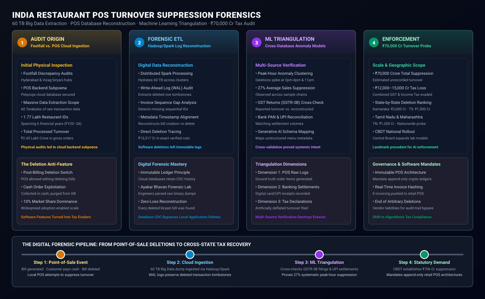
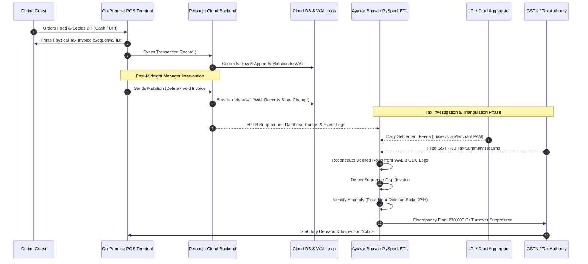
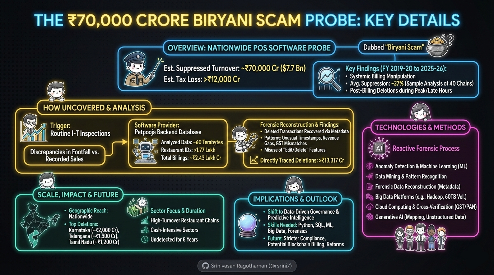

# India Restaurant Billing Turnover Suppression Probe: Big Data Forensics and Cloud POS Manipulation (2026)

Daily learning · February 23, 2026

*By Srinivasan Ragothaman ([@rsrini7](https://github.com/rsrini7))*

> **Core Idea:** A nationwide digital forensic investigation by India's tax authorities uncovered an estimated ₹70,000 crore ($7.7B) in suppressed sales turnover and ₹12,000–15,000 crore in evaded taxes across 1.77 lakh restaurants over six financial years (FY 2019-20 to 2025-26). By subpoenaing 60 terabytes of cloud Point-of-Sale (POS) backend data from provider Petpooja, forensic teams deployed PySpark ETL and machine learning anomaly detection to reconstruct deleted transaction logs, uncover sequential billing gaps, and cross-reference digital payment gateways against statutory GST filings.

---

## 1. Foundations & Ecosystem Context

Point-of-Sale (POS) systems in modern food service operate as distributed, edge-to-cloud transactional networks. In typical retail configurations, counter terminals run local desktop or Android clients backed by lightweight embedded storage engines (such as SQLite or IndexedDB) to ensure high-throughput billing even during internet outages. Transactions are subsequently synced via REST or WebSocket connections to centralized multi-tenant cloud platforms hosted on AWS, GCP, or private clouds.

```
+-----------------------------------------------------------------------------------+
|                           Typical Restaurant POS Architecture                    |
+-----------------------------------------------------------------------------------+
  Dine-In / Takeaway Customer
            │
            ▼
  [POS Terminal (Edge)] ───────► [Thermal Receipt Printer] (Invoice handed to guest)
      │ (Local SQLite)
      │
      ▼ (HTTPS Sync / WebSockets)
  [Cloud POS Backend Platform] (Multi-Tenant SaaS: Petpooja, Posist, etc.)
      ├── Relational DB (PostgreSQL / MySQL)
      ├── Write-Ahead Logs (WAL) & CDC Event Bus (Kafka / Debezium)
      └── S3 / Cloud Storage Cold Archives
            │
            ├────────► [Digital Payment Gateways] (Pine Labs, Razorpay, Paytm, UPI)
            ├────────► [Food Delivery Aggregators] (Zomato, Swiggy Webhook APIs)
            └────────► [Tax Returns Filed] (GSTR-1 Outward Supplies, GSTR-3B Summary)
```

In standard restaurant accounting, every table session generates a series of immutable lifecycle records:
1. **Kitchen Order Ticket (KOT):** Internal directive routing ordered dishes to kitchen stations.
2. **Provisional Bill / Check:** Printed summary presented to the customer for payment settlement.
3. **Fiscal Tax Invoice:** Finalized, sequentially numbered invoice with applicable GST breakdown (typically 5% without Input Tax Credit for non-AC/AC standalone restaurants, or 18% for hotel-based establishments).

The investigation—colloquially termed the "Biryani Scam" due to initial inspections at legendary Hyderabad and Visakhapatnam biryani chains—exposed a systemic discrepancy: dining establishments generated valid customer checks, collected settlements (predominantly in cash or mixed tenders), and subsequently utilized software-level post-billing deletion utilities to purge or alter transaction records before generating statutory tax reports.

### Key Terminology & Architectural Concepts

| Term | Technical Meaning & System Context |
| :--- | :--- |
| **POS Edge Terminal** | On-premise billing terminal running embedded database engines (SQLite/IndexedDB) designed to operate offline and asynchronously synchronize with cloud backends. |
| **Cloud POS Backend** | Centralized multi-tenant SaaS infrastructure hosting relational databases (PostgreSQL/MySQL), event queues, and merchant configuration planes. |
| **Write-Ahead Logging (WAL)** | Database append-only logging mechanism recording data modifications before they are applied to primary data pages, preserving immutable mutation history. |
| **Change Data Capture (CDC)** | Software pattern that tracks and streams row-level inserts, updates, and deletes from database commit logs into distributed analytical storage (e.g., Kafka to Parquet). |
| **Soft Deletion vs. Hard Deletion** | Soft deletion updates a record flag (`is_deleted = true`, `status = 'VOID'`) retaining row data; hard deletion issues a raw SQL `DELETE` removing tuples from table pages while leaving residual artifacts in WAL journals. |
| **Sequence Gap Analysis** | Statistical audit methodology detecting missing integers in sequentially generated fiscal invoice series (`INV-2026-001`, `INV-2026-003` indicating a missing record). |
| **KOT Orphan Rate** | Proportion of Kitchen Order Tickets produced by kitchen display systems that fail to reconcile with any finalized tax invoice in the transaction ledger. |
| **Triangulation Audit** | Multi-source forensic validation cross-referencing cloud POS logs, payment aggregator settlements (UPI/Credit Card), and delivery partner APIs against filed GSTR-3B returns. |

---

## 2. Deep Technical Mechanism: How Turnover Suppression Was Executed & Discovered

The investigation evolved across three technical phases: physical edge discrepancy observation, centralized cloud database subpoena and extraction, and distributed forensic reconstruction.

```
┌────────────────────────────────────────────────────────────────────────────────────────┐
│                      Turnover Suppression & Forensic Reconstruction                    │
└────────────────────────────────────────────────────────────────────────────────────────┘

  [Physical Operation]                      [Software-Level Manipulation]
  Customer Pays Cash/UPI                    POS Terminal User Interface
           │                                          │
           ├── Final bill printed & paid              ├── Cash receipt marked "Void" or "Cancelled"
           └── Customer departs outlet                └── Local record marked `is_deleted = 1`
                                                              │
                                                              ▼
  [Cloud Database Synchronization]          [Ayakar Bhavan Forensic Big Data Lab]
  Petpooja Multi-Tenant Backend             PySpark Distributed Pipeline (60 TB)
           │                                          │
           ├── Live DB: Row masked/deleted            ├── Reconstruct WAL / CDC Event Streams
           └── WAL & S3 Backups: Logs preserved       ├── Identify ₹13,317 Cr direct deletions
                                                      └── Uncover Peak-Hour Deletion Clustering
                                                              │
                                                              ▼
  [Statutory Reconciliation]                [Multi-Stream Triangulation Engine]
  GSTR-3B Tax Filings                       Cross-Verification Data Feeds
           │                                          │
           └── Under-reported by ~27%                ├── UPI / Card Aggregator Settlements (Bank PAN)
                                                      ├── Swiggy / Zomato Order Webhooks
                                                      └── Raw Ingredient Footprint (Meat/Rice Procurement)
```

### 1. Physical Edge Discrepancies & The Hyderabad Inception
The probe originated from on-ground field surveys conducted by the Central Board of Direct Taxes (CBDT) and the Directorate General of GST Intelligence (DGGI) at prominent restaurants in Hyderabad and Visakhapatnam (including chains such as Pista House, Shah Ghouse, and Mehfil). Tax inspectors observed dining halls operating at 90–100% capacity with continuous customer turnover, yet reported daily sales figures in tax returns reflected fractional utilization (under-reporting gross revenues by 25% to 40%).

Physical spot-checks revealed that waitstaff provided customers with printed bills generated from the POS. However, end-of-day billing tallies synchronized to the tax authorities via quarterly GSTR-1 and monthly GSTR-3B filings excluded significant volumes of these finalized transactions.

### 2. Cloud Subpoena & Ingestion of 60 TB Backend Telemetry
Recognizing that individual store audits were constrained by local hardware wipes, the Ayakar Bhavan digital forensic lab in Hyderabad issued statutory subpoenas to Petpooja (operating under parent entity Prayosha Food Services Pvt. Ltd.), an enterprise POS platform managing billing operations for more than 1.77 lakh restaurants across India (~10% national market share).

Investigators ingested approximately 60 terabytes of multi-tenant cloud storage, comprising:
- Multi-region relational database dumps (PostgreSQL and MySQL instances).
- Change Data Capture (CDC) event streams and Kafka ingestion logs.
- Cloud object storage backups (Amazon S3 bucket snapshots of transaction archives).
- Telemetry logs recording user interaction events, device IP addresses, session identifiers, and terminal MAC addresses.

### 3. Deletion Mechanisms at the Software Layer
Forensic analysis of the backend codebase and database tables identified mechanisms utilized to suppress sales:
- **Post-Payment Invoice Cancellation:** The POS interface allowed store managers with administrative privileges to mark settled bills as "Cancelled", "Void", or "Complimentary" hours after customer departure.
- **KOT Decoupling:** Food items logged on Kitchen Order Tickets were prepared and served, but the terminal allowed cashiers to unbind the KOT from the final invoice table, leaving the transaction in an unbilled "Orphaned" state while the register recorded zero revenue.
- **Selective Sync and Offline Mode Manipulation:** By disconnecting edge devices from local area networks during peak dining hours, cash-settled orders were recorded exclusively in ephemeral local storage and wiped prior to reconnection, preventing synchronization with cloud ledgers.
- **Direct Database Mutation Flags:** Relational records possessed a soft-delete column (`is_deleted TINYINT(1) DEFAULT 0`). When store operators invoked deletion utilities, the backend updated `is_deleted = 1`, excluding the tuple from reporting queries (`SELECT * FROM orders WHERE is_deleted = 0`) while leaving the underlying row and its Write-Ahead Log entry physically present in cloud storage.

### 4. Direct Deletions vs. Total Suppressed Turnover
Ayakar Bhavan's data engineering pipelines directly reconstructed **₹13,317 crore** in explicitly deleted or voided invoice records across the 6-year audit window (FY 2019-20 through FY 2025-26). 

By extrapolating deletion behavior across comparable merchant clusters, identifying unrecorded cash volume through sequence gap density, and triangulating inventory procurement models, tax authorities estimated total suppressed sales turnover at **approximately ₹70,000 crore ($7.7 billion)**, representing an aggregate tax shortfall (combining GST evasion and suppressed corporate/personal income tax) of **₹12,000 to ₹15,000 crore**.

### 5. Peak-Hour Deletion Clustering
Statistical analysis debunked restaurant claims that deletions represented accidental keystrokes, duplicate orders, or customer disputes. In standard retail environments, legitimate order cancellations follow a uniform distribution mirroring customer order flow (~1–2% cancellation rate across operating hours).

In the investigated dataset, deletion volumes exhibited non-random temporal spikes:
- **Lunch Rush Post-Processing (2:00 PM – 4:00 PM):** Bulk deletions executed immediately following peak lunch hours.
- **Night Closing Settlement (11:00 PM – 1:00 AM):** High-density deletion routines executed during shift reconciliation, systematically purging cash-settled tables before transmitting end-of-day reports.
- **Suppression Proportion:** Sample audits across 40 major restaurant chains revealed an average turnover suppression rate of **27%**, with individual outlets systematically eliminating up to 45% of peak-hour cash transactions.

---

## 3. Forensic Architecture & Data Ingestion Flow

The forensic infrastructure constructed at Ayakar Bhavan utilized distributed big data frameworks to re-hydrate transactional lineages across years of multi-tenant records.



### End-to-End Transaction Lifecycle & Forensic Audit Trail



---

## 4. Production Implementations & Forensic Code Recipes

The forensic extraction process relies on two algorithmic pillars: distributed sequence-gap detection across billions of records using PySpark, and low-level page carving of deleted records from embedded SQLite databases and Write-Ahead Logs.

### Recipe 1: Distributed PySpark Job for Sequence Gap and Deletion Density Analysis

This production PySpark script models the big data processing methodology used to ingest multi-terabyte transactional parquet exports, identify missing sequential invoice numbers per terminal, and flag non-random deletion time clusters.

```python
#!/usr/bin/env python3
"""
PySpark Distributed Forensic Audit Pipeline
Analyzes multi-tenant POS transaction logs to detect sequential invoice gaps,
tombstoned soft-deletions, and peak-hour anomaly clustering.
"""

from pyspark.sql import SparkSession
from pyspark.sql import functions as F
from pyspark.sql.window import Window
import sys

def create_spark_session(app_name: str = "POS_Forensic_Audit") -> SparkSession:
    return (
        SparkSession.builder
        .appName(app_name)
        .config("spark.sql.adaptive.enabled", "true")
        .config("spark.sql.adaptive.coalescePartitions.enabled", "true")
        .config("spark.sql.shuffle.partitions", "200")
        .getOrCreate()
    )

def analyze_pos_telemetry(spark: SparkSession, input_path: str, output_path: str):
    # Schema: tenant_id, terminal_id, invoice_id, invoice_num, timestamp,
    #         gross_amount, payment_mode, is_deleted, deletion_timestamp
    df = spark.read.parquet(input_path)

    # 1. Sequence Gap Analysis across Terminal-Level Sequential Series
    window_spec = (
        Window.partitionBy("tenant_id", "terminal_id")
        .orderBy("invoice_num")
    )

    df_with_lags = df.withColumn("prev_invoice_num", F.lag("invoice_num", 1).over(window_spec)) \
                     .withColumn("gap_size", F.col("invoice_num") - F.col("prev_invoice_num") - 1)

    # Filter instances where consecutive invoice IDs skip integers
    sequence_gaps = df_with_lags.filter(F.col("gap_size") > 0).select(
        "tenant_id",
        "terminal_id",
        "prev_invoice_num",
        "invoice_num",
        "gap_size",
        "timestamp"
    )

    # 2. Deletion Temporal Clustering Analysis
    # Flag soft-deleted records and analyze deletion hour distribution
    deleted_records = df.filter(F.col("is_deleted") == 1)

    deletion_summary = (
        deleted_records
        .withColumn("hour_of_deletion", F.hour("deletion_timestamp"))
        .groupBy("tenant_id", "hour_of_deletion")
        .agg(
            F.count("invoice_id").alias("deleted_invoice_count"),
            F.sum("gross_amount").alias("deleted_gross_volume"),
            F.sum(F.when(F.col("payment_mode") == "CASH", 1).otherwise(0)).alias("cash_deletions"),
            F.sum(F.when(F.col("payment_mode") == "DIGITAL", 1).otherwise(0)).alias("digital_deletions")
        )
    )

    # 3. Anomaly Scoring: Compute suppression ratio vs. reported total
    tenant_totals = df.groupBy("tenant_id").agg(
        F.count("invoice_id").alias("total_invoices_logged"),
        F.sum(F.when(F.col("is_deleted") == 0, F.col("gross_amount")).otherwise(0.0)).alias("reported_revenue"),
        F.sum(F.when(F.col("is_deleted") == 1, F.col("gross_amount")).otherwise(0.0)).alias("suppressed_revenue")
    ).withColumn(
        "suppression_ratio",
        F.round(F.col("suppressed_revenue") / (F.col("reported_revenue") + F.col("suppressed_revenue")), 4)
    )

    # Identify tenants exceeding typical retail threshold (2% baseline error rate)
    high_risk_merchants = tenant_totals.filter(
        (F.col("suppression_ratio") > 0.05) & 
        (F.col("suppressed_revenue") > 500000.0) # > INR 5 Lakhs suppressed
    ).orderBy(F.desc("suppression_ratio"))

    # Write audit outputs
    high_risk_merchants.write.mode("overwrite").parquet(f"{output_path}/high_risk_merchants")
    deletion_summary.write.mode("overwrite").parquet(f"{output_path}/deletion_temporal_clusters")
    sequence_gaps.write.mode("overwrite").parquet(f"{output_path}/sequence_gaps")

if __name__ == "__main__":
    if len(sys.argv) < 3:
        print("Usage: spark-submit pos_audit.py <input_parquet_path> <output_path>")
        sys.exit(1)
    spark = create_spark_session()
    analyze_pos_telemetry(spark, sys.argv[1], sys.argv[2])
    spark.stop()
```

---

### Recipe 2: Python Forensic Record Recovery from SQLite Databases and WAL Files

At edge terminals where local records were deleted prior to cloud sync, investigators carved deleted records directly from SQLite database files and corresponding `-wal` Write-Ahead Log files by scanning database page headers and unallocated freeblock space.

```python
#!/usr/bin/env python3
"""
SQLite Edge POS Carving Tool
Scans raw SQLite leaf pages and unallocated space to recover deleted invoice payloads
matching Point-of-Sale relational record formats.
"""

import struct
import re
import sys
from typing import Generator, Tuple, Dict, Any

SQLITE_HEADER_SIZE = 100
PAGE_SIZE_OFFSET = 16
PAGE_TYPE_INTERIOR_INDEX = 0x02
PAGE_TYPE_INTERIOR_TABLE = 0x05
PAGE_TYPE_LEAF_INDEX = 0x0A
PAGE_TYPE_LEAF_TABLE = 0x0D

def parse_sqlite_page_size(raw_data: bytes) -> int:
    if len(raw_data) < SQLITE_HEADER_SIZE or raw_data[:16] != b"SQLite format 3\x00":
        raise ValueError("Invalid SQLite header or corrupted file.")
    page_size = struct.unpack(">H", raw_data[PAGE_SIZE_OFFSET:PAGE_SIZE_OFFSET+2])[0]
    return 65536 if page_size == 1 else page_size

def carve_deleted_invoice_strings(page_bytes: bytes) -> Generator[Dict[str, Any], None, None]:
    """
    Carves text fields from unallocated / free space in a leaf table page.
    Matches invoice regex patterns: INV-[0-9]{4}-[0-9]{6}, currency values, and timestamps.
    """
    invoice_pattern = re.compile(rb'(INV-\d{4}-\d{5,8})')
    date_pattern = re.compile(rb'(\d{4}-\d{2}-\d{2}\s\d{2}:\d{2}:\d{2})')
    amount_pattern = re.compile(rb'(\d{2,6}\.\d{2})')

    invoices = [m.group(1).decode('utf-8', errors='ignore') for m in invoice_pattern.finditer(page_bytes)]
    dates = [m.group(1).decode('utf-8', errors='ignore') for m in date_pattern.finditer(page_bytes)]
    amounts = [float(m.group(1).decode('utf-8', errors='ignore')) for m in amount_pattern.finditer(page_bytes)]

    if invoices:
        for idx, inv in enumerate(invoices):
            yield {
                "carved_invoice_id": inv,
                "timestamp_approx": dates[idx] if idx < len(dates) else "UNKNOWN",
                "extracted_amount": amounts[idx] if idx < len(amounts) else 0.0,
                "recovery_method": "Unallocated_Page_Carve"
            }

def scan_sqlite_file(file_path: str):
    with open(file_path, "rb") as f:
        header = f.read(SQLITE_HEADER_SIZE)
        page_size = parse_sqlite_page_size(header)
        f.seek(0)

        page_number = 0
        total_recovered = 0

        while True:
            page_data = f.read(page_size)
            if not page_data or len(page_data) < page_size:
                break
            page_number += 1
            
            # Read page type byte (at offset 100 for page 1, offset 0 for subsequent pages)
            header_offset = SQLITE_HEADER_SIZE if page_number == 1 else 0
            page_type = page_data[header_offset]

            if page_type == PAGE_TYPE_LEAF_TABLE:
                for record in carve_deleted_invoice_strings(page_data):
                    print(f"[Page {page_number:05d}] RECOVERED: {record['carved_invoice_id']} | "
                          f"Amount: INR {record['extracted_amount']:.2f} | Time: {record['timestamp_approx']}")
                    total_recovered += 1

        print(f"\nScan Complete: Recovered {total_recovered} potential deleted invoice fragments from {page_number} pages.")

if __name__ == "__main__":
    if len(sys.argv) < 2:
        print("Usage: python3 carve_pos_sqlite.py <restaurant_pos.db|restaurant_pos.db-wal>")
        sys.exit(1)
    scan_sqlite_file(sys.argv[1])
```

---

## 5. Impact, Real-World Edge Cases & Gotchas

```
+-------------------------------------------------------------------------------------------------+
|                       Common Claims vs. Technical Realities                                     |
+-------------------------------------------------------------------------------------------------+
| Common Claim                                  | Technical Reality                               |
+-----------------------------------------------+-------------------------------------------------+
| "Deleting transactions locally purges records | Multi-tenant SaaS architectures stream writes   |
| from the cloud platform."                     | to append-only WALs and CDC buses. Soft-delete  |
|                                               | flags mask rows from UI views but leave logs.   |
+-----------------------------------------------+-------------------------------------------------+
| "Cash transactions leave no forensic trace    | Kitchen Order Tickets (KOTs), inventory usage   |
| and cannot be substantiated."                 | (meat/rice ratios), and sequence gaps provide   |
|                                               | mathematical proof of suppressed cash orders.   |
+-----------------------------------------------+-------------------------------------------------+
| "Deletions were caused by innocent staff      | Legitimate cancellations occur uniformly (~1%). |
| keystroke errors during shift hours."         | Systematic deletions cluster post-rush (2-4 PM) |
|                                               | and closing (11 PM - 1 AM) with ~27% drop.      |
+-----------------------------------------------+-------------------------------------------------+
| "Merchant PAN accounts isolate store finances | Forensic pipelines link payment gateway bank    |
| from statutory GST filing audits."            | accounts (UPI/QR/Cards) directly to GSTN data,  |
|                                               | identifying gross settlement mismatches.        |
+-----------------------------------------------+-------------------------------------------------+
```

### Real-World Failure Modes & Forensic Gotchas

1. **The Inverted Cash-to-Digital Ratio Anomaly:**  
   In India's post-UPI retail economy, typical metropolitan restaurants record 65–80% of aggregate collections via UPI, credit cards, or digital wallets, with cash comprising 20–35%. Under-reporting establishments suppressed cash orders so aggressively that their reported mix inverted to 95% digital and 5% cash—an economic impossibility for high-volume cash establishments like traditional biryani houses.
2. **Kitchen Inventory Triangulation:**  
   Tax authorities circumvented deleted sales logs by cross-referencing input tax credit (ITC) claims on raw materials. For instance, an establishment purchasing 1,000 kilograms of premium basmati rice and 1,500 kilograms of mutton per week could mathematically produce approximately 4,000 to 5,000 biryani portions. Claiming gross sales of only 2,200 portions proved substantial turnover suppression via physical stoichiometric mass balances.
3. **Delivery Aggregator API Discrepancies:**  
   Restaurants attempted to balance cloud accounts by misclassifying dine-in sales as cancelled online aggregator orders. However, Swiggy and Zomato maintain independent, server-authenticated webhook callbacks. Mismatches between POS status (`CANCELLED_BY_CUSTOMER`) and aggregator status (`DELIVERED_AND_SETTLED`) immediately flagged manipulation.
4. **Offline Cache Desynchronization:**  
   Some operators isolated POS terminals from the internet to avoid cloud writes, running offline for days. When edge terminals eventually reconnected to receive menu updates, their embedded SQLite sync queues flushed uncompacted mutation batches, inadvertently transmitting the deleted transaction logs to the cloud backend.

---

## 6. Practical Adoption Blueprint & Verification Checklist

To eliminate software-level turnover suppression and comply with emerging statutory compliance mandates, engineering teams designing retail POS and enterprise billing architectures must adopt cryptographic append-only guarantees.

### Architecture Blueprint: Tamper-Evident Fiscal POS Design

```
+-----------------------------------------------------------------------------------+
|                        Tamper-Evident Append-Only Architecture                    |
+-----------------------------------------------------------------------------------+

   Order Event (KOT / Item Add)
            │
            ▼
   [Merkle Tree Hash Chaining] ──► SHA-256(Prev_Hash + Invoice_Data + Timestamp)
            │
            ▼
   [Hardware Fiscal Memory / Secure Enclave] (Write-Once-Read-Many Microchip)
            │
            ▼
   [Real-Time Invoice Registration] ──► Real-Time JSON Payload via Mutual TLS
            │
            ▼
   [Government E-Invoice Portal (IRN / QR Code)] ──► Digitally Signed Cryptographic QR
            │
            ▼
   [Thermal Receipt Printed] (Contains Verifiable Cryptographic QR Code)
```

### Engineering Requirements for Compliant Billing Systems

1. **Cryptographic Invoice Chaining (RFC 6962 Standard):**  
   Every invoice generated must embed a cryptographic hash incorporating the hash of the preceding invoice:

$$\text{Hash}_n = \text{HMAC-SHA256}(\text{Key}, \text{Hash}_{n-1} \parallel \text{InvoiceData}_n)$$

   Any subsequent deletion breaks the mathematical hash chain across all subsequent transactions.
2. **Prohibition of Soft-Delete Interfaces:**  
   Eliminate raw `DELETE` and `is_deleted = 1` mutations on finalized invoices. Reversals must be executed exclusively via explicitly linked **Credit Notes** containing signed justifications, preserving the original invoice tuple intact.
3. **Mandatory Real-Time E-Invoicing API Hooks:**  
   Integrate direct, real-time Invoice Registration Portal (IRP) hooks. Before an invoice can be finalized or printed, the system must obtain an official Invoice Reference Number (IRN) and signed QR code.

### Forensic Verification Checklist for POS Auditability

- [ ] **Sequential Integrity:** Verify zero gaps in chronological sequential invoice numbers across all edge terminals.
- [ ] **KOT-to-Bill Reconciliation:** Confirm 100% of generated Kitchen Order Tickets map to a finalized tax invoice or an authorized, timestamped cancellation log signed by a kitchen supervisor.
- [ ] **Immutable Audit Logging:** Ensure all database mutations stream to a centralized, write-once cloud event repository (e.g., AWS S3 Object Lock in Compliance Mode).
- [ ] **Payment Reconciliation Parity:** Validate that the sum of daily POS gross sales equals the exact sum of bank settlement credits (UPI, Cards, Cash deposits) within $\pm 0.5\%$.
- [ ] **Tender Mix Validation:** Ensure reported cash-to-digital ratios fall within two standard deviations of neighborhood geographic baselines.

---

## 7. Timeline, National Expansion & Current State

```
+───────────────────────────────────────────────────────────────────────────────────────────+
|                         Evolution of the National Investigation                           |
+───────────────────────────────────────────────────────────────────────────────────────────+
  Mid-2024           Initial Income Tax surveys at biryani chains in Hyderabad & Visakhapatnam.
       │
  Late-2024          Ayakar Bhavan Digital Forensic Lab establishes data-sharing protocols.
       │
  Jan 2025           Court-authorized data subpoena executed on Petpooja cloud backend.
       │
  Mid-2025           60 TB data lake established; PySpark pipelines reveal ₹13,317 Cr direct cuts.
       │
  Late-2025          Cross-verification with GSTN, Razorpay, Pine Labs, and Swiggy/Zomato.
       │
  Feb 2026           Probe escalates nationally under Central Board of Direct Taxes (CBDT);
                     State-wise evasion quantified: Karnataka (₹2,000 Cr), Telangana (₹1,500 Cr),
                     Tamil Nadu (₹1,200 Cr), Maharashtra & NCR regions under active scrutiny.
       │
  Future Outlook     Regulatory push toward mandatory hardware fiscal memory and real-time
                     cloud e-invoicing for all commercial retail billing software in India.
```

### State-Wise Deletion Breakdown
The Ayakar Bhavan laboratory's data processing quantified significant cross-state turnover suppression:
- **Karnataka:** ~₹2,000 crore directly traced deletions across IT corridor dining hubs and quick-service restaurant networks.
- **Telangana:** ~₹1,500 crore, centered primarily in Hyderabad's culinary and hospitality belts.
- **Tamil Nadu:** ~₹1,200 crore, concentrated in Chennai and tier-2 restaurant chains.
- **Maharashtra, Delhi-NCR, Gujarat:** Ongoing data partitioning and notice dispatches across over 50,000 additional restaurant IDs.

---

## 8. Primary Sources & References

1. [Central Board of Direct Taxes (CBDT): Annual Forensic and Enforcement Reports](https://incometaxindia.gov.in) — Official directives and procedural protocols governing digital evidence extraction from enterprise cloud SaaS providers.
2. [Goods and Services Tax Network (GSTN): Technical Specifications for E-Invoicing](https://einvoice1.gst.gov.in) — Architectural standards for real-time Invoice Registration Portal (IRP) APIs, QR code digital signatures, and hash verification.
3. [Directorate General of GST Intelligence (DGGI): Detection of Fraudulent Invoicing & Turnover Suppression](https://dggi.gov.in) — Case studies on synthetic transaction manipulation and multi-stream triangulation methodologies.
4. [Petpooja (Prayosha Food Services Pvt. Ltd.) Technical Platform Documentation](https://www.petpooja.com) — Standard operating documentation for multi-terminal POS synchronization, offline caching, and administrative void modules.
5. [The Times of India / NDTV / Hindustan Times: Investigative Reports on the 'Biryani Scam' (Feb 2026)](https://timesofindia.indiatimes.com) — Detailed reportage on the Hyderabad Ayakar Bhavan 60 TB forensic lab operations and nationwide CBDT expansion.

---

## 9. Supplementary Visuals


*Figure: Overview of the forensic workflow and data extraction architecture utilized during the 60 TB restaurant billing investigation.*

---

**Related:**
- [Global-AI-Scam-Landscape-And-Defense-Playbook-2026.md](Global-AI-Scam-Landscape-And-Defense-Playbook-2026.md) — Big data forensics, anomaly detection algorithms, and defense frameworks against automated economic fraud.
- [Securing-OpenClaw-Infrastructure-Setup-2026.md](../../AI-ML/Agents/openclaw/Securing-OpenClaw-Infrastructure-Setup-2026.md) — Production infrastructure hardening, write-ahead logging integrity, and isolation patterns.
- [Autonomous-AI-Agents-Cybersecurity-Governance-Infrastructure-2026.md](../../AI-ML/Agents/analysis/Autonomous-AI-Agents-Cybersecurity-Governance-Infrastructure-2026.md) — Auditing enterprise agentic workflows and automated compliance verification architectures.
