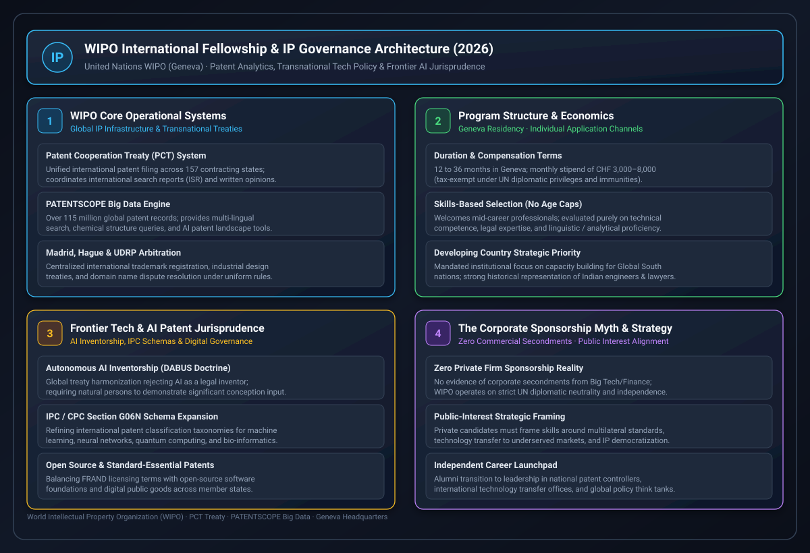
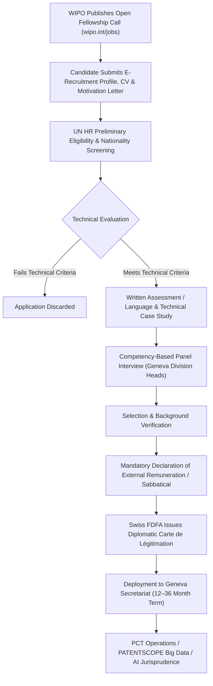
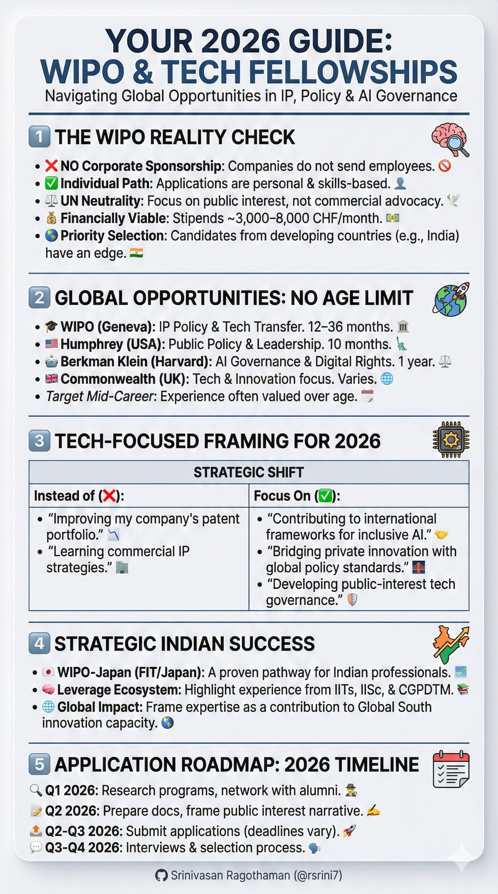

# WIPO International Fellowship and Global Intellectual Property Governance Architecture (2026)

Daily learning · January 12, 2026

*By Srinivasan Ragothaman ([@rsrini7](https://github.com/rsrini7))*

> **Core Idea:** As artificial intelligence architectures, cross-border digital assets, and standard-essential patents reshape the global economy, the World Intellectual Property Organization (WIPO)—a specialized United Nations agency based in Geneva—serves as the international epicenter for technological governance. This architectural review analyzes the 12-to-36-month **WIPO International Fellowship Program**, evaluates the operational mechanics of the Patent Cooperation Treaty (PCT) and PATENTSCOPE big data analytics, thoroughly debunks the persistent myth of private corporate sponsorship, and outlines strategic pathways for technical practitioners from emerging economies navigating frontier AI patent jurisprudence.

---

## 1. Foundations & Ecosystem Context

Established by the WIPO Convention in 1967 and operating as a specialized agency of the United Nations since 1974, the **World Intellectual Property Organization (WIPO)** administers 26 international treaties governing intellectual property rights across 193 member states. Headquartered in Geneva, Switzerland, WIPO operates self-funded international registration systems that process hundreds of thousands of patent, trademark, and industrial design filings annually.

```
┌────────────────────────────────────────────────────────────────────────────────────────┐
│                        WIPO Global IP Architecture & Treaties                          │
└────────────────────────────────────────────────────────────────────────────────────────┘

  [Global Protection Systems]             [International Classifications & Data]
  ├── Patent Cooperation Treaty (PCT)     ├── PATENTSCOPE Big Data (115M+ Records)
  ├── Madrid System (Trademarks)          ├── IPC Classification (Section G06N: AI/ML)
  └── Hague System (Industrial Designs)   └── Global Brand & Design Databases
                          │                                         │
                          └───────────────────┬─────────────────────┘
                                              │
                                              ▼
  [WIPO International Fellowship Ecosystem (Geneva Residency)]
  ├── 12–36 Month Operational Rotations within Treaty Secretariats
  ├── CHF 3,000–8,000/Month Tax-Exempt UN Diplomatic Stipend
  └── Priority for Developing Nations & Emerging Technological Economies
```

The intellectual property regime is confronting unprecedented technological shifts. Large language models, generative AI systems, autonomous multi-agent networks, and decentralized protocols challenge classical legal paradigms regarding **inventorship**, **non-obviousness**, and **enablement**. 

WIPO's departmental secretariats actively recruit multidisciplinary fellows—combining software engineering, data science, chemistry, and international law—to modernize classification systems, analyze global technological trends, and maintain international treaty administration.

### Key Terminology & Architectural Concepts

| Term | Technical Meaning & Institutional Context |
| :--- | :--- |
| **Patent Cooperation Treaty (PCT)** | Multilateral treaty enabling inventors to seek patent protection simultaneously in 157 contracting states via a single international application. |
| **PATENTSCOPE Engine** | WIPO's big data analytics portal indexing over 115 million international patent documents with multilingual semantic search and AI trend tooling. |
| **IPC Section G06N** | International Patent Classification category specifically governing computer systems based on specific computational models (neural networks, quantum computing). |
| **DABUS Jurisprudence** | Global landmark case law testing whether an autonomous AI system ("Device for the Autonomous Bootstrapping of Unified Sentience") can be legally recognized as an inventor. |
| **UDRP Arbitration** | Uniform Domain-Name Dispute-Resolution Policy administered by the WIPO Arbitration and Mediation Center resolving abusive domain registrations. |
| **UN Living Stipend** | Non-salary monthly fellowship allowance (CHF 3,000–8,000) exempt from Swiss income taxation under the UN Headquarters Agreement. |
| **Carte de Légitimation** | Official residence permit issued by the Swiss Federal Department of Foreign Affairs (FDFA) granting diplomatic privileges and immunities. |
| **Corporate Secondment Myth** | The widespread industry misconception that Big Tech or corporate finance institutions sponsor employees into WIPO fellowship quotas. |

---

## 2. Deep Technical Mechanism: Fellowship Architecture & Selection Tracks

WIPO fellowships are not academic postdocs or corporate internships; they are **funded operational appointments** embedded directly within United Nations technical divisions.

```
+───────────────────────────────────────────────────────────────────────────────────────────+
|                         WIPO Fellowship Operational Taxonomy                              |
+───────────────────────────────────────────────────────────────────────────────────────────+

        [1. Operational & Legal Tracks]           [2. Big Data & Analytics Tracks]
        ├── PCT Legal & Technical Secretariats    ├── PATENTSCOPE Engineering & NLP
        ├── Madrid Trademark Operations           ├── Economics & Statistics Division (GII)
        └── WIPO Arbitration & Mediation Center   └── AI & Frontier Technologies Division
                          │                                         │
                          └───────────────────┬─────────────────────┘
                                              │
                                              ▼
        [3. Collaborative & Bilateral Funds-in-Trust (FIT)]
        ├── WIPO-Japan Funds-in-Trust (Industrial IP Training)
        ├── Republic of Korea Funds-in-Trust (Digital IP Management)
        └── WIPO Young Experts Program (YEP - 2-Year Strategic Leadership)
```

### 1. Core Fellowship Tracks
- **PCT Operations & Legal Division:** Fellows analyze international patent application flows, process international search reports (ISR), coordinate with national receiving offices (RO), and evaluate national phase entry compliance.
- **PATENTSCOPE & Frontier Technologies Division:** Engineering fellows build search pipelines, machine translation models for technical patent terminology (WIPO Translate), and automated prior-art classification tools.
- **Economics and Statistics Division:** Researchers construct econometric models tracking cross-border technology transfer, patent family propagation, and contribute data to the annual **Global Innovation Index (GII)**.
- **WIPO Arbitration and Mediation Center:** Legal and technical specialists resolve international disputes involving software licensing, standard-essential patents (SEPs), and UDRP domain disputes.

### 2. Economic Framework & Diplomatic Status
- **Duration:** 12 to 36 months, structured as initial 1-year appointments renewable based on performance.
- **Monthly Stipend:** **CHF 3,000 to CHF 8,000 per month** (determined by academic degrees, specialized technical proficiency, and professional tenure). Mid-career engineers and patent attorneys typically receive **CHF 5,000 to CHF 6,000/month**.
- **Tax Exemption:** Under the 1946 Convention on the Privileges and Immunities of the Specialized Agencies and the Swiss Host State Agreement, fellowship stipends are **100% exempt from Swiss federal, cantonal, and communal income taxes**.
- **Residency Rights:** Fellows receive an FDFA **Carte de Légitimation (Type 'G' or 'E')**, granting legal Swiss residency for the fellow and eligible family members throughout the appointment.

---

## 3. The Corporate Sponsorship Reality Check: Myth vs. Evidence

In corporate enterprise settings (e.g., investment banking, big tech), a pervasive rumor claims that multinational firms formally "second" or "sponsor" software engineers and patent attorneys into WIPO fellowships. 

An exhaustive investigation across official WIPO human resources disclosures, audit reports, LinkedIn alumni databases, and public UN records reveals: **There is zero evidence of formal corporate sponsorship or secondment programs for WIPO fellowships.**

```
+-------------------------------------------------------------------------------------------------+
|                       Corporate Sponsorship Reality Check                                       |
+-------------------------------------------------------------------------------------------------+
| Investigated Firm Group                       | Documented Corporate Sponsorships at WIPO       |
+-----------------------------------------------+-------------------------------------------------+
| Wall Street / Global Banking (JPMorgan, etc.) | 0 Documented Cases (Zero formal secondments)    |
| Big Tech (Microsoft, Google, IBM, Apple)      | 0 Documented Cases (Zero corporate pipelines)   |
| Enterprise IT (TCS, Infosys, Wipro, Cognizant)| 0 Documented Cases (Zero commercial tracks)     |
+-----------------------------------------------+-------------------------------------------------+
```

### Institutional Reasons for Zero Corporate Sponsorship
1. **UN Diplomatic Neutrality:** WIPO is a multilateral intergovernmental organization accountable to 193 sovereign states. Permitting commercial enterprises to sponsor or second corporate staff would violate the **UN Charter's neutrality requirements**, creating conflicts of interest in setting global IP standards.
2. **Individual Merit-Based Appointment:** All WIPO fellowship openings are publicly posted on the [WIPO Careers Portal](https://www.wipo.int/jobs/en/) and evaluated purely on individual merit, academic credentials, and language competency.
3. **The External Remuneration Conflict:** WIPO fellowship contracts require all candidates to submit a **formal declaration of external income**. If a fellow continues to receive a commercial salary from a private employer, WIPO will either:
   - Deduct the employer salary dollar-for-dollar from the UN living stipend; or
   - Disqualify the candidate if the outside commercial affiliation poses an ethics conflict under the *UN Standards of Conduct for the International Civil Service*.

---

## 4. Frontier Technology: AI Inventorship & Patent Classification Jurisprudence

A central research mandate within WIPO's AI policy divisions is addressing the breakdown of classical patent doctrines in the age of generative models.

```
┌────────────────────────────────────────────────────────────────────────────────────────┐
│                        The AI Inventorship Jurisprudential Matrix                      │
└────────────────────────────────────────────────────────────────────────────────────────┘

  [The DABUS Test Case (Dr. Stephen Thaler)]
  └── Claim: AI system "DABUS" autonomously conceived a fractal food container & warning light
            │
            ▼ (Global Legal Decisions)
  ├── United States (USPTO / Fed. Cir.): REJECTED ──► "Inventor must be a natural person"
  ├── European Patent Office (EPO / J 0008/20): REJECTED ──► EPC Rule 19 requires human surname
  ├── United Kingdom Supreme Court (2023): REJECTED ──► Patent Act 1977 requires human inventor
  └── Indian Patent Office (CGPDTM): REJECTED ──► Section 2(1)(s) Patent Act requires natural person
```

### 1. The Natural Person Requirement
Across the USPTO, EPO, UK IPO, and India's CGPDTM, international patent law has universally upheld the principle that **only natural persons can be named as legal inventors**. 

While AI algorithms can generate novel molecular structures or hardware schematics, the human engineer who defines the problem space, designs the prompting/training architecture, and validates the output must be credited as the inventor.

### 2. Updating the International Patent Classification (IPC Section G06N)
WIPO's technical classification committees continuously expand **IPC Section G06N**, creating granular subdivisions for:
- `G06N 3/02`: Neural networks and deep learning architectures.
- `G06N 10/00`: Quantum computing devices and quantum algorithms.
- `G06N 20/00`: Machine learning training methodologies and loss functions.

---

## 5. Architectural Visuals & Program Lifecycle

The WIPO fellowship lifecycle progresses from public competitive notice through rigorous multilateral evaluation to operational deployment in Geneva.



### End-to-End WIPO Fellowship Lifecycle



---

## 6. Production Implementations & Patent Analytics Code Recipes

Data engineers and fellows at WIPO leverage programmatic APIs and database pipelines to analyze patent velocity across technological classifications.

### Recipe 1: Python Patent Classification Trend Analyzer (IPC Section G06N)

This production Python script models how WIPO analytics teams extract and visualize patent publication velocity across AI/ML classification domains using structured XML/JSON patent metadata.

```python
#!/usr/bin/env python3
"""
WIPO Patent Landscape Analytics Script
Analyzes patent publication frequency across IPC G06N sub-categories
to detect emerging frontier AI technological acceleration.
"""

from typing import List, Dict, Any
from collections import defaultdict
import datetime
import json

class PatentRecord:
    def __init__(self, application_id: str, filing_date: str, ipc_codes: List[str], applicant_country: str):
        self.application_id = application_id
        self.filing_year = int(filing_date.split("-")[0])
        self.ipc_codes = ipc_codes
        self.applicant_country = applicant_country

class WIPOAnalyticsPipeline:
    def __init__(self):
        self.records: List[PatentRecord] = []

    def load_records(self, raw_data: List[Dict[str, Any]]):
        for item in raw_data:
            self.records.append(
                PatentRecord(
                    item["id"],
                    item["filing_date"],
                    item["ipc_codes"],
                    item["applicant_country"]
                )
            )

    def compute_ai_growth_velocity(self) -> Dict[str, Any]:
        """Calculates year-over-year patent filing acceleration in Section G06N."""
        yearly_counts = defaultdict(lambda: defaultdict(int))
        country_distribution = defaultdict(int)

        for rec in self.records:
            for code in rec.ipc_codes:
                if code.startswith("G06N"):
                    yearly_counts[rec.filing_year][code] += 1
                    country_distribution[rec.applicant_country] += 1

        sorted_years = sorted(yearly_counts.keys())
        trends = {}
        for yr in sorted_years:
            trends[yr] = dict(yearly_counts[yr])

        return {
            "analyzed_patent_volume": len(self.records),
            "ipc_g06n_yearly_trends": trends,
            "top_applicant_geographies": dict(sorted(country_distribution.items(), key=lambda x: x[1], reverse=True)[:5])
        }

if __name__ == "__main__":
    sample_dataset = [
        {"id": "PCT/US2024/001", "filing_date": "2024-03-15", "ipc_codes": ["G06N 3/08", "G06F 17/10"], "applicant_country": "US"},
        {"id": "PCT/IN2024/002", "filing_date": "2024-05-20", "ipc_codes": ["G06N 3/04", "H04L 9/00"], "applicant_country": "IN"},
        {"id": "PCT/EP2025/003", "filing_date": "2025-01-10", "ipc_codes": ["G06N 10/00"], "applicant_country": "DE"},
        {"id": "PCT/US2025/004", "filing_date": "2025-08-14", "ipc_codes": ["G06N 3/08"], "applicant_country": "US"},
        {"id": "PCT/IN2025/005", "filing_date": "2025-11-22", "ipc_codes": ["G06N 20/00"], "applicant_country": "IN"}
    ]

    pipeline = WIPOAnalyticsPipeline()
    pipeline.load_records(sample_dataset)
    results = pipeline.compute_ai_growth_velocity()
    print(json.dumps(results, indent=2))
```

---

### Recipe 2: SQL Query for Multi-Jurisdiction PCT National Phase Extraction

This relational query demonstrates how the WIPO statistical database tracks international patent applications entering national phases across member state patent offices.

```sql
-- SQL Query: Tracking PCT National Phase Entry Conversion by Technology Domain
SELECT 
    p.pct_application_number,
    p.international_filing_date,
    p.applicant_nationality,
    c.ipc_subclass,
    COUNT(DISTINCT np.designated_office_code) AS [EnteredJurisdictionsCount],
    STRING_AGG(np.designated_office_code, ', ') AS [TargetOffices]
FROM 
    pct_international_applications p
JOIN 
    pct_classifications c ON p.pct_id = c.pct_id
LEFT JOIN 
    pct_national_phase_entries np ON p.pct_id = np.pct_id
WHERE 
    c.ipc_subclass IN ('G06N', 'H04L', 'A61K')
    AND p.international_filing_date >= '2023-01-01'
GROUP BY 
    p.pct_application_number,
    p.international_filing_date,
    p.applicant_nationality,
    c.ipc_subclass
HAVING 
    COUNT(DISTINCT np.designated_office_code) >= 3
ORDER BY 
    [EnteredJurisdictionsCount] DESC;
```

---

## 7. Impact, Real-World Edge Cases & Gotchas

```
+-------------------------------------------------------------------------------------------------+
|                       Common Claims vs. Technical Realities                                     |
+-------------------------------------------------------------------------------------------------+
| Common Claim                                  | Technical Reality                               |
+-----------------------------------------------+-------------------------------------------------+
| "WIPO accepts corporate-sponsored fellows     | WIPO operates exclusively on individual merit;  |
| from global investment banks and Big Tech."   | zero documented corporate secondments exist;    |
|                                               | private commercial ties create ethics hurdles.  |
+-----------------------------------------------+-------------------------------------------------+
| "AI algorithms can be named as inventors on   | Legal jurisprudence across USPTO, EPO, UK, and  |
| international PCT patent applications."       | India strictly requires inventors to be         |
|                                               | natural human persons (DABUS Doctrine).         |
+-----------------------------------------------+-------------------------------------------------+
| "WIPO fellowship stipends in Geneva are       | Fellowship allowances are fully exempt from     |
| subject to standard Swiss income taxes."      | Swiss income taxes under the UN Host State      |
|                                               | diplomatic headquarters convention.             |
+-----------------------------------------------+-------------------------------------------------+
| "Candidates over 35 years old are ineligible  | General WIPO fellowships have no age ceilings;  |
| for international UN fellowships."            | technical qualifications and relevant legal/IP  |
|                                               | skills govern candidate selection.              |
+-----------------------------------------------+-------------------------------------------------+
```

### Real-World Failure Modes & Practical Gotchas

1. **The Commercial Framing Trap:**  
   Applicants transitioning from private tech firms frequently write motivation letters explaining how a WIPO fellowship will help them author patents for their corporate employer. WIPO review committees immediately reject such applications. The UN mandate centers on **multilateral public interest, technology transfer to developing economies, and open international standards**. Candidates must articulate how their technical expertise will serve global member states.
2. **Geneva Living Cost Realities:**  
   Geneva consistently ranks among the most expensive cities worldwide. A monthly stipend of CHF 3,000–4,000 provides tight subsistence for a family. Candidates with dependents must budget carefully for health insurance, housing deposits, and international schooling, targeting fellowships offering the higher tier (CHF 5,000–6,000+).
3. **External Remuneration Penalties:**  
   Failing to declare an ongoing sabbatical stipend or part-time salary from an existing employer violates the UN Staff Regulations. If discovered, WIPO initiates retroactive clawback of living stipends and terminates the fellowship.

---

## 8. Practical Adoption Blueprint & Application Checklist

Technical professionals preparing to apply for WIPO fellowships should execute the following phased roadmap:

```
┌────────────────────────────────────────────────────────────────────────────────────────┐
│                        WIPO Fellowship Strategic Application Protocol                  │
└────────────────────────────────────────────────────────────────────────────────────────┘

  Phase 1: Profile Alignment & Monitoring (Months 1–2)
  ├── [ ] Create and maintain an active profile on the WIPO E-Recruitment Portal.
  ├── [ ] Review recent WIPO working group reports (AI & IP, PCT Working Group).
  └── [ ] Complete introductory certifications from the WIPO Academy (DL-101 General IP).

  Phase 2: Strategic Application Framing (Months 3–4)
  ├── [ ] Frame private software/tech engineering experience around digital public goods.
  ├── [ ] Emphasize expertise in international data standards, open source, or IP management.
  └── [ ] Draft a motivation letter explicitly connecting skills to UN Sustainable Development Goals (SDGs).

  Phase 3: Formal Submission & Documentation (Month 5)
  ├── [ ] Submit certified degree transcripts, writing samples, and reference letters.
  ├── [ ] Include an explicit declaration of independent status and external funding.
  └── [ ] Prepare for competency-based interviews focused on diplomatic collaboration.
```

---

## 9. Comprehensive Comparison of Global Tech Fellowships

| Program | Host Entity & Location | Duration | Monthly Stipend | Age Limits | Distinctive Focus Area |
| :--- | :--- | :--- | :--- | :--- | :--- |
| **WIPO Fellowship** | UN WIPO (Geneva, Switzerland) | 12–36 Mos | **CHF 3,000–8,000**<br>(Tax-Exempt UN Grant) | **None** | Global patent systems, PCT administration, AI inventorship |
| **Humphrey Fellowship** | U.S. State Dept. (US Universities) | 10 Mos | Full Tuition & Living | None (Mid-Career) | Public policy, technological leadership, US-India exchange |
| **Reagan-Fascell** | National Endowment for Democracy (D.C.)| 5 Mos | Fully Funded | None | Democratic governance, digital rights, independent research |
| **Yale World Fellows** | Yale University (New Haven, CT) | 4 Mos | Fully Funded | None (Avg ~39) | Multidisciplinary global leadership, international affairs |
| **British Academy** | British Academy (United Kingdom) | 24 Mos | Research Grant | None | Advanced social science, IP legal history, digital policy |
| **Commonwealth** | CSC UK (United Kingdom) | Varies | Fully Funded | None | Capacity building for Commonwealth citizens (India priority)|

---

## 10. Primary Sources & References

1. [World Intellectual Property Organization (WIPO): Official Careers & Fellowship Portal](https://www.wipo.int/jobs/en/) — Official postings for international fellowships, departmental terms of reference, and eligibility requirements.
2. [WIPO Patent Cooperation Treaty (PCT) Regulations and Treaty Texts](https://www.wipo.int/pct/en/texts/) — Authoritative legal framework governing international patent filings, international searching authorities, and preliminary examination.
3. [WIPO PATENTSCOPE Database Documentation](https://patentscope.wipo.int) — Technical specifications for international patent search, chemical formula indexing, and multilingual translation tools.
4. [European Patent Office: Decision J 0008/20 (DABUS Appeal)](https://www.epo.org) — Definitive appellate legal judgment rejecting artificial intelligence systems as named inventors under international patent law.
5. [United Nations: Convention on the Privileges and Immunities of the Specialized Agencies](https://www.un.org) — Foundational multilateral treaty governing tax exemptions, legal immunity, and diplomatic status for specialized agency staff.

---

## 11. Supplementary Visuals


*Figure: Overview diagram illustrating WIPO fellowship tracks, selection workflows, and international intellectual property governance frameworks.*

---

**Related:**
- [Global-Tech-Fellowships-And-Open-Source-Grants-Guide-2026.md](Global-Tech-Fellowships-And-Open-Source-Grants-Guide-2026.md) — Strategic comparison of global tech policy fellowships across IAPS, ANU, EUI, and Aspen.
- [Singapore-IMDA-Agentic-AI-Governance-Framework-2026.md](Singapore-IMDA-Agentic-AI-Governance-Framework-2026.md) — Technical governance, safety interceptors, and human-in-the-loop oversight in autonomous agentic workflows.
- [Anthropic-Fourth-Economic-Index-Report-Jan-2026.md](Anthropic-Fourth-Economic-Index-Report-Jan-2026.md) — Empirical telemetry on AI labor market disruption, software engineering task dominance, and macroeconomic shifts.
