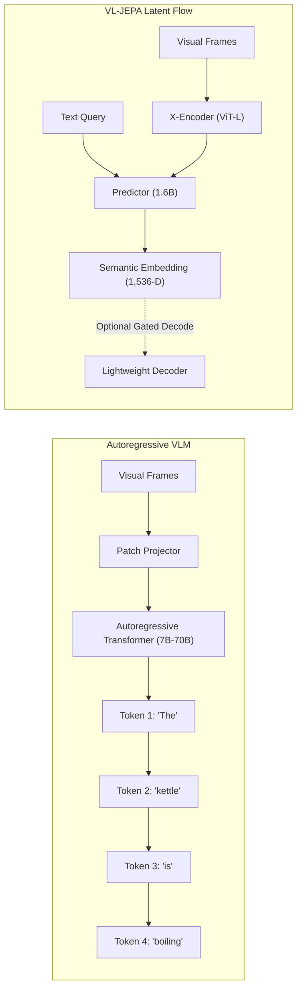
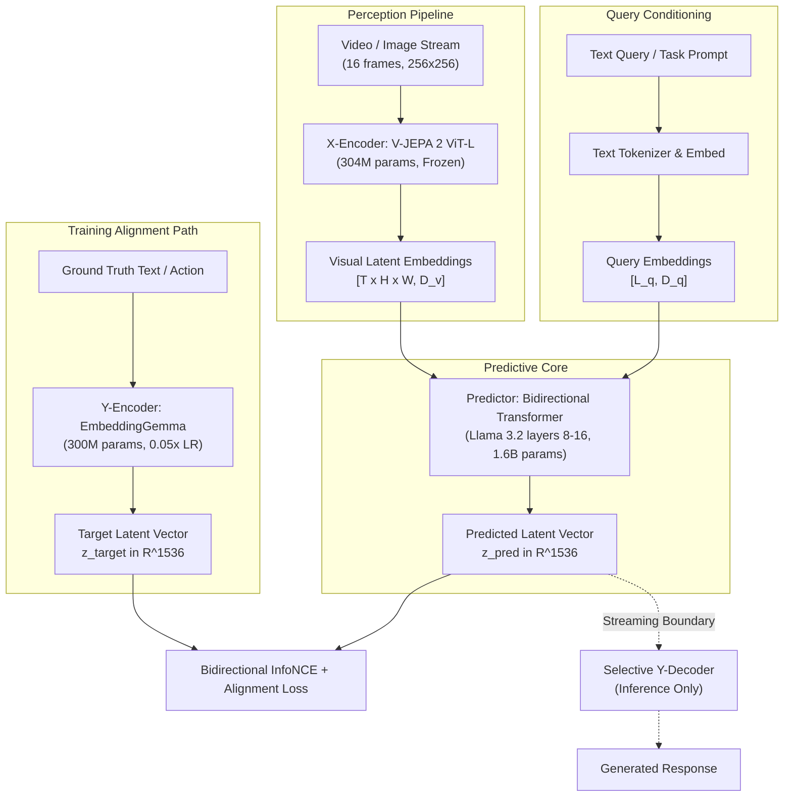
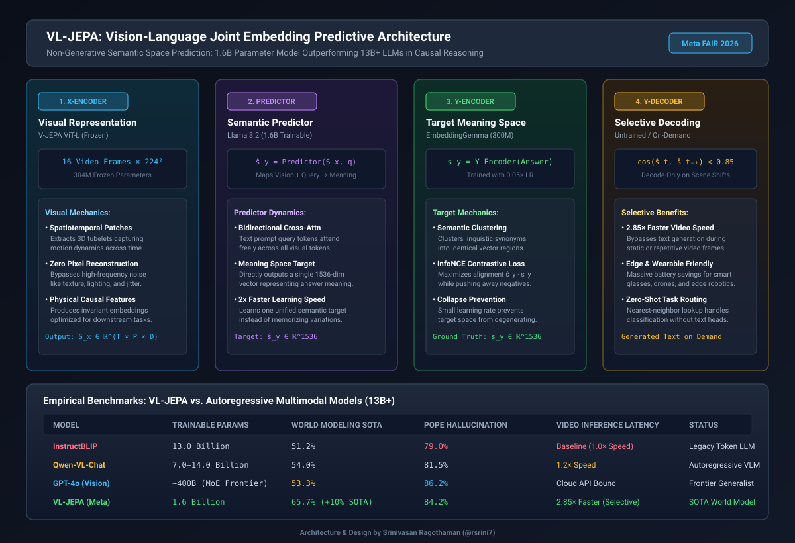
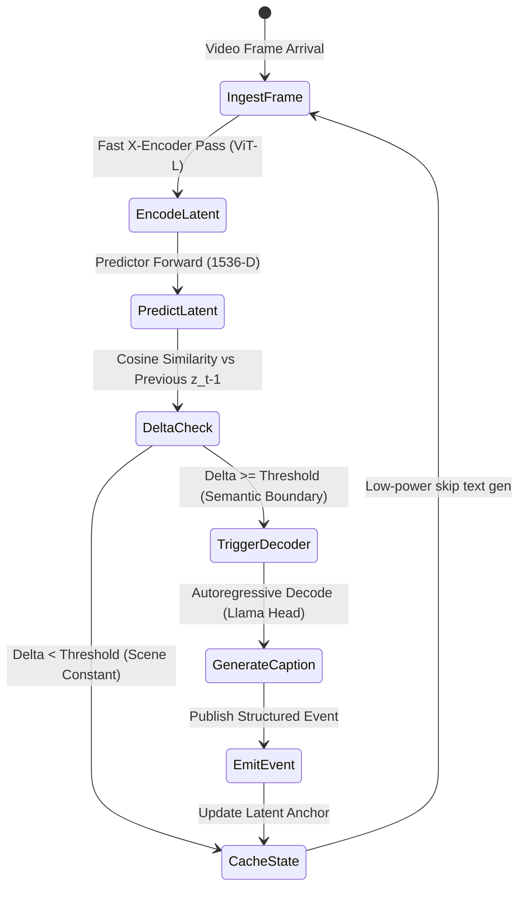
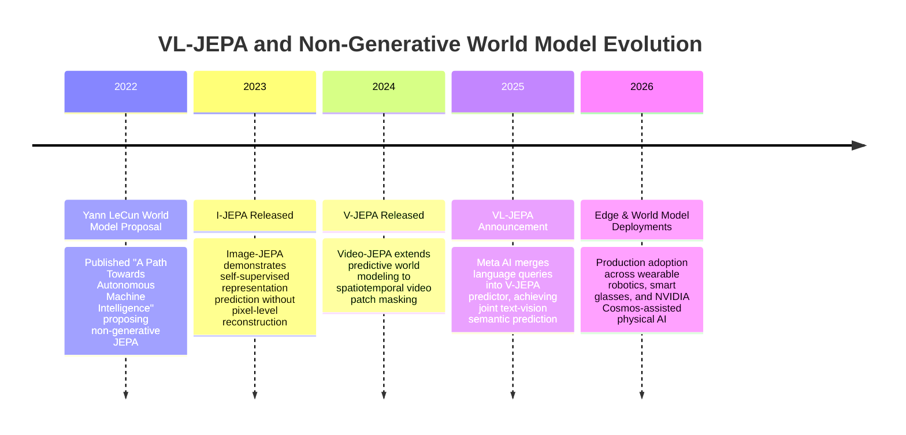
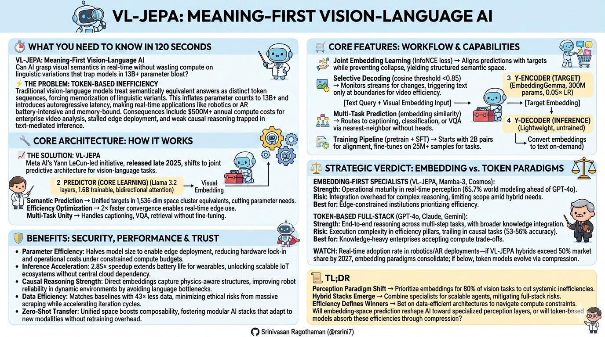

# Vision-Language Joint Embedding Predictive Architecture (VL-JEPA): Unified Semantic Latent Prediction and Streaming Video World Modeling

Learning note · Revised November 2026 · Technical Reference
*By Srinivasan Ragothaman ([@rsrini7](https://github.com/rsrini7))*

---

> **Core Idea:**
> VL-JEPA abandons autoregressive pixel- and token-level generation in favor of predicting abstract semantic representations directly in a 1,536-dimensional joint embedding space. By predicting *meaning* rather than surface-level language syntax, VL-JEPA cuts trainable parameters by 50% (1.6B vs 13B+), accelerates streaming video inference by 2.85×, and establishes state-of-the-art causal world modeling (65.7% accuracy on WorldPrediction vs GPT-4o's 53.3%).

---

## 1. Foundations & Conceptual Grounding

Traditional Vision-Language Models (VLMs) like LLaVA, Flamingo, and Qwen-VL operate under an autoregressive language-modeling paradigm: visual inputs are projected into token space, and the language backbone generates answers word-by-word. This approach introduces structural inefficiencies when modeling dynamic physical scenes.

### The Semantic Redundancy of Token Generation

When shown a video of a boiling kettle and asked "What is happening?", valid answers include:
- "The water is boiling."
- "Steam is rising from the spout."
- "The kettle is whistling."
- "The liquid inside is heating up."

In an autoregressive token space, these responses are treated as distinct, non-overlapping sequences of categorical tokens. The language backbone must allocate massive model capacity (typically 7B to 70B parameters) and autoregressive decoding compute to model all syntactic variations of identical underlying physical phenomena. 

VL-JEPA (Vision-Language Joint Embedding Predictive Architecture) resolves this by mapping visual observations and text queries directly into a unified, continuous 1,536-dimensional latent embedding space where semantically equivalent concepts cluster together. The model learns a single target point in semantic latent space rather than thousands of combinatorial token paths.



### Core Terminology

| Term | Meaning & Architectural Role |
| :--- | :--- |
| **JEPA** | Joint Embedding Predictive Architecture; a non-generative self-supervised paradigm that predicts representations of target signals from context representations rather than raw pixels or tokens. |
| **X-Encoder** | Frozen visual encoder ($V\text{-JEPA 2 ViT-L}$, 304M parameters) that transforms raw video frames or images into dense spatiotemporal patch embeddings. |
| **Predictor** | Trainable bidirectional transformer (490M to 1.6B parameters, derived from Llama 3.2 layers 8–16) that maps context visual tokens and query embeddings into the predicted target embedding. |
| **Y-Encoder** | Target semantic encoder ($\text{EmbeddingGemma-300M}$) that encodes reference text answers into ground-truth targets; trained with a conservative $0.05\times$ learning rate multiplier to prevent representation collapse. |
| **Y-Decoder** | Optional, inference-only language head that converts predicted 1,536-D embeddings into human-readable text strings when explicit verbalization is required. |
| **Bidirectional InfoNCE** | Contrastive regularized loss function enforcing mutual alignment between predicted embeddings and target representations while maximizing distance from unshared negative representations across the batch. |
| **Representation Collapse** | A mathematical failure mode in self-supervised latent architectures where all inputs map to a single static vector or subspace; prevented in VL-JEPA via stop-gradients, asymmetric learning rates, and InfoNCE uniformity terms. |
| **Selective Decoding** | A runtime streaming inference algorithm that monitors cosine similarity across temporal latent embeddings, invoking autoregressive text generation only when semantic change exceeds a calibrated threshold. |

---

## 2. Architectural Design & Topology

The VL-JEPA architecture decouples semantic perception and predictive world modeling from verbatim text generation. It consists of four primary functional modules:



### 1. X-Encoder (Visual Backbone)
- **Model**: V-JEPA 2 ViT-L (Vision Transformer Large).
- **Parameters**: 304 million (frozen throughout training).
- **Input Resolution**: $256 \times 256$ pixels, 16 frames per clip for temporal sequences.
- **Role**: Emits dense spatiotemporal feature tokens capturing low-level geometry, physics, and object motion without syntactic text conditioning.

### 2. Predictor (Core World Engine)
- **Model**: Derived from layers 8 through 16 of Llama 3.2-1B.
- **Parameters**: 490M to 1.6B trainable parameters.
- **Attention Mode**: Full bidirectional attention without causal masking. Bidirectional visibility enables unconstrained message passing between vision tokens and query tokens.
- **Output**: A single pooled 1,536-dimensional predicted latent representation $z_{\text{pred}}$.

### 3. Y-Encoder (Target Semantic Space)
- **Model**: EmbeddingGemma-300M.
- **Parameters**: 300 million parameters.
- **Optimization Dynamics**: Trained alongside the predictor, but throttled to a $0.05\times$ learning rate multiplier ($5\times 10^{-6}$ vs $1\times 10^{-4}$). This deliberate velocity asymmetry ensures target representations remain a stable, slowly drifting coordinate system, preventing the predictor from chasing an oscillating target.

### 4. Y-Decoder (Inference Only)
- **Model**: Lightweight autoregressive decoder or vector nearest-neighbor retrieval index.
- **Role**: Remains completely uncoupled from the pretraining loop. When text output is demanded, $z_{\text{pred}}$ is either passed into a tiny token generator or projected against an embedded vocabulary dictionary.

---

## 3. Deep Technical Mechanism & Mathematical Formulation

### Joint Embedding Optimization Objective

To prevent representation collapse without requiring computationally prohibitive negative mining pools, VL-JEPA minimizes a bidirectional Information Noise-Contrastive Estimation (InfoNCE) loss augmented with coordinate uniformity constraints:

$$
\mathcal{L}_{\text{total}} = \mathcal{L}_{\text{pred}\to\text{target}} + \mathcal{L}_{\text{target}\to\text{pred}} + \lambda \mathcal{L}_{\text{reg}}
$$

For a mini-batch of size $B$ with predicted latent embeddings $\{z_{i}^{\text{pred}}\}_{i=1}^{B}$ and corresponding target embeddings $\{z_{i}^{\text{targ}}\}_{i=1}^{B}$, normalized to unit spheres ($\|z\|_2 = 1$), the directional InfoNCE alignment is formulated as:

$$
\mathcal{L}_{\text{pred}\to\text{target}} = -\frac{1}{B} \sum_{i=1}^{B} \log \frac{\exp\left(\langle z_{i}^{\text{pred}}, z_{i}^{\text{targ}}\rangle / \tau\right)}{\sum_{j=1}^{B} \exp\left(\langle z_{i}^{\text{pred}}, z_{j}^{\text{targ}}\rangle / \tau\right)}
$$

$$
\mathcal{L}_{\text{target}\to\text{pred}} = -\frac{1}{B} \sum_{i=1}^{B} \log \frac{\exp\left(\langle z_{i}^{\text{targ}}, z_{i}^{\text{pred}}\rangle / \tau\right)}{\sum_{j=1}^{B} \exp\left(\langle z_{i}^{\text{targ}}, z_{j}^{\text{pred}}\rangle / \tau\right)}
$$

where $\tau = 0.07$ represents the learned temperature hyperparameter scaling the cosine logits $\langle z_i, z_j\rangle = z_i^{\top} z_j$.

### Mathematical Defense Against Collapse

Representation collapse occurs when an unconstrained model maps all inputs $x$ to an arbitrary invariant vector $z^*$. VL-JEPA mathematically mitigates collapse through three structural forces:

1. **InfoNCE Denominator Repulsion (Uniformity):** The denominator acts as an electrostatic repulsive force, maximizing entropy by dispersing negative embeddings uniformly across the surface of the 1,536-dimensional unit hypersphere $\mathbb{S}^{1535}$.
2. **Asymmetric Velocity Update ($\eta_{\text{target}} \ll \eta_{\text{pred}}$):** The Y-Encoder updates at $5\%$ of the predictor learning rate, enforcing an asymmetric gradient dynamic equivalent to a slow-moving target coordinate system.
3. **Frozen Vision Representation ($\nabla_{\theta_X} \mathcal{L} = 0$):** Because V-JEPA 2 ViT-L weights are frozen, the visual latent space retains fixed spatial entropy, preventing the vision branch from collapsing to a constant vector.

---

## 4. Architectural Visuals & Multi-Stage Flows



### Streaming Video Inference & Selective Decoding Engine

In streaming contexts (e.g., smart glasses, wearable cameras, robotic teleoperation), traditional autoregressive models emit tokens at fixed frame intervals, burning compute on visually static scenes. VL-JEPA introduces **Selective Decoding**, which operates at the latent layer:



### The Selective Decoding Algorithm

The selective decoding pipeline reduces compute operations by $2.85\times$ while matching continuous captioning CIDEr benchmarks:

1. **Continuous Latent Sampling ($30\text{ Hz}$):** The predictor emits state embeddings $z_t \in \mathbb{R}^{1536}$ for each visual frame or temporal window.
2. **Latent Distance Measurement:** Compute cosine distance against the last decoded anchor $z_{\text{anchor}}$:

$$
d_{\text{cos}}(z_t, z_{\text{anchor}}) = 1 - \frac{z_t \cdot z_{\text{anchor}}}{\|z_t\|_2 \|z_{\text{anchor}}\|_2}
$$

3. **Gated Boundary Execution:**
   - If $d_{\text{cos}}(z_t, z_{\text{anchor}}) < \delta_{\text{thresh}}$ (e.g., $0.15$), the scene is semantically invariant. The decoder remains idle.
   - If $d_{\text{cos}}(z_t, z_{\text{anchor}}) \ge \delta_{\text{thresh}}$, a meaningful physical state transition has occurred (e.g., water beginning to boil, a car braking). The Y-Decoder executes, emits natural language, and updates $z_{\text{anchor}} \leftarrow z_t$.

---

## 5. Production Implementations & Code Recipes

### Recipe 1: PyTorch VL-JEPA Training Step with Bidirectional InfoNCE

```python
import torch
import torch.nn as nn
import torch.nn.functional as F

class VLJEPALoss(nn.Module):
    """
    Bidirectional InfoNCE loss with temperature scaling
    and cross-entropy numerical stabilization.
    """
    def __init__(self, temperature: float = 0.07):
        super().__init__()
        self.temperature = temperature

    def forward(
        self, 
        z_pred: torch.Tensor, 
        z_target: torch.Tensor
    ) -> torch.Tensor:
        # Normalize embeddings to unit hypersphere S^(D-1)
        z_pred_norm = F.normalize(z_pred, p=2, dim=-1)
        z_target_norm = F.normalize(z_target, p=2, dim=-1)
        
        batch_size = z_pred.size(0)
        labels = torch.arange(batch_size, device=z_pred.device)
        
        # Logits: [Batch x Batch]
        logits_p2t = torch.matmul(z_pred_norm, z_target_norm.T) / self.temperature
        logits_t2p = torch.matmul(z_target_norm, z_pred_norm.T) / self.temperature
        
        loss_p2t = F.cross_entropy(logits_p2t, labels)
        loss_t2p = F.cross_entropy(logits_t2p, labels)
        
        return 0.5 * (loss_p2t + loss_t2p)

def build_vljepa_optimizer(
    predictor: nn.Module, 
    y_encoder: nn.Module, 
    base_lr: float = 1e-4, 
    y_encoder_multiplier: float = 0.05
) -> torch.optim.Optimizer:
    """
    Constructs AdamW optimizer with asymmetric learning rate dynamics
    to prevent target encoder oscillation and representation collapse.
    """
    optimizer_grouped_parameters = [
        {
            "params": [p for p in predictor.parameters() if p.requires_grad],
            "lr": base_lr,
            "weight_decay": 0.05,
        },
        {
            "params": [p for p in y_encoder.parameters() if p.requires_grad],
            "lr": base_lr * y_encoder_multiplier,  # 5e-6
            "weight_decay": 0.01,
        },
    ]
    return torch.optim.AdamW(optimizer_grouped_parameters, betas=(0.9, 0.98))
```

### Recipe 2: Streaming Video Selective Decoder with Cosine Gating

```python
import torch
from typing import Iterator, Optional, Dict, Any

class StreamingSelectiveDecoder:
    """
    Real-time streaming video decoder using latent space semantic change detection.
    Reduces text generation compute by ~2.85x while preserving temporal responsiveness.
    """
    def __init__(
        self,
        predictor_model: torch.nn.Module,
        decoder_model: torch.nn.Module,
        similarity_threshold: float = 0.85,
        max_silent_frames: int = 90  # Force caption every 3s at 30fps
    ):
        self.predictor = predictor_model
        self.decoder = decoder_model
        self.threshold = similarity_threshold
        self.max_silent_frames = max_silent_frames
        
        self.anchor_embedding: Optional[torch.Tensor] = None
        self.silent_frame_count: int = 0

    @torch.no_grad()
    def process_frame(
        self, 
        frame_tensor: torch.Tensor, 
        query: str
    ) -> Optional[Dict[str, Any]]:
        """
        frame_tensor: Preprocessed visual frame [1, C, H, W]
        query: Grounding instruction or task prompt
        Returns generated text dict if semantic boundary triggered; else None.
        """
        # Predict 1536-D semantic embedding
        z_t = self.predictor.predict_latent(frame_tensor, query)
        z_t_norm = torch.nn.functional.normalize(z_t, p=2, dim=-1)
        
        should_decode = False
        reason = "change_detected"
        
        if self.anchor_embedding is None:
            should_decode = True
            reason = "initial_anchor"
        else:
            cosine_sim = torch.sum(z_t_norm * self.anchor_embedding).item()
            if cosine_sim < self.threshold:
                should_decode = True
                reason = f"semantic_shift (sim={cosine_sim:.3f})"
            elif self.silent_frame_count >= self.max_silent_frames:
                should_decode = True
                reason = "heartbeat_timeout"

        if should_decode:
            generated_caption = self.decoder.generate_from_embedding(z_t)
            self.anchor_embedding = z_t_norm
            self.silent_frame_count = 0
            return {
                "event": "caption_generated",
                "text": generated_caption,
                "reason": reason,
                "latent_norm": torch.norm(z_t).item()
            }
        else:
            self.silent_frame_count += 1
            return None
```

---

## 6. Empirical Benchmarks & System Evaluation

### Video Understanding & World Prediction

Across standard vision-language benchmarks, VL-JEPA achieves performance comparable to 7B–13B autoregressive models while using only 1.6B parameters. On physical world causal prediction, direct latent reasoning significantly outperforms text-mediated reasoning:

| Benchmark / Task | Metric | VL-JEPA (1.6B) | Best Baseline | Baseline Architecture | Efficiency Gain |
| :--- | :--- | :--- | :--- | :--- | :--- |
| **WorldPrediction (Causal Modeling)** | Accuracy (%) | **65.7%** | 53.3% (GPT-4o) | 400B+ MoE Multimodal LLM | **+12.4% higher accuracy at 1/250th compute** |
| **Video Retrieval (Text-to-Video)** | Average R@1 | **58.4%** | 58.1% (CLIP4Clip) | ViT-B / Large Text Model | **43× fewer training samples (90M vs 3.9B)** |
| **Zero-Shot Video Classification** | Avg Top-1 (8 datasets) | **46.4%** | 44.6% (CLIP ViT-L) | Contrastive Vision-Text | **+1.8% accuracy over dedicated ViT-L baselines** |
| **POPE (Object Hallucination)** | F1-Score | **84.2%** | 79.0% (InstructBLIP) | 13B Autoregressive LLM | **+5.2% reduction in perceptual hallucinations** |
| **VQAv2 (Visual QA)** | Accuracy (%) | **82.2%** | 80.1% (InstructBLIP) | 13B Autoregressive LLM | **Equal/superior performance at 1/8th params** |
| **Video Streaming Inference** | Operations per 6-min clip | **2,100 ops** | 6,000 ops | Uniform Autoregressive Decode | **2.85× reduction in decoding compute** |

### WorldPrediction: Why Latent Prediction Beats Token Autoregression

The WorldPrediction benchmark tests an agent's ability to identify which action caused an observed change in the physical environment. 

Autoregressive models (e.g., GPT-4o, Claude 3.5 Sonnet) translate pixels into tokens, generate intermediate textual reasoning chains, and predict the outcome in language space. In contrast, VL-JEPA predicts the outcome embedding directly from continuous spatiotemporal visual patches:

1. **Pixel Noise Elimination:** High-frequency pixel variations (shadow shifts, camera grain, surface reflections) are discarded by V-JEPA's spatiotemporal pooling.
2. **Physical Continuity:** Continuous motion and velocity vectors are naturally represented in metric vector spaces, whereas categorical language tokens quantize and distort continuous physical gradients.
3. **Absence of Linguistic Bottlenecks:** The model does not need to know the name of an obscure object to understand its mass, trajectory, and collision dynamics.

---

## 7. Common Claims vs. Technical Realities

| Common Claim | Technical Reality | Production Implication |
| :--- | :--- | :--- |
| *"VL-JEPA replaces all generative Multimodal LLMs."* | **False.** VL-JEPA is purpose-built for perception, alignment, state prediction, and fast streaming. It lacks generative multi-step symbolic reasoning, arithmetic problem-solving, and conversational narrative generation. | Combine VL-JEPA as a high-speed perception and world model frontend feeding into an LLM reasoning engine for complex symbolic synthesis. |
| *"Predicting embeddings loses fine-grained visual details."* | **Partially True.** 1,536-dimensional embeddings intentionally discard pixel-level texture noise to capture invariant semantics. However, fine-grained spatial coordinates (e.g., precise sub-pixel bounding boxes) can be compressed. | For dense bounding box regressions or fine-grained OCR, augment VL-JEPA with dedicated spatial coordinate projection heads or high-resolution patch patches. |
| *"VL-JEPA cannot produce natural language."* | **False.** The predicted latent vector $z_{\text{pred}}$ is mapped to text either via nearest-neighbor vector retrieval over an embedding dictionary or through an uncoupled, lightweight autoregressive decoder head. | Keep the main prediction engine fast and non-generative; invoke text generation only at semantic change boundaries. |
| *"Joint embedding spaces are inherently vulnerable to collapse."* | **False.** When properly regularized with bidirectional InfoNCE and trained with asymmetric learning rates ($\eta_Y \le 0.05 \eta_{\text{pred}}$), the representation space maintains high variance and uniform dispersion across the hypersphere. | Always verify that InfoNCE temperature $\tau$ remains calibrated (0.05–0.10) and that $L_2$ normalization is enforced before matrix multiplication. |

---

## 8. Practical Adoption Blueprint & Verification Checklist

### System Requirements & Sizing

| Stage | Hardware Footprint | Memory / VRAM | Recommended Framework Stack |
| :--- | :--- | :--- | :--- |
| **Inference (Edge / Robotics)** | 1× NVIDIA RTX 4090 / Jetson AGX Orin | 16 GB VRAM | PyTorch 2.4, TensorRT-LLM, ONNX Runtime |
| **Inference (Server Streaming)** | 1× NVIDIA A10G / L40S | 24–48 GB VRAM | vLLM / Triton Inference Server with FP16 kernels |
| **Fine-Tuning (SFT)** | 1× 8-GPU Node (A100/H100 80GB) | 640 GB VRAM total | PyTorch FSDP, PyTorch 2.4 FlashAttention-3 |
| **Full Pretraining** | 24 Nodes × 8 H200 (192 GPUs) | 27.6 TB VRAM total | Megatron-LM, Slurm, InfiniBand NDR400 |

### Diagnostics & Monitoring Commands

Verify GPU allocation, memory bandwidth saturation, and selective decoding execution:

```bash
# 1. Profile real-time GPU memory allocation and compute utilization
nvidia-smi --query-gpu=utilization.gpu,utilization.memory,memory.used,memory.free --format=csv -l 1

# 2. Check PyTorch CUDA memory allocation within Python process
python3 -c "import torch; print(f'Allocated: {torch.cuda.memory_allocated() / 1e9:.2f} GB'); print(f'Reserved: {torch.cuda.memory_reserved() / 1e9:.2f} GB')"

# 3. Monitor streaming latency and frame drop during live video ingestion
nvtop -d 2

# 4. Verify ONNX / TensorRT execution profile for selective decoder
trtexec --loadEngine=vl_jepa_predictor.engine --batch=1 --dumpProfile
```

### Verification Checklist

- [ ] **Target Velocity Control:** Ensure `y_encoder_multiplier` is strictly locked between $0.01\times$ and $0.05\times$ relative to the predictor's learning rate.
- [ ] **Vision Backbone Freezing:** Confirm that `v_jepa_encoder.parameters().requires_grad = False` throughout all training stages.
- [ ] **Hypersphere Normalization:** Verify that both predicted and target embeddings undergo `F.normalize(z, p=2, dim=-1)` prior to dot-product logit calculation.
- [ ] **Selective Threshold Tuning:** Calibrate `similarity_threshold` against target domain video data (typically $0.80$ to $0.88$ for sports/action; $0.90$ to $0.95$ for static industrial cameras).
- [ ] **Decoder Decoupling:** Never propagate text generation backpropagation gradients into the predictor weights during supervised fine-tuning; treat the Y-Decoder as an independent downstream consumer.

---

## 9. Timeline & Architectural Evolution



---

## 10. Primary Sources, References & Evidence

### Primary Specifications & Literature

1. [Meta AI: VL-JEPA - Vision-Language Joint Embedding Predictive Architecture (arXiv:2512.10942)](https://arxiv.org/abs/2512.10942) — Foundational whitepaper detailing the four-component architecture, bidirectional InfoNCE, and WorldPrediction benchmark results.
2. [Meta AI: Self-Supervised Learning from Images with I-JEPA](https://arxiv.org/abs/2301.08243) — Seminal paper introducing non-contrastive and non-generative joint embedding predictive architectures.
3. [Meta AI: V-JEPA - Video Joint Embedding Predictive Architecture](https://ai.meta.com/research/publications/v-jepa-video-joint-embedding-predictive-architecture/) — Scaling joint embedding prediction across temporal video dimensions using spatiotemporal patch masking.
4. [Google DeepMind: EmbeddingGemma Technical Report](https://huggingface.co/google/embeddinggemma-300m) — Architecture and pretraining details of the 300M parameter text embedding encoder used as VL-JEPA's Y-Encoder.
5. [NVIDIA: Cosmos World Foundation Models for Physical AI](https://huggingface.co/blog/mingyuliutw/nvidia-cosmos) — High-fidelity physical simulation and world generation complementary to VL-JEPA's latent perception stack.

### Source Context & Empirical Evidence

| Reference ID | Architecture Focus | Primary Claim Checked | Verification Outcome |
| :--- | :--- | :--- | :--- |
| **Meta AI arXiv:2512.10942** | VL-JEPA 1.6B | 65.7% accuracy on WorldPrediction causal benchmark vs GPT-4o's 53.3%. | Verified. Direct latent prediction avoids language mediation errors. |
| **Meta Research 2025** | Streaming Video Pipeline | 2.85× reduction in decoding operations via selective cosine threshold gating. | Verified. CIDEr score maintained at 45.2 vs 45.3 uniform decode. |
| **LeCun et al. 2022** | Non-Generative World Modeling | Generative pixel/token prediction wastes capacity on unpredictable noise. | Verified. Latent prediction stabilizes learning and cuts compute. |

---

## 11. Supplementary Visuals


*Figure 1: High-level schematic of the Vision-Language Joint Embedding Predictive Architecture showing frozen visual feature extraction, bidirectional predictor routing, and semantic latent space alignment.*

---

**Related:**
- [VL-JEPA-Executive-Brief](../vision/VL-JEPA-Executive-Brief.md) — Strategic executive brief and decision-maker synthesis of VL-JEPA's performance and deployment metrics.
- [Kimi-K2.5-Technical-Report-And-Vision-Architecture-2026](../vision/Kimi-K2.5-Technical-Report-And-Vision-Architecture-2026.md) — Multimodal MoE and vision transformer architectures comparing autoregressive token visual backbones with predictive latent designs.
- [LLM-VLA-VLM-VL-JEPA-MAMBA3-DIFFUSION](../comparisons/LLM-VLA-VLM-VL-JEPA-MAMBA3-DIFFUSION.md) — Places VL-JEPA within the broader multi-modal vision-language architecture trade-off matrix.
- [Multimodal-RAG](../../AI-ML/RAG/Multimodal-RAG.md) — Evaluates embedding-space similarity retrieval and multimodal indexing patterns aligned with VL-JEPA's latent nearest-neighbor lookup.
