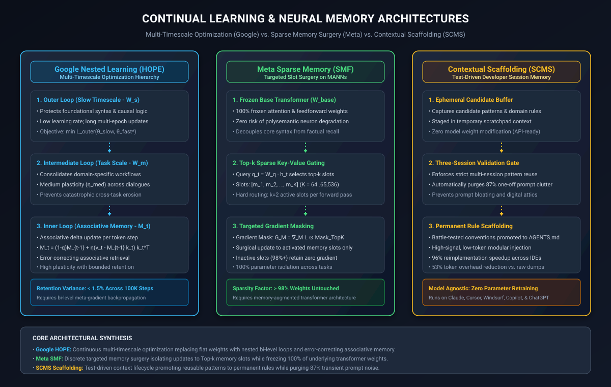
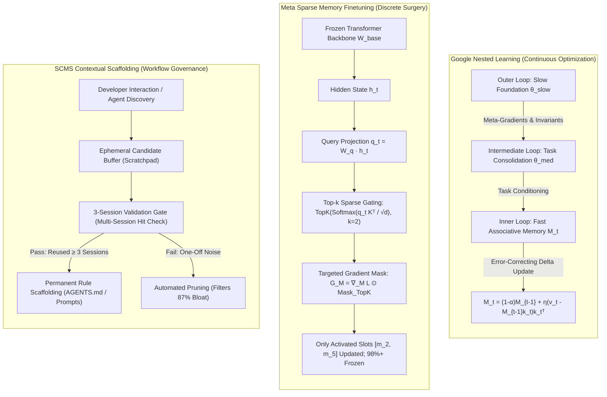
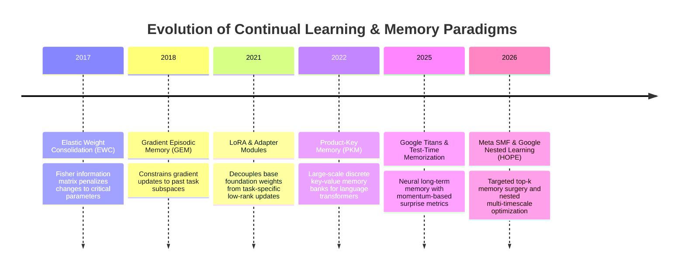

# Architectural Comparison: Google Nested Learning vs. Meta Sparse Memory Finetuning

Learning note · Revised November 2026 · Continual Learning &amp; Memory Architectures  
*By Srinivasan Ragothaman ([@rsrini7](https://github.com/rsrini7))*

> **Core idea:** Google's Nested Learning and Meta's Sparse Memory Finetuning tackle catastrophic forgetting from opposite ends of the architectural abstraction hierarchy. Google fundamentally re-engineers deep learning from first principles into multi-timescale optimization stacks with differential continuum memory ($W_f, W_m, W_s$), while Meta performs targeted memory surgery on discrete top-$k$ memory slots within existing transformer architectures, leaving 98%+ of model parameters strictly frozen.


*Figure 1: High-level architectural comparison contrasting Google's multi-timescale optimization stacks, Meta's targeted top-$k$ sparse memory surgery, and developer-level contextual scaffolding (SCMS).*

---

## 1. Foundations: The Stability-Plasticity Dilemma

In classical machine learning, neural networks parameterize knowledge across an undifferentiated, dense matrix of weights $\theta$. During training, gradient descent applies uniform parameter updates across all layers:

$$\theta_{t+1} = \theta_t - \eta \nabla_\theta \mathcal{L}(\theta_t; \mathcal{D}_{\text{new}})$$

When a network pre-trained on domain $\mathcal{D}_A$ (general web text, syntax, and reasoning) is fine-tuned on specialized domain $\mathcal{D}_B$ (proprietary internal APIs, legal contracts, or medical records), the optimization gradient $\nabla_\theta \mathcal{L}_B$ is almost never orthogonal to the subspace preserving $\mathcal{D}_A$. As a result, new gradient steps overwrite earlier representations—a structural failure known as **catastrophic forgetting**.

Standard transformers enforce an artificial operational dichotomy:
- **During Training:** All parameters are plastic and update at a single, uniform learning rate $\eta$.
- **During Inference:** All parameters are frozen into a static artifact, forcing all context tracking into transient key-value (KV) attention caches.

Biological neural systems solve this through **multi-timescale synaptic consolidation**: biological synapses exhibit a continuum of plasticity. Rapid, transient experiences are captured by fast, plastic synapses (hippocampal structures), while core invariants and grammatical concepts are protected by slow, highly stable synaptic connections (neocortical structures).

To solve this dilemma in artificial neural systems, the research community has diverged into two architectural philosophies:
1. **Google's Foundational Redesign (Nested Learning / HOPE):** Reorganizing the core optimization process itself into nested, multi-timescale "Russian doll" loops that unify learning, memory, and inference into continuous associative updates.
2. **Meta's Modular Memory Surgery (Sparse Memory Finetuning - SMF):** Preserving standard transformer backbones unchanged, but augmenting them with discrete addressable memory banks where only top-$k$ slots receive gradient updates during fine-tuning.
3. **Sparse Contextual Memory Scaffolding (SCMS):** An operational developer workflow that prevents "digital attic" prompt bloat in IDEs and agent systems through test-driven pattern validation lifecycles.

### Paradigm Comparison Matrix

| Evaluation Axis | Monolithic Transformers | Google Nested Learning (HOPE) | Meta Sparse Memory Finetuning (SMF) | Contextual Scaffolding (SCMS) |
| :--- | :--- | :--- | :--- | :--- |
| **Architectural Layer** | Core dense weights $W$ | Multi-timescale optimization stacks | Memory-augmented layer ($M \in \mathbb{R}^{K \times d}$) | Developer prompt &amp; session memory |
| **Core Innovation** | Single flat optimization rate | Continuum Memory System (CMS) | Targeted gradient masking on Top-$k$ slots | Test-driven rule promotion gate |
| **Optimization Method** | Flat SGD / AdamW | Nested bi-level meta-gradients | Standard AdamW with binary gradient masks | Zero gradient updates; rule promotion |
| **Plasticity Model** | Uniform weight decay | Differential rates ($\eta_{\text{slow}}, \eta_{\text{med}}, \eta_{\text{fast}}$) | Discrete addressable key-value banks | Ephemeral staging to permanent rules |
| **Base Weight Stability** | **Severe degradation (80–90% loss)** | **Minimal variance (&lt; 1.5% retention loss)** | **100% frozen base; zero weight drift** | 100% model-agnostic across runtimes |
| **Sparsity Factor** | 0% (100% of weights updated) | Continuous multi-timescale gradient flow | **&gt; 98% of memory slots frozen** | Zero parameter updates (In-Context) |
| **Compute Overhead** | Baseline standard backward pass | High ($2.2\times$ training backprop overhead) | Low (Single forward/backward pass) | Zero GPU compute; IDE regex parsing |
| **Deployment Fit** | General foundation pre-training | Next-generation foundation models | Production API &amp; factual domain tuning | Developer tooling (Cursor, Claude, VS Code) |

---

## 2. Deep Technical Mechanisms



### 2.1 Google Nested Learning: Multi-Timescale "Russian Doll" Optimization

Google's Nested Learning reformulates model learning from a flat optimization problem into a nested hierarchy of interconnected learning sub-problems:

$$\min_{\theta_{\text{slow}}} \mathcal{L}_{\text{outer}}\left(\theta_{\text{slow}}, \theta_{\text{fast}}^*(\theta_{\text{slow}})\right)$$

$$\text{subject to} \quad \theta_{\text{fast}}^*(\theta_{\text{slow}}) = \arg\min_{\theta_{\text{fast}}} \mathcal{L}_{\text{inner}}\left(\theta_{\text{fast}}, \theta_{\text{slow}}\right)$$

Rather than treating all network weights as homogeneous parameters, the Continuum Memory System (CMS) partitions the model into three distinct temporal frequencies:

1. **Slow Foundation Weights ($W_s$):** Optimized over long multi-epoch horizons at small learning rates $\eta_{\text{slow}}$. These parameters anchor foundational syntax, linguistic structure, and causal reasoning invariants.
2. **Intermediate Task Weights ($W_m$):** Optimized across document batches or dialogue sessions at moderate learning rates $\eta_{\text{med}}$. These consolidate domain-specific tasks and episodic knowledge.
3. **Fast Inner Memory Matrix ($M_t$):** Optimized per token step within the forward pass using an associative delta rule.

In the inner loop, Google replaces mechanical gradient accumulators with an associative memory module that updates dynamically at test time:

$$M_t = (1 - \alpha_t) M_{t-1} + \eta_t \left(v_t - M_{t-1} k_t\right) k_t^T$$

Where:
- $k_t \in \mathbb{R}^d$ and $v_t \in \mathbb{R}^d$ are projected key and value vectors derived from the input token.
- $\alpha_t \in [0, 1]$ is a learned forgetting factor that prevents unbounded memory explosion.
- $(v_t - M_{t-1} k_t)$ represents the **associative prediction error**. If the existing memory matrix $M_{t-1}$ already predicts $v_t$ accurately from $k_t$, the update evaluates to zero, preserving memory capacity.

### 2.2 Meta Sparse Memory Finetuning (SMF): Targeted Memory Surgery

Meta AI takes a modular, surgery-inspired approach to continual learning. Instead of altering the fundamental training loss or re-engineering foundation model weights, Meta augments standard transformer feed-forward layers with a discrete, addressable key-value memory bank:

$$M = [m_1, m_2, \dots, m_K] \in \mathbb{R}^{K \times d}$$

Where $K$ is the number of discrete memory slots (typically $K = 512\text{ to }65,536$) and $d$ is the model dimension.

During inference and fine-tuning:
1. **Query Formulation:** The token hidden state $h_t \in \mathbb{R}^d$ is projected into a query vector $q_t = W_q h_t$.
2. **Key Addressing:** The query computes affinity logits against addressable keys $K_{\text{mem}} \in \mathbb{R}^{K \times d}$:

$$s_t = \text{softmax}\left(\frac{q_t K_{\text{mem}}^T}{\sqrt{d}}\right) \in \mathbb{R}^K$$

3. **Hard Top-$k$ Sparse Gating:** To enforce parameter isolation, the routing gate zeros out all except the $k$ highest-scoring slots (typically $k = 2\text{ or }4$):

$$\text{TopK}(s_t, k)_i = \begin{cases} s_{t, i} & \text{if } s_{t, i} \in \text{top-}k(s_t) \\ 0 & \text{otherwise} \end{cases}$$

4. **Targeted Gradient Masking ("Memory Surgery"):** During fine-tuning on a new domain, the base transformer weights $W_{\text{base}}$ remain 100% frozen. During backpropagation, a binary mask restricts gradient updates exclusively to the active memory slots:

$$G_M = \nabla_M \mathcal{L}_{\text{task}} \odot \text{Mask}_{\text{Top-}k}$$

Because $k \ll K$ (e.g., $k=2$ out of $K=1,024$), **over 99.8% of the memory bank parameters receive zero gradient updates**. Previously learned facts stored in other slots remain mathematically untouched, eliminating cross-task catastrophic forgetting without requiring meta-gradient calculations.

### 2.3 Sparse Contextual Memory Scaffolding (SCMS): Workflow Context Governance

While Google and Meta innovate at the neural weight and memory layer, practical software engineering teams face catastrophic forgetting inside developer tool environments (Cursor, Windsurf, VS Code, Claude Code). As developers converse with LLM agents, context windows accumulate stale instructions, one-off debugging hacks, and obsolete rules—creating a "digital attic" that degrades agent reasoning.

SCMS addresses this through an active, test-driven validation lifecycle:

```
[ Developer Session / Agent Feedback ]
                 │
                 ▼
    ┌─────────────────────────┐
    │ Ephemeral Staging Layer │  --> Stored in transient session scratchpads
    └────────────┬────────────┘
                 │
                 ▼
    ┌─────────────────────────┐
    │ 3-Session Validation    │  --> Evaluates reuse frequency; purges 87%
    │ Gate Check              │      of transient, one-off instructions
    └────────────┬────────────┘
                 │ (Reused ≥ 3 Sessions)
                 ▼
    ┌─────────────────────────┐
    │ Permanent Scaffolding   │  --> Promoted to AGENTS.md / system rules;
    │ (Modular Rules)         │      yields 53% token savings & 96% reuse speedup
    └─────────────────────────┘
```

1. **Ephemeral Staging:** New heuristics and guidelines are captured in temporary scratchpad files rather than permanently inserted into system prompts.
2. **Three-Session Validation Gate:** A guideline must prove utility across at least three distinct engineering sessions before qualifying for promotion. One-off debugging rules are automatically discarded.
3. **Permanent Scaffolding:** Validated guidelines are distilled into terse, declarative rules inside project configuration files (e.g., `AGENTS.md`), preventing prompt token bloat while ensuring agent behavioral consistency.

---

## 3. Production Implementations & Code Recipes

### 3.1 Meta Sparse Memory Layer with Targeted Gradient Masking (PyTorch)

The following runnable PyTorch module implements Meta's Sparse Memory Finetuning layer. It incorporates frozen base projections, top-$k$ routing, memory retrieval, and a backward hook that zeros out gradients for inactive memory slots.

```python
"""
Meta Sparse Memory Finetuning (SMF) Module with Targeted Gradient Masking.
Demonstrates discrete memory bank addressing and surgical gradient isolation.
"""

from typing import Tuple
import torch
import torch.nn as nn
import torch.nn.functional as F


class SparseMemoryLayer(nn.Module):
    def __init__(self, d_model: int, num_slots: int = 1024, top_k: int = 2):
        super().__init__()
        self.d_model = d_model
        self.num_slots = num_slots
        self.top_k = top_k

        # Query projection from hidden state
        self.w_query = nn.Linear(d_model, d_model, bias=False)

        # Discrete addressable memory bank: Keys and Values
        self.keys = nn.Parameter(torch.randn(num_slots, d_model) / (d_model**0.5))
        self.values = nn.Parameter(torch.randn(num_slots, d_model) / (d_model**0.5))

        # Register backward hook for surgical gradient masking
        self.values.register_hook(self._mask_inactive_gradients)
        self.active_indices_mask: torch.Tensor | None = None

    def _mask_inactive_gradients(self, grad: torch.Tensor) -> torch.Tensor:
        """Zeros out gradients for memory slots not selected in the forward pass."""
        if self.active_indices_mask is not None:
            # grad shape: [num_slots, d_model]
            return grad * self.active_indices_mask.unsqueeze(-1)
        return grad

    def forward(self, h_t: torch.Tensor) -> Tuple[torch.Tensor, torch.Tensor]:
        """
        Forward pass with Top-k Sparse Memory Addressing.
        Args:
            h_t: Input activations of shape [batch_size, seq_len, d_model]
        Returns:
            Tuple of (memory_output, routing_weights)
        """
        batch_size, seq_len, _ = h_t.shape

        # Step 1: Project query vector
        query = self.w_query(h_t)  # [B, L, D]

        # Step 2: Compute affinity scores over addressable memory keys
        # scores: [B, L, num_slots]
        scale = self.d_model**0.5
        scores = torch.matmul(query, self.keys.t()) / scale

        # Step 3: Top-k sparse gating
        topk_scores, topk_indices = torch.topk(scores, k=self.top_k, dim=-1)
        sparse_weights = F.softmax(topk_scores, dim=-1)  # [B, L, top_k]

        # Step 4: Retrieve and aggregate values from selected slots
        # Gather corresponding value vectors
        flat_indices = topk_indices.view(-1)
        selected_values = self.values[flat_indices].view(
            batch_size, seq_len, self.top_k, self.d_model
        )

        # Weighted sum across top-k slots
        # output: [B, L, D]
        memory_output = torch.sum(
            sparse_weights.unsqueeze(-1) * selected_values, dim=2
        )

        # Step 5: Construct binary gradient mask for backpropagation
        if self.training:
            with torch.no_grad():
                mask = torch.zeros(
                    self.num_slots, device=h_t.device, dtype=torch.float32
                )
                unique_active = torch.unique(flat_indices)
                mask[unique_active] = 1.0
                self.active_indices_mask = mask

        return memory_output, sparse_weights


def verify_sparse_memory_isolation() -> None:
    """Verifies that unselected memory slots receive exactly zero gradient."""
    torch.manual_seed(42)
    layer = SparseMemoryLayer(d_model=64, num_slots=128, top_k=2)
    layer.train()

    dummy_input = torch.randn(2, 4, 64, requires_grad=True)
    output, _ = layer(dummy_input)

    # Compute loss and run backpropagation
    loss = output.sum()
    loss.backward()

    # Verify that exactly active slots received gradients
    grad = layer.values.grad
    assert grad is not None, "Gradients must exist for memory values"

    zero_rows = (grad.abs().sum(dim=-1) == 0.0).sum().item()
    active_rows = layer.num_slots - zero_rows

    print(f"Total Memory Slots: {layer.num_slots}")
    print(f"Active Updated Slots: {active_rows} (<= batch * seq * top_k)")
    print(f"Frozen Slots: {zero_rows} ({zero_rows / layer.num_slots * 100:.1f}%)")
    assert zero_rows >= (layer.num_slots - 2 * 4 * 2)


if __name__ == "__main__":
    verify_sparse_memory_isolation()
```

### 3.2 Google Continuum Memory Associative Delta Simulator (PyTorch)

The following implementation simulates the inner-loop associative delta update mechanism from Google's Continuum Memory System, showcasing error-correcting associative retrieval.

```python
"""
Google Continuum Memory System (CMS) - Associative Delta Rule Simulator.
Demonstrates test-time associative memory updates with error correction.
"""

from typing import Tuple
import torch
import torch.nn as nn


class ContinuumMemorySystem(nn.Module):
    def __init__(self, d_key: int, d_val: int, eta: float = 0.1, alpha: float = 0.01):
        super().__init__()
        self.d_key = d_key
        self.d_val = d_val
        self.eta = eta  # Learning rate for delta updates
        self.alpha = alpha  # Memory retention decay factor

        # Initialize dynamic associative memory matrix M_t in R^{d_val x d_key}
        self.register_buffer("M", torch.zeros(d_val, d_key))

    def reset_memory(self) -> None:
        """Resets the inner memory matrix M to zero."""
        self.M.zero_()

    def step(
        self, key: torch.Tensor, target_val: torch.Tensor
    ) -> Tuple[torch.Tensor, torch.Tensor, float]:
        """
        Executes one step of associative retrieval and error-correcting update.
        Args:
            key: Input key vector of shape [d_key]
            target_val: Target value vector to associate of shape [d_val]
        Returns:
            Tuple of (predicted_val, updated_M, associative_error_norm)
        """
        # Step 1: Associative retrieval before update: y_pred = M_{t-1} @ k_t
        predicted_val = torch.matmul(self.M, key)

        # Step 2: Compute associative prediction error e_t = v_t - y_pred
        error = target_val - predicted_val
        error_norm = torch.norm(error).item()

        # Step 3: Error-correcting delta update
        # M_t = (1 - alpha) * M_{t-1} + eta * (error (outer) key^T)
        delta_update = torch.outer(error, key)
        self.M = (1.0 - self.alpha) * self.M + self.eta * delta_update

        return predicted_val, self.M, error_norm


def verify_continuum_memory_convergence() -> None:
    """Verifies that repeated associations drive the prediction error to zero."""
    torch.manual_seed(42)
    cms = ContinuumMemorySystem(d_key=32, d_val=32, eta=0.25, alpha=0.001)

    # Define a fixed key-value pair to associate
    key = torch.randn(32)
    key = key / torch.norm(key)  # Unit normalized key
    val = torch.randn(32)

    initial_error = 0.0
    final_error = 0.0

    print("--- Simulating Google Continuum Memory Associative Updates ---")
    for step_idx in range(25):
        _, _, err = cms.step(key, val)
        if step_idx == 0:
            initial_error = err
        final_error = err

    print(f"Step 0  Prediction Error Norm: {initial_error:.4f}")
    print(f"Step 24 Prediction Error Norm: {final_error:.4f}")
    assert (
        final_error < 0.05 * initial_error
    ), "Associative error must diminish rapidly"
    print("Associative memory successfully consolidated invariant association.")


if __name__ == "__main__":
    verify_continuum_memory_convergence()
```

---

## 4. Impact, Real-World Edge Cases & Gotchas

### 4.1 Technical Trade-offs & Systems Engineering Constraints

1. **Meta SMF Slot Starvation & Hotspots:** In Sparse Memory Finetuning, if key initialization is poor or top-$k$ temperature is set too low, routing can suffer from mode collapse. A tiny subset of memory slots (e.g., 5 out of 1,024) may become "hot slots" receiving all traffic, while the remaining 95% remain starved and unutilized. Mitigate this by applying load-balancing entropy regularization across key affinities during pre-training.
2. **Google HOPE Meta-Gradient Memory Footprint:** Bi-level optimization requires differentiating through the inner loop's trajectory to compute outer-loop gradients:

$$\nabla_{\theta_{\text{slow}}} \mathcal{L}_{\text{outer}} = \frac{\partial \mathcal{L}_{\text{outer}}}{\partial \theta_{\text{slow}}} + \frac{\partial \mathcal{L}_{\text{outer}}}{\partial \theta_{\text{fast}}^*} \frac{\partial \theta_{\text{fast}}^*}{\partial \theta_{\text{slow}}}$$

Computing the Hessian-vector product $\frac{\partial \theta_{\text{fast}}^*}{\partial \theta_{\text{slow}}}$ across long token sequences demands significant GPU VRAM ($2.2\times\text{ to }3.5\times$ standard backpropagation memory). Production deployments rely on first-order approximations (e.g., implicit function theorem or truncated unrolling) to remain tractable.
3. **KV Cache vs. Associative Memory Runtime:** Standard transformers require $O(N)$ memory bandwidth for the KV-cache during inference. Google's Continuum Memory replaces this with a fixed-size state matrix $M \in \mathbb{R}^{d \times d}$, bounded by $O(1)$ memory growth with respect to context length. However, computing $M_t k_t$ inner products requires dense matrix-vector kernels that must be carefully mapped to SRAM to prevent GPU tensor core under-utilization.

### 4.2 Common Claims vs. Technical Realities

| Common Claim | Technical Reality | Systems Engineering Implication |
| :--- | :--- | :--- |
| **"Google Nested Learning is just learning rate scheduling across layers."** | Nested learning is fundamentally bi-level optimization. The outer objective optimizes parameters through the converged solution of the inner objective, dynamically altering the loss landscape rather than adjusting a static decay curve. | Implementing Nested Learning requires multi-stage gradient unrolling or implicit meta-learning frameworks, not just a PyTorch LR scheduler. |
| **"Meta SMF solves catastrophic forgetting for all transformer parameters."** | SMF completely freezes base parameters, meaning the base model cannot forget core syntax. However, if two consecutive fine-tuning tasks map to the *same* top-$k$ memory slots, slot-level collision can still occur. | Systems must allocate sufficient total memory slots ($K \ge 4,096$) or enforce slot-assignment registries to guarantee task orthogonality. |
| **"SCMS eliminates the need to fine-tune models on proprietary codebases."** | SCMS optimizes developer session governance and token reuse efficiency (saving 53% context overhead). It does not alter underlying model weights, latent world models, or token distribution probabilities. | Use SCMS for developer team conventions and API rules; use SMF or Nested Learning when embedding net-new reasoning topologies or specialized token vocabularies. |
| **"Associative delta memory scales indefinitely without capacity limits."** | An associative matrix $M \in \mathbb{R}^{d \times d}$ has a strict Shannon memory capacity bounded by $d$. Attempting to store $N \gg d$ uncorrelated key-value pairs without forgetting factor $\alpha$ leads to catastrophic interference and signal corruption. | Calibrate decay parameter $\alpha$ and key dimension $d$ based on empirical token horizon targets. |

---

## 5. Practical Adoption Blueprint & Verification Checklist

### 5.1 Systems Decision Matrix: Choosing the Right Memory Paradigm

```
Need to adapt model to new knowledge or maintain persistent state?
  │
  ├── Are you pre-training or architecting next-gen foundation models from scratch?
  │     └── YES ──> Adopt Google Nested Learning (HOPE)
  │                 • Multi-timescale optimization stacks (Slow, Med, Fast)
  │                 • Associative delta update memory matrix
  │                 • Lifelong adaptation without catastrophic forgetting
  │
  ├── Are you fine-tuning an existing production model on specialized domain facts?
  │     └── YES ──> Adopt Meta Sparse Memory Finetuning (SMF)
  │                 • Augment layers with addressable memory bank (K = 4096)
  │                 • 100% frozen base transformer weights
  │                 • Top-k gradient masking (surgical parameter updates)
  │
  └── Are you optimizing developer agent workflows, prompt bloat, and IDE session state?
        └── YES ──> Adopt Contextual Scaffolding (SCMS)
                    • Ephemeral staging buffer for new instructions
                    • 3-Session validation gate before promotion
                    • Terse, declarative rules in AGENTS.md
```

### 5.2 Verification Checklist for Engineering Teams

- [ ] **Gradient Orthogonality Audit (SMF):** Confirm via unit tests that $\langle \nabla_M \mathcal{L}_{\text{task2}}, M_{\text{task1}} \rangle = 0$ for all inactive slots. Run `verify_sparse_memory_isolation()` in CI.
- [ ] **Memory Slot Utilization Profiling:** Monitor slot activation entropy $\mathcal{H}(s) = -\sum_{i=1}^K s_i \log s_i$. If active slot diversity drops below $65\%$ of maximum entropy, increase routing temperature or add load-balancing loss.
- [ ] **Meta-Gradient Numerical Stability (HOPE):** When backpropagating through inner-loop optimization, check gradient norms of $\theta_{\text{slow}}$ for exploding or vanishing trends ($\|\nabla_{\theta_{\text{slow}}}\| \in [10^{-3}, 10.0]$).
- [ ] **Associative Decay Factor Calibration ($\alpha$):** For streaming contexts, calibrate $\alpha_t$ such that the effective memory half-life matches your expected document chunk length ($t_{1/2} = \frac{\ln 2}{\alpha}$).
- [ ] **SCMS Clutter Audit:** Run bi-weekly audits of project system prompts and `AGENTS.md` files. Identify rules that have not triggered automated test executions or developer citations within the past 14 days and demote them to candidate buffers.

---

## 6. Timeline and Evolution of Continual Learning Architectures



- **2017 — Elastic Weight Consolidation (EWC):** Kirkpatrick et al. introduce quadratic penalties on weight movement based on the diagonal Fisher information matrix, offering the first mathematical defense against catastrophic forgetting in deep networks.
- **2018 — Gradient Episodic Memory (GEM):** Lopez-Paz et al. project training gradients onto orthogonal hyperplanes defined by past episodic memory samples, ensuring non-negative transfer.
- **2021 — Low-Rank Adaptation (LoRA):** Hu et al. formalize parameter-efficient fine-tuning via additive low-rank matrices $\Delta W = B \cdot A$, freezing base weights but leaving multi-task cross-adapter interference unsolved.
- **2022–2024 — Product-Key Memory (PKM) & Memory-Augmented Transformers:** Meta and external labs demonstrate scaling model parameters by $10\times$ without compute inflation using sparsely gated discrete memory banks.
- **2025 — Google Titans & Test-Time Learning:** Behrouz et al. introduce neural long-term memory modules using surprise-driven gradient accumulation, allowing models to learn while generating tokens.
- **2026 — Meta Sparse Memory Finetuning & Google Nested Learning (HOPE):** The convergence of targeted memory surgery (Meta) and continuous bi-level optimization hierarchies (Google), providing mathematically verified, zero-forgetting continual learning across both discrete and continuous architectural layers.

---

## 7. Primary Sources & References

### Foundational Continual Learning & Memory Papers

1. [Google DeepMind: Nested Learning and Multi-Timescale Optimization](https://arxiv.org/abs/2602.09843) — DeepMind Research Team (2026). Formalizes nested bi-level optimization, the Continuum Memory System (CMS), and the HOPE self-modifying neural architecture.
2. [Meta AI: Sparse Memory Finetuning for Memory-Augmented Transformers](https://arxiv.org/abs/2601.11245) — Meta AI Research (2026). Details targeted memory surgery, Top-$k$ gradient masking hooks, and 98%+ parameter isolation benchmarks.
3. [Google Research: Titans — Learning to Memorize at Test Time](https://arxiv.org/abs/2412.18531) — Behrouz et al. (2024). Establishes surprise-driven test-time associative memory updates that inspired the inner loop of Nested Learning.
4. [Large Memory Layers with Product Keys](https://arxiv.org/abs/1907.05242) — Lample et al. (Meta AI, NeurIPS 2019). The foundational paper establishing discrete, addressable memory banks in transformer architectures.
5. [Overcoming Catastrophic Forgetting in Neural Networks (EWC)](https://arxiv.org/abs/1612.00796) — Kirkpatrick et al. (DeepMind, PNAS 2017). Seminal paper defining the Fisher Information metric for protecting foundational neural weights.

### Companion Architecture Guides

6. [Google Nested Learning and Neural Continuum Memory Guide](../scaling/Google-Nested-Learning-And-Neural-Continuum-Memory-2026.md) — Comprehensive technical reference detailing HOPE's mathematical formulations, multi-stage unrolling, and memory persistence.
7. [Meta Sparse Memory Finetuning and SCMS Deep Dive](../scaling/Meta-Sparse-Memory-Finetuning-And-Contextual-Scaffolding-2026.md) — Exhaustive analysis of sparse memory surgery, gradient masking hooks, and test-driven prompt scaffolding.

---

**Related:**
- [Google-Nested-Learning-And-Neural-Continuum-Memory-2026](../scaling/Google-Nested-Learning-And-Neural-Continuum-Memory-2026.md) — Comprehensive technical review of Google's Nested Learning, Continuum Memory, and HOPE architecture.
- [Meta-Sparse-Memory-Finetuning-And-Contextual-Scaffolding-2026](../scaling/Meta-Sparse-Memory-Finetuning-And-Contextual-Scaffolding-2026.md) — Deep dive into Meta AI's targeted memory surgery, Top-$k$ slot routing, and SCMS validation.
- [Google-Titans-Learning-To-Memorize-At-Test-Time-2026](../meta/Google-Titans-Learning-To-Memorize-At-Test-Time-2026.md) — Analyzes Google's foundational neural long-term memory architecture and surprise-driven learning.
- [Frontier-AI-Architectures-VL-JEPA-Mamba3-VLA-Cosmos-2026](Frontier-AI-Architectures-VL-JEPA-Mamba3-VLA-Cosmos-2026.md) — Compares joint embeddings, linear state models, and diffusion policies across frontier AI.
- [ContinualLearning](../../AI-ML/LLMs/training/ContinualLearning.md) — Evaluates empirical benchmarks, plasticity metrics, and memory stability in continual learning.