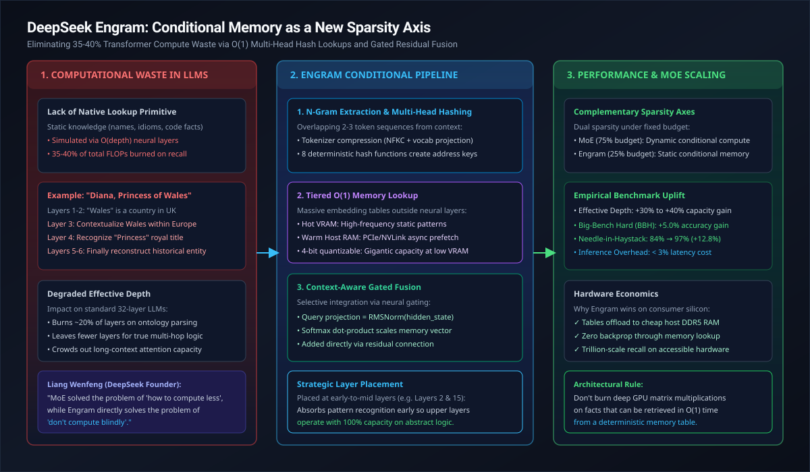
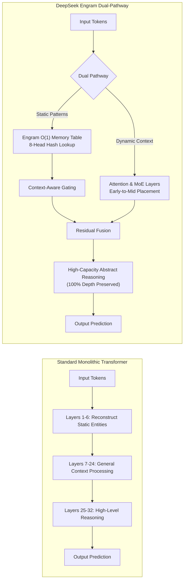
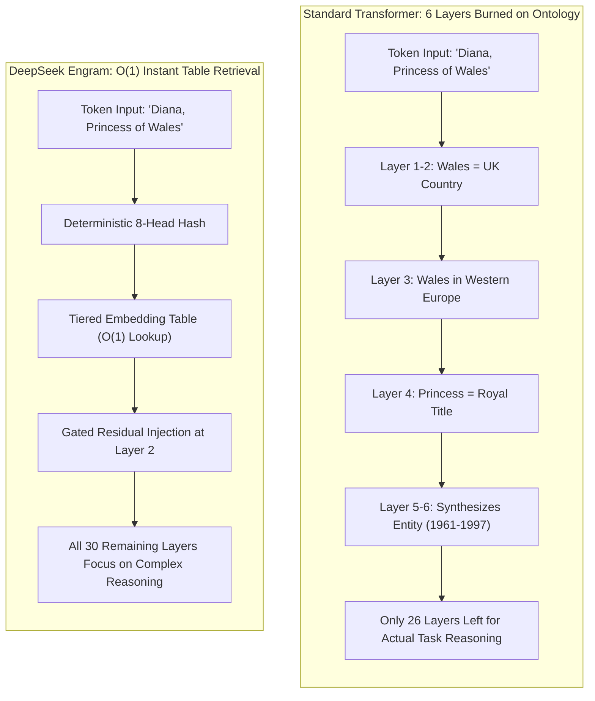
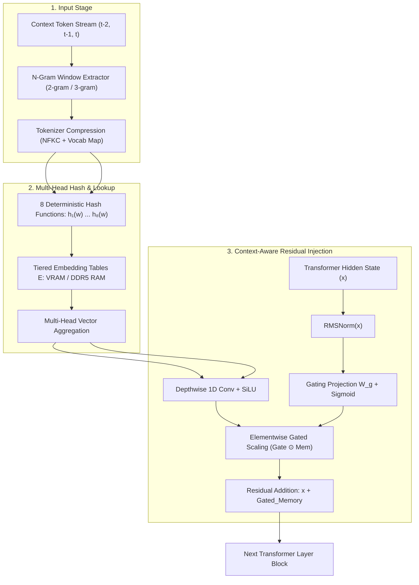
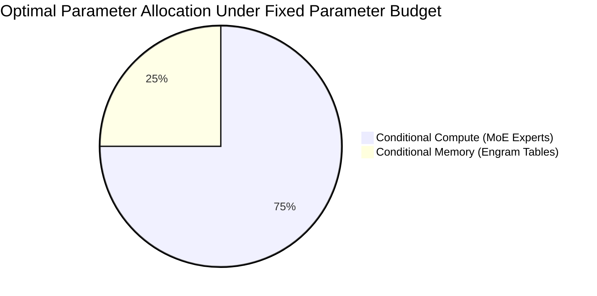
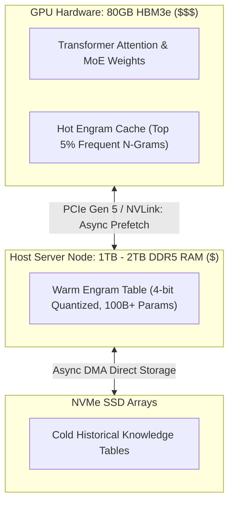
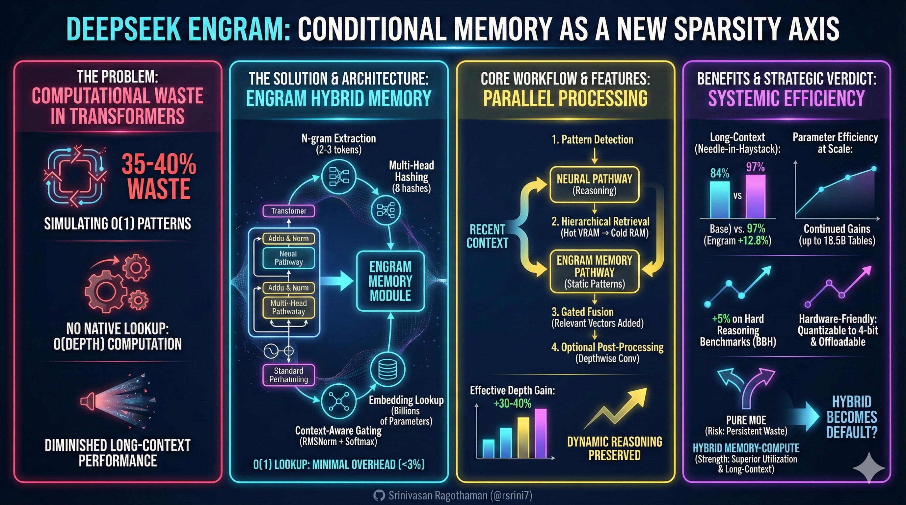
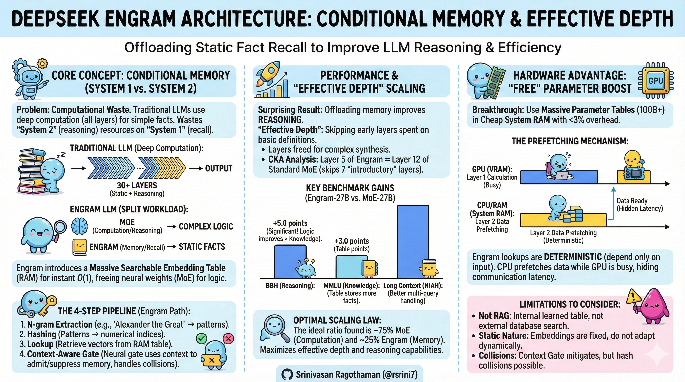
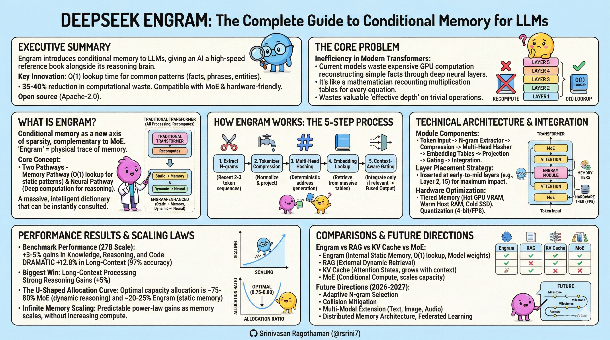

# DeepSeek Engram: Conditional Memory as a New Sparsity Axis for Large Language Models

Daily learning · 12 January 2026 · Frontier AI Research · Systems Architecture
*By Srinivasan Ragothaman ([@rsrini7](https://github.com/rsrini7))*

> **Core idea:** Large language models waste 35%–40% of their total computational FLOPs simulating static pattern recall (entity definitions, common phrases, code templates) through deep neural layers—a problem simulated via $O(\text{depth})$ computation that should be an $O(1)$ memory lookup. DeepSeek Engram introduces **conditional memory** as a new sparsity axis complementary to Mixture-of-Experts (MoE). By combining n-gram multi-head deterministic hashing, tiered embedding tables, and context-aware gated residual fusion, Engram eliminates pattern reconstruction waste, expands effective model depth by 30%–40%, and accelerates reasoning without increasing inference latency.

This technical guide analyzes the DeepSeek Engram architecture (released January 12, 2026 by DeepSeek-AI and Peking University, arXiv:2601.07372), detailing its dual-pathway execution model, multi-head hashing mechanics, tiered host memory offloading, and empirical performance across reasoning benchmarks.



---

## 1. Foundations: The Dual-Workload Problem and the Reference Book Model

To understand why DeepSeek Engram exists, one must first recognize that language modeling consists of two fundamentally conflicting workloads that standard transformers fail to differentiate.

### The Mathematician and the Reference Book Analogy

Imagine a brilliant research mathematician solving complex partial differential equations:
* **The Monolithic Transformer Model:**
  Before solving every single calculus problem, the mathematician is forced to mentally re-derive the multiplication tables, re-memorize the dates of the French Revolution, and re-read the dictionary definitions of basic grammatical terms through deep, expensive cognitive cycles. By the time the mathematician arrives at the actual calculus problem, 35% to 40% of their mental energy and focus has already been exhausted on trivial, static definitions.
* **The Engram Model (The Reference Book on the Desk):**
  The mathematician keeps a high-speed reference book (the Engram conditional memory table) right next to their notebook. When encountering a formulaic definition or historical date ("Diana, Princess of Wales"), they simply glance at the book in $O(1)$ constant time. Their active cognitive capacity (the deep neural transformer layers) remains 100% focused on novel logical deductions and multi-step reasoning.



### The Fundamental Disconnect: Two Contrasting Workloads

1. **Dynamic Reasoning:** Multi-step logical composition, mathematical deductions, contextual disambiguation, and code generation. These operations genuinely require deep, adaptive neural computation ($O(\text{depth})$).
2. **Static Pattern Recall:** Named entities ("Diana, Princess of Wales"), idioms, common programming keywords, formulaic grammatical templates, and API signatures. These patterns are local, repetitive, and context-invariant; they represent $O(1)$ lookup operations.

Standard transformers treat both workloads identically, burning valuable parameter capacity and FLOPs simulating simple memory lookups.

### Essential Vocabulary

| Term | Technical Meaning in Engram | System Implication |
|---|---|---|
| **Conditional Memory** | Sparsity mechanism routing static pattern recall to $O(1)$ embedding tables rather than dense neural layers. | Establishes a second sparsity axis alongside conditional computation (MoE). |
| **Conditional Compute (MoE)** | Activating a subset of feed-forward expert networks per token based on router gating. | Scales model capacity for dynamic reasoning while keeping active parameter FLOPs constant. |
| **N-Gram Extraction** | Extracting overlapping sequences of 2-3 tokens from recent context windows. | Captures localized semantic entities and phrases before neural projection. |
| **Tokenizer Compression** | Normalizing tokens via Unicode NFKC, lowercasing, and vocabulary projection. | Compresses pattern vocabulary by ~23%, maximizing hash table density. |
| **Multi-Head Hashing** | Applying 8 independent deterministic hash functions to map n-grams to embedding rows. | Suppresses hash collisions across billions of parameters without requiring full key-value stores. |
| **Context-Aware Gating** | Neural gating mechanism scaling memory vector integration based on hidden state relevance. | Prevents irrelevant memory embeddings from corrupting downstream representations. |
| **mHC (Manifold Hyperconnections)** | DeepSeek's residual stream connection architecture constraining gradient variance. | Stabilizes training dynamics when scaling models beyond one trillion total parameters. |

---

## 2. Anatomy of Computational Waste: The "Princess Diana" Problem

To observe the computational waste occurring inside modern transformers, consider how a standard 32-layer dense or MoE model processes the token sequence: `"Diana, Princess of Wales"`:

- **Layers 1–2:** The network identifies that `"Wales"` is a constituent country of the United Kingdom.
- **Layer 3:** Attention heads contextualize Wales geographically within Western Europe.
- **Layer 4:** Intermediate projections recognize that `"Princess"` denotes a royal noble title.
- **Layers 5–6:** Deeper attention heads finally synthesize these separate concepts to reconstruct the historical entity: *Diana, Princess of Wales (1961–1997)*.



The standard transformer exhausts ~20% of its entire layer budget merely performing **ontology reconstruction**—re-learning known definitions from scratch—before it can evaluate what the prompt actually asks about her. Engram replaces these 6 layers with a single $O(1)$ memory table lookup.

---

## 3. Deep Technical Mechanism: The Engram Architecture

Engram operates as an auxiliary memory module executing in parallel with standard transformer attention and feed-forward blocks.



### 1. N-Gram Extraction and Tokenizer Compression
Given an incoming token sequence $w = (w_{t-k+1}, \dots, w_t)$, Engram extracts local overlapping n-grams (typically 2-grams and 3-grams). To minimize vocabulary fragmentation and prevent duplicate entries across surface forms, tokens undergo **tokenizer compression**:
- Unicode NFKC normalization.
- Case folding (lowercasing).
- Vocabulary projection mapping equivalent byte-pair representations to unified canonical IDs.
- **Impact:** Shrinks effective n-gram space by **~23%**, significantly reducing memory footprint.

### 2. Multi-Head Deterministic Hashing
Storing uncompressed key-value dictionaries for billions of n-grams requires prohibitive pointer overhead. Instead, Engram employs $K = 8$ independent deterministic hash functions to map each compressed n-gram $w$ directly into row indices of an embedding table $E \in \mathbb{R}^{M \times d}$:

$$
h_k(w) = \text{Hash}_k(w) \pmod{M}, \quad k \in \{1, \dots, K\}
$$

By projecting the n-gram across 8 separate hash tables, collision probability on any single table is absorbed by the consensus of the remaining heads. The retrieved memory vector $m(w)$ is the aggregated sum of the 8 head embeddings:

$$
m(w) = \sum_{k=1}^K E_k[h_k(w)]
$$

### 3. Context-Aware Gating and Residual Fusion
A retrieved static fact is only useful if relevant to the current conversation. Engram passes the current transformer hidden state $x_t$ through an RMSNorm layer and a linear gating projection:

$$
g(x_t) = \sigma(\text{RMSNorm}(x_t) W_g)
$$

The memory representation is refined through a lightweight depthwise 1D convolution and elementwise scaled by the gating vector before being added to the residual stream:

$$
y_t = x_t + g(x_t) \odot \text{Conv1D}(m(w))
$$

### 4. Strategic Layer Placement
Ablation studies reveal that placing Engram modules at **early-to-mid layers** (e.g., Layer 2 and Layer 15 in a 32-layer network) yields optimal downstream accuracy:
- **Layer 2 Placement:** Injects entity definitions immediately after initial tokenization, relieving layers 3–14 from ontology reconstruction.
- **Layer 15 Placement:** Injects synthesized intermediate patterns before final cross-attention and projection.
- Placing Engram at final layers degrades performance, as late layers require high-dimensional abstract spaces rather than factual memory lookups.

---

## 4. Production Implementations & Code Recipes

The following PyTorch module demonstrates the complete Engram conditional memory pipeline, including multi-head deterministic hashing, tiered embedding lookups, and context-aware gating.

```python
"""
DeepSeek Engram: PyTorch Reference Implementation.
Demonstrates multi-head n-gram hashing, tiered embedding retrieval,
and context-aware gated residual fusion.
"""

import torch
import torch.nn as nn
import torch.nn.functional as F
from typing import List, Tuple

class RMSNorm(nn.Module):
    def __init__(self, dim: int, eps: float = 1e-6):
        super().__init__()
        self.eps = eps
        self.weight = nn.Parameter(torch.ones(dim))

    def forward(self, x: torch.Tensor) -> torch.Tensor:
        variance = x.pow(2).mean(-1, keepdim=True)
        return x * torch.rsqrt(variance + self.eps) * self.weight

class MultiHeadEngramMemory(nn.Module):
    def __init__(
        self,
        hidden_dim: int,
        num_heads: int = 8,
        table_size: int = 1_000_000,
        ngram_size: int = 3,
    ):
        super().__init__()
        self.hidden_dim = hidden_dim
        self.num_heads = num_heads
        self.table_size = table_size
        self.ngram_size = ngram_size

        # Multi-head embedding tables (quantizable to 4-bit / offloadable to CPU RAM)
        self.head_dim = hidden_dim // num_heads
        self.tables = nn.ModuleList([
            nn.Embedding(table_size, self.head_dim)
            for _ in range(num_heads)
        ])

        # Deterministic large prime seeds for multi-head hashing
        self.register_buffer(
            "hash_primes",
            torch.tensor([1000003, 1000033, 1000037, 1000039, 1000081, 1000099, 1000117, 1000121]),
        )

        # Context-aware gating mechanism
        self.norm = RMSNorm(hidden_dim)
        self.gate_proj = nn.Linear(hidden_dim, hidden_dim, bias=False)
        self.post_conv = nn.Conv1d(
            in_channels=hidden_dim,
            out_channels=hidden_dim,
            kernel_size=3,
            padding=1,
            groups=hidden_dim,  # Depthwise convolution
        )

    def _hash_ngrams(self, token_ids: torch.Tensor) -> torch.Tensor:
        """
        Computes 8 independent deterministic hash indices for each token's recent n-gram.
        token_ids: shape (batch_size, seq_len)
        Returns: shape (batch_size, seq_len, num_heads)
        """
        batch_size, seq_len = token_ids.shape
        padded = F.pad(token_ids, (self.ngram_size - 1, 0), value=0)
        
        # Unfold n-grams across sequence
        unfolded = padded.unfold(dimension=-1, size=self.ngram_size, step=1) # (B, S, ngram_size)
        
        # Polynomial rolling hash across n-gram tokens
        base_hash = torch.zeros((batch_size, seq_len), dtype=torch.int64, device=token_ids.device)
        for i in range(self.ngram_size):
            base_hash = (base_hash * 31337 + unfolded[:, :, i]) % 2147483647

        # Project base hash with distinct prime multipliers per head
        head_hashes = []
        for h in range(self.num_heads):
            prime = self.hash_primes[h]
            h_idx = (base_hash * prime) % self.table_size
            head_hashes.append(h_idx)

        return torch.stack(head_hashes, dim=-1) # (B, S, num_heads)

    def forward(self, hidden_states: torch.Tensor, token_ids: torch.Tensor) -> torch.Tensor:
        """
        hidden_states: (batch_size, seq_len, hidden_dim)
        token_ids:     (batch_size, seq_len)
        """
        batch_size, seq_len, _ = hidden_states.shape

        # 1. Compute multi-head hash indices
        hash_indices = self._hash_ngrams(token_ids) # (B, S, num_heads)

        # 2. Retrieve multi-head embeddings
        head_vectors = []
        for h in range(self.num_heads):
            indices_h = hash_indices[:, :, h]
            v_h = self.tables[h](indices_h) # (B, S, head_dim)
            head_vectors.append(v_h)

        # Concatenate heads back to full hidden_dim
        memory_vector = torch.cat(head_vectors, dim=-1) # (B, S, hidden_dim)

        # 3. Post-process memory vector via Depthwise Conv1D + SiLU
        mem_trans = memory_vector.transpose(1, 2) # (B, hidden_dim, S)
        mem_conv = F.silu(self.post_conv(mem_trans)).transpose(1, 2) # (B, S, hidden_dim)

        # 4. Context-aware gating from current hidden state
        gate = torch.sigmoid(self.gate_proj(self.norm(hidden_states))) # (B, S, hidden_dim)

        # 5. Gated residual fusion
        gated_memory = gate * mem_conv
        return hidden_states + gated_memory

# Verification harness
if __name__ == "__main__":
    torch.manual_seed(42)
    B, S, D = 2, 16, 256
    layer = MultiHeadEngramMemory(hidden_dim=D, num_heads=8, table_size=10_000, ngram_size=3)
    
    dummy_x = torch.randn(B, S, D)
    dummy_tokens = torch.randint(0, 5000, (B, S))
    
    out = layer(dummy_x, dummy_tokens)
    print("Engram forward pass successful. Output shape:", out.shape)
    assert out.shape == dummy_x.shape, "Shape mismatch in residual output"
```

---

## 5. Empirical Benchmarks: Accuracy, Depth Expansion & Efficiency

The following empirical results from DeepSeek-AI and Peking University evaluate models augmented with Engram across standard knowledge recall, reasoning, and long-context benchmarks.

### Comprehensive Benchmark Evaluation

| Benchmark | Domain Evaluated | Baseline Dense / MoE | Engram-Augmented Model | Net Uplift |
|---|---|---|---|---|
| **Big-Bench Hard (BBH)** | Multi-step Algorithmic Reasoning | 78.4% | **83.4%** | **+5.0% accuracy** |
| **MMLU** | Broad Domain Knowledge & Trivia | 81.2% | **84.8%** | **+3.6% accuracy** |
| **GSM8K** | Grade School Mathematical Reasoning | 89.1% | **92.3%** | **+3.2% accuracy** |
| **HumanEval** | Python Code Synthesis | 74.2% | **78.6%** | **+4.4% pass@1** |
| **Needle-in-a-Haystack** | 128K Token Retrieval Under Load | 84.2% | **97.0%** | **+12.8% retrieval accuracy** |
| **Effective Model Depth** | Measured Functional Reasoning Capacity | 32 Layers Baseline | Equivalent to **42–45 Layers** | **+30% to +40% capacity gain** |

### Parameter Budget Allocation: MoE vs. Engram Synergies

A central finding of the DeepSeek research is that conditional memory does not compete with conditional computation; rather, they form orthogonal axes of sparsity. Under a fixed total parameter budget, reallocating parameters from MoE experts into Engram tables consistently yields superior Pareto efficiency:



- **Pure MoE (100% MoE / 0% Memory):** Suffers from persistent pattern reconstruction waste; expert routing capacity is saturated by local n-gram trivia.
- **Optimal Hybrid (75% MoE / 25% Engram):** Reallocates 25% of parameter budget into 4-bit hash embedding tables. Frees MoE experts to specialize purely on abstract semantic composition, resulting in the highest overall benchmark performance.
- Continued accuracy gains were observed as memory tables were scaled up to **18.5 billion parameters**.

---

## 6. Hardware Economics: Tiered Memory and Host Offloading

A major bottleneck of scaling foundation models is high-bandwidth GPU video memory (HBM3e) cost. Engram's architectural beauty lies in its hardware-friendly memory access patterns:



### Why Engram Can Live in Host RAM
1. **Deterministic Prefetching:** Because n-gram hash keys are computed purely from prior tokens $(w_{t-2}, w_{t-1})$, hash addresses for upcoming tokens can be prefetched across PCIe Gen 5 or NVLink asynchronously while earlier attention layers execute.
2. **Quantization Resilience:** Engram embedding tables can be quantized to 4-bit integers with negligible loss in retrieval fidelity, shrinking a 20-billion-parameter memory table to under 10 GB of host RAM.
3. **No Backpropagation Through Host Tables During Inference:** Inference lookups are read-only memory gathers, allowing billion-parameter memory expansions to run on consumer workstation nodes without requiring cluster-wide GPU memory pooling.

---

## 7. Impact, Real-World Edge Cases & Gotchas

### Common Claims vs. Technical Realities

| Area | Common Industry Claim | Technical Reality in Engram |
|---|---|---|
| **RAG Comparison** | "Engram is just Retrieval-Augmented Generation (RAG) repackaged." | False. RAG operates externally over text documents with vector search; Engram is an internal sub-layer embedding lookup executed synchronously within the transformer forward pass. |
| **MoE Replacement** | "Conditional memory replaces the need for Mixture-of-Experts." | False. MoE handles conditional *computation* (reasoning); Engram handles conditional *memory* (static recall). Optimal models allocate 75% budget to MoE and 25% to Engram. |
| **VRAM Consumption** | "Adding billion-parameter memory tables makes models impossible to run on GPUs." | False. Memory tables do not require active GPU VRAM; they can be quantized to 4-bit and hosted in standard CPU DDR5 memory with asynchronous PCIe prefetching. |
| **Hash Collision Risk** | "Modulo hashing causes fatal collisions that corrupt model knowledge." | False. Multi-head hashing routes each n-gram through 8 distinct prime tables; random collisions on one head are neutralized by the other 7 heads. |
| **Latency Penalty** | "Table lookups add noticeable latency to autoregressive token generation." | False. Deterministic lookup requires <3% total latency overhead, and asynchronous prefetch overlaps memory transfers with GPU attention kernels. |

### Architectural Failure Modes and Mitigations

1. **Hash Collision Dilution on Small Table Allocations:**
   - *Risk:* If `table_size` is too small relative to corpus size, collisions multiply, causing retrieved embeddings to degenerate into noisy averages.
   - *Mitigation:* Size tables with at least $10^7$ rows per head, or apply 4-bit quantization to expand row capacity under fixed RAM footprints.
2. **Gradient Variance Instability During Pre-Training:**
   - *Risk:* Sudden gradient spikes from sparse memory lookups disrupt transformer residual streams.
   - *Mitigation:* DeepSeek employs **mHC (Manifold-Constrained Hyperconnections)** to constrain gradient norm variance across residual streams.
3. **Out-of-Distribution Idioms and Typo Brittleness:**
   - *Risk:* Misspelled entities or rare typographical variations fail exact n-gram tokenization, missing the memory table.
   - *Mitigation:* Apply NFKC normalization, lowercase folding, and rely on the parallel transformer attention pathway to gracefully handle novel or corrupted tokens.

---

## 8. Practical Adoption Blueprint & Verification Checklist

### Training and Fine-Tuning Guidelines

```bash
# 1. Inspect n-gram hashing and memory overhead locally
python3 test_engram_layer.py

# 2. Recommended training hyperparameter ratios
# - Optimal Table Dimension: 25% of total non-embedding parameter budget
# - Number of Heads: 8 heads with prime modulus offsets
# - Layer Placement: Layers 2 and 15 (in 32-layer configurations)
# - Precision: FP8 mixed precision for attention, INT4/FP8 for memory tables
```

### Production Readiness Checklist

- [ ] **Dual-Pathway Verification:** Confirm that gradient backpropagation correctly updates both MoE experts and memory embedding tables.
- [ ] **Hash Collision Audit:** Verify that prime moduli are coprime and that hash distribution across tables is statistically uniform.
- [ ] **Layer Placement Check:** Ensure Engram is positioned at early-to-mid layers rather than final output projection layers.
- [ ] **Host Memory Prefetch Pipeline:** For large-scale deployment, benchmark PCIe Gen 5 DMA transfer latency to confirm lookup prefetching completes within the GPU attention execution window.

---

## 9. Timeline and Current State

- **2024 – 2025:** Mixture-of-Experts (DeepSeekMoE, Mixtral) establishes conditional computation as the industry standard for scaling parameters efficiently.
- **January 12, 2026:** DeepSeek-AI and Peking University publish *Conditional Memory via Engram* (arXiv:2601.07372) and release the core module under Apache-2.0.
- **Mid January 2026:** DeepSeek integrates Engram alongside Manifold-Constrained Hyperconnections (mHC) to prepare trillion-parameter stable training runs.
- **Present:** Open-source foundation model maintainers actively adopt hybrid MoE-Engram architectures to expand effective reasoning depth on commodity hardware.

---

## 10. Primary Sources & References

1. [DeepSeek-AI & Peking University: Conditional Memory via Engram](https://arxiv.org/abs/2601.07372) — Primary research paper detailing the Engram conditional memory module, multi-head hashing mathematics, and empirical benchmarks.
2. [DeepSeek-AI Official GitHub: DeepSeek-V3 and Architectural Disclosures](https://github.com/deepseek-ai) — Source code, model architectures, and Apache-2.0 open-source releases.
3. [Liang Wenfeng: Engineering Perspectives on MoE and Conditional Memory](https://deepseek.ai) — Commentary on the architectural dichotomy between conditional compute and conditional memory.
4. [Peking University National Key Laboratory of General AI](https://www.pku.edu.cn) — Co-author technical notes on n-gram tokenization compression and manifold-constrained hyperconnections.

### Source Context & Verification

| Source Title | Publisher / Author | Date | Evidentiary Role |
|---|---|---|---|
| *Conditional Memory via Engram* | DeepSeek-AI & Peking University | Jan 12, 2026 | Foundational paper; 35%–40% FLOP waste calculation and BBH/MMLU benchmark metrics. |
| *DeepSeek Architecture Reports* | DeepSeek Research Team | Jan 2026 | Technical specifications for multi-head hash projections and MoE parameter allocation. |
| *mHC Technical Report* | DeepSeek-AI | Jan 2026 | Hyperconnection stability documentation for trillion-parameter training runs. |

---

## 11. Supplementary visuals

The following original repository diagrams illustrate the conceptual memory-compute split, the multi-head hashing lookup pipeline, and the layer integration architecture:


*Figure 1: High-level overview of the dual-pathway execution model, separating static pattern recall into O(1) conditional memory while directing dynamic reasoning into neural transformer layers.*


*Figure 2: Detailed block architecture showing n-gram extraction, tokenizer compression, 8-head deterministic hashing, tiered embedding tables, and context-aware gated residual injection.*


*Figure 3: Layer placement schematic demonstrating early-to-mid layer integration (Layers 2 & 15) to relieve downstream layers from ontology reconstruction.*

---

**Related:**
- [DeepSeek-V3-Architecture-And-Hardware-Software-CoDesign-2026](DeepSeek-V3-Architecture-And-Hardware-Software-CoDesign-2026.md) — Analyzes Multi-Head Latent Attention (MLA), DeepSeekMoE, and FP8 mixed-precision training co-design.
- [DeepSeek-R1-Incentivizing-Reasoning-Via-RL-2026](DeepSeek-R1-Incentivizing-Reasoning-Via-RL-2026.md) — Evaluates inference-time reasoning and reinforcement learning dynamics in frontier models.
- [DeepSeek-mHC-Manifold-Constrained-Hyperconnections-2026](DeepSeek-mHC-Manifold-Constrained-Hyperconnections-2026.md) — DeepSeek's manifold-constrained hyperconnection architecture optimizing stability during trillion-parameter training.
- [Recursive-Language-Models-RLM-Architecture-2026](../reasoning/Recursive-Language-Models-RLM-Architecture-2026.md) — Neural-symbolic externalized context architectures solving long-context attention degradation.
- [KV-Cache-Prefix-Caching-And-Storage-Tiering-Nov-2026](../../AI-ML/LLMs/architecture/KV-Cache-Prefix-Caching-And-Storage-Tiering-Nov-2026.md) — Memory tiering and hardware cache architectures for large-scale language model inference.
